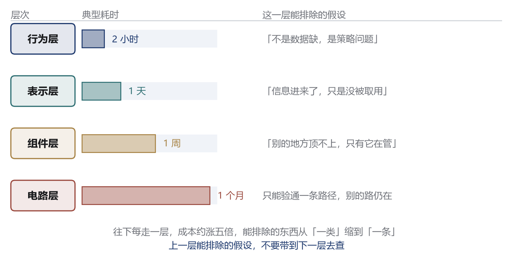

## 看不懂的时候，能做什么

一个客服系统上线三个月，模型答错了一条退款政策：用户问"超过七天还能退吗"，模型答"可以"。实际规则是不能。这条错误被截图发到群里，随后是三种解释。

第一种说，模型没记住这条规则，得补数据。第二种说，模型记得，但被前面一句"我们的服务一向很灵活"带偏了。第三种说，规则在提示词里写着，模型是没读到，得改提示。

三种解释对应三种修法，成本差十倍。要选哪一个，得先知道模型内部到底发生了什么。这就是这一册要处理的事。

先把话说清楚：没有人能读懂一个几千亿参数模型的全部计算。可解释性不是"把模型翻译成人话"，它是"在有限的预算里，回答一个具体的、可验证的问题"。

问题是具体的，方法才有意义。"这个模型为什么不行"太大，"它在这批输入上是从第几层开始出错的"才做得动。

### 四个层次，四种结论

把可做的事按"离输出多远"排一下，大概是四层。

| 层次 | 想回答的问题 | 常用手段与成本 | 能得到的结论 |
|---|---|---|---|
| 行为层 | 它在这类输入上表现如何 | 测试集、对照实验（一次前向） | 能力与失效的边界 |
| 表示层 | 内部有没有编码某个概念 | 探针、方向向量（需取激活） | 概念存在与否、强弱、可改性 |
| 组件层 | 哪一部分在负责这件事 | 消融、头打分（上千次前向） | 功能定位 |
| 电路层 | 信息怎么从输入流到输出 | 激活替换、路径追踪（需干预对） | 机制解释 |

越往下，结论越硬，代价也越高。层次之间的关系不是"越深越好"，而是"越深越能问出更细的问题"。

图里的耗时是在同一个 7B 模型上做一次完整对照的经验值，不是某个产品的报价。真正要看的是第三列：每往下一层，能买到的东西从"排除一类原因"缩到"确认一条路径"。所以顺序不能反——先用便宜的排除掉大类，剩下的才值得往深里查。

实际工作里，绝大多数问题停在第一层就够了。一个模型在长文档上引用编号出错，你可能只需要构造二十条测试，就能发现它在"引用最近的编号"而不是"引用被指的那一条"。这个结论不需要看任何内部激活，却已经足够指导修复。

只有在两种情况下才值得往下走。一是行为层的测试分不出原因，二是不敢只靠改提示，需要确认改到了根上。安全审计是典型的第二种。

还有一个常被忽略的判断标准：这个问题要不要写进报告。如果你只需要知道"改了有没有用"，行为层足够；如果你要回答"为什么会这样"，才需要往下。往下每走一层，成本至少翻十倍。

### 一组词的定义

这一册后面会反复用到几个词，先把它们定下来，免得读到时各人理解不同。

**探针**：用一个线性分类器从激活里读出一个属性。它回答“在不在”，不回答“用不用”。

**方向**：激活空间里的一个单位向量，通常由两组数据的均值差得到。它可以被加减，所以能用于干预。

**特征**：稀疏字典里的一列（一个解码方向加一个激活强度）。它比方向更细，但也更不稳定。

**干预**：修改激活（加法、投影消融、替换），然后看输出。它是从“相关”走到“因果”的唯一手段。

**消融**：干预的一种特例，把某个组件的输出去掉。注意“去掉”有四种实现，结论可以差三十倍。

**电路**：一组组件加它们之间的信息流。它的价值在于能给出可证伪的预测。

六个词里最容易混的是“方向”与“特征”。日常对话里两者常被当成同义词，但在工程上它们差得很远：方向是一个连续量，可以在推理时按系数调；特征是一个开关，只能开大或关小。用方向做干预会拖带副作用，用特征做干预更干净但需要先训字典。

还有一个词不属于这套体系但经常混进来：“注意力”。它不是解释，是中间量。注意力权重高不等于信息流到了输出。看到一张以注意力图为核心的“解释”，先问一句：把它标出的位置遮住，输出会变吗？不会，那张图就是装饰。

### 一个最小的排查：二十条样本，三个条件

层次分清了，接下来要落到具体动作。下面这套东西是这一册所有方法的入口，一个人一下午能做完，不需要 GPU 集群，也不需要看任何内部激活。

**场景**：模型对"超过七天还能退吗"答"可以"，实际规则是不能退。

**第一步，把现象固定住。** 同一条输入跑五次（温度 0），确认它稳定答错。偶然一次答错不值得分析，五次里错四次以上才算稳定失效。这一步的产出是一条可复现的输入，包括完整系统提示、上下文、参数。后面所有实验都基于它。

**第二步，造三组对照。** 每组十条，只改一个变量。

| 组别 | 构造方式 | 想排除的假设 |
|---|---|---|
| A 时间边界 | 五条七天以内，五条超过七天 | 是不是分不清边界 |
| B 规则位置 | 规则放最前，或放问题后面 | 是不是没读到规则 |
| C 措辞干扰 | 前面加一句"服务很灵活" | 是不是被上下文带偏 |

**第三步，跑四十次调用，逐条记录原文。** 不要只看对错，要把输出存下来。很多结论藏在措辞里：答"可以"和答"通常可以，但建议咨询客服"是两种不同的失败。

**第四步，读结果。** 三种典型读法。

A 组里七天以内全对、超过七天全错：模型掌握了规则的方向，但边界搞错了。修法是明确边界，不是补数据。

B 组里规则放最前对、放后面错：模型能读到，但读到之后没保持住。修法是改结构，把规则和问题放一起。

C 组里加了那句"服务很灵活"就错：这是干扰型失效。修法是在提示里明确"以下规则优先于任何语气描述"。

如果三组都错得一样，才是"模型不知道这条规则"，值得去查训练数据和内部表示。

**为什么二十条就够。** 因为这一步不测比例，测的是"哪种条件下会错"。一条稳定复现的对照就够定性。二十条的作用是让每种条件都有几条独立样本，避免"刚好那条样本本身有毛病"。

**二十条不够做什么。** 不够算准确率。二十条里错三条，置信区间是 15% 到 50%（二项分布），几乎什么都说明不了。所以这一步的产出只能是定性结论：在什么条件下坏。要报数字，得按前面那个两千五百条的公式重新算样本量。

这个流程的价值在于它便宜到没有理由跳过。四十次调用、半小时、一个下午能把三种猜测收成一种，而三种猜测对应的修法成本差上百倍。

### 行为层：最便宜，也最常被跳过

很多工程师一听"可解释性"就想到注意力图和特征可视化，觉得跑测试集不算。这是个误解：行为层的对照实验，是解释能力最强、成本最低的工具。

一个例子。某个模型在 2023 年之后的事件上表现突然变差。不用看内部，把问答题按事件发生年月分桶，画一条准确率随时间的曲线，如果它在某个时间点整齐地掉下去，那就是训练数据截止时间的影响，不是能力退化。这条曲线的形状本身就是解释。

再一个。让模型算三位数乘法，正确率六成。换成"先分解成两步，把中间结果写出来再算"，正确率到九成。同一个模型、同一批题，只改了输出格式。这说明它不缺知识，缺的是在单个 token 位置里完成多步进位的能力。结论是"策略问题，不是知识问题"，而这个结论是靠改提示做出来的对照实验。

行为层的实验设计有几个要点，值得当成习惯。

**要有对照组。** 只测新版本，看到 82 分，你不知道这是好还是坏。要和旧版本、和同类模型、和"人类基线"比。

**要能分解。** 一个总分掉三个点，得分到子类去看。是长输入掉、短输入掉，还是某一类问题掉。

**要留样本。** 每次评测都存下逐条结果，不要只存平均分。后面任何分析都从这里出发。

**要固定随机性。** 温度、采样、提示模板统一，否则差异里混着噪声。

这里算一遍，看看"掉三个点"这句话到底有多可信。

假设旧版本在某个子集上的准确率是 82%，你想确认新版本是不是真的提升了 3 个点。两比例检验的样本量公式是

$$n \approx \frac{2\,(z_{1-\alpha/2}+z_{1-\beta})^2\,p(1-p)}{\delta^2}$$

取 $\alpha=0.05$、检验功效 $1-\beta=0.8$，则 $z_{1-\alpha/2}=1.96$、$z_{1-\beta}=0.84$；代入 $p=0.82$、$\delta=0.03$：

$$n \approx \frac{2\times(1.96+0.84)^2\times 0.82\times 0.18}{0.03^2} = \frac{2\times 7.84\times 0.1476}{0.0009} \approx 2570$$

每组要两千五百多条，合计五千多条。如果每条还要人工判定，那就是五千次人工判断。

这个数说明一件很实际的事：在三百条的测试集上，"准确率从 82.0 变成 85.0"这句话本身没有信息量。三百条时标准误是

$$\mathrm{SE}=\sqrt{\frac{0.82\times 0.18}{300}} \approx 0.022$$

也就是 2.2 个百分点，三点差异还不到 1.5 个标准误，两次跑出不同结果完全正常。想在小测试集上看小差异，唯一的办法是逐条对比，看"哪几条翻了"、"翻的那几条是不是同一类"，而不是比平均分。

### 表示层：从一个方向开始

2013 年有个发现，词向量里有"性别方向"。取 king 的向量，减去 man，加上 woman，得到的向量最接近 queen。这个加减法本身没什么神奇，有意思的是方向是共享的：所有"男性对应女性"的词对，差向量都指向同一个方向。

大模型里同样有这种方向。最常被引用的一类是拒绝方向。

做法很朴素。准备两组输入，一组是该拒绝的（明确有害的请求），一组是不该拒绝的（结构相似但无害）。让模型跑一遍前向，在某一层的某个位置取出激活向量，两组分别求平均，两个均值相减，得到一个方向。

然后做两件事验证它。

把当前激活在这个方向上的分量减掉，也就是做投影，看模型是不是变得几乎不拒绝了。再把方向加回去，乘一个系数，看模型是不是对无害问题也开始拒绝。

如果两件事都成立，这个方向就算找到了。

这个结果的含义分两面。坏的一面是，安全对齐的防线比想象中薄，一个方向就能拆掉大半。好的一面是，既然可定位，就可以用来做防御和监控，这部分在最后一章展开。

但也要小心一件事：方向找到了、能改行为了，仍然不等于"模型平时就是靠这个方向做决策的"。这中间的差别是这一册反复要强调的东西，下面单独说。

顺便看一下这一层的成本，它常被想得比实际贵。

假设你手上有 1000 条带标签的句子，想扫一遍 32 层，每层在最后一个 token 位置取 4096 维激活。要存的激活量是

$$1000 \times 32 \times 4096 \times 2\ \text{字节} \approx 262\ \text{MB}$$

半精度存，两百多兆，一个 U 盘装得下。有了这份激活，训 32 个逻辑回归探针在笔记本上几秒钟就能跑完，因为它只是 4096 维输入的线性分类，样本只有一千条。

真正的成本在前向那一步：1000 条输入跑一次 7B 模型，几百 token 的序列，单卡几十秒。所以你完全可以在一个下午里把"这个模型在某层是否编码了某概念"查清楚。

规模一大就不一样了。十万条样本、每层都存，激活量变成 26 GB，还要考虑怎么随机读取、怎么做不泄漏的交叉验证。这时候是工程问题，不是算法问题。

### 组件层：关掉一个，看掉多少

想知道某个部分是否关键，最直接的办法是把它关掉。关掉之后效果掉得多的，就是关键的。

在 Transformer 里，"关掉"通常指把一个注意力头的输出置零。一层里有几十个头，每个头做一件小事，关掉一个，影响往往很小。原因不难理解：多条路径在算同一件事，断一条，其余顶上，这叫冗余。

所以单头消融常常给不出结论。要成组关，按层关、按头类型关、按位置关。可组合数增长得很快，这里算一遍就知道为什么实践里不能穷举。

假设一个 32 层、每层 32 个头的模型，共 $32\times 32=1024$ 个头。

单头扫描：每个头消融一次，每次跑 500 条评测样本，每条生成 200 个 token。

$$1024 \times 500 \times 200 = 1.024\times 10^{8}\ \text{token}$$

一个 7B 模型在单张 A100 80GB 上做批量推理，吞吐按公开报告的量级取 3000 token/s。

$$\frac{1.024\times10^{8}}{3000} \approx 3.4\times 10^{4}\ \text{s} \approx 9.5\ \text{小时}$$

一个通宵多一点，做得完。

两两组合：$\binom{1024}{2} = 523{,}776$ 组。

$$523776 \times 500 \times 200 = 5.24\times10^{10}\ \text{token}$$

$$\frac{5.24\times10^{10}}{3000} \approx 1.75\times10^{7}\ \text{s} \approx 202\ \text{天}$$

一张卡跑七个月，显然不可行。三三组合更是天文数字。

这个算式解释了组件层研究的真实工作方式：不做穷举，先用便宜的方法筛。比如算每个头对输出的直接贡献（把头的输出投影到 logit 方向上，看分量多大），按贡献排序，只对前 5% 做消融。1024 个头筛出 50 个，两两组合就降到 $\binom{50}{2}=1225$ 组，一共 $1225\times 500\times 200 = 1.2\times10^{8}$ token，十一个小时跑完。相比穷举的七个月，省了两个数量级。

代价是筛法本身可能漏掉重要的头。一个头对输出的直接贡献小，但它可能是某条关键路径的中转站，贡献都记在下游。这是组件层最常见的误判来源。

还有一件容易被忽略的事：Transformer 的一层里不只有注意力。残差流是一条贯穿所有层的主干，注意力和 MLP 各自把结果加回主干。所以"消融一个头影响很小"，可能是因为同一层的 MLP 干了同样的事。只关注意力不看 MLP，结论往往偏乐观。

一个粗略的经验是，MLP 层吃掉了三分之二左右的参数量，很多"知识"确实存在那里。做组件层分析时，注意力和 MLP 要一起看，至少各自关一遍做对照。

### 电路层：信息从哪来，到哪去

电路分析要回答的是路径问题：某个信息从输入的哪个位置被读出，经过哪几个组件，最后写到了输出的哪个方向。

标准做法是因果干预。构造一对输入，只在某个位置上有差别，让模型分别跑一遍，记录所有中间激活。然后把干净那一遍的某个中间激活，替换成被扰动那一遍的对应位置，看输出往哪边倒。

倒得多，说明这个位置承载了关键信息；倒得少，说明信息走的是别的路。

这个过程叫激活替换，也叫激活修补。它的好处是把"相关"变成了"因果"：不是"这个位置在这个任务上很活跃"，而是"换掉这个位置，输出就变了"。

一次最小可用的干预实验长这样。任务是让模型把"张三把书给了李四"改写成被动句。

第一步，造一对输入。干净的那条是原句，扰动的那条把"张三"换成"王五"。两条只差一个名字，其余完全相同。

第二步，各跑一次前向，把每一层、每个位置的激活都记下来。

第三步，逐层做替换：拿干净那次的激活，把第 $\ell$ 层某个位置换成扰动那次的对应激活，其余全用干净的，然后让模型继续跑完，看输出里写的是"张三"还是"王五"。

如果第 12 层替换之后输出里出现了"王五"，而第 11 层替换不会，那这个位置就是名字信息进入最终答案的关卡。

这里有个设计要点：扰动要小且干净。只换一个名字，模型不会察觉输入变了，因果链才是单线的。如果换掉半个句子，模型进入完全不同的处理模式，替换实验的结论就没有意义。

公开文献里有一些漂亮的成果。在小规模模型上，"间接宾语识别"这类语法任务被拆解成两三个注意力头加一个 MLP，路径清楚，消融之后行为按预期坏掉。归纳头（前面出现过 A B，再见到 A 就补 B）也是在这个层面上被定位的。

但这些成果的适用范围要说清楚：它们都是在较小的模型、较窄的任务上做出来的。能不能直接推广到前沿规模，目前没有定论。一部分原因是冗余随规模增长更严重，一部分原因是任务越开放，路径越多，越难界定"这条路径解释了全部行为"。

从激活替换还能往前走一步，做路径修补。区别在替换什么：激活替换改的是某个位置的整条残差流，路径修补改的是某个头写给下游的那一份输出。前者问"这个位置上有没有关键信息"，后者问"这个头把信息送给了谁"。

路径修补的做法是：先锁定一个输出位置和一个候选头，把它的输出替换成扰动版本的对应输出，其余所有头保持干净。如果这个位置上出现的那一点扰动，足以让最终答案翻转，那条边就成立。把所有成立的边连起来，就是一张从输入到输出的有向图。图上的节点是组件，边是信息流。

这张图的价值在于可证伪。它预测了"关掉这几条边会导致这个错误"，你可以去关一遍验证。验证不通过，图就画错了。可解释性研究里，能这样被证伪的结论不多，所以电路分析在方法论上比大多数可视化严格。

代价是它只在一对输入上成立。换一对输入，图可能不一样。

### 相关不等于因果

这是这一册最重要的一句话，值得用一整节说。

表示层和组件层给出的多数是相关性证据。一个方向向量和拒绝行为高度相关，一个头在某个任务上激活很强，这些都不能直接推出"模型靠它做决策"。

要谈因果，得做干预，而且干预要满足三件事。

**改变它，行为按预期变。** 减掉拒绝方向，拒绝率显著下降。这是必要条件，但不充分。

**不改变它，行为不该变。** 加一个和它正交的扰动，幅度相同，拒绝率不该有明显变化。这一条排除"任何足够大的扰动都会破坏行为"这个平凡解释。很多号称找到方向的工作，缺的就是这个对照。

**有剂量关系。** 干预强度从 0 递增到 2 倍，效果应该单调变化，而不是在某个阈值上突然跳。单调性说明你动的是一个连续的量，而不是碰巧越过了某个破坏性的边界。

第三条是最有用的排查手段。如果你把系数从 0.1 调到 2.0，效果时好时坏、方向不定，那大概率不是在干预一个语义方向，而是在给模型注入噪声。

一个具体的失败案例。有人发现某层的某个方向，减去它之后模型在数学题上的正确率提高了 8 个点，写成了报告。后来有人用随机方向做了同样的干预，也提高了 5 个点。原因是减去一个随机方向的模长，等效于把激活的整体范数缩小了，而激活范数偏大时模型确实容易乱。真正的收益来自范数，不来自方向。

这个案例的教训不是"别做方向干预"，而是"一定要有随机方向做对照"。对照不通过，结论就不成立。

### 三个常见的误解

**误解一：找到一个特征，就解释了一个行为。** 特征存在，不代表它在这个行为里被用到。要证明用到，得做消融或干预，看行为是否随之变化。

**误解二：消融掉没有影响，说明它不重要。** 有两种情况会让重要的组件在消融后看不出影响。一是并行路径补偿，断了一条，另一条顶上；二是它只在部分输入上起作用，而测试集没覆盖到。所以消融要配一个覆盖面够宽的测试集，并且报告"在哪些子集上有影响"。

**误解三：解释了一层的机制，就解释了整个模型。** 局部解释的可迁移性很弱。同一类任务换个说法，路径可能完全不同。所以结论要带条件："在这个模型、这个任务、这组输入上"。

还有第四个，值得单独提：图好看就是解释。

注意力热力图是最容易骗人的东西。它画出来很漂亮，颜色一深，看着就像"模型在看这里"。但注意力权重只是路由的中间量。一个位置被注意了，不代表它的信息真的流到了输出，因为后面的 value 投影和写回可能把它扔掉。

判断一张注意力图有没有解释力，最简单的办法是问一句：如果我把它标出的"重要位置"遮住，输出会变吗？不会变，这张图就只是装饰。这个问题一次实验就能回答，比争论方法论有用。

### 一个失败案例：跳级诊断

有个团队遇到"表格里的数字被抄错"。三行两列的小表，模型把第二行第二列的数抄成了第一行第二列的。

问题很明确，但处理顺序出了问题。团队直接上了稀疏自编码器，想找"表格结构"相关的特征。两周之后又加了电路分析，逐层做激活替换，画了四十多张热图。第三周写了一份三十页的报告，结论是"第 14 层到第 18 层在处理列对齐时存在路由混乱"。

改完之后，错误率从 12% 降到 9%。没解决问题。

第四周换了一个人接手。他做的第一件事是把输入原样打印出来，和用户实际发的内容逐字节对比。结果发现：预处理脚本里有一条替换规则，把全角括号转成半角，同时把全角数字也顺手转掉了。表格里的"２０２４"变成了"2024"，但列分隔符没变，模型看到的是一张错位的表。

修法是一行代码：只转括号，不碰数字。错误率降到 0.3%。

这个案例的教训不是"可解释性没用"，而是顺序错了。**可解释性工具默认输入是干净的、提示是按预期生效的、预处理没有改语义。** 这三个默认在真实系统里经常不成立，而不成立的时候，往模型内部查什么都是白查。

一个可用的排查顺序是这样的。

先查数据：输入到模型的那一刻，字节是什么。这一步用日志就能做，十分钟。

再查提示：把发给模型的完整字符串打印出来，包括系统提示、模板拼装、工具返回。这一步经常能发现"模板把两段拼接成了没有分隔符的一行"这类问题。

再查解码：采样参数、停止词、格式约束。有些错误是解码阶段截断造成的，和模型能力无关。

这三步都干净，才轮到模型内部。前三步加起来一小时，能拦掉真实事故里的相当一部分。

反过来，跳过前三步的代价很具体：三周人力，加上一次"改了但没修好"的上线。如果那位工程师第一周就打印输入，后面三周都不必发生。

### 怎么选层次

回到开头那个退款问题。三种解释，怎么区分？

先做行为层。构造二十条政策问答，其中十条是"七天以内"，十条是"超过七天"，看模型是不是只在后者上错。如果两类都对，说明问题不在规则本身。再在提示词里把规则挪到最前面、重复一遍，看是否改善。这一步能区分"没读到"和"读到了但用错"。

如果提示词改了没用，往下走。取最后一层的激活，训一个线性探针判断"输入里是否包含超过七天的信息"。探针准确率高，说明信息进来了，问题出在后面；准确率低，说明信息没进来，是检索或注意力的问题。

再往下，用 logit lens 看中间层有没有出现"不能退"这个候选。哪一层开始出现正确答案又消失，问题就在那几层。

三步做完，通常能落到三种结论之一，对应三种修法。这比三个人各执一词要快。

更一般地，几种常见症状可以先落到某一层再动手。

| 症状 | 先查哪层 | 具体实验 | 能得到的结论 |
|---|---|---|---|
| 某类问题整体答错 | 行为层 | 按子类分桶统计 | 知识缺失还是策略问题 |
| 规则写在提示里却不用 | 行为层＋表示层 | 挪动规则位置；训规则探针 | 没读到，还是读到了没用 |
| 长文档里引用错编号 | 组件层 | 按位置做消融或替换 | 是检索头没找到，还是生成时看错 |
| 换个说法就崩 | 表示层 | 两种说法的方向做余弦 | 编码本身不稳，还是解码环节脆 |
| 微调后某项能力消失 | 表示层 | 微调前后同一探针对比 | 真的忘了，还是被压住了 |
| 越狱攻击成功 | 表示层 | 拒绝方向上的投影量 | 防线是被压制还是被绕过 |

这张表不是标准答案，但它能把“我们查一下”变成“我们查这个”。

### 结论能说多硬

同一个实验结果，写法不同，可信度差很远。下面这张表是这一册反复要用的口径。

| 说法 | 需要的证据 | 能推翻它的实验 |
|---|---|---|
| 模型知道 X | 探针显著高于控制任务 | 换模板后准确率掉回基线 |
| 模型靠 X 决策 | 干预有效，且随机方向无效 | 随机方向也有效 |
| 第 12 层开始出错 | 逐层替换定位到一个区间 | 换一对输入结论翻转 |
| 特征 4712 是概念 X | top 例子 + 最小对比 | 换掉关键词激活不降 |

第三列是重点。一句结论如果写不出"什么实验能推翻它"，它就不是结论，是描述。描述也有用，但它进不了决策。

举个对比。"模型在第 14 层之后开始忽略年份信息"是可以被推翻的：换十对输入，如果有一半在第 10 层就丢了，这个说法就不成立。"模型对时间不够敏感"不能被推翻，因为它没说什么算敏感。两句话的成本一样，价值差一个数量级。

写报告时有个简单的自检：把结论念给一个没参与实验的人听，问他"你会怎么验证这句话"。他答得出来，说明这句话写清楚了；答不出来，回去重写。

### 算一遍：误诊一次要多少钱

前面说过三种解释对应三种修法，成本差十倍。这里把这个"十倍"算成钱。

先算三种修法的成本。

**当成"知识缺失"，补数据重训。** 假设要补二十万条带标注的样本，标注按每条 0.5 元（含质检）：

$$200000\times 0.5 = 10\ \text{万元}$$

训练一轮 7B 模型的指令微调，8 卡 A100 跑 30 小时，按云上每卡时 20 元：

$$8\times 30\times 20 = 4800\ \text{元}$$

再加两周的评测和回归，两个人。算力不到五千元，人力十来万，总成本落在十万元量级。

**当成"被上下文带偏"，改提示。** 两个人两天，一千六百元，加一次全量回归评测，几千元。总计一万元以内。

**当成"模型没读到规则"，调结构。** 同量级，一万元以内。

现在算诊断的收益。诊断本身花八小时人力，按每小时 80 元：

$$8\times 80 = 640\ \text{元}$$

不做诊断，三种假设各三分之一，随机选一种修法，期望成本是

$$\frac{10 + 1 + 1}{3}\approx 4\ \text{万元}$$

做了诊断，假设能把"选对"的概率从三分之一提到五分之四，剩下五分之一仍然选错、还得返工，期望成本是

$$0.8\times 0 + 0.2\times (4 - 0)\approx 0.8\ \text{万元}$$

省下三万多，花掉六百四。这个比例是五十比一。

即使把诊断成本放大十倍（比如要训一个探针、跑一遍干预实验，花一周），也还是划算的。这就是为什么"先搞清楚再动手"在工程上不是洁癖，是算术。

反过来说，这个算式也划出了边界：如果三种修法的成本差不多（比如都在一千元量级），诊断就不值得做，直接试最快的那种。诊断的价值来自修法成本的不对称。修法越贵、差距越大，越该先诊断。

还有一笔成本容易被漏掉：错误修复本身有副作用。补数据重训会让模型在其他能力上漂移，可能引入三个新问题，再花两周去查。这些"次生成本"不进预算表，但它们真实存在，而且往往比主成本更贵。

### 预算怎么分

如果有人问"一个可解释性项目该怎么分配时间"，一个经过验证的配比是两成行为层、四成表示层、三成组件层、一成电路层。

这个配比看起来和"成本阶梯"矛盾——最便宜的分得最少。原因在于边际收益：行为层两成时间就能覆盖八成问题，再往上加时间，能多排除的假设迅速变少。而表示层那四成时间，通常是整个项目里唯一能产出"可复现、可量化"结论的部分。

组件层那三成是给"必须定位到具体位置"的场景留的，比如要做定向干预、要写审计报告。电路层那一成基本是研究性质，它买的是理解，不是产出。

如果只有一天，全花在行为层。这不是保守，是因为一天时间做表示层只能得到一条噪声很大的曲线，而做行为层能得到一组能直接指导修法的对照。

### 每一层该交出什么

分析做完要交接。交接的东西不对，后面所有人都在重做。四层该交的东西不一样。

| 层次 | 交付物 | 接手人能拿它做什么 |
|---|---|---|
| 行为层 | 可复现输入 + 对照表 | 直接定修法 |
| 表示层 | 层曲线 + 方向 + 对照表 | 判“信息在不在” |
| 组件层 | 头与层排序 + 消融表 | 定“改哪里” |
| 电路层 | 一条路径 + 可证伪预测 | 定“机制是什么” |

三样东西是共同的。第一是版本：模型哈希、提示模板、采样参数。没有这三样，结论不可复现。第二是对照：不附对照的准确率数字没有意义，因为读者无法判断它比“不做任何事”好多少。第三是失败条件：写明“如果出现什么现象，这个结论就不成立”。

交接时最常见的损耗是“只交结论不交对照”。比如一份报告写“第 14 层是关键层”，没附那条层曲线。接手的人无法判断这个“关键”是相对于什么，只好重跑一遍。重跑的成本是原分析的一半，而附上曲线的成本是零。

### 什么时候该停

可解释性项目最常见的失败不是做错，是做太久。三个停止条件，满足任何一个就可以收。

**一，不再产生新假设。** 一开始你手上有三种可能，做完一层剩下两种，再做完剩下一种。做到“无论结果如何，下一步动作都一样”的时候，就已经到顶了。再往下查不会改变你要做的事，只会改变你能说的事。

**二，下一层的成本超过修法成本。** 修法要一万元，而下一步分析要两万元，那就直接修。修完不行再查，那时候你手上有新信息（“修了没用”本身排除了一个假设），比凭空往下查更有效率。

**三，问题已经变小到可以被监控。** 有时候你不需要知道原因，只需要知道“什么时候会变差”。那就把预算从“找原因”转到“做监控”，后者长期收益更大。

一个具体的判据：**如果下一个实验的结果不会改变你要做的事，就停。** 这句话听着简单，但它能砍掉很多“顺手再查一层”的无效工作。比如你已经确认是格式指令干扰了年份，修法是拆开两步生成。这时候再查“到底是第 16 层还是第 18 层开始干扰”，对修法没有任何影响。

反过来，有些情况必须往下走：修法很贵（重训）、修法有副作用（加固会提高误拒）、或者要向外部解释（审计报告）。“必须解释”是一个正当理由，但要写清楚解释给谁看，否则很容易变成无底洞。

### 还有两层常被忘掉

前面四层都在模型内部。但真实事故里，相当一部分“模型错误”根本不在模型里。补上两层，整张图才完整。

**数据层**：输入预处理、检索结果、模板拼装、历史对话拼接。这一层出错的频率比很多人预期的高，而且最难被发现，因为它不在任何监控里。

**产品层**：默认参数、截断长度、重试策略、追问时机、界面上的预设选项。用户看到的“模型答错”，有时是产品把一个中间状态的输出展示了出来。

把六层放在一起，常见的症状就能落到具体位置。

| 症状 | 先查哪层 | 具体动作 |
|---|---|---|
| 同一个问题两次结果差很多 | 产品层 | 查温度、重试、缓存 |
| 表格、编号、格式错乱 | 数据层 | 打印拼接后的原始字符串 |
| 引用了不存在的文档 | 数据层 | 查检索返回与截断 |
| 知识在但取不出 | 表示层 | 探针 |
| 只在某些句式下错 | 组件层 | 逐层替换 |

这张表里前两行占的比例，在高频业务里往往超过一半。它们有一个共同特点：不需要看任何激活就能查，而且修法往往是一行代码。

这也解释了为什么“可解释性”在工程里经常被低估又经常被滥用。低估它的人只看到“要看模型内部”，觉得贵；滥用它的人跳过前两层，直接往深处查，三周后才发现问题是模板里少了一个分隔符。

一个简化的经验分配：如果一个问题首次出现，花三成时间在数据层与产品层，七成在行为层；只有这三层都干净，才值得往内部走。这个比例不是纪律，是性价比。

### 说清楚代价

这一册会讲很多方法，但有一个前提要摆在前面：这些方法都不便宜，而且结论都带条件。

一个探针的结果依赖你取哪一层、哪个位置、用什么数据集训的对照任务。一个稀疏自编码器的特征依赖字典宽度和稀疏系数。一次消融的结果依赖测试集选了什么。换一个条件，结论可能变。

所以可解释性报告的写法有讲究：不只写结论，要写清方法、超参、数据集，以及对照组的结果。同行复现不了，结论就不能当依据。

反过来，也不要因为"不精确"就完全不用。工程判断本来就带不确定性。一个成本两小时、能把三种猜测收敛到一种的实验，比在群里争论三天有价值。

模型内部有几千亿个参数，人永远不会逐条读懂它。但"读不懂全部"从来不是问题，问题是不知道该问什么。把问题问小、问到能验证，剩下的事方法会替你做。
