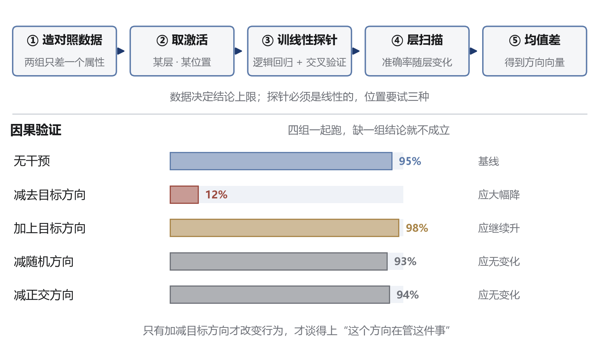

## 探针与表示方向

有人发现一个模型在中文里能答对"李白是哪个朝代人"，换成英文问，答成宋朝。两种可能：知识不在，或者知识在但取不出来。两种结论对应完全不同的修法，一个是补数据，一个是改提示或调推理。

要分开这两种情况，最直接的办法是往模型内部看一层：在某一层的激活里，还能不能线性地读出"唐朝"这个答案。

这一章讲两件事。探针，用来判断某个信息在不在；方向，用来判断这个信息能不能被加减。两件事的工具是同一套，目标不同。

先说清楚它们各自能回答什么。探针能回答"某一层、某一位置的激活向量里，是否线性地含有某个属性的信息"。它不能回答"模型是不是在用这个信息做决策"，也不能回答"这个属性为什么会出现"。方向能回答"沿着这个方向改变激活，行为会不会按预期变"。它不能回答"模型平时是不是走这条路"。

把这四句记住，后面很多误用都能避开。

### 探针的完整流程

整套流程七步，每一步都有容易出错的地方。

**第一步，把问题写成一个二分类。** 不是"模型懂不懂中文"，而是"在这批输入里，模型内部是否含有'这句话的主语是女性'这个信息"。问题要能被标注，能被别人独立复核。

**第二步，构造数据集。** 正例和负例要尽量只有目标属性不同，其余全部匹配。这一步决定了后面所有结论的上限，也是最容易被跳过的一步。

**第三步，选层和位置。** 层从 0 到 $L$（$L$ 是层数），位置可以是最后一个 token、某个特定 token、或整段平均。

**第四步，取激活。** 让每条样本跑一次前向，在第 $\ell$ 层、第 $p$ 个位置取出隐状态向量。通常取残差流，也就是这一层结束之后、进入下一层之前的那个向量。

**第五步，训一个线性分类器。** 逻辑回归足够，加 L2 正则，特征先做标准化。不要用深层的 MLP，理由下面单独说。

**第六步，评估。** 分层 $k$ 折交叉验证，报告均值与标准差。同时跑一个控制任务，看探针是不是学得太容易。

**第七步，解释与对照。** 把准确率随层数画成曲线；把探针权重当成一个方向；再做因果验证。

写成伪代码大致是这样。

```python
acts = []          # 每条样本、每层、每个位置的隐状态
for text, label in data:
    out = model.run_with_cache(text)
    acts.append((out.resid[layer][pos], label))

X, y = stack(acts)
X = (X - X.mean(0)) / (X.std(0) + 1e-6)     # 按维标准化
clf = LogisticRegression(C=1.0, max_iter=2000)
scores = cross_val_score(clf, X, y, cv=5, scoring="accuracy")
```

一百行以内的代码，做完就有结论。难的不是代码，是数据。



### 位置和层：两个最容易出错的选择

位置的影响比多数人预想的大。

取最后一个 token，读到的是"整段输入汇总之后的状态"，适合判断"整句话的属性"。取某个实词的 token，读到的是那个词附近的局部状态，适合判断"这个词本身的属性"。整段平均池化看起来最稳，实际上会把位置信息抹掉，对顺序敏感的任务反而更差。

一个实用的做法是三个都取，看结论是否一致。三种位置给出同样的结论，可信度就高；只在一个位置上成立，就要小心。

层的选择更像一条曲线。通常的形状是：浅层接近随机，中间某层突然跳升，深层的准确率又掉一点。跳升的位置一般被解读为"这个概念在这里被聚合出来"。但这句话有两个陷阱。

一是"信息在"和"信息可读"不同。线性探针读不出来，可能是信息以非线性的方式编码，也可能是信息分散在很多维里，线性方向抓不住。读不出来不等于不在。

二是深层的准确率下降，可能是信息被转写成了另一套表示，正好不在你探针假设的方向上。所以层曲线的下降段不能直接解读为"模型忘了"。

还有一个纯工程细节：不同层的激活范数差别很大，浅层小、深层大。不标准化的话，逻辑回归的正则项对不同层的惩罚强度不同，跨层比较就不公平。这会把层曲线的形状扭曲。

### 数据集的混杂因素

这是探针研究里最实在的问题，也是最容易被忽略的。

举个具体的例子。任务是判断句子里的人称代词是男是女。你从语料里抽了一千条含"他"的句子和一千条含"她"的句子。正例（她）平均长度 26 个字，负例（他）平均 18 个字。跑完探针，准确率 95%。

这个 95% 有多少是"性别"、多少是"长度"？没法从这一个数里看出来。

如果只按长度猜，能到多少？假设长度在两组里都近似正态，均值 26 和 18，标准差都是 8，那么长度这一个特征的判别能力可以用 AUC 表示：

$$\mathrm{AUC} = \Phi\!\left(\frac{|\mu_+-\mu_-|}{\sqrt{2}\,\sigma}\right) = \Phi\!\left(\frac{8}{11.3}\right) \approx \Phi(0.71) \approx 0.76$$

也就是说，一个只看长度的分类器就能拿到七成多的 AUC。如果你的"性别探针"只比这个高一点点，那它基本没读到性别。

三步处理混杂。

**匹配采样。** 按长度、词频、句法结构分层抽样，让两组在这些维度上分布一致。最简单，也最有效。

**控制任务。** 用同样的数据、同样的流程，把标签换成"句子长度是否超过中位数"，训一个探针。这个探针的准确率就是"混杂基线"。目标探针必须显著高于它。

**换模板验证。** 训练集用一批句式模板，测试集用完全没见过的模板。如果准确率从 95% 掉到 55%，说明探针学的是模板而不是概念。这个测试叫跨模板泛化，是最有说服力的一项。

学界给这个思路起了个名字，叫探针的选择性。一个探针既能读出目标属性，又不那么容易读出无关属性，才算好探针。实现上可以用"目标任务准确率减去控制任务准确率"作为一个粗指标。

### 一个可以照着做的小实验

下面这个实验规模很小，单卡几十分钟，适合第一次上手。

**模型**：一个 7B 级别的开源指令模型，能拿到逐层隐状态。

**数据**：1000 对句子。每对的两句只差一个名字，一个男性名字，一个女性名字，其余字面完全相同。比如"张伟昨天把报告交给了主管"和"李娜昨天把报告交给了主管"。用同一批模板生成，模板数量控制在二十个以内。

**任务**：从最后一个 token 的激活里，判断这句话的主语是男是女。

**流程**：扫 0 到 32 层，每层训一个逻辑回归，5 折交叉验证，记录准确率。再跑两个对照：标签随机打乱的版本，以及"句子长度超过中位数"的控制任务。

**预期看到的形状**。浅层在 50% 附近，某几层开始爬升，中后层达到 90% 以上，最后几层略降。打乱标签的对照全程在 50% 上下浮动，浮动范围大约 ±3 个百分点（一千条样本，5 折，标准误在 1.5 个点量级）。控制任务的准确率如果在 60% 以下，说明数据匹配做得还可以。

**怎么读这个结果**。如果性别信息在中层就已经线性可读，而模型在英文提问时答错了朝代题，那是另一个问题：这里的实验只说明"性别这类简单属性可以这样查"，朝代题要换成"这句话涉及的历史朝代"作为标签重跑。

如果所有层的准确率都在 60% 以下，先别下"模型不懂性别"的结论。检查三件事：位置是不是选错了；模板是不是太单一导致标准化之后信号被压掉；两组句子的长度是否差太多。

**一个必做的负对照**。把标签随机打乱，重跑一遍。如果准确率还是 90%，说明流程里有泄漏，比如同一对句子的两条样本同时出现在训练集和测试集里，或者特征标准化用了全量数据。

### 从探针到方向：三种算法

探针训完之后，它的权重本身就是一个方向。但还有两种更常用的算法。

**均值差。** 两组激活分别求均值，相减，单位化。

$$d = \frac{\mu_+ - \mu_-}{\lVert \mu_+ - \mu_-\rVert}$$

这个式子在说什么：把"有该属性的平均状态"减去"没有该属性的平均状态"，得到的箭头指向"从无到有"的变化方向。除以模长是为了让它只表示方向，不表示强度。

**逻辑回归权重。** 训练出来的权重向量 $w$ 就是一个方向，样本在 $w$ 上的投影决定分类。

**线性判别方向。** 如果两组的协方差不是各向同性的，均值差会被"方差大的那些维"主导。修正办法是先按协方差白化，再取均值差：

$$d_{\mathrm{LDA}} \propto \Sigma^{-1}(\mu_+ - \mu_-)$$

这里的 $\Sigma$ 是两组共享的协方差矩阵。这个式子在说什么：先把空间拉伸成"每个方向方差都一样"的形状，再取均值差，这样方向就不会被高方差维带偏。

三者的关系是：均值差是 LDA 在各向同性假设下的特例，逻辑回归在数据线性可分且正则很弱时接近 LDA。实践里三者给出的方向余弦相似度通常在 0.7 到 0.95 之间。差得太多，说明数据里有明显的协方差结构或者类别不平衡，要先处理数据。

### 归一化与"系数"的含义

方向算出单位向量 $\hat d$ 之后，干预有两种写法。

**加法**：$x' = x + \alpha\lVert x\rVert\hat d$，把 $\alpha$ 定义成"相对于当前激活范数的比例"。好处是跨层可比，坏处是不同样本被改的绝对量不同。

**投影消融**：$x' = x - (x\cdot\hat d)\hat d$，把这一维整个去掉。好处是彻底，坏处是如果这个方向混了别的东西，会一起删掉。

两种写法在论文里都常见，报告时要写清用的是哪种，否则数字没法比。

$\alpha$ 的量级大概是多少？经验上，单层残差流的范数在几十到几百之间（跟模型宽度和层数有关），一个语义方向在单个 token 上的分量往往只占其中很小一部分。所以要让行为明显改变，$\alpha$ 常常要到 0.5 甚至更大。这就带出一个问题：$\alpha$ 太大时，你不是在"调整一个语义维度"，而是在大幅扰动整个状态。

判断有没有越过这条线，看剂量曲线。$\alpha$ 从 0 到 1 逐档增加，如果目标指标单调变化、通用能力基本不变，说明还在语义范围里。如果通用能力在某一档之后突然崩，那一档就是安全边界。

### 算一遍：方向稳不稳

方向是从有限样本估出来的，必然有噪声。怎么知道它稳？

**自助法**。从数据里有放回地抽 500 条正例、500 条负例，算一个方向；重复 1000 次，得到 1000 个方向；两两算余弦相似度，取中位数。

判据可以这样定：中位余弦大于 0.8，方向算稳定，可以用于干预；0.6 到 0.8 之间，方向大致对但混了噪声，干预效果会打折；低于 0.6，方向基本不可用，要先扩数据或改匹配策略。

粗略地看，余弦的标准误和样本量的关系是

$$\mathrm{SE}(\cos\theta) \sim \frac{1}{\sqrt{n}}$$

样本从 500 增加到 2000，误差减半。所以如果一千条样本给出的余弦中位数是 0.7，扩到四千条大概能到 0.85 附近。这是一个经验关系，具体数值取决于数据的干净程度。

**还要看层间稳定性。** 相邻两层算出的方向，余弦通常很高（0.85 以上），说明这个方向在几层里是连续的。如果第 12 层和第 13 层的方向余弦只有 0.3，那说明这个"方向"其实是噪声，或者这个属性在这两层之间的表示方式变了。

### 因果验证：一个完整的干预实验

方向算出、稳定性达标，还不够。要证明它有因果作用，得设计实验。

**干预组**：在选定的层，对每个 token 位置的激活做投影消融或加法，然后让模型继续生成。

**对照组一：随机方向。** 随机采一个单位向量，做同样幅度的干预。这是最重要的一组，它排除"任何扰动都能造成这个效果"。

**对照组二：正交方向。** 取一个和目标方向正交、但来自另一个语义概念的方向（比如"语气正式"的方向），做同样干预。它排除"任何语义方向都能造成这个效果"。

**对照组三：不做干预。** 只测基线。

如果任务是“它能不能知道这个事实”，还有一种干预叫置换。把第 $\ell$ 层第 $p$ 个位置的激活，换成另一条输入在同一层同一位置的激活，看输出是否跟着变成另一样本的答案。换过去之后答案跟着变，说明这个位置就是信息瓶颈；不跟着变，说明后面几层还能从别处拿到信息。

置换比加法干净，因为它不改变激活的统计分布，不是往里面注入能量，而是“把 A 的大脑换成 B 的”。代价是需要一对结构相同的输入，否则换出来的状态是模型从没见过的，下游会乱。

**指标**：目标行为率（比如拒绝率），加上一组通用能力指标（常识问答、数学、指令遵循各取一小份）。前者说明有效，后者说明代价。

结果写成一张表。

| 组别 | 目标行为率 | 通用能力（相对基线） |
|---|---|---|
| 无干预 | 95% | 100% |
| 减去目标方向 | 12% | 88% |
| 加上目标方向 | 98% | 91% |
| 减随机方向 | 93% | 97% |
| 减正交方向 | 94% | 96% |

这张表的读法：目标方向让目标行为大幅变化，随机和正交方向几乎没影响，说明效果来自方向本身而不是扰动幅度。同时通用能力掉了 12 个点，说明这个方向不纯，里面混着和通用能力相关的东西。

这时候的正确结论不是"找到了拒绝方向"，而是"找到了一个和拒绝强相关、但也和通用能力纠缠的方向"。想让它变纯，可以试三件事：换更匹配的数据集、只保留方向投影最强的那些维度、或者换成稀疏自编码器找更细的特征。

如果随机方向也让拒绝率掉到 50%，那结论就完全不同：模型对任何足够大的扰动都会放弃拒绝，你测到的不是"拒绝方向"，而是"扰动容忍度"。

### 语言与领域偏移

同一个概念，在不同语言里的方向不完全一样。

经验上，中英文的同类方向余弦在 0.5 到 0.8 之间（公开报告的量级），说明有一部分共享，也有一部分各自独立。这不是模型的问题，是训练数据分布的问题：中文语料里"拒绝"的表达方式、礼貌层级、常见句式都和英文不同。

工程上的直接后果是：用英文数据算出的方向，直接拿到中文上干预，效果会打折，而且副作用更大。正确的做法是在目标语言上重算一遍，或者至少在目标语言上验证一遍剂量曲线。

领域偏移同理。用通用对话数据算的"有害"方向，拿到医疗问答场景上，可能把正常的医学术语也压掉。所以在垂直场景里做监控，一定要用场景内的数据算方向。

**模型版本之间也不能通用。** 同一个基座的不同微调版本，方向可能差别很大，因为微调会重排表示。每次换模型都要重算，不能沿用。

### 一个失败案例：92% 的探针

有个团队做了一个"违法意图"探针，交叉验证准确率 92%，上线做输入过滤。上线之后误报率高得离谱，正常的法律咨询、新闻报道都被拦。

查了两周，发现问题在数据来源。违法样本集中来自一个论坛，那个论坛的帖子有一个固定格式，标题带方括号标签。探针学到的是"有没有方括号标签"，而不是"有没有违法意图"。92% 的准确率里，很大一部分来自这个格式特征。

诊断方法很简单：按来源分组，做留一来源交叉验证。也就是每次留一个来源做测试集，其余来源做训练集。换来源之后，准确率从 92% 掉到 61%。

这个案例的教训有三条。一是交叉验证的随机划分会在同源数据上骗你，同源样本之间的相关性让测试集不再独立。二是任何“高得可疑”的准确率都要先怀疑数据泄漏，而不是庆祝。三是探针上线前必须在“来自新分布”的数据上验证一遍，哪怕只有两百条。

### 回到开头那道题

现在用这套工具处理“中文能答、英文答错”的问题。

第一步，把“朝代”换成标签：这句话里是否出现了某个朝代的名称。中英文各取一千条，匹配长度与句式。分别取最后一层激活，训探针。

结果大概是两种之一。

第一种，英文探针准确率也很高。说明“朝代”这个信息在英文输入下也进入了激活，只是没被解码到输出。问题在输出的选择环节，不在知识本身。修法：把英文提问里加上“先用中文思考再回答”，或者把问题拆成两步先问“哪个朝代”再问细节。

第二种，英文探针准确率明显低。说明信息根本没聚合出来。修法：补英文数据，或者在检索环节把相关文档一并丢进上下文。

这里要注意一个细分：探针准确率低，也可能是“英文句子里的朝代名称本身就不在词表里高频出现”，导致激活很弱。所以还要加一个对照：用英文句子但其中包含中文朝代名（“Li Bai lived in 唐 dynasty”）测一遍。如果这种混杂句的探针准确率很高，那问题就落在“英文朝代名本身的表示太弱”上。

一个实验、三个对照，两小时能跑完，结论能直接决定要不要花两周重做数据。这是探针真正的性价比所在。

### 算一下预算

把上面所有步骤的成本摆到一起，看看一个完整的探针加方向项目大概要多少。

数据标注一千对，两个人两天，按每人每天六百元算，约两千四百元。模型前向（含层扫描）单卡一小时，云上 A100 按每小时二十元算，二十元。训练与评估在笔记本上跑，零成本。因果验证要跑五组干预、每组五百条、每条生成两百 token，共五十万 token，单卡三分钟左右，可以忽略。

真正的开销在人工判断上：干预之后的输出要人看，五百条乘五组，两千五百条，一个人两天。

总计一周人力加几十元算力。这个量级意味着：探针实验应该在做产品决策之前做，而不是之后。它的成本比一次错误的重训低两个数量级。

### 三条边界

**探针读到信息，不等于模型在用。** 这是最常被违反的一条。模型的激活里含有大量它并不使用的信息，因为残差流是累加的，早期层的特征会一路带到后面。一个探针在某层读出 95%，可能只是说明"这个信息还没被丢弃"，不说明"它影响了输出"。

**一个方向不等于一个概念。** 均值差算出的方向，是两组数据所有差异的线性叠加。如果两组数据在目标属性之外还有别的差异（长度、语气、话题），方向里就混着它们。这就是前面那张表里通用能力掉 12 个点的原因。

**线性读不出，不等于不存在。** 有些信息以非线性方式编码，线性探针抓不住。要验证，可以训一个小的非线性探针做对照，如果非线性探针明显更强，说明这部分信息确实存在但不在线性子空间里。当然，非线性探针本身的可信度又是另一个问题，因为它可能自己学会了任务。

探针和方向都不贵，一个人一周能做出可用的版本。它们的价值不在于给出"模型理解了什么"这种大结论，而在于把"知识不在"和"知识取不出来"这两种情况分开。分开了，修法就清楚了：前者补数据，后者改提示或者调推理时的干预强度。这个区分本身，往往比后面所有精细分析都值钱。

真正需要小心的是别把工具当成结论。探针的准确率是一个关于数据的数字，不是一个关于模型的判断。要把它变成判断，得靠对照实验，靠换分布验证，靠干预之后看行为。这三件事做完，你手上的才是一条能拿去决策的证据。
