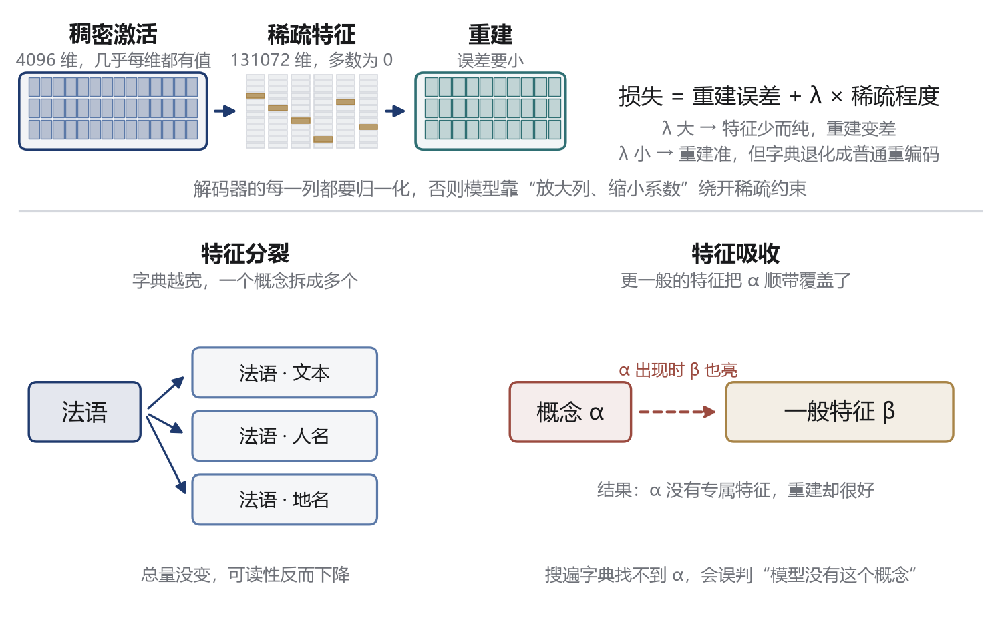

## 稀疏自编码器：把激活拆开

有人盯着一层激活里的某一个维度看了很久。他发现这一维在"金门大桥"出现时响应很强，于是写了张图，标注"第 1738 维 = 金门大桥"。

第二天他换了几条输入，发现这一维在"旧金山的桥"上也响应，在"悬索桥结构"上也响应，甚至在"从湾区开车往北"这类句子里也有一点。这个神经元不是"金门大桥"，它是一堆相关概念的混合。

这个现象不是个例，是常态。一个几千维的激活向量，要表示的语言概念远多于几千个，模型只能把多个概念挤进同一组维度里。想读懂它，就得先把混合的东西拆开。

稀疏自编码器就是干这个的。

### 为什么单个神经元不可读

一个 4096 维的激活，如果每一维只表示一个概念，模型最多表示 4096 个概念。但语言里光常见的实体、属性、句法关系就远不止这个数。

模型的解法叫叠加。它不去给每个概念分配一个正交的轴，而是允许概念用"几乎正交"的方向，也就是夹角很小但不为零的方向。在几千维的空间里，能塞进的近似正交方向数量远超维度本身。代价是每一维都混着几十个概念的分量。

这解释了两件事。一是单神经元分析为什么总是不清不楚，二是为什么"找方向"这种方法能work：概念确实对应某个方向，只是这个方向不与坐标轴对齐。

叠加带来的问题是可读性。你想问"哪些维度表示'法律'"，答案是"没有哪一维专门表示，它散布在很多维上"。

### SAE 的结构

思路很直接：找一个变换，把稠密的激活 $x\in\mathbb{R}^{d}$ 映射到一个远大于 $d$ 的稀疏向量 $f\in\mathbb{R}^{m}$（$m\gg d$），再从 $f$ 重建回 $x$。

编码：

$$f(x)=\mathrm{ReLU}\!\left(W_e\,(x-b_d)+b_e\right)$$

解码：

$$\hat{x}=W_d\,f(x)+b_d$$

这个式子在说什么。$x-b_d$ 先减掉一个"平均激活"，把数据中心化，这是为了不让某个总是很大的公共分量占满所有特征。$W_e$ 是一个 $m\times d$ 的矩阵，每一行可以看成一个"探测器"，$W_ex$ 的第 $j$ 个分量就是"输入在第 $j$ 个探测器上的响应强度"。ReLU 把负响应截成零，于是每个输入只会点亮一部分探测器。这一步就是稀疏的来源之一。

解码那边，$W_d$ 是 $d\times m$，每一列是一个"概念方向"。$f(x)$ 里第 $j$ 个非零值，就是"往输出里加多少倍的第 $j$ 个方向"。所以 $f$ 的每个分量直接对应一组可读的方向，这就是 SAE 的全部意义。

训练目标：

$$L(x)=\underbrace{\lVert x-\hat{x}\rVert_2^2}_{\text{重建}}+\lambda\underbrace{\lVert f(x)\rVert_1}_{\text{稀疏}}$$

这个式子在说什么。前一项要求"拆开再拼回去不能失真"，后一项要求"用到的特征尽量少"。$\lambda$ 是两者之间的汇率：$\lambda$ 大，模型宁可重建差一点也要少用特征；$\lambda$ 小，模型会为了精确重建而点亮很多特征，字典就退化成一次普通的线性重编码，可读性没了。

为什么用 L1 而不是直接数非零个数？因为"非零个数"不可导，没法用梯度下降。L1 是它在凸优化意义下的最紧松弛，而且 L1 的次梯度在零点附近会持续把小的值推向零，天然产生稀疏。

后来的变体里有一种直接控制稀疏度的做法：保留前 $k$ 大的分量，其余置零，只优化重建。这叫 TopK 结构。它的好处是稀疏度是明确的超参（每 token 恰好 $k$ 个特征），坏处是 $k$ 不能自适应，不同 token 需要不同数量的特征时会被硬切。

还有一个必须做的工程细节：把 $W_d$ 的每一列归一化成单位长度。不归一化的话，模型可以靠"把解码方向放大十倍、把 $f$ 缩小十倍"来同时降低 L1 和保持重建，稀疏约束就失效了。

行话里把这个约束叫列归一化，训练时每次更新后把每列除以它的模长，重投影回单位球面。

### 字典宽度与稀疏度：两个旋钮

SAE 有两个关键超参。

**字典宽度** $m=r\cdot d$。$r$ 取 8、16、32、64。$r$ 越大，能容纳的独立概念越多，特征越细；代价是参数量和训练成本线性增长，而且特征会越来越碎。

**稀疏度**，通常用每个 token 平均激活的特征数（$L_0$）来衡量。经验上，取 $d$ 的百分之一到十分之一这个量级，比如 4096 维的激活，每个 token 用 20 到 200 个特征。

两个旋钮不是独立的。宽度加大，同样的 $\lambda$ 下 $L_0$ 也会变大，因为可用的探测器多了。所以调参要先定宽度，再调 $\lambda$ 让 $L_0$ 落在目标区间。

评估看四个数。

**重建质量**：直接用 $\lVert x-\hat x\rVert^2/\lVert x\rVert^2$，或者用"损失恢复率"，也就是把原激活换成重建激活之后，模型原本任务的 loss 保留了多少。后者更贴近实际影响。

**稀疏度**：平均 $L_0$。

**死特征比例**：从来没被激活过的特征占比。ReLU 很容易死，一批特征因为初始化不好或者梯度不够，永远输出零。比例超过一成就要处理，常用办法是定期把死特征重新指向"重建误差最大的那些样本"。

**可解释性分数**：下面单独讲。

### 算一遍：参数量与算力

取 $d=4096$、$r=32$，则 $m=131072$。

编码器 $W_e$ 有 $4096\times 131072 \approx 5.37\times 10^{8}$ 个参数，解码器同量级。合计

$$2\times 5.37\times10^{8} \approx 1.07\times10^{9}$$

十亿参数出头，和一个小模型差不多大。这也是为什么 SAE 的存储成本不能忽略：每层一个，三十层就是三百亿参数。

训练数据量。取十亿个激活（来自十亿个 token 的某一层）。如果把这些激活存下来，每个 4096 维半精度：

$$10^{9}\times 4096\times 2\ \text{字节} = 8.2\times10^{12}\ \text{字节} \approx 8.2\ \text{TB}$$

存不下，所以实际做法是流式：一边跑模型生成激活，一边更新 SAE，不留中间结果。这就带来一个约束，SAE 训练和激活生成必须同步，不能像普通训练那样反复读一个固定数据集。

算力。每个 token 的编码是一次 $m\times d$ 的矩阵乘，解码是一次 $d\times m$ 的矩阵乘。矩阵乘的浮点运算量约为 $2md$（乘加各算一次），两次共 $4md$。

$$4\times 131072\times 4096 \approx 2.1\times10^{9}\ \text{FLOP/token}$$

十亿 token：

$$2.1\times10^{9}\times10^{9}=2.1\times10^{18}\ \text{FLOP} = 2.1\ \text{EFLOP}$$

A100 的 FP16 峰值算力按公开规格是三百多 TFLOPS，实际跑到三成，约 $1\times10^{14}$ FLOP/s。

$$\frac{2.1\times10^{18}}{10^{14}} \approx 2.1\times10^{4}\ \text{s} \approx 6\ \text{小时}$$

六小时，单卡。听起来很便宜。

但别忘了激活是怎么来的。生成十亿 token 的激活，要让 7B 模型跑十亿次前向，每次约 $2\times7\times10^{9}=1.4\times10^{10}$ FLOP：

$$1.4\times10^{10}\times10^{9}=1.4\times10^{19}\ \text{FLOP}$$

是 SAE 训练本身的七倍。所以这个流程的真实成本，主要花在"把模型的激活导出来"这一步。这也是为什么大规模 SAE 研究往往是模型训练团队做的，他们有现成的激活管道。

### 特征分裂

字典越宽，特征越碎。同一个概念会被拆成好几个。

比如"法语"这个概念。在窄字典里可能只有一个特征，在宽字典里会分成"法语文本""法语人名""法语地名""法语音标"等若干个。这叫特征分裂。

分裂本身不算错，它反映的是"概念确实有多个侧面"。但它带来两个麻烦。

一是统计口径变了。你想知道"法语相关特征有多少个"，在 $r=8$ 的字典里是 1 个，在 $r=64$ 的字典里是 6 个。跨研究比较数字时会失真。

二是自动打分被稀释。一个概念拆成六个特征，每个特征的例子都不够纯，打分模型给每个都打中等分，可读性指标看起来很差，实际上是因为字典太宽。

处理办法是在报告里固定宽度，或者用"把同一概念的多个特征合并后看"的方式做统计。跨宽度比较绝对分数是没有意义的。

### 特征吸收

比分裂更麻烦，也更晚才被注意到。

现象是这样：某个概念 $\alpha$ 明明存在，模型也确实在用它，但你在字典里找不到对应的特征。搜遍所有特征，没有一个的 top 激活例子集中在 $\alpha$ 上。

原因是有个更一般的特征 $\beta$，它在 $\alpha$ 出现时也会激活，于是 $\alpha$ 的信号被"顺带"覆盖了。重建误差很小，因为 $\beta$ 的方向已经能大致重建出 $\alpha$ 的成分。$\alpha$ 因此没有被单独分配一个探测器。

成因不难理解。L1 惩罚的是"用了几个特征"。如果一个更一般的特征能同时覆盖 $\alpha$ 和别的东西，用它就比"单开一个 $\alpha$ 特征"更省。稀疏性和完备性在这里冲突，稀疏性赢了。

吸收的后果比分裂严重。分裂只是把一个东西拆成几份，你还能找到它；吸收是让一个东西消失，你会得出"模型没有这个概念"的错误结论。

诊断吸收有个办法。先锁定候选概念 $\alpha$ 的一组正例，看这些样本的激活，找出激活最强的特征 $\beta$。然后把 $\beta$ 从字典里去掉，重训一遍 SAE，看 $\alpha$ 是不是出现了一个专属特征。出现了，说明之前是被吸收了。

更省事的近似做法是"消融稀疏度"：对每个特征，统计"把它单独关掉时，$\alpha$ 正例的激活下降多少"。如果某个特征关掉之后 $\alpha$ 掉了很多，但它的 top 例子看起来和 $\alpha$ 关系不大，那它就是把 $\alpha$ 吸收进去的那个。

这也说明"看 top 激活例子"这种直观检查是不够的。一个特征可以在很多概念上都有响应，只是其中一个占了主导，其余被掩盖。

### 自动可解释性打分

十几万个特征，人一个个看是不可能的。所以要自动化。

标准流程分四步。

**第一步，取样本。** 对每个特征，找出激活值最高的若干个（比如 20 个）位置，把每个位置周围的上下文截出来。要去重，否则同一个文档里的相邻位置会被重复计入。

**第二步，让模型生成解释。** 把这些例子给一个语言模型，让它写一句"这个特征在什么情况下激活"。提示词要约束格式，比如"用不超过二十个字描述共同点，不要描述单个例子"。

**第三步，验证解释。** 这是关键的一步，也是最容易被省略的一步。给另一个模型（或者同一个模型的新一轮调用）看这条解释，再给它一组新样本，其中一半是这个特征真的会激活的，一半是随机采的。让它判断哪些会激活。判断准确率就是分数。

**第四步，汇总。** 把所有特征的分数平均，得到字典的整体可解释性。

第三步不能省。只做前两步，你得到的是"一段读起来通顺的描述"，不是"一个正确的描述"。语言模型很擅长给任意一组例子编出一个听起来合理的共同点，尤其是当这些例子本身有噪声的时候。

这套流程有四个系统性偏差。

**偏向具体名词。** "金门大桥""合同法第 52 条"这类概念，例子一看就懂，解释容易写对。而"否定辖域""从句边界"这类句法功能特征，例子之间看不出明显共同点，分数会系统性偏低。这不代表这些特征没用，只代表打分方法不适合它们。

**受打分模型的知识限制。** 解释里出现打分模型不熟悉的概念时，它验证不出来。所以不同模型打出的分数不能直接比。

**上下文泄漏。** 如果 20 个例子里都出现了同一个罕见 token，解释只要写"含这个词时激活"就能拿高分，但这显然不是特征的真实功能。缓解办法是去掉重复片段，并且要求解释不能只提单个 token。

**被字典宽度扭曲。** 前面说的分裂问题，在这里表现为整体分数随宽度下降。所以跨宽度比较没有意义。

分数怎么用？两个用法是靠谱的。

一是**排序**。同一个字典内部，按分数排序，挑最高的那几百个特征做人工复核。人工复核的成本就从十几万降到几百。

二是**筛选异常**。分数极低（接近随机）的特征，通常是死特征或者纯噪声，可以直接从监控列表里去掉。

不要用它做跨模型、跨宽度的比较。那个数字没有可比性。

### 算一遍：打分的成本

13 万个特征，每个特征三步、每步一次模型调用，每次平均 2000 token（20 个例子加上提示），大约

$$131072\times 3\times 2000 \approx 7.9\times10^{8}\ \text{token}$$

按公开 API 的价格量级，便宜的小模型每百万 token 几毛到几块，贵的前沿模型每百万十几到几十。取中间偏便宜的一档，每百万 1 元：

$$7.9\times10^{8}\ \text{token} \approx 790\ \text{百万} \approx 790\ \text{元}$$

八百块，一次。看起来不多。但如果要调提示词、换打分模型、比较几版字典，这个数会乘上十几次。而且第三步的验证要额外跑一遍新样本，成本再翻倍。

所以实践里常见的折中是：只对激活频率最高的 10% 特征做完整打分，其余用一个更便宜的代理指标（比如 top 例子的 token 熵，或者激活分布的偏度）做粗筛。

### 成本与规模的取舍

把上面所有数字放一起，能看到一条很清楚的成本曲线。

**层数**：不做全层。选中间层（概念最抽象、最可读）加最后几层（离输出最近、最影响行为）。三十层里选五六层，成本降到六分之一。

**宽度**：从 $r=8$ 起步。$r=64$ 只在前沿研究里用，工程上没必要，因为宽字典的特征更碎，反而不好用。

**训练 token 数**：一亿起步，十亿更好。低于一亿，很多低频概念根本采不到样本，特征会很脏。

**上线监控**：只跑一两层、小字典、只监控一两百个精选特征。推理时的额外开销要算进延迟预算。

### 三个用途

**监控。** 在推理链路上挂一个轻量 SAE，看某些危险特征（暴力、自伤、越权指令）是否异常激活，作为输出过滤之外的第二道信号。它的价值在于"模型在想什么"这一层，而输出过滤只能看"模型说了什么"，两者互补。

**审计。** 训练完之后扫一遍字典，找出明确编码了敏感概念的特征，比如特定人名、住址格式、内部代号。如果某个特征对某个人名响应极强，说明这个名字在训练数据里出现频率很高，泄露风险高。这不能替代"直接测试能不能复现"，但能给一个风险排序。

**引导。** 推理时放大或抑制某个特征，改变行为。比方向向量更精细，因为可以针对具体概念而不是"拒绝"这类大类。放大"简洁"特征，输出变短；抑制"模棱两可"特征，少说"可能""也许"。

引导有两个坑。一是耦合：放大一个特征，和它相关的概念会一起被放大。放大"汽车"特征，输出开始莫名提到汽车。二是剂量：放大倍数稍微大一点，输出就会退化成一串和该特征相关的词。所以引导必须做剂量扫描，找那个"效果明显但语言还通顺"的窗口。

监控这条用途要算一下延迟预算，因为它比看起来贵。

7B 模型每生成一个 token 约需要 $1.4\times10^{10}$ FLOP。前面算过，一个 $m=131072$ 的 SAE 每 token 多 $2.1\times10^{9}$ FLOP，占 15%。看起来可以接受。

但线上不是这么算的。小 batch 推理时，GPU 的算力利用率很低，瓶颈在显存带宽和 kernel 启动，不在 FLOPS。这时候多挂一个 SAE，不是多 15% 的算力，而是多两到三次 kernel 启动和一堆小的矩阵乘，实际延迟可能多两三成。

把量级摆清楚：假设线上每秒一万个 token（二十个并发请求、平均长度五百），SAE 需要

$$10^{4}\times 2.1\times10^{9} = 2.1\times10^{13}\ \text{FLOP/s} = 21\ \text{TFLOPS}$$

单张 A100 能扑。但如果监控三层，就是 63 TFLOPS，已经接近实际可用算力的上限，而且这三层的激活要额外存一份。

所以工程上的折中是只监控一层，并且只算那些精选出来的一百多个特征。也就是把 $W_e$ 的行和 $W_d$ 的列切出来，$m$ 从 13 万降到 200，算力掉到可以忽略。代价是只能看预先选定的概念，看不到新出现的。

更便宜的一种做法是不在线上跑 SAE，而是把激活存下来，离线批量跑。代价是延迟，好处是成本低一个数量级，而且可以做全层扫描。很多团队的监控实际上是后一种：线上只做输出过滤，SAE 监控跑在离线管道上，以分钟级延迟发现问题。

### 一个可以照着做的实验

如果只是在学习阶段，下面这个配置能在一张卡上跑完，结果也够看。

**模型与层**：一个 7B 开源模型，取第 16 层残差流，$d=4096$。选中间层是因为这里的特征通常最抽象、最可读。

**数据**：两万段中文维基和新闻，每段切成 512 token 的窗口，大约一千万 token。这个量级足以让高频概念都被采到，低频概念会漏，但学习够用。

**字典**：$r=16$，$m=65536$。六万多个特征，一张 24GB 卡能装下。

**稀疏度**：调 $\lambda$ 使平均 $L_0$ 落在 60 附近。60 意味着平均每个 token 用六十多个特征重建，听起来多，但相对于六万的字典只占千分之一。

**训练**：二十万步，每步一个 batch，四千个激活。学习率 $10^{-4}$ 量级，前一千步线性预热。

**验收四项**：损失恢复率在九成以上；死特征低于一成；随机抽三十个特征看 top 例子，至少一半能写出人话；同一概念在不同窗口上的激活位置合理。

**怎么看一个特征是不是真的**。三件事。

第一，把 top 二十个例子里的共同 token 去掉，重跑激活，看还剩多少。剩得多，说明抓的是结构；剩不下，说明只是记了词。

第二，做最小对比。取一条例子，只改一个词，其余不动。激活对目标词敏感、对其他词不敏感，特征是干净的。

第三，也是最硬的一条，把该特征在推理时抑制掉，看哪些输入的行为变了。变了的那些输入，才是它真正管的事。

### 一个失败案例：安全带特征

有个团队在字典里找到一个特征，top 激活例子全是汽车碰撞测试的段落，里面反复出现"安全带"。他们判定这是"安全带"特征，并用它做引导实验，放大三倍。

结果输出开始在各种不相关的地方提到汽车内饰、仪表盘、座椅。语言还算通顺，但话题完全跑偏。

复查发现，这个特征真正响应的不是"安全带"，而是"汽车内饰描述"这一整类文本。安全带只是这类文本里最高频的词。引导放大的时候，整类概念一起被放大。

诊断这个错误有个简单办法：做最小对比。取一条 top 例子，只把"安全带"换成一个同长度的无关词，其余不变，看激活掉多少。如果几乎不掉，说明特征不依赖这个词。再只把"汽车"换成"自行车"，看激活掉多少。掉得多，说明它抓的是话题而不是具体物件。

这个检查一条样本一分钟，应该在用任何特征做引导之前做一遍。

### 和方向向量的分工

方向向量是一个方向，SAE 是一组过完备的基。后者更细，但训练成本高、稳定性差、还有分裂和吸收这些麻烦。

工程上的选择标准很清楚。如果只关心单一行为，比如拒绝、某种语气、某个语言的输出，方向向量够用，一天能做完，效果可解释。如果要做广泛监控，需要覆盖几十上百个概念，SAE 更合适，因为方向向量一个个算是做不完的。

两者可以叠着用：先用方向向量解决最要紧的那一个问题，再用 SAE 做面上的扫描。

稀疏自编码器的价值在于它给了"概念"一个可枚举的形式。在这之前，你只能说"激活里有这个信息"；有了字典，你可以说"第 4712 号特征在管这件事"，并且能查它在哪些输入上亮、亮了多大、关掉会怎样。

但它离"干净的概念清单"还有距离。分裂让它重复，吸收让它遗漏，自动打分让它带偏。这三个问题都有缓解办法，没有根治办法。所以它适合当辅助信号，配合行为实验一起用，不适合单独作为结论的依据。真要下一个"模型里有没有这个概念"的判断，还是得回到干预实验：关掉它，行为变不变。
