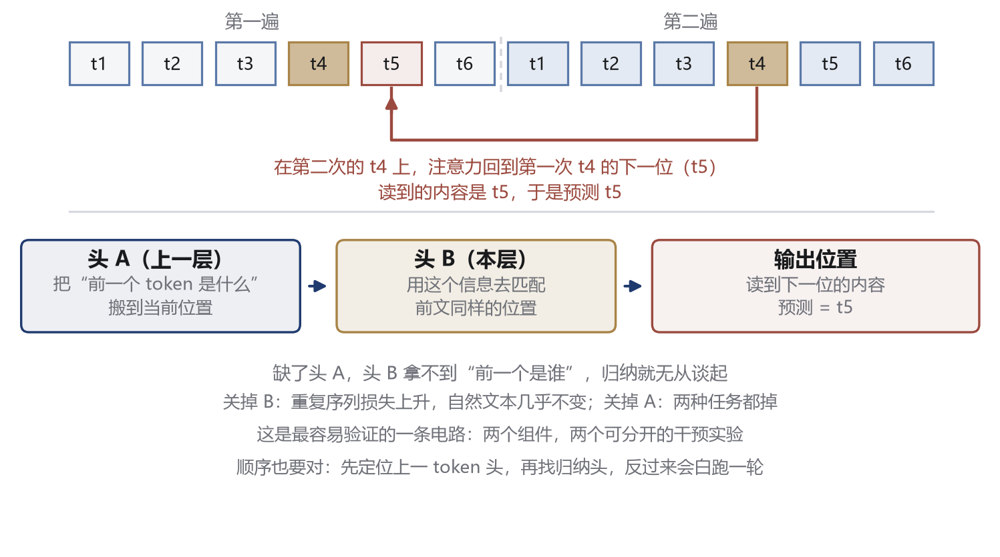

## 注意力头与电路

给模型一段它从没见过的文本：二十五个随机生成的词，重复两遍。第二遍念到第十九个词时，让它预测下一个，它能答对。这段文本不在训练数据里，它也不可能有记忆，那它凭什么答对。

凭的是"前面出现过这个模式"。模型内部有一个专门的机制在做这件事，它的结构可以画出来，可以定位到具体几个注意力头，关掉之后这个能力就消失。这是可解释性研究里少有的、能完整讲清楚的一类机制。

这一章讲怎么找这类机制，怎么验证它，以及为什么这类分析在真实场景里经常做不下去。

### 一个头在做什么

先把基本单元说清。一个注意力头做两件事：决定看哪里，决定看到的东西怎么用。

$$\mathrm{Attn}(X)=\sum_j a_{ij}\,x_j W_V W_O,\qquad a_{ij}=\mathrm{softmax}\!\left(\frac{(x_iW_Q)(x_jW_K)^{\top}}{\sqrt{d_k}}\right)$$

这个式子在说什么。位置 $i$ 的输出是前面所有位置 $j$ 的内容的加权和。权重 $a_{ij}$ 由两个投影决定：$x_iW_Q$ 是"我在找什么"，$x_jW_K$ 是"我提供什么"，两者做内积，相似度高的权重大。这是路由部分，回答"看哪里"。

被选中的内容 $x_jW_V$ 经过 $W_O$ 投影之后加回残差流。这是写回部分，回答"看到的东西怎么用"。

所以一个头可以抽象成两个矩阵的组合：$W_QW_K^{\top}$ 决定匹配规则，$W_VW_O$ 决定搬运规则。前者是"读"，后者是"写"。电路分析里把这个叫 QK 电路和 OV 电路。

这个抽象很有用，因为很多可读的头，它的 QK 和 OV 都能用一句话描述。比如"当前 token 和上一个 token 匹配"（QK），"把上一个 token 的某个属性搬过来"（OV）。

### 归纳头：一个能做实验的机制

归纳头的行为定义很清晰：如果序列前文出现过 $A\,B$，现在又见到了 $A$，那么下一个应该是 $B$。

这个能力有个前提。当前位置的 token 是 $A$，但头要匹配的是"上一个 $A$ 后面的那个位置"，它得知道"上一个 token 是什么"。这一步通常由另一类头完成，叫上一 token 头，它把前一个位置的信息搬到当前位置。

两层配合：上一 token 头在位置 $i$ 写入"$i-1$ 的内容是 A"，归纳头在位置 $i$ 用这个信息去匹配前文所有"内容为 A"的位置，然后把注意力投到那些位置的下一个，读出 $B$。

这就是最朴素的一条电路：两个头串联，信息流方向明确，每一环都能单独验证。

### 怎么找归纳头

实验可以完全用合成数据做，不需要真实语料。

**第一步，造数据。** 从词表里随机抽 $N$ 个 token，拼成一个序列，然后原样重复一遍：

$$[t_1,t_2,\dots,t_N,\ t_1,t_2,\dots,t_N]$$

$N$ 取 25 到 50。因为是随机的，模型对这些 token 没有任何语义先验，能预测对只能靠"前面出现过"。

**第二步，定义指标。** 在第二遍的第 $i$ 个位置（也就是第二个 $t_i$），正确的下一个 token 是 $t_{i+1}$。定义前缀匹配分数：

$$\text{PMS}=\log p(t_{i+1}\mid \text{prefix})-\frac{1}{|V|}\sum_{v\in V}\log p(v\mid \text{prefix})$$

这个式子在说什么：正确答案的对数概率，减去所有候选词的平均对数概率。减去平均是为了抵消"某些 token 天生概率高"的影响。分数为正且大，说明这个位置真的在预测 $t_{i+1}$，而不是碰巧。

实际计算时不用真的对全词表求平均，取一个随机样本估计即可。

**第三步，逐头扫描。** 对每一层每一个头，只保留它的输出、屏蔽其他头，看 PMS 还剩多少。或者反过来，只留这一个头，看它单独能做到多少。

前者衡量"这个头单独够不够"，后者衡量"少了它行不行"。两个都要看。只做一个，结论会偏。

**第四步，消融验证。** 把分数最高的那几个头一起关掉，重跑。理想结果是对称的：合成数据上的 PMS 大幅下降，而自然文本上的语言建模损失基本不变。

这个对称性很关键。如果关掉之后自然文本的损失也大幅上升，说明这些头不只做归纳，还兼着别的事，那"归纳头"这个标签就下得太窄了。

**第五步，看注意力图。** 在第二遍的第 $i$ 个位置，归纳头对第一遍第 $i-1$ 个位置的注意力应该显著高于其他位置。把整段的注意力权重画出来，会看到一条偏移一格的斜线。这条线就是这个头的"指纹"。

如果看到的是别的形状，比如只注意最近的几个位置，那它可能是位置头而不是归纳头。分数高不代表机制是那个机制，注意力图是必要的交叉检查。

### 复制头与归纳头的区别

复制头的行为是"把前文某个位置的内容原样搬到输出"。它不需要"上一个 token"这层对齐，只需要"匹配到某个 token，然后复制它"。

测复制头常用"复制人名"任务：给一段含罕见人名的文本，让模型在后面提到这个人。因为名字罕见，模型不可能靠语义猜，只能靠复制。这类任务的准确率对复制头很敏感。

归纳头是复制头的一个特例：复制头负责"搬"，归纳头在搬的基础上加了"按前文模式预测下一个"。所以找归纳头的方法能找到复制头，反过来不一定。

这两类头之外，还有几类常见的可读头。**上一 token 头**，专看前一个位置。**位置头**，对不同相对位置有固定偏好。**句法头**，在一个依存关系两端之间建立注意力。**注意特殊 token 的头**，专门盯分隔符。

这个清单不长，但覆盖了模型里相当一部分可解释的行为。剩下的头，多数说不出它在干什么，只能描述"在某些输入上激活较强"。

### QK 与 OV 怎么量化

前面说一个头可以拆成“读”和“写”两半。拆完之后，能不能用数衡量“它在读什么、写什么”？能，靠矩阵的秩一分解。

QK 部分：把 $W_QW_K^{\top}$ 看成一个大矩阵，它的秩远小于维度，所以可以用前几个奇异向量近似。这些奇异向量的含义是“当前 token 的一种特征”与“前文 token 的一种特征”匹配。如果第一个奇异向量对应的两个方向恰好是“前一个 token 的身份”，那就是上一 token 头；如果是“同一个 token”，那就是复制头。

OV 部分：看 $W_VW_O$ 作用后，哪些 token 的 embedding 会被写出来。做法是算 $W_U W_V W_O$ 这个复合矩阵，每一行对应一个 token，看哪个 token 的分数最高。这就得到“这个头倾向于写哪些词”。

更进一步的量化叫组合分数，用来判断“头 A 的输出会不会被头 B 读到”：

$$C(A,B)=\lVert W_{OV}^{A}\,W_{QK}^{B}\rVert_2$$

这个式子在说什么：把 A 的写回矩阵和 B 的匹配矩阵乘起来，看这个复合变换能把多少能量从“A 的输出方向”搬到“B 的关注方向”。$\lVert\cdot\rVert_2$ 取谱范数，也就是最大的放大倍数。

这个分数怎么用？它是“可能”，不是“确实”。分数高只说明“如果 A 写了东西，B 能读到”，不说明平时真的读。所以它是筛选工具：对上千个头对算一遍，取前几十对做路径修补验证。

两个实践细节。一是必须和随机基线比。把头随机配对，算一大批组合分数，得到分布；真实的头对必须超过这个分布的 99 百分位才算候选。不同层的矩阵尺度差异很大，不比基线的话，深层头对会全部排前面。二是 QK 矩阵要按头维度分别算（每个头有自己的 $d_k$ 维子空间），不能拿整层的矩阵当整体分解，否则得到的“功能”是几十个头求平均的结果，往往什么都看不出来。

### 算一遍：头的打分要多贵

假设模型 32 层、每层 32 头，共 1024 个头。

单头消融，每条样本 50 个 token，跑 200 条样本，一个头一次：

$$1024\times 200\times 50 = 1.024\times10^{7}\ \text{token}$$

7B 模型在 A100 上按 3000 token/s 算：

$$\frac{1.024\times10^{7}}{3000}\approx 3400\ \text{s}\approx 1\ \text{小时}$$

一小时扫完全部头，这是组件层最划算的一步。

但要注意一个陷阱：这是"前向"的成本。如果你想在每一步都记录所有头的输出，显存会爆。1024 个头 × 50 位置 × 128 维 × 200 条 × 半精度，大约 2.6 GB，还行。如果样本扩到 2000 条，就是 26 GB，得换策略：只记录候选头，或者分批。

打分方式和结论的关系也要说清。

**直接贡献**：把头写回残差流的那一份，投影到目标 token 的 unembedding 方向上，取内积。

$$s_{h}=\left(h\,W_O\right)\cdot u_{y}$$

这个式子在说什么：把头的输出向量和目标词的方向做内积，值大说明这个头在直接往"输出 $y$"这个方向推。它的优点是便宜，一次前向就能算所有头。缺点是只看得见"直接推动输出的头"，看不见"给下游供货的中转头"。

**消融效应**：关掉这个头，目标词的 logit 掉多少。

$$\Delta_{h}=\log p(y\mid \text{clean})-\log p(y\mid \text{head } h \text{ ablated})$$

这个式子的含义很直白：没了它，正确答案的概率掉了多少。缺点是它会被冗余掩盖，一个头被关掉，另一个立刻补上，$\Delta$ 接近零，但你不能说它不重要。

两个分数要一起看。直接贡献高、消融效应低的头，通常是"和别的头并联"；直接贡献低、消融效应高的头，通常是"关键的中转"；两个都低，基本可以放过。

### 算一遍：一对输入的替换实验要跑多少次

电路分析最贵的一步是替换。先把它算清，才知道该在哪里省。

假设序列长 20 个 token，模型 32 层，每层 32 头。

**逐层定位。** 每对输入要做 $32\times 20=640$ 次替换：每个（层，位置）组合一次。每次替换后要让模型把后面算完，生成一个 token 就够了，因为你只看目标 token 的 logit。

$$640\times 200\ \text{token} = 1.28\times10^{5}\ \text{token}$$

一对输入十三万 token。五百对：

$$1.28\times10^{5}\times 500 = 6.4\times10^{7}\ \text{token}$$

按每秒 3000 token：

$$\frac{6.4\times10^{7}}{3000}\approx 2.1\times10^{4}\ \text{s}\approx 6\ \text{小时}$$

一个通宵。这是可以接受的。

**逐头定位。** 锁定五个候选层，每层 32 头，每个头在每个位置上做一次路径修补：

$$5\times 32\times 20 = 3200\ \text{次/对}$$

五百对就是一百六十万次前向、$3.2\times10^{8}$ token，按同样吞吐算约三十小时。已经比逐层贵五倍，所以必须先用逐层定位把范围缩到五层以内，不能全层扫。

**可以省的地方。** 三个优化能把上面的数压下一半以上。

一是用 KV 缓存。只替换第 $\ell$ 层，前面的层根本没变，可以复用干净输入的前向结果，只从第 $\ell$ 层开始重算。序列 20 个 token、32 层，平均只重算一半的层，成本大约减半。

二是批量。把“同一层的 20 个位置”拼成一个 batch 一起跑，显卡利用率从個位数升到几十个点，实际时延降三到五倍。这一步不改算法，但能把三十小时变成八小时。

三是只算目标 token。不需要生成完整输出，只需要看一个位置的 logit，所以生成长度取 1。如果误取成长度 50，成本就直接乘五十。

把这三条用上，一对输入的逐层定位从十三万 token 降到几万，五百对在四小时内能跑完。这就是为什么电路分析的成本主要取决于工程细节，而不是理论复杂度。

### 消融的四种变体

“关掉一个头”这句话至少有四种实现，它们测的东西不一样。

**置零消融。** 把输出置零。最直观，也最容易触发补偿（前面那个案例就是）。

**均值消融。** 把它在一批干净输入上的平均输出替换进去。残差流的范数变化小，补偿机制不容易启动。

$$h_{\text{abl}}=h-h+\bar{h}_{\text{dataset}}$$

**随机方向消融。** 保持输出的模长，但把方向换成随机。它控制“能量不变、信息改变”这个条件，是判“方向是否重要”的标准做法。

**重采样消融。** 把这条输入上的输出，换成另一条输入的对应输出（保持层与位置）。它最接近路径修补，也是四种里最干净的：输入分布不变，只有内容变了。

四者的适用场景不一样。

| 变体 | 适合证明 | 主要偏差 |
|---|---|---|
| 置零 | 能力是否依赖它 | 触发动态补偿 |
| 均值 | 平均贡献 | 掩盖样本特异的作用 |
| 随机方向 | 方向是否特异 | 随机方向本身有噪声 |
| 重采样 | 它携带的信息 | 需要结构相同的输入对 |

一个具体的数字对比能说明差别有多大。同一个头，同一个任务：置零消融掉 1 个点，均值消融掉 8 个点，随机方向消融掉 6 个点，重采样消融掉 34 个点。四个数差三十多倍，而它们都叫“消融”。

所以报告里必须写清用的是哪一种。只写“消融后准确率下降 1 点”是没信息的，因为读者无法判断你是哪一种——也无法判断你有没有做另外三种。

一个实用的次序：先用置零粗筛（便宜），对排名靠前的候选用重采样确认（准确）。如果两者结论不一致，以重采样为准，并在报告里把两个数都列出来，因为那个差异本身就是“这个头被多少条路径补偿”的度量。

### 电路分析的六步流程

从一个具体现象到一个可验证的机制，标准流程是六步。

**第一步，把行为变成一个标量。** 不能是"它答对了"，必须是"正确答案的 logit 减去错误答案的 logit"，或者"正确 token 的排名"。有了标量，才能比较干预前后的变化。

**第二步，造对比对。** 两条输入只差一个关键事实。比如"玛丽把书给了约翰"和"玛丽把书给了汤姆"，只换名字。其余完全一致，这样因果链是单线的。

**第三步，逐层逐位置做激活替换。** 把干净输入在第 $\ell$ 层第 $p$ 个位置的激活，换成扰动输入的对应激活，看标量往哪边倒。把所有 $(\ell,p)$ 的结果画成热图，颜色深的地方就是关键位置。

这一步叫定位，它给的结论是"信息在第几层第几个位置被处理"。注意它给的是必要条件的方向：热图上颜色深的，是信息经过的地方；颜色浅的，不能立刻排除，因为可能存在并行的另一条路。

**第四步，在关键层里逐头替换。** 锁定第三、四层，对每个头做路径修补：只替换这个头写给下游的那一份输出，其余保持干净。看标量变化。排名靠前的就是候选组件。

路径修补比整层替换精细，因为它不改变残差流的整体范数，下游不会因为"输入分布异常"而进入别的模式。

**第五步，QK 与 OV 分解。** 对每个候选头，分别看它的 QK 矩阵和 OV 矩阵在做什么。

QK 部分：取若干输入，算注意力权重，看它在哪些位置对上高。如果是一条斜线，说明它在匹配"前一次出现"；如果是固定偏移，说明是位置头；如果集中在某个特殊 token，说明是分隔符头。

OV 部分：把这个头的输出向量和词表里的 token 方向做内积，看它倾向写哪些 token。如果它写出的方向正好对应"名字"这一类，说明它在搬运名字。

**第六步，拼路径并验证。** 把前几步找到的组件连起来，写成一句机制描述："上一 token 头在第 $\ell_1$ 层把 $A$ 写入位置 $i$；归纳头在第 $\ell_2$ 层用它匹配到前文 $A$ 的位置，把下一个 token 的信息搬到输出。"

然后验证：按这个描述，关掉这几个组件，行为应该坏；不关，行为应该好。如果关掉之后行为只坏了一半，说明还有一条你没找到的路。这时候要么继续找，要么在报告里写明"这条路径解释了约一半的效果"。

### 算一遍：组合数有多可怕

前面算过单头扫描与两两组合。三层以上才是真正的地狱。

$$\binom{1024}{2}=523{,}776,\qquad \binom{1024}{3}=1.78\times10^{8}$$

三头组合是一点七八亿组。每组一次前向（只算一个 token），按每秒三千 token 算，约十六小时——听起来居然还行？错在假设太乐观：真实验证要两百条输入，不是一条。

$$1.78\times10^{8}\times200 = 3.6\times10^{10}\ \text{次}$$

一天八万六千秒、每秒三千次，一年也只有 $9.5\times10^{10}$ 次。差不多是—年。

所以必须剪枝。剪枝后的可行区域是这样的：先用组合分数把候选头从 1024 缩到 50，三头组合降到 $\binom{50}{3}=19600$ 组，按每组合 200 条算，约 21 小时，可做；再缩到 20 个头，就只剩 1140 组，两个小时。

但 20 个头的名单很可能是错的（前面说过中转头会被漏），所以实践里的顺序是“宽剪→两两验→收窄→三三验”，每步都用验证结果修正候选集。

这张算式给出一条工程原则：**电路分析里，剪枝不是优化，是可行性前提。** 不剪枝的分析不是“贵一点”，是“做不完”。所以判断一份电路结论可不可信，先问“候选集是怎么来的”，比看结论本身有用。

### 一个电路图该长什么样

如果要把电路分析的结论写成可交接的东西，格式比内容重要。一份能用的电路报告包含四部分。

**节点。** 每个节点写三样：层号、头号（或 MLP）、一句话功能。头号必须带模型版本，因为换一个检查点编号就变了。功能描述要可操作，比如“在末位把前一个 token 的身份写入残差流”，而不是“处理句法”。

**边。** 每条边写“从哪个节点、经什么矩阵、到哪个节点”。只靠组合分数推出来、没做路径修补的，标为“推测边”；验证过的才标“确认边”。两种边用不同线型画，读者一眼能看出哪些还欠证据。

**预测。** 这是最有价值的部分。一条好的电路必须给出三个可检验的预测：关掉这几个节点，这个能力会坏多少；换一种输入（同结构不同内容），路径是否不变；在另一个相近任务上，这几个节点是否仍然重要。

**验证结果。** 三个预测各自跑了没有，结果如何。没跑的要明写“未验证”，不要留白——留白会被读成“已验证”。

一个模板段落大致是这样：“在模型 X（哈希 Y）上，日期格式转换的年份信息由第 9 层第 12 头写入，经第 14 层第 3 头中继，在第 20 层之后被格式指令下的注意力覆盖。预测：同时抑制第 12 头与第 3 头，准确率下降 30 点以上；换引导语后路径不变；在“月份转数字”任务上这三个节点不重要。已验前两条，第三条未验证。”

这段话比一张漂亮的热图有用，因为它可以直接被拿去反驳。

### 一个公开案例

在小规模模型上，"间接宾语识别"是做得最完整的一个例子。

任务是给模型一句"玛丽把书给了约翰"这样的句子，让它回答"给了谁"。句子结构固定是主语、动词、间接宾语、直接宾语，模型要输出间接宾语那个名字。

公开报告的分析结果是：两个注意力头加一个 MLP 层就能解释大部分行为。第一个头在动词位置标记"后面有个间接宾语"，第二个头把这个信息传到句子末尾，让输出位置去看那个名字。MLP 负责把"名字"这个类别识别出来。

这个结论的可信度高，因为它经过了完整的六步验证，包括关掉这几个组件之后行为按预期坏掉。

但要强调两点。一是规模：这是在几亿参数级别的模型上做的，不是几百亿。二是任务：句法固定、答案唯一、输入长度二十个 token 以内。换成开放对话，"间接宾语"这个概念本身都不好界定。

### 为什么很难推广到真实场景

**冗余。** 前面反复说过。关掉一个头没影响，可能是因为另一个头在补。而补的那个头在正常状态下可能完全不激活，只在被消融时才被"唤醒"。这种动态补偿让消融实验的结论系统性偏低。

**多义。** 一个头在不同输入里干不同的事。这在文献里叫多任务头或者多义头。它使得"这个头负责 X"这种说法永远只能是"在这个任务上负责 X"。想给一个头一个统一的功能描述，往往做不到。

**组合爆炸。** 一个稍复杂的任务可能涉及几十条路径。每条路径都要单独验证，而验证一条路径的成本是几百次前向。

**任务界定的主观性。** "这个行为"到底指什么，本身就是个选择。同样是"翻译"，中译英和英译中涉及的组件可能完全不同。所以电路分析的结果总是带一个隐式前提：在这个任务定义下。

**基座差异。** 不同模型的组织方式不一样。同一个机制在 A 模型里是第 12 层第 3 个头，在 B 模型里可能根本不存在，而是由 MLP 完成。所以结论不可跨模型迁移，每个模型都要重做。

这五条加起来，解释了为什么电路层面的漂亮结果都出现在小模型、窄任务上。不是研究者不想做大，是做大的成本高到不划算，而且结论的可靠性下降得比成本上升还快。

### 一个能自己跑的实验

把上面五步落成一个具体配置。

**模型**：一个 7B 级别的开源模型，能拿到逐层、逐头的输出。

**数据**：两千条合成序列，每条五十五个 token。前二十五个从词表随机抽，后三十个是前三十个的重复。随机种子固定，保证可复现。

**度量**：只看第二遍的位置，算 PMS。为了避免词表大小带来的影响，平均项用一个五千词的随机子集估计。

**扫描**：对每个头做两件事。一是只留它自己的输出、屏蔽其他所有头，算 PMS；二是其他头全留、只屏蔽它，算 PMS。两个数一起看。

**预期结果**。第一项会出现几个高分头，往往集中在中层偏后的位置，数量不多。它们的第二项分数很低，说明去掉它们影响很大。同时，分数不高的头占绝大多数，这是正常的：大多数头不参与这个任务。

**三个必做的交叉检查**。

一是看注意力图。高分头在第二遍的第 $i$ 个位置，应该对第一遍的第 $i-1$ 个位置有明显偏好。看不到这条偏移一格的线，就不是归纳头。

二是换随机种子重跑。真的归纳头，换种子之后分数还在；噪声，分数会飘。多跑三个种子，看排名的稳定性。

三是换任务验证。把“随机 token 重复”换成“自然句子重复”，同一个头还应该高分，但分数会低一些，因为自然语言里模型可以用语义帮忙，不一定非得靠归纳。

**一个很容易搞错的地方**：归纳头必须先有上一层给出的“上一个 token 是什么”这个信息。如果你把上一层完全屏蔽再算，分数会掉很多，这时候不能结论“这个头不行”。正确的做法是只屏蔽本层其他头，保留前面所有层。

这也解释了一个现象：归纳头常常成对出现，一个负责把前一个 token 编码到当前位置，一个负责匹配。只找后面那个，会低估机制的整体重要性。

把上面的配置写成一张验收表。

| 指标 | 干净 | 关掉候选头 | 判据 |
|---|---|---|---|
| 合成序列 PMS | 6.2 | 0.4 | 降幅 > 80% |
| 自然文本 loss | 2.10 | 2.13 | 升幅 < 3% |
| 重复检测准确率 | 88% | 41% | 降幅 > 30 点 |
| 注意力对角偏移 | +1 | 无峰 | 最高权重在 $i-1$ |

这张表的数字是示意，但四行的结构是必须的。第一行说明“没它不行”，第二行说明“它不兼职其他事”，第三行说明“这个能力真的依赖它”，第四行说明“机制是那个机制”。四行缺任何一行，结论就只能写成“相关”。

特别是第二行。很多人只报第一行，得到“降了 90%”，听起来很强。但如果关掉之后自然文本的 loss 也涨了一成，这个头就不是归纳专用，而是“什么都干一点”。这种头不能当机制解释的基石，因为它身上挂着太多别的东西。

### 置换检验：分数差多少才算真

PMS 从 6.2 降到 0.4，这个差算不算真？在小样本上，这种问题不能靠“看着差很多”回答，要做一个置换检验。

具体做法。手上有两百条序列，每条算两个值：完整模型的 PMS，和关掉候选头之后的 PMS。差值 $d_i$ 是每条的效应。零假设是“关不关都一样”，也就是 $d_i$ 的符号随机。

于是把两百个 $d_i$ 的符号随机翻转（每条以一半概率取反），求和，得到一个“零假设下的总效应”；重复一千次，得到一千个值。真实总效应如果落在这批值的最极端 1% 之外，就算显著。

为什么要按序列而不是按位置重排？因为同一条序列里的二十个位置高度相关：它们共享上下文，错就一起错。按位置重排会把相关样本当独立样本，$p$ 值会被算得很小，得到一个假阳性。这是这类检验里最常见的错误，比公式写错还常见。

一个具体的判据：两百条序列、一千次重排，如果真实总效应是零分布最大值的 1.5 倍以上，报告 $p<0.01$；如果只有 1.1 倍，就不能报“显著”，只能说“方向一致”。

置换检验还有个附带好处：它给出的零分布本身就是“噪声有多大”的估计。如果零分布的范围很宽（比如从 -2 到 +2），说明两百条序列不够，需要加到五百条以上。这个信息比一个 $p$ 值有用，因为它告诉你下一步该做什么。

### 多义头长什么样

一个头可以同时管好几件不相干的事。这在实验上的表现是：你换一批任务，同一个头的分数都很高。

有一个典型的现象叫“双重任务”。某个头在“预测下一个 token”和“检测重复”两件事上都排名靠前，而且它的注意力图在不同任务里完全不同：一个任务里它看前一个位置，另一个任务里它看前文所有相同 token 的位置。

这说明它不是“一个头做两件事”，而是“同一组权重参数在两件事上都有用”。两种说法听起来差不多，工程含义差很多：前者可以拆，后者拆不开。

遇到多义头，正确的结论是“在这个任务上，它的功能是 X”，而不是“它的功能是 X”。报告里必须带上前提。

### 一个失败案例：消融没变化

有个团队在做一个"日期格式转换"的失效分析。他们发现第 18 层第 7 个头在这类输入上激活很强，几乎是基线的五倍。于是做了单头消融，结果准确率只掉了 1 个百分点。结论写成"这个头虽然激活强，但并不重要"。

三个月后另一个组用路径修补重做了这个实验。他们发现，把第 18 层第 7 个头写给下游的那一份替换成扰动版本的输出，准确率掉了 34 个百分点。这个头是关键的。

差别在哪？消融是把输出置零。置零之后，残差流的范数变小了，同一层第 22 个头立刻提高了自己的输出幅度，把缺口补上。这个补偿是动态的，正常运行时不发生。

路径修补不置零，而是换成一个"错误的但幅度相同"的输出。补偿机制不会启动，因为它看到的输入分布是正常的。

这个案例的教训很实在：**消融测的是"少了它会怎样"，而你想知道的是"它平时在做什么"。这两件事在存在冗余时不是一回事。**

诊断冗余的办法有两个。一是同时消融候选头和它的可能补偿者，看影响是否叠加；二是改用替换而不是置零。前者便宜，后者更准。

还有一个后续的问题需要注意：头的编号不稳定。同一个模型重训一次，或者换一个微调版本，第 18 层第 7 个头可能变得完全不同，而某个现在没编号的头接管了同样的功能。

所以“第 18 层第 7 个头”这种写法只在一个具体的权重文件上成立。报告里要带模型版本和哈希。“这个模型有个归纳头”这种说法不能直接搬到另一个模型上，要重新找一遍。

### 一个失败案例：热图上的假峰

第三个案例是方法层面的，它不关于模型，关于你自己的实验。

一个团队做日期格式转换的定位。输入是“2023 年 5 月 12 日”这样的日期，输出要求是“12 May 2023”。他们把输入里每个数字和每个字都做了替换实验，画出一张热图，颜色深的地方表示“换掉它输出就变”。

热图上出现了一个很怪的峰：第 0 层、第 0 个位置（也就是第一个 token）颜色最深，而且深得不像话。团队花了三天追这个位置，猜各种解释：是不是序列开头的全局信息、是不是起始符里存了格式偏好。

第四天有人意识到一件事：他们的输入对里，两条序列的“第一个 token”不总是一样。有的输入开头是引号，有的开头是空格，有的开头直接是数字。把 A 句的第一位置换成 B 句的第一位置，等于同时改了两件事：这个位置的内容，和整个序列的起点形态。模型看到“开头变成了一个奇怪的东西”，注意力分布整个塌掉，输出自然大变。

这个峰不是“关键位置”，是“分布外输入造成的破坏”。和前面说的“相关不等于因果”是同一类问题，只不过这次是实验自己造出来的假相关。

三个修法，按性价比排。

第一，位置对齐。造输入对时锁死前两个 token（比如都用同一段引导语开头），只改内容区。一个字符的对齐工作，能消掉大半假峰。

第二，单位置回填检查。对一个可疑位置，把它的激活换成“同一条句子另一个随机位置的激活”，如果输出也大变化，说明这个位置的激活只要不在原位就会出事，那是破坏而不是信息。

第三，看整张热图的形状。真实的定位通常是一两条清楚的带（因为信息在几个特定层被加工）；假峰往往是孤立的点，颜色深但与周围完全不相连。孤立深点值得怀疑，连成带的区域才值得追。

这个案例还有一个更普适的教训：热图最容易骗人。它的每一格都是一个标量，而颜色会把“一大格”变成“一个重要的发现”。真正应该看的是“这个格子相对它的邻域是否异常”，而不是“它的绝对颜色有多深”。任何一张用颜色说话的热图，都应该配一张“邻域平均”的对照图。

### 补偿从哪里来

前面那个“消融没变化”的案例里，补偿是一个假设。它可以被测量。

做法很直接：把目标头置零，然后把同一层其他头的输出范数全部打印出来，和基线对比。如果某些头的范数显著上升，补偿就找到了具体对象。

一个典型的实测形状：关掉第 18 层第 7 头，同层第 22 头的输出范数从 1.0 升到 1.35，第 3 头从 0.8 升到 0.9，其余不变。而跨层的头几乎没有变化。这说明补偿主要发生在同一层，而且往往集中在一两个头上。

有了这个信息，下一步就能做得更干净：同时关掉第 7 头和第 22 头，再看效应。如果准确率现在掉了三十多个点，就确认了这两个头在并联干同一件事。这个实验只多花一倍时间，结论却从“不重要”变成“两个头互为备份”。

还有一个更便宜的做法：不算范数，只看注意力的熵。补偿头往往会把注意力变得更分散（因为它要同时管两件事），熵会上升。在一批样本上算平均熵，变化超过 15% 就值得进一步查。

要注意的是，补偿不只是“另一个头变大”。还有两种形式更隐蔽。一是 MLP 补偿：注意力头被关后，同层的 MLP 输出会变大，因为残差流的总量要保持。二是下游层补偿：某个头被关，下一层的头会把注意力重新分配到别的特征上。所以完整的补偿测量应该同时看同层的头、同层的 MLP、以及下一层头的注意力分布。

这三项一起看，你会发现一个反直觉的事实：模型对“局部损坏”的容忍度非常高，而这种容忍度是靠动态重路由实现的，不是靠写死的冗余。这也解释了为什么单点消融几乎总是低估重要性——你测到的是一个自修复系统的残余能力，而不是那个部件本身的作用。

### 三个容易越界的地方

把电路结论写成报告时，有三个常见的越界。每一个都能让读者把结论当成比自己能支撑的更强。

**越界一：从“在小模型上”说到“在大模型上”。** 公开的漂亮结果大多出自几亿参数级别、句法固定的任务。“间接宾语识别”拆成两个头加一个 MLP，这是真的；说“大模型也是这样处理语义的”，这是猜的。正确的写法是把参数量、任务类型、句长都写进结论里。

**越界二：从“存在一条路径”说到“这就是模型用的路径”。** 你找到一条能解释行为的路径，不等于模型平时就走它。模型可能同时走三条路，你找到的是最容易定位的那一条。这时候结论要写成“存在一条路径”，并补一句“它解释了大约多少比例的效应”——后者必须用消融测，不能估。

**越界三：从“关掉它会坏”说到“它就是做这个的”。** 关掉一个头会让准确率掉很多，但它可能是一个“通用中转站”，管线所有任务。验证方法：在三个不相干的任务上各关一次，如果都掉，它就不是专長。公开报告里这类“什么都管”的组件不少，它们对机制解释没什么用，但对工程风险很有用（改动它最危险）。

三个越界的共同根源是把局部结果当成普遍结论。一个简单的防护是：写完一句话，在后面加“在这个模型、这个任务、这组输入上”。如果加了这旬话之后这句话就不想发了，那它本来就不该发。

### 重要性是一个分布，不是一个数

报告里常写“这个头很重要”，隐含一个单个数。实际上一个头的重要性随输入变化，单个数会把这种变化抹掉。

测法很简单：把五百条输入按任务类型分五组，每组算一次消融效应。

| 任务 | 平均效应 | 有效应的比例 |
|---|---|---|
| 日期转换 | 34 点 | 92% |
| 数字加法 | 12 点 | 41% |
| 人名复制 | 3 点 | 12% |
| 改写句子 | 1 点 | 8% |
| 开放对话 | 0.5 点 | 5% |

平均值 10 点，但这个数不存在于任何一组里。这个头几乎只对“日期转换”必需，对其他任务几乎无关。

第三列比第二列有用。平均效应回答“总体多重”，有效应的比例回答“它在多少情况下被用上”。前者适合写摘要，后者适合做决策：如果你要改的东西全在开放对话里，这个头可以完全忽略。

两种常见的误读。一是把平均值当“通用重要性”，然后在不相干的场景上做干预，发现没用。二是只测自己关心的那一类输入，得出“它很重要”，推广到全体时高估。

一个可操作的约定：报告里写“在第 X 类输入上，消融效应 Y 点（覆盖 Z% 的样本）”，三个数一起给。少一个，读者就只能猜。

这也解释了为什么同样是“找个关键头”的任务，两个团队会得出完全不同的排名。不是方法不同，是测试集的构成不同。跨团队比这种排名没有意义，除非双方用同一套输入。

### 这些分析到底有什么用

做了这么多，能换来什么？

**定位失效。** 模型在某类输入上稳定出错，用逐层替换找到"从第几层开始偏"。这比"整体重训"精确得多，也比"试试改提示"有方向。

一个具体的例子。某模型在长文档里引用编号出错：内容对了，编号对不上。逐层替换发现，编号信息在第 9 层就进入了激活，但输出位置在第 20 层之后的注意力集中在"最近一次出现的编号"上，而不是"被引用的那一条"。修法不是重训，而是在提示里要求"先在正文里给每条编号加标记，再引用"。生成顺序一变，注意力就有了正确的落点，准确率立刻上去。

**审计。** 想知道模型是不是在"抄答案"而不是"算答案"，可以找那些把输入片段原样搬到输出的头。在数学题上，如果复制头贡献很大，说明它在背题而不是解题。这个信号对评测污染的判断有帮助。

**指导结构改动。** 如果某个头的功能明确且有害（比如专门复制训练数据里的隐私片段），可以在部署时定向抑制它，而不是整体重训。这类改动风险高，但如果机制清楚，比盲改安全。

如果预算不够做完整的六步，有个便宜的近似方案：不做路径修补，只算每个头对目标 token 的直接贡献，按贡献排序，取前五十个做人工看。它不能证明因果，但能把“看哪里”的范围从一千个头缩到五十个。剩下的事再按需做。

这个方案的风险是前面说过的：中转头会被漏掉。所以它适合筛查，不适合下结论。

注意力头和电路的分析给的是"哪一块在做什么"，不是"模型为什么会思考"。这个区别要一直记着。前者能指导工程决策，后者目前还给不出。

一个更务实的判断标准是：这个分析能不能变成一次可执行的改动。能，就值得做；不能，就只是在积累知识。积累知识本身没错，但要清楚自己在做哪件事。

真实的工作里，大部分问题不需要走到电路层。行为层的分桶测试能解决一半，表示层的探针能解决另一半里的多一半。剩下那一小块，才是电路分析的地盘。搞清楚这个比例，比学会所有方法更重要。
