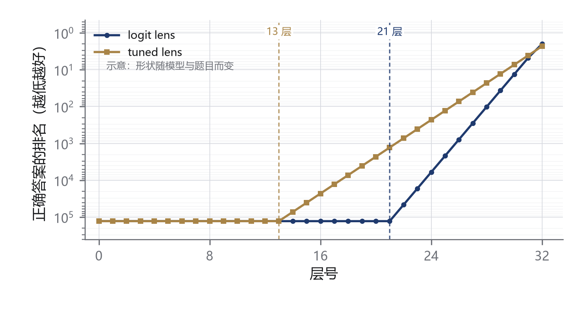

## 归因与 logit lens

模型回答"这部电影是 2024 年上映的"，实际是 2023 年。团队的第一反应是知识过期或者记错，于是去查训练数据。

查了两天没查出问题。后来有人把问题换成"把'2023 年 5 月'改写成英文月份格式"，模型输出"May 2024"。同一个错误，换了个任务又出现。这说明它不是记错了年份，而是在某个格式转换的环节把数字加了一。

要发现这一点，只看输入和输出是不够的。你得能看到"中间某一层已经知道正确答案"，然后看到"后面几层把它改错了"。

这一章讲两类工具。一类从中间往输出看，叫 logit lens，回答"模型在第几层知道的"。一类从输出往输入追，叫归因，回答"哪些输入片段影响了这个输出"。

### logit lens：把中间层强行解码

模型每一层都在残差流上加一点东西。第 $\ell$ 层的隐状态 $x_\ell$ 是"到目前为止累积的全部信息"。它本来不是给输出用的，但你可以强行把它当最终状态处理。

做法是先做一次最终的层归一化，再乘上unembedding 矩阵：

$$p_\ell=\mathrm{softmax}\!\left(\mathrm{LN}(x_\ell)\,W_U\right)$$

这个式子在说什么。$W_U$ 是把隐状态映射到词表的那个矩阵，形状是 $d\times|V|$。$x_\ell W_U$ 得到一个长度为词表大小的向量，每个分量是"这个词的分数"。softmax 把分数变成概率。于是你就得到了"如果在第 $\ell$ 层就结束，模型会预测什么"。

层归一化不能省。最后一层输出之前有一次归一化，中间层没有。如果不补上这一步，$x_\ell$ 的范数和最终层差很多，投影出来的分布会完全失真。

为什么这样做能work？因为残差流是累加的：$x_{\ell+1}=x_\ell+\Delta_\ell$。如果 token 的方向在残差流里是线性可读的（很多模型确实如此），那么每个中间状态都已经含有"当前最可能的词"这个信息，只是强度不同。乘 $W_U$ 就是把它读出来。

它什么时候失效？三种情况。

一是中间层的表示基底和最终层不同。有些模型在中层用一套"内部语言"，到后面才翻译成 token 方向。这时候强行投影会得到一堆无意义的词。

二是有些计算是非线性的，需要经过后面的 MLP 才能变成可读的形式。投影看不到这部分。

三是层归一化的位置和类型因模型而异，用错地方会让整条曲线变成噪声。

所以 logit lens 的结果必须先在已知答案的样本上校准一遍：如果你在一条明确正确的样本上，曲线在中间层就跳到了正确答案，说明这个方法在这个模型上可用；如果整条曲线都是乱的，就别用它。

### 怎么读一条曲线

把每一层的"正确答案的排名"或"正确答案的概率"画出来，横轴是层，纵轴是指标。

典型的形状是这样：前几层接近随机（排名在几千名），某一层突然跳到前十，之后在中层上下波动，最后几层稳定在第一。

那个跳变的位置，通常被解读为"答案在这一层进入模型"。这个解读要打个折。跳变说明的是"到了这一层，答案已经可以用最终的词表方向线性读出来了"，不等于"这一层算出了答案"。真正的计算可能更早，只是那时还没对齐到输出基底。

波动段也值得看。有些样本在中层出现过正确答案，然后掉下去，最后又回来。这种"中途丢失再恢复"的模式，往往说明有两条路径在竞争：一条给出了正确答案，另一条给出了干扰项，前面的层还压不住。

如果你在做一个失效分析，最关心的是"最后掉下去"的那一段。答案在哪一层开始掉，问题就在那之后。

### tuned lens：修掉基底不匹配

logit lens 的偏差来自"中间层和最终层不在同一个基底上"。修法很直接：给每一层学一个小的映射，把它翻译到最终层的空间，然后共用同一个 unembedding。

$$p_\ell=\mathrm{softmax}\!\left((x_\ell A_\ell+b_\ell)\,W_U\right)$$

这里的 $A_\ell$ 是 $d\times d$ 的仿射矩阵，$b_\ell$ 是偏置。这个式子在说什么：先用一个学出来的线性变换把第 $\ell$ 层的状态搬到"最后一层的坐标系"里，再用同一把尺子（$W_U$）去量。$A_\ell$ 的作用就是补偿层与层之间的旋转和缩放。

训练方式有两种。

一是**分布匹配**：用同一批文本，让第 $\ell$ 层的预测分布去逼近最后一层的预测分布，损失用 KL 散度。

$$\mathcal{L}_\ell=\sum_{t}\mathrm{KL}\!\left(p^{\text{final}}_{t}\,\Vert\,p^{\ell}_{t}\right)$$

这个式子在说什么：让"第 $\ell$ 层的看法"尽量接近"最终层的看法"。它不需要标签，只需要文本，所以数据便宜。

二是**直接监督**：用下一个 token 的真实标签做交叉熵。这更直接，但会引入"正确答案"这个先验，让曲线看起来比实际更好。

实际研究里多用第一种，因为它不引入标签信息。用第二种的时候要在报告里注明。

两种 lens 的差别，具体有三点。

**平滑度**。tuned lens 的曲线通常更平滑，早期层就有合理的分布，不会突然从随机跳到正确。

**跳变位置**。tuned lens 给出的"信息进入层"往往比 logit lens 更早一到两层。原因是 logit lens 需要等到表示自己对齐到输出基底，而 tuned lens 用 $A_\ell$ 提前做了这个对齐。

**稳定性**。换一批数据，tuned lens 的曲线形状更稳定；logit lens 在层与层之间的抖动更大。

代价是要训练。每个模型、每一层一个 $A_\ell$，换模型就得重训。

### 算一遍：tuned lens 的成本

30 层，每层一个 $4096\times4096$ 的仿射矩阵：

$$30\times 4096\times 4096 \approx 5.0\times10^{8}$$

五亿参数，一个中等模型的量级。存成半精度是 1 GB。

训练数据一千万 token。每个 token 在每一层都要算一次映射，再乘 unembedding：

$$10^{7}\times 30\times\left(2\times 4096^{2}+2\times 4096\times 128000\right)$$

第一项是仿射，$2\times 4096^2\approx 3.4\times10^{7}$ FLOP；第二项是投影到词表，$2\times 4096\times 128000\approx 1.0\times10^{9}$ FLOP。后者大三十倍。

单 token 单层约 $1.05\times10^{9}$ FLOP，三十层约 $3.1\times10^{10}$，一千万 token：

$$3.1\times10^{17}\ \text{FLOP}$$

按实际十万亿次浮点每秒（$10^{14}$）算，三千秒，不到一小时。单卡。

如果贪心一点，把仿射直接做成 $d\times|V|$，参数量变成

$$30\times 4096\times 128000\approx 1.6\times10^{10}$$

一百六十亿参数，比模型本身还大。这就是为什么一定要"$d\times d$ 仿射 + 共享 $W_U$"这个结构。少一个数量级，效果几乎一样。

还有一个隐藏成本：要预先跑一遍模型，把所有层的隐状态存下来。一千万 token × 30 层 × 4096 维 × 2 字节：

$$10^{7}\times 30\times 4096\times 2\approx 2.5\ \text{TB}$$

存不下，所以也是流式训练，一边跑一边更新。这跟稀疏自编码器的工程约束是同一类问题。

lens 这个方法后来还出了几个变体，思路都是“把中间层的状态拿去问一个问题”。一种做法是把中间层激活拼到另一个短提示里，让模型用这个状态继续算，看它能得出什么，这叫修补式探针。另一种是用对比数据学一个投影，把激活直接映射到“是/否”这样的二元判断上。这些变体的共同前提是：中间状态里已经含有可被下游利用的信息，只是需要一条路把它导出来。

### 一个可以照着做的 lens 实验

配置很小，一个人一下午能做完。

**模型与数据**：一个 7B 开源模型，一百条你确定它答对的样本，每条都要有一个唯一的正确答案（比如事实问答、日期、人名）。

**指标**：不用概率，用排名。排名比概率稳，因为概率受 softmax 温度影响。具体做法是：每一层算出分布之后，看正确 token 排第几，找不到就记成词表大小。

**画图**：横轴层号 0 到 32，纵轴排名取对数。一百条样本可以画成一百条线，也可以取中位数画一条带四分位的带。两种都画，中位数看趋势，单条看稳定性。

**先做 logit lens，再做 tuned lens**。tuned lens 的仿射用同样的文本训练，五百步就够。两条曲线画在一起对比。

**怎么读**。如果 logit lens 的曲线在中层就跳到前十，说明这个模型的中间层已经对齐到输出基底，方法可用。如果一直到最后两层才跳，而 tuned lens 在中间就跳了，说明层间基底差异很大，以后一律用 tuned lens。如果两条曲线都在最后才跳，可能这批题自带了推理链，答案确实要到后面才算出来。

**一个必做的对照**。把答案换成错误 token，重跑一遍。曲线应该全程很差。如果错误 token 的排名在中层也很高，说明你选的样本里“错误答案”和“正确答案”在分布上太像，或者数据有重复。

### 归因：哪些输入影响了输出

logit lens 回答"什么时候知道"，归因回答"靠什么知道"。

**梯度。** 最直接的想法：算输出对每个输入 token 的梯度，梯度大的贡献大。

$$g_i=\frac{\partial y}{\partial x_i}$$

这个式子在说什么：$x_i$ 是第 $i$ 个 token 的 embedding，$y$ 是你关心的输出分数（比如正确答案的 logit）。$g_i$ 表示"$x_i$ 稍微动一点，$y$ 会动多少"。

它的问题是局部性。梯度只在当前点附近有效。如果某个 token 的作用是"决定了整个句子的走向"，但当前模型对它已经饱和（比如它已经把答案推到了极高概率），梯度会很小。你看到的是"它不重要"，实际是"它已经完成了工作"。

还有一个技术问题：embedding 层的梯度不等于贡献。embedding 是离散查表，梯度是"如果这个向量能连续变化会怎样"，这个假设和实际不符。

**积分梯度。** 修法是沿着"从基线到输入"的路径积分，而不是只看一个点的梯度。

$$\mathrm{IG}_i=(x_i-x'_i)\int_{0}^{1}\frac{\partial f\!\left(x'+\alpha(x-x')\right)}{\partial x_i}\,d\alpha$$

这个式子在说什么。$x'$ 是一个"什么都不含"的基线（比如全零向量，或者一个特殊的中性输入），$x$ 是真实输入。沿着从 $x'$ 到 $x$ 的直线走，每一步都算一次梯度，把这些梯度按路径长度加权平均，再乘以"这个 token 从基线到真实值变了多少"。

它满足一条漂亮的公理，叫完备性：所有 token 的归因加起来，正好等于"输出减去基线输出"。也就是说，它是一个精确的分配，不是近似。

实践里用几十步离散求和近似积分。步数太少，结果不稳；步数太多，成本高。二三十步是常见的折中。

**注意力权重。** 最便宜的一种：直接看某个位置对输入的注意力分布，权重大的就算贡献大。

它的失效场景很清楚。注意力只是路由，被选中的内容还要经过 value 投影和输出投影，才真正写进残差流。一个位置被注意了九成，但如果它的 value 方向和你关心的输出正交，贡献就是零。反过来，一个位置只被注意了一成，但方向完全对，贡献可能很大。

更麻烦的是多层叠加。第 3 层的注意力看 A，第 12 层的注意力看 B，最终输出可能主要由 B 决定。只看某一层的注意力，会得出相反的结论。

**遮挡。** 把一个片段从输入里去掉（或者换成占位符），看输出变化多少。

$$\Delta_S=f(x)-f(x\setminus S)$$

这个式子在说什么：$S$ 是被遮住的那一段，$x\setminus S$ 是遮掉之后的输入。$\Delta_S$ 就是这一段的贡献。它最接近因果：真的去掉了，看结果。

它的失效场景有两个。一是造出了分布外输入。遮掉一段之后，句子可能语法不通，模型进入"这是什么怪句子"的模式，输出变化里混着这个模式的影响。二是组合效应。遮住 A 没影响，遮住 B 没影响，遮住 A 和 B 一起影响很大，因为它们是互补的。逐个遮挡的方法抓不到这种。

缓解办法是把遮挡换成"替换成中性内容"而不是删除，并且同时报告"单遮"和"双遮"的结果。

### 四种方法放在一起比

| 方法 | 主要回答 | 成本 | 典型失效 |
|---|---|---|---|
| 梯度 | 微小扰动下谁最敏感 | 一次反向传播 | 饱和区域失效，embedding 层不可靠 |
| 积分梯度 | token 级贡献如何分配 | 二三十次反向传播 | 基线选得不对，结论全错 |
| 注意力 | 模型在看哪里 | 一次前向 | 注意力不等于贡献，只看一层会误导 |
| 遮挡 | 去掉它输出变多少 | 每个片段一次前向 | 造出分布外输入，抓不到组合效应 |

这四种没有哪个更好，它们回答的是不同的问题。梯度回答"敏感度"，积分梯度回答"分配"，注意力回答"路由"，遮挡回答"必要性"。

选哪个还有一个现实约束：你的模型能不能拿到中间结果。有的推理框架只暴露输入和输出，那就只能用遮挡。能改代码、能拿到激活，才谈得上后三种。选方法之前先看看手里的工具。

一个实用的原则是：用两个方法，结论一致才敢报。一致的部分可信，不一致的部分是线索。

### 一个完整的排查

回到开头那个年份错一年的问题。

**第一步，遮挡定范围。** 把输入分成几段（问题、上下文、格式要求），逐段遮掉。发现遮掉"格式要求：输出英文月份"这一段之后，错误消失。范围锁定了。

**第二步，注意力看细处。** 在生成月份的那个位置，看它对输入的注意力。发现它对"2023"这个 token 的注意力很低，对"英文月份"的注意力很高。这符合"它在做格式转换，没去看年份"的猜测。

**第三步，logit lens 看层。** 画曲线。发现"2023"这个候选在中间某层排名已经进入前五，之后掉下去，最后出现的是"2024"。

三步的结论拼在一起：模型在中间层已经拿到了正确的年份，但在做格式转换时，注意力被引向了格式指令，年份信息没有被带过去，最后几层用了某个默认值（或者做了一个错误的进位）。

修法就很具体了：把格式指令和内容分开，让模型先输出"年份：2023"，再做格式转换。或者直接在提示里给出目标格式的示例，减少它自己推断格式的空间。

这个案例里，三种方法各出了一份力：遮挡负责缩小范围，注意力负责指出机制，lens 负责定位层。单独用任何一个，都得不出完整结论。

### 长上下文里的归因

上下文到了几万 token，归因的方法要改。逐 token 算梯度太贵，逐个遮挡更不可能。

常见的做法是分两层。先在“块”这一级做归因：把上下文按段落或按文档切开，每块算一个分数。块的粒度取两百到五百 token，一个两万 token 的上下文就是四十到一百块，遮挡一轮可以接受。然后把高分的块进一步切细，在块内做 token 级归因。

块的分数怎么算更省？不用真遮挡，用一个便宜的代理：把每块的 token embedding 置零，跑一次前向，看输出 logit 的变化。这个近似不精确，但能把范围从一百块缩到十块，足够。

有一件事要特别注意。长上下文里的注意力很容易被“位置近”主导，也就是模型倾向于看靠后的内容。这时候归因结果会系统性偏向最后几段，即使真正有用的信息在前面。判断有没有这个偏差，做一个对照：把上下文的顺序打乱（前提是不影响语义），看归因排序是否大变。大变，说明归因在很大程度上在测位置，而不是内容。

这也解释了一个常见的工程现象：把关键文档放在上下文中间，效果比放在开头或结尾差。归因能量化这个损失：同一个文档放在不同位置，它的归因分数可以差好几倍。这个差值本身就是“位置偏差”的度量。

### 一个失败案例：基线选错

有个团队用积分梯度做"客服回复里哪句话导致用户不满"的归因。基线选了全零 embedding。

结果所有样本的归因都集中在标点符号和句首的"您好"上。团队以为发现了"问候语让用户反感"，差点据此改产品。

复查发现，零向量对应的状态离真实分布太远。模型的 embedding 里没有"零"这个概念，全零向量走一遍前向，激活的分布和正常输入完全不同，梯度在那条路径上不具代表性。

改成"同长度随机句子的平均 embedding"作基线，结果恢复正常：归因落在具体的承诺条款上。

这个案例给出一个可操作的判据：**换三个不同的基线，看归因排序的一致性。** 如果三种基线给出的 token 排名，两两之间的 Spearman 相关系数都在 0.7 以上，结论算稳；低于 0.5，说明结论主要由基线决定，不能用。

三个基线可以这样选：全零、随机句平均、同领域的"中性"输入（比如一段没有承诺的模板回复）。第三个最贴近实践，也最贵。

### 两个容易误读的现象

**曲线不是单调的。** 很多人预期“排名随层数单调变好”，实际常常不。正确的读法不是看“有没有下降”，而是看“下降的幅度和持续时间”。降一两层就回来，是正常的路径竞争；降到最后没回来，才是真的被压住了。

**同一批题在不同模型上的曲线形状完全不同。** 有的模型答案在中间层就定下来了，后面只是“把话说出来”；有的模型要到最后一两层才能确定。这跟你用多少层、多少参数无关，跟训练数据里“推理链占多少”有关。所以曲线适合在同一模型内部比较（比如比较两道题的难度），不适合跨模型比较“谁更聪明”。

### 边界

**归因是分配，不是发现。** 完备性说的是"所有归因加起来等于总变化"，所以它是一个零和分配问题。它不会告诉你"这里有一个新东西"，只会告诉你"这些已有的影响怎么分"。你想找的"关键因素"如果不在候选集里，归因永远找不到它。

**归因不解释计算。** 它说"这个 token 贡献了 30%"，不说"模型用它做了什么运算"。要知道后者，得回到组件层和电路层。

**结果对超参敏感。** 基线、步数、遮片的粒度、取哪一层的梯度，每一个都会改变排序。所以报告里必须写全，否则别人复现不出来。

**层的选择影响巨大。** 在 embedding 层做归因和在最后一层做归因，结论可能完全相反。前者问“输入的字面影响”，后者问“经过全部计算之后的影响”。这两个问题不一样，要明确你要哪个。

**归因不能在“多个正确输出”上直接比较。** 一道题如果有两种写法都算对，归因会给出两套不同的“重要 token”。你把两套平均，结果反而全部变得不重要。处理办法是先固定一种输出形式，或者分别算、分别看。

logit lens 和归因的价值在于它们便宜。一次前向加一次反向，就能得到"模型在哪一层知道"和"哪些输入重要"这两个问题的初步答案。它们给不出机制，但能把排查范围从"整个模型"缩小到"某几层、某几个位置"。在这个范围里再上更贵的方法，性价比才高。

用它们的时候记住一件事：这些方法给出的是线索，不是结论。线索的价值在于能被后续实验证实或推翻。一个不能被推翻的"解释"，通常只是描述。
