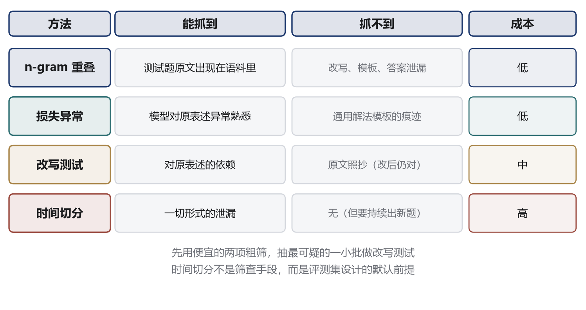
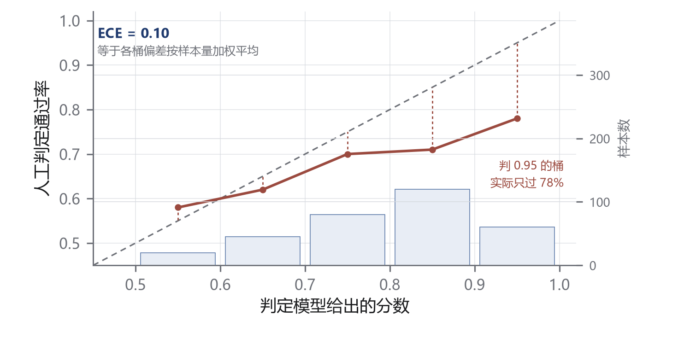

## 评测：污染与判定模型

一个模型在某个公开榜单上拿了 89 分，团队据此定了一个大版本的计划。上线之后，用户反馈很差，尤其是代码题。运营拉了一批真实工单做人工评测，同一批题上这个模型只有 62 分。

89 和 62 之间差了 27 分。这个差距不是模型崩了，是那个 89 分本来就不可信。

评测有两个系统性偏差，几乎所有榜单都受它们影响：题目被模型见过（污染），以及判分的人或模型本身有偏。它们不会让分数变成零，只会让分数虚高，而且虚高的幅度恰好是你最需要知道的那部分。

### 污染为什么几乎必然发生

先把"污染"和"作弊"分开。没有哪个团队会故意把测试题塞进训练数据。污染是数据管道的默认结果。

**直接泄漏。** 测试题原文出现在训练语料里。编程题尤其严重：题目、样例、解答、讨论全在公开论坛上，爬一次就都在预训练数据里了。数学竞赛题也一样，题目和解析在多个网站上被反复转载。

**间接泄漏。** 题目原文不在，但同一类题的解法模板大量存在。模型学会了模板，在测试集上表现好，但这种好来自"见过这个套路"而不是"会推理"。这种泄漏最难查，因为你找不到具体重叠的文本。

**版本泄漏。** 榜单更新了题目，或者换了评测脚本，但模型是在旧版本发布之前训练的，评测方却在旧版上刷分。有些榜单的题目是"滚动更新"的，模型训练时拿到的是第 1 版，评测时用的是第 3 版，中间两版的差异没人核对。

**答案泄漏。** 有些题目格式里带了答案（比如选择题的答案在题目文件的后半部分），或者同一道题在数据集里出现两次，一次带答案一次不带。

还有一个更隐蔽的情况：模型蒸馏。如果训练数据里包含了另一个强模型对测试题的解答，那么即使题目原文不在，答案的形状也在。这时候检测文本重叠是查不出来的。

把四种污染和四种方法摆成一张表，能看出谁该先上。

| 污染类型 | 谁抓得住 | 谁拿它没办法 |
|---|---|---|
| 原文泄漏 | n-gram、损失异常 | 改写测试（照样答对） |
| 答案泄漏 | 损失异常、人工看 | n-gram（题面不重叠） |
| 模板泄漏 | 改写测试 | n-gram（找不到重叠） |
| 蒸馏泄漏 | 时间切分 | 前三种都弱 |

读法：先从最便宜的一列开始筛，但只要涉及“模板”或“蒸馏”，前面三行的方法都帮不上忙。这就是为什么一个只做重叠检测的评测报告，它的“无污染”结论几乎没有信息量。

### 四种检测方法

#### 方法一：n-gram 重叠

这是最基础的一种，实现简单，抓直接泄漏有效。

操作步骤。

第一步，归一化。去标点、统一小写、全角转半角、数字统一成占位符。归一化做不彻底，后面全是假阴性。

第二步，取长 $n$。$n$ 通常取 13。为什么是 13？太短（比如 5）会撞上大量常见短语，假阳性高；太长（比如 30）则一句改写就躲过去了。13 个词的连续片段在自然语言里已经足够独特。

第三步，建索引或做匹配。如果训练语料可获得，给语料建 n-gram 索引，然后拿测试题的 n-gram 去查。如果语料不可获得（比如闭源模型），只能拿测试题的片段去搜索引擎查，看有没有原文。

第四步，计算覆盖率。

$$\text{cov}(q)=\frac{\left|\{g\in G(q): g\in \mathcal{C}\}\right|}{\left|G(q)\right|}$$

这个式子在说什么。$G(q)$ 是题目 $q$ 切出的所有 13-gram，$\mathcal{C}$ 是训练语料的 n-gram 集合。分子是"在语料里出现过的片段数"，分母是"总片段数"。比值就是这道题有多少比例被语料覆盖。

判据怎么定。

覆盖超过 50%，高度可疑，必须人工看一眼。低于 10%，基本可以放过。中间那一段最麻烦，通常是因为题目里有通用描述（背景介绍、格式说明），那部分是正常重叠。

一个更实用的判据是"最长连续匹配长度"。如果连续 40 个词以上完全一致，那基本可以确定是原文泄漏，不管覆盖率多少。

算一下索引的存储。假设语料有一万亿 token，13-gram 的数量也是一万亿量级，去重之后大约三千亿个。每个哈希存 8 字节：

$$3\times10^{11}\times 8 = 2.4\times10^{12}\ \text{字节} = 2.4\ \text{TB}$$

太大了。所以实际操作里，很少有人真的给整个语料建索引。常见做法是先对测试题做"独特性过滤"：只查那些含罕见词的片段，把查询量降下来。或者用布隆过滤器，用误判率换空间。

#### 方法二：损失异常

原理很直觉：模型对见过的文本，损失更低。

操作步骤。

第一步，只算答案部分的损失。题目部分大家一起见过（背景材料可能来自维基），答案部分才是区分点。

第二步，按题目难度分层。直接用原始 loss 会被难度淹没：难题本来就 loss 高。分层可以按"同批次其他模型的表现"或者"题目长度和类型"来分。

第三步，算层内 z 分数。

$$z_i=\frac{\ell_i-\mu_{\text{bucket}}}{\sigma_{\text{bucket}}}$$

这个式子在说什么。$\ell_i$ 是第 $i$ 道题的损失，$\mu$ 和 $\sigma$ 是同一难度桶里的均值和标准差。$z$ 很负，说明这道题对这个模型来说"异常地容易"。

判据：$z<-2$ 标为可疑，$z<-3$ 高度可疑。为什么用 -2 而不是 -1.5？因为在正态假设下，-2 对应约 2.3% 的比例。如果一批题里有 20% 都低于 -2，说明整体有系统性问题，不是个别题。

这个方法有个致命弱点：强模型的普遍 loss 都低，$z$ 的区分度会下降。一个更好的做法是做差：

$$\Delta_i=\ell_i^{\text{orig}}-\ell_i^{\text{para}}$$

这个式子在说什么。同一道题，一份保留原表述，一份用同义改写（答案不变）。如果模型对原表述的损失明显低于改写版，说明它对原表述"更熟"。这个差值把"模型能力强"这个共同因素抵消掉了，剩下的是"记忆"。

判据：$\Delta_i$ 显著为负（比如低于 -0.3 nat）的题，标为可疑。阈值要在已知干净的题目上标定，不同模型不一样。

#### 方法三：改写测试

这是最接近"直接验证"的方法：如果模型是在背，换一种问法就会露馅。

操作步骤。

第一步，设计三种改写。

换数字：把题目里的数值换掉，答案随之改变（要重新算）。

换实体：把人名、地名换成同类实体，答案结构不变。

换问法：保持信息完全不变，只改表述顺序和句式。

第二步，人工确认改写后的题仍然可解、答案唯一。这一步不能省。很多"改写"实际上把题改坏了，模型答错不是因为它背题，是因为题本身有问题。

第三步，两个版本各跑一遍，比较准确率。

判据：换实体和换问法的分数下降如果超过 10 个百分点，说明模型对原表述有依赖。换数字下降超过 15 个点，说明它没有真正掌握算法。

算一下样本量。想检测"下降 10 个百分点"这个差异，原题准确率 80%，改写后 70%，两比例检验：

$$n \approx \frac{2\,(z_{1-\alpha/2}+z_{1-\beta})^2\,\bar p(1-\bar p)}{\delta^2}$$

取 $\bar p = 0.75$、$\delta=0.10$、同样的临界值：

$$n \approx \frac{2\times 7.84\times 0.1875}{0.01}\approx 294$$

每种改写各要三百条左右。如果改写有三种，就是九百条，加上原题三百条，一共一千二百条。这个规模不小，所以改写测试通常只在一部分题上做，用来估计整体的污染比例，而不是逐题判定。

#### 方法四：时间切分

这是唯一能根本解决的方法。

操作步骤。

第一步，确定训练截止时间。有公开声明的用声明，没有的用内部记录。这里要小心：声明的截止时间往往不准，实际数据可能更晚（补数据、混入新语料）。

第二步，只用截止之后产生的题目。比如模型截止到 2024 年 6 月，那就只用 2024 年 7 月之后发布的竞赛题、新发生的新闻事件。

第三步，定期补充，老题退场。设一个滚动窗口，比如只用最近 12 个月的题。

判据：不需要阈值，因为时间上就不可能泄漏。这是它最大的优点。

代价有三个。一是题目生产速度是瓶颈，一个月能出多少道高质量新题，决定了评测的频率上限。二是"截止时间"本身的不确定性，如果实际数据比声明晚三个月，那三个月的题就不干净。三是难度漂移，新题和旧题的难度分布不一样，分数不能直接跨期比较。

#### 两种补充手段

**金丝雀字符串。** 在最敏感的测试集里插入一段独特的无意义字符串（比如一段特定格式的 UUID），如果模型能复述它，说明这段数据进了训练集。这个方法只能证明"泄漏发生了"，不能证明"没有泄漏"，因为模型不一定记得住。

**成员推断。** 给一条样本，判断它是否在训练集里。做法是比较模型对这条样本的损失和"同分布的相似样本"的损失。这个方法在理论上很漂亮，实际噪声很大，单条判断的准确率经常只比随机好一点。用在一批样本上做统计判断，还勉强可用。

### 四个方法怎么配合

如果评测集是自己维护的，防污染主要是流程问题，不是技术问题。

第一，评测集和训练数据物理隔离。同一个仓库、同一套权限、同一个数据管道，早晚会泄漏。隔离要落实到目录和权限上，不能只靠约定。

第二，看过评测集的人不参与训练数据筛选。这条听上去苛刻，但它能避开一种最常见的污染：筛选人员凭记忆把"类似的文本"拉进了训练集。

第三，评测集里埋金丝雀。每季度让模型复述一次，能复述出来就说明漏了，再去定位是哪一批数据。

第四，发布新版本之前先跑一次重叠检测，自动化，不靠人记得。

这四条都不贵，但都很容易在赶进度时被跳过。跳过之后的代价，是几个月后无法解释的分数波动。

单个检测方法都有盲区。四个方法各自能抓到的东西不一样。

一个实用的顺序是先做最便宜的两项（重叠与损失异常）做粗筛，抽一万道题里最可疑的二百道，再用改写测试验证。时间切分不做日常筛查，它应该是榜单设计的默认前提：新题上架之前先确认它是新题。

还有一个便宜的习惯值得养成：拿一道题去搜索引擎查一下。能搜到原题加解析的，就不要放进评测集。这一步花不了十分钟，能拦掉大部分直接泄漏。

### 算一遍：检测器到底抓到了几成

“在一万道题里检出 120 道污染”——这句话听起来很明确，实际上什么都没说。它没告诉你分母是多少。如果检测器只能抓到四分之三的污染，真实污染数至少是 160 道。

估这个数需要一个不常用的手段：往评测集里注入已知的污染题，测检测器能抓到几成。

**做法**。自己造五十道题，把它们的原文和解答按“真实的污染方式”混进训练语料或搜索引擎能搜到的位置（实际做法是直接放进一个待测的索引里），然后让检测器去扫。

假设检出 38 道，灵敏度就是

$$\hat{s}=\frac{38}{50}=0.76$$

这个估计本身也有不确定度。五十条样本、38 次成功，二项分布的 95% 置信区间约为 $[0.63, 0.86]$（用 Wilson 区间）。

现在拿同一个检测器扫真实评测集，检出 120 道。真实污染数的点估计是

$$\hat{N}=\frac{120}{0.76}\approx 158$$

把灵敏度的区间代进去，得到区间

$$\left[\frac{120}{0.86},\ \frac{120}{0.63}\right]\approx [140,\ 190]$$

也就是说，报告里的“120 道”实际应该是“140 到 190 道”。低估两到五成。

这个修正很重要，因为它改变结论。如果评测集一共两千道题，120 道是 6%，看起来可以接受；158 道是 7.9%，加上区间上界 190 道就是 9.5%。两个数字对应的处理方式不同：前者可以在报告里注明，后者应该重做评测集。

两个坑。一是注入题必须和真实污染同分布。如果你自己造的题比真实污染更“好抓”（比如原文直接插入、没有任何改写），灵敏度会被高估，修正后的真实数会被低估。二是灵敏度随题目类型变。代码题容易抓，开放题难抓，所以修正要分类型做，不能一个总灵敏度走天下。

至于是不是值得做这个注入实验，算一下成本：造五十道题加索引，两个人半天；检测器跑一遍，十几分钟。换来的是一句“污染数在 140 到 190 之间”，而不是一句无法解释的“检出 120 道”。大多数评测报告的质量差距，就体现在这一句话上。

### 判定模型的四种偏差

用模型给回答打分，成本比人工低两个数量级。代价是四种系统性偏差。

**长度偏差。** 长答案得分高，即使信息量相同。这是最稳定、最强的一种偏差，几乎在所有判定模型上都能测到。

量化方法：把同一批回答按长度分成五档，看每档的平均分。如果分数随长度单调上升，偏差存在。更精确的做法是拟合一个逻辑回归，把"长度比"作为协变量，看系数。

**格式偏差。** 带小标题、编号、加粗的回答更容易得高分。这个偏差和长度偏差经常混在一起，因为格式化通常会拉长文本。

量化方法：取同一份内容，做两个版本，一个是纯段落，一个是分点加粗。让判定模型比。如果分点版稳定胜出，偏差存在。

**自我偏好。** 同源模型生成的回答得分偏高。用一个模型评自己的输出，分数会系统性上浮。这个偏差在"评判者和被评者是同一家族"时最明显。

量化方法：准备三组回答，分别来自评判模型自己、同家族的另一个模型、完全不同的模型。控制质量（用人工分匹配），看判定模型给三组的分数是否有系统差异。

**位置偏差。** 成对比较时，放在前面的更容易被选。这个偏差的强度因模型而异，有的很弱，有的能到六成。

量化方法：同一对回答，正反各评一次。如果两次结论一致的比例只有 70%，说明有三成的对比被位置左右了。

### 校准怎么做

四种偏差都能测，就都能校。

**第一步，建人工对照集。** 取两百条真实样本，人工打分。这批量不用大，但要覆盖不同的长度、格式、质量档次。人工打分要两人独立做，算一致性（比如 Cohen's kappa），一致性低于 0.6 说明评分标准本身不清楚，要先统一标准。

**第二步，算一致性。** 判定模型的分数和人工分数做相关。成对比较用"方向一致率"，绝对打分用 Spearman 相关系数。

**第三步，定阈值。** 一致率低于 0.7，判定结果不能直接用。0.7 到 0.8 之间，只能在"明显好坏"的样本上用。0.85 以上，可以用于日常迭代，但重要决策还是要人工抽检。

**第四步，分桶校准。** 整体一致率高不代表每个子集都高。按长度、按类别、按语言分别算一遍。如果某个子集的一致性只有 0.5，那个子集的结果要单独处理。

**第五步，去偏。** 针对具体偏差做修正。长度偏差用回归扣除，格式偏差用纯文本比较，位置偏差用正反各评一次取平均，自我偏好用异源评判。

先算一下那个“两百条对照集”到底能证明多少。

人工一致性用 Cohen's kappa。它扣掉了“两个人碰巧一致”的部分，公式是

$$\kappa=\frac{p_o-p_e}{1-p_e}$$

$p_o$ 是实际一致率，$p_e$ 是随机一致的期望。假设两百条样本，两人实际一致 78%，随机期望 42%，则

$$\kappa=\frac{0.78-0.42}{1-0.42}=\frac{0.36}{0.58}\approx 0.62$$

这个值看起来可以，但它的标准误不小：

$$\mathrm{SE}(\kappa)\approx\frac{\sqrt{p_o(1-p_o)/n}}{1-p_e}=\frac{\sqrt{0.78\times0.22/200}}{0.58}\approx 0.050$$

95% 区间是 $[0.52, 0.72]$。也就是说，两百条的样本分辨不了 0.6 与 0.7 这两个“不同档位”的一致性。要把半宽压到 0.05，样本量需要大约八百条（标准误按 $1/\sqrt{n}$ 缩）。

不一致的是“方向一致率”：成对比较时两人选同一个的比例。同样是 78%，它的标准误是

$$\sqrt{\frac{0.78\times 0.22}{200}}\approx 0.029$$

半宽不到 6 个百分点。这就是一个很实用的结论：**两百条对照集够测一致率，不够测 kappa。** 小团队就别报 kappa 了，报一致率加置信区间，诚实且信息量更大。

反过来说，如果你真的需要把 kappa 报到 0.05 的精度（比如要对外声明“标注质量达标”），那就得做八百条以上的人工标注，成本是两百条的四倍。这个数应该在项目预算里提前算清，而不是事后被质疑时才补。

几种去偏的具体做法。

长度偏差：在提示词里明确要求"不考虑长度，只看信息量"。这个办法有效但不彻底，因为模型对长度的偏好是隐式的。更可靠的是统计修正：拟合

$$\mathrm{logit}\,P(\text{胜})=\beta_0+\beta_1\log\frac{L_A}{L_B}+\beta_2\cdot\mathbb{1}[\text{A 是新模型}]$$

这个式子在说什么。$\beta_1$ 抓住长度的影响，$\beta_2$ 才是"排除了长度之后，新模型是否更好"。$\beta_2$ 显著为正，才算真有提升。这个回归很便宜，五百对样本几分钟能跑完，应该在每次成对评测里都做。

格式偏差：把两个回答都转成纯文本（去 markdown、去编号、去加粗），再比。这个操作会损失一些真实信息（比如表格），所以只在"判断内容质量"时用，不用于"判断可用性"。

位置偏差：正反各评一次。两次都选 A 才算 A 胜，两次结论相反算平局。这样做的代价是有效样本减半，但结论可靠得多。

自我偏好：用不同家族的模型做评判者，或者用两个评判者投票。如果预算允许，用人工做最后一道。

还有一条更彻底的路子：不用模型判，用规则判。数学题比最终答案，代码题跑单测，信息抽取比对字段，这类任务根本不需要判定模型。规则判定的好处是没有上述四种偏差，可复现，成本几乎为零。

它的局限是适用范围窄。开放题、写作题、对话质量，都没有唯一答案，规则判不了。而且规则容易被“反向优化”：模型学会了输出符合单测但实际不对的代码。所以规则判定要配一批“看上去对但实际错”的对抗样本。

实践上最好的结构是混合：能用规则的部分用规则，不能用规则的部分用模型判加人工抽检。比例大致上，一个成熟评测集里应该有六到七成是可规则判定的，剩下三到四成靠模型和人工。这个比例本身能反映评测集的成熟度。

### 校准曲线：偏在哪一段

前面那五种去偏手段都是“定性”的。要定量，画一张校准图。

横轴是判定模型给的分数，纵轴是人工判定的实际通过率。对角线是“完美校准”。点在对角线下方，说明模型给分偏高（过度自信）；在上方，说明给分偏低。

一个实测量级：325 条样本分五档，样本数分别是 20、45、80、120、60。五档的偏差绝对值是 3、3、5、14、17 个百分点。用一个数概括，叫期望校准误差：

$$\mathrm{ECE}=\sum_{k=1}^{K}\frac{n_k}{N}\,\left|\mathrm{acc}_k-\mathrm{conf}_k\right|$$

这个式子在说什么：每一档的“预测概率与实际通过率”的差，按这一档的样本量加权，再平均。它算的是“平均偏多少”。代入上面的数：

$$\mathrm{ECE}=\frac{20\times 0.03+45\times 0.03+80\times 0.05+120\times 0.14+60\times 0.17}{325}$$

分子是 $0.6+1.35+4.0+16.8+10.2=32.95$，除以 325 得 0.10。

0.10 意味着平均偏 10 个百分点。这个量级在实测里很常见，尤其是“只给一个总体分数”的判定模型。

怎么用它。第一个用途是定阈值。如果你想要“实际通过率 90%”的自动通过线，不能把分数阈值定在 0.9；按上图，得定到 0.98 附近。这一条对上线影响很大：很多团队把“分数 ≥ 0.9”当成“质量达标”，实际上对应的是七成多的人工通过率。

第二个用途是分桶看偏差是否一致。上图里前三档（低分区）偏差小、后两档偏差大，说明模型在“该不该给高分”上更不靠谱。这种情况下，把判定结果用于“排序”是安全的，用于“阈值卡控”就危险。

一个必须注意的方法论细节：ECE 的值依赖分档数。同样一批数据，分五档得 0.10，分十档可能得 0.13，分三档可能得 0.07。所以跨报告比 ECE 必须同分档数。更严重的缺陷是，一个把样本均匀撒到各档的模型，可以靠“把分数推向中间”拿到好看的 ECE，但排序能力没了。所以 ECE 要配一个区分度指标（比如 AUC）一起看。

### 判定模型的三个最小测试

上一节说四种偏差都能测。具体怎么测？三个小实验，各一百条，半天跑完，能筛掉大部分不合格的判定模型。

**测试一：长度。** 取五十份内容，每份做两个版本：原版，以及把每段话拉长一倍（加不提供信息的铺垫）。两版信息量相同，长度差一倍。让判定模型打分，用绝对分而不是成对比较。

判据：长版平均分高 0.3 分（十分制）以上，就是长度偏差。另一种测法是把五十对同时跑成对比较，长版胜率应接近 50%；超过 65% 就是严重偏差。

**测试二：位置。** 取五十对已经知道优劣的回答（人工标定），正反各评一次。

判据：两次结论一致率应高于 80%。低于 70% 就不能直接用成对比较的原始结果，必须做正反双向取平均。低于 60% 的，建议换模型。

**测试三：自我偏好。** 取三个模型对同一批题的输出（一个同源、两个异源），用人工分配对，保证质量相近。分别打分。

判据：同源那一组的平均分如果比异源高 0.4 分以上，就是自我偏好。这个词在公开报告里很常见，量级常常是 5% 到 15% 的胜率偏移。

三个测试的共同前提是“内容相同”。如果你做不到内容相同（比如长度差一倍必然带信息差），就让差异尽可能小，并在报告里写明“这个测试只能给出上限”。

这三项测完，你会拿到三个数。三个数都合格的判定模型不多，但这不重要——重要的是你知道自己手上那个偏多少。知道偏多少，就能用回归扣、用双向平均、用人工抽检补，而不是拿一个不知底细的分数做决策。

### 一个可照着做的污染审计

污染检测的方法多了不好选。这里给一个五天的顺序，按性价比排。

**第一天，搜一下。** 抽一百道题，拿题面里的罕见短语去搜索引擎查。同时查“题目 + 答案”的组合。这一步成本最低，能拦掉最粗暴的直接泄漏。产出：一份“可搜到原题”的清单。

**第二天，跑重叠。** 在能拿到训练语料的前提下，对评测集做 13-gram 覆盖计算，把覆盖率超过 50% 的题列出来。拿不到语料就用布隆过滤器近似，或者只查“含罕见词的片段”。产出：可疑题清单加覆盖率分布。

**第三天，算损失差。** 同一批题做两个版本：原表述和同义改写（答案不变）。只算答案部分的损失，取差值，按难度分桶算 z 分数。产出：每道题的“记忆度”排序。

**第四天，改写验证。** 从前面三步的并集里抽最可疑的两百道，人工写三种改写（换实体、换数字、换问法），确认改写后仍可解、答案唯一，然后两个版本都跑一遍。产出：真实的“依赖原表述”比例，带置信区间。

**第五天，写报告。** 三段：点了哪几种检测、各自发现多少、修正后的污染估计是多少。关键是把“检出多少”和“估计有多少”分开写，前者是方法结果，后者才是结论。

这套流程不需要任何新工具，成本主要是第三、四天的人工（两人两天）。它比花两周重做一个新的评测集便宜十倍，而且产出的是“这份评测集现在能不能用”的结论，而不是一个“应该重建”的笼统建议。

一个可选的第六天：把这次的污染样本存成一个“回归集”，下次换模型时先跑一遍，看它是不是也会在同样的题上表现异常好。能稳定复现的“异常好”，基本可以确认是污染而不是能力。

### 第二种污染：评测代码

前面讲的污染都在数据里。还有一类在代码里，同样会让分数虚高，但几乎没人查。

三个真实例子。

**答案解析只取第一个数字。** 题目答案是“$2$ 小时 $30$ 分钟”，标准答案写“2.5”，而评测脚本用正则取第一个数字，得到 2。于是模型答“150 分钟”判错，而一个错误的“2”却判对。这类 bug 的比例在高频数值题上可以到 5%。

**多答案只比第一个。** 开放题有两个都可接受的写法，标准答案只存了一个，于是模型给出另一个写法时判错。这与模型的“正确率”无关，与答案库的完备性有关。

**截断导致的下游错位。** 评测时把输出截到两百字，结果答案在两百字之后。模型答对了，但判错。更隐形的版本：截断把 markdown 的代码块切了一半，语法检查脚本报错。

怎么查？一个很便宜的办法：拿旧版本的模型，在旧评测集上重跑一遍。如果分数与历史记录差了几个点，不是模型变了，是评测变了。这一步叫“评测回归”，应该和代码回归一起做。

第二个办法是抽二十条“判错”的样本逐条看。二十条足以发现解析类 bug，因为这类 bug 往往集中在少数题型上。如果二十条里有一条判决可疑，就扩大到一百条。

第三个办法：给答案解析写单测。准备二十条人工确认的“输出 + 预期判决”，每次改评测脚本先跑这批。这听起来很基础，但真的做了的团队很少。

这类 bug 的共同危害是它不会让分数变成零，只会让分数轻微虚高或虚低，而且方向固定。一旦形成习惯，团队就会把“这个版本掉了两个点”当成噪声，实际上是解析器又改了一个正则。

### 算一遍：模型判定能省多少钱

“用模型判比人工便宜两个数量级”这句话常被引用，但到底省多少、代价是什么，很少人算清。

假设一次评测要改五千条回答。

**全人工**：每条平均两分钟（含阅读上下文），按每小时 24 元（每分钟 0.4 元）：

$$5000\times 0.8\approx 4000\ \text{元}$$

**全模型**：按每百万 token 一元、每条回答平均两千 token（含提示与两份对比）：

$$5000\times 2000\times 10^{-6}\approx 10\ \text{元}$$

十倍到四百倍的差距，取决于单价。所以成本上模型判定确实没得比。

但全模型不可信，因为前面的四种偏差。实际方案是混合：模型判全部，人工抽检一成。

$$5000\times 2000\times 10^{-6}+500\times 0.8 = 10+400=410\ \text{元}$$

四百一。是全人工的一成，而且精度大幅优于全模型：因为抽检的那五百条能估出模型在整体上的一致性，并给一个置信区间。五百条的一致率标准误是 $\sqrt{0.8\times0.2/500}=0.018$，一点八个点，足够判断“能否用这个判定模型做决策”。

什么时候抽检比例可以降到 5%？当模型与人工的一致率稳定在 0.85 以上，并且已经在三个不同批次上验过。什么时候应该提到 20%？当评测结果将直接决定“模型能不能上线”，或者上一次抽检发现了一致率下降。

这个算式还有一个反面用法：如果判定模型与人工的一致率只有 0.7，那么“模型判全量 + 抽检一成”得到的结果，可信度不如“人工判一半、只报那一半”。因为前者会把三成的偏差均匀地抹到所有结论上，你无法知道哪一个结论被抹了。宁可样本少、数据干净，也不要样本多、数据脏。

### 算一遍：62% 的胜率

这是这一章最值得算清的一个例子。

假设你做了 500 对成对比较，新模型胜 310 对，胜率 62%。

**第一步，看统计显著性。** 二项分布的标准误：

$$\mathrm{SE}=\sqrt{\frac{p(1-p)}{n}}=\sqrt{\frac{0.62\times0.38}{500}}=\sqrt{0.000471}\approx 0.0217$$

62% 加减 2.2 个百分点，95% 置信区间是 $[57.7\%, 66.3\%]$。区间不含 50%，所以"新模型更好"在统计上成立。

到这里，很多团队就宣布提升了。往下才是关键。

**第二步，看长度。** 新模型答案平均 420 token，旧模型 240 token，比值 1.75。

如果判定模型有长度偏差，这 12 个点里有多少是长度带来的？可以估一下：先在旧模型自己的两版回答之间做实验（一版故意写长一点），测出"长度比每增加 1，胜率增加多少"。假设测出来是"长度比翻倍带来约 15 个点的胜率提升"，那么 1.75 倍大约对应 10 个点。

这不是精确计算，但足以说明问题：12 个点的提升里，可能有 10 个来自长度。

**第三步，分层看。** 把 500 对按长度比分成三组。

长度比在 0.8 到 1.25 之间的有 180 对，新模型胜 92 对，胜率 51.1%。这组的置信区间：

$$\mathrm{SE}=\sqrt{\frac{0.511\times0.489}{180}}\approx 0.037$$

区间是 $[43.7\%, 58.5\%]$，含 50%，不显著。

长度比大于 1.25 的有 240 对，新模型胜 178 对，胜率 74%。长度比小于 0.8 的有 80 对，新模型胜 40 对，胜率 50%。

这三组放在一起看，结论非常清楚：新模型的优势几乎全部出现在"它答得更长"的那些对比里。长度相近时，两者打平。

**第四步，查位置偏差。** 把 500 对的顺序全部交换，重评一遍。两次结论一致的比例是 68%。也就是说，32% 的对比被顺序影响了。

在长度相近的那 180 对里，一致率是 61%，比整体更低。这意味着那 51.1% 里还混着位置噪声，真实差距可能比 1.1 个点更小。

**第五步，人工抽检。** 从 500 对里随机抽 100 对，让人工判。人工判新模型胜 53 对，胜率 53%，95% 置信区间大约 $[43\%, 63\%]$。仍然不显著。

**结论。** 62% 这个数字，扣掉长度偏差之后大概是 51%，扣掉位置噪声之后可能在 50% 附近。真实的提升即使存在，也小到这批样本测不出来。

**那要多少样本才能测出 3 个点的真实提升？**

$$n\approx\frac{2\,(1.96+0.84)^2\times 0.25}{0.03^2}=\frac{3.92}{0.0009}\approx 4356$$

四千三百多对，而且必须是长度匹配的样本对。按每对两次生成加一次判定算，大约是一万三千次调用。如果用人工抽检 10%，还要四百多次人工判断。

这个规模和成本，解释了为什么"小幅提升"这件事在评测上很难说清。也解释了为什么很多团队宁愿相信一个 62%，也不愿意花两周去证伪它。

### 算一遍：污染会把分数抬高多少

前面算出了“污染有多少道”，这里算“这点污染值多少分”。

假设两千道题，估计污染 158 道（占 7.9%）。模型在污染题上的准确率 95%，在干净题上 70%。总分是加权平均：

$$0.079\times 0.95 + 0.921\times 0.70 = 0.075 + 0.645 = 0.720$$

也就是 72.0 分。把污染题全部剔除后，分数是 70.0 分。虚高 2 个点。

2 个点听起来不多，但它恰好是很多榜单上相邻两名的差距。如果对手的模型没有污染，报 71 分，那么榜单上“我们 72 比对手 71 强 1 分”；修正之后，真相是“我们 70，对手 71”。名次翻转，而两个模型实际能力没变。

再把污染比例换一下，看敏感度。同样假设，污染占两成：

$$0.20\times 0.95 + 0.80\times 0.70 = 0.19 + 0.56 = 0.75$$

虚高 5 个点。如果污染占四成（这在一些公开竞赛题上不是不可能），虚高 10 个点。

这个算式给出三条实用建议。

第一，报告总分时同时报“污染估计值”和“修正后分数”。两个数一起给，读者自己能判断这个提升有多硬。只给前一个，等于隐矞风险。

第二，污染对结论的影响取决于“污染题与干净题的准确率差”。如果模型在两类题上都只有五成准确率，污染再多也抬不高分。反过来说，一个模型在污染题上远高于干净题，这个差距本身就是很强的污染信号，比任何检测器都直接。

第三，比较两个模型时，如果它们的污染程度不同，比较就没有意义。要么都用同一份剔除过的题，要么各自报修正后的分。行业里常见的做法是后者，因为它不需要共享数据，但它依赖双方都诚实地报出污染估计。

### 给判定模型写一张验收单

决定用不用一个判定模型，五条就够。每条都要有数和阀值，不能写“表现良好”。

| 项 | 阀值 |
|---|---|
| 与人工的方向一致率 | ≥ 0.80 |
| 长度偏差（成对胜率） | 55% 到 45% 之间 |
| 正反一致率 | ≥ 0.80 |
| 自我偏好（分差） | < 0.3 分 |
| ECE | < 0.10 |

五条里最容易被放松的是第一条。很多团队接受 0.7，理由是“总比没有强”。但在 0.7 上做的决策，与抛硬币加一点信息的差别不大，而它会让团队以为自己有量化依据。宁可承认“我们现在只能人工判”，也不要拿 0.7 的分数当硬指标。

第二条容易被误读。长度偏差不可能完全消失，55/45 已经是很好的水平；关键是要知道它偏向哪边，然后用回归扣。完全不知道偏向的模型，比知道偏向的模型更危险。

五条都过了，还有一件事：把这个验收单附在评测报告后面。它告诉读者“这个数字是用什么工具算的”，比任何方法描述都有用。

### 一个失败案例：分点格式

有个团队用判定模型做"回答质量"打分，选出了一个版本上线。上线后发现一个奇怪的现象：用户复制率反而下降了。

复盘时把高分回答抽样看了二十条，发现它们有一个共同特征：全是"首先、其次、最后"的三段式分点，每条前面有加粗小标题。内容其实比低分版本更空，但在判定模型那里分数高。

进一步测：取同一份内容，做纯段落和分点两版，让判定模型比。分点版胜率 81%。把两个版本都转成纯文本再比，胜率回到 52%。

这说明判定模型在评"格式好不好看"，而不是"内容对不对"。而用户要的是能直接用的内容，不是好看的结构。

修法有三条。一是判定时统一转纯文本。二是在提示词里明确写"分点和小标题不加分"。三是在人工对照集里专门放一批"格式好但内容空"的样本，看判定模型会不会给高分。第三条最有效，因为它直接把这个偏差暴露在一致性指标上。

污染的危害是让分数虚高，判定偏差的危害是让方向跑偏。前者让你高估自己，后者让你优化错的东西。两个都不容易彻底解决，但至少要知道自己的数字有多脏，脏在哪一块。

### 一个失败案例：改写把题改坏了

改写测试是最贵的污染筛查手段，也是误判率最高的一种。

有个团队拿一千道数学题做改写测试。改写后准确率从 84% 掉到 66%，掉了 18 个点。他们据此写了一份报告，结论是“评测集存在严重污染，建议重建”。重建要四周，几个团队的指标会被这个结论影响。

发布前有人抽了两百道“掉分题”逐条看。结果是这样：

四十五道改写后答案不唯一。原来问“举一个例子”，改写后问“举两个例子”，但标准答案只改了一个，还是判错。

三十一道改写后题意变了。比如“以下哪个不是必要条件”把“不是”挪到了句尾，模型按新语序理解成了肯定句。

真正因为“依赖原表述”而掉分的，只有二十四道左右。

也就是说，18 个点的“污染”里，真正的污染不到 5 个点。这个差别直接决定了要不要花四周重建。

这个案例的错不在方法，在验收。改写测试有一个不能省的前置：**每一道改写后的题，必须被独立确认仍然可解且答案唯一。** 样本量一大，这一步不能靠一个人看。两条可执行的做法：

一是让另一个模型先做一遍。如果两个强模型在改写版上分歧很大，这道题很可能被改坏了，直接剔除。

二是让两个标注员独立判定“改写版与原本是否等价”。一致率低于 85% 的题目全部剔除，不要仲裁，因为仲裁会引入主观。

剔除之后剩下的样本量会小一些，但结论可信。以一千道为例，剔除两成还有八百道，而八百道的两比例检验标准误是 2.2 个点，足够分辨 5 个点以上的差异。

这也说明一个更一般的道理：所有“掉分”的实验都要先排掉“题坏了”这个解释，否则你测到的是题目质量，不是模型能力。这个检查比统计显著性重要得多，而且它是定性的，不靠算。

一个可操作的检验是：每次报出一个"提升"，同时报出三件事——长度变化、格式变化、人工抽检的胜率和置信区间。三件事都摆出来，读者自己能判断这个提升有几分是真的。这个习惯养成之后，很多"显著提升"会在报出来的那一刻自己消失。
