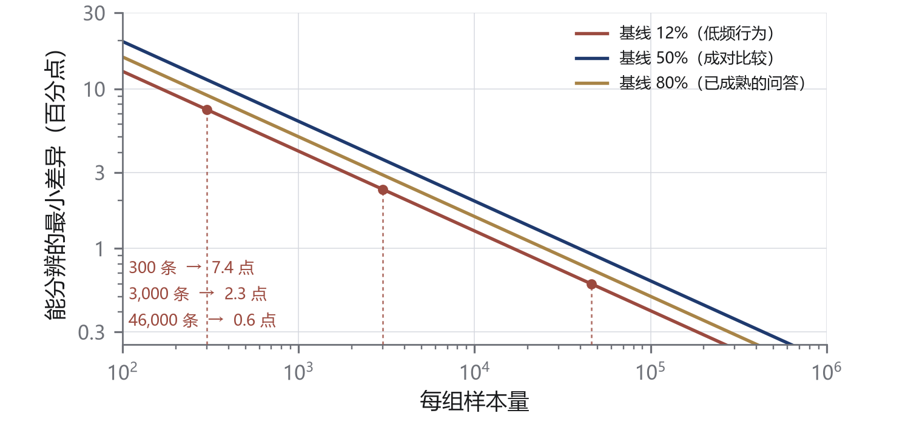
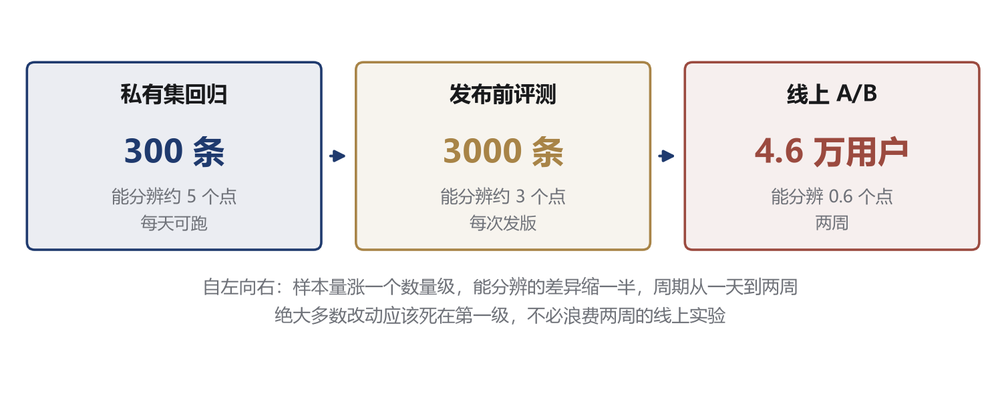

## 竞技场、私有评测与线上实验

有个团队花了三个月，把一个模型在公开竞技场上的排名从第七推到第三。上线之后，业务方的反馈是"没感觉到变化"，客服工单量没降，用户留存没升。

这不是白干活。排名从第七到第三，说明模型在"大众偏好"这个维度上确实更强了。但业务方要的不是大众偏好，是"在退款咨询这类问题上少错一条"。这两件事之间没有必然联系。

要判断一个模型改动值不值得上，需要三种评测，它们回答三个不同的问题。公开榜单回答"相对水平"，私有评测回答"有没有回归"，线上实验回答"真实收益"。三件事不能互相替代，也不能用其中一个的数字去推另一个。

### 竞技场在测什么

做法很简单：用户提一个问题，系统给两个匿名的回答，让他选一个更好的。选完之后揭示是哪两个模型。

这些成对比较被收集起来，拟合一个实力分数。拟合用的模型叫 Bradley-Terry，简称 BT。

$$P(i\succ j)=\sigma(\theta_i-\theta_j)=\frac{1}{1+e^{-(\theta_i-\theta_j)}}$$

这个式子在说什么。$\theta_i$ 是模型 $i$ 的实力值，$\theta_i-\theta_j$ 是两者的差距。差距越大，$i$ 赢的概率越接近 1。$\sigma$ 是 sigmoid，把任意实数压到 0 到 1 之间。差距为 0 时胜率正好 50%，差距为 2 左右时胜率大约 88%。

Elo 是这套东西的在线版本。每来一场比赛，根据"预期胜率"和"实际结果"的差，调整双方的分数。它是 BT 的一个增量近似，长期收敛到同样的解。所以两者算出来的排序通常一致，只是 Elo 的绝对数值依赖于初始分和 K 因子，不能直接比。

竞技场有三个性质要记住。

**没有标准答案。** 它测的是"人更喜欢哪个"，不是"哪个更正确"。一道数学题，一个答对了但写得很啰嗦，一个答错但条理清楚，很多人会选后者。

**偏好会漂移。** 用户群体在变，提问分布在变，界面的呈现方式也在变。同一个模型，同一批对手，隔半年重跑，分数可能差几十分。

**可以刷。** 长答案、加格式、加免责声明、多说几句"这是个好问题"，都能提高胜率而不提高实质质量。这不是作弊，是优化了评测所测量的东西。

所以竞技场分数适合回答一个问题："在普通用户的主观偏好上，谁更强"。它不适合回答"哪一版更适合我的业务"。

### 算一遍：一场比较能说明多少

BT 的拟合是对数似然最大化：

$$\mathcal{L}(\theta)=\sum_{(i,j)\in\mathcal{D}}\Big[y_{ij}\log\sigma(\theta_i-\theta_j)+(1-y_{ij})\log\sigma(\theta_j-\theta_i)\Big]$$

这个式子在说什么。$\mathcal{D}$ 是所有比较记录，$y_{ij}=1$ 表示 $i$ 赢了。每一项是对一次比较的"预测得多准"的度量，全部加起来取最大，就得到最可能产生这批结果的实力值。

注意这个式子有一个性质：所有 $\theta$ 同时加一个常数，似然不变。所以必须固定一个基准（比如把某个模型定为 0），否则解不唯一。加了 L2 正则也能达到同样的效果。

标准误怎么估？最粗略的近似是：

$$\mathrm{SE}\approx\frac{1}{\sqrt{n_{\text{eff}}}}$$

这个式子在说什么。$n_{\text{eff}}$ 是有效比较场次。场次越多，估得越准，误差按平方根衰减。

具体算一个。假设模型 A 和模型 B 直接对比了 300 场，A 赢 165 场，B 赢 135 场，胜率 55%。

$$\mathrm{SE}=\sqrt{\frac{0.55\times0.45}{300}}\approx 0.029$$

95% 置信区间是 $[49.3\%, 60.7\%]$，包含 50%。也就是说，"A 比 B 强"这个结论在 300 场时还不成立。

要让这个 5 个点的差距达到显著，需要多少场？

$$n\approx\frac{2\,(1.96+0.84)^2\times 0.55\times 0.45}{0.05^2}=\frac{2\times 7.84\times 0.2475}{0.0025}\approx 1552$$

一千五百多场直接对比。而且这是"只看这两者"的情况；如果放在一个几十个模型的池子里，A 和 B 的直接对比可能只有总场次的几分之一，需要的总场次会更多。

这就解释了一个常见现象：榜单上前十名的分数差距往往小于各自的置信区间。排名变了，不代表实力变了。

### 算一遍：池子效应有多大

把上面那句"对手一变分数就变"算成一个具体数字。

假设 8 个模型，A 的真实实力 $\theta_A=1.0$，其余七个都是 0。A 对每一个的胜率是

$$P=\sigma(1.0)=\frac{1}{1+e^{-1}}\approx 0.731$$

如果 A 与每个对手各赛一千场，总共七千场，A 赢大约 $7000\times 0.731=5117$ 场，总体胜率 73.1%。按常用的换算，实力差对应到分数上是

$$\Delta_{\text{Elo}}=400\log_{10}\frac{p}{1-p}=400\log_{10}\frac{0.731}{0.269}\approx 400\times 0.434\approx 174$$

现在池子里新增两个强模型 C 和 D，$\theta=1.5$。A 对它们的胜率变成

$$\sigma(1.0-1.5)=\sigma(-0.5)\approx 0.377$$

A 与 C、D 各赛五百场，赢大约 377 场；与原来七个对手的七千场不变，还是 5117 场。总场次八千，胜率

$$\frac{5117+377}{8000}\approx 0.687$$

对应分数差 $400\log_{10}(0.687/0.313)\approx 137$。

A 的真实实力一点没变，分数从 174 掉到 137，掉了 37 分。如果这个榜单把所有人归一到平均分 1000，A 会从 1174 变成 1137。团队看到的就是"我们的模型退步了 37 分"。

这个算例说明的不是"竞技场不靠谱"，而是"绝对分不能跨期比较"。要比较，必须在同一个池子里，看同一批拟合出的相对排序。

### 竞技场分数的三个伴生指标

只看一个胜率，很容易把“刷分”当成“变强”。加上三个伴生指标，就能分辨。

**长度。** 算胜出回答与落败回答的平均长度比。实测量级：很多榜单上这个比值在 1.1 到 1.4 之间，也就是说胜者系统性更长。如果你的新版本胜率提升 5 个点，而长度比从 1.15 升到 1.35，这个提升就应该打问号。

**结构。** 统计“带小标题/分点”的回答在其中占的比例。如果胜出组的比例明显高于落败组，说明评测在奖励格式。这个数不需要人工，正则就能算。

**措辞。** 算一批“兼容性词汇”的出现率，比如“当然可以”“这是个好问题”“希望能帮到你”。它们在主观评测里往往能抬高分数，但不提供信息。

三个指标都不需要额外评测，用已有的比较记录就能算。把它们报在胜率旁边，读者自己会判断。

一个具体的用法：如果三个指标都稳定而胜率提升，可信；如果胜率提升而三个指标中有两个变了，就要先控制这两个变量重算一遍（比如按长度比分层看胜率）。后者和前面讲判定模型偏差时的分层方法完全一样，只是换了个数据源。

这也说明竞技场数据不是“脏数据”，而是“没被充分读的数据”。同一个数据集，只看胜率是一种用法，把长度、结构、措辞当协变量又是另一种用法，后者的信息量至少是前者的两倍。

### 为什么分数不能跨版本比

BT 分数是相对的。它只在"参与拟合的那批模型和那批题目"的上下文里有意义。

**池子效应。** 同一个模型，对手弱的时候分数高，对手强的时候分数低。新模型加入、老模型退出，都会让所有人的分数重新分配。一个模型"掉了 40 分"，可能只是因为它旁边多了两个强模型。

**题目分布。** 竞技场的题目来自真实用户，分布随热点变化。某个模型在代码题上强，代码题占比高的时候它分数就高。题目分布一变，排序就可能翻转。

**用户群体。** 不同渠道、不同地区的用户偏好不同。如果平台用户构成变了（比如涌进一批新用户），分数会整体漂移。

**刷分策略的扩散。** 一旦有人发现"加长答案能提分"，大家都加长，优势就抵消了。但在抵消之前，先加的那批人拿到了虚高的分数。

工程上的正确用法是：只看同一批拟合里的相对排序，不看绝对数值，也不跨期比较。如果要比较两个版本，必须在同一时间、同一批题目、同一批对手下做。

那竞技场数据到底能怎么用？三个用法是靠谱的。一是看大类之间的差异：一个模型在写作和代码两类问题上的相对位置，比总分稳定得多。二是看风格偏好：哪类回答更容易被选，这对产品设计有直接价值。三是做交叉排查：如果你的离线评测和竞技场结论差得很远，至少有一边的评测有问题，值得查。

不能用的是两个。一是拿分数做对外宣传的绝对指标，因为对手池一变它就不成立。二是拿它预测业务效果，因为它测的是普通用户的主观选择，不是你的场景下的任务完成率。

### 私有评测集

业务方真正需要的是一套自己的评测集。它有三个特点。

**贴合业务。** 题目来自真实流量，覆盖高频和长尾。

**可判定。** 大部分题目有标准答案或明确的判定规则。

**冻结。** 不对外公开，不进入任何训练数据，版本固定。

建设流程七步。

**第一步，定用途。** 是"每次更新看有没有回归"，还是"选型时比较几个模型"。前者要覆盖广、每题都要有明确判据；后者可以更聚焦、允许主观题。用途不同，规模和数据分布都不一样。

**第二步，从线上日志分层抽样。** 按意图分类、输入长度、语言、用户类型分层。每一层抽多少，按线上占比来定，但要给长尾层设一个下限，否则长尾永远抽不到。

**第三步，设计判定方式。** 能规则判的一律用规则。信息抽取比对字段，数学题比对答案，分类题比对标签。只有开放题才用模型判或人工判。这一步决定了维护成本。

**第四步，标注。** 两人独立标，算一致性。一致性低的题要么删掉，要么把判定规则写得更细。有争议的题由第三人仲裁。

**第五步，冻结与版本。** 建一个 `v1.0`，之后所有分数都对齐这个版本。要改题就出 `v1.1`，同时保留旧版本，让新旧分数能对照。

**第六步，防泄漏。** 私有集不和训练数据放一起，看过题的人不参与数据筛选。

**第七步，维护节奏。** 每季度补一批新题，淘汰过时的。补题的量控制在总量的 10% 到 20%，这样分数不会因为换题大幅跳动。

规模定多少？常见起点是三百到五百条。这个量能做回归，但做不了精细比较。

算一下分辨能力。三百条题，单模型准确率 80%：

$$\mathrm{SE}=\sqrt{\frac{0.8\times0.2}{300}}\approx 0.023$$

置信区间半宽 2.3 个百分点。所以三百条能分辨大约 5 个点以上的差异，5 个点以下看不出来。

如果要分辨 3 个点：

$$n\approx\frac{2\,(1.96+0.84)^2\times 0.8\times 0.2}{0.03^2}=\frac{2\times 7.84\times 0.16}{0.0009}\approx 2787$$

将近三千条。这是个反直觉的数：想看清 3 个点，需要三千条题，而不是三百条。

所以实践里的分层是：日常回归用三百条（只看"有没有大跌"），版本发布前用一千条（看"有没有中等幅度的变化"），重大改版用三千条（看"小幅度提升"）。不同场景用不同规模，比一套评测打天下合理。

### 私有集里放什么题目

抽样不是按线上比例复制一份。评测集是检测器，不是抽样调查，每一类的分辨率都要够。

一个可用的配比是这样。

| 类别 | 线上占比 | 评测集占比 | 说明 |
|---|---|---|---|
| 高频意图 | 60% | 35% | 适当压缩，省标注成本 |
| 中频意图 | 25% | 25% | 基本按比例 |
| 长尾、罕见意图 | 12% | 30% | 上采样，回归常发生在这里 |
| 对抗与边缘用例 | 3% | 10% | 人工构造 |

为什么长尾要上采样？因为回归最容易发生在那里。高频问题每次迭代都有人测，出了问题当天就能发现；长尾问题可能三个月没人碰，改一个提示词就坏了。评测集的价值之一就是把长尾的检测频率提上来。

对抗样本要单独设计。它们不是"难一点的题"，而是"看上去正常但容易触发特定失效"的题。比如带否定句的政策问答、带多个条件的退款请求、包含少量乱码的用户输入。这类题只占线上不到一成，但它们是回归的高发区。

还有一类容易被遗漏：拒答与边界。用户问了一个应该拒答的问题，模型拒了，但拒得很生硬；或者用户问了一个应该回答的问题，模型拒了。这两类都要有，而且判定标准要写清楚，不能靠标注人员当场判断。

### 算一遍：分层怎么分才省

“按线上比例抽样”这句话听起来最公平，实际上是对评测集最差的建议。把它算一遍就清楚了。

假设线上每天一万条请求，分四层：高频意图占六成，中频两成半，长尾一成二，对抗与边缘用例百分之三。各层内部准确率的标准差分别是 0.40、0.45、0.30、0.45（越接近五成的层，方差越大）。总共只能标三百条。

**目标一：估计总体准确率。** 这时用最优分配（Neyman）：每层分到的样本数正比于“该层总量 × 该层标准差”。

$$n_h\propto N_h\sigma_h$$

四层的权重是 $6000\times0.40=2400$、$2500\times0.45=1125$、$1200\times0.30=360$、$300\times0.45=135$，合计 4020。三百条大致分成 179、84、27、10。

**目标二：发现任何一层变差。** 这时目标不是估总体，而是每层都有足够精度。要求各层标准误相同，则

$$n_h\propto \sigma_h^2$$

四层权重变成 0.16、0.2025、0.09、0.2025，三百条分成 73、93、41、93。

两种分配差得很远。对抗层在第一种里只分到 10 条，标准误是

$$\frac{0.45}{\sqrt{10}}\approx 0.14$$

十四个百分点。这个精度下，对抗层准确率从 80% 掉到 65% 也看不出来。而对抗层恰好是最容易出回归的地方。

结论很清楚：**评测集不是抽样调查，不能按 Neyman 分。** 它是一组检测器，每一层都要有足够的检出能力。前面那个“长尾上采样到三成”的配比，背后的依据就是这个，不是拍脑袋。

这也是为什么“我们的评测集按线上分布抽样”这句话在评审里经常被质疑。它是抽样调查的好习惯，是回归检测的坏习惯。两种目的需要不同的设计，混淆它们会让评测集看起来很科学，实际上漏掉最需要盯的那一块。

### 线上实验

离线评测回答"在测试集上变了多少"，线上实验回答"真实用户是否受益"。

基本做法是 A/B：把流量随机分成两组，一组用新版本，一组用旧版本，比较核心指标。

有四件事必须做对。

**随机化单位。** 按用户哈希分组，不是按请求。按请求分组会让同一个用户在两版之间来回切换，体验割裂，指标也被污染。而且模型效果有"上下文惯性"，同一个用户看到两种风格，反应会变。

**指标选择。** 别只看"用户满意度"这种笼统指标，它的噪声极大而且有滞后。要看具体行为：追问率、复制率、转人工率、任务完成率、会话轮数。每个指标对应一个具体假设，比如"追问率高说明第一次没答清"。

**护栏指标。** 除了看收益，还要看代价：平均延迟、每会话成本、投诉率、安全拦截率。一个提升 2% 完成率但延迟翻倍的版本，通常不能上。

**新奇效应。** 新版本上线头几天，用户会因为"变了"而多试几下，指标虚高。至少要观察一到两周，并且避开周内效应（工作日和周末的用户行为不一样）。

算一下样本量。假设基线任务完成率 12%，想检测相对 5% 的提升，也就是从 12% 到 12.6%，绝对差异 0.6 个百分点。

$$n\approx\frac{2\,(1.96+0.84)^2\times 0.12\times 0.88}{0.006^2}=\frac{2\times 7.84\times 0.1056}{0.000036}\approx 46000$$

每组四万六千个用户。如果日活两万、五五分流，每组每天一万，需要跑五天。但考虑新奇效应和周期效应，实际跑两周更稳。

这个数字说明一件事：想检测 5% 的相对提升，需要的样本量是几万级。很多团队拿着两千用户的实验说"提升了 8%"，那个数字大概率是噪声。

**不要边看边停。** 每天看一次数据，看到显著就停，这是典型的多次检验问题。看十次，至少有一次会碰巧显著。正确做法是事先定好样本量和观察期，到点再看；或者用序贯检验的方法，把"看几次"也纳入统计校正。

### 功效曲线：一张图看完样本量

上面的算式可以画成一张图。横轴是每组样本量，纵轴是“能分辨的最小差异”，三条线对应不同的基线水平。

这张图里用的是 80% 功效、双侧 5% 的临界值（$1.96+0.84=2.80$），公式是

$$\delta_{\min}\approx 2.80\sqrt{\frac{2p(1-p)}{n}}$$

三个标的点值得记：三百条时能分辨 7.4 个点（基线 12%），三千条时 2.3 个点，四万六千条时 0.6 个点。这正是三级评测的样本量来源。

这里有一个容易混的地方，需要说明。前面算私有集时说“三百条能分辨约 5 个点”，用的是“两个标准误”的粗判据：

$$2\times\sqrt{\frac{0.8\times 0.2}{300}}=2\times0.023\approx 4.6$$

而图里用的是 80% 功效，要求 $2.80$ 个标准误，得 7.4 个点。两个数不矛盾，它们回答的是两个问题：前者是“看到 5 点差异时它算不算异常”，后者是“真实差异 5 点时我能不能稳定测到”。做决策要用后者，因为它关心“漏掉”的概率。

这张图还有一个实用用法：反查。你已经知道要测的效果大小（比如产品只愿意上“至少 2 个点”的改动），就在纵轴 2 的位置画一条水平线，看它和三条线交在哪里——基线 12% 时约四千条，基线 50% 时约两万条。这两个数就是“这个实验值不值得做”的答案。如果交点在日活之上，就不要做，直接上线看长周期指标。

把常用组合算成一张速查表，省得每次重新推。

| 基线 | 5 点 | 3 点 | 1 点 |
|---|---|---|---|
| 12% | 660 | 1840 | 16600 |
| 50% | 1570 | 4360 | 39200 |
| 80% | 1000 | 2790 | 25100 |

三列都是“每组样本量”，80% 功效、双侧 5%。注意中间那行最贵：基线 50% 时方差最大，要的钱最多。这解释了为什么成对比较的评测动辄需要几万对，而准确率评测（基线常在八成以上）几千条就能看出三个点。

这张表还有一个反直觉的用法：如果你已经跑了实验并看到差异，可以反查“这个差异是否在本样本量能分辨的范围内”。比如三千条样本、基线 12%，看到 1.5 个点的提升——查表，三千条只能分辨 2.3 个点，所以 1.5 不够，应当报“未检出差异”而不是“小幅提升”。很多报告里的“小幅提升”都是这种产物。

### 算一遍：CUPED 能省多少样本

样本量不够时，有一个不改业务、只改统计的做法叫 CUPED：用实验前的指标做协变量，把方差扣掉。

做法是：对每个用户，取实验前一周的同一个指标 $X$，算一个系数

$$\theta=\frac{\mathrm{Cov}(Y,X)}{\mathrm{Var}(X)}$$

然后把指标修正成 $Y'=Y-\theta(X-\bar X)$。修正后的方差是

$$\mathrm{Var}(Y')=\mathrm{Var}(Y)\,(1-\rho^2)$$

这个式子在说什么：$\rho$ 是实验前指标和实验指标的相关系数。相关越高，能扣掉的方差越多，等效样本量就越多。

代入几个数。$\rho=0.6$ 时，方差降 36%，等效样本量变成原来的 $1/(1-0.36)=1.56$ 倍。$\rho=0.8$ 时，降 64%，变成 $2.8$ 倍。

这对前面那个“四万六千用户”的算例意味着什么？如果实验前指标的相关是 0.6，需要的人数是

$$46000\times0.36\approx 16500$$

每组一万六千五，实验周期从五天缩到两天。如果相关是 0.3，只降 9%，省不了多少，不值得为它加工程。

CUPED 的边界要说清楚。一是它只降方差，不降偏差：分流有问题它一点帮不上。二是相关系数必须用**实验前**的数据算，不能用实验期间的数据，否则会把处理效应自己扣掉。三是它假设“实验前的差异不会随处理变化”，如果新版本对老用户和新用户的效果不同，这个假设会破。

实践里的判据很简单：先算 $\rho$，高于 0.4 就上，低于 0.3 就算了。算 $\rho$ 不需要新数据，用历史数据十分钟就能出。这么便宜的方差缩减，不用很可惜。

### 实验里常见的四种干扰

**同用户跨组。** 同一个用户今天看到新版本，明天看到旧版本，他无法形成稳定预期，行为指标就乱了。这叫分流不独立。解法是按用户分组并且保持一段时间稳定，不每次请求重新随机。

**学习效应。** 用户用了一段时间之后，会改变提问方式。新版本先上线的那一组，用户可能已经学会了“怎么说它才能听懂”，这会让新版本看起来更好。控制办法是对比“同一用户在新旧两版上的表现”，而不是只看增量。

**溢出。** 强社交产品里，同一个群里的人可能分到不同组，互相截图分享。这时候两组不独立。解法是按群组而不是按个人分流。

**埋点延迟。** 转化类指标有滞后窗口。一个用户今天提问，三天后才付费。如果只统计当天的数据，会把新版本的效果低估。所以实验周期要长于转化窗口，或者用同口径的滞后指标。

还有一个容易忽略的干扰：低频指标的噪声。投诉率、安全事故率这些指标数量很少，单次实验根本看不出差异，但它们恰恰是最重要的护栏。正确做法是不用它们判实验成败，只用它们做“红线监控”：超过某个绝对阈值就回滚，不问统计显著性。

### 边看边停会把错误率花光

“每天看一眼，显著就停”是实验里最常见的错误，但很少人算过它到底错多少。

每次看都做一次 $\alpha=0.05$ 的检验，看 $k$ 次，至少一次假阳性的概率是

$$1-(1-0.05)^k$$

看五天是 23%，看十天是 40%，看二十天是 64%。也就是说，一个完全没效果的改动，只要你看得够勤，早晚会“显著”。

这不是统计学的抠细节，它在真实系统里造成过很多错误上线：一个没用的改动在第七天碰巧越过阈值，团队以为找到了增长点，全量之后指标回落，再花两周找原因。

三个可行做法。

**一，事先定好样本量和观察期。** 到点看一次，不多看。这是最简单也最可靠的做法，代价是必须忍住不看。

**二，把 $\alpha$ 分给几次中期分析。** 如果业务确实需要中途看，就事先声明“只在 50% 流量时看一次”，把总 $\alpha$ 分成 0.005 和 0.045。第一次用 $z=2.58$ 的严阈值，最后一次用 2.00。这样总体假阳性率仍是 5%。

**三，用始终有效的检验。** 有一类方法（统称 always-valid）允许任意时刻看、任意时刻停，不需要校正。代价是同样本量下功效略低，大致相当于损失 10% 到 20% 的样本。如果业务真的必须天天盯，选它，比每天乱看好。

一个容易混的点：护栏指标不受这套规矩约束。护栏指标（延迟、投诉、安全拦截）本来就该实时盯，发现异常立即回滚——这类决策不需要统计显著性，因为代价不对称：多回滚一次的代价远小于漏掉一次事故。所以“不要边看边停”只适用于效果指标，不适用于护栏指标。把这两类分开对待，是实验设计里最容易被忽略的一条。

### 一个失败案例：A/A 测试

有个团队做了一个 A/B，新版本完成率提升 9 个点，非常显著，准备全量。上线前有人建议先跑一次 A/A：把同一个版本随机分成两组，跑同样的流程。

结果 A/A 也跑出了 7 个点的差异。

查了两天，发现分流有问题。缓存键用的是请求 ID 而不是用户 ID，导致同一个用户的会话在不同请求里被分到了不同组。而"完成率"是按会话算的，一个会话跨了两组，指标就乱了。

修法是改缓存键，重新分流。再跑 A/A，差异回到 1 个点以内，符合预期。

这个案例的教训很直接：**任何 A/B 上线之前，先跑一次 A/A。** 成本是一个实验周期，收益是确认你的实验管道本身没有偏差。

A/A 的判据：同一版本分两组，指标的差异应该落在置信区间内，且不能有系统性方向。如果 A/A 反复出现"后上线的那组更好"，那就是时间趋势或者分流偏差。

### 又一个失败案例：私有集被“调”坏了

A/A 测的是实验管道，还有一种失效发生在测试集自己身上，而且更常见。

一个团队有一套三百条的私有评测集。他们每天用它跑五个候选提示词变体，挑分最高的上线。四十轮之后，分数从 71 涨到 84，团队很满意，于是把“每周迭代”写进了流程。

上线三个月，业务指标一点没动。有人把四十轮里上线的版本拿出来，在另一批同分布的新题上重测，得分只有 72。

原因不复杂：每一轮从五个候选里挑最高，就是一次“选择偏差”。三百条题、标准误 2.3 个点，五选一挑最高，大概能把分数抬 1.5 到 2 个点（最高值比均值高约 0.7 个标准误）。四十轮下来，光靠挑，就能累积十几点。这些点数不代表能力，只代表“这套题被调熟了”。

同一件事在学术界有个名字叫“在测试集上调参”，在工程里叫“拿评测集当训练信号”。它的可怕之处在于分数曲线很好看，每一轮都有正反馈，你没有任何内部信号能发现自己在过拟合。

三个防护措施，成本递增。

第一，留一个隐藏集。从三百条里划出一百条，平时绝不碰，只在发版前跑一次。隐藏集的分数比开放集低两三个点是正常的；低到两位数，说明开放集已经被用脏了。

第二，轮换。每轮从三个子集里随机选一个跑，不固定。这样单轮信号噪声大一些，但不会持续对着同一批题优化。

第三，也是根本的做法，把优化目标和评测目标分开。提示词迭代应该看“错误类型分布有没有变”，而不是看总分。总分涨了但错误类型没变，多半是拟合。

一个可操作的判据：如果连续三轮总分上升而错误类型分布完全不变，停止迭代，先查是不是过拟合。真正的能力提升会改变错误的形状，不会只改变错误的个数。

### 算一遍：八个指标里至少一个显著

线上实验最容易发生的错误，不是算错，是看太多。

一次实验你盯着八个指标：完成率、追问率、复制率、转人工率、会话轮数、延迟、成本、投诉率。每个都有 $\alpha=0.05$，假设真的没效果，至少一个显著的概率是

$$1-(1-0.05)^{8}\approx 0.34$$

三分之一。换句话说，一个完全无用的改动，有三分之一的机会让你找到一个“显著提升”。而且人会不自觉地挑那个最好看的报告。

三个修正办法，从简单到严谨。

**一，事先指定一个主指标。** 宣告“这个实验只看任务完成率，其余都是参考”。主指标用 0.05，其余只看方向和量级，不做显著性声明。这是最好的性价比，几乎不损失检出力。

**二，Bonferroni 校正。** 八个指标都用 $\alpha=0.05/8=0.00625$，对应 $z=2.73$ 而不是 1.96。代价是样本量要多 94%（$(2.73/1.96)^2\approx1.94$）。那些$\alpha$ 太保守，但对于必须同时对多个指标下结论的合规场景是合适的。

**三，分层。** 把指标分成两类：一个决策指标 + 若干个监控指标。决策指标做检验，监控指标只做“是否越过红线”的判断（比如延迟涨 10% 就回滚），不做“是否显著提升”的声明。实践里最常用的是这个。

还有一个相关的问题：同一个人群上先后做两个实验，指标会互相污染。如果第一个实验给用户留下了印象，第二个实验的基线已经变了。所以同一人群上的实验要么串行且留足冷却期（至少一周），要么按人群分层做并行。

### 三种评测不一致时怎么查

私有集涨了 5 个点，线上一点没动。这是最常见也最让人恼火的一种不一致。四个可能，按排查成本排序。

**可能一：测试集不覆盖线上分布。** 私有集里六成是“高频意图”的模板题，而线上长尾占了四成。模型在所有模板题上变好，在长尾上变差，总分却可能是上涨的。查法：按分层看分数，不要在总分上找原因。

**可能二：提升集中在不可感知的维度。** 比如模型把“格式更规范”做了，但用户要的是“少错一条”。查法：看错误类型分布，不要只看个数。

**可能三：线上有拦截机制。** 如果输出过滤或安全拦截把新版本的“更详细回答”拦了，用户看不到提升。查法：看拦截率有没有变化。

**可能四：分流或埋点问题。** 这是最后才该怀疑的，但一旦成立，前面三条都白查。查法：跑一次 A/A（前面那个案例就是这种）。

排查顺序建议是 1 → 2 → 3 → 4，因为前两个只需要看已有数据，第三个看日志，第四个要重跑实验。很多人直接从第四个开始，因为“实验不显著”最容易被归因于管道问题，而它恰恰是最少见的。

反过来，如果线上涨了而私有集跌了，也要查。这通常意味着新版本在“让用户多试几下”这类行为指标上占便宜（比如回答变短、更快给出结论，用户重试更多但满意度未变），而不是真的变好。这时候应该看更长周期的指标，比如七日留存。

这两种不一致都有一个共同的信息价值：它们告诉你那个你没测到的东西存在。一个团队如果从没遇到过不一致，通常是在看同一个指标的两个尺度，而不是在看两个不同的指标。

### 一个可照着做的噪声标定

前面说“噪声水平”是私有集的五件必项之一。具体怎么测？半天。

**方法一：同版本多跑。** 同一个模型、同一套题、温度 0，跑三次。理论上三次完全一致（温度 0 是贪婪解码），所以它测的是“服务端非确定性”（批量大小、kernel 选择、浮点累加顺序）。

实测量级：一个三百条题集，三次分数的差异往往在 0.5 到 1.5 个点之间。它比你想象的大，因为 GPU 上的归约顺序不固定。

**方法二：改采样参数。** 温度从 0 改到 0.3，跑三次。这个波动包含了“输出措辞变化”带来的判定不确定性。它不再是噪声，而是“业务实际感受到的波动”，通常有三到六个点。

两个数都要报，因为它们回答不同问题。第一个是“同一份代码跑两次会差多少”，决定了技术回归的阈值；第二个是“用户可能遇到的差异”，决定了产品发布的阈值。

利用它们的方式很直接：前者的一点五倍作为“回归告警线”，后者作为“单次实验不能下结论”的门槛。比如噪声 3 个点，那么“新版本涨 2 点”就不值得发。

一个容易漏掉的细节：判定模型自己的非确定性也要算进去。即使生成完全一样，判定模型每次打分可能差一个点。测法很简单：拿同一批固定输出，让判定模型跑三次，看分数差多少。这个数应该从总噪声里扣掉，否则你会把判定器的不稳定当成模型的不稳定。

### 四周搭一套可用的评测

如果一个团队从零开始，下面这个节奏是可行的。

**第一周，采样与判定规则。** 从线上日志抽五百条，按意图分层。同时把判定规则写成文字，具体到“什么算对、什么算部分对、什么算错”。这一步花的时间最多，但它决定了后面所有工作的质量。判定规则写不清楚，标注一致性就不可能高。

**第二周，标注与仲裁。** 两人独立标，算一致性。一致性低于 0.6 的类别，回到第一周重写规则。争议题由第三人定，把定下来的理由补进规则。这一周结束时，应该得到三百到四百条可用的题，每条都有唯一确定的判定。

**第三周，跑基线、定容差。** 拿当前线上版本跑一遍，得到基线分数。再用同一个版本跑三次（换随机种子或温度），看分数波动多大。这个波动就是噪声水平，也是回归告警的阈值：低于噪声的下降不算下降。

**第四周，接入流程、跑 A/A。** 把评测接进发版流程，每次更新自动跑。同时做一次线上 A/A，确认分流管道没偏差。

四周之后，你手上有了一套能用的东西：一个三百条的冻结集，一份写清楚的判定规则，一个噪声水平的估计，一条能自动跑的管道。这四样东西比一个十万条的公开榜单有用得多，因为它们的边界你是清楚的。

之后的维护成本主要在补题。每季度补一成到两成，把过时的换掉。补题的时候不要改判定规则，否则新旧分数不能比。

### 私有集的五件必项

一套能长期用的私有集，靠的不是题目多，是五样东西齐全。

| 项 | 具体内容 | 不做会怎样 |
|---|---|---|
| 冻结 | 版本号 + 哈希，改动走新版本 | 分数跨周不可比 |
| 判定规则 | 一页纸，含边界例子 | 两个人标出两个结果 |
| 噪声水平 | 同版本跑三次的波动 | 把噪声当提升 |
| 留出集 | 一成题平时不碰 | 越调越虚高 |
| 补题节奏 | 季度一成到两成 | 半年后全过时 |

五件里最容易被省掉的是“噪声水平”。它听起来像学术讲究，实际是日常决策的基准：基线 80%、噪声 2.3 个点，那么 78.9 到 81.1 之间的一切变化都是噪声，不需要开会讨论。没有这个数，团队会为 0.5 个点的波动开三次会。

测噪声的方法很简单：同一个模型、同一套题、只换随机种子或温度，跑三次。取三次的标准差。这个数应该写进评测集的 README，和题数、版本号放在一起。

第二容易被省掉的是“留出集”。它和噪声水平的性质不同：噪声水平告诉你“多小算小”，留出集告诉你“是不是调过头了”。两者都不能从事后补算，必须提前设计。

还有一个很少被写进文档但很关键的事：判定规则的边界例子。规则写“回答包含完整退款金额且不包含错误承诺则算对”，这句话不够。要附上五个“算对”和五个“算错”的真实例子，尤其是那些看起来模棱两可的。标注一致性从 0.6 提到 0.8，靠的往往就是这十个例子，不是规则本身的措辞。

### 三种评测的分工

| 评测 | 回答什么 | 何时跑 | 主要风险 |
|---|---|---|---|
| 公开榜单 | 相对水平、对外沟通 | 发布时 | 污染、刷分、不可比 |
| 私有评测 | 有没有回归 | 每次更新 | 覆盖不足、题目过时 |
| 线上实验 | 真实收益 | 重大改版 | 分流偏差、新奇效应 |

成本这一列放不进表里，单独说：一次公开榜单近乎免费（但不可控），一次三百条私有集是半天人力，一次线上实验要两周
 和几万用户。三者的成本差两个数量级，这也是为什么它们必须按顺序过。

三者缺一不可。只看榜单会做错方向，因为榜单测的是大众偏好；只看私有集会高估收益，因为测试集上的提升不一定转化；只做线上实验则周期太长、成本太高，而且很多改动（比如安全加固）的效果在短期指标上看不出来。

一个成熟团队的做法是三级漏斗。任何改动先过私有集，跌了就退回；过了私有集再看榜单有没有异常下滑；重大改动才上线上实验。三级都过，才全量。

还有一类评测不属于这三层，但很重要：人工深度审阅。每次大版本找五个真实用户，看他们用完整个对话，问三个问题：哪里卡了、哪里不信、下次还会不会用。样本量小到没有任何统计意义，但它能发现所有指标都发现不了的东西。定性和定量的分工，在这里最明显。

这个漏斗的价值不在于"更准"，而在于"更省"。绝大多数改动会死在第一级，不用浪费两周的线上实验。

评测这件事的难处不在于算分，在于解释分数。一个分数从 82 变成 85，可能是模型真的好了，可能是题目变简单了，可能是判定模型偏了，也可能只是噪声。把这四种可能分开，需要的不是更复杂的指标，而是更清楚的对照设计。

所有对照设计的共同点是：改变一个东西，固定其余所有东西。这个原则听起来简单，做起来要抵住很多诱惑：想同时上两个功能、想换新测试集、想调一下提示词。每多改一样，你就少知道一件事。

竞技场分数、私有集分数、线上指标，三者各自都有明确的适用范围。用错范围，数字越精确，误导越大。一个团队真正需要的，不是更多的榜单，而是对自己那套评测的边界有清醒的认识：它测什么，不测什么，多大的差异才算差异。这三句话能答清楚，评测就已经比大多数团队做得好了。
