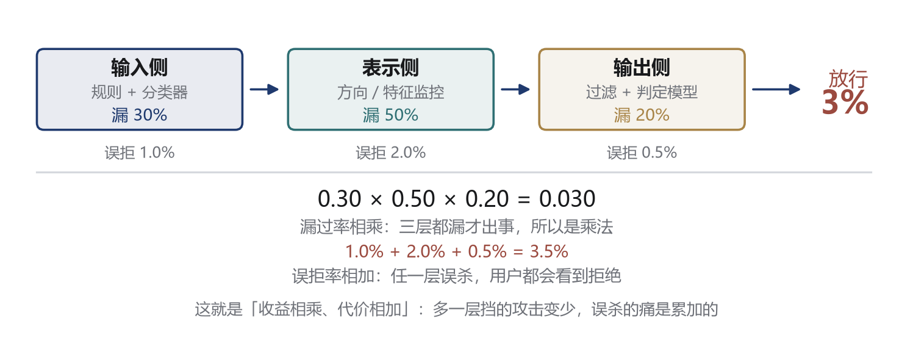

## 可解释性在安全与对齐里的用处

一次越狱事件之后，安全团队要做复盘。攻击用的提示词是一段角色扮演加多层嵌套的指令，绕过了模型的拒绝。

复盘会上有两种意见。一种说，防线被压制了，攻击把"拒绝"这个机制压了下去。另一种说，防线从来没有覆盖过这种情况，模型只是不知道该怎么拒绝一个包裹在角色扮演里的请求。

两种结论对应完全不同的对策。前者要加固防线，比如在推理时给拒绝方向加权重；后者要补数据，让模型见过这类结构。选错了，下次还会被绕过。

分清这两种情况，靠的就是前面几章的方法。这一章讲它们在安全和对齐里到底能回答什么，以及哪些地方是被夸大的。

### 用途一：定位失效

模型在某类输入上出错，可能是四种原因之一：知识缺失、信息没被取用、某条路径被压制、输出格式错。

四种原因对应四种修法，而分层的方法能把它们分开。

| 症状 | 先查哪层 | 具体做法 | 对应修法 |
|---|---|---|---|
| 答不出某个事实 | 表示层 | 该事实的线性探针 | 补数据 |
| 信息在但答错 | 表示层＋输出层 | 探针准但输出错 | 改提示、调检索 |
| 答案中途丢失 | 归因＋lens | 分层看正确答案排名 | 改生成顺序 |
| 某类输入稳定错 | 组件层 | 逐层激活替换 | 定向干预 |

拿开头那个越狱例子走一遍。

第一步，取一条被成功越狱的输入，再造一条结构相同但内容无害的。两条都跑前向。

第二步，用拒绝方向做投影。在正常的有害请求上，这条方向的投影值很高；在越狱成功的请求上，如果投影值也很高，说明"拒绝"这个信号还在，模型只是没有执行它。如果投影值很低，说明信号被压掉了。

第三步，用探针查"这条输入是否含有有害意图"。探针准确率高，说明模型知道这是有害的；准确率低，说明识别的第一步就没做到。

两个结果组合起来，落在三种情况里。

投影高、探针高：模型知道有害，拒绝信号也还在，但输出环节没执行。这是执行环节的问题，可能是后面几层把拒绝信号覆盖了。

投影低、探针高：模型知道有害，但拒绝信号被压掉了。这是典型的压制型越狱，攻击成功在表示层。

探针低：模型根本没能识别出这是有害请求。这不是压制，是覆盖不足。

三种情况的修法完全不同。第一种要在输出前加一道显式检查；第二种要在推理时加固方向；第三种只能补数据。走完这三步，复盘会上的争论就有答案了。

### 用途二：设计防御

方向存在这件事，让防御有了三个新思路。

**检测。** 监控拒绝方向在推理时是否被压制。具体做法是：在选定的一层，对每个 token 位置算激活在该方向上的投影值，得到一个序列。正常请求的投影值有一个稳定的分布，被攻击的请求会出现异常低的值。

阈值怎么定？用干净流量标定。取一周的正常请求，算出投影值的分布，把 1% 分位数作为报警阈值。这样在干净流量上的误报率大约是 1%。

听起来可行，但算一下就发现问题。

**算一遍：监控的误报量。**

假设线上每秒一万个 token（二十个并发、平均长度五百）。一天是：

$$10^{4}\times 86400 = 8.64\times10^{8}\ \text{token}$$

阈值设在 1% 分位，那么每天被标为"异常"的 token 数是

$$8.64\times10^{8}\times 0.01 = 8.64\times10^{6}$$

八百六十万个报警。这个数字没法用。

按请求聚合一下。一天大约 $8.64\times10^{8}/500\approx 1.7\times10^{6}$ 个请求，每个请求取最极端的那一个 token 的投影值：

$$1.7\times10^{6}\times 0.01 = 1.7\times10^{4}$$

一万七千个请求报警。一天一万七千条工单，还是没法用。

问题出在阈值选错了地方。1% 的分位在"每条请求只看一个值"的时候是合理的，但在"每个 token 都看"的时候，一条正常请求里有五百个 token，只要有一个落在尾部就被标出来，累积误报率变成

$$1-(1-0.01)^{500}\approx 99.3\%$$

几乎每条正常请求都会被标。这个式子在说什么：每个 token 独立地有 1% 的概率越过阈值，五百个 token 里至少有一个越过的概率接近 1。

所以单阈值的 per-token 监控在生产里根本不可行。要么把阈值提高到 1e-5 这种量级，要么组合多个条件。

组合条件是实际的做法。三个条件同时满足才报警：

一是投影值低于某个极端阈值（比如 1e-5 分位）；

二是这个低值持续出现，不是单个 token 的抖动，比如连续十个位置都低；

三是模型的实际输出确实是拒绝失败（用规则或者小模型判一下）。

三个条件一起，误报率降到可以接受，代价是漏报增加。这是所有异常检测系统的宿命：提高召回就要降低精度。

**阈值到底怎么标。** 不能只看干净流量的分位数，还得看真实攻击的分布。做法是准备两份数据：一份一周的正常流量（几万条请求），一份已知的攻击集（几百条）。用打分函数给两份都算一个分，画 ROC 曲线，横轴是误报率，纵轴是召回率，按业务能接受的误报量选工作点。

假设每天一万七千条请求，安全团队一天只能处理两百条工单。那误报预算就是

$$\frac{200}{17000}\approx 1.2\%$$

在 ROC 上找到误报率 1.2% 对应的点，读出它的召回。如果召回只有三成，说明这个信号不够强，单靠它不行；如果召回有八成，这个监控可以上线。

还要做一个交叉检验：把这套阈值拿到两周后的数据上重跑一遍，看 ROC 是否漂移。漂移大，说明流量分布不稳定，阈值得定期重标。

**加固。** 在推理时给拒绝方向加一点权重，让模型更难被说服。做法是在每层的激活上加 $\alpha\lVert x\rVert\hat d$。

代价是误拒率上升。$\alpha$ 越大，加固越强，但正常问题被拒的比例也越高。所以必须做剂量曲线：$\alpha$ 从 0 到 1 逐档跑一批数据，同时测"越狱成功率"和"正常请求的误拒率"，找那个两条曲线还没交叉的点。

公开报告的经验是，这类干预的效果窗口很窄，$\alpha$ 稍微大一点，误拒率就上去了。所以它更适合作为"可调的一档"，不适合作为主防线。

### 三层防线：收益相乘，代价相加

把上面的东西摆成一条链，能看清一个结构性的不对称。

输入侧、表示侧、输出侧三个检查，假设各自的漏过率是 30%、50%、20%。一道攻击要成功，必须三层都漏过：

$$0.30\times 0.50\times 0.20 = 0.030$$

3%。看起来很好。但误拒率是相加的：$1.0\%+2.0\%+0.5\%=3.5\%$。每一层都有一小部分正常请求被它误杀，用户遇到的是三次机会中的任意一次。

这就是“收益相乘、代价相加”。它解释了一个实践中的现象：加第三层防线的边际收益很小（从 15% 降到 3%，挡掉的只是两层都漏的那一小撮），但边际代价是线性的。所以防线不是越多越好，通常两层就够，第三层要做得很轻。

上面的乘法还有一个隐含假设：三层是独立的。实际上它们不独立，因为它们往往看同一种信号（“这个请求看起来有害”）。不独立时，联合漏过率会明显高于乘积。极端情况下三层一起漏：一个语义完全等价、措辞完全无害的改写，可能同时绕过输入分类器、表示监控和输出过滤。

所以乘法给的是下界，不是保证。报告里应该写成“在独立假设下 3%，实测 8%（抽五百条攻击样本）”，而不是只写 3%。这个差别在评审时很关键：前者是估算，后者是测量，而后者才能当依据。

**审计。** 定期检查这个方向是否还在。如果某次微调之后它的强度变弱了，说明对齐被破坏了，哪怕表面的拒答率没变。

具体做法：固定一批标定样本，每个月算一次方向的投影均值。如果均值掉了两成以上，报警。这个检查很便宜，一次前向就够。

### 用途三：评估数据泄露

训练数据里如果有人名、地址、内部代号，模型可能记住，并且能被诱导输出。

可解释性给了一个检测手段：找那些专门对"人名格式"响应强的特征，看它们在什么输入下被激活。

具体流程。

第一步，用一个 SAE 字典，筛出对人名模式响应强的特征。做法是拿一批人名文本和一批随机文本，比较各特征的激活，取差异最大的若干个。

第二步，对每个候选特征，看它的 top 激活样本里出现了哪些具体名字。如果一个特征对"张三"的响应远强于其他名字，说明这个名字在训练数据里出现频率很高。

第三步，给所有高响应名字排个序。这个排序就是"记忆强度"的粗略估计。

它的局限要说清楚。这一步只能给出排序，不能证明"模型能复现这个名字"。特征响应强，可能是因为这个名字在语料里出现得多，但模型未必能在生成时把它吐出来。要验证复现，还得直接测：用前缀诱导、用填空、用"续写"任务试。

所以正确的用法是两段配合：SAE 特征给排序，生成测试给验证。前者把范围从几百万条数据缩到几百个候选，后者确认哪些是真的能被复现。

算一下这个流程的成本。一个 13 万特征的字典，筛出前五百个候选，每个候选看 20 条 top 样本，人工过一遍，大约两百条样本要人看，半天。生成测试对五百个名字各跑十条诱导问法，五千次生成，一张卡半小时。整体一天内能出一份报告。

### 用途四：判断对齐是不是真的

微调之后，模型表面上不再回答某类问题。这是学会了判断，还是学会了拒绝模板？

用探针能区分。

做法是：在微调前的模型和微调后的模型上，用同一个探针（同一层、同一个训练集、同一套权重）测同一批输入。

三种结果。

探针分数不变，输出变了：模型对这类输入的内部表示和以前一样，只是输出层加了拒绝。这是"学会了闭嘴"，也叫浅层对齐。特征是换一种问法就能绕过。

探针分数升高，输出也变：模型真的学会了识别这类输入，内部表示变了。这是"学会了判断"。

探针分数降低，输出变：这种情况要小心。内部表示被改坏了，可能能力整体受损，不只是这一类。要跑一个通用能力评测确认。

这个区分在安全上有直接价值。浅层对齐看起来解决了问题，实际上只是把问题推到了"换个问法"之后。如果只测标准的红队集，会得到"已经安全"的结论；用探针一查，就知道防线有多薄。

还有一个变体：用方向而不是探针。算微调前后拒绝方向的余弦，如果余弦很低（比如 0.4），说明方向被重排了，原来的加固手段失效。这个检查应该写进每次微调的验收流程。

### 用途五：给判定模型做诊断

上一章讲过判定模型有四种偏差。可解释性可以用来查它的偏差从哪来。

做法是把判定模型当成一个普通的语言模型：给它一条待评的回答，看它对输入的归因。如果归因集中在"但是""然而""首先"这类转折词和结构词上，说明它在看格式，不在看内容。

更直接的做法是遮挡。把回答里的内容段落遮掉，只留结构词，看分数掉多少。掉得少，说明内容不重要。

这个诊断很便宜，一百条样本就能看出模式，而且结论直接可行动：把输入统一转成纯文本，或者换一个对格式不敏感的评判模型。

一个实际的做法是给判定模型做"敏感性测试"：对同一份回答做五种扰动（加小标题、加长一倍、加免责声明、换同义词、调换段落顺序），看分数变化。如果加小标题带来的分数增量超过换同义词带来的增量，那这个判定模型测的主要是格式。

### 算一遍：加固的兑换率

给拒绝方向加权重是一件“用误拒换安全”的交易。交易划不划算，可以算。

假设一组剂量扫描的实测量级是这样：$\alpha=0.5$ 时，越狱成功率从 42% 降到 24%，同时正常请求的误拒率从 2.1% 升到 5.3%。

账换率：越狱降了 18 个点，误拒升了 3.2 个点。平均每降一个点越狱，要付

$$\frac{3.2}{18}\approx 0.18\ \text{个误拒点}$$

现在把这个数换算成钱。假设每天十万次请求：

每次越狱被利用造成的预期损失取 5 元（事故处理、声誉、合规），每次误拒造成的预期损失取 0.2 元（用户重试或离开）。

加固前：$10^{5}\times(0.42\times 5+0.021\times 0.2)=10^{5}\times(2.10+0.004)\approx 21\ \text{万元}$。

加固后：$10^{5}\times(0.24\times 5+0.053\times 0.2)=10^{5}\times(1.20+0.011)\approx 12\ \text{万元}$。

一天省九万，这笔账很划算。但换一个场景：企业内部的合同审核助手，误拒意味着员工无法完成工作、转头去找法务，单次成本估 50 元；越狱在这个场景几乎没有外部影响，取 0.5 元。

加固前：$10^{5}\times(0.42\times 0.5+0.021\times 50)=10^{5}\times(0.21+1.05)=12.6\ \text{万元}$。

加固后：$10^{5}\times(0.24\times 0.5+0.053\times 50)=10^{5}\times(0.12+2.65)=27.7\ \text{万元}$。

同一个 $\alpha$，一个场景省九万，另一个场景多花十五万。所以“加固多少”不是一个技术参数，是一个业务参数。做剂量扫描时必须同时报两条曲线（越狱率与误拒率），让业务方自己填两个成本数字，而不是由安全团队单方面定。

这个算式还有一个用处：它告诉你什么时候该换手段。当误拒成本远高于越狱成本时，任何“提高阈值的加固”都不划算，应该改成“只标记不拦截”（降低误拒到接近零，把决策交给人工或下游策略）。这是一个容易被忽略的选项，因为它听起来不够硬，但它的总成本往往最低。

### 一个可以照着做的复盘流程

把前面几个用途串成一个可执行的四步，遇到事故时直接用。

**第一步，固定一条可重现的样本。** 把出问题的输入存下来，包括完整的系统提示、上下文、参数。事故排查最常见的失敗是样本丢了，大家靠回忆讨论。

**第二步，做三种对照。** 同一条输入，分别配上（a）正常系统提示、（b）去掉安全提示、（c）换上一条结构相同但内容无害的输入。三组输出一对比就能看出是“提示词在起作用”还是“模型自己能拦住”。

**第三步，上探针和方向。** 三个问题：模型的激活里有没有有害意图（识别层），拒绝方向还强不强（防线层），输出前的最后几层有没有把拒绝信号覆盖（执行层）。三个数一摆，结论就落到前面那三种情况里。

**第四步，验证修法。** 改完之后，不仅在原始样本上测，还要在“同一结构、不同内容”的二十条新样本上测。只在一条上修好，说明修的是这一个例子，不是这一类问题。

这四步做完通常不超过一天，比开三次会便宜。

还有一个不常见但很有用的用途：给对齐训练挑数据。

对齐训练的数据集动辄几十万条，大部分样本对模型来说“太简单”，拒绝得很稳，再训练也没信息。可以把探针分数当作难度信号：探针分数低的样本，说明模型还没识别出来，这些才是值得花标注预算的；探针分数高的，模型已经会了，再丢进去只是重复。

这个筛选的价值不在于省标注费，而在于避免“让模型在自己已经会的例子上反复训练”带来的副作用：风格坍缩、过度拒答。公开报告里，这类过度训练造成的副作用比数据不足更常见。

### 一个可照着做的对齐验收

微调之后怎么验收“对齐没坏”？只看拒答率不够，因为它会把“学会了闭嘴”当成“学会了判断”。下面是一个三层的验收，成本半天。

**第一层：行为。** 六十条有害请求（拒答率下界 95%），六十条无害请求（误拒率）。两个数一起报，因为任何加固都是拿误拒换安全。

**第二层：表示。** 旧探针不变参数直接用在新的激活上，同时报三个数：准确率、峰值层、以及与新方向的余弦。

判据：准确率跌不超 5 点、峰值层不移两以上、余弦高于 0.7，三项都过才算“表示没被重排”。任何一项不过，就要在报告里写“旧结论作废，待重验”。

**第三层：能力。** 跑三项通用能力（常识、数学、指令遵循），每项三百条。它们的目的是防“只顾安全，把能力改坏了”。下降低于噪声水平的才算没事。

三层的顺序不能反。先验行为、再验表示、最后验能力，因为行为最快、能力最贵。很多验收只做第一层就发了版本，结果三周后才发现能力掉了，而那时候已经无法定位是哪次微调造成的。

一个细节：验收集要固定。每次微调后用同一批题，否则两次验收不可比。这和私有评测集的道理一样，只是它服务的是安全团队，不是产品团队。

### 上线前的三条检查

如果要把可解释性工具接进安全流程，不要一上来就做实时监控。先做三个便宜的检查，它们几乎不需要额外工程。

**检查一：方向还在不在。** 每次微调后，在固定标定集上算一次拒绝方向的强度。跌两成就告警。一次前向，几分钟。

**检查二：探针还能不能用。** 同一个探针在新模型上的准确率，与旧模型比。跌得多，说明表示被重排了，之前基于探针的结论全部作废。

**检查三：阈值漂没漂。** 把监控用的打分函数在新一周的正常流量上跑一遍，看分位数分布是否移动。移动超过两成，阈值要重标。

这三条都不产出新结论，它们的价值在于“发现变化”。安全系统的大多数失效不是被攻破，是“模型换了、阈值没换”。把这三条接进发版清单，能拦住很大一部分这类事故。

### 算一遍：抽 60 条全拒能证明什么

安全验收里最常见的一句话是“我们抽了两百条有害请求，全部拒了”。这句话能支撑多硬的结论？可以算。

假设 $n$ 条全部拒答，一次失败都没有。真实拒答率 $p$ 的 95% 置信下界是

$$p_{\min}=0.05^{1/n}$$

这个式子在说什么：如果真实拒答率是 $p$，$n$ 条全拒的概率是 $p^n$。要让这个概率不小于 0.05（也就是不至于太罕见），就得 $p^n\ge 0.05$，反解得到上式。

代入几组数：

$$n=20:\ 0.05^{0.05}\approx 0.86$$

$$n=60:\ 0.05^{1/60}\approx 0.951$$

$$n=300:\ 0.05^{1/300}\approx 0.990$$

三句话分别是：抽 20 条全拒，只能声明“拒答率不低于 86%”；抽 60 条，能声明“不低于 95%”；想声明 99%，需要抽 300 条。

这个数很反直觉。二十条全对听起来“完美”，但它对应的下界连九成都不到。而安全声明的常用口径是“不低于 95%”或“不低于 99%”，对应的样本量是六十条和三百条。

再往前一步：如果允许失败呢？六十条里允许 1 次失败，下界会跌到 0.92 左右；允许 3 次，跌到 0.87。所以“抽六十条，错一两条也算通过”这个常见口径，实际只能支撑 90% 左右的声明。报告里写“满足 95% 拒答”的话，就不成立了。

这也解释了为什么安全评测不能用“抽几条看看”的方式做验收。它需要固定的样本量口径，而且这个口径要让评审方事先知道。事后补算很容易被质疑“你们是不是换了个口径”。

### 一个失败案例：监控被绕过

有个团队上线了一套基于特征激活的安全监控。规则是：某几个"有害"特征同时超过阈值，就拦截。

上线第一个月效果不错，拦截了不少攻击。第二个月，有人把绕过方法发到了公开论坛上：在提示词末尾加一段看似无害的填充文本。这段文本会让那几个特征的激活值分散到很多 token 上，每个 token 的值都降到阈值以下，但总量没变。

原因是监控用的是 per-token 阈值，而攻击改变了激活的分布形状。

这个案例说明一件事：**可解释性监控一旦被知道，就会被针对。** 它不是密码学意义上的安全机制，没有保密假设下的形式化保证。攻击者知道你监控哪个层的哪个特征，就能设计出让它不亮但行为照旧的输入。

缓解办法有三条。一是不公开具体监控哪一层、哪个特征。二是换成对分布形状更鲁棒的统计量，比如一段文本上的分位数而不是最大值。三是把它当辅助信号，不要当唯一防线。

第三条最重要。可解释性监控的价值在于"提高攻击成本"，不在于"提供保证"。一个攻击者要绕过输出过滤，试几次就能找到说法；要绕过表示层监控，得先知道监控什么，再设计分布层面的规避。成本高一个数量级。这个成本差就是它的价值。

### 又一个失败案例：审计报告的覆盖度

第二个案例不关于技术，关于结论的边界。

一个团队做模型供应链审计。他们担心的是“微调时被植入后门”：某个特定短语能触发异常行为。做法是拿两百个可能的触发词，每个配五种上下文，共一千条输入，跑一遍，看有没有异常输出。结果全部正常，报告写“未发现后门”。

这份报告在一个月后被推翻了：送检的模型确实有一个后门，触发词是一个罕见的公司名加一个标点。

问题不在方法执行，在结论范围。算一下覆盖率：测试了一千条输入，而可能的触发组合有多少？光是从十万词表里取两个词的组合，就是

$$\binom{100000}{2}\approx 5\times10^{9}$$

一千条相对于五十亿，覆盖率大约是 $2\times10^{-7}$。也就是说，这份报告实际上验证的是“在两百个我们想得到的触发词上，没有异常”，而不是“没有后门”。前者是一个很弱的结论，后者是一个无法支撑的结论。

正确的写法有三种，都能成立。

一是限定范围：“在两百个高频候选词、五种上下文下未发现异常，覆盖估计攻击面的千万分之二。”这句话读起来没那么好听，但它诚实且可验证。

二是换方法：不做穷举，做异常扫描。拿大量干净输入跑一遍，找“在绝大多数输入上死寂、但在少数输入上异常强”的特征或方向，按激活强度排前几十个，再人工看那些输入长什么样。这个方法不依赖你想得到触发词，覆盖率不按组合数算。

三是给检测功效：如果后门是被某个通用方向（比如“服从特殊指令”）实现的，那么用这个方向做探针，能在少量样本上测出能力。这相当于把“找触发词”换成“找能力”，后者的搜索空间小得多。

这个案例的教训可以抽成一句：**任何以“未发现”结尾的结论，必须同时给出搜索空间大小和覆盖比例。** 不给这两个数，“未发现”和“没找”是同一件事。

### 后门检测的最小流程

既然穷举触发词不可行，五百条数据能做什么？可以做一次“反向扫描”。

思路是：不猜触发词，而是找“平时不亮、偶尔特别亮”的内部信号。

**第一步，采基线。** 五百条干净输入（真实业务流量即可），跑一遍，取一个中间层的激活。五百条 × 4096 维 × 2 字节：

$$500\times 4096\times 2\approx 4\ \text{MB}$$

四兆。记录每个维度的均值与标准差，也记录每个维度在五百条里的最大值。

**第二步，找异常维度。** 只留那些“在 95% 的样本上几乎为零、但在少数样本上很大”的维度：均值接近 0、标准差远小于最大值的那些。这些维度就是候选的“条件激活”信号。通常会有几十到几百个。

**第三步，找人眼能看的东西。** 对每个候选维度，取激活最高的五条输入，看它们有什么共同点。后门触发词如果存在，这几条输入里往往会出现同一个罕见词或同一个标点组合。

**第四步，验证。** 找到可疑片段之后，把它拼到一条普通请求前面，重跑，看输出是否异常。这一步和前一步的区别是因果：前者是相关，后者是干预。

**第五步，换上下文重测。** 同一个可疑片段在至少三个不同上下文里都能触发，才能确认。只在一条样本上生效的，更可能是那条样本本身的特殊之处。

这套流程的成本很低：一次前向加几百次小规模前向，一个下午。它能发现什么？能发现“激活很明显”的后门——也就是那些需要一整个特征或一个方向才能实现的行为。

它发现不了什么？发现不了稀疏触发的后门。如果后门只在“公司名 + 标点”这种组合下生效，而且它在内部只引起很小的激活变化（比如只影响几个 token 的输出分布），这套方法看不到。这时候只能靠供应链审计（看训练数据、看微调脚本、看权重哈希），而不是靠可解释性。

诚实地说，这是可解释性在安全领域最容易被高估的地方。它擅长的是“给定一个可疑行为，查找它在内部怎么实现”，不擅长“在没有任何线索的情况下把后门挖出来”。后者是一个搜索问题，搜索空间太大。

### 一个五百条就能跑的越狱实验

前面几节都是方法，这里给一个能直接照着做的实验，用来回答一个具体问题：这个模型的防线，到底是被压制了，还是没覆盖到？

**数据**：五百条有害请求（可从公开红队集里抽），每条生成三个包裹版本：直接问、角色扮演包裹、多语言包裹。共一千五百条。再加五百条无害请求做对照。

**测量**：对每条输入，在两处取一个数。一是中间层的“拒绝方向”投影值（用三百条标定样本算出的方向）；二是输出的拒绝率（用规则或小模型判）。

**画图**：横轴投影值，纵轴是否拒绝。四个象限就是四种结论。

| 投影 | 输出 | 结论 |
|---|---|---|
| 高 | 拒 | 正常 |
| 高 | 不拒 | 执行环节被绕 |
| 低 | 不拒 | 防线被压制 |
| 低 | 拒 | 其他机制在拦 |

**判据**：如果 80% 以上的越狱样本落在“低投影 + 不拒”，那是压制型，加固方向有意义；如果大多落在“高投影 + 不拒”，那是执行型，加固方向没用，得在输出前加检查；如果越狱样本的投影分布和无害样本重叠得很厉害，说明方向本身在这个场景不适用，得重算。

成本：两千条输入一次前向，加上方向计算，单卡半小时。这是整个安全评估里性价比最高的一次实验，因为它把“加固”和“补数据”这两条完全不同的路线分开了。选错的话，后续投入会差一个数量级。

一个必须注意的细节：方向要用“同一批数据”的标定集算，不能用公开的现成方向。模型换了、语言换了、甚至只是微调版本变了，方向的余弦就会跌到 0.5 以下（公开报告的量级），用它算出的投影值就没有意义了。

### 事故响应的时间线

前面讲的都是“平稳时怎么查”。事故时不一样，时间压力会改变每个工具的性价比。一条可用的时间线如下。

| 阶段 | 目标 | 该做的事 |
|---|---|---|
| 头一小时 | 止血 | 拦截、回滚、固定样本 |
| 第一天 | 分清四种情况 | 三组对照 + 探针 |
| 第一周 | 定修法 | 分层定位、验证 |

**头一小时不要做分析。** 这个阶段做任何解释都是在猜。该做的是三件：把出问题的输入截下来（包括完整上下文与参数）、看是否能通过拦关键字或改提示先止血、确定影响范围（多少请求、哪类用户）。

固定样本这件事听起来消极，实际是最关键的。很多团队事后想分析，发现日志只存了输入输出的前两百字，或者根本没存参数。没有可重现的样本，后面所有方法都用不上。

**第一天做三组对照。** 同一条输入，分别配上正常提示、去掉安全或格式提示、以及一条结构相同但内容正常的输入。三组一出，你就能分清是“提示在起作用”还是“模型自己能拦”。这个成本是三次调用，不需要任何工具。

如果三组对照还不够，再上探针与方向。但要注意：第一天不要去查“到底是第几层”，那个答案对止血没帮助。

**第一周才做分层定位。** 这时候血止住了，你可以花时间回答“为什么会这样”。逐层替换、方向投影、特征消融都在这一阶段。产出是一份能解释给非技术同事的报告，和一个能防止同类事故的检查项。

这条时间线对应一个很容易违反的原则：**止血与归因是两个任务，不要同时做。** 混在一起做，结果是血没止住、锅也没分清，两边都输。

### 四条可接进发版清单的检查

前面讲了很多方法，能落到流程里的只有少数。下面四条是性价比最高的，每条都能写成脚本、每次发版自动跑。

| 检查 | 方法 | 告警阈值 |
|---|---|---|
| 方向强度 | 标定集上投影均值 | 跌两成 |
| 探针迁移 | 旧探针在新模型上的准确率 | 跌五 5 点 |
| 阈值漂移 | 新一周正常流量分位数 | 移动两成 |
| 拒答下界 | 六十条有害请求全拒 | 出现一条失败 |

四条都不需要新代码，只需要一个固定标定集。它们的共同特点是不产出“新结论”，只产出“变了没有”。

第一条与第二条的差别值得说清。方向强度跌了，可能是方向不再有效，也可能是激活尺度变了；探针准确率跌了，说明表示发生了重排。两个都跌，基本可以确认对齐被破坏；只跌一个，可能是尺度问题。把两个信号一起看，比单独看任何一个准确。

第三条是防“流量变了但阈值没变”。它最容易被忽略，因为流量变化往往是渐进的，不会有人主动去看。自动跑分位数是唯一的办法。

第四条是一个硬指标，不靠统计。六十条全拒对应 95% 下界（前面算过）。如果它失败了，不管其他指标多好看，都不应该发版。

四条检查的总成本：一分钟。这是整本书里性价比最高的一页。

### 对内解释与对外解释

同一个机制，写给工程师和写给用户是两份东西。这一点经常被混。

写给工程师的解释需要：具体定位（层、头、特征）、对照结果、以及“什么实验能推翻它”。它的价值在于可操作。

写给用户的解释需要：可理解的原因、能采取的行动、以及不泄露内部细节的粒度。比如“我没有找到包含这个政策的文件，所以不能确认”，而不是“第 14 层的检索头没激活”。

两者的共同点是“得是真的”。很多产品把模型自述的“我之所以这么答是因为……”当成解释，这很危险：模型的自述是另一个生成结果，它可以编。检验方式很简单：把自述里提到的“依据”拿掉，看输出变不变。不变，那段依据就是编的。

可解释性在这里的作用不是“提供一句话”，而是“验证那句话”。一个团队如果能把“模型自述的依据”与“归因结果”对一遍，就能拦住很大一部分“看起来很有道理的解释”。这个检查成本很低，但对信任的影响很大。

### 边界

**解释不等于控制。** 知道某个方向、某个特征、某条路径在做什么，不等于能可靠地用它改变行为而不产生副作用。前面反复出现的"通用能力掉 12 个点"就是例子。理解和控制之间隔着一个剂量调优的工程问题。

**局部解释不等于全局理解。** 在一个任务、一组输入上找到的机制，换条件可能完全不适用。所有结论都要带前提：这个模型、这个任务、这批输入。

**方法本身有偏差。** 探针依赖数据匹配，SAE 依赖字典宽度和稀疏系数，归因依赖基线和层选择。这些选择会改变结论。所以一份可解释性报告如果不写清方法和超参，它的结论就不能当依据。

**存在对抗性。** 这一条最容易被忽略。所有基于可解释性的检测都是可以被优化的目标。一旦它成为防线，攻击者就会去优化它。

**它能提高成本，不能提供保证。** 这是对它最准确的定位。安全工程里，"提高攻击成本"是有价值的目标，但它和"证明安全"是两件事。

还有一条边界值得单独说：它依赖模型的白盒访问。很多商用模型只给 API，拿不到逐层激活，前面大多数方法都用不上。这种情况下只能用输入输出层面的方法：对抗样本、行为测试、输出过滤。可解释性不是万能工具，它有前提。

把这几条放在一起看，可解释性在安全里的位置就清楚了：它适合做诊断工具，适合做纵深防御里的一层，适合做审计和验收的检查项。它不适合做唯一防线，也不适合作为"我们已经理解了模型"的证据。

回到开头那个越狱复盘。三步实验做完，团队发现是第三种情况：探针分数很低，模型根本没识别出这是有害请求。于是他们没有去加固方向，而是补了一批"角色扮演包裹有害请求"的训练数据，同时在输入端加了一条结构检查。

这个结论不是靠争论得出的，是靠三次前向和一次探针训练得出的。成本几个小时，避免了一次方向错误的加固——那种加固会让误拒率上升，用户体验变差，而真正的漏洞还在。

可解释性最有用的地方就在这里。它不告诉你模型是什么，它让你在几个可能的解释里排除掉错的。排除本身就是进展。一个团队如果能在每次事故之后排除掉两个错误假设，一年下来，对自家系统的认识会比读一百篇论文都扎实。

这件事的门槛比想象的低。不需要训练大模型，不需要复现前沿结果，一台机器、几百条数据、几个下午，就能把一个具体的困惑拆成可回答的问题。真正稀缺的不是方法，是愿意在动手改之前先搞清楚"到底哪里坏了"的耐心。

最后一句提醒：每次做完一个解释，把结论写成一句能被人推翻的话。“模型的拒绝信号被压掉了”比“模型存在安全风险”有用，“第 14 层开始输出被格式指令主导”比“模型关注了格式”有用。能推翻的结论才能被迭代，不能被推翻的结论只会被重复。
