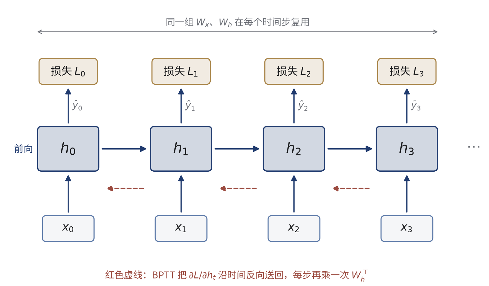
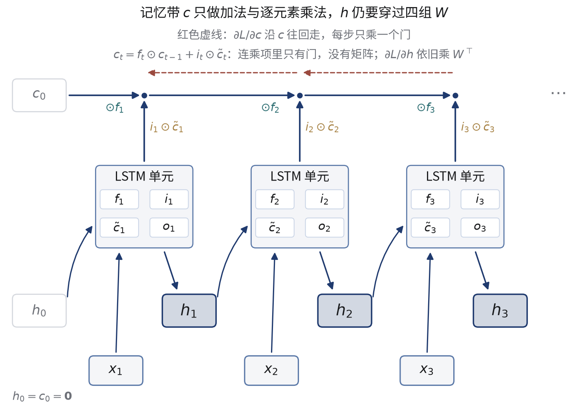

## 循环网络：把历史压进一个状态

有一类句子，判断要靠很远的信息：“我昨天在图书馆借的那几本讲罗马帝国衰亡史的书，到今天还没看完，因为实在太厚了，而且翻译得也一般，所以我打算先还回去，过几天再借一本薄一点的版本。”

“还回去”的主语是什么，取决于二十多个词之前的“书”。n-gram 看不到这么远——三元模型的条件里只有两个词，第四个词之前的东西一概不存在。

想把窗口开大一点，算一笔账就明白了。五万词的词表，要看前三十个词，组合数是 $5\times10^4$ 的三十次方，写出来是一百四十位的数字。就算只看到前十个词，也是 $10^{47}$ 量级。这条路走不通，而且原因不只是参数量：定长窗口里，第 1 个词和第 2 个词占的是两套完全独立的参数，模型在“猫在垫子上”学到的规律，一点也不能用在“垫子上有猫”上。

真正需要的是三件互相牵连的东西：参数不随历史长度增长，不同位置共享同一套变换，以及能记住任意远的信息。循环神经网络（Recurrent Neural Network，RNN）用一句话同时给了这三个：不要窗口，要一个会变的摘要。

这里有一个常被忽略的对比。定长窗口的模型把“位置”当成了身份：前一个词和后一个词用的是两组不同参数，所以“猫追狗”和“狗追猫”是两个完全不同的学习任务。共享参数把“位置”和“内容”分开了：同一个变换应用到每个位置，顺序信息只通过“先读谁”体现。这是表示上的一次实质性简化，它让模型能用同一套知识处理任意长度的输入，代价是必须把顺序信息编码进状态本身，而不能交给参数表。

这笔交易在硬件上还有一层代价。循环是串行的：算 $h_t$ 必须先有 $h_{t-1}$，一条一千个 token 的序列要跑一千次小矩阵乘。GPU 最擅长的“一次算很多互不相关的乘加”在这里完全用不上，每个时刻只有一个向量在算，计算单元大半时间在空转。这个限制直接导致了后来的那场架构更替。

### 一个状态，一格一格地更新

RNN 不再一次吃若干个词，而是一个一个读，每读一个就更新一次状态：

$$h_t=\tanh\bigl(W_h h_{t-1}+W_x x_t+b\bigr)$$

符号逐个说。$x_t\in\mathbb{R}^{d_{\text{in}}}$ 是第 $t$ 个 token 的嵌入向量，$d_{\text{in}}$ 是嵌入维度；$h_t\in\mathbb{R}^{d_h}$ 是读完第 $t$ 个 token 之后的隐状态，$d_h$ 是状态维度；$W_x\in\mathbb{R}^{d_h\times d_{\text{in}}}$ 把输入投到状态空间，$W_h\in\mathbb{R}^{d_h\times d_h}$ 把上一步的状态投到这一步，$b\in\mathbb{R}^{d_h}$ 是偏置；$\tanh$ 逐元素作用。初始状态 $h_0$ 通常取全零向量。

形状先对一遍，这是检查公式有没有写错的最快办法。$W_h h_{t-1}$ 是 $(d_h\times d_h)\cdot(d_h)=d_h$ 维，$W_x x_t$ 是 $(d_h\times d_{\text{in}})\cdot(d_{\text{in}})=d_h$ 维，两者相加合法，过 $\tanh$ 后仍是 $d_h$ 维。

参数量也顺手算一下，取 $d_{\text{in}}=d_h=256$、词表 $V=50000$。$W_x$ 是 $256\times256=65536$ 个，$W_h$ 同样 $65536$ 个，$b$ 是 $256$ 个，一共十三万个。但输出层要给五万个词打分，$W_y\in\mathbb{R}^{V\times d_h}$ 是 $50000\times256=1280$ 万。加起来，循环本体只占全部参数的百分之一，其余九成九都在输出投影上；再把输入端的嵌入表算进去，这个比例还要更悬殊。

这个比例值得记一笔。很多关于“小 RNN 语言模型容量不够”的讨论，其实卡的不是循环结构，而是词表投影那一层：每预测一个词都要做一次 $V$ 维的 softmax，计算量和参数都在那里。

回到主线。把前三个时刻写开，$h_0=0$：

$$\begin{aligned}
z_1&=W_h h_0+W_x x_1+b, & h_1&=\tanh(z_1)\\
z_2&=W_h h_1+W_x x_2+b, & h_2&=\tanh(z_2)\\
z_3&=W_h h_2+W_x x_3+b, & h_3&=\tanh(z_3)
\end{aligned}$$

$z_t$ 是激活前的值。这张图叫“按时间展开”（unrolling）：本来是一个循环，画开之后是一条链，每一步用同样的三个矩阵。$W_h$ 在这条链上出现了三次，这是后面所有麻烦的根源。

为什么用 $\tanh$ 而不是别的。它在 $(-1,1)$ 之间有界，状态反复经过它也不会被无限放大；它在零点附近近似恒等，导数接近 1，梯度可以比较顺畅地穿过；它还是奇对称的，正负信号同等对待。换成 sigmoid 就丢了最后一条，输出恒为正，状态会在 0.5 附近漂移。

白话：$h_t$ 是“读完前 $t$ 个词之后的一份摘要”，维度固定。因为它固定，所以它是压缩；因为压缩，所以有损。读到第一百个词时，第一个词的信息还在不在，取决于这个摘要有没有被后来的内容挤掉。

这个状态能干的事，比它看起来多。设想一维的简化情形，$W_h=1$、$W_x=0$、$b=0.1$，输入全为零，那么 $h_t=\tanh(h_{t-1}+0.1)$：每读一个词，状态就往上限推一点，读得越多值越大，直到接近饱和。这就是一个计数器，而计数正是很多语言现象需要的能力（“这是第几个引号”“括号嵌套了几层”“距离上一个句号几个词”）。

换成更复杂的 $W_h$，状态可以表示一整套“开关”：某一维变成正数就表示“已经进入了一个引号内部”，另一维表示“上一个词是动词”。这些都不是人工设计的，而是梯度为了降低预测误差自己找出来的。在这个意义上，RNN 的状态是一个维度很小、但可以被连续更新的可微程序，每读一个词执行一步。

容量也就在这里。$d_h=256$ 的状态只有二百五十六个数，要同时记住“主语单复数”“引号开没开”“上一个动词的时态”“段落到哪儿了”，每一件都要占几个维度。状态越大能装的东西越多，但参数按平方涨，而且如后文所示，装得下不等于学得会。

### 按时间展开：损失与反向传播

语言模型要的不只是状态，还要下一个词的概率。每个时刻把 $h_t$ 投到词表上：

$$y_t=W_y h_t+b_y,\qquad p_t=\mathrm{softmax}(y_t)$$

$W_y\in\mathbb{R}^{V\times d_h}$ 是输出投影，$b_y\in\mathbb{R}^{V}$ 是偏置，$y_t$ 是词表上每个词的分数，$p_t$ 是概率分布。第 $t$ 步的损失是真实下一个词的负对数概率：

$$L_t=-\ln p_t[w_{t+1}],\qquad L=\sum_{t=1}^{T}L_t$$

$p_t[w_{t+1}]$ 表示取分布里真实词那一项。整句的损失是各步之和，一条长度为 $T$ 的序列一次给出 $T$ 个预测任务。

训练时每一步喂进去的都是真实的 $x_t$，不是模型上一步的预测，这叫 teacher forcing。它的好处是一条序列能并行算出所有损失，坏处是训练和推理不一致：推理时模型只能吃自己吐出来的东西，一旦错一步，后面全在错误的土壤上生长。这个错位叫曝光偏差，后面还会遇到。

反向传播就在展开的那条链上走。记 $\delta_t=\partial L/\partial h_t$，它是两部分之和：当前时刻的损失直接贡献的，加上后一时刻传回来的。第二部分的传递矩阵是

$$J_t=\frac{\partial h_t}{\partial h_{t-1}}=\mathrm{diag}\bigl(1-h_t^2\bigr)\,W_h$$

这个矩阵的形状是 $d_h\times d_h$：$\mathrm{diag}(1-h_t^2)$ 是一个对角矩阵，对角线上是 $\tanh$ 在每个分量上的导数，$W_h$ 是那个共享的权重矩阵。这个对角矩阵来自于 tanh 计算。

我们给出完整梯度：

$$\delta_t=\frac{\partial L_t}{\partial h_t}+J_{t+1}^{\top}\delta_{t+1}$$

这是因为 $h_1$ 会用于 $h_2$ 的计算，$h_2$ 又会用于 $h_3$ 的计算，这也意味着 $h_1$ 会被用到 $h_3$ 的计算。把它展开，我们假设三个时刻，最后一个状态是 $h_3$，那么：

$$ \frac{\partial L}{\partial h_1} = \frac{\partial L_1}{\partial h_1} + \frac{\partial h_2}{\partial h_1}\frac{\partial L}{\partial h_2}  $$

$$ \frac{\partial L}{\partial h_2} = \frac{\partial L_2}{\partial h_2} + \frac{\partial h_3}{\partial h_2}\frac{\partial L}{\partial h_3}  $$

代入就得到：

$$ \frac{\partial L}{\partial h_1} = \frac{\partial L_1}{\partial h_1} + \frac{\partial h_2}{\partial h_1} \Big( \frac{\partial L_2}{\partial h_2} + \frac{\partial h_3}{\partial h_2}\frac{\partial L}{\partial h_3} \Big) $$

注意，最后一步没有后项，$\delta_T=\partial L_T/\partial h_T$。
可以看出，$\delta_1$ 里出现 $J_2^{\top}J_3^{\top}\cdots J_T^{\top}$，正是 $\partial h_T/\partial h_1$ 的转置。链有多长，连乘就有多长。

对 $W_h$ 的梯度，是每个时刻各算一份，再加起来：

$$\frac{\partial L}{\partial W_h}=\sum_{t=1}^{T}\mathrm{diag}\bigl(1-h_t^{2}\bigr)\,\delta_t\,h_{t-1}^{\top}$$

为什么是这个形状。第 $t$ 步有 $z_t=W_h h_{t-1}+\cdots$，$z_t$ 对 $W_h$ 的导数是 $h_{t-1}$ 的外积形式，而 $\partial L/\partial z_t=\mathrm{diag}(1-h_t^2)\delta_t$。两者相乘，得到一个 $d_h\times d_h$ 的矩阵，正好和 $W_h$ 同形。$T$ 个时刻各给一个这样的矩阵，加起来就是总的梯度。

这个求和式里有一个关键结构：$T$ 项，每一项链的长度不同。第 $T$ 项只穿过一步，第 1 项要穿过 $T-1$ 步。梯度消失不是所有项一起消失，而是早期项先消失——模型于是只学得会近处的依赖。

剩下两个参数的梯度形式差不多，可以作为核对。对 $W_x$，把上式的 $h_{t-1}^{\top}$ 换成 $x_t^{\top}$；对输出层 $W_y$，它不出现在时间链上，每个时刻独立贡献：

$$\frac{\partial L}{\partial W_y}=\sum_{t=1}^{T}\bigl(p_t-o_{t+1}\bigr)h_t^{\top}$$

$o_{t+1}$ 是真实下一个词的 one-hot 向量，所以 $p_t-o_{t+1}$ 就是“预测分布减真实分布”，这是 softmax 加交叉熵的标准梯度。对比一下就看得出区别：$W_y$ 的梯度是 $T$ 个独立项直接相加，没有连乘，所以它总能被训练好；$W_h$ 的每一项都拖着一条链，链越长越弱。一个模型可以同时“输出层学得很好”和“循环层学不到长依赖”，这两件事不矛盾。

完整跑一遍整句的回传，显存要保存所有时刻的 $h_t$ 和 $z_t$，序列一长就放不下。所以实践中用截断的反向传播（truncated BPTT）：每次只回传 35 步左右，状态继续往前传但梯度在那儿切断。代价很直接，模型在梯度意义上“看不见”比 35 步更远的依赖，哪怕它的状态里还留着那些信息。

这也解释了 RNN 训练的一个典型现象：序列长度是一个超参，而且它同时影响三件事——显存占用、每步的并行度、以及模型能学到多远的依赖。Transformer 把这几个量都解耦了，所以它才能在长序列上大规模并行；这是后话。

### 单步雅可比：梯度从哪一步开始消失

把上面的递推解开，看从第 $k$ 步到第 $t$ 步的梯度到底乘了什么：

$$\frac{\partial h_t}{\partial h_k}=\prod_{i=k+1}^{t}J_i=\prod_{i=k+1}^{t}\mathrm{diag}\bigl(1-h_i^2\bigr)W_h$$

$t-k$ 个矩阵连乘，每一个都是“对角导数乘同一个 $W_h$”。这个乘积只有两个自由度，而它们都在同一个方向上用力。

先看范围。矩阵范数满足次乘性，$\lVert AB\rVert\le\lVert A\rVert\lVert B\rVert$，所以

$$\left\lVert\frac{\partial h_t}{\partial h_k}\right\rVert\le\prod_{i=k+1}^{t}\lVert\mathrm{diag}(1-h_i^2)\rVert\,\lVert W_h\rVert\le(\gamma\rho)^{\,t-k}$$

$\gamma=\max_x|\tanh'(x)|=1$，是对角因子的上界；$\rho$ 是 $W_h$ 的谱半径，也就是它特征值绝对值的最大值，衡量“反复乘这个矩阵会长得多快或多慢”。

第一个因子是对角项。$\tanh'(z)=1-\tanh^2(z)=1-h^2$，落在 $(0,1]$ 之间。$h$ 靠近 0 时它接近 1，梯度能过；$h$ 靠近 $\pm1$ 时它接近 0，这一步就相当于一个阀被关死。$|z|>3$ 时 $\tanh'$ 已经小于 0.01。而隐状态在真实训练中很容易跑到饱和区：输入大、权重稍大，$z$ 就大了。

换成 sigmoid 更糟。$\sigma'(z)=\sigma(z)(1-\sigma(z))\le0.25$，每一步最多乘 0.25，二十步就是 $0.25^{20}\approx9\times10^{-13}$，梯度已经掉到单精度浮点的有效位数以下。这是传统 RNN 用 $\tanh$ 而不是 sigmoid 的直接原因，但 $\tanh$ 自己也会饱和，只是把上限从 0.25 抬到了 1。

第二个因子是 $W_h$ 的谱半径。即使所有对角项都等于 1，只要 $\rho$ 略小于 1，乘几十次就趋近于零：$0.9^{50}\approx0.005$，$0.9^{100}\approx2.6\times10^{-5}$。反过来，$\rho$ 略大于 1 就爆：$1.1^{50}\approx117$，$1.1^{100}\approx13780$。

两个因子不能互相补偿，这是整个问题的死结。想让梯度传得远，就要 $\rho$ 接近或大于 1；但 $W_h$ 在前向也要用，放大同样发生在正向，状态很快就会跑进 $\tanh$ 的饱和区，对角项接近零，抵消掉放大的那一点。若把 $\rho$ 调小求稳，前向不饱和了，梯度又开始指数衰减。同一个矩阵既要“记住”（放大以保持信息），又要“不爆”，在一个线性变换里做不到。

有人试过正交初始化：把 $W_h$ 初始化成正交矩阵，所有奇异值都是 1，谱半径恰好 1，在线性情形下梯度范数严格不变。这确实能多撑几十步，但它只解决了初始时刻，训练一开始 $W_h$ 就会偏离正交，而且 $\tanh$ 的对角项仍在压。它是缓解，不是解决。

这里还有一个容易让直觉出错的地方：谱半径小于 1 并不等于梯度会单调变小。谱半径描述的是 $k\to\infty$ 时的渐近速率，而有限的几十步里，一个非正规矩阵（特征向量彼此不正交）可以先放大再衰减，这叫瞬态增长。所以实际训练中会看到梯度先涨后跌，损失先坏后好，光看谱半径解释不了。初始化的常见做法是把 $W_h$ 的元素抽成均值 0、方差 $1/d_h$ 的正态分布，这样随机矩阵的谱半径集中 1 附近，既不会一开始就爆，也不会一开始就死。

实测结果与推导一致：普通 RNN 能稳定利用的历史大约在二十步量级，超过这个长度，梯度信号已经弱到学不动。这和“状态装不下”是两件不同的事。即使把 $d_h$ 加到几千维，梯度也传不回去。

还有一句容易被忽略的：同一串连乘既决定了“信息能存多久”，也决定了“梯度能传多远”。前向时 $h_t$ 对 $h_{t-1}$ 的依赖是 $J_t$，反向时梯度穿过的也是 $J_t$。所以 RNN 的“记忆”和“可训练性”不是两个指标，是同一个量的两面。这解释了为什么所有改良都从改变这条路径下手。

### 爆炸、裁剪与沉默的失败

梯度爆炸和梯度消失的表现完全不同，后果也不同。

爆炸是吵闹的。梯度范数每步乘 1 以上，几十步后变成天文数字，一次更新就能把权重推到荒谬的位置，损失突然跳到几百甚至 NaN。工程上很好发现，也好处理：把梯度的全局范数裁到阈值内，

$$g\leftarrow g\cdot\min\left(1,\frac{\tau}{\lVert g\rVert}\right)$$

$g$ 是整个参数组的梯度拼成的长向量，$\lVert g\rVert$ 是它的全局范数，$\tau$ 是阈值，常用 1.0 或 5.0。梯度短于阈值时原样不动，超过就整体等比例缩小，方向不变。

裁剪治的是标，不是本。它限制了步长，没有修正方向：如果梯度里长程那部分的贡献已经被短程项淹没，裁剪不会把它找回来。所以爆炸能靠裁剪“管住”，消失不能。

消失是沉默的。损失曲线平稳下降，训练看起来一切正常，模型学会了“的”后面接名词、“，”后面接主语，但它就是学不会“他”指的是三十个词之前的那个人。没有报错，没有尖峰，只有一种很难归因的“不够聪明”。检测它的办法是设计对照实验：在第 $k$ 步埋一个必须记住的标记，看 $k$ 增大到多少时模型的表现掉回随机水平。这条曲线叫有效记忆长度，普通 RNN 的量级就是前面说的二十步。

从优化角度看，消失不是“信息丢了”，是“信号被压到了数值精度以下”。参数的梯度确实存在，只是小到跟初始化噪声、跟 batch 之间的随机性分不开，优化器无法从中提取方向。

所以当时的一套工程配方是三层叠加：梯度裁剪防爆炸，小学习率防一步跑飞，短序列分块训练省显存并缩短回传链。三样都不解决根本问题，但合起来能把一个普通 RNN 训到“能用”。真正需要学长距离依赖的任务，就得换结构或换优化器，而当时能选的只有前者。

### LSTM：把记忆挪到加法通道

问题既然出在“反复乘同一个矩阵”，改法就有两种：换一个不会被反复乘的状态，或者让“乘什么”由网络自己学。长短期记忆网络（Long Short-Term Memory，LSTM）两件都做了。

它把状态拆成两路，分工分得很清楚。一路是记忆带 $c_t$，只在内部流转，负责“存”；另一路是 $h_t$，负责“读出来”，给输出层看，也给下一步的门看。存和读分开，是后面所有好处的来源。

先说门。每一步有四个小网络，输入完全相同，都是上一步的输出和当前词拼起来的向量 $u_t=[h_{t-1},x_t]$：

$$\begin{aligned}
f_t&=\sigma\bigl(W_fu_t+b_f\bigr),\qquad i_t=\sigma\bigl(W_iu_t+b_i\bigr)\\
o_t&=\sigma\bigl(W_ou_t+b_o\bigr),\qquad \tilde c_t=\tanh\bigl(W_cu_t+b_c\bigr)
\end{aligned}$$

$[h_{t-1},x_t]$ 是把上一步隐状态和当前输入并排拼成一个 $(d_h+d_{\text{in}})$ 维向量，所以 $W_f,W_i,W_o,W_c$ 的形状都是 $d_h\times(d_h+d_{\text{in}})$。$\sigma$ 是 sigmoid，把值压进 $(0,1)$，适合当“比例”用。$\tilde c_t$ 是这一步准备写进记忆带的候选内容，用 $\tanh$ 是因为它需要能取负值。

四个输出里，$f_t$ 和 $i_t$ 决定写入多少，$\tilde c_t$ 决定写什么，$o_t$ 只决定读出多少。所以写进记忆带只有一条式子：

$$c_t=f_t\odot c_{t-1}+i_t\odot\tilde c_t$$

$\odot$ 是逐元素相乘。遗忘门 $f_t$ 决定旧内容留多少，输入门 $i_t$ 决定新内容写多少。输出门 $o_t$ 不在这条式子里，它管的是另一件事，把记忆带读出一份：

$$h_t=o_t\odot\tanh(c_t)$$

读出之前先过 $\tanh$ 压进 $(-1,1)$，再按 $o_t$ 的比例交出去。$h_t$ 不回头改 $c_t$，它只有两个去处：输出层，和下一个时刻的门。

两路分开之后，整个单元读起来就清楚了：$c$ 只跟自己打交道，$h$ 只从 $c$ 里读，读完就离开。按时间展开的样子见图 3-2，初始状态取 $h_0=c_0=\mathbf{0}$。

把三步写成式子。每步的门读同一个 $u_t$，只是下标不同：

$$u_1=[h_0,x_1],\qquad u_2=[h_1,x_2],\qquad u_3=[h_2,x_3]$$

记忆带这头，三项首尾相接，每一步只做“乘旧值、加新值”：

$$\begin{aligned}
c_1&=i_1\odot\tilde c_1 &&\text{（}c_0=\mathbf 0\text{）}\\
c_2&=f_2\odot c_1+i_2\odot\tilde c_2\\
c_3&=f_3\odot c_2+i_3\odot\tilde c_3
\end{aligned}$$

输出这头，每一步各自独立地从记忆带里读一份，读完不影响记忆带：

$$\begin{aligned}
h_1&=o_1\odot\tanh(c_1)\\
h_2&=o_2\odot\tanh(c_2)\\
h_3&=o_3\odot\tanh(c_3)
\end{aligned}$$

两组式子摆在一起，差别一眼就能看出来。$c$ 那条线上只有两种运算，乘一个门，加一个候选，从头到尾没有矩阵，也没有 $\tanh$；$h$ 那条线上才有 $\tanh$，而 $\tanh$ 只影响“这一刻交出什么”，改不了记忆带里存着什么。第 1 步的 $f_1$ 乘的是 $c_0=\mathbf 0$，所以真正写进记忆带的只有 $i_1\odot\tilde c_1$；从第 2 步起，$c$ 才开始带着东西往前走。

关键全在 $c_t$ 那条加法上。对 $c_t$ 求 $c_{t-1}$ 的导数，只有第一项含 $c_{t-1}$：

$$\frac{\partial c_t}{\partial c_{t-1}}=\mathrm{diag}(f_t)$$

没有 $W_h$，没有 $\tanh$ 的导数，只有一个逐元素的门。往回传 $k$ 步，梯度乘的是

$$\prod_{j=1}^{k}\mathrm{diag}(f_{t-j})$$

一串 0 到 1 之间的数，按维度各自相乘。这一串数解释了两件事。

为什么能缓解消失：如果某一维上的信息需要记住很久，网络可以把对应的 $f$ 学到接近 1。$0.99^{100}\approx0.37$，一百步之后还剩三分之一，梯度穿得过去。普通 RNN 的所有维度共用同一个 $W_h$，做不到“这一维保留、那一维清空”；门是逐维度的，这是它真正比矩阵灵活的地方。

为什么不会爆炸：$f_t$ 是 sigmoid 的输出，最大不超过 1，所以这条路径上的连乘只会变小或不变，结构上就没有放大项。$f=1$ 时梯度原样穿过，这也是“恒定误差传送带”（constant error carousel）这个说法的来历。

### 对四组权重求导：差别到底在哪一步

RNN 那一节把 $L$ 对 $W_h$ 的梯度拆成了 $T$ 项之和，每一项穿过一条长短不同的链。LSTM 有四组权重，把它们逐项写出来，差别就落在“每步乘的是什么”上。

损失还是 $L=\sum_t L_t$，$L_t$ 只依赖 $h_t$。反向要同时传两条线，记

$$\delta^h_t=\frac{\partial L}{\partial h_t},\qquad \delta^c_t=\frac{\partial L}{\partial c_t}$$

$c_t$ 有两个去处：本步的 $h_t=o_t\odot\tanh(c_t)$，和下一步的 $c_{t+1}=f_{t+1}\odot c_t+\cdots$。所以

$$\delta^c_t=\underbrace{o_t\odot\bigl(1-\tanh^2(c_t)\bigr)\odot\delta^h_t}_{\text{本步读出}}+\underbrace{f_{t+1}\odot\delta^c_{t+1}}_{\text{下一步记忆带}}$$

假设三个时刻，最后一步没有后项：

$$\begin{aligned}
\delta^c_3&=o_3\odot\bigl(1-\tanh^2(c_3)\bigr)\odot\delta^h_3\\
\delta^c_2&=o_2\odot\bigl(1-\tanh^2(c_2)\bigr)\odot\delta^h_2+f_3\odot\delta^c_3\\
\delta^c_1&=o_1\odot\bigl(1-\tanh^2(c_1)\bigr)\odot\delta^h_1+f_2\odot\delta^c_2
\end{aligned}$$

代入就得到

$$\frac{\partial L}{\partial c_1}=o_1\odot\bigl(1-\tanh^2(c_1)\bigr)\odot\delta^h_1+f_2\odot\Bigl(o_2\odot\bigl(1-\tanh^2(c_2)\bigr)\odot\delta^h_2+f_3\odot\delta^c_3\Bigr)$$

把它和 RNN 那段展开逐项对上：$\partial h_2/\partial h_1$ 所在的位置，这里换成了 $f_2$。这是全部差别的来源——$\partial c_2/\partial c_1=\mathrm{diag}(f_2)$，一个对角矩阵，只把每一维按自己的比例缩放，不混合维度，也没有放大的余地。

接下来是四组权重。先把“每个门的预激活”上的梯度记下来，它们都是 $d_h$ 维向量：

$$\begin{aligned}
\alpha^f_t&=\delta^c_t\odot c_{t-1}\odot f_t\odot(1-f_t)\\
\alpha^i_t&=\delta^c_t\odot\tilde c_t\odot i_t\odot(1-i_t)\\
\alpha^c_t&=\delta^c_t\odot i_t\odot\bigl(1-\tilde c_t^{2}\bigr)\\
\alpha^o_t&=\delta^h_t\odot\tanh(c_t)\odot o_t\odot(1-o_t)
\end{aligned}$$

$\alpha^g_t$ 就是 $\partial L/\partial(W_gu_t+b_g)$。四个式子读法一样：$\delta^c$ 乘上“这个门控制的那一项”，再乘上自己那条 sigmoid（或 $\tanh$）的导数。遗忘门控制的是 $c_{t-1}$，输入门控制的是候选 $\tilde c_t$，输出门控制的是读出来的 $\tanh(c_t)$，候选那一路过的是 $\tanh$。

有了它们，四组权重和偏置的梯度都是同一个外积形式：

$$\frac{\partial L}{\partial W_g}=\sum_{t=1}^{T}\alpha^g_t\,u_t^{\top},\qquad \frac{\partial L}{\partial b_g}=\sum_{t=1}^{T}\alpha^g_t,\qquad g\in\{f,i,o,c\},\quad u_t=[h_{t-1},x_t]$$

形状对得上：$\alpha^g_t$ 是 $d_h$ 维列向量，$u_t^{\top}$ 是 $d_h+d_{\text{in}}$ 维行向量，外积正好是 $d_h\times(d_h+d_{\text{in}})$，和 $W_g$ 同形；偏置把 $T$ 份梯度直接加起来。

把 $T=3$ 摊开，$\partial L/\partial W_f$ 就是三项相加：

$$\frac{\partial L}{\partial W_f}=\alpha^f_1u_1^{\top}+\alpha^f_2u_2^{\top}+\alpha^f_3u_3^{\top}$$

第 1 步那一项里的 $\alpha^f_1$ 带着 $\delta^c_1$，而 $\delta^c_1$ 要经过 $f_2\odot f_3$ 才能碰到第 3 步的信息。同一位置，RNN 的 $\partial L/\partial W_h$ 里是两个单步雅可比 $J_2,J_3$ 连乘（$J_t=\mathrm{diag}(1-h_t^2)W_h$）。两条链并排看：

| 对比项 | RNN 的 $W_h$ | LSTM 的 $W_f$ |
|---|---|---|
| 往回两步要乘 | $J_2$、$J_3$ 连乘 | $f_2\odot f_3$ |
| 一步乘的是 | $d_h\times d_h$ 矩阵 | 对角线上的一串数 |
| 会不会放大 | 会，$\rho(W_h)>1$ 就爆 | 不会，$f\le1$ |
| 能不能逐维关闭 | 不能，共用 $W_h$ | 能，逐维的门 |

第三、四行是一件事的两面。门是逐维度的，所以“这一维记住很久、那一维立刻清空”是可以学的：想让某一维把信息留一百步，把那一维的 $f$ 从 0.73 学到 0.99 就行——前面算过，一百步之后还剩三分之一。普通 RNN 只有一个共享的 $W_h$，所有维度被同一个谱半径绑在一起，要么一起放大到饱和，要么一起衰减到噪声，中间没有别的选项。梯度消失之所以在 RNN 上是结构性的，就在这里。

但整张表只管记忆带这一条路。$\delta^h$ 的递推没有变好：

$$\delta^h_{t-1}=\frac{\partial L_{t-1}}{\partial h_{t-1}}+W_{f,h}^{\top}\alpha^f_t+W_{i,h}^{\top}\alpha^i_t+W_{o,h}^{\top}\alpha^o_t+W_{c,h}^{\top}\alpha^c_t$$

$W_{g,h}$ 是 $W_g$ 里对应 $h_{t-1}$ 的那 $d_h$ 列。这条路上仍然是矩阵的转置在连乘，照样衰减；门能做的是把 $\alpha$ 调大调小，让信号不至于在几百步之后彻底消失。所以梯度裁剪照用，LSTM 解决的是“长期记忆的梯度传不回去”，不是“所有梯度问题”。

还有一个工程细节，对能不能训起来影响很大：遗忘门的偏置通常初始化为 1 而不是 0。这样训练开始时 $f\approx\sigma(1)\approx0.73$，记忆带接近一条恒等通道，梯度一开始就能顺畅地回传；如果初始化成 0，$f\approx0.5$，一百步后只剩 $10^{-30}$，模型从一开始就几乎学不到东西。

门到底在学什么，看一个具体任务就清楚了：判断一段文本里的引号是否配对。某个维度可以学成“进入引号就置 1，遇到右引号就清零”，这需要三个门配合——输入门在遇到左引号时写入，遗忘门在遇到右引号时清空，输出门在需要判断时把这一维读出来。嵌套的情形要复杂一些，靠多个维度叠加计数层次。同样的事用普通 RNN 做不是不可以，但要靠一个精细调过的 $W_h$ 在所有维度上同时完成写入、保留和清零，梯度很难把它调到那个位置。

代价是四组权重而不是一组，参数是普通 RNN 的四倍，而且是逐个时刻串行算的，在 GPU 上并行度很差。

### GRU 与那条被压扁的向量

门控循环单元（Gated Recurrent Unit，GRU）是 LSTM 的简化版，把两路状态合成一路，门从三个减到两个：

$$\begin{aligned}
z_t&=\sigma\bigl(W_z[h_{t-1},x_t]\bigr),\qquad r_t=\sigma\bigl(W_r[h_{t-1},x_t]\bigr)\\
\tilde h_t&=\tanh\bigl(W_{\tilde h}[r_t\odot h_{t-1},x_t]\bigr)\\
 h_t&=(1-z_t)\odot h_{t-1}+z_t\odot\tilde h_t
\end{aligned}$$

$z_t$ 是更新门，$r_t$ 是重置门，$\tilde h_t$ 是候选状态。注意最后一行：$h_t$ 直接由旧状态和新候选按比例混合，$(1-z_t)$ 就是“保留多少旧状态”，它干的是 LSTM 里遗忘门的活，只不过和输入门互补（两者加起来等于 1），不需要单独学。重置门 $r_t$ 则在算候选状态时先对旧状态做一次逐元素滤波，让模型可以“暂时忘掉一部分历史再看当前输入”。

参数上少一组权重（三组而不是四组），大约省 25%，在多数任务上效果与 LSTM 相当，小数据上有时更好。后来有人用大规模对照实验扫过各种门控变体，结论是：门控这件事本身才是关键，具体用哪个变体、用几个门，差别通常在几个点以内。这个结论对后面理解 Transformer 也有用——结构上的选择经常不如“有一个能学的前缀比例”重要。

这两种结构把梯度问题解决了大半，但有一件事它们没动：无论内部多复杂，读完一句话，向外交付的仍然是一个固定维度的向量。

机器翻译把这个矛盾推到了台面上。2014 年，Sutskever 等人用两个多层 LSTM 做英法翻译：编码器逐词读完源句，把最后一个隐状态当作整句的表示，用它初始化解码器，解码器从这个向量出发逐词生成译文。

算一下这个向量要装多少东西。取 $d_h=1000$，一个五十词的源句被压进一千个数，平均每个词二十个数。更麻烦的是它要同时编码四类信息：主语是谁、时态是什么、哪些词还没译、以及译文的语序该从哪里开始。这四件事共享同一千个数，彼此干扰。

后果在实验里很清楚：源句长度超过三十个词，BLEU 就开始明显下滑，句子越长掉得越多。这不是训练不够，是信息在编码那一刻就被丢掉了——解码器每一步拿到的都是同一个向量，它没有任何办法回去查原文。

还有一个更细的失效方式：那个向量对句尾的偏重。因为状态是逐个词覆写出来的，最后几个词经过的变换最少，保留得最完整；最早的词已经被几十次矩阵乘冲洗过。所以即使句子不长，主语位置的信息也往往比宾语位置弱。这与人类读句子的习惯恰好相反：人会记住主语，因为它后面一直被引用。

一个粗略的信息论估算能说明差距在哪。五十个词，每个词在译文里平均有几种合理选择，保守按 8 比特算，整句就是 400 比特。一千维的浮点向量看起来远大于 400，但训练只能教会这个向量“够用”，教不会它“无损”：梯度只关心最后的翻译损失，不关心中间有没有丢信息。容量够不等于用法对。

训练与推理的差异在这里又出现一次。训练时解码器吃的是真实译文的前缀，一句话的损失可以并行算完；推理时只能一个词一个词地往外吐，每吐一个就把它接回输入。为了缓解一步错步步错，推理时会同时维护几套候选前缀，按累积对数概率保留最优的几条，这叫束搜索。这些手段能挣回一两个 BLEU，但拗不过那个固定向量的硬上限。

所以下一步的方向很自然：既然一个向量装不下，就不要只给一个向量。让解码器每译一个词，都回原文里自己找该看哪儿。这就是注意力，下一章的主题。
