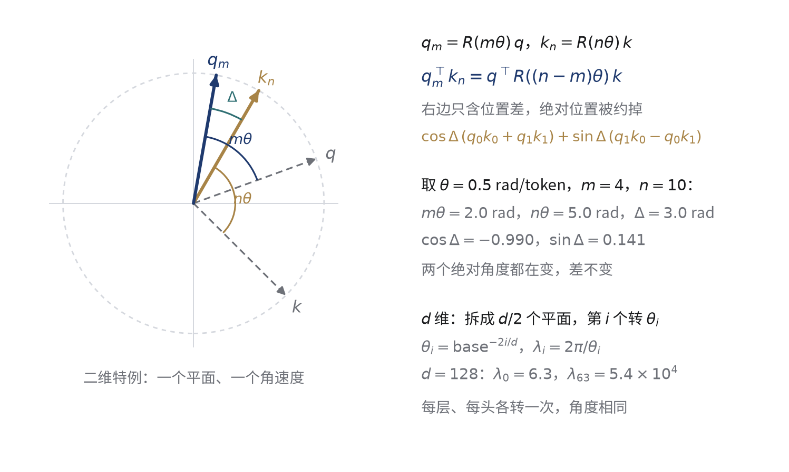

## 位置编码：从正弦到旋转

做一个十分钟能做完的实验。取一个训练好的 Transformer，把输入句子里相邻的两个词交换位置，其余不动，然后看输出的概率分布。

如果模型用的是绝对位置嵌入或者正弦编码，交换之后几乎每个位置的输出都会变，因为“第 5 位”和“第 6 位”各自带着不同的坐标。如果把位置信息整个拿掉，同时把因果掩码也去掉（也就是一个双向的编码器），你会看到另一幅景象：输出只是跟着换了位置，每一行的数值一点没变。换句话说，在这个模型眼里，“狗咬人”和“人咬狗”是同一堆零件，只是摆放顺序不同。

这件事不是小毛病。语言的意义有一大半长在顺序上：主谓宾的次序、修饰语的位置、否定词在动词前还是后。而注意力的计算公式对顺序完全无知——它算的是两两之间的相似度，一个集合的性质，不是一个序列的性质。这一章讲的就是怎么把顺序重新装回去，以及为什么这个看起来简单的补丁，最后变成了决定模型能看多长的东西。

### 顺序在注意力的盲区里

先把“无知”这件事说成一句可以验算的话。

设 $P$ 是一个置换矩阵：每行每列恰好一个 1，其余为 0。$PX$ 的作用是把 $X$ 的行按 $P$ 重排，也就是把 $T$ 个位置换个次序。把这个重排后的输入喂进注意力，逐步算：

$$S'=(PX)W_QW_K^{\top}(PX)^{\top}=P\big(XW_QW_K^{\top}X^{\top}\big)P^{\top}=PSP^{\top}$$

中间的等号只是把括号挪了个位置：$(PX)^{\top}=X^{\top}P^{\top}$，于是 $P$ 和 $P^{\top}$ 分别落到乘积的两端。所以打分矩阵只是把行和列同时按 $P$ 重排，$S'_{ij}=S_{\pi(i),\pi(j)}$，$\pi$ 是 $P$ 对应的那个重排。

softmax 是逐行做的，而重排一行不改变这一行的元素集合，所以

$$A'=\mathrm{softmax}_{\text{row}}(PSP^{\top})=PAP^{\top}$$

最后一步，输出：

$$O'=A'(PV)=PAP^{\top}PV=PAV=PO$$

中间那一步之所以成立，是因为 $P^{\top}P=I$，于是 $A P^{\top}P=AI=A$。结论是 $O'=PO$：**输出只是跟着输入换了顺序，每一行的数值一点没变。**

这个性质叫置换等变。它说的是注意力只关心“有哪些向量、彼此多相关”，完全不关心“谁在第几位”。上面那串推导看着像形式主义，但它给了一个硬结论：位置信息不可能从注意力里自己长出来，必须以某种方式从外面注入。

因果掩码会削弱这个结论，但不会推翻它。加了掩码之后，第 $i$ 个位置只能看到前 $i$ 个 key，这个“能看到几个”确实是位置信号，而且理论上足以确定绝对位置。问题是它和内容纠缠在一起：模型要判断“我在第 30 位”，得先数清前面有多少个 key，而这个计数不是在某个维度上直接写着的，只能通过对注意力模式的间接约束学出来。后面会看到，把这个计数当成唯一的位置来源（也就是什么都不加），在训练长度内表现略差，但在长度泛化上反而更好——这条线索先记住。

### 正弦编码：一组转速不同的指针

原论文的方案不学参数，直接用一个固定函数给每个位置算一个向量，然后加到词嵌入上：

$$PE_{(pos,\,2i)}=\sin\!\left(\frac{pos}{10000^{2i/d}}\right),\qquad PE_{(pos,\,2i+1)}=\cos\!\left(\frac{pos}{10000^{2i/d}}\right)$$

符号逐个交代。$pos$ 是位置序号，从 0 开始；$i$ 是维度对的编号，从 0 到 $d/2-1$；$d$ 是模型维度；$2i$ 和 $2i+1$ 是一对相邻的维度，一个放正弦、一个放余弦。分母里的 10000 是频率谱的底数。

把指数单独拎出来看会更清楚。定义第 $i$ 对的角速度

$$\omega_i=10000^{-2i/d}$$

它就等于 $1/10000^{2i/d}$。$i=0$ 时 $\omega_0=1$，意思是每往后一个位置，相位推进 1 弧度；$i$ 增大，$\omega_i$ 按几何级数下降，到 $i=d/2-1$ 时指数约为 $-1$，$\omega$ 降到万分之一。用角速度写，编码就是 $\sin(pos\cdot\omega_i)$ 和 $\cos(pos\cdot\omega_i)$——第 $i$ 对维度记录的是“位置乘以这个角速度之后的角度”。

每一对 $(\sin,\cos)$ 就是单位圆上的一个点，由角度唯一确定。$d/2$ 对维度就是 $d/2$ 个转速不同的指针，转速按等比数列排开。$d=512$ 时，$i=0$ 那一对每 6.28 个 token 转一圈，$i=255$ 那一对要六万个 token 才转完一圈。低维转得快，负责区分相邻位置；高维转得慢，负责区分远处的段落。读出这一整组指针的角度，位置就唯一确定了——只要没有两个位置让所有指针同时回到同一组角度。

为什么不直接用 $pos$ 本身？因为 $pos$ 会随长度无界增长，位置到十万时，加进嵌入的那个数就是十万量级，会把词嵌入本身的尺度彻底压掉。$\sin$ 和 $\cos$ 被限制在 $[-1,1]$，加到任何位置上都不会破坏数值范围。这是选三角函数最朴素的一层理由。

第二层理由更关键：任意位置 $pos+k$ 的编码，可以写成位置 $pos$ 的编码经过一个只依赖 $k$ 的线性变换。用和角公式展开，取其中一对维度：

$$\begin{aligned}\sin\big((pos+k)\omega\big)&=\sin(pos\,\omega)\cos(k\omega)+\cos(pos\,\omega)\sin(k\omega)\\[2pt]\cos\big((pos+k)\omega\big)&=\cos(pos\,\omega)\cos(k\omega)-\sin(pos\,\omega)\sin(k\omega)\end{aligned}$$

写成矩阵就是

$$\begin{pmatrix}\sin((pos+k)\omega)\\ \cos((pos+k)\omega)\end{pmatrix}=\begin{pmatrix}\cos(k\omega)&\sin(k\omega)\\ -\sin(k\omega)&\cos(k\omega)\end{pmatrix}\begin{pmatrix}\sin(pos\,\omega)\\ \cos(pos\,\omega)\end{pmatrix}$$

右边那个 $2\times2$ 矩阵只含 $k$，不含 $pos$。对 $d/2$ 对维度各做一次，得到一个 $d\times d$ 的块对角矩阵 $M_k$，于是

$$PE(pos+k)=M_k\,PE(pos)$$

这就是“正弦编码能表达相对位置”的全部依据：要判断“往前数第 $k$ 个”，模型只需要一个固定的线性映射，不必为每个绝对位置单独学一套权重。

这里有一个必须说清的落差。“能表达”和“会学”是两件事。训练目标只有预测下一个词，没有任何一项损失在逼模型去用这个线性结构。$M_k$ 存在，模型可以找到它，也可以完全忽略它，把正弦值当成一堆没有规律的坐标用。原论文的消融里，把正弦换成可学习的位置嵌入，BLEU 只差了 0.1 上下——在训练长度内，这个漂亮的性质几乎没有兑现出优势。

真正的问题出在长度上。算一下每一维在训练窗口里转了多少圈：

$$r_i=\frac{L}{\lambda_i}=\frac{L\cdot\omega_i}{2\pi}$$

$\lambda_i=2\pi/\omega_i$ 是这一维的波长，$L$ 是训练长度，$r_i$ 就是转过的圈数。$d=512$、$L=512$ 时，$r_0=512/6.28\approx81$，$r_{255}=512/60500\approx0.0085$。两个极端都不好用。

高频那一头转了 81 圈。位置 3 和位置 516 的相位几乎相同（差 0.4 圈的一个零头），模型看到的坐标是同一个，它没有任何办法区分这两个位置——不是学得不好，是坐标本身重合了。低频那一头连一圈的 1% 都没走完，512 个位置落在一条几乎笔直的弧上，模型无从判断“多远算远”，也就学不到长距离的概念。

两头都失效，中间那一段——转了几圈到几十圈的维度——才是真正有用的。训练长度一旦翻倍，高频维的混叠区域扩大，低频维仍然没走完一圈，整体表现就断崖式下降。原论文训练在 512，测到 1024 就明显退化，原因就在这里。

### 学习式位置嵌入：把位置当成一个词来学

最直接的改法是放弃固定函数：给每个位置分配一个可训练向量，和词嵌入一样查表。

$$x_t=E[\,\text{token}_t\,]+W_{\text{pos}}[\,t\,],\qquad W_{\text{pos}}\in\mathbb{R}^{L_{\max}\times d}$$

$E$ 是词嵌入表，$W_{\text{pos}}$ 是位置表，$L_{\max}$ 是预设的最大长度。这是一张纯粹的查找表，第 $t$ 行就是第 $t$ 个位置的坐标，跟着梯度一起更新。

参数账：$L_{\max}\times d$。$L_{\max}=4096$、$d=4096$ 时是 1678 万，和一层注意力的参数量相当。$L_{\max}=2048$（GPT-3 的配置）时是一半。相对整个模型不算多，但也不是可以忽略的量。

它在训练长度内确实更灵活。因为每个位置是一个自由的向量，模型可以给“句首”学一个专属方向，用来做“总结整句”“判断语气”这类操作；也可以让相邻位置的方向有规律地排列，形成一种粗糙的距离感。这些结构在正弦编码里要靠模型自己去发现，在学习式嵌入里是直接给出来的自由度。GPT-2、GPT-3、BERT 都用了这个方案，长度分别是 1024、2048、512。

代价有三个层次。最表面的：表长就是硬上限，第 4097 个位置查不到，只能截断或者复用最后一行的向量，而复用意味着那之后所有位置共享同一个坐标——比没有还糟。第二层：即使把表加长，长尾位置也学不好，因为大部分训练序列都短于 $L_{\max}$，位置 4000 出现的次数比位置 10 少几个数量级，梯度信号不够，那里的向量基本停在初始化附近。第三层：这部分参数完全不共享，位置 100 学到的方向和位置 101 学到的方向之间没有任何约束，模型得靠数据自己发现“相邻位置应该相似”。

### 相对位置：把距离写进分数

换一个思路。既然模型真正需要的往往是“隔多远”，而不是“在第几位”，那就别管绝对坐标，直接把距离写进注意力分数。

2018 年《Self-Attention with Relative Position Representations》给的做法是给每个相对距离学一对向量，一个加到 key 上，一个加到 value 上，距离超出范围就裁剪到边界值。后来更常见、也更省的形式是给每个距离学一个标量，直接加在打分上：

$$e_{ij}=\frac{q_i^{\top}k_j}{\sqrt{d_k}}+b_{\,i-j}$$

$e_{ij}$ 是位置 $i$ 看位置 $j$ 的原始分数（softmax 之前），$i-j$ 是相对距离，$b$ 是一张按距离索引的表。距离的取值是无限的，表必须有限，所以要裁剪：超过 $\pm k$ 的距离共用同一个向量。

T5 用的是另一种压缩方式：把距离分成 32 个桶，近处（比如 8 以内）一个距离一个桶，远处按对数分桶，桶越远越宽。这等于主动声明“隔 100 和隔 200 我分不清，也不需要分清”。

好处很直接。模型学的是“隔三个词”和“隔三十个词”的区别，至于“第 3 位”还是“第 300 位”，它不关心。序列变长，只要相对距离还在表内，行为应该一致。这条思路后来被 Transformer-XL 推得更远：它把内容项和位置项彻底拆开，让缓存的历史片段也能拿到正确的位置偏置。

代价藏在工程里，而且不小。偏置矩阵是 $T\times T$ 的，每层都要一份，$T=8192$、32 层、FP16 时是 4.3 GB 量级的额外开销；更要命的是它和 FlashAttention 这类融合算子不兼容——后者把整个注意力计算塞进一个 kernel，中间结果不落地，你没法在里面插一张 $T\times T$ 的偏置表。除此之外，裁剪半径之外的相对距离全部压成同一个值，模型看不到“更远”的差别，外推能力依旧有限。

于是有了第三条路：不动输入，也不加偏置矩阵，而是把位置变成对 $q$ 和 $k$ 的一次旋转。

### RoPE：让位置变成一次旋转

前面三条路各有一个填不平的坑：正弦编码的相对性只是个理论性质，学不学得到不由人；学习式嵌入把表长写死；相对偏置要一张 $T\times T$ 的表，又和融合算子打架。2021 年《RoFormer》给了一个不一样的做法：既然注意力用的是点积，那就让位置以一种“只留相对位移”的方式参与点积——把 $q$ 和 $k$ 按各自的位置转一个角度。

#### 二维：一次旋转消掉绝对位置

先在二维平面上把这件事做完。定义旋转矩阵

$$R(\alpha)=\begin{pmatrix}\cos\alpha&-\sin\alpha\\ \sin\alpha&\cos\alpha\end{pmatrix}$$

它的作用是把一个二维向量逆时针转 $\alpha$ 弧度。这里只需要它的两个性质，都可以直接验算：

$$R(\alpha)^{\top}=R(-\alpha),\qquad R(\alpha)R(\beta)=R(\alpha+\beta)$$

第一条说“转置等于反向转”，第二条说“连转两次等于把角度加起来”。两条合起来得到本章用得最多的一行：

$$R(\alpha)^{\top}R(\beta)=R(\beta-\alpha)$$

现在规定：位置 $m$ 的 query 转 $m\theta$，位置 $n$ 的 key 转 $n\theta$，$\theta$ 是一个固定的角速度，$q$、$k$ 是不带位置的原向量。写成

$$q_m=R(m\theta)\,q,\qquad k_n=R(n\theta)\,k$$

把这两个代入点积。第一步用 $(AB)^{\top}=B^{\top}A^{\top}$，第二步用上面的复合性质：

$$q_m^{\top}k_n=\big(R(m\theta)q\big)^{\top}\big(R(n\theta)k\big)=q^{\top}R(m\theta)^{\top}R(n\theta)\,k=q^{\top}R\big((n-m)\theta\big)\,k$$

走到这里，绝对位置已经从式子里消失了：右边的矩阵只含 $n-m$。记 $\Delta=(n-m)\theta$，把这个 $2\times2$ 的乘法完整展开一次，看看它到底留下了什么。先把 $R(\Delta)k$ 算出来：

$$R(\Delta)k=\big(k_0\cos\Delta-k_1\sin\Delta,\ k_0\sin\Delta+k_1\cos\Delta\big)$$

再与 $q=(q_0,q_1)$ 做内积，把四项按 $\cos\Delta$ 和 $\sin\Delta$ 归并：

$$q_m^{\top}k_n=\cos\Delta\,(q_0k_0+q_1k_1)+\sin\Delta\,(q_1k_0-q_0k_1)$$

白话读一遍：原来的点积 $q_0k_0+q_1k_1$ 被 $\cos\Delta$ 缩放，另外多出一项 $q_1k_0-q_0k_1$ 被 $\sin\Delta$ 缩放。头一项是“同维相乘”，后一项是“交叉相乘”。两项的系数都只依赖位置差 $\Delta$，所以不管这对 token 出现在文章的第 10 位还是第 10000 位，只要相隔距离一样，点积就一样。

这一步为什么必须用旋转，而不能用加法？因为加法改不了相对性。如果位置是以 $q+p_m$、$k+p_n$ 的形式进去的，展开之后会出现 $p_m^{\top}k$、$q^{\top}p_n$、$p_m^{\top}p_n$ 三组项，前两组各自带着绝对位置，消不掉。旋转的特殊之处在于它是正交变换，$R^{\top}R=I$，两个旋转的乘积只留角度差。这是一条很窄的路：既要保住向量长度，又要让位置以“可约掉”的形式进入，在二维平面上能同时满足这两点的线性变换，基本只有旋转。

#### 从二维到 $d$ 维：块对角

$d$ 维没法整体旋转（二维旋转矩阵只对平面有意义），做法是把 $d$ 维拆成 $d/2$ 个互不干扰的二维平面。第 $i$ 个平面用角速度 $\theta_i$，占坐标 $(2i,\,2i+1)$ 这两个分量，各自按自己的位置转：

$$\begin{aligned}(q_m)_{2i}&=q_{2i}\cos(m\theta_i)-q_{2i+1}\sin(m\theta_i)\\ (q_m)_{2i+1}&=q_{2i}\sin(m\theta_i)+q_{2i+1}\cos(m\theta_i)\end{aligned}$$

把所有平面摞起来，整个变换是一个 $d\times d$ 的块对角矩阵：对角线上有 $d/2$ 个 $2\times2$ 的旋转块，其余全是 0。每个块都正交，所以整体正交，这也意味着旋转不改变向量长度，数值上不会放大也不会衰减。

点积于是变成 $d/2$ 个二维结果的求和，每一项都只含 $(n-m)\theta_i$。$k$ 那一侧用完全相同的角度和公式。RoPE 到此就完整了：没有新增参数，没有新增矩阵，只在算 $q$ 和 $k$ 之后、点积之前插了一次逐元素的乘加。

有一处实现上的分叉值得单独说，因为它会静默地毁掉模型。把哪两维配成一对，有两种同样合法的写法。一种是相邻两维一组，$(0,1),(2,3),\dots$，GPT-J 系列用这个；另一种是前后半对半，$(0,d/2),(1,d/2+1),\dots$，Llama 的 `rotate_half` 用这个：

```text
# 前后半对半的写法，q ∈ R^d，cos/sin ∈ R^{d/2}
def rotate_half(x):
    x1, x2 = x[:d//2], x[d//2:]
    return cat([-x2, x1])

q_rot = q * cat([cos, cos]) + rotate_half(q) * cat([sin, sin])
```

两种写法差一个固定的维度置换，数学上等价，但置换之后的向量要乘不同的权重矩阵。训练时用哪一种，推理时就必须用哪一种。换错了不会报错，形状对得上、数值也不溢出，只是模型突然变傻。

#### 为什么乘在 $q$、$k$ 上

同一个位置信号可以加在输入 $x$ 上（正弦编码）、加在分数上（相对偏置）、或者乘在 $q$、$k$ 上（RoPE）。三者的区别不只是实现方便。

加在 $x$ 上，位置会和词义混进同一个向量。这个混合向量要往上过十几层，每一层的前馈网络都会对它做一次非线性变换，位置那部分被搅散、被叠加、被改写，到第 10 层时已经说不清哪些分量是位置。更要紧的是，模型没有任何压力去保持“相邻位置差一个旋转”这个结构。

加在分数上，问题是那张 $T\times T$ 的表，以及它和融合算子的冲突。

乘在 $q$、$k$ 上，两个好处同时拿到。位置只影响打分，不影响内容：$v$ 完全不参与旋转，所以 KV 缓存里存的值向量是干净的，被搬运的信息不会因为位置而变形。而且相对性直接出现在点积里，不需要模型去学任何线性映射——它是构造出来的，不是学出来的。

还有一笔推理时的账。旋转发生在 $W_Qx$ 之后，而 $\cos(m\theta_i)$、$\sin(m\theta_i)$ 只与位置有关，与输入无关，所以可以预先算好一张 $L_{\max}\times d/2$ 的表，所有层、所有头、所有 batch 共用。新 token 进来只需要算它自己那一行。旋转又是逐元素的，代价可以忽略。

一个常被搞混的细节：旋转在每一层、每一个头里都要各做一次，用的 $\theta_i$ 完全相同。有人以为位置只在第一层注入一次，其实相反，每一层的注意力都在用同一组角度重新组织信息。位置关系是被反复施加的，不是一次性加进去的印记。

### 算一遍：位置 $i$ 与 $j$ 的相对相位

RoPE 的公式干净，但真正要理解它的能力边界，得把相位算到具体数值。取 $d=128$、$\mathrm{base}=10000$，角速度是

$$\theta_i=10000^{-2i/128}=10^{-i/16},\qquad i=0,1,\dots,63$$

相邻两个 token 在维度对 $i$ 上的相位差就是 $\theta_i$ 本身——位置 $m$ 转 $m\theta_i$，位置 $m+1$ 转 $(m+1)\theta_i$，差一个 $\theta_i$。

| 维度对 $i$ | $\theta_i$ | 波长 $\lambda_i$ | 相邻相位差 |
|---|---|---|---|
| 0 | $1.0$ | $6.3$ | $57.3^\circ$ |
| 16 | $0.10$ | $63$ | $5.7^\circ$ |
| 32 | $0.010$ | $628$ | $0.57^\circ$ |
| 63 | $1.2\times10^{-4}$ | $5.4\times10^{4}$ | $0.0066^\circ$ |

再看一对具体的位置。取 $i=5$、$j=12$，距离 $\Delta=7$ 个 token。

在 $i=0$ 那一对上，相对相位是 $7\times1.0=7$ 弧度，折回一圈是 $7-2\pi=0.72$ 弧度。这意味着距离 7 和距离 $7+2\pi\approx13.3$ 在这一维上给出完全相同的 $\cos$ 和 $\sin$——它们不可分辨。这正是“高频维只能看见相对距离”的准确含义。

在 $i=32$ 那一对上，相对相位是 $7\times0.01=0.07$ 弧度，$4^\circ$，几乎为零；$i=63$ 那一对是 $8.1\times10^{-4}$ 弧度，$0.046^\circ$。这两维在距离 7 上几乎没有转动，它们记录的是“这两个位置都很靠前”这个事实，也就是绝对位置信息。



所以一条 RoPE 的频谱同时做两件事：低维管“隔多远”，高维管“在哪”。这两件事本来互相冲突——想分清“隔 1”和“隔 2”，需要角速度大；想分清“第 8000”和“第 8001”，也需要角速度小到一整圈能覆盖 8000。频谱把这两件事分给不同的维度，是这个设计最漂亮的地方。

还有一道精度上的墙，很多人没算过。如果旋转在 fp16 里做，fp16 的分辨率大约是 $5\times10^{-4}$（11 位尾数）。相邻 token 的相位差小于这个数时，两个位置在数值上就分不开：

$$\theta_i<5\times10^{-4}\ \Longrightarrow\ 10^{-i/16}<5\times10^{-4}\ \Longrightarrow\ i>52.8$$

也就是 $d=128$ 时，第 53 对以上的维度在 fp16 下对“相邻位置”已经没有分辨力。这解释了为什么很多实现把 $\cos$、$\sin$ 表算在 fp32 里，再和 fp32 的 $q$、$k$ 相乘——位置本身的信息不能交给半精度去承载。

### 失败：两种配对方式只差一个置换

RoPE 的实现有两个流派。一种是相邻两维配对，$(0,1),(2,3),\dots$；另一种是前后半配对，$(0,d/2),(1,d/2+1),\dots$。数学上它们是同一个旋转，只差一个固定的维度置换。

问题是这个置换要和训练时一致。假设训练用相邻配对，推理时换成前后半配对，会发生什么？

形状全对，没有报错，数值不溢出。变的是 $q$ 和 $k$ 的内容：第 0 维原来和控制位置的高频项配对，现在和另一个也由高频项控制的维度配对。用错之后，每个维度承载的相位是“别人的相位”，注意力分数变成一堆错位的三角函数的和。表现是模型的困惑度突然涨好几倍，生成开始重复，且**完全不像一个位置编码问题**——因为前向不报错，第一反应往往是“权重加载错了”或者“精度不够”。

自检的办法很便宜：取一条短输入，在两个不同位置放同一个 token，看模型的键向量是否只差一个旋转。如果用的是相邻配对，$k_{m+1}$ 与 $k_m$ 在每一对内部的关系应该是固定的旋转 $R(\theta_i)$。写十行代码验一下，比查两天配置快。

同类错误还有一处：$\cos$、$\sin$ 表的长度。表是按 $d/2$ 个角度算的，拼接时要复制一份成 $d$ 才能逐元素乘。复制的方式有两种——`cat([cos, cos])` 和 `repeat_interleave(2)`，恰好对应两种配对方式。选错了，错误和上面一样静默。

### 位置在工程上真正咬人的地方

位置编码在正文里是一个数学问题，在系统里是一个状态管理问题。三个地方会出错。

第一处是 KV 缓存。缓存里存的是已经旋转过的 $k$，不是原始 $k$。新来的 token 必须按自己的绝对位置旋转，才能和缓存里的旧键对齐。如果实现里图省事，每次把新 token 的位置算成 0，那就等于把整个对话的位置重置了——模型会觉得每一句都是开头。这个错误在单轮对话里几乎看不出来，在多轮里表现为“反复重新自我介绍”。

第二处是前缀复用。同一个系统提示被十个请求共享，它的键值可以只算一次。但复用的前提是这十个请求里这段前缀的位置完全相同——都是从头开始的第 1 到第 512 个 token。如果一个请求把这段文档插在中间，位置变了，旋转的角度也变了，缓存不能复用。这是分页缓存和前缀缓存都要维护一张“位置索引表”的原因。

第三处是填充。一个 batch 里短句补齐到最长，补齐的位置如果参与了注意力（哪怕分数被掩码成 $-\infty$），它们的键值仍然占着缓存。更麻烦的是位置编号：如果补齐的位置占用了真实的位置号，后面的真实 token 的位置就偏了。正确做法是让每个序列有自己的位置计数器，补齐的位置号随便给但要严格遮掉。

这三处都不是“编码方案好不好”的问题，而是“位置是一个必须全程一致的全局状态”。这也是为什么换位置方案比换激活函数麻烦得多：激活函数是逐元素的局部函数，位置要贯穿数据管道、缓存、并行切分和批处理。

### 算一遍：128K 需要多细的分辨率

长度外推的文献里常说“分辨率不够”，这句话可以量化。

一个 4K 训练的模型要处理 128K，位置序号放大 32 倍。用位置插值，$m'=m/32$，第 8000 个位置变成 250，落在训练范围之内。代价是相邻两个 token 的相位差从 $\theta_i$ 变成 $\theta_i/32$。

对 $i=0$ 那一对，相邻相位差从 $57.3^\circ$ 变成 $1.8^\circ$；对 $i=32$ 那一对，从 $0.57^\circ$ 变成 $0.018^\circ$。$0.018^\circ$ 对应 $\cos$ 的变化是 $3\times10^{-4}$，已经在 fp16 的噪声里了。所以插值之后，中低频的维度全部失去局部顺序的分辨力，模型只能靠少数高频维维持“谁在前谁在后”。

这不是猜测，可以直接测。做法是构造一组只有顺序不同的输入——同一批 token，正序和逆序——看输出的差异。健康模型上这个差异很大；插值过度之后它变小，最后趋近于“模型认为这两句话一样”。

另一个可测的指标是注意力熵随距离的变化。训练长度内，相邻位置的注意力权重明显高于远处（局部性）；插值过度之后这条曲线变平，模型不再偏好近处，输出开始出现“重复整段”的退化——因为它分不清“刚说过”和“很久以前说过”。

这给出了长度外推的一条经验法则：**扩展倍数 $s$ 的上限由“最需要局部性的那一维”决定。** 高频维的相位差本来只有 $1$ 弧度，除以 32 之后是 0.03 弧度；如果模型的任务依赖“相邻两个词”的区分，这个倍数就已经到顶了。YaRN 之所以把高频维原样保留、只压低频维，就是不想动这条线。

### 频率谱决定能力边界

RoPE 里唯一需要选的东西是角速度序列。论文取

$$\theta_i=\mathrm{base}^{-2i/d},\qquad i=0,1,\dots,\frac{d}{2}-1$$

$\mathrm{base}$ 通常取 10000。这个式子和正弦编码的 $\omega_i$ 一模一样，但作用的位置不同：那边是往向量上加，这边是拿去转。

要分清两个量。$\theta_i$ 是角速度，单位是“弧度每 token”；$\lambda_i$ 是波长，指这一维转完一整圈需要多少个 token。两者互为倒数，差一个 $2\pi$：

$$\lambda_i=\frac{2\pi}{\theta_i}=2\pi\cdot\mathrm{base}^{\,2i/d}$$

以 $d=128$、$\mathrm{base}=10000$ 为例。$i=0$ 那一对的波长是 $2\pi\approx6.28$，六个多 token 就转一圈；$i=63$ 那一对是 $2\pi\times10000^{126/128}\approx5.4\times10^{4}$，要五万多个 token 才转一圈。相邻两维的波长固定相差 $10000^{2/128}\approx1.155$ 倍，逐维递增 15.5%。整条频谱是一条等比数列，从六个 token 扫到五万个，跨了四个数量级。

和正弦编码一样，用“在训练窗口里转了几圈”来给维度分组：

$$r_i=\frac{L}{\lambda_i}$$

$L=4096$ 时，$r_0\approx652$，$r_{63}\approx0.075$。两头的含义完全不同。$r_i$ 很大的高频维，在窗口里转了六百多圈，同一个相位反复出现，它们提供的是纯粹的距离感——相对相位差，而不是绝对位置。$r_i$ 很小、连一圈都没走完的低频维，在整个窗口里每个位置都对应一个不同的角度，它们携带的其实是绝对位置。

这解释了 RoPE 为什么在外推时会以两种方式失效。序列长度超过最长波长（五万多）之后，低频维的相位绕回原点附近，不同的远距离开始重叠，模型分不开“隔了五万”和“隔了十万”。另一方面，长文本真正需要的分辨率不在那个量级，而在“第 8000 位和第 8001 位能不能分开”——这要求最长的那些维度在 8000 位之内还没转满一圈，也要求它们在相邻位置上的相位差没有小到被其他维度的抖动盖住。两个要求同时成立的空间并不大，这就是长度外推改造要动的那块地方。

### 消融：把 base 从 10000 改小

RoPE 的 $\mathrm{base}$ 是一个纯超参，论文取 10000。改变它等于整体平移频谱。

$\theta_i=\mathrm{base}^{-2i/d}$，把 base 从 $10^{4}$ 改成 $5\times10^{5}$，所有角速度同时变小。以 $d=128$、$i=0$ 为例，$\theta_0$ 从 1 变成 1，因为 $i=0$ 时指数是 0，与 base 无关。真正的变化在低频一端：$i=63$ 时 $\theta_{63}=10^{-3.94}=1.2\times10^{-4}$ 变成 $(5\times10^{5})^{-0.984}=3\times10^{-6}$，波长从五万四千变成两百万。

所以改 base 的效果不是“整体缩放”，而是“把低频谱拉长”。高频维完全不动，中频维略微变慢，低频维变得极慢。这正好是长上下文想要的：局部顺序的分辨率保住，远距离的区分能力扩大。

代价出现在训练长度内的低频维上。波长两百万意味着在 4096 的窗口里，这一维的相位只走了 $4096/2\times10^{6}=0.002$ 圈，$\cos$ 几乎是常数 1。它不再提供任何位置信息，等于白白占了两维。base 越大，浪费的维度越多。

Code Llama 把 base 直接设成一百万，是这条路线的极端版本：它在 100K 上下文上继续训练，用大量长文本把那些“几乎不变”的低频维重新训出意义。没有这段继续训练，单纯改 base 会让模型在短文本上略差——因为若干维度变成了废维。

这个消融说明一个一般规律：**位置编码的参数不是“越多越好”或“越长越好”，它是在“训练长度内每一维都要有用”和“训练长度外还要能延伸”之间分配频谱。** base 是最粗糙的那个旋钮，YaRN 的分区斜坡是更细的版本，本质上是同一件事。

### 长度外推：改频率，以及不走频率的两条路

一个 4K 模型要处理 128K，得主动改频率。下面几种方法改的是同一件事——每个维度用多大的角速度——只是分派方式越来越细。

最直接的想法是压缩坐标。《Extending Context Window via Positional Interpolation》(2023) 提出的位置插值（Positional Interpolation，PI）把位置序号除以扩展倍数 $s=L'/L$：

$$m'=\frac{m}{s}$$

128K 的位置被压回 4K 的范围内，模型看到的最大角度还是训练时那个，代价是分辨率下降：原本隔 1 的两个位置现在隔 $1/s$。它为什么能成，论文给了个直观解释：注意力分数可以看成一组三角基的加权和，这族基函数在区间内能拟合任意曲线，出了区间却可能飙到几千；插值只在原来那个区间里取点，所以曲线有界。论文算出的上界比直接外推小约六百倍，这就是“少量微调就够”的原因——模型不需要学一套新的位置表示，只需适应刻度变细。

代价也很清楚：$s$ 越大刻度越粗，相邻 token 的相位差被压成原来的 $1/s$，局部顺序变糊。《YaRN》(2023) 观察到 $s$ 超过 8 之后即使微调也会明显退化。

既然病灶是“所有维度被等比例拉伸”，那就让高频维少动、低频维多动。NTK-aware 插值不动位置，改基频：

$$b'=b\cdot s^{\,d/(d-2)},\qquad \theta_i'=b'^{\,-2i/d}$$

把 $b'$ 代进去化简，能得到一个很干净的形式：

$$\theta_i'=\theta_i\cdot s^{\,-2i/(d-2)}$$

检查两端。$i=0$ 时指数是 0，最高频那一维一动不动；$i=d/2-1$ 时指数是 $-2(d/2-1)/(d-2)=-1$，最低频那一维恰好被除以 $s$，与 PI 完全一致；中间的维度按几何级数渐变。所以 NTK-aware 可以看成 PI 的软版本，把插值压力从全频谱均摊改成了从高频到低频递增。它保住了局部分辨率，代价是 $b'$ 该取多少没有理论答案，得试。Code Llama 直接把它取成一百万（论文里叫调整基频，ABF），就是这一步的经验化结果。

《YaRN》把“调一个数”改成“按波长分区”。先算每一维在窗口里转了几圈（上面的 $r_i$），$r_i$ 小说明它携带绝对位置、不该外推；$r_i$ 大说明它只提供相对位置、可以不动。定两个分界 $\alpha,\beta$，用一个斜坡把两者连起来：

$$\gamma(r)=\begin{cases}0,&r<\alpha\\ \dfrac{r-\alpha}{\beta-\alpha},&\alpha\le r\le\beta\\ 1,&r>\beta\end{cases}$$

$$h(\theta_i)=\big(1-\gamma(r_i)\big)\frac{\theta_i}{s}+\gamma(r_i)\,\theta_i$$

$h(\theta_i)$ 是这一维最后用的角速度。三句话读完：波长比窗口还长的维度全部除以 $s$，不让它硬外推；波长很短的维度原样不动，保住局部顺序；中间的按比例混。Llama 系列上论文取 $\alpha=1$、$\beta=32$。

还有一处不在频率上的修正。插值把 logits 整体压小，softmax 出来的分布变平，注意力变散，熵上升。YaRN 在 softmax 里加一个温度：

$$\mathrm{softmax}\!\left(\frac{q_m^{\top}k_n}{t\sqrt{d}}\right),\qquad \frac{1}{t}=0.1\ln s+1$$

$1/t$ 是在 LLaMA 7B 到 65B 上拟合出来的，$s=16$ 时约 1.28。实现上不用改 attention 代码，把 $q$、$k$ 同乘 $1/\sqrt{t}$ 即可，零额外开销。

几个数字：Llama 2 7B 用 $s=16$ 微调 400 步，64K 上 Proof-pile 困惑度 2.42；再从那个检查点用 $s=32$ 微调 200 步，128K 上 2.37。同一张表里也有一行反面教材：只按 $s=16$ 扩到 64K 的模型直接测 128K，困惑度跳回两位数。频率改造的倍数必须对得上目标长度，差一倍就前功尽弃。

另有一条不走频率的路。《Train Short, Test Long》(2021) 提出 ALiBi：什么都不加，只在打分上按距离线性扣分，

$$e_{ij}=\frac{q_i^{\top}k_j}{\sqrt{d_k}}-m\,(i-j)$$

$m$ 是每个头自己的斜率，8 个头时取 $1/2,1/4,\dots,1/256$ 的等比数列。斜率大的头只看眼前，斜率小的头看得远，整个模型因此同时具备多种时间尺度，而且没有任何位置参数。它的卖点是外推：训练在 1024，直接测 2048 甚至更长，困惑度几乎不涨——公式里没有任何依赖具体位置的量，距离变长只是让扣分变多，行为是连续的。BLOOM 用了这个方案。代价是表达力的损失：线性偏置只表达“越远越不重要”这一种先验，学不出“某些位置特别重要”这种结构，比如固定的分隔符、表格的列对齐。训练长度内它通常略逊于 RoPE，这也是它没能成为主流的原因。

还有一条更彻底的：什么都不加。《The Impact of Positional Encoding on Length Generalization in Transformers》(2023) 把这类模型叫 NoPE，意思是 no positional encoding。它依赖的是因果掩码自带的那点计数信息——第 $t$ 个位置能看到 $t$ 个 token，这个差异是结构性的。论文在 1.07 亿参数的解码器上比了五种方案、十个推理与算术任务：汇总排名是 NoPE 0.69、T5 相对偏置 0.55、ALiBi 0.50、Rotary 0.33、绝对位置 0.22（平均倒数排名，越高越好）。训练长度内 NoPE 略差，注意力分布更平，局部顺序学得不够锐利；但输入长度翻几倍时，它的性能下降比 RoPE 平缓得多。原因不难理解：RoPE 把位置写死在一组固定频率上，超出范围就失真；NoPE 学到的是一种随上下文自适应的位置感，长度变了，这种感觉跟着变。

这条发现改变了对位置编码的理解。它不是必需品，而是一种先验。RoPE 强加的先验在训练分布内很有效，在分布外就变成约束。今天的模型仍然以 RoPE 为主，理由是工程生态——KV 缓存、FlashAttention、张量并行都围绕它优化过——再加上训练长度内的收益足够大，长上下文可以靠继续训练和外推改造补上。

### 一张表：五种位置方案放在一起

前面把正弦、学习式、相对偏置、RoPE、ALiBi 分别讲过一遍。它们不是五个平行的选项，而是对同一个问题的五种回答，放在一起才看得出取舍。

| 方案 | 位置进哪里 | 新增参数 | 训练外长度 |
|---|---|---|---|
| 正弦编码 | 加到输入 $x$ 上 | 0 | 差，相位混叠 |
| 学习式嵌入 | 加到输入 $x$ 上 | $L_{\max}d$ | 不能超过表长 |
| 相对偏置 | 加到分数上 | 每层 $O(T)$ 或桶数 | 一般，受裁剪半径限制 |
| RoPE | 乘在 $q$、$k$ 上 | 0 | 需要改频率才能扩 |
| ALiBi | 从分数里减 | 每头 1 个斜率 | 好，但表达力弱 |

第一列决定了“位置和内容混不混”。加在输入上的两种，位置会随着往上走被前馈网络反复改写，到第 10 层已经说不清哪些分量是位置；加在分数上或乘在 $q$、$k$ 上的三种，位置只影响“谁看谁”，不影响“看什么”。

第二列决定了“能不能扩”。有参数的那两种（学习式、相对偏置）在训练分布外没有定义，扩长度必须重新训练那部分参数；无参数的正弦和 RoPE 在数学上对任意长度都有定义，只是会失真；ALiBi 是唯一一个“任意长度都合理”的——因为它的公式里没有绝对位置，距离变长只是扣分变多。

第三列是实际选择的依据。今天的主流是 RoPE，不是因为它在这三行里每一项都最好，而是因为它在“训练长度内效果好”和“工程生态成熟”这两件事上同时合格：无参数、可预计算、和融合注意力兼容、KV 缓存里存的东西干净。

### 消融：把位置换成常数

最后一个实验最简单，也最能说明问题：所有位置的编码都取同一个值，等价于完全没有位置信息，只保留因果掩码。

在训练长度内，这个模型的损失比带 RoPE 的高一点，量级在 0.1 到 0.3 nat。它并没有崩掉，原因就是第 7 章末尾提到的那件事：因果掩码本身携带了位置——位置 $i$ 只能看到 $i$ 个键，这个“能看几个”是结构性的差异。模型可以靠这个差异间接推断顺序，只是效率低。

而在长度外推上，这个模型反而更好。公开的对比实验里，无位置编码的模型在训练长度 4 倍以上的输入上，性能下降明显比 RoPE 平缓。原因是它没有把位置写死在任何一组频率上，学到的是“随上下文自适应的位置感”。

这个结果值得咀嚼，因为它推翻了一个直觉：我们以为位置编码是必需的，其实它是**一种先验**。RoPE 强加的先验在训练分布内非常有效，出了分布就变成约束。要不要这个先验，取决于你更在乎训练长度内的效果，还是长度外的稳健。

工程上仍然选 RoPE，理由很实际：训练长度内的收益是立刻兑现的（每一层都在用），长度外的损失可以靠继续训练和插值补回来。而“无位置编码”的收益只在极端外推时才显现，那时其他因素（数据、注意力实现）造成的退化已经更大。**一个方案的胜出，很少是因为它在所有维度上都更好，通常是因为它的短板落在别人还没走到的地方。**

位置解决了，一句话终于变成一个有序的序列，模型知道谁在前、隔多远。但它还不知道自己算出来的那些分数“应该是什么”。下一章要问的是：一堆 logits 摆在那里，凭什么说某个答案是对的，这个“对”又怎么变成一个可以求梯度的数。
