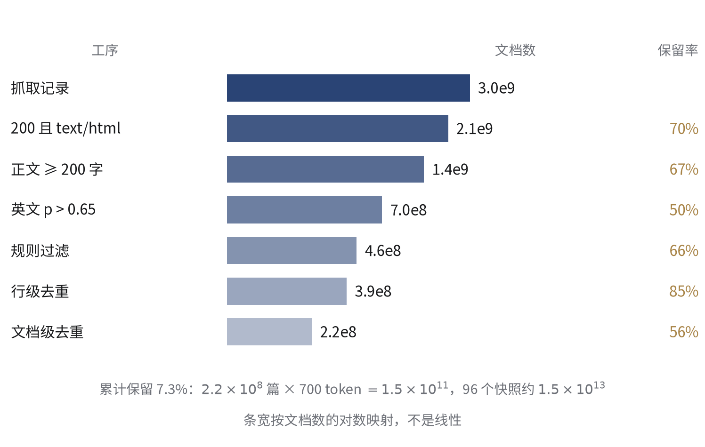

## 清洗：抽取、语言识别、规则过滤

从一个新闻页的 WARC 记录里取出 HTML，四十八 KB。按字符数分类统计一遍：内联脚本和 JSON 配置占二十二 KB，样式表四 KB，导航和菜单六 KB，广告位与推荐列表五 KB，页脚与版权声明三 KB，真正的正文八 KB。也就是说，这一页里能被称作“文章”的部分，占全部字符的六分之一。

模型看不见“文章”这个概念。它看见的是 token 序列，而序列里六分之五是导航、脚本和广告。这些片段有两个特点让它们格外危险：一是短，二是跨页面完全重复。“点击这里订阅”“版权所有 © 2024”“相关阅读”这几串字符，在几十亿个页面上出现过，它们在语料里的出现频率比任何真实句子都高几个数量级。模型会把容量花在记住它们上，因为它们是最容易被预测的文本——而这恰好是损失函数最奖励的东西。

所以清洗不是“把脏东西扫掉”这么简单，它决定了模型看到的世界长什么样。这一章按工序走：先把正文从页面结构里剥出来，再判断它是什么语言，再用一组规则判断它像不像人写的，最后处理那些单篇文档看不出来的重复。

### 一页网页里有多少正文

抽取要解决的问题是：给定一个 DOM 树和一堆文本节点，标出哪些节点属于正文。

两种判据。一种是结构判据：正文通常在 `<article>`、`<main>`、`role="main"`、`class="post-content"` 这类容器里，导航在 `<nav>`、`<ul>` 里，页脚在 `<footer>` 里。按标签和属性写 XPath，命中率取决于站点用不用语义化标签——新闻站用得多，博客和论坛用得少。

另一种是统计判据：正文段落长、标点多、链接少；导航和列表短、几乎没有标点、几乎全是链接。把这两组特征算成几个比值，就能给每个块打分。

Readability 的原始算法是后一种的典型代表，它的打分公式只有一行：

$$\text{score}(b)=1+c_b+\min\!\left(\left\lfloor \frac{L_b}{100}\right\rfloor,\,3\right)$$

$b$ 是一个候选块，$c_b$ 是块内逗号的数量，$L_b$ 是块内字符数，$\lfloor\cdot\rfloor$ 是向下取整。白话：逗号多、长度长的块得分高，长度超过三百字符后不再加分。逗号是“这是句子”的最廉价证据——导航条目很少有逗号，正文段落几乎每句都有。算完再乘一个惩罚项 $1-\rho_b$，$\rho_b$ 是链接密度（链接文字字符数除以块内字符数），把满是链接的块压下去。

这个公式很粗糙，但在十几年的实践中一直有效，因为它抓住了网页的一条统计规律：正文是人写的连续句子，导航是机器生成的短语列表，两者的标点密度差一个数量级。

### jusText：给每个段落打三种标签

jusText 把上面这个思路做得更细，它不整块打分，而是先按空行把页面切成段落，再逐段分类。

分类依据三个量。段落长度 $L$（字符数）；链接密度 $\rho$（链接内字符数除以 $L$）；停用词密度 $\sigma$（段落里属于停用词表的词数除以总词数）。停用词表就是 the、of、and、is、that 这一批高频虚词，它们在自然语言里占三到四成，在导航、标题、按钮里几乎不出现。

默认参数下的判定是这样：$L<200$ 的段落先搁置，太短没法判断；$\rho>0.33$ 判为坏；$\sigma<0.1$ 判为坏；$\sigma>0.2$ 且长度足够，判为好；剩下的进“待定”。

$$\text{label}(p)=\begin{cases}\text{bad}, & \rho_p>0.33\ \text{或}\ \sigma_p<0.1\\ \text{good}, & \sigma_p>0.2\ \text{且}\ L_p\ge 200\\ \text{review}, & \text{其他}\end{cases}$$

这套阈值不是从数据里学出来的，是作者按经验调的——jusText 的文档里直说，参数是在一堆新闻页上试出来的。0.1 和 0.2 之间留了一段缓冲，缓冲区的段落交给上下文判断。

上下文判断是 jusText 比 Readability 好的地方。一个待定段落，如果前后邻段都是好段落，它算好；前后都坏，它算坏；一好一坏，看哪边更近。理由是正文有连续性：一段引语、一个短句、一行代码，本身看不出是不是正文，但它夹在正文中间，就属于正文。这个规则处理了“文章里的小标题和列表”这类容易被误删的内容。

最后保留从第一个好段落到最后一个好段落之间的所有好段落和待定段落，其余丢掉。这个“首尾裁剪”很关键：页面开头的导航、结尾的版权声明，几乎一定在第一个好段落之前、最后一个好段落之后。

jusText 的弱点也在这里。它假设正文是一串连续段落，遇到结构松散的页面就失效：论坛帖（每层楼一个短段）、问答页（问题和答案交替，答案常常很短）、代码仓库的 README（大量列表和代码块）、电商详情页（参数表）。这些页面的“好段落”密度低，首尾裁剪会把中间也切掉。

### trafilatura：多路回退与自检

trafilatura 是这几年用得最多的开源抽取器，Dolma 和 FineWeb 都用它。它的做法不是单一算法，而是一条回退链。

先用 lxml 解析 DOM，按一组手工整理的 XPath 规则找正文容器——`article`、`main`、`[role=main]`、常见的正文 class 名，还有站点专用的规则（针对维基、博客平台、新闻 CMS 的模板）。找到就抽，抽完做清理：去掉重复行、去掉过短的块、去掉只有链接的块。

规则没命中，退到 Readability 式的打分；再没命中，退到 jusText。三条路都失败，这一页丢掉。

抽完还要自检，这一步是 trafilatura 区别于前两者的地方。它比较抽出文本的长度和页面总文本长度的比例，比例过低说明只抽到了一小段，比例过高说明把导航也带进来了；再检查抽出文本的语言是否和页面声明一致；再检查有没有残留的模板串。任一项不过，整页丢弃而不是保留半截。

这套自检的收益是精度，代价是召回。一页内容抽得不完整，不如不要——半截文章会让模型学到断句和残缺的段落结构，这比少一篇的损害大。这个取舍在数据工程里反复出现：宁可少要，不要脏的。

速度也值得说。trafilatura 单核每秒处理二三十个页面，比 jusText 慢一半左右，因为要多跑几路解析和自检。一百亿个页面，单核要跑十几年，所以实际是几千个核并行跑几周。这笔算力开销是“回到 WARC 重抽”这条路线的门票。

### 抽不出来的是什么

抽取器的失败不是随机的，它有明确的体裁偏向。

新闻、博客、百科这类“一段接一段的连续散文”，三种抽取器都能做好，准确率九成以上。论坛和问答页差得多：内容由大量短段落组成，区分“用户说的话”和“界面文字”需要理解页面功能，而不仅仅是统计标点。代码页几乎全军覆没：代码块没有逗号、没有停用词、链接密度为零，按上面的任何一条判据都会被判成坏段落。

这个偏向会沿着流水线一路传下去。抽取阶段丢掉的内容，后面的质量分类器看不见，配比阶段也调不回来——你以为语料里“对话占比 5%”，实际可能是“能抽出来的对话占 5%”，而能抽出来的那部分恰好是被转成散文的对话，不是真实的对话。

所以 2023 年之后的流水线开始按来源分路处理，而不是一条流水线跑到底。代码不走正文抽取，直接从 git 仓库拉原始文件；论文优先取 LaTeX 源码或 arXiv 的结构化版本，抽取 HTML 是下策；论坛和问答站用站点专用规则，按 DOM 里“帖子”和“回复”的固定结构切；PDF 单独走一遍版面分析，先把段落顺序理顺再抽文字。

代价是维护成本。每个站点一套规则，规则会随站点改版失效，需要持续回归测试。这也是为什么“数据”这件事在工业界是一个长期团队，而不是一次性的脚本。

### 语言识别：176 类的一个线性分类器

正文抽出来，下一件事是判断它是什么语言。

标准工具是 fastText 的语言识别模型，代号 `lid.176`：176 种语言，输入是文本的字符 n-gram（2 到 5 个字符的片段），特征是这些 n-gram 的哈希桶，模型是一个线性分类器加层次 softmax。它不看词，只看字符片段，所以对拼写错误和未登录词不敏感，单核每秒能判上万到十万条短文本。

为什么是字符 n-gram 而不是词？因为语言之间的差别在字符层面就已经很明显：波兰语的 `szcz`、越南语的声调符号、阿拉伯语的连写、日文的假名混汉字。用字符片段做特征，一个几 MB 的模型就能覆盖 176 种语言，不需要分词器，也不需要每种语言的词典。

判定输出是一个概率分布。实践中的做法是取最高分的语言，同时要求它的概率超过一个阈值，低于阈值就整页丢弃。CCNet 用 0.5，FineWeb 用 0.65，Dolma 按来源分别设。

阈值不是越高越好。设 0.65，短页面几乎全被牺牲——一句“欢迎光临”在中文、日文、韩文里的字符集有重叠，模型给出的概率会分散到三种语言上，最高分常常不到 0.5。而短页面里恰好有大量真实的对话和评论。

近亲语言是另一个坑。西班牙语和葡萄牙语、印尼语和马来语、俄语和乌克兰语，在字符 n-gram 层面高度相似，一句短话判错的概率很高。中文和日文更麻烦：日文里混着大量汉字，一段纯汉字的日文文本会被判成中文。

工程上的补救是分两级：先用整个页面判一次（长文本准确率高），再用判定的语言跑一次该语言专用的二次检查（比如日文检查有没有假名）。两级都过才保留。代价是低资源语言的召回进一步下降——这几乎是所有清洗工序的共同模式：每道工序都在提高精度，代价总是落在长尾上。

还有一个顺序问题值得单独提。CCNet 的做法是先去重、再判语言，而不是反过来。理由是英文的 cookie 提示、导航条、页脚版权声明会出现在所有语种的页面上，这些重复片段会干扰语言识别；先按段落哈希把跨语言的重复删掉，低资源语言的识别准确率明显上升。论文报告，部分语言的可用文档数因此差到三倍以上。这个细节说明流水线的顺序不是随意的，每一步都会改变下一步的输入分布。

### 抽取器怎么评测：三段式

“哪个抽取器好”这个问题没有统一答案，但可以拆成三个可分别测的层次。

第一层是字符级重合。人工标注 2000 页的正文 span，拿抽取结果与标注算重合字符比率。好的抽取器在新闻上能到 0.9，在论坛上降到 0.6。这个指标 객观但偏保守：抽取器把正文里的一个列表丢了，得分会掉，而那个列表可能无关紧要。

第二层是下游效果。把两份语料各训一个小模型，比验证损失与下游分数。这是唯一能回答“哪个更好”的层次，但它需要训两个模型，噪声与配比都会干扰，小差异根本看不出来。

第三层是失败分布。统计“抽出为空”“抽出极短（<100 字）”“抽出几乎全是链接”三类的比例。这一层最实用，因为它能定位问题而不需要标注。一个抽取器在新闻上可能三层都赢，但它的“抽出为空”比例在论坛站上是另一个的两倍，而论坛恰好是你最想要的那一块。

| 层次 | 代价 | 能回答什么 |
|---|---|---|
| 字符重合 | 2 人天标注 | 抽得全不全 |
| 下游效果 | 两个小模型 | 值不值得用 |
| 失败分布 | 半天脚本 | 在哪里失效 |

工程上推荐先做第三层。它不需要标注，跑一遍全量语料就能得到三张图（按站点分组的空抽取率、短抽取率、链接密度分布），而这组图能直接告诉你要不要换抽取器、要不要给某类站点写专用规则。字符重合与下游效果可以晚做，但要有——它们是向外部解释“为什么选这个”的唯一依据。

### Gopher 的六把尺子

语言识别之后，语料里还剩大量“是文字但不是好文字”的东西：自动生成的 SEO 页、字符画、报错日志、只有标点的行、base64 编码、目录页。

2021 年 DeepMind 训练 Gopher 时，把这套判断整理成了可执行的规则，后来几乎所有开源语料都沿用了它的框架。规则本身很朴素，值得逐条看，因为每一条背后都有一个具体的失败模式。

| 检查项 | 典型阈值 | 主要拦下的内容 |
|---|---|---|
| 词数 | 50–100000 | 导航页、错误页、超长日志 |
| 平均词长 | 3–10 字符 | 符号表、URL 列表、代码片段 |
| 含字母词占比 | ≥ 80% | 数字表格、字符画、base64 |
| 符号词比（`#`、`...`） | ≤ 0.1 | 目录、话题标签页、链接列表 |
| 省略号结尾行占比 | ≤ 30% | 截断摘要、目录 |
| 项目符号开头行占比 | ≤ 90% | 纯列表页 |
| 重复行、段、n-gram 占比 | 各设阈值 | 模板页、机器生成页 |

词数的下限拦的是“没有内容”的页面：图片站、门页、错误页。上限拦的是机器产物：日志文件、数据库导出、爬虫自己生成的索引页——这些文本长度能到几兆，重复度极高。

平均词长是最容易被误解的一条。它假设语言用空格分词，英文的平均词长在 4 到 5 个字符；低于 3 说明这条“文本”其实是符号序列，高于 10 说明是没有空格的长串（URL、哈希值、压缩数据）。这条规则直接搬到中文会出事：中文不分词，按空白切出来的“词”是一整句，平均长度二三十，全军覆没。所以中文语料必须重调这套参数，或者换成“平均每字符的 token 数”“汉字占比”这类指标。规则移植从来不是复制粘贴。

符号词比看的是 `#` 和 `...` 相对词数的比例。`#` 多说明是标签页或者代码；`...` 多说明是目录、被截断的摘要、链接列表——这类页面的正文往往只有一句，剩下全是省略号引导的预览。

含字母词占比这一条针对的是数字表格和字符画。财务报表、价格表、ASCII 艺术，它们的“词”里几乎没有字母，但字符数不少，很容易通过长度检查。

省略号结尾和项目符号开头这一对，是专门用来识别列表结构的。目录页的每一行都以省略号结尾（“第一章 …… 1”），链接列表的每一行都以 `-` 或 `•` 开头。阈值定得很松（30%、90%），因为正常的文章里也有列表，只有极端情况才整页丢掉。

重复检查是最有效的一条。同一篇文档内重复出现的行、段落、10-gram，占比超过阈值就整篇丢弃。它拦下的是模板页和机器生成页：一个电商站的商品描述，往往是“产品名 + 同一段参数说明 + 同一段售后承诺”，重复率能到七成。

这套规则的共同点是：它们都在检测“分布外”。自然语言的统计特征相当稳定——词长集中在 4 到 5、虚词占三到四成、标点密度在一个区间内、重复率很低。偏离这个分布的东西，要么不是自然语言，要么是机器批量生成的。规则不需要理解内容，只需要知道“正常文本长什么样”。

也正因为如此，规则有一个明确的能力边界：它能识别“不像人写的”，识别不了“是人写的但没价值”。一篇营销软文、一份产品说明书、一段情绪宣泄，完全符合上面每一条阈值。要把它们分开，得让模型来打分，那要等到讲质量分类的时候。

### 三个阈值一起调会互相掩盖

流水线上的阈值不是独立的，调一个会改变另一个的效果，这在联合调参时会造成假象。

一个具体例子。把语言识别阈值从 0.5 提到 0.65，同时把最小词数从 50 降到 30。单独看，第一个动作删掉 12%，第二个动作留下多 4%；合起来看，删掉 9%——比两个单独效果相加少 7 个点。原因是它们删的不是同一批文档：被词数过滤器删掉的那些短文本，恰好就是语言识别置信度最低的那一批。两者高度重叠，先后顺序决定了谁先删掉它们。

这种重叠可以用一个简单的四格表看。抽 10 万篇文档，按“是否过语言阀”与“是否过词数阀”分成四组：

| | 过词数 | 不过词数 |
|---|---|---|
| 过语言阀 | 7.1 万 | 1.4 万 |
| 不过语言阀 | 0.6 万 | 0.9 万 |

两个阀同时开的保留量是 7.1 万。若它们独立，应该是 $0.85\times0.86\times10=7.3$ 万；实际少了 2 千，这 2 千就是“同时被两个阀卡住”的重叠部分。重叠越大，联合效果离“两个比例相乘”越远。

工程上的含义是：要拿小模型做消融时，最好一次只改一个阀，而且从最后一个阀往前改（靠近训练端的先改）。同时改两个，得到的结论可能是“组合效果好”，实际上只是其中一个在起作用，而另一个的收益被重复计算了。真要联合调，就每一组都跑一次全流水线，不能拿单独实验的数字相乘。

### 模板：单篇文档看不见的重复

上面所有规则都在单篇文档内部做判断。有一类噪声用这种方法永远看不见：模板。

“点击查看大图”“转载请注明出处”“本文由 XX 整理发布”，这些话单独看完全正常——有标点、有虚词、长度合适。它们的问题不在句内，而在跨文档的重复：同一串字符出现在几百万个页面上。

单文档规则对此无能为力，因为每一篇文档里它只出现一次。这类噪声要靠跨文档统计来抓。

CCNet 的做法是段落级哈希。把每个段落规范化——转小写、数字替换成 0、去标点、去重音符号——取 SHA-1 的前 64 位作为指纹；然后拿每个段落的指纹和一份“参考样本”比对，命中就删掉这个段落。参考样本只取语料的一个分片（约 3%），因为全量比对的内存放不下。这是一个近似：只跟 3% 的语料比，能抓到的是“高频重复”，抓不到“只重复了几十次”的模板。

另一条路是统计跨文档的 n-gram 频率。一个 5-gram 如果在几百万篇文档里都出现，它的信息量接近零，可以直接从语料里删掉这个片段，或者给它一个极低的采样权重。这本质上是在算 IDF：越常见的片段越不重要。工程上常用一张“黑名单 n-gram 表”，由高频统计自动生成，再加人工审核。

模板漏网的后果可以很具体。设想一个资讯站，每篇文章末尾有“相关阅读”区块：五条链接，每条带一句摘要，摘要三十到六十字、有标点、链接密度 0.4。jusText 会把它们判成待定段落，而它们的上文是正文（好段落），按上下文规则就被保留下来了。于是每个页面都带上一段“相关阅读 + 五条摘要”，这些摘要来自别的文章，语义上跟本篇毫无关系。

模型在这种语料上训完，会学到一个规律：文章结尾要以“相关阅读”开头，后面跟五条短句。生成时它就会照做，编造出五个不存在的标题。这不是幻觉的算法原因，是数据的形状被学了进去。

### 一道漏斗：每步剩多少

把前面几道工序串起来，用单个快照的数字走一遍。下面每一行的保留率都是经验值，不同快照、不同阈值会浮动几个点，但量级稳定。

| 工序 | 剩余文档 | 保留率 |
|---|---|---|
| 抓取记录 | $3.0\times10^{9}$ | — |
| 200 且 text/html | $2.1\times10^{9}$ | 70% |
| 抽出正文 ≥ 200 字 | $1.4\times10^{9}$ | 67% |
| 英文、置信度 > 0.65 | $7.0\times10^{8}$ | 50% |
| 规则过滤 | $4.6\times10^{8}$ | 66% |
| 行级与模板去重 | $3.9\times10^{8}$ | 85% |
| 文档级去重 | $2.2\times10^{8}$ | 56% |

两项数字对得上。一是总保留率：$2.2/30=7.3\%$，与上一章那条链子里的“千分之七”是同一件事的两种算法，差别在口径（一个按记录数、一个按字节）。二是 token 总量：$2.2\times10^{8}$ 篇乘每篇 700 token 得 $1.5\times10^{11}$，九十六个快照就是 $1.5\times10^{13}$，正好是公开网页语料的量级。这两项能对上，说明这串保留率不是拍出来的。

漏斗的形状比具体数值更值得看。最陡的一段是语言识别和文档级去重，各砍一半；最缓的一段是行级去重，只砍一成五。这意味着同样的人力，投在去重上的回报比投在规则微调上高一个量级。也意味着“再收紧一点规则”最多只能从 46 亿篇里再多删几千万篇，而动去重算法能改变几亿篇的去留。

### 打一分要多少钱

质量分类器是流水线里唯一需要 GPU 的环节，成本得算清楚。设教师模型 700 亿参数，每篇文档平均 300 token，2.2 亿篇（只给去重后的那份打分）：

$$2\times7\times10^{10}\times300\times2.2\times10^{8}=9.2\times10^{22}\ \text{FLOPs}$$

按单卡有效 $1.5\times10^{14}$ FLOPS 算，是 $6.1\times10^{8}$ 卡秒，也就是十七万卡小时；按每卡小时两美元，三十五万美元。

这个数字要和“给同样数据训一遍模型”比。一个 70 亿参数的模型跑 15 万亿 token：

$$6\times7\times10^{9}\times1.5\times10^{13}=6.3\times10^{24}\ \text{FLOPs}$$

比值是 1.5%。换句话说，花训练预算的百分之一点五，换一次“全量质量打分”，在账上是划算的——只要打分真的把语料变小了。如果打分后留下十分之一，那么每单位有效 token 的训练成本降了，但打分费摊到每 token 上是原来的十五倍。所以分类器打分的经济性完全取决于一件事：高分那十分之一能不能顶得上低分那十分之九。

蒸馏之后成本降两个量级。学生是一个七亿参数的小模型（或一层线性分类器），每篇文档 $2\times7\times10^{8}\times300=4.2\times10^{11}$ FLOPs，2.2 亿篇共 $9.2\times10^{19}$，不到教师的三百分之一。所以工程上的做法是：让大模型标几万到几十万条，训一个小模型，再用小模型扫全量。FineWeb-Edu 用的是这个路子，只是把“线性分类器”换成了一个小号的 transformer。

### 一次消融只要二十六分钟

“这条规则到底有用”这个问句，答案不在论文里，在自己手上。算一笔实验成本就明白了。

取 500 万篇文档，训一个一点六亿参数的模型，跑 20 亿 token。算力是

$$6\times1.6\times10^{8}\times2\times10^{9}=1.9\times10^{18}\ \text{FLOPs}$$

八张卡、每张有效 $1.5\times10^{14}$ FLOPS：

$$\frac{1.9\times10^{18}}{8\times1.5\times10^{14}}=1.6\times10^{3}\ \text{s}\approx 26\ \text{分钟}$$

二十六个分钟一组，一天能跑五十组。这就是“五十多个过滤器逐个对照”在工程上居然可行的原因。关键不是模型小，是语料也小：500 万篇 × 700 token = 35 亿 token，够跑一个 epoch，而验证集只需固定一份 2000 万 token 的留出文本，不能动。

这个规模上能量出来的差异有下限。验证损失的标准误大约 $\sigma/\sqrt{N}$，token 级损失的标准差取 3 nats、$N=2\times10^{7}$，得到 0.0007；两个配置的差值要超过两倍标准误才算信号，也就是 0.0015 nats。实践上这个量级以下的差异都是噪声，而很多论文里报的恰恰是这个量级。想看更大的效应，就得把模型放大到十亿参数以上，单次实验从半小时变成一天，可做的组数从五十降到二。

所以消融的策略是分两阶段：小模型筛掉明显的坏规则（只看方向，不看具体值），再用一个中等模型验证五到十条候选规则。跳过第一阶段，会在无收益的规则上花掉几周；只做第一阶段，会把 0.002 的噪声当成结论写进报告。

### 一次没有回归集的升级

一个真实形状的事故：抽取器的依赖升了个版本，XPath 里一条匹配正文容器的规则失效了。

失效的方式很隐蔽。规则没命中时，trafilatura 会退到 Readability 打分，所以页面照样能抽出来，只是抽得短。一周后，语料里“平均每篇字数”从 1900 掉到 1200，团队以为是抓取端的问题，查了两天。真正的原因在一条 class 名上：新版本把属性匹配改成大小写敏感，而那个站点写的是 `Post-Content`。

损失能算出量。平均字数掉 37%，意味着同等文档数下 token 少了三分之一；而丢掉的那部分大多在文章后半段——正是结论、数据、长段推理所在。用这种语料训出的模型，在长文任务上会莫名其妙地弱，而纸面上的 token 总数只少了三成，没人会往“抽取器版本”上想。

对策不复杂：留一份两千页的人工标注回归集，按体裁分层（新闻、博客、论坛、代码、论文各四百页），每次升级跑一遍，看三个数：平均抽出字数、空正文比例、抽出文本与标注的重合字符比率。三个数任一偏离基线超过 5%，就不允许上线。这份回归集的成本是两三天人工，而它能拦住的那类事故，一次就是两周的机时加一次重跑。

### 十条规则逐条称重

规则表看上去都合理，但删量和收益完全是两回事。在一份 500 万篇的抽样、一个一点六亿参数的模型上做一次对照（数字只表示方向和量级，不是论文值），得到这样一张表：

| 规则 | 删量 | 验证损失变化 |
|---|---|---|
| 文档级去重 | 44% | −0.021 |
| 语言置信度 > 0.65 | 12% | −0.006 |
| URL 黑名单 | 8% | −0.004 |
| 最少 50 词 | 11% | −0.003 |
| 句末标点行 ≥ 80% | 21% | −0.002 |
| 重复行占比 > 30% | 6% | −0.001 |
| 平均词长 3–10 | 3% | 0.000 |
| 含字母词 ≥ 80% | 5% | +0.001 |
| 省略号结尾 ≤ 30% | 2% | 0.000 |
| 项目符号行 ≤ 90% | 1% | −0.001 |

读法有三层。第一，删量最大的去重收益也最大，两者同步，是因为它删掉的是真重复。第二，中间六条的收益都在测量下限以下——2 亿 token 的验证集上，标准误约 0.0007，这些规则的效果与噪声无法区分。第三，有一条删量不小却是正的：含字母词占比会把带大量数字的技术文档、混合语言页面一起删掉，而它们恰好包含模型在网页里见不到的写法。

“没收益”不等于“该关掉”。删掉 21% 的文档换 0.002 的损失，在“语料不够用”的阶段是亏的，在“语料过剩”的阶段是赚的——同样的训练预算下，少 21% 的数据可以用更多 epoch 补，而过拟合风险才是主要矛盾。判断一条规则该不该开，得先回答“现在缺的是数据量还是数据质量”。

### 清洗会删掉三种能力

把阈值调紧，得到的是更干净的书面英语，丢掉的则是三类在语料里本来就稀缺的东西。

一是短文本。问答、评论、客服对话、弹幕，单条几十个字，正好卡在 50 词下限上。一个站的问答页，问题一行、答案三行，整页抽出来不到一百词，词数规则会把它删掉。删掉的后果不在损失上，在对话能力上：一个从没在短句对答上训过的模型，SFT 之后仍然不会接话。

二是公式与代码。平均词长、含字母词占比、句末标点这三条都是为“散文”设计的，而公式和代码三条全不满足。一个带公式的物理题解答，正文里一半字符是符号，抽出来平均词长 12，直接被判成非自然语言。这就是为什么数学与代码必须走专用管道，而不能靠网页流水线搭便车。

三是小语种。语言置信度 0.65 这道阀，英语几乎无损，因为它的字符 n-gram 分布集中；而一个只有几百万网页的语种，短文本多、借词多、与近亲语言重叠多，0.65 会删掉一半。最后语料里只剩下那个语种的长篇文章——百科、新闻、法律文本。模型于是学会了那个语种的书面语，不会它的口语。

这三类删掉的量加起来不到总量的一成，却是能力差异的主要来源。这也是为什么后来的做法从“一条流水线”变成“多条管道”：网页、代码、数学、对话、多语各走各的过滤器，共享的只有去重和分词。

### 召回换精度

到这里，流水线上有七八道阀门，每一道都在删东西。把它们串起来，从原始响应到最终进训练的 token，保留率在千分之几到百分之几之间，落在哪里取决于阈值有多紧：正文抽取砍掉八成以上的字节，语言识别和规则过滤再从剩下的里面砍掉一半到九成，去重最后再砍一刀。要走完几十个快照，才凑得出十几万亿 token。

每一道阀门的阈值都是一个旋钮，往紧调，精度上去，召回下来。这条曲线没有最优点，只有取舍，而取舍的后果不均匀地落在长尾上。

具体一点：把“含字母词占比”从 80% 调到 90%，删掉的是那 10% 的边缘文档，里面主要是表格、混合语言页面、带大量数字的技术文档。把语言识别的置信度从 0.5 调到 0.65，删掉的主要是短文本和低资源语言，因为它们的概率分布本来就分散。把“平均词长”下限从 3 调到 4，中文和泰文的比例会掉一半。

这些删除在总量上微不足道——5% 的文档而已——但它们的分布不随机。每一条规则都在把语料往“结构规整的书面英语”推一点，推七八次之后，语料就只剩下新闻、博客和百科了。代码、对话、口语、方言、网络用语、公式推导，这些恰好是模型最难从别处学到的东西。

FineWeb 的消融实验把这层窗户纸捅破了。它把五十多个流传甚广的规则逐个打开，用小模型测下游效果，结论是大部分规则没有可测量的收益，有的还有害：删掉的东西里包含的信息，比留下的噪声更值钱。真正稳定有正收益的只有几条——语言识别、句末标点规则（它同时完成了去导航）、URL 黑名单、去重。

这个结论不该被读成“规则没用”，而该被读成“规则的用途是排除明显不可能，不是挑出最好的”。判断“这段文字值不值得学”需要语义理解，规则做不到；但判断“这段文字根本不是自然语言”，规则又快又准，而且不需要 GPU。

于是流水线的分工就清楚了：规则做粗筛，成本低、召回高、允许误杀；分类器做精排，成本高、看语义、按分数排序而不是硬删。两者的比例大概是：规则把 400 TB 砍到几十 TB，分类器在这几十 TB 里决定哪 10% 进训练。

还有一件事在所有阀门之后才显现：重复。前面那些规则都是单文档的，而网页语料里最大的浪费是跨文档的重复——一篇报道被几十家转载，一份隐私政策挂在每个页脚，同一段代码在无数教程里出现。去重删掉的 token 比所有规则加起来还多，而它面对的问题也最难：什么叫“同一篇文档”，改了一个词的转载算不算，改了语序的洗稿算不算。下一章处理这件事。
