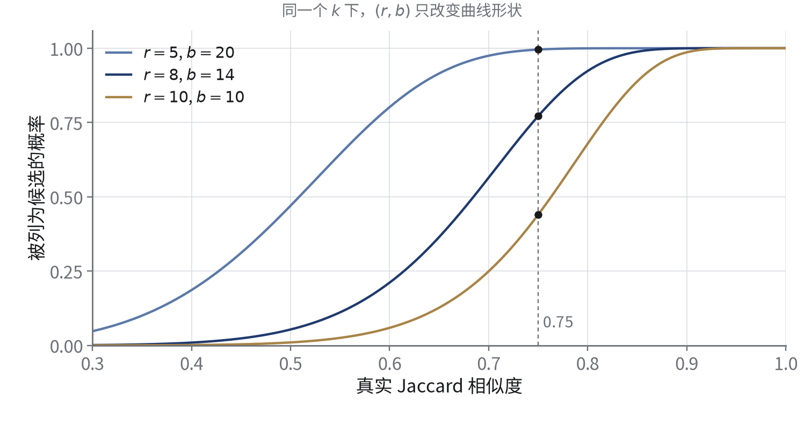

## 去重与去污染

2021 年，一组研究者做了一件看上去有点挑衅的事：给 GPT-2 一段五十来个 token 的开头，让它往下写，然后把续写结果拿去和训练语料比对。几千次采样里，有六百多段是逐字复现的原文——邮箱地址、电话号码、IRC 聊天记录、代码文件头里的版权声明。模型不是在模仿文体，它是在背。

更早的证据藏在 GPT-2 自己的论文里。给它一个网页的开头，它会一行一行地把整个页面的结构写出来，包括导航栏和页脚。这件事当时被解释成“语言模型学到了网页长什么样”，后来的说法要难听得多：那些页脚在语料里出现了上百万次，模型只是记住了它们。

重复是记忆的温床。训练时每个 batch 从语料里抽样，一段出现 $r$ 次的文字被抽中的机会也是别人的 $r$ 倍。一段被转载四十次的新闻，在梯度下降眼里不是一篇新闻，是四十篇。梯度按样本可加，这四十份贡献叠在一起，等于给它偷偷加了四十倍的权重，而这一切没有经过任何人的决定，纯粹是爬虫抓取次数的副产品。

网页语料的重复程度超出直觉。前面几道工序把语料变干净了：正文抽出来了、语言判对了、规则筛过了。可那些都是逐篇的检查，管不了一篇和另一篇的关系。一篇通稿会被几十家站点全文转载，改个站点名就发；一份隐私政策挂在每个页脚，几年不变；同一个开源许可证文件在几十万个仓库里各存一份；同一段商品描述被同一个商家的上千个页面复用。这些重复不是随机撒在语料上的噪声，它们集中在模板、条款、样板文和热门内容上——正好是最不需要模型花容量去学的东西。去重处理的就是这件事，它分两层：找出完全相同的片段，和找出“改了标点、换了站点名”的近似副本。

### 同一段文字被数了很多遍

把语料记作一个多重集 $D=\{x_1,\dots,x_N\}$：$x_i$ 是第 $i$ 个训练样本（一篇文档，或一个固定长度的片段），$N$ 是样本个数，样本 $x$ 在语料里出现 $r(x)$ 次。均匀抽样下一个 batch，$x$ 被抽中的概率正比于 $r(x)$，所以整个训练过程里它被看到的期望次数是

$$\mathbb{E}\big[\#\{x\text{ 被抽中}\}\big]=B\cdot\frac{r(x)}{N}$$

$B$ 是整个训练里总抽样次数（步数乘以每步的样本数）。这个式子不需要任何假设，它只是“按比例抽样”的定义。白话：样本的出现次数直接是它在训练里的权重，不管这个次数是怎么来的。

训练目标因此不是“网页文本分布上的期望损失”，而是“按抓取次数加权的期望损失”。这两者的差别在模板文上被放大到荒谬：一段 cookie 提示在语料里出现五十万次，那么它在损失函数里的分量，等于五十万篇各不相同的文章里各取一句。模型要降低损失，最省力的路径不是学会“网页有这种东西”，而是把这段字符串连同周边的标签结构一起记下来，遇到开头就条件反射地续完。

这里面有三笔账。第一笔是容量：参数被用来存原文，就没法用来存规律。第二笔是评测：验证集如果也带着同样的重复，困惑度会显得比真实水平好，因为模型在验证集上背过答案。第三笔最难察觉：重复数据把训练分布压窄了。语料里同一个说法出现得越多，模型越倾向于用它，即使换个场合不该这么说。

有人会问：那直接给某些数据加权不就行了？可以，问题是权重应当是一个决定，而不是一次事故。想提高百科的比例，就调采样权重，这是可控的、写在配方里的；而爬虫在某个站点上抓了三千个结构相同的页面，让这个站点的排版风格在损失里占 1%，这是没人决定过的。去重的意义不在于“删掉数据”，在于把权重还给真实的分布。

### 精确去重：把后缀排一次序

先解决最硬的那一半：找出所有“长度不少于 $k$、并且在语料里出现过至少两次”的片段。

要判断一个片段是否重复，直觉做法是拿它去语料里搜一遍。单次搜索可以用哈希表做到近似常数时间，但候选片段有 $N$ 个，每个都要搜一遍就是 $O(N^2)$：一千亿 token 的语料，$N^2$ 是 $10^{22}$，这个量级的操作任何机器都做不完。

换个角度：如果所有“从某个位置开始一直到结尾”的字符串（称为后缀）按字典序排好，那么共享同一段前缀的后缀必然挨在一起——字典序比较是从第一个字符开始逐位比，前缀相同就往后比，共享 $k$ 个字符的两个后缀，中间不可能插进一个“第 $k$ 个字符就不同”的串。于是“重复”这个全局性质，被压缩成了“数组中相邻两项的共同前缀有多长”这个局部性质。

把整份语料拼成一个大字符串 $S$，第 $i$ 个后缀记作 $S[i{:}]$。后缀数组（suffix array）是一个整数数组 $\mathrm{SA}$，满足 $S[\mathrm{SA}[0]{:}]<S[\mathrm{SA}[1]{:}]<\cdots$，也就是“第 $j$ 小的后缀从位置 $\mathrm{SA}[j]$ 开始”。构造它的经典算法是 SA-IS，时间与 $|S|$ 成正比，不是 $|S|\log|S|$。

有了 $\mathrm{SA}$，再算相邻后缀的最长公共前缀（longest common prefix，LCP）：

$$\mathrm{LCP}[j]=\big|\,\mathrm{lcp}\big(S[\mathrm{SA}[j-1]{:}],\;S[\mathrm{SA}[j]{:}]\big)\big|$$

$\mathrm{lcp}(a,b)$ 是两个字符串从头开始能对上多少个字符。朴素算法对每一对相邻后缀逐位比较，最坏是 $O(N^2)$（想象一百万个 `a`），实践中用 Kasai 算法可以做到 $O(N)$，靠的是一条性质：把后缀 $S[i{:}]$ 的首字符删掉，得到的就是 $S[i{+}1{:}]$，它的 LCP 至少是前者的 LCP 减一。所以按位置顺序扫一遍，比较指针永远不回退。

判据就一行：$\mathrm{LCP}[j]\ge k$ 时，位置 $\mathrm{SA}[j-1]$ 和 $\mathrm{SA}[j]$ 各自往后的 $k$ 个 token 是同一段文字，删掉后者。实际实现还要多做一步：相邻的若干对可能互相重叠（一段被复制三次的文字，会连续产生好几对超过阈值的相邻后缀），所以要把命中的区间按位置合并，同一个重复簇只保留最早出现的那一份，其余位置的这段 span 全部删掉。这一步是区间并集，排序后线性扫。

三个数字决定这套流程能不能用。第一个是内存：论文《Deduplicating Training Data Makes Language Models Better》(2021) 报告每个 token 约 8 字节，4 字节存后缀数组、4 字节存文本本身（token id 用 32 位整数）。四百亿 token 就是 320GB，一台机器的内存装不下，得靠外存排序或者按快照分片。第二个是时间：构造 SA 与算 LCP 都是线性的，瓶颈在磁盘 IO。第三个是阈值 $k$：论文把“一段长度 $k$ 的串在语料里又出现过一次”的 token 占比画成曲线，发现十来个 token 处是拐点，$k<10$ 的匹配占了全部 token 的九成，那些是“两个不相干的人写出了同一串常用词”；人工检查 $k=25$ 的匹配没有发现假阳性，于是乘二取 50，留出余量。

后缀数组的强项是彻底：它抓的是子串，不是文档，所以“一篇长文里被塞进来的一段模板”也能被单独切掉，文档的其余部分留着。它的弱项同样是彻底：改一个标点、换一个站点名、多加一行“本文转载自”，匹配就断了。而网页重复的主要形式恰恰是这种改写。哈希路线的方案（比如 Dolma 用段落 SHA-1 加 Bloom filter）便宜得多，内存是常数级、可以流式跑，代价是只能抓完全一致的段落，还会带来约百分之一量级的假阳性——一个从没出现过的段落被误判成重复，这个概率随 Bloom filter 装满而上升。

### 近重复：一百个哈希代表一篇文档

近重复的判据是两个文档的词集合有多重合。把第 $i$ 篇文档切成所有 5-gram 的集合 $S_i$（连续五个词算一个元素，去重后成集合；FineWeb 用英文分词器切词，不是按字节切），定义 Jaccard 系数

$$J(S_i,S_j)=\frac{|S_i\cap S_j|}{|S_i\cup S_j|}$$

分子是两篇共有的 5-gram 个数，分母是并集大小。完全相同的两篇 $J=1$；各写各的两篇接近 0。白话：它衡量“这两篇文章用的词组，有多少是重叠的”。

问题是 $J$ 的精确计算需要遍历两个集合，一亿篇文档两两算一遍是一亿的平方，也就是 $10^{16}$ 次集合运算，这条路直接断掉。MinHash 的办法是给每篇文档算一个很短的签名，让签名的相似度成为 $J$ 的无偏估计。

取一个把 token 映射到整数的随机哈希函数 $h$，定义文档 $i$ 的最小哈希值

$$h_{\min}(S_i)=\min_{x\in S_i}h(x)$$

可以证明

$$\Pr\big[h_{\min}(S_i)=h_{\min}(S_j)\big]=J(S_i,S_j)$$

推导只用一句话：把两个集合的并集按哈希值排序，最小的那个元素要么同时属于两边（概率 $|S_i\cap S_j|/|S_i\cup S_j|$），要么只属于其中一边（概率是差集占比），两者之比正好是 Jaccard。所以“两个文档的最小哈希相等”这件事，发生的概率就是它们的相似度。

一个哈希给出的是一次伯努利试验，方差太大。取 $k$ 个独立的哈希函数，得到 $k$ 维签名，两篇文档在多少个维度上相等、除以 $k$，就是 $J$ 的估计，标准差约

$$\sigma\approx\sqrt{\frac{J(1-J)}{k}}$$

$J=0.75$、$k=112$ 时是 0.041——估计得不算精细，但对“是不是重复”这个二选一的问题够用了。白话：一百多次独立投票，票数比例就是相似度，误差按 $1/\sqrt{k}$ 收缩。

签名的价值在于它把文档从几万个 5-gram 压成了一百多个整数，剩下的问题是“怎么在上亿条签名里找到几乎一样的那几条”。逐一比较仍然是平方复杂度，而被列为候选：把 $k$ 个签名值切成 $b$ 个 band、每个 band $r$ 行（$b\cdot r=k$），**只要有一个 band 逐位相同**，就把这对文档列为候选。

一个 band 逐位相同的概率是 $J^{r}$（$r$ 个位置各自撞上的概率相乘），没有一个 band 相同的概率是 $(1-J^{r})^{b}$，于是被列为候选的概率是

$$P(J)=1-\left(1-J^{r}\right)^{b}$$

这条曲线是 S 形的：相似度低时几乎为 0，某个点之后陡然上升，最后趋近 1。拐点大致在 $J\approx(1/b)^{1/r}$。$r$ 控制陡峭程度、$b$ 控制位置，$br$ 不变时调这两个数只是在改曲线形状，不改计算量。

具体参数差别很大。FineWeb 取 5-gram、$k=112$、$r=8$、$b=14$，拐点 $J\approx0.72$：$J=0.7$ 时命中率 56%，0.75 时 77%，0.8 时 92%，0.85 时 98.8%。它的目标很明确——“至少七成半相似”要抓住，八成以上不能漏，七成以下漏掉可以忍。RefinedWeb 用了 9000 个哈希、450 个 band、每 band 20 行，曲线在 0.8 附近几乎是阶跃：0.75 只有 76%，0.8 直接到 99%。换来的是四十倍以上的签名维度和对应的比较开销。

这就是这套参数的全部门道：$r$ 大则曲线陡、漏检多；$r$ 小则召回高，代价是候选对爆炸——短文档尤其容易误中，因为它们的 5-gram 集合小，随便几个常见短语就能凑出一个相同的 band。实际取值是在“漏掉多少真重复”和“候选池多大”之间摆的，不是优化出来的。

候选对通常还要过第二道闸。前面那篇去重论文用 9000 维签名初筛，再算编辑相似度 $1-\mathrm{EditDistance}(x_i,x_j)/\max(|x_i|,|x_j|)$，超过 0.8 才判定重复；编辑距离是把一篇改成另一篇所需的最少插入、删除、替换次数。FineWeb 省掉这步，直接信 band 命中，但加了一步传递闭包：$A$ 与 $C$ 重复、$B$ 与 $C$ 重复，则 $A$、$B$、$C$ 同簇，每簇随机留一篇。闭包会把簇越滚越大——那篇论文在 C4 上找到过一个 25 万篇的簇，源头是一个被镜像到各处的内容农场。

内存账要摆在一起看才公平：后缀数组是 8 字节一个 token，一亿篇平均一千 token 的文档就是 800GB；MinHash 是 112 个 32 位整数加少量元数据，一篇约 450 字节，同样一亿篇 45GB，而且可以边算边落盘、按 band 分桶做外存连接。所以工业界的常规组合是“MinHash 做主力，后缀数组做抽查或者做小语料的精确分析”。

### 去重的粒度、方向与簇的大小

同样是去重，切在哪一层，结果完全不同。

文档级：一篇文档只要和别的文档相似度超过阈值，整篇删掉。做法最省事，代价是把“同一模板下的不同内容”一起牺牲——一个电商站的十万个商品页共用同一套模板，只有规格表不同，文档级去重会把其中九万九千个判成重复，剩下的那个也谈不上多有用。段落级居中间：模板段落被删，正文留下。子串级（后缀数组那种）最细：只删命中的那段 span，一篇被塞了模板的长文能保住主体。CCNet 走的是段落级，FineWeb 和 RefinedWeb 走文档级，The Pile 与 Dolma 混合使用。

更反直觉的是方向：去重是在每个快照内部做，还是跨所有快照做一遍？

FineWeb 的消融给出了一个和直觉相反的结论。逐快照独立去重后剩下约 20 万亿 token，把 96 个快照合起来做全局去重只剩约 4 万亿——删掉了五倍的数据，效果却更差。原因在时间方向：全局去重必须定一条保留规则，最自然的是“留下最新快照里的那份”，于是同一篇文章在 2013 年的副本被删掉。论文拿 2013 年的快照做了检查，被留下的那一成内容在广告密度、关键词堆砌、格式错乱上都比被删掉的九成更差。解释不复杂：一篇好文章会不断被转载、被引用、被重新发布，所以它在新快照里有副本；只存在于旧快照里的，往往是当年就没人愿意再发的页面。

簇的大小也值得单独看。真正有害的是那种几百上千篇的大簇：镜像站、模板页、爬虫拼出来的垃圾站，它们的文本一模一样，模型会被迫背下来。而只重复两三次的小簇，删掉反而损失信息——一个说法被几个人分别写过，说明它在现实里重要，这种“独立重复”是信号而不是噪声。所以有些配方会按簇大小分档处理：超过阈值的整簇只留一篇，两三次的小簇全部保留。

还有一层更现代的做法是语义去重。《SemDeDup》(2023) 不比较字面，而是用预训练模型的句向量，把文档聚类，在簇内按余弦相似度删掉那些“意思几乎一样”的样本。在图文数据上，它删掉了约一半数据而下游性能基本不掉，省下的是实打实的训练算力。风险在于“意思一样”这个判断太粗：同一段政策在 2019 年和 2023 年的两个版本，语义相似度可能高到 0.95，但年份和条款是不同的事实，删掉一份就等于从语料里抹掉了一次修订。字面去重不会有这个问题，语义去重会。

### 把 112 个签名切成 14 段

参数选定后，曲线长什么样值得看一眼。下图是三种常见取法在同一张图上的位置，横轴是真实 Jaccard，纵轴是被列为候选的概率。

把具体值算出来更清楚。$r=8$、$b=14$、$k=112$：

$$P(0.7)=1-(1-0.7^{8})^{14}=1-0.9424^{14}=0.56$$

同样公式在几个点上：$J=0.6$ 是 0.21，$0.75$ 是 0.77，$0.8$ 是 0.92。另一组 $r=5$、$b=20$ 更宽松，$J=0.6$ 时已有 0.80 的命中率；$r=10$、$b=10$ 更严格，$J=0.8$ 只命中 0.68。

| 真实 $J$ | $r=5$, $b=20$ | $r=8$, $b=14$ | $r=10$, $b=10$ |
|---|---|---|
| 0.6 | 0.80 | 0.21 | 0.06 |
| 0.7 | 0.97 | 0.56 | 0.25 |
| 0.8 | 1.00 | 0.92 | 0.68 |
| 0.9 | 1.00 | 1.00 | 0.99 |

宽松与大候池是同一件事。$J=0.6$ 在 2.2 亿篇文档里会有多少对？假设相似度分布集中在 0.1 以下，0.5 到 0.7 这一段的大约万分之一，也就是两万篇里有 2.2 万对，取 0.80 命中就是 1.8 万对；而 0.8 以上的真重复也许只有几百对。多出来的候选对要逐个跑第二道闸（编辑距离或逐 token 重叠），而编辑距离是 $O(|x||y|)$，一篇一千 token 的文档就是一百万次格子计算。候选池大一倍，总开销就大一倍。这就是为什么“宁可漏一点”在工程上是理性选择。

实现上还有个天真的坑：把 3.1e10 个 band key（2.2 亿篇 × 14 段）全放进一张哈希表。每个 key 至少 16 字节，加起来 500 GB，任何机器都放不下。可行的做法是按 band 分十四趟：每趟只留一个 32 位 band key 和文档编号，共 $2.2\times10^{9}$ 对，按 key 排序后顺序扫一遍，相邻同 key 的归成一组。单趟 35 GB，外排排序几十分钟就能跑完，总时间主要花在磁盘上。

簇的处理也有个容易写崩的地方：命中后当成无向图做连通分量。一个被镜像了 25 万次的农场，会把这个分量连成大片的背景，如果再用“与簇内任意一篇相似”作为传播条件，最后半个语料会被归进同一簇。稳妥的做法是限定传播深度（一跳），或者先按文档长度分桶再去重——长度差两倍以上的两篇文档不该被归进同一簇。

### 去重花掉的算力比它省下的少

去重是流水线里最贵的一步，但它省下的训练算力更大。把两头都算一遍。

先把花掉的那头估出来。1.5e13 个 token，每个 token 开一个 5-gram，就是 1.5e13 个 shingle；每个 shingle 要算 112 次哈希。按单核每秒 $10^{7}$ 次哈希（C 实现、无分配）：

$$\frac{1.5\times10^{13}\times112}{10^{7}}=1.7\times10^{8}\ \text{核秒}=4.7\times10^{4}\ \text{核小时}$$

加上分词、排序、第二道闸的开销，总量在十万核小时量级，按每核小时两美分算，两千美元。这个数字小得出乎意料，原因是哈希是纯算术，而训练要跑矩阵乘。

再算省下的那一头。去重把 15 万亿 token 砍到 12 万亿，省下 3 万亿 token。在 70 亿参数的模型上：

$$6\times7\times10^{9}\times3\times10^{12}=1.3\times10^{23}\ \text{FLOPs}$$

这张卡按有效 $1.6\times10^{14}$ FLOPS 跑，是 $8.0\times10^{8}$ 卡秒，即九万卡·天。按每天每卡两美元算，一百八十万美元。

一边是两千，一边是一百八十万，差三个数量级。这笔账的结论很硬：只要去重能真的删掉 20% 的无效 token 而不伤信息，它花多少时间都值。真正需要小心的是“删掉的不是无效 token”。

### 中文去重：同一套参数为什么失效

把英文那套参数搬到中文，会同时出现两个方向的错误。

第一个是 5-gram 的定义。英文按空格切词，五个词已经能裁定一段句子；中文如果按字切，五个字只是“人工智能技术”这种常见四字格加一个字，在语料里偶然重合的概率极高。实测上，中文五字窗口的 Jaccard 在不相干的两篇新闻之间能到 0.2，而英文五词窗口只有 0.02。同一个 0.72 的阈值，在英文上几乎是“逐字重复”，在中文上只能算“同一个话题”。补救办法是把窗口拉长到 15 到 20 字，或者改用字符 3-gram 集合配更低的阈值。

第二个是阈值的方向。中文的门户站、采集站比例更高，同一篇稿件被转载时常常只换标题和导语。这类副本的正文 Jaccard 能到 0.9，会被抓住；但洗稿式的伪原创只保留段落骨架、把句子全部重写一遍，Jaccard 会掉到 0.3 以下，任何字面方法都抓不到。而它们在损失函数里的作用与真重复一样：同一个说法被投了两次票。

中文语料上还有一类英文没有的重复：诗词、古文、语录、法规条文。它们本来就该出现多次，而且在正经语料里占比很高。把它们当成重复删到只剩一份，模型就会失去“这些东西会被反复引用”这个事实。所以中文语料的去重通常分体裁：新闻正文严删，引文、格言、法条宽容。

### 去重换来了什么

那篇 2021 年的论文把收益量得很清楚。在 C4 上做精确子串去重（阈值 50 token）之后，模型的验证困惑度更低，达到同等困惑度所需的训练步数只有原来的四分之一；更关键的是逐字复现率——给它一段训练集里的开头让它续写，输出和原文完全一致的比例——降到了原来的几分之一。同一个模型，同样的参数量，记的东西少了，会的东西没少。

训练曲线的形状也变了。不去重的模型在训练后期会出现一种现象：训练损失继续降，验证损失却变平甚至回升。一种解释是它在把剩下的长尾模板背下来，而这些模板在验证集里同样存在，于是验证损失先被这条捷径撑着，等到能背的都背完，剩下的才是真实分布上的难度。去重之后这条分叉基本消失，曲线更平、更可预测——对要提前定算力预算的人来说，这比最终分数更重要。

代价要老实说。第一是内存和时间，前面算过，四百亿 token 需要 320GB，实际工程里这是流水线里最贵的一步。第二是误删，尤其是低资源语言：同一段经文、同一部法典的条款在成千上万个页面里重复，它们在字面上确实是重复的，但对只有几十 MB 语料的语言来说，删掉之后剩下的量可能撑不起训练。所以有些语料对高资源语言做严格去重、对低资源语言只做大簇去重。第三是预算要重算：去重砍掉的 token 是实打实的，原本按 15 万亿 token 排的训练计划，去重后可能只剩 12 万亿，缩放定律那笔账要重新算一遍。

还有一个顺序问题常被忽略。去重放在过滤之前还是之后，结果不同：先过滤再去重，能省掉对垃圾文档做哈希的开销，但会让“重复度”统计偏高——一批本该被规则删掉的模板页，在去重阶段被当成真实重复。先去重再过滤，去重那一步要处理全量数据，贵，但簇的大小反映的是真实分布。FineWeb 的顺序是抽取、语言识别、过滤、去重、再过滤，也就是去重夹在两轮过滤之间。

### 去重之后，预算表要重排

去重删掉的 token 不是小数，它会把整张预算表推翻。一个具体情形：原计划 100B 参数、2 万亿 token（每参数 20 个），算力 $6\times10^{11}\times2\times10^{12}=1.2\times10^{24}$。全局去重后发现只剩 1.6 万亿独立 token。三个选项：

| 应对 | 参数 / token | 每参数 token | 损失变化 |
|---|---|---|---|
| 按原比例缩模型 | 89B / 1.6T | 20 | +0.004 |
| 保持模型，减数据 | 100B / 1.6T | 16 | +0.012 |
| 重复补足 | 100B / 2.0T | 20（含两成重复） | +0.006 |

三行都不理想。第一行保持最优配比，代价是模型变小；第二行模型不变，但 $D/N$ 从 20 掉到 16，偏离最优，在 $A/N^{\alpha}$ 与 $B/D^{\beta}$ 两项上都会付一点；第三行靠重复补，而重复的收益是递减的。

选哪一行取决于模型拿来干什么。如果目标是一个旗舰模型，第一行最优：损失只差 0.004，而参数小 11%，服务成本也跟着降。如果目标是榜单得分，第三行更划算：重复的数据在前期与真数据几乎等价，撑到 2 万亿比停在 1.6 万亿好。如果目标是一个必须固定参数量的部署（比如已经按 100B 排好了推理集群），那就只能接受第二行的偏离。

这张表还说明一件事：去重的“收益”不仅在于训练变快，还在于它把一个隐形的约束摆到了台面上。不做去重时，那 4000 亿重复 token 看上去是“多出来的数据”，实际上是“同一句话被读了五遍”；而当你知道只有 1.6 万亿独立 token 时，你就可以在“小模型多数据”与“大模型少数据”之间真正做一次选择。

### 重复在损失上到底占了多少

重复的危害可以用一个很粗的算式量化。设语料里 12% 的 token 是模板与页脚，模型对它们的平均损失是 0.3（因为几乎完全可预测），其余 88% 的损失是 2.2。总损失是

$$0.12\times0.3+0.88\times2.2=1.97$$

看上去模板对总损失“贡献很小”，只占 1.8%。但这 12% 的算力本来就白花了：如果把它们换成 12% 的新文本，同样的算力能多读 13.6% 的内容，而那部分内容的平均损失是 2.2——也就是说，训练效率直接提升一成多。

更隐蔽的是容量。模板文本的损失已经很低，所以它的梯度也很小，但它仍然占着嵌入表与前馈网络的一部分表示能力。一个模型把几个页脚记到 0.1 的损失，代价是那些参数不能用来区分正文里的细微差别。这部分损失在账面上看不见，它表现为“低频位置的损失比同规模应该有的更高”。这也是为什么只看总损失判断不了去重值不值，得看分层损失与下游。

### 一份去重报告应该报什么

“我们做了去重”与“我们做了去重，删掉 4.2% 的文档，最大簇 1372 篇”是两回事。前者无法复现也无法评估，后者可以。

四个数就够。

第一对是去重前后的 token 数，以及两者都注明分词器。它直接决定预算表要不要重排。

第二是簇大小分布：单篇、2–3 篇、4–10 篇、10–100 篇、>100 篇各占多少文档。这个分布能看出重复的性质——大量 2–3 篇的小簇是“同一件事被几个人写过”，通常不该删；大量 >100 篇的大簇是镜像站与模板页，必须删。只看总量的话，两者混在一起无法区分。

第三是被删片段的高频清单：排前二十的 20-gram。如果清单里是网址、版权声明、“相关阅读”，那是正确结果；如果是“根据中国互联网络信息中心”这种正当句子，说明阈值太松，误删了很多正文。这份清单花十分钟人工看一遍，能拦住大多数配置错误。

第四是抽样人工一致率：随机抽 200 对“被判为重复”的文档，人工判断是否真重复。低于九成的准确率时，应该回头调阈值或加第二道闸，而不是把数量写进报告了事。

| 指标 | 典型值 | 异常含义 |
|---|---|---|
| 删掉比例 | 3%–20% | >40%：阈值太松 |
| >100 篇的簇占比 | <1% | >5%：镜像站未处理 |
| 人工一致率 | >90% | <85%：大量误删 |
| 被删前 20 的 n-gram | 模板串 | 出现正文句：误删 |

这四个数里，最容易被省略的是第四个，而它恰好是唯一一个能回答“删对了吗”的。

### 去污染：训练集与评测集之间的一道墙

去重处理的是语料内部的重复，还有一类重复在语料外部：训练集和评测集撞了。

撞法有很多种。评测集的题目和答案被贴在网上，爬虫抓了进来；题目讨论帖里有人把完整解法写了一遍；代码题的函数签名和测试用例在 GitHub 上有几万个仓库各存一份；更隐蔽的是，模型生成的数据被清洗后回流成了训练数据，而那份数据的源头就是某个评测集。

后果不是“分数不准”这么温和。如果一个团队拿被污染的评测集做规模决策——判断 8B 够不够、要不要继续加数据——那么它其实是在用“模型背下了多少题”来决定“模型有多聪明”。这类错误会一路传到产品定价和算力预算上。

GPT-3 的论文里有一句很短的交代：训练集做过和评测集的 n-gram 重叠过滤。做法是把评测集里所有 13-gram 建成索引，扫训练集，任何包含这些 13-gram 的文档整篇去掉。13 这个数字是经验值：英文里 13 个连续 token 偶然重合的概率极低，同时又短到能抓住“只改了一两个词的抄袭”。

实现上和精确去重是同一套工具。把评测集（含答案和解析）的 token 序列拼起来建后缀数组或者哈希表，然后扫训练集，记录每篇文档命中了多少个不同的 13-gram。命中数为 0 的放过；命中数超过一个很小的阈值（比如 1）就整篇删；也可以只删命中的那段 span，保留文档的其余部分——对“一篇博客里顺手引了一道题”这种情况，删 span 更划算。有的流水线还会把阈值按命中比例设，比如“命中的 13-gram 占文档 token 的 5% 以上才删整篇”。

代价是这道墙挡不住改写。把题目的数字换掉、把问法从“求 $x$”改成“已知……求 $x$”，n-gram 就全变了，而题目考的仍是同一件事。《Rethinking Benchmark and Contamination for Language Models with Rephrased Samples》(2023) 系统地展示了这一点：用改写工具处理过的样本，n-gram 检测几乎全部放过。更难的是翻译——一道英文数学题译成中文放进中文语料，字符级 n-gram 一个都对不上。

这条漏洞有多大，有一个实验量过。GSM8K 是小学数学应用题集，公开几年之后，几乎所有模型在上面都刷到了八九十分。Scale AI 在 2024 年造了一份 GSM1k：同样的题型、同样的难度分布，题目全新。结果一批在 GSM8K 上九十多分的 8B 级模型，在 GSM1k 上掉了十三个百分点。这不是“泛化不足”，是背题。

所以去污染的第一条纪律是不要相信“我做过 n-gram 过滤”这句话，要报告重叠率：训练集里有多少比例的文档、多少比例的 token 和评测集有 13-gram 重叠，重叠段集中在哪些来源。第二条是覆盖多粒度：字符级 n-gram 对中文更合适（十个汉字的重合已经很有信息量），代码按行或按 AST 片段，数学题按“数值模式”——把所有数字替换成占位符之后再比一遍，能抓住换数字的改写。第三条是承认做不到全清，转而在评测一侧加保险：留一份不公开的内部评测集，或者定期换题。

还有一个反方向的坑：去污染太狠会删掉好语料。题目和解答本身是极有价值的训练文本，一个数学题站点上八成内容是习题讲解，整站删掉等于放弃这部分能力。所以合理的粒度是“删掉含答案的文档”或者“删掉命中的段落”，而不是“删掉整个域名”。这也是为什么工程上常用“文档级判定 + 段落级删除”这种混合策略。

到这里，语料里每一篇都是唯一的、没和评测集撞过的文本。可是它仍然可能是垃圾：SEO 软文、批量生成的产品参数页、机翻得句子都不通的说明书。它们符合所有规则，也不重复，只是不值得学。要判断“值不值得”，先得有一个关于“好”的定义，而这个定义写不进规则表——下一章从 GPT-3 的一个二分类器讲起。
