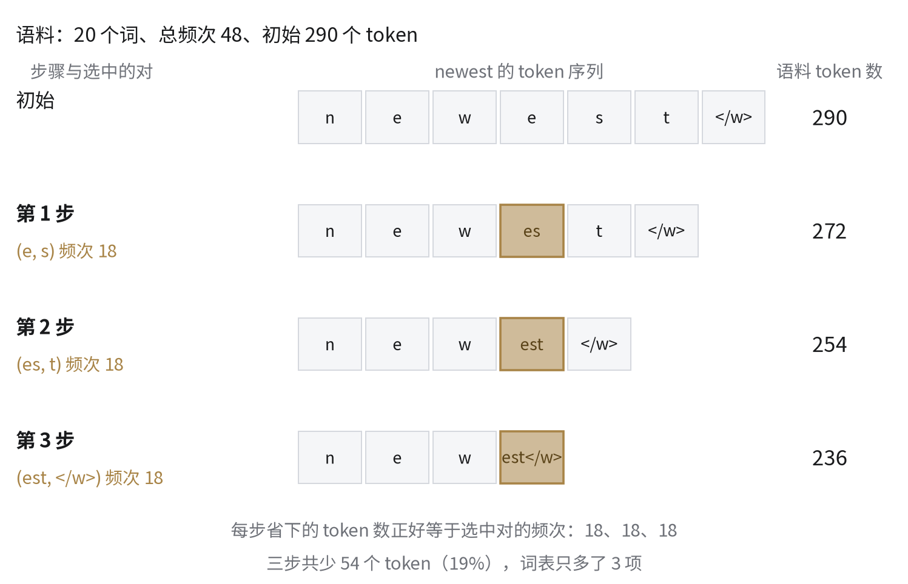

## 分词器：BPE、unigram、SentencePiece

同一段话，一段中文、一段英文，说的是同一件事。丢进同一个接口，看返回的 `usage` 字段，中文那一遍的 token 数常常是英文的一倍半到两倍。两段文字的信息量并没有差这么多。多出来的部分是分词器加上去的。

这个数字不只是账单。上下文窗口按 token 计数，训练成本按 token 计价，注意力的计算量随序列长度平方增长，模型能“看见”多长的文档也由 token 数决定。分词器是流水线上唯一一个不参与梯度下降的部件：训练开始前它就被固定，之后再也不改。正因为它不动，它的缺陷会一直留在模型里，谁也没法在后面补。

它做的事听起来无害：把字符串变成整数序列。GPT-2 用五万个 token 的词表，一个中文字符有时要占三个 token，一个英文单词通常占一个。这个差别不来自语言，来自切分规则。

### 两条走不通的极端

最直接的想法是以词为单位。英文常用词五万个左右，看起来可控。问题是“词”这个单位没有定义。run、runs、running、ran 算四个词；专有名词、缩写、拼错的词、新造的 hashtag 各算一个；化学式、型号名、URL 又是一批。真要覆盖开放领域的全部词形，词表会膨胀到百万级，而其中绝大多数词在语料里只出现几次。

更致命的是那个无法修补的漏洞：任何没进词表的词只能映射到一个“未知”符号，比如 `<unk>`。模型对它的全部信息就丢了——不是“不认识但能猜”，是“看不见”。到了中文、日文这类不按空格分词的语言，连“什么算一个词”本身都有争议。

另一个极端是以字符为单位。词表缩到几十到几百，没有未登录词，任何文本都能表示。代价落在序列长度上。英文平均一个词四到五个字符，中文一个字一个字符，同一段内容切出来要长四倍以上。这个账在任何规模上都算不过来：注意力的计算量正比于 $L^2$（$L$ 是序列长度），序列长四倍，注意力部分贵十六倍；嵌入表虽然小了，可每个位置都要过一次前馈网络，那部分是线性的，也跟着翻倍。

子词（subword）走的是中间那条线：高频的整体保留，低频的拆成碎片。常用的词占一个 token，罕见词用几个碎片拼出来，词表规模可控，序列长度也可控。今天所有主流模型都走这条路，区别只在用什么算法切。

子词好到什么程度，有一个可以直接量的指标叫压缩率：同一段文本的字符数除以 token 数。英文上，好的 BPE 词表能到 4 左右；代码在 3.5 上下；中文常常只有 1 到 1.5。这个差别不是语言的错，是词表被英文占满了。

### BPE：数相邻对，一直合下去

字节对编码（Byte Pair Encoding，BPE）原本是 1994 年的一种数据压缩算法，2016 年被 Sennrich 等人搬到机器翻译上，用来解决罕见词和未登录词的表示问题，论文是《Neural Machine Translation of Rare Words with Subword Units》(2016)。

算法的核心只有一句：从字符表出发，反复把语料里出现次数最多的相邻符号对合并成一个新符号。

拿一个小语料走一遍。假设只有四个词，词频分别是 low 出现 5 次、lower 2 次、newest 6 次、widest 3 次。初始切分是逐字符：

| 词 | 频次 | 初始符号序列 |
|---|---|---|
| low | 5 | l o w |
| lower | 2 | l o w e r |
| newest | 6 | n e w e s t |
| widest | 3 | w i d e s t |

统计所有相邻对的加权频次。注意是按词频加权，不是按出现位置计数——newest 出现六次，它中间的 (e,s) 就一次加六。

| 相邻对 | 加权频次 | 说明 |
|---|---|---|
| (e,s) | 9 | newest 6 + widest 3 |
| (s,t) | 9 | newest 6 + widest 3 |
| (w,e) | 8 | lower 2 + newest 6 |
| (l,o) | 7 | low 5 + lower 2 |
| (o,w) | 7 | low 5 + lower 2 |
| (n,e) | 6 | newest 6 |
| (w,i) (i,d) (d,e) | 3 | widest 3 |
| (e,r) | 2 | lower 2 |

最高是 9，两个并列。取哪个都合法，假设先取 (e,s)，合并成新符号 `es`。语料变成 `l o w`、`l o w e r`、`n e w es t`、`w i d es t`，词表里多了一个 `es`。

这一合，(s,t) 消失了——s 被吃进 `es` 里，后面跟着的现在是 (es,t)，加权频次 9，所以第二轮合并出 `est`。重新统计，(l,o) 与 (o,w) 各 7 次，是最高的，第三轮合 `lo`；这一合又把 (lo,w) 推到 7 次，第四轮合 `low`。剩下三个 6 次的并列：(n,e)、(e,w)、(w,est)。

平手怎么破，决定了 `newest` 的命运。先合 (w,est) 得到 `west`，`newest` 变成 `n e west`，再合 (n,e) 收尾；先合 (e,w) 则得到 `new est`，那是语言学上更合理的切法。多数实现按“在语料里首次出现的位置”破平，所以同一份词表、同一个语料，换一个实现也可能切出不同结果——这是 BPE 被诟病的不稳定之处里最容易被忽略的一个。按前一种破法，六轮下来词表新增 `es`、`est`、`lo`、`low`、`west`、`ne`，语料切成：

```text
low      →  low
lower    →  low e r
newest   →  ne west
widest   →  w i d est
```

BPE 的两个性质在这一段里都露了出来。它完全由频率驱动，不需要任何语言学知识，换任何语言、任何符号系统都能跑。它也完全不懂词法：`newest` 被切成 `ne` 加 `west`，因为 `est` 这个片段在 widest 那边也出现，和 newest 一起把它推到了频次榜首，于是 `w` 和 `est` 被合成了一个整体；`low` 保住了整体，`lower` 却被拆开。它学到的是统计上的常见片段，词根、词缀这些概念它一个也没有。

### 二十个词的语料走一遍

四个词看得清合并顺序，但看不出词表规模的感觉。换一份二十个词的语料，这次把词尾标记也加上——真实 BPE 就是这么做的，不加的话词中间的 s 和词尾的 s 会被当成同一个符号，复数的语法作用就被抹掉了。

| 词 | 频次 | 词 | 频次 |
|---|---|---|---|
| low | 5 | wide | 2 |
| lower | 2 | wider | 2 |
| newest | 6 | lowly | 2 |
| widest | 3 | slow | 3 |
| new | 3 | slower | 1 |
| lowest | 2 | earlier | 1 |
| late | 3 | earliest | 2 |
| later | 2 | near | 3 |
| latest | 2 | nearer | 1 |
| slowest | 1 | nearest | 2 |

初始符号是 26 个字母加 `</w>`，共 27 个。每个词的 token 数是字符数加一，乘上频次累加，得到总数 290。

第一步统计相邻对。把词尾标记算进去之后，前五名是：

| 相邻对 | 频次 |
|---|---|
| (e, s) | 18 |
| (s, t) | 18 |
| (t, `</w>`) | 18 |
| (l, o) | 16 |
| (o, w) | 16 |

三个并列 18 不是巧合。以 est 结尾的词恰好贡献 18 次：newest 6、widest 3、lowest 2、latest 2、earliest 2、nearest 2、slowest 1。这三个对在每个这样的词里各出现一次，所以计数完全一样。

按首次出现的位置破平，先合 (e, s)。合并后 token 总数是 272——正好少 18。这不是估算：合并一次，这个对在语料里的每一次出现都少一个 token，所以省下的数量精确等于该对的频次。

第二步只剩 (es, t) 以 18 居首，合并成 `est`，token 数 254。第三步 (est, `</w>`) 又是 18，合并成 `est</w>`，总数 236。



三个数字摆在一起：290 → 272 → 254 → 236，三步省了 19%，词表从 27 涨到 30。真实词表就是这么长出来的：五万词表意味着 256 个字节符号加四万九千多次合并，十二万八的词表意味着一十二万七千多次。每一次都重复同一件事：统计相邻对、选最高的、全局替换。

由此能估出训练成本。词表五万、语料一百亿字符，每轮合并要扫一遍全部相邻对，五万轮就是五万次全量扫描，共 $5\times10^{14}$ 次操作，单核要跑几年。

真实实现靠两个技巧绕开它。一是计数只算一次，用优先队列维护，合并后只更新受影响的那几个位置。二是把“同一个词的多次出现”折叠成（词，频次）的词典——英语里不同词形只有几百万个，每轮扫这个词典就够，不必碰原始语料。这两条把训练时间从几年压到几十分钟。

### 训练一个分词器：一份能跑的配置

用 SentencePiece 训一个 BPE 词表，参数就这几行：

```python
import sentencepiece as spm
spm.SentencePieceTrainer.train(
    input="corpus.txt",
    model_prefix="tok32k",
    vocab_size=32000,
    model_type="bpe",
    character_coverage=0.9995,
    byte_fallback=True,
    split_by_whitespace=True,
    user_defined_symbols=["<|endoftext|>"],
    max_sentence_length=8192,
    input_sentence_size=20000000,
    shuffle_input_sentence=True,
)
```

五处值得单独说。`vocab_size` 定词表，三万二是 Llama-2 的取法，十二万八是 Llama-3 的取法，多出来的十万个位置基本给了非英语与代码。`character_coverage` 只保留累计频次到 99.95% 的字符，长尾字符进兜底。`byte_fallback` 让未登录字符退回字节序列，`<unk>` 从此不出现。`split_by_whitespace` 对中英混排要小心：设 True 会先按空格切，整段中文变成一个“词”，反而禁止了跳字合并，多语言词表常设 False。`input_sentence_size` 限制参与训练的句子数，两千万句约几 GB，配合 shuffle 保证抽样无偏。

成本可以算。两千万句约 60 亿字符，SentencePiece 单核每分钟约处理一千万字符，要 600 分钟，单核十小时；分 16 片并行统计，一小时内跑完。相对整个预训练，这是几百分之一的钱，但因为不可逆，它的得失被放大到全部训练上。

### 换词表的代价

一个常见决策：旧模型用三万二词表训了一半，想换成十二万八，不重训，只扩表——旧 token 的 id 不动，新增的随机初始化，接着往下训。这看上去省了几万卡时，实际上会同时出三个问题。

第一，切法变了。旧词表把 `unbelievable` 切成四片，新词表里它成了整体；于是这批语料里每个出现这个词的位置，token 序列都变了。序列一短，位置编号全部错位，模型在旧位置上学到的“第 300 个 token 该看哪里”全部失效。

第二，新旧行的尺度不同。旧的嵌入行已经见过万亿 token，新的行是高斯噪声；同一个学习率对两者不可能同时合适——大到能训新行，就会把旧行推乱；小到保住旧行，新行就永远学不出来。

第三，压缩率变了，等于把“每 token 的算力预算”改了。十二万八词表下同一份语料 token 数少一成五，原先按 token 数排的步数预算对应的实际文本量就多了一成五，学习率调度跟着全要重排。

正确的做法只有两种：重训到底，或者接受“扩表加两阶段”——先冻结旧嵌入与输出层，只训新行几千步，再全量放开并把学习率降一个量级。第二种能省多少钱也算得出来：继续训一万亿 token，按词表变大省下的那一成五算，是 $1.5\times10^{11}$ 个 token，对 70 亿参数模型是

$$6\times7\times10^{9}\times1.5\times10^{11}=6.3\times10^{21}\ \text{FLOPs}$$

64 张卡、每张有效 $1.6\times10^{14}$ FLOPS，是 7 天。也就是说，一个词表决策的代价是“一周机时”这个量级——比大多数人以为的小，而它买到的收益（中文与代码的压缩率）会跟随模型一辈子。

### 真实实现里还有两处细节第一，初始符号表里会加一个词尾标记 `</w>`，让“词中间的 s”和“词尾的 s”成为两个不同的符号，否则 `-s` 这个复数的语法作用会被抹掉。上面那个例子为了看清合并顺序把它省了。第二，合并只在词内进行，不跨词边界，所以语料要先按空白和标点预切成“词”。

这个预切分在 GPT-2 里是一段正则，而它的写法会直接影响模型的能力。原版的模式大致是把缩写当成整体、把字母串、数字串、标点串分开，并且让空格粘在后面的词上：

```text
's|'t|'re|'ve|'m|'ll|'d| ?\p{L}+| ?\p{N}+| ?[^\s\p{L}\p{N}]+|\s+(?!\S)|\s+
```

`\p{L}` 是任意字母、`\p{N}` 是任意数字，` ?` 表示“零个或一个空格”。这条正则把 `don't` 切成 `don` 和 `'t`，把 ` 123` 切成一个带前导空格的片段，把连续空白单独当成一类。作用是把“词”的边界提前钉死：BPE 之后永远不会跨过一个数字串去合并字母，也不会把 `'t` 拼回 `don`。不同模型的这条正则不一样，切出来的 token 就不一样，这正是同一个词在不同模型里 token 数不同的原因之一。

训练循环维护三个量：符号表 $\Sigma$（初值是全部字符加 `</w>`）、带权词表（每个词是一个符号元组，权重是出现次数）、相邻对的加权计数表。每一轮重算计数、选出最高的一对、把所有词里的这对一起替换。合并轮数是唯一的超参数，因为词表大小等于初始符号数加合并次数——Sennrich 等人的原文就是这句话。

他们在 WMT 2015 英德数据上合并了 59 500 次：德语侧词表从 175 万种降到 6.3 万种，语料从 1 亿 token 涨到 1.12 亿（切成子词之后变长了），新测试集上的未登录词从 1079 个降到 0。收益不在总分上：同期单模型 BLEU 从 22.0 降到 21.5，八模型集成从 24.2 升到 24.5；真正动的是生僻词，它的 unigram F1 从 36.8 升到 40.9。压缩率与效果之间没有免费的午餐，只是价钱付在了别处。

编码是训练的反向操作：规则表冻结，按优先级从小到大依次套用。这里有一个容易忽略的点——编码时每一步要取“优先级最高的那一对”，并把它在串里的所有出现一起合并，而不是从左到右扫一遍见一对合一对。

```text
输入：词 w，合并表 merges（下标就是优先级）
rank = { pair : i for i, pair in enumerate(merges) }
syms = list(w) + ["</w>"]
while True:
    cand = [(rank[(syms[i], syms[i+1])], i)
            for i in range(len(syms) - 1)
            if (syms[i], syms[i+1]) in rank]
    if not cand: break
    _, i = min(cand)                    # 优先级最高的那一对
    syms = merge_all(syms, syms[i], syms[i+1])
```

顺序不能乱：`es` 的 rank 一定小于 `est`，所以 `n e w e s t` 先变 `n e w es t`、再变 `n e w est`；反过来先合 `st`，`est` 就永远合不出来。这套规则的确定性很强，同一份文本永远切成同一个样子——这是好事，训练和推理必须看到同一种切法，否则嵌入会被喂进分布外的序列。

它也不是最优的。给定合并表，“哪种切法 token 最少”要在整条串上做动态规划，而 BPE 只是把训练时定下的顺序重放一遍。假设 (a,b) 的 rank 是 1、(b,c) 是 2，串 `abc` 必然切成 `ab` 加 `c`，`a` 加 `bc` 这条可能更省 token 的切法根本不在考虑范围内。换成“按词表做动态规划求最短编码”会省一点 token，但模型不认识那种切法：嵌入是按合并顺序学出来的，编码端临时给出一个更优解，等于往模型嘴里塞它没见过的序列。训练与编码用同一套规则，这条约束比“更优”重要。

可并行性也是这么来的。合并表训练完就是一张静态查表，一个词切成什么样只取决于它自己的字符和 rank 表，与文档别处无关。一篇文档可以按空白预切成一堆词，各词独立编码、多线程分片；同一进程里再加一层缓存，把“整词到切法”的映射存下来，高频词命中缓存后只有生词才真跑一遍合并。

训练分词器用的语料不必是全部训练数据，几亿到几十亿 token 的样本就够，因为要学的只是“哪些字串常见”这种统计量。

### WordPiece：挑“搭配强度”而不是频次

BERT 用的是第三种，30 000 词表（《BERT》(2018)），词中间的片段带 `##` 前缀，`##ing` 与词首的 `ing` 是两个不同的 token。

它的训练循环和 BPE 长得一样：从单字符出发，反复合并一对符号，直到词表满。差别在挑哪一对。BPE 挑频次最高的，WordPiece 挑“合并后语料似然提升最大”的。两边似然都是各片概率连乘，把相邻符号 $a$、$b$ 合成 $ab$ 之后，语料似然的变化近似正比于

$$\mathrm{score}(a,b)=\frac{\mathrm{count}(ab)}{\mathrm{count}(a)\cdot\mathrm{count}(b)}$$

分子是 $a$、$b$ 相邻出现的次数，分母是两个符号各自出现次数的乘积。比值越大，说明这一对的相邻程度越超出“各按自己的频率碰在一起”的预期。白话：它比的是“搭配强度”而不是“使用频次”——一个出现一百万次的常见对，如果两个符号本来就各自出现一千万次，score 只有 $10^{-8}$，进不了词表；一个只出现一万次的固定搭配，若两个符号各自只出现一千次，score 是 $0.01$，反而排在前面。

编码端它没有同一条路。WordPiece 训完之后只留下词表，不留概率，所以只能做贪心最长匹配：从词的左端开始，取词表里能匹配上的最长子串切下，剩下的逐个加 `##` 继续匹配。训练在最大化语料似然，编码在每一步最大化“当前这一片有多长”，两套判据遇到歧义就分叉，而分叉时它没有依据判断哪种切法更好。unigram 之所以能保住一致性，是因为它把 $p(w)$ 一起存了下来。三种算法的分野就在这里：BPE 存“合并顺序”，WordPiece 存“词表”，unigram 存“词表加概率”。

### unigram：先给一大把，再按损失砍

BPE 是自底向上加，unigram 语言模型是自顶向下减。Kudo 在 2018 年的《Subword Regularization》里给了完整形式化，配套工具就是 SentencePiece。

先准备一个“足够大”的种子词表：语料里的全部单字符，加上出现频率最高的一批子串（用增强后缀数组可以一次扫出来）。然后假设子词之间独立，一个句子的概率是各片概率的连乘：

$$P(x)=\prod_{i=1}^{M}p(x_i),\qquad x_i\in\mathcal{V},\qquad \sum_{w\in\mathcal{V}}p(w)=1$$

$x$ 是一个句子切出的子词序列，$M$ 是片数，$\mathcal{V}$ 是词表，$p(x_i)$ 是这片子词单独出现的概率。子词当然不独立，但正因为假设得这么简，才能把“切法”当作隐变量做精确推断。

训练目标是边际似然：语料里每句话都有多种合法切法，我们只看到句子、看不到切法，要对所有切法求和，

$$\mathcal{L}=\sum_{s=1}^{|D|}\log\sum_{x\in S(X_s)}P(x)$$

$|D|$ 是语料里的句子数，$X_s$ 是第 $s$ 句，$S(X_s)$ 是这一句的全部合法切分（每一片都必须在 $\mathcal{V}$ 里）。求和落在对数里面，没有闭式解，所以用 EM 迭代。

E 步在切分格（lattice）上跑前后向：设 $\alpha[i]$ 是“前缀 $X_{1:i}$ 所有切法的概率之和”，$\beta[j]$ 是“从 $j$ 到句尾所有切法的概率之和”，那么从 $i$ 到 $j$ 这一片的后验期望计数是

$$c_{ij}=\frac{\alpha[i]\,p(X_{i:j})\,\beta[j]}{\alpha[|X|]}$$

分子是“经过这一片的全部切法的概率之和”，分母是“全部切法的概率之和”，相除就是这一片在平均意义下被用了几次。M 步把这些期望计数归一化成概率：

$$p(w)=\frac{\sum_{(i,j):\,X_{i:j}=w}c_{ij}}{\sum_{w'\in\mathcal{V}}\sum_{(i,j):\,X_{i:j}=w'}c_{ij}}$$

白话：E 步问“在这一句的所有切法里，这一片平均被用了几次”，M 步把答案除以总用量变成概率。分子分母都从整个语料累加，两三轮基本收敛。

剪枝的判据不是“概率低了就砍”，而是“砍了之后语料似然会掉多少”。每轮 EM 收敛后，对每个候选 $w$ 算

$$\mathrm{loss}(w)=\mathcal{L}(\mathcal{V})-\mathcal{L}\big(\mathcal{V}\setminus\{w\}\big)$$

按 loss 从小到大排序，保留前 $\alpha\%$（论文取 $\alpha=80$），单字符无条件保留；一轮砍掉两成，重复到词表落到目标大小（常见 8k、16k、32k）。这个判据比按概率砍稳得多：一个概率很低但不可替代的子词（某个必须整体出现的词缀），删了似然会掉一大块，会被留下；一个概率不低但换成别的切法照样能解释语料的子词，损失接近零，会被删掉。

推理时的编码是一遍动态规划，把连乘换成连加：

```text
输入：句子 X（长度 n），词表 V 及概率 p，最长子词长 L
best[0] = 0
for j in 1..n:
    best[j] = -INF
    for i in max(0, j-L) .. j-1:
        if X[i:j] in V and best[i] + log p(X[i:j]) > best[j]:
            best[j] = best[i] + log p(X[i:j]);  back[j] = i
从 j = n 沿 back 回溯到 0，每一跳就是一片
```

复杂度 $O(nL)$，$L$ 是词表里最长子词的长度，实际几十。这里训练与推理刻意不一致：推理走 argmax 拿唯一最优切分，训练时却按 $\tilde P(x)\propto P(x)^{\tau}$ 采样一条切法，$\tau$ 越小分布越平、采样越随意（官方示例取 0.1），取到很大就退化成 Viterbi。同一个词每次出现切法都不同，模型因此见到更多拼写变体，对生僻词和噪声更稳——这就是子词正则化。BPE 一侧有对应技巧叫 BPE-dropout，编码时以概率 $p$ 丢弃每条合并规则，同一句话也能切出多种样子。

代价在训练成本上：每轮 EM 要在整个语料上跑前后向，每轮剪枝还要对每个候选估一次似然变化（实现里用“去掉该子词后重跑一次前向”近似）。SentencePiece 报告 unigram 的训练与分词对输入规模是线性的，但常数比 BPE 大得多。

### SentencePiece：空格也是一个符号

上面几种算法都假设输入已经分好词。这个假设在真实语料里站不住：网页文本里有全角空格、不间断空格、零宽字符，中文、日文、泰文根本不按空格分词。传统做法是先跑一个语言相关的预分词器（中文用 jieba 之类），再喂给 BPE——而预分词器自己就是一个不可逆的、有误差的步骤。

SentencePiece 的办法是把原始文本当成一串 Unicode 字符，空格在其中被换成一个特殊符号 ▁（U+2581），和其他字符一起参与切分。这样编码是纯字符级的映射，解码时把 ▁ 换回空格就完全还原。论文把这条性质写成一条等式：

$$\mathrm{Decode}\big(\mathrm{Encode}(\mathrm{Normalize}(x))\big)=\mathrm{Normalize}(x)$$

注意右边是 $\mathrm{Normalize}(x)$ 而不是 $x$：归一化（NFKC）会改掉一些等价写法，比如把全角字母换成半角、把连续的组合字符合成一个。只要归一化本身是确定的映射，这条等式就成立，而“归一化前”和“归一化后”的差别是可以被明确定义的。白话：切完再拼回去，一定拿到同一段文本（在归一化之后），不丢空格、不丢字符。

对照一下别的做法就明白这一步的价值。subword-nmt 用 `@@` 标记“这个词还没完”，而 `@@` 只能表达词内边界，无法区分“词间有空格”和“这里本来就没空格”，连续两个空格也必丢一个。所以那种表示不是无损的，每种语言都得写一套反解码规则。

空白转义只是第一步。真正让“无损”成立的是三件事一起：把空格当符号（信息不丢）、把归一化做成可重现的映射（NFKC 编译成有限状态转换器，按最左最长规则匹配，也能用 TSV 自定义规则）、把词表与参数全部打进模型文件（不依赖外部规则，换个 Unicode 版本也不会变）。

顺带两个工程改进。BPE 在长度为 $N$ 的串上每轮重扫相邻对，朴素实现是 $O(N^2)$，SentencePiece 用二叉堆维护合并候选，降到 $O(N\log N)$。参数只给目标词表大小、不给合并次数，因为 unigram 那侧没有“合并次数”这个概念。

还有一个参数叫字符覆盖率（character_coverage），默认 0.9995：只保留出现频率累计到 99.95% 的那些字符，剩下的归入兜底。这不是为了省事，是为了不让词表被长尾字符吃掉——一份多语言语料里出现的私用区符号、变形拉丁字母、各种 emoji 加起来可能有几万个，每个只出现几次。把它们全收进词表，等于用几千个“几乎不会被用到”的位置换掉了本该给常用片段的位置。取 0.9995 意味着把所有 token 的百万分之五扔给兜底，对绝大多数语料这点损失可以忽略。

数字能看出取消预分词的价值。英日翻译上，词级模型（八万词表）BLEU 20.06，换成 unigram 的 8k 共享词表升到 21.62；日英方向从 28.24 升到 29.55。给 unigram 加上预分词反而降到 20.86——预分词把日文的切分自由度提前锁死了，而那正是子词模型本该自己学的东西。

### 字节：把兜底放进词表

字符级的词表有个隐藏前提：你事先知道语料里会出现哪些字符。这个前提在开放域上不成立。一个冰岛语的人名、一个数学符号、一个 emoji、一段从 PDF 里粘出来的私用区字符，都可能不在词表里。BPE 遇到这种字符只能输出 `<unk>`，信息当场丢失。

GPT-2 的解法是把初始符号表从“Unicode 字符”换成“256 个字节值”。文本先按 UTF-8 编码成字节串，再在字节串上跑合并。这个改动之所以能覆盖任意文本，原因很机械：UTF-8 保证任何合法文本都能编码成字节串，而词表初值包含全部 256 个字节，所以编码函数是全函数——最坏情况一路退回单字节，永远走不到 `<unk>`。

代价是粒度。一个汉字在 UTF-8 里占三个字节，最坏切成三个 token；四字节的字符最坏切四片。而且字节边界不认字符边界，一个汉字可能被切成“两字节加一字节”两片，模型得自己学会把碎片拼回一个字。这一点在中文上尤其能感觉到：早期以英文为主的词表，处理起中文来 token 数常常是英文同一段内容的两到三倍。

GPT-2 的实现里还有一步纯表示层的处理：把 256 个字节映射到 256 个可打印的 Unicode 码位（空格映射成 `Ġ`），于是 token 串可以当普通文本存进 JSON，空格也不会被预分词提前吃掉。这一步不改变合并算法。

另一条路是字节回退（byte fallback）：词表主体仍然是普通的子词，但额外保留 256 个字节符号，遇到未登录字符时退回字节序列表示。SentencePiece 和 Llama 系列走的是这条。加上这一条，`<unk>` 就从词表里消失了。它和字节级 BPE 解决的是同一个问题，区别在把字节放在兜底位置还是起点：放在起点的词表天然只由字节组成；放在兜底位置的词表以常用子词为主，只在必要时才退化。

工程上差一步，就会出现“声称复现了分词、却在个别字符上对不齐”的情况：词表相同、合并表相同，预切分的正则不同，切出来的 token 就不同。书面报告里应该连这条正则一起交出。

### 分词器的三个数

评估一个分词器只需要三个数，它们各自能回答一类问题。

第一个是压缩率，字符数除以 token 数。它直接进训练预算：同一份文本的 token 数少一成，训练算力就少一成，上下文能装的内容就多一成。它也是唯一一个能跟推理点亮关系的数。

第二个是词表利用率，真正用上的 token 数除以词表大小。低于 0.9 就说明词表里有一大批行永远拿不到梯度，白占参数与显存。

第三个是边界一致性：同一个词在不同上下文里被切成一样的比例。这个数最难定义，但最影响模型行为。比如 ` the`（带前导空格）与 `the` 是两片不同的 token，前者在正常英文里出现得多，后者只在行首或引号后出现。如果分词器的预切分规则对空格处理不统一，同一个词会散到两个不相关的嵌入上，模型得额外花容量去学“它们是同一个东西”。

量它的办法很简单：抽十万个高频词，统计每个词在语料里的“主切法”占比。好的分词器里，一个词的切法方差很小；差的分词器会把 `newest` 切成 `ne west`，把 `widest` 切成 `wide st`，而这两个 `est` 片段又不能复用。

| 指标 | 典型值 | 异常时的含义 |
|---|---|---|
| 压缩率（英文） | 3.8–4.4 | 低于 3.5：词表没吃饱 |
| 压缩率（中文） | 2.0–3.0 | 低于 1.8：汉字靠字节拼 |
| 词表利用率 | 0.90–0.97 | 低于 0.85：分词器训练语料脏 |
| 主切法占比 | >0.95 | 低于 0.9：预切分规则不统一 |

这三个数能在半小时内测完，而它们能提前指出的三种问题，任何一种都会跟着模型一辈子。

### 一段五百字的文本，两种切法

把切分差异放到具体数字上，看它对训练与推理各意味着什么。

一段 500 字的中文，32K 词表下大约 750 个 token（1.5 token/字），128K 词表下约 500 个。差 250 个 token，50%。这三个数字往下推，会变成三件事：

训练上，同样的 500 字内容，前者需要多跑 50% 的前向反向。按 $6ND$ 算，如果中文占语料的 20%，多出来的算力是 $0.2\times0.5=10\%$ 的总预算。这个数比“词表扩到 128K 多出来的嵌入参数”值钱得多。

上下文上，2048 窗口在前者只能装 1360 字，后者能装 2048 字。对于“读完一篇文档再回答”这类任务，差的不是 50% 的字符，而是“能不能一次读完”。

推理上，每个 token 都要付一次全模型前向。同一个请求在 32K 词表下要跑 750 步、在 128K 下 500 步，按每步读一遍权重算，延迟差 33%。这个差异在批处理里会被吞掉一部分（因为算力从带宽受限变成算力受限），但不会消失。

三项加起来，中文占比高的小模型应该认真考虑把词表做到 6 万以上；而如果中文只占 5%（一个以英文为主的模型顺带支持中文），这份收益摊薄后可能抵不上嵌入参数与输出层的开销。

### 中文、代码、数字：分词器在哪里让模型吃亏

分词器看起来只是个查表工具，实际决定了模型处理信息的颗粒度：一句话被切成多少段，模型就有多少次预测的机会。

多语言是最明显的例子。一个 12.8 万的词表要分给几十种语言。如果训练语料里九成是英文，BPE 的合并几乎全部落在英文片段上，剩下的语言只能分到零头。同样一句印地语，token 数是英文的三四倍：序列变长意味着同样的窗口能装的信息变少，模型在这些语言上的有效容量被词表压掉一截——它得先花几层把碎片拼成词。中文介于两者之间：常用双字词能进词表，生僻字和专名仍要拆成单字甚至字节。

另一类失效是字符级的活。问“strawberry 里有几个 r”，模型常常答错。原因不在计数能力，在输入：这个词被切成 `straw` 和 `berry` 两片，模型看到的两个向量里已经没有“字母 r 出现了几次”这个信息。要回答，它得先凭记忆重建拼写再数，两步都可能出错。凡是逐字符的操作——拼写、字母重排、核对序列号——都撞在同一堵墙上：token 是不可分割的原子，字符边界在嵌入层就消失了。后来的补法是让它先把词拆成字母，等于用输出给自己造一个字符级视图。

更隐蔽的一层是同一个东西在词表里有多个互不相干的身份。`Hello`、`Hello`（前面带空格）、`HELLO`、带标点的 `Hello,`，在词表里是四个 token，嵌入各自学各自的。模型因此没有“大小写无关”这种归纳偏置，它得从数据里分别学会这几种写法是一回事；全大写在语料里出现得少，嵌入训练不足；提示词改成全大写，输出质量可能掉一截。

代码和数字各有失效点。代码的缩进会变成专门的 token（四个空格一个），缩进深度于是成了几个符号的重复，模型对缩进很敏感，也容易在深层嵌套里数错层数。数字则取决于切法：把 `1234` 整块收进词表，`1234` 和 `1235` 就是两个无关的向量，模型没有线索知道它们只差一；把它按一到三位切开，位数表示稳定了，序列却变长。

这几类失效的共同点是：分词器把连续信号压成离散符号，这个压缩是有损的，损失的部分不会消失，只会转移到模型身上，让它用参数和层数去补。

::: {.keypoint}
分词器把连续文本压成离散符号，这一步的粒度决定了后面所有计算的分辨率与成本。它不参与训练，却是整条流水线上唯一一个一旦定下就无法修改的部件；它的错误不是“效果差一点”，而是永久性的分辨率损失。
:::

到这里，一句话变成了一串整数。可是这一串到底多长，还没有定——词表 3 万和 12.8 万，同一段文本的 token 数能差两成，嵌入参数能差四倍。把词表大小、序列长度、嵌入参数量放在一张账单上，才能看出那个最优点落在哪里。
