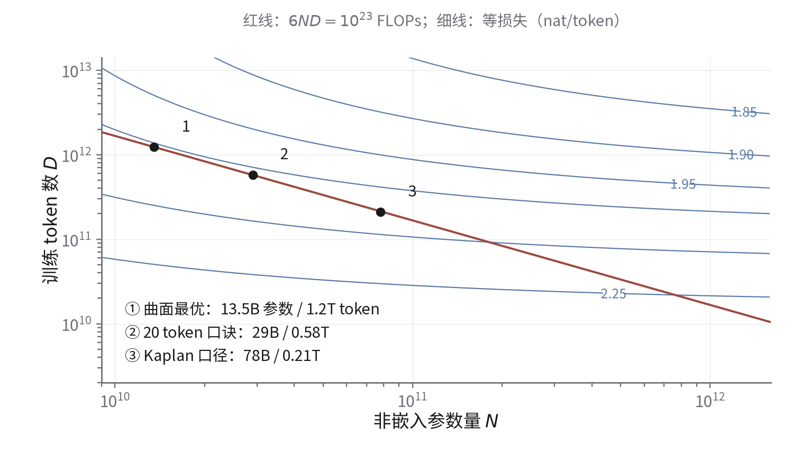

## 缩放定律：Kaplan、Chinchilla、推理最优

假设你手上有 $10^{24}$ FLOPs 的预算，按 H100 上 350 TFLOP/s 的有效吞吐折算，是一千三百张卡跑一个月。这笔钱可以训一个 300B 的模型、喂它 5500 亿 token，也可以训一个 70B 的模型、喂它 2.4 万亿 token。两条路花一样多的钱，损失不一样，而你在按下启动键之前就需要知道哪条更低——训练一旦开跑，改主意等于把钱扔掉。

2020 年和 2022 年，这个问题的答案相反。前一个答案是“绝大部分预算给参数”，后一个答案是“参数与数据对半分”。两次都是严肃的实验，都发表在顶会上，第二次并没有推翻第一次的数学，它推翻的是第一次的测量口径。这一章把两次的式子、常数、推导过程摊开，然后加上第三次修正：当推理成本进账本之后，“最优”这个词指向的位置又移了一次。

### 三条幂律与它们怎么来的

幂律的意思很简单：损失随某个量的增长按负指数下降，在双对数坐标上是一条直线。Kaplan 等人在《Scaling Laws for Neural Language Models》(2020) 里分别固定两个变量、扫第三个，得到了三条：

$$L(N)=\left(\frac{N_c}{N}\right)^{0.076},\qquad L(D)=\left(\frac{D_c}{D}\right)^{0.095},\qquad L(C_{\min})=\left(\frac{C_{c,\min}}{C_{\min}}\right)^{0.050}$$

$N$ 是非嵌入参数量，$D$ 是训练 token 数，$C_{\min}$ 是在最优批量下达到给定损失所需的最小算力。$N_c=8.8\times10^{13}$、$D_c=5.4\times10^{13}$、$C_{c,\min}=3.1\times10^{8}$ PF-days 是拟合出来的常数，它们带着分词器和数据集的印记，换一套语料就变；可迁移的只有指数。

指数很小，先算清它们意味着什么。参数翻十倍，损失乘 $10^{-0.076}=0.84$，降 16%。数据翻十倍，乘 $10^{-0.095}=0.80$，降 20%。算力翻十倍，乘 $10^{-0.050}=0.89$，降 11%。这些数字听起来令人沮丧，但损失是对数量：从 3.0 降到 2.5，困惑度从 20 降到 12，生成质量的差别肉眼可见。幂律的残酷之处在于它不给你跳跃，好处在于它可以外推——用几十万美元的小实验，预测几千万美元的大实验落在哪。

三条曲线之间有一个不一致，值得停一下看。如果参数与数据同步翻倍，算力翻四倍，那么按前两条律，损失应该乘 $(2^{-0.076})(2^{-0.095})=2^{-0.171}=0.888$；换成以算力为单位，因为算力翻了四倍，这相当于 $C^{-0.0855}$。而第三条直接拟合出来的指数是 0.050，差了一半。原因在于第三条不是用“同步变大”的实验拟合的，它用的是固定参数、改训练步数的实验，量的是“同一模型的多走几步”值多少钱，而前两条量的是“换一个更大的模型”值多少钱。两个问题不是同一个问题，指数自然不同。记住这一点，后面看 Chinchilla 的三条路线时就不会把它们当成同一个量的三种估法。

实验设置值得看清楚，因为后面所有的争议都出在这里。模型从不到百万非嵌入参数到 15 亿，数据量从 2200 万到 230 亿 token（WebText2，BPE 词表 50257），上下文 1024，批量 512 条序列，训练 25 万步，Adam 优化器，3000 步线性 warmup 接 cosine 衰减到零。形状的影响先被排除：固定参数量、只改深宽比，比值变动 40 倍时损失只差 3% 以内，所以可以只按 $N$ 一个变量组织实验。每个点都训到测试损失不再下降为止，因为训过头的点损失会回升，混进拟合里会污染斜率。

三条单变量曲线要合成一个曲面，得满足三个条件：$D\to\infty$ 时退化成 $N$ 的幂律，$N\to\infty$ 时退化成 $D$ 的幂律，而且对大的 $D$ 应该出现按 $1/D$ 衰减的过拟合项。同时满足这三条的最简形式是不对称的：

$$L(N,D)=\left[\left(\frac{N_c}{N}\right)^{\alpha_N/\alpha_D}+\frac{D_c}{D}\right]^{\alpha_D}$$

同时拟合四个参数得到 $\alpha_N=0.076$、$\alpha_D=0.103$、$N_c=6.4\times10^{13}$、$D_c=1.8\times10^{13}$。白话：损失由一项“容量不够”和一项“数据不够”拼成，数据项被包在一个外层指数里，所以模型再大也压不掉数据不足带来的那部分。$\alpha_D$ 比单变量时的 0.095 略大，因为这里两个变量同时在动。

有了曲面就可以做预算分配。约束是 $C\approx6ND$——每个参数每个 token 前向 2 次浮点运算（一次乘加）、反向 4 次（两次乘加），这个 6 忽略了注意力里与 $T^2$ 有关的部分，在中等上下文下是合理的近似。把 $D=C/(6N)$ 代进 $L(N,D)$，对 $N$ 求导置零，得到 $N_{\text{opt}}\propto C^{\alpha_C/\alpha_N}$，其中

$$\frac{1}{\alpha_C}=\frac{1}{\alpha_N}+\frac{1}{\alpha_S}+\frac{1}{\alpha_B}$$

$\alpha_S=0.76$ 是损失对训练步数的指数，$\alpha_B=0.21$ 是对批量的指数。代入得 $\alpha_C\approx0.052$，比值 $0.052/0.076=0.68$，与实测拟合的 $0.73$ 对得上。剩下那点给数据：$D\propto C^{0.27}$。换成好记的说法，算力涨十倍，参数涨 5.5 倍，数据只涨 1.8 倍——乘起来正好十倍。

这个结论直接塑造了 GPT-3：1750 亿参数，只喂了 3000 亿 token，每个参数摊到 1.7 个 token。同期的其他模型也都在这个量级附近。整个行业按“参数优先”的配方跑了两年，直到有人重做了一遍实验。

### Chinchilla：同一个问题，换一种口径

DeepMind 在《Training Compute-Optimal Large Language Models》(2022) 里把这件事重做了一次：400 多个模型，规模 7000 万到 160 亿参数，数据量 5 到 5000 亿 token。结论与 Kaplan 相反——参数和数据应该大致同比例增长。算力涨十倍，两边各涨约 3.2 倍。

差别出在测量口径上。Kaplan 的所有模型共用一条固定长度的学习率日程，这意味着那些“只喂了一部分数据”的点在被测量时学习率还没降下来，损失里混着“还没退火完”的成分，系统性地高估了小数据量下的损失。而小数据量对应的是大模型那一侧的配置，于是拟合线被推向了“多给参数”。Chinchilla 给每个规模配四条不同长度的 cosine 周期，长度相差 16 倍，让周期与实际的 token 数匹配，每个点都是该预算下的收敛值。

然后三条互不依赖的路线同时走，结论一致。第一条是训练曲线包络：对每个 FLOP 预算，在所有的 $(N,D)$ 组合里找出损失最低的点，在 1500 个对数间隔的预算上重复一遍，再拟合幂律，得 $a=0.50$（自助法 10–90 分位 0.488–0.502）、$b=0.50$。第二条是 IsoFLOP 剖面：固定 9 个预算（$6\times10^{18}$ 到 $3\times10^{21}$ FLOPs），每个预算扫一组模型大小，对每条 U 形剖面拟合抛物线取最低点，连起来再拟合，得 $a=0.49$、$b=0.51$。U 形本身好理解：预算固定时，模型小了欠拟合，模型大了数据不够，两头都差，中间有个底。预算变大时，底的位置向右上方移动，移动的斜率就是 $a$。第三条直接把损失写成参数和数据的函数，在 log 空间用 Huber 损失（$\delta=10^{-3}$）配 L-BFGS：

$$\hat L(N,D)=E+\frac{A}{N^{\alpha}}+\frac{B}{D^{\beta}}$$

拟合值是 $E=1.69$、$A=406.4$、$B=410.7$、$\alpha=0.34$、$\beta=0.28$。三项各有出处：$E$ 是数据本身的熵，模型再大也消不掉；$A/N^{\alpha}$ 是有限容量带来的逼近误差；$B/D^{\beta}$ 是只跑一个 epoch、只走有限步带来的优化与样本误差。这个分解不是凑的，论文附录从“贝叶斯最优分类器 → 受限函数类上的最优解 → 单 epoch 梯度下降的结果”三层误差推下来，每一层对应一项。

指数的落差比结论本身更该记住：$\alpha=0.34$、$\beta=0.28$，比 Kaplan 的 0.076 和 0.103 大了三到四倍。同一个物理量，两次实验差这么多，说明这条曲线对训练条件极其敏感，它不是自然常数，是实验报告。

按新配方，Chinchilla 只有 700 亿参数，用了 1.4 万亿 token，与 2800 亿参数的 Gopher 花掉同样的 $5.76\times10^{23}$ FLOPs，在几乎所有评测上超过后者，MMLU 从 60.5% 到 67.5%。Gopher 的 token 数只有 3000 亿——每个参数 1.1 个 token，正是旧配方的典型产物。

论文里有一句话后来被反复引用，却很少被当成结论看：Chinchilla 比 Gopher 小四倍，所以显存占用和推理成本也跟着下来，大致按四倍的比例。这句话当时只是顺带一提，但它已经埋下了下一节的全部伏笔。两年后回头看，Chinchilla 最重要的贡献不是“每参数 20 个 token”，而是把“参数”与“训练量”这两条轴分开，让人第一次能在一个平面上讨论“同样预算下的不同形状”。

还有一个分歧源容易被忽略：样本覆盖范围。Kaplan 的多数实验在 1 亿参数以下，Chinchilla 的多数模型在 5 亿以上。从各自的最后一个点外推到千亿参数，前者要跨的距离远得多，指数上一点曲率会被指数级放大。后来有人把两边的实验点混在一起重拟合，发现只要把口径统一，两套数据并不矛盾——这更像一次测量误差的修正，而不是一次理论革命。

### 二十个 token 的来历

“每参数 20 个 token”这个数字在工程界流传得比论文本身广，它确实是从拟合线里掉出来的，不是谁先验设定的。

从 $\hat L=E+A/N^{\alpha}+B/D^{\beta}$ 出发，要求 $6ND=C$ 下的最小值，用拉格朗日乘子：设

$$\mathcal{L}=E+\frac{A}{N^{\alpha}}+\frac{B}{D^{\beta}}+\lambda(6ND-C)$$

对 $N$ 与 $D$ 分别求偏导置零：

$$\frac{\alpha A}{N^{\alpha+1}}=6\lambda D,\qquad \frac{\beta B}{D^{\beta+1}}=6\lambda N$$

两式相除，$\lambda$ 与 6 一起消掉：

$$\frac{\alpha A}{N^{\alpha}}=\frac{\beta B}{D^{\beta}}$$

白话：在最优点上，把预算从数据挪一块给参数、和反过来挪一块，损失的下降速度相等。左边是参数项的边际收益（按指数加权），右边是数据项的边际收益。

解这个方程组，得到两条幂律：

$$N_{\text{opt}}=G\left(\frac{C}{6}\right)^{a},\qquad D_{\text{opt}}=G^{-1}\left(\frac{C}{6}\right)^{b}$$

其中 $a=\beta/(\alpha+\beta)$、$b=\alpha/(\alpha+\beta)$、$G=\big(\alpha A/\beta B\big)^{1/(\alpha+\beta)}$。代入数值：$a=0.28/0.62=0.45$、$b=0.34/0.62=0.55$、$\alpha A=138.2$、$\beta B=115.0$，所以 $G=(1.202)^{1/0.62}=1.35$。

两个指数都在 0.5 附近，这就是“对半分”的全部内容。代入 Gopher 的预算 $C=5.76\times10^{23}$：$C/6=9.6\times10^{22}$，取 0.45 次方得 $2.3\times10^{10}$，乘 1.35 是 $3.1\times10^{10}$——310 亿参数。论文用这个曲面给出的估计是 400 亿，用包络曲线给出的区间是 400 亿到 700 亿。三个数不完全一致，这说明曲面在最优点附近很平，下文会用到这个性质。

比值 $D/N$ 不是常数，它随预算缓慢上升：

$$\frac{D_{\text{opt}}}{N_{\text{opt}}}=G^{-2}\left(\frac{C}{6}\right)^{b-a}\propto C^{0.097}$$

指数 0.097 意味着预算涨十倍，比值只涨 25%。在 $10^{19}$ 到 $10^{25}$ 这一段，比值落在 20 上下，于是有了那句口诀。把它代回约束 $C=6ND$，得到一条直接可用的公式：

$$C=6N\cdot20N=120N^{2}\quad\Longrightarrow\quad N=\sqrt{C/120}$$

白话：参数量的平方正比于预算。预算涨四倍，模型大两倍，数据也翻倍。代 $C=5.76\times10^{23}$ 得 $N=6.9\times10^{10}$，就是“该用 700 亿而不是 2800 亿”的来源。这个式子好在只需要一个乘除就能估出量级：$10^{24}$ FLOPs 对应 910 亿参数、1.8 万亿 token。

用这个口诀之前要知道它带了三个前提。一是稠密模型、单轮训练、$N$ 算的是可训练参数；二是算力只花在训练上；三是分词器的压缩率在比较范围内不变——上一章刚算过，词表从三万二换到十二万八，同样的文本 token 数少 20%，于是 $D$ 的含义也跟着变了。三个前提都不成立时，20 这个数就不是 20。

最优点的平坦程度值得单独算一遍，因为它解释了后面所有的偏离。固定 $C=5.76\times10^{23}$，把参数在四倍范围内挪动，每档配上对应的数据量 $D=C/(6N)$，用拟合式算三项误差：

| 参数 / 数据 | A/N 项 | B/D 项 | 两项和 |
|---|---|---|---|
| 17.5B / 5.49T | 0.134 | 0.112 | 0.246 |
| 35B / 2.74T | 0.106 | 0.135 | 0.241 |
| 70B / 1.37T | 0.084 | 0.164 | 0.248 |
| 140B / 0.686T | 0.066 | 0.200 | 0.266 |

参数从 175 亿到 700 亿，翻了四倍，两项之和只从 0.246 变到 0.248；只有到 1400 亿才看出明显的抬升。参数砍半、数据翻倍，两项一涨一落几乎完全抵消，而推理成本直接减半。

这不是说 Chinchilla 算错了，而是说谷底是一条很平的沟。参数在这个沟里挪动两倍，损失变化不到 0.01 nat，远小于数据质量带来的波动。一旦目标函数里多出一项“每个 token 的推理成本”，天平立刻倒向小模型那一侧——这就是下一节。

### 用 $10^{23}$ 算三遍

同一个预算，三种口径给出三个答案。把三套式子都代入 $C=10^{23}$，能看清它们的分歧到底有多大。

拟合曲面那一套：$C/6=1.67\times10^{22}$，取 0.45 次方得 $9.99\times10^{9}$，乘 1.35 是 $1.35\times10^{10}$；数据量由约束反解，$D=C/(6N)=1.23\times10^{12}$。

口诀那一套：$N=\sqrt{C/120}=2.89\times10^{10}$，$D=20N=5.8\times10^{11}$。

Kaplan 那一套要外推。以“$3\times10^{23}$ 对应 1750 亿参数”为锚点，按 $N\propto C^{0.73}$：

$$N=1.75\times10^{11}\times\left(\frac{1}{3}\right)^{0.73}=7.8\times10^{10}$$

数据量只剩 $1e23/(6\times7.8e10)=2.1\times10^{11}$，每参数 2.7 个 token——这就是 2020 年的主流配方。

三个点代回损失曲面，结果如下。

| 口径 | 参数 / 数据 | D/N | 损失 |
|---|---|---|---|
| 拟合曲面 | 13.5B / 1.23T | 91 | 2.005 |
| 20 token 口诀 | 29B / 0.58T | 20 | 2.012 |
| Kaplan 外推 | 78B / 0.21T | 2.7 | 2.047 |

三个点的损失分别是 2.005、2.012、2.047。最大差距 0.042 nats，看上去不大，但有参照物：把预算从 $10^{23}$ 提到 $6\times10^{23}$，损失从 2.005 降到 1.929，买到 0.076。也就是说，Kaplan 口径的代价约等于“多花三倍钱才能补回来”。

这张图还说明另一件事：红线与等损失线的切点很浅。在切点附近沿红线走一个数量级，损失只涨 0.02 上下；而离开红线往左上方走（参数少、数据多），损失涨得同样慢。谷底是一条沟，不是一个坑。

### 2.005 里面有什么

把最优点的损失拆开看，三项的分工比任何一句话都清楚。

$$\hat L=1.69+\underbrace{0.146}_{A/N^{\alpha}}+\underbrace{0.169}_{B/D^{\beta}}=2.005$$

第一项 1.69 占了 84%。它是“这份文本的熵”，模型再大、数据再多也消不掉——除非换一份更好预测的语料。后面两项是模型报欠的部分，加起来 0.315，各占一半，正好对应最优点上两个边际收益相等这个条件。

这个分解解释了一个常见困惑：为什么从 2.0 降到 1.9 那么难。想把两项各砍一半，参数要乘 $2^{1/0.34}=7.7$，数据要乘 $2^{1/0.28}=11.9$，算力乘两者之积：

$$6ND\times7.7\times11.9\approx92$$

九十二倍。从 $10^{23}$ 到 $9\times10^{24}$，大约是从“一个 30B 模型”到“一个三千亿参数的集群训练”。而损失只从 2.005 到 1.85——困惑度从 7.4 到 6.4。

这也解释了为什么“换数据”在后期比“加算力”划算。$E$ 看上去是常数，但它只在同一份语料上是常数。把语料里的垃圾比例从 40% 降到 20%，等效于把 $E$ 往下推一截，而这一截不需要任何额外算力。FineWeb-Edu 把 15 万亿筛到 1.3 万亿后小模型反而更好，原因就在这里：它换的不是 $N$ 也不是 $D$，是 $E$。

反过来，一个团队若把 $E$ 当成不可动的常数，就会把所有问题当成“算力不够”。他们的配方会变成“加参数、加 token”，而两项的空间已经很小，花出去的钱只能换回 0.01 量级的改善。

### 把推理写进目标函数

训练只花一次钱，推理要花一辈子。设模型在服务期内要处理 $R$ 个 token，每个 token 的前向是 $2N$ 次浮点运算，推理账单是 $2NR$。总账变成

$$C_{\text{total}}=6ND+2NR$$

推理项与 $D$ 无关，这是关键的结构差异：训练成本按参数和数据的乘积计，推理成本只按参数计。参数是“每次都要付的租金”，数据是“一次性的装修费”。

在固定总预算下重新做一次拉格朗日，约束换成 $6ND+2NR=C$，一阶条件变成

$$\frac{\alpha A}{N^{\alpha}}=\frac{\beta B}{D^{\beta}}\left(1+\frac{R}{3D}\right)$$

推导只差一步：约束对 $N$ 的偏导从 $6D$ 变成 $6D+2R$，两式相除时右边多出 $(6D+2R)/(6D)=1+R/(3D)$。白话：服务量把“参数项”的权重放大了一个因子。$R$ 相对于 $D$ 越大，参数越贵，最优点越往小 $N$、多 token 的方向滑。

滑多远取决于服务量，但这里有一个容易算错的地方：不能假设数据量可以无限涨。把 $R/D=30$ 代进上面的方程求解，会得到一个千万参数级的解，而它对应的数据量是几百万亿 token——这个量不存在。真实的场景里 $D$ 被可获得的数据封顶，解就落在边界上：$D$ 取到能拿到的最大值，剩下的预算全给 $N$。过度训练不是一个“最优点”，它是约束把最优点挤到墙角后的形状。

给一组具体数字感受两边的大小。一个 8B 模型，服务一年按每秒 1000 个请求、每个请求 1000 token 估，是 $3.15\times10^{13}$ 个 token；推理算力 $2\times8\times10^{9}\times3.15\times10^{13}=5\times10^{23}$，相当于把 15 万亿 token 的预训练（$7.2\times10^{23}$）又付了七成。再训一倍时长会把训练提到 $1.4\times10^{24}$，但也只把损失压低百分之几；相比之下，把参数砍一半、把省下的算力全部换成更多 token，损失几乎不动而服务成本直接减半。

行业里把这件事做成了常规动作。Llama 3 的 8B 用了 15 万亿 token，每个参数摊 1868 个 token，是 Chinchilla 配方的九十多倍；同代的 405B 用了 15.6 万亿 token，每参数 38.5 个，几乎贴着 Chinchilla。同一份数据、同一个配方，两个尺寸给出两个截然不同的比值，原因不在训练，在部署：8B 要跑在高并发的廉价卡上、要能塞进端侧，405B 是旗舰，按质量优先，服务量相对小。

混合专家模型把这件事搅得更乱。DeepSeek-V3 有 6710 亿总参数、每个 token 激活 370 亿，预训练 14.8 万亿 token。按总参数算，每参数 22 个 token，看着像标准 Chinchilla；按激活参数算，每参数 400 个 token，是彻底的过度训练。两个数都对，取决于你问的是哪笔账：显存和存储按总参数算，算力和推理延迟按激活参数算。缩放定律里的 $N$ 到底该取哪个，得先想清楚这个模型是为谁服务的。

顺带给一下这套账的绝对量级。DeepSeek-V3 的预训练花了 266.4 万 H800 小时，按每卡每小时两美元估，约 530 万美元。这个数放在 2023 年是不可想象的——同等的 671B 稠密模型要贵一个数量级以上。把成本压下来的不是缩放定律，而是架构与工程，但缩放定律决定了这笔钱该怎么分配。

### 把缩放定律当预算表

前面那些公式最终要回答一个很实际的问题：想把损失做到某个数，需要多少钱。用同一个拟合曲面可以列出一张表（2048 张 H100、每卡有效 $4\times10^{14}$ FLOPS、每卡时两美元）。

| 目标损失 | 参数 / 数据 | 天数 | 美元 |
|---|---|---|---|
| 2.00 | 11.3B / 1.7T | 1.6 | 16 万 |
| 1.95 | 19B / 3.2T | 5.1 | 50 万 |
| 1.90 | 36B / 6.8T | 21 | 205 万 |
| 1.85 | 80B / 18T | 121 | 1190 万 |

每一行都是“两项误差相等”那个条件下的最优解，所以 $N$ 与 $D$ 是联动的。读这张表只需要看两列：算力每降 0.05 nats 就乘三到四倍，而天数从 5 天涨到 121 天。

这张表最有用的一行是最后一行。1.85 在很多人眼里是“比 1.90 好一点点”，而它要一百多天、一千多万美元。如果把这笔钱的一半拿去做数据清洗与质量分类，$E$ 可能降 0.02 到 0.05——等效于多花几千万美元。这也是为什么 2024 年以后，“数据”重新变成了比“算力”更便宜的那条路。

反过来，这张表也解释了为什么大多数团队的模型停在 1.9 到 2.0 之间：不是不想再降，是再降一档的价格超出了预算能承受的范围。而那些报出 1.7 以下的模型，通常不是靠“更大”，是靠一份更干净、更集中（更窄因而更好预测）的语料。

### 幂律什么时候失效

幂律好用，但它有三条明确的失效边界，越过之后算出来的数字会系统性偏差。

第一条是数据耗竭。幂律假设 $D$ 可以一直涨，而公开高质量文本在几十万亿 token 量级。到了那个量级，继续加“token”只能是重复或合成，而两者都打折：重复的有效量是 $U(1+R^{*})$ 封顶，合成数据则会把教师模型的偏差当数据学进去。此时正确的做法是把目标从“给定算力最小化损失”改成“给定唯一数据最大化模型能力”，两个问题的解不一样。

第二条是目标改变。所有拟合都是在 CLM 上做的。换成 MTP、换成掩码、或者在预训练后期掺入指令数据，$E$ 与 $B$ 都会变，而 $\alpha$、$\beta$ 未必不变。直接用旧系数估新目标，误差能到一倍以上。

第三条是“损失不是能力”。即使在同一条曲线上，同样降 0.05 nats，在不同阶段对应的能力提升完全不同：从 2.4 到 2.35 可能意味着语法错误的消失，从 1.9 到 1.85 可能全部花在了更好地预测标点上。所以用缩放定律排预算是对的，用它预测“能不能做对某道题”就一定错。

这三条边界共享一个形状：幂律描述的是“在同一个数据分布上、用同一个目标、把规模推大”时的规律。一旦三者之一变了，曲线就换了，而新曲线的常数需要重新拟合——用自己的数据，用自己的分词器，用自己的目标。

### 同一条曲线的两种用法：内插与外推

拟合出的幂律有两种用法，风险完全不同，但报告里通常不区分。

内插是在已测区间内取值。你的实验覆盖了 3000 万到 10 亿参数，要估一个 5 亿参数的最优点，那是内插，括号里说“误差 ±0.01 nat”可信。

外推是要跨过最后一个点。用 10 亿的参数拟合，去估 100 亿，那是外推，误差不是 ±0.01，而可能是 ±0.05。原因有三：函数形式可能在更大尺度上不成立；超参需要重新换算（muP 只能帮你到一定程度）；数据配比在更大规模上必变。

| 用法 | 跨度 | 可信度 | 典型误差 |
|---|---|---|---|
| 内插 | <1 个数量级 | 高 | ±0.01 nat |
| 短外推 | 1–2 个数量级 | 中 | ±0.03 nat |
| 长外推 | >3 个数量级 | 低 | 方向可能错 |

区别对待的办法是留一个“锛点”：把最大的那个实验点排除在拟合之外，用它做验证。如果预测与实测差 0.02 以内，外推两三个数量级可以接受；如果差 0.05 以上，说明函数形式或超参换算哪里不对，此时应该重新拟合，而不是直接外推。

这个锛点的代价是整个实验组里最贵的那一个（它在最大规模上），但它能拦住的最坏情形是“按一个错的方向花一千万美元”。花几十万美元买这个保险，在任何预算下都划得来。

### 误差预算：±0.03 这个区间从哪来

拟合出的指数都有不确定度，而它在外推时会被放大。给一个可操作的算法。

假设拟合得 $\alpha=0.34\pm0.02$（这个量级的波动在重拟合里很常见）。在参数项上，损失是 $A/N^{\alpha}$，对 $\alpha$ 的敏感度是

$$\frac{\partial \ln L}{\partial \alpha}=-\ln N$$

$N=10^{10}$ 时 $\ln N=23$，所以 $\alpha$ 差 0.02 会让损失项差 $23\times0.02=46\%$。代入 $A/N^{\alpha}\approx0.15$，就是 $\pm0.07$ nat。这个数字远大于“训练噪声”，也远大于大部分论文里报的差异。

这就是为什么用别人的系数估自己的损失往往错得很离谱：不是公式不对，是系数在你的数据上不成立。可行的做法是三个：用自己的小实验重新拟合（哪怕只拟合 $\alpha$，把 $A$、$E$ 固定）；把指数的不确定度当成一个区间去用（“大概在 0.10 到 0.20 之间”比“0.15”诚实）；以及用区间去排预算（取上界，因为它决定你需不需要加卡）。

还有一种误差更隐蔽：拟合用的损失是“最后一个检查点的损失”，而最后一个检查点的学习率未必真正降到零。如果衰减没走完，损失里混着“还没退火”的成分，而这个成分在不同规模上不一样（规模越大，同样的 token 数走得越少），于是拟合出的指数会被系统性拉偏。这正是 Kaplan 那轮被指出的问题，也是最容易重犯的一个。

### 数据开始不够用

每参数 20 个 token 的配方在 2022 年看起来很宽裕，到了 2024 年就撞墙了。按 Chinchilla 配比，一个 5000 亿参数的模型要 10 万亿 token；按过度训练的做法要 50 万亿。而去重、过滤之后的公开高质量英文文本在 10 万亿量级——FineWeb 这类开放数据集在清洗后给出 15 万亿 token 的规模，其中真正高质量的教科书级子集只有一万多亿。Qwen3 报的 36 万亿 token 里，已经掺入了大量合成数据与多模态抽取的文本。

数据不够时，最直接的办法是重复。Muennighoff 等人在《Scaling Data-Constrained Language Models》(2023) 里把这件事量化了：400 多个模型，1000 万到 90 亿参数，最多重复 1500 个 epoch，语料用 C4。结论分三层。

第一层，重复四轮以内几乎无损。一个 87 亿参数的模型在 440 亿唯一 token 上跑四个 epoch，与在 1780 亿 token 上跑一个 epoch 相比，验证损失只高 0.5%。

第二层，收益按指数衰减，可以写成公式。设唯一 token 数是 $U$，重复轮数减一记作 $R$（跑四个 epoch 时 $R=3$），有效数据量是

$$D'=U+U R^{*}\left(1-e^{-R/R^{*}}\right)$$

$R^{*}$ 是拟合出来的“半衰期”，实测 $R^{*}_D=15.4$。白话：每一轮重复的 token 都要打折，第一轮几乎不打折，越往后折得越狠，总折扣趋于饱和。代入 $U=1$ 万亿、四个 epoch（$R=3$）：$15.4\times(1-e^{-3/15.4})=2.73$，所以 $D'=3.73$ 万亿——四万亿 token 的处理量换来 3.73 万亿的等效数据，效率 93%。跑十六个 epoch（$R=15$）得 $D'=10.6$ 万亿，效率掉到 66%。跑一百个 epoch 得 16.4 万亿，效率 16%。

第三层，上限是硬的。令 $R\to\infty$，$D'\to U(1+R^{*})=16.4U$。重复到天荒地老，等效数据也只有唯一数据的 16.4 倍。这个上限对做数据规划的人是一句警告：把一份 1 万亿 token 的语料重复一百遍，处理了 100 万亿，等效数据只有 16.4 万亿，效率 16%；而那 99 万亿的算力如果拿去清洗更多原始网页，换回的新数据会多得多。

同一篇论文还给了参数侧的对称公式，$N'=U_N+U_NR^{*}_N(1-e^{-R_N/R^{*}_N})$，实测 $R^{*}_N=5.31$。参数侧的半衰期只有数据侧的三分之一，意味着在数据受限时，多余的参数比多余的 epoch 贬值更快。推论很直接：数据不够就该多跑几轮、少加参数，而不是反过来。他们按这个修正训练了一个模型，比 Chinchilla 配方建议的小 27%，损失和下游指标都更好。

除了重复，还有两条路。一是换数据来源：在自然语言语料里掺代码，最多掺到一半，自然语言任务的指标不掉，等效 token 数翻倍——代码里的长程依赖和严格语法给语言模型提供了另一种监督。二是合成数据：用强模型生成教科书、对话、推理链，再拿去训小模型。Phi 系列与《Textbooks Are All You Need》(2023) 走的是这条路，代价是合成数据的分布偏差会被原样继承，而偏差在 benchmark 上往往看不出来。

还有一种不靠加数据的办法：改顺序和配比。同样一份语料，把高质量的子集放到最后、同时把学习率线性降到零，效果会明显好于均匀混在一起。Llama 3 在最后 400 亿 token 上做这种退火，8B 模型在 GSM8k 上提升 24%、MATH 提升 6.4%；405B 上几乎无变化，说明大模型自己已经具备这些能力，不再需要靠最后一段数据“临时拉一把”。这个方法的好处是便宜——只占千分之三量级的 token 就能拿到可观的提升，代价是它能提供的增益只在那一段预算里，不能替代规模。

### 自己拟合一条曲线

工业界不会直接套论文里的系数。那些常数是在特定数据、特定分词器、特定优化器下拟合的，换一样就变——上一章刚讲过，词表一换，$D$ 的定义就变了，$B$ 与 $\beta$ 跟着变。可行的做法是自己跑一组小规模实验。

实验设计有几条硬要求。尺寸要跨三个数量级，比如 3000 万、1 亿、3 亿、10 亿，四个点也够，但必须拉得开，否则指数会埋在噪声里。每个尺寸配三到四档 token 预算，覆盖 20 到 2000 个 token per param，这样曲线的弯曲部分才会被采到。每个点单独调学习率和批量，调到接近最优——用一套超参扫所有尺寸，得到的“最优”其实是最优超参的曲线，不是模型本身的曲线。更好的做法是按 muP 一类参数化规则把学习率从最小模型换算上去，能省掉大量调参。

学习率日程必须与该点的 token 数匹配。这一点是 Kaplan 那轮拟合被指出的问题，也是最容易重犯的错误：所有点共用一条 cosine，等于让不同预算的点在不同的“训练进度”上被测量。

拟合有两条路。一条是直接对 $E+A/N^{\alpha}+B/D^{\beta}$ 做非线性最小二乘，在 log 空间用 Huber 损失抑制离群点，多组初值取最好的那组——这个曲面有局部极小，初值不好会收敛到奇怪的解。另一条是 IsoFLOP 剖面法：固定预算，扫模型大小，对每条剖面拟合抛物线取顶点。后者对超参噪声更鲁棒，但需要更多实验点。

拟合完不能只看 $R^2$。留一批没参与拟合的点做验证，尤其是最大的那个——它决定外推是不是从最后一段就偏了。还要检查残差有没有系统性弯曲：如果小模型上的残差一致偏正、大模型上偏负，说明函数形式不对，外推到更大规模会错得离谱。

这套实验本身不贵。二十个点左右就能拟合出可用的指数：最小三千万参数、几十亿 token 的点在单卡上几小时跑完；最大十亿参数、两百亿 token 的点要几百卡时。全部加起来几千卡时，按每卡每小时两美元算是几万美元。相对一次千万美元级别的正式训练，这是保险费，而它保的正是“方向有没有选错”。舍不得花这几万美元的团队，往往在几个月后花几百万美元发现配方是错的。

三个坑要提前知道。小模型的训练配方往往不能直接迁移到大模型，学习率、初始化、正则化都要换算，否则拟合出的指数会偏。数据分布会随规模变化：小实验用得起清洗得最干净的语料，大训练必须混入更多低质数据，曲线会在某个点之后向下弯，弯的位置取决于数据配比的恶化速度。第三个坑藏得最深：损失不是能力。损失从 2.2 降到 2.0，可能对应代码通过率从 20% 跳到 35%，也可能几乎不动，取决于这点损失降在哪些 token 上。如果模型把进步花在更好地预测网页模板、标点、常见句式上，基准分数不会动。

这也解释了“涌现”的争议。2022 年前后流行一个说法：规模超过某个阈值，能力会突然跳出来。2023 年有研究指出这可能是度量造成的错觉——精确匹配这种指标在“完全错”到“部分对”的过渡期会长时间停在零，然后突然跳起；换成 token 级编辑距离或对数似然，曲线是平滑上升的。底层能力一直在连续变好，只是被一个阶跃式的指标遮住了。这不意味着规模没用，它意味着不要用单一阈值判断模型“会不会”某件事，要看曲线在不同任务上的斜率差异。

有一件事需要说清楚：上面所有的 $L$ 都是交叉熵，单位是 nat/token，而它的大小依赖于分词器。同一段文本，词表大的模型每个 token 承载的信息更多，$L$ 天然更高；跨模型比较损失必须换算到 bit/char 或 bit/byte，否则会得出“词表越大越差”的荒谬结论。

整套账建立在“损失”这个标量上，而损失由训练目标定义。交叉熵配因果语言建模是一套，换成掩码填空、span 破坏、多 token 预测，同一条曲线的常数会变，形状也可能变——因为不同目标对同一个模型施加的约束不同。目标是怎么选出来的，它又怎么反过来改变能力的形状，是下一章的事。
