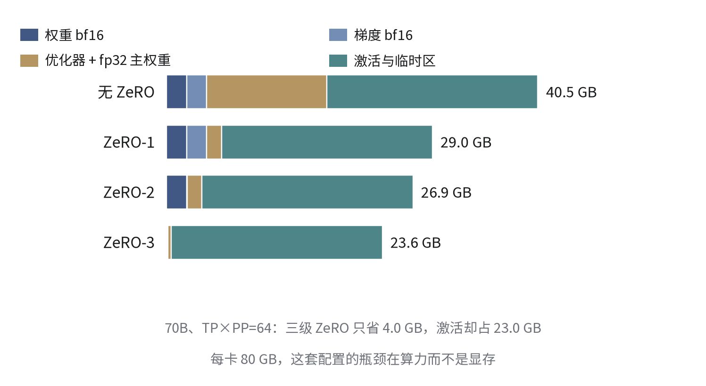

## 训练系统：并行、显存、通信

损失函数写在纸上只有一行，把它真的算出来要一整个系统。一支六人小组拿到 64 张 H100，想把一个 7B 模型从头训到 3000 亿 token。他们改了一份开源配置，启动脚本跑了不到二十秒就退出，报错是显存不足。日志里最后一行显示，模型已经加载完毕、优化器已经初始化、第一批数据已经在路上，显存占用 79.4GB。

权重本身只占 14GB。同一份权重装进推理引擎，80GB 的卡能剩下大半空间跑几百个并发请求。从 14GB 到 79GB 的差额不是实现写得差，而是训练和推理要保存的东西本来就不一样：推理只需要权重，训练要顺着时间往回走，凡是被反向传播用到的量都得留着。

这笔差额由四样东西构成——权重、梯度、优化器状态、激活值。它们各自随什么增长、能不能切开、切开之后要付多少通信，决定了数据并行、张量并行、流水并行、专家并行这些名词的全部形状。这一章把这笔账算完，再看每一种切法是在用哪种资源换显存。

### 一张 16 字节的账单

先把与参数同寿命的三项数清楚。参数以 bf16 保存，每个 2 字节。反向传播要对每个参数求一个梯度，同样形状、同样精度，再 2 字节。Adam 给每个参数维护一阶矩 $m$ 和二阶矩 $v$，两者都是梯度平方或梯度的指数滑动平均，需要足够精度才不至于把微小更新吃掉，因此用 fp32，各 4 字节。合计 12 字节。

| 项 | 精度 | 字节/参数 | 70B |
|---|---|---|---|
| 权重 | bf16 | 2 | 140GB |
| 梯度 | bf16 | 2 | 140GB |
| 一阶矩 m | fp32 | 4 | 280GB |
| 二阶矩 v | fp32 | 4 | 280GB |
| fp32 主权重 | fp32 | 4 | 280GB |
| 小计 | — | 16 | 1.1TB |

表格最后一行比上面多出 4 字节。为什么不直接用 bf16 的权重接收更新，省下这 28GB？

因为更新量太小，bf16 看不见它。bf16 只有 8 位有效数字（1 位隐含、7 位显式），相邻两个可表示数之间的相对间隔是 $2^{-8}\approx3.9\times10^{-3}$。一个初始化在 0.1 附近的权重，它的最小可分辨增量是 $0.1\times3.9\times10^{-3}\approx4\times10^{-4}$。而一步实际更新是多少？学习率 $10^{-4}$ 乘上梯度量级 $10^{-2}$，得到 $10^{-6}$。两者差 400 倍，这份增量加到 bf16 权重上，结果就是原值，一次更新被舍掉。

$$w\leftarrow w-\eta g,\qquad \frac{\eta g}{w}\approx\frac{10^{-6}}{0.1}=10^{-5}\ll 2^{-8}$$

白话：相对更新量比 bf16 的分辨率高两个数量级，直接加等于没加。所以框架保留一份 fp32 的权重副本（常称 master weights），更新在 fp32 里累加，前向时再转成 bf16 供矩阵乘使用。这 4 字节不参与前向也不参与通信，只负责"记住"那些太小的变化。

16 字节/参数是估算训练显存的起点。换算成"一张 80GB 卡能训多大的模型"，答案是 5B，这还没算激活。7B 需要 112GB，一张卡装不下；70B 需要 1.1TB，八张卡加起来的 640GB 也不够；405B 的 6.5TB 相当于八十四张卡的全部容量。单卡容量从 2017 年的 16GB 涨到今天的 80GB，模型规模同期涨了上千倍，这个剪刀差是所有并行策略存在的理由。

剩下的一项是激活值，它和前三项性质不同：不随参数量定，而随"同时处理多少 token"定。一层里要留到反向使用的中间量有这些——子层输入的归一化结果、query/key/value 三个投影、注意力的输出、输出投影的结果、前馈网络的中间激活（SwiGLU 下是两个 $2.67d$ 维向量）、前馈的输出。逐项加起来约 $10d$ 个数，bf16 下就是每个 token 每层 $20d$ 字节。$d=4096$ 时是 80KB，32 层合计 2.6MB。

2.6MB 听着不多，乘上批量就变了。全局批 100 万 token 时是 2.6TB；即使切成 64 份分给 64 张卡，每张卡仍要 40GB，与 16 字节账上的 1.75GB 相比是二十多倍。这就是为什么小模型也会爆显存：激活是账上唯一随批量线性增长的一项，而并行策略里没有哪一种能把它按参数切。

有两项激活常被漏算。一是注意力分数矩阵，形状 $b\times h\times s\times s$，$b$ 是批、$h$ 是头数、$s$ 是序列长度，bf16 下 $h=32$、$s=4096$、$b=1$ 时是 5.4 亿个数、1.07GB，32 层全部保留就是 34GB；这一项随 $s$ 的平方涨，序列从 4K 拉到 32K 是 64 倍。用 FlashAttention 这类不落地整块矩阵的实现，这一项就不存在（做法是把序列切成小块、边算边丢，完整矩阵从不写进显存），激活的主项回到上面那 $10d$。二是输出层的 logits，形状 $b\times s\times V$，100 万 token 乘 32768 是 330 亿个数、66GB；实现上按 token 分块算交叉熵，显存里只看得到一小片。

### 通信的四种动作

要把账上的任何一项分到别的卡上，就得让卡之间说话。说的话只有四种，全归约（all-reduce）、归约散射（reduce-scatter）、全收集（all-gather）、全对全（all-to-all）。每个并行策略的通信代价，都可以拆成这四种动作的字节数。

设要搬的张量有 $S$ 字节、卡数为 $N$，用最常用的环形算法，每张卡自己的收发量是：

| 原语 | 语义 | 每卡字节 | 用在哪 |
|---|---|---|---|
| AllReduce | 求和，每张卡都拿到完整结果 | $2S(N-1)/N$ | 数据并行梯度 |
| ReduceScatter | 求和，每张卡只留自己那一段 | $S(N-1)/N$ | ZeRO 的梯度、张量并行的反向 |
| AllGather | 各段拼成完整张量，每人一份 | $S(N-1)/N$ | ZeRO-3 取参数、张量并行的前向 |
| AllToAll | 每张卡给其他每张卡各发一段 | $\approx S$ | 专家并行的路由 |

$(N-1)/N$ 在 $N$ 大时接近 1，所以口诀是：全归约约等于两倍张量，归约散射和全收集各约一倍，而"归约散射接全收集"合起来正好等于一次全归约。环形全归约就是这么实现的：先转 $N-1$ 圈，每圈一张卡把自己负责的那一段的部分和推给下游、同时接收上游的部分和，转完每张卡手上有一段完整的和；再转 $N-1$ 圈把各段拼回完整张量。所以每卡搬 $2S$ 而不是 $S$——这个 2 是所有并行通信估算里最容易被漏掉的因子。

代入 7B：bf16 梯度 14GB，一次全归约每卡搬 28GB。400Gb/s 的 InfiniBand 折算到每张卡是 50GB/s，耗时 0.56 秒。

问题在于这 0.56 秒值不值。如果每张卡一步处理 50 万 token，前向加反向是 $6\times7\times10^9\times5\times10^5=2.1\times10^{16}$ FLOPs，按 400 TFLOPS 的有效算力要 52 秒，通信占 1%，可以当它不存在。如果每卡一步只处理 5000 token，计算缩到 0.5 秒，网卡就成了主角，一半时间在等。

分界线可以解出来。设单卡有效算力 $F$（FLOPs/s）、网卡带宽 $B$（字节/s）、每卡每步 $t$ 个 token、参数量 $\Psi$。梯度全归约搬 $4\Psi$ 字节（$2S$，而 $S=2\Psi$），计算是 $6\Psi t$ 次浮点运算：

$$\frac{4\Psi}{B}=\frac{6\Psi t}{F}\quad\Longrightarrow\quad t^{*}=\frac{2F}{3B}$$

白话：通信时间正比于参数量，计算时间也正比于参数量，两者相除把 $\Psi$ 约掉了，分界点只取决于硬件的算力带宽比。代入 $F=4\times10^{14}$、$B=5\times10^{10}$，得 $t^*\approx5300$ token。这个结论很硬：数据并行能不能用，与模型多大无关，只与你每卡喂多少 token 有关。GPT-3 用 320 万 token 的全局批、分到 1024 张卡上是每卡 3000 出头，正好落在分界线附近，所以它的配置里通信是个真实成本。

工程上不会等梯度全部算完再发起通信。反向从最后一层往前算，每层梯度一可用就攒进 25MB 左右的桶，桶满立刻发起全归约，网卡的工作与后续层的反向重叠，账面上 0.56 秒的开销在时间线上只剩一个零头。

### 把冗余的副本切开：ZeRO 三级

数据并行解决了吞吐，没解决显存：每张卡上仍是完整的 16 字节账。而账上最厚的部分——12 字节的优化器状态与主权重——在每张卡上一模一样，是纯粹的冗余。

《ZeRO: Memory Optimizations Toward Training Trillion Parameter Models》(2019) 的做法是把模型状态分成优化器状态、梯度、参数三堆，逐堆切开分给不同的卡。记参数量为 $\Psi$、数据并行度为 $N_d$，每卡常驻字节数：

| 阶段 | 切什么 | 每卡常驻 | 7B、64 卡 |
|---|---|---|---|
| 基线 | 不切 | $16\Psi$ | 112GB |
| 一级 | 优化器状态 | $4\Psi+12\Psi/N_d$ | 29.3GB |
| 二级 | 加梯度 | $2\Psi+14\Psi/N_d$ | 15.5GB |
| 三级 | 加参数 | $16\Psi/N_d$ | 1.75GB |

一级的算式拆开看：参数 2 字节与梯度 2 字节仍完整保留，共 $4\Psi$；优化器那 12 字节按 $N_d$ 均分，每卡只管自己那一片参数的 $m$、$v$ 和 fp32 副本。更新时每张卡只更新自己负责的那一段，更新完把参数广播出去。7B 配 64 卡，$4\times7+12\times7/64=28+1.3=29.3$GB，从 112GB 降到 29GB，一张 80GB 卡就能装下。

二级把梯度也切了。反向时不再做全归约，而是做归约散射：每个梯度元素被求和后直接落到负责它的那张卡上，其余卡连看都不看一眼。于是梯度只占 $2\Psi/N_d$，加上完整的参数 $2\Psi$ 与切开的优化器 $12\Psi/N_d$，合计 $2\Psi+14\Psi/N_d$。三级把参数也切了，前向算到某一层之前，先用全收集把这一层的参数从各卡拼回来，算完就丢；反向再用一次，梯度用归约散射发走。三项全切，$16\Psi/N_d$。

通信量的变化比显存账更需要留意。一级完全没有新增通信：优化器状态本来就不参与卡间通信，切它不产生流量，省下的全是副本。二级把一次全归约换成了"归约散射 + 全收集"，字节数完全相同，只是分两步走——全归约在环形实现下本来就是这两步接起来的。三级多了一次全收集：前向取参数、反向取参数、反向发梯度，三次搬运而基线只有两次，多出 50%。PyTorch 的 FSDP（Fully Sharded Data Parallel）就是这一级，实践中靠预取把下一次全收集藏在当前层的计算里，代价才能压下来。

三级台阶有一个共同的边界：它们切不开单独一层。无论 $N_d$ 多大，某一层的参数、梯度和激活必须在同一时刻同时存在于某张卡上（三级只是让它在算这一层时才聚拢）。一层装不下，ZeRO 帮不上忙。

### 切进一层：张量并行

先看一层到底多大。一层 Transformer 的参数约 $12d^2$：注意力四个投影各 $d\times d$，前馈两个矩阵是 $d\to4d\to d$，各 $4d^2$。$d=8192$ 时是 8 亿参数，按 16 字节算要 13GB，加这一层的激活，80GB 的卡还剩一半。$d=16384$（405B 那个量级的宽度）时一层 32 亿参数、51GB，加上激活和临时缓冲区就顶到天花板了。

《Megatron-LM: Training Multi-Billion Parameter Language Models Using Model Parallelism》(2019) 给出的切法是把矩阵按行列拆开。前馈层是 $Y=\mathrm{GeLU}(XA)B$，$X\in\mathbb{R}^{b\times d}$ 是一批 token 的输入（$b$ 这里是微批里的 token 数），$A\in\mathbb{R}^{d\times4d}$ 是第一层权重，$B\in\mathbb{R}^{4d\times d}$ 是第二层。把 $A$ 按列切成 $[A_1,A_2]$，各 $\mathbb{R}^{d\times2d}$，分给两张卡；把 $B$ 按行切成 $\begin{bmatrix}B_1\\B_2\end{bmatrix}$，各 $\mathbb{R}^{2d\times d}$。于是

$$Y=\mathrm{GeLU}(XA_1)B_1+\mathrm{GeLU}(XA_2)B_2$$

两张卡各算一项，结果相加才是 $Y$。逐项验证：$XA_1$ 是 $b\times2d$，GeLU 逐元素作用不改变形状，再乘 $b\times2d$ 与 $2d\times d$ 得 $b\times d$，两项同形可以相加。每张卡只算一半的浮点运算，只存一半的权重。

关键在于切分点落在哪。GeLU 是逐元素函数，$\mathrm{GeLU}([u,v])=[\mathrm{GeLU}(u),\mathrm{GeLU}(v)]$，所以第一层按列切完，两张卡可以各自独立地过激活，中间不需要任何通信，唯一的通信是最后把两个 $b\times d$ 的部分和加起来，一次全归约。

反过来若按行切 $A$，每张卡拿到的输入只有 $x$ 的一半列，第一层之前就得先全收集把输入拼全，通信提前到了入口，而且每层都要拼一次。把切分点放在"能逐元素算"的位置，是张量并行省通信的全部技巧。

注意力用同一套逻辑，只是切分的轴换成了头。$d$ 维被分成 $h$ 个头，每个头的 $\mathrm{softmax}(QK^{\top}/\sqrt{d_{\text{head}}})$ 只在自己头内进行，头与头之间没有交互，所以 query/key/value 的投影矩阵按列切、每张卡分到一部分头是天然的；输出投影按行切，最后全归约一次。这里有个硬约束：切分的最小单位是一个头，一个头不能再拆给两张卡，所以张量并行度不能超过头数。用 GQA 把键值头压到 8 个的模型，键值投影最多只能切 8 份，张量并行度实际被钉在 8 以内。

代价是每层四次全归约：注意力之后一次、前馈之后一次，反向传播再各一次。每次搬 $4bsd$ 字节（$bsd$ 个 bf16 元素是一份张量，全归约每卡搬两倍）。批 1、序列 4096、$d=8192$、80 层：

$$4\times 80\times 2\times 1\times 4096\times 8192\times 2\ \text{字节}\approx43\ \text{GB}$$

每步 43GB。走 InfiniBand 是 0.86 秒，走 NVLink 是 0.1 秒——H100 的 NVLink 单向带宽约 450GB/s，是跨机网络的九倍。这个差距直接决定了张量并行的度数：它基本被"一个节点里有多少张卡"钉死，通常就是 8。Llama 3 的 405B 在 16384 张 H100 上训练，切法是张量并行 8、流水并行 16、数据并行 128，三个数相乘正好是卡数；这种相乘关系是配置的第一道硬约束，动一个维度就得按倍数动其他两个。

切得再细还有第二个损失。每张卡上的矩阵变小，GEMM 的算术强度（每读一字节做的浮点运算次数）下降，硬件跑不满。$d=8192$ 切 8 份，每卡的矩阵是 $8192\times1024$，还够大；切到 32 份，每卡只剩 $8192\times256$，读权重的带宽开始压过计算，两头吃亏。

张量并行和 ZeRO 切的是不同的东西。ZeRO 切的是"状态"——参数、梯度、优化器副本在时间上大部分闲置，切开只影响存取；张量并行切的是"计算"，一层内的矩阵乘被拆到多张卡上，每步都必须通信。前者能用便宜的跨机网络，后者只能用昂贵的机内互联。

### 沿深度切：流水并行与气泡

张量并行被机内带宽钉在 8，剩下的卡只能往别处放。既然一层切不开，就沿着层切：80 层分成 16 段，每段 5 层放在一组卡上，一个微批从第一段走到最后一段，像流水线。段与段之间只传激活，一个微批一次 $bsd$，跨机完全能承受。

流水线的问题在开头和结尾。设每段处理一个微批花一个时间单位，一共 $p$ 段、$m$ 个微批。第一个微批从第 1 段走到第 $p$ 段要 $p$ 步，这 $p-1$ 步里后面的段还没活干；最后一个微批走完，前面各段又空出 $p-1$ 步。所以整条线一共花 $m+p-1$ 个时间单位，而理想情况是 $m$ 个。时间线上共有 $p(m+p-1)$ 个“段×时间”格子，真正干活的只有 $mp$ 个，空转占比是

$$\text{bubble}=1-\frac{mp}{p\,(m+p-1)}=\frac{p-1}{m+p-1}$$

白话：段数越多、微批越少，两头空得越厉害。$p=8$、$m=8$ 时气泡占 $7/15=47\%$，接近一半的算力在空转；$m=32$ 降到 $7/39=18\%$；$m=128$ 才到 $7/135=5\%$。要用 16 段，就得配 64 个以上微批才能把气泡压到 20% 以下。

这里藏着一个与优化器耦合的约束。$m$ 个微批共享一次参数更新，全局批 = $m\times$微批大小。$m=128$、每微批 3 万 token，全局批就是 380 万 token。全局批决定了学习率能开多大、warmup 要多长，所以流水并行的段数不是纯系统决策，它会反过来牵制收敛超参。

《GPipe: Efficient Training of Giant Neural Networks using Pipeline Parallelism》(2018) 用的是最直白的排法：$m$ 个微批全部前向做完，再统一反向。它的气泡与后来的调度一样大，代价在显存——同时活着的 $m$ 份激活全部要留到反向，等于把分段省下的显存又还了回去。一前一后（one forward one backward，1F1B）调度改的是顺序而不是总量：每个微批前向完，尽早排上它的反向，在途微批数封顶为 $p$。

```text
阶段      时间单位        每段在做什么                  在途微批数
填充      1 .. p-1        依次拿到自己的第一个微批      1 -> p-1
稳态      p .. m          交替做一次前向、一次反向      恰好 p
排空      m+1 .. m+p-1    依次交回最后一个微批          递减到 0
```

气泡没有变，填充与排空依旧各占 $p-1$ 步；变的是峰值显存，从 $m$ 份激活降到 $p$ 份。同样的算力利用率，换个顺序就少存几倍激活，这是流水并行里最实用的一条经验。再往前一步是交错式流水：让一张卡负责 $v$ 个不相邻的段，气泡缩到 $(p-1)/(vm+p-1)$，代价是段间通信次数翻 $v$ 倍。

段数还受两条约束。层数要能均匀分：80 层切 16 段正好每段 5 层，切 12 段就余下 8 层，多出来的层只能塞进某段，那段成为瓶颈。各段显存天然不均：第一段多一个词嵌入表，最后一段多一个输出头加交叉熵，填充阶段首段还积压了多个微批。Llama 3 的处理是把层重新排一遍，首尾两段少放几层、中间段多放几层，让每张卡的显存峰值对齐。

### 序列与专家：另外两个维度

序列维度也能切。张量并行下，归一化、dropout 这类逐位置操作每张卡都存了完整副本，序列并行把它们按 token 分给各卡，省下一小块显存，代价是全归约换成"归约散射 + 全收集"，字节数不变。

真正处理长上下文的是上下文并行：把序列切成几段，每卡持有一段，算注意力时别的卡的键和值通过环形传递送过来，边转边用在线 softmax 累积部分结果——这就是《Ring Attention with Blockwise Transformers for Near-Infinite Context》(2023) 的思路。每层每卡搬的字节数约 $4sd$（自己那一段的键和值要绕环走一圈，$s$ 是整个序列长度、$d$ 是隐维），与张量并行同量级，但可以和后一段的计算完全重叠：传下一块 K/V 的同时算当前块。它解的是张量并行解不了的问题——张量并行度被头数和机内带宽钳在 8，而序列长度可以任意长，上下文并行度随卡数线性增长。Llama 3 训练 128K 上下文时用的就是它，配置表里写作 CP=16。

混合专家带来第三种切法。专家并行把不同专家放在不同卡上，token 经全对全通信送到对应专家，算完再送回来，每层两次（一次派发、一次收回）。字节数是一层 $4Tkd$：$T$ 是本卡要处理的 token 数、$k$ 是每个 token 激活的专家数、$d$ 是隐维，每个 token 要发 $k$ 份、每份 $d$ 个 bf16 元素，两次全对全合起来就是 $4Tkd$。注意这个式子与专家总数无关——把 256 个专家摊到 64 张卡上，每张卡的收发量并不因为专家多而变大，这是专家并行能扩展到万亿参数的原因：总参数可以远超单卡容量，每个 token 只碰其中 $k$ 个。DeepSeek-V3 总参数 671B，每个 token 只激活 37B，靠 8 个节点、64 路专家并行把 256 个专家摊开。

麻烦在负载。某个专家收到的 token 多，对应那张卡就要多算，其余卡只能等；工程上用容量因子加丢弃、用辅助损失或路由偏置把分布压平（辅助损失和路由偏置是两类常见手段）。全对全还有一层性质：它的流量取决于路由结果，是动态的、不规则的，很难像全归约那样做静态带宽规划。

### 一份 70B 的完整配置

把前面所有账目拼成一份能直接拿去改的配置。目标是 70B 稠密模型、2 万亿 token、2048 张 H100。

模型形状先定：80 层、$d=8192$、64 个注意力头、8 个 KV 头（GQA）、词表 12.8 万、序列长 4096。一层约 $12d^2=8.1\times10^{8}$ 参数，80 层加上嵌入共 700 亿。

| 配置项 | 取值 |
|---|---|
| 并行组合 | TP=8 × PP=8 × DP=32 |
| 卡数 | $8\times8\times32=2048$ |
| 微批 | 8 条序列 × 4096 token |
| 梯度累积 | 8 |
| 全局批 | $8\times32\times8=2048$ 序列 |
| 全局批 token | $2048\times4096=8.4\times10^{6}$ |
| 学习率 | $1.5\times10^{-4}$，warmup 2000 步 |
| 总 token | $2\times10^{12}$ |
| 总步数 | $2.4\times10^{5}$ |

三个数相乘等于卡数，这是配置的第一道硬约束。TP 取 8 是因为它被机内带宽钉死；剩下的 256 张卡怎么分给 PP 和 DP，取决于两件事：一层能不能装下，以及气泡能不能容忍。

每卡显存拆开看（TP×PP=64，所以每卡持 $700/64=10.9$ 亿参数）：

| 项 | 字节/参数 | 每卡 |
|---|---|---|
| 权重 bf16 | 2 | 2.2 GB |
| 梯度 bf16 | 2 | 2.2 GB |
| 优化器（含 fp32 主权重） | 12/DP | 1.6 GB |
| 激活（全层重算，8 微批） | — | 21.6 GB |
| logits 分块与临时区 | — | 4.0 GB |
| 通信桶与碎片 | — | 3.0 GB |
| 合计 | — | 34.6 GB |



这张图最值得看的是最后两行的差。从 ZeRO-1 升到 ZeRO-3，省下 5.4 GB；而激活那一块横着 23 GB 不动。因为激活既不在模型状态的切分范围里，也不能按参数切——它随微批里的 token 数线性涨，只能靠减小微批或重算来压。这就是为什么到了 70B 这个量级，ZeRO 已经不再是主角，而“每卡排多少 token”才是那个旋钮。

34.6 GB，占 80GB 的四成三。这个结果值得停一下：显存还剩一半，为什么不减卡？因为卡数不是显存定的，是算力定的。2 万亿 token 在 70B 上的总浮点运算是

$$6\times7\times10^{10}\times2\times10^{12}=8.4\times10^{23}$$

H100 的 bf16 稠密峰值约 990 TFLOPS，按 40% 的 MFU 折算到每卡 $4\times10^{14}$ FLOPS，2048 张卡合起来 $8.2\times10^{17}$。除一下：$1.02\times10^{6}$ 秒，十一天半。而真实工期要长一倍多，差在两个折扣：重算与气泡。

先算单步。一个全局步的算力是 $8.4\times10^{6}\times6\times7\times10^{10}=3.5\times10^{18}$，除以 $8.2\times10^{17}$ 是 4.3 秒。而实测单步在 10 秒上下，差的 5.7 秒就是“有效算力”与“墙钟”的缝隙：TP 每层四次全归约（80 层×8 微批，每微批每层搬 $4bsd$ 字节，合计每卡每步 344GB，NVLink 450GB/s 下 0.76 秒）、PP 气泡（$p=8$、$m=64$，$7/71=10\%$）、重算多跑的一遇前向（33%）、以及调度与数据加载。

把 33% 的重算算进去，$6\Psi$ 变成 $8\Psi$，MFU 的分母也跟着变：

$$\text{MFU}_{\text{实际}}=\frac{6\Psi D}{\text{峰值}\times\text{墙钟}}=\frac{8.4\times10^{23}}{2048\times9.9\times10^{14}\times2.5\times10^{6}}=0.17$$

17%。这是“含重算”的 MFU——如果分子用 $8\Psi D$，它变成 22%。公开报告里的 38% 到 43% 通常指矩阵乘部分的峰值利用率，不扣重算也不扣气泡，三套口径相差很多，看论文时必须先对齐口径。

最后是总时间。$2.4\times10^{5}$ 步 × 10 秒 = $2.4\times10^{6}$ 秒，28 天。再乘 1.1（故障与重启）是 31 天，对应 152 万卡时，按每卡时两美元算是三百万美元。

### 一个切错的例子：PP=16

同样的 2048 张卡，把并行改成 TP=8 × PP=16 × DP=16，看上去更均衡。代价在气泡：

$$\text{bubble}=\frac{p-1}{m+p-1}=\frac{15}{64+15}=19\%$$

比 PP=8 的 10% 多一倍。而且要凑出 $m=64$ 个微批，全局批会变成 $8\times16\times64$，是原来的两倍，学习率得重新调。如果保留原来的全局批（每卡微批减半），$m$ 就只有 32，气泡升到

$$\frac{15}{32+15}=32\%$$

三分之一的算力空转。换算成钱：3100 万美元的训练里多烧掉 700 万。

PP 不是越大越好，也不是越小越好。段数多了，单段层数少、气泡大、首尾显存不均更严重；段数少了，一张卡上的层数多，权重加激活装不下。对 80 层、80GB 卡，每段 10 层、PP=8 是一个自然的中点；换到 405B（126 层、$d=16384$），一层就装不下，必须 PP≥16。

増加维度还有一条容易被忘记的约束：每个并行维度都要能整除。2048 张卡能拆成 $8\times8\times32$，也能拆成 $8\times16\times16$，但拆成 $8\times12\times\cdots$ 就不行——除非你愿意让某些卡少干活。这也是为什么公开配置里的数字总是 2 的幂的乘积。

### 从 256 卡到 2048 卡：扩容时哪一项会先坏

同一个 70B 模型，先在 256 卡上跑通，再扩到 2048。这不是把数字改大就行，五项依次会出问题。

| 项 | 256 卡 | 2048 卡 | 后果 |
|---|---|---|---|
| 数据并行度 | 8 | 64 | 梯度 all-reduce 变大 8 倍 |
| 全局批 | 512 序列 | 2048 序列 | 学习率需重调 |
| 检查点体积 | 1.1 TB | 1.1 TB | 写盘时间不变，频率要变 |
| 故障率 | 每 12 小时一次 | 每 1.5 小时一次 | 回滚开销乘八 |
| 通信域 | 32 节点 | 256 节点 | 交换机级数增加，尾延迟 |

第二行最容易被忽略。卡数乘八而单卡微批不变，全局批也乘八，学习率得按平方根或线性规则调（大模型常用线性 warmup 加平方根缩放）。如果忘了调，前几千步会变成“大步慢走”——损失降得比 256 卡时还慢，而团队会误以为“扩容没收益”。

第四行最贵。故障间隔与卡数成反比：单卡 MTBF 2 万小时的话，256 张卡的平均无故障时间是 78 小时，2048 张只有 9.8 小时。于是检查点间隔的最优值变小（由 $\sqrt{2MT_w}$ 给出，$M$ 降八倍时 $T_i^*$ 降 2.8 倍），而每次回滚要重算的步数不变，结果就是回滚开销占总时间的比例涨了近三倍。扩容前必须先把异步写盘与热备卡做好，否则新增的算力会被故障吃掉一大块。

第五行是尾延迟。2048 卡的通信要跨三层交换机，任何一次 all-reduce 的耗时由最慢的那条链路决定，而不是平均值。这意味着一两个“准故障”节点（不报错但网卡降速）能把整个集群的步时拉长 20%。对策是持续做带宽自检：每 N 步跑一次小规模 all-reduce 基准，与基线比，偏离超过 5% 就标红。

### 精度：bf16、fp8 与重算

前面所有字节数都默认 2 字节一个数。这个默认值是十年试验的结果。

fp16 有 5 位指数、10 位尾数，能表示的最小正规数是 $2^{-14}\approx6.1\times10^{-5}$，最大 65504。梯度常在 $10^{-8}$ 量级，存进 fp16 就掉进非正规区，到 $2^{-24}$ 以下变成零，参数拿不到更新。损失缩放（loss scaling）就是给梯度搬家：前向拿到 loss 后乘 $2^{k}$ 再启动反向，所有梯度同比放大到 fp16 的中段；更新前除回 $2^{k}$；出现 inf 或 nan 就把 $k$ 减一。这套机制的代价只是一个超参和一个判据，但它依赖"同一批参数的梯度量级大致相当"，长尾数据或稀疏模型上并不成立。

bf16 换了个取舍：8 位指数，范围与 fp32 相同（最大约 $3.4\times10^{38}$），不需要缩放；尾数只剩 7 位，相对精度 $2^{-8}\approx0.4\%$。0.4% 的舍入噪声为什么能忍？因为 Adam 的二阶矩是个平均器。$v_t=(1-\beta_2)\sum_k\beta_2^k g_{t-k}^2$ 等效于对 $n_{\text{eff}}=(1+\beta_2)/(1-\beta_2)$ 步的梯度平方取平均，$\beta_2=0.95$ 时 $n_{\text{eff}}=39$。每步的舍入误差近似独立，平均之后噪声降到 $0.4\%/\sqrt{39}\approx0.06\%$；更新量正比于 $1/\sqrt{v}$，噪声再减半，约 $0.03\%$。这是随机噪声，会被后续几千步继续平均掉。而 fp16 的下溢不是噪声，是系统性丢信息——小梯度直接变零，无论平均多少步都回不来。

fp8 把这条路走得更远，8 位要在指数和尾数之间分。E4M3（4 位指数、3 位尾数）最大 448，相对量化误差约 $2^{-4}=6\%$；E5M2（5 位指数、2 位尾数）范围到 57344，误差约 $2^{-3}=12.5\%$。常见配方是前向用 E4M3、反向梯度用 E5M2，前者要精度、后者要范围。能不能用全压在缩放因子上：一个张量共用一个 scale 时，某个极端大的激活会把整张量的有效位数拖垮；DeepSeek-V3 的做法是激活按 $1\times128$ 的块、权重按 $128\times128$ 的块各自在线求最大绝对值再定 scale（$\text{scale}=\max|a|/448$），异常值只污染自己那一块。代价是硬件只原生支持逐张量量化，分块缩放要在 Tensor Core 与 CUDA Core 之间来回搬，累加器得用 fp32。它用这套方案跑完 14.8 万亿 token，全程没有需要回滚的损失尖峰。

精度决定了每字节装多少信息，重算决定了存多少份。梯度检查点（gradient checkpointing，也叫激活重计算）的思路是前向时只留每层输入、反向时把该层重算一遍。检查点多密是个可优化的问题：$L$ 层切成 $L/s$ 段，段内激活全丢、只留每段边界的输入；反向进到某一段，先把这段的 $s$ 层重新前向算出来。峰值时手上同时有 $L/s$ 份边界与 $s$ 份段内激活，占用正比于

$$M(s)=\frac{L}{s}+s\quad\Longrightarrow\quad s^{*}=\sqrt L,\ M_{\min}=2\sqrt L$$

白话：切太碎则边界太多，切太粗则段内峰值太高，最优在两者相等处。80 层按每 9 层一个检查点切，激活从 80 份降到 18 份，省四分之三以上。计算量的账很直接：一个参数对一个 token 做一次乘加算 2 FLOPs，前向 $2\Psi$（$\Psi$ 是参数量），反向对输入和对权重各 $2\Psi$ 共 $4\Psi$，合计 $6\Psi$；重算多跑一遍前向，多 $2\Psi$，变成 $8\Psi$，多三分之一。用三分之一的时间换四分之三的激活，长序列训练里几乎总是划算。

选择性重算走另一条路：不按段丢，只丢注意力矩阵这类"显存占比大、浮点运算占比小"的张量，代价通常压到 5% 以内。32 个头、长度 4096 的注意力分数占一层激活的绝大部分，而它的 FLOPs 只占几个百分点。省显存最划算的地方，往往和算得最多的算子并不重合。

### 一次 OOM 的排查顺序

显存超了报错很直接（CUDA out of memory），但“为什么超”有五种答案，排查顺序决定了花几小时还是几天。

先看报错里两个数：已分配量（allocated）与预留量（reserved）。两者接近，说明真的用得多；差一大截，说明是碎片——分配器无法复用不连续的空闲块。碎片在小批量、变长序列的训练里很常见，修法是固定序列长度或开 `expandable_segments`。

第二看报错发生在哪个阶段。前向就爆，说明权重与激活本来就装不下，该降微批或加重算；反向才爆，往往是保留了不该保留的中间量（比如某层的注意力矩阵没走 flash 实现）。

第三看是不是只有某几张卡爆。如果只有最后一段爆，就是流水线的首尾不均（嵌入、输出头集中在那里）；如果只有某几张 numbered 卡爆，查参数分布——路由不均的 MoE 就会这样。

第四看显存随时间。每一步涨一点，是泄漏或缓存未释放（典型是变长序列的缓存块、或者评测时新建了图）；阶跃式上跳，是某一步的输入格外长。

| 现象 | 可能原因 | 先改什么 |
|---|---|---|
| 前向就爆 | 权重加激活装不下 | 降微批 |
| 只有反向爆 | 中间量未释放 | 开重算、换 attention 实现 |
| 只有部分卡爆 | 末段不均、路由不均 | 首尾层数调整 |
| 每步缓慢上涨 | 碎片或缓存 | 固定序列长、清理缓存 |
| 阶跃上跳 | 超长样本 | 按长度分桶 |

最后一行容易被误判为泄漏，而它其实是一次性的。区别方法很简单：如果每一步都跳，就是泄漏；如果只在少数步跳且随后不降，就是超长样本。

### 检查点、故障与有效训练时间

系统再稳也会坏。《Llama 3》(2024) 报告 405B 训练跑了 54 天，记录到 419 次意外中断，有效训练时间约 90%。原因分几类：显存颗粒故障、网卡掉线、整个节点变慢（不报错，只是每一步都慢一点），以及最难查的静默数据错误——算错了但不抛出异常，只能靠损失曲线发现。

对策的第一层是检查点写得更勤更快。405B 的完整训练状态一份就是 6.5TB（16 字节乘 4050 亿，与前面的账对得上），同步写要十几分钟，等于每写一次就停一次训练。实际做法是分片写、异步写：每张卡只写自己负责的那 400MB（三级切分下参数本来就分散在各卡），落到并行文件系统上聚合带宽够的话几秒钟完成；写的同时训练继续，用后台线程把张量从显存拷到主机内存再落盘。写检查点因此不再是一个停顿，而是一段持续的背景带宽开销。

第二层是决定多久写一次。这件事有最优解。设写一次检查点占用的等效时间 $T_w$（异步下按带宽折算）、故障间隔 $M$（平均无故障运行时间）、重启耗时 $T_r$，损坏比例是

$$f(T_i)=\underbrace{\frac{T_i}{2M}}_{\text{平均回滚损失}}+\underbrace{\frac{T_r}{M}}_{\text{重启}}+\underbrace{\frac{T_w}{T_i}}_{\text{写盘开销}}$$

第一项是回滚的期望损失：两次检查点之间随机时刻出事，平均丢 $T_i/2$ 的训练进度。对 $T_i$ 求极小，前两项与 $T_i$ 无关，$\frac{1}{2M}-\frac{T_w}{T_i^2}=0$，得

$$T_i^{*}=\sqrt{2MT_w}$$

代入 $M=3$ 小时、$T_w=1$ 分钟，$T_i^*=\sqrt{2\times3\times\frac{1}{60}}\approx0.32$ 小时，也就是每 19 分钟一次。此时三项分别是 5%、8%、5%，合计约 19%。这个最优点附近很平：改成 30 分钟一次，回滚损失升到 8%、写盘降到 3%，合计 20%，几乎一样；改成 5 分钟一次，回滚只剩 1%，写盘却涨到 20%，合计 30%，明显变差。真正值得优化的是重启：把 $T_r$ 从 15 分钟压到 2 分钟，总损耗能从 19% 降到 12%。

第三层是重启速度本身。加载 6.5TB 状态、重建通信组、把数据加载器跳到正确位置，每一步都要时间。数据位置常被忽略：只记"第几步"而不记对应的数据偏移，回滚之后要么重复读一段、要么跳过一段，后者在训练分布上挖了个洞。做法是把数据顺序做成 step 的确定函数，恢复时按 step 重算偏移。

还有一层是冗余。大规模训练通常留 1%–2% 的空闲卡作热备，某张卡坏了就换掉它的通信组。热备处理单卡故障，检查点处理进程级崩溃与数值事故。

切得好不好有一个现成指标：模型浮点利用率（Model FLOPs Utilization，MFU），即用 $6\Psi D$ 算出的有效计算量除以耗时与峰值的乘积（$\Psi$ 是参数量、$D$ 是 token 数）。Llama 3 405B 报告的是 38% 到 43%；低于 30%，通常说明某个维度切得不合适。

::: {.keypoint}
四种并行都是用不同的资源换显存：张量并行花带宽，流水并行花空闲，ZeRO 花带宽，重算花算力。选型不是找最优解，而是看集群里哪种资源还有余量。
:::

到这里，一个模型已经能在几千张卡上把几万亿 token 读完，账面上的显存、通信、精度都有了着落。但这套系统能保证的只是"每一步都算得出来"，保证不了"每一步都算对了地方"。真正跑起来，损失会在某个毫无征兆的步骤突然跳高，然后停在那里不再下降；一次尖峰抵得上几十小时的正常训练，而处理它需要的东西——z-loss、QK-Norm、梯度裁剪、回滚策略——都不在这本显存账上。
