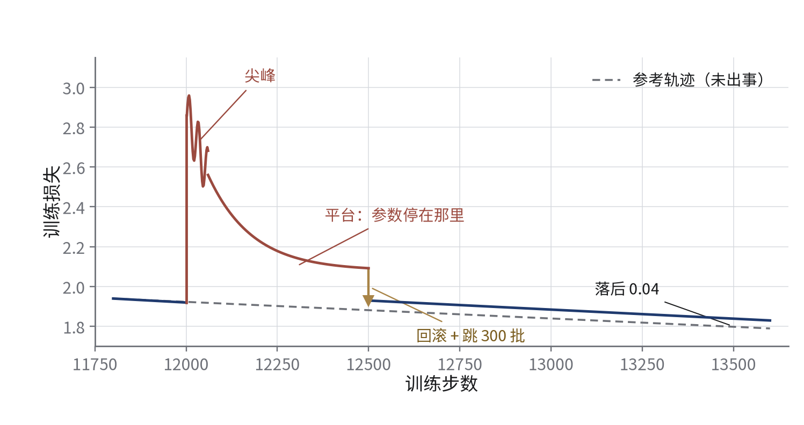

## 稳定性：损失尖峰、回滚、检查点

第 12000 步，监控面板上的损失曲线出现一条竖线。前一步是 1.92，这一步是 2.87，接下来三十步在 2.5 到 3.1 之间来回，然后缓慢回落，到第 12600 步停在 2.08 附近，此后再也没有回到原来那条下降轨迹上。整个过程中没有任何报错，没有 NaN，显存和吞吐都正常。

这是大模型预训练里最常见的事故形态：损失尖峰（loss spike）。它不像崩溃那样立刻可见，代价却更大——原本预计第 40000 步到 1.7，现在可能永远到不了；而团队往往在几天后才发现，这段训练已经白跑。

上一章把显存、通信、精度都算平了，那套系统能保证每一步都算得出来，保证不了每一步都算对了地方。数值行为是另一本账：它不由参数量和带宽决定，而由 logits 的幅度、softmax 的饱和度、优化器状态的记忆长度决定。这一章拆开尖峰的成因，再讲三类应对——拴住范数、调对超参、出事之后怎么救。

### 尖峰长什么样，怎么判定

先给一个可操作的判据，否则"尖峰"只是感觉。工程上通常同时看两条：单步损失超过前 100 步滑动均值的 3 个标准差；抬升幅度超过 0.3 且 500 步内没有回落到原轨迹的 ±0.02 之内。第一条抓突发，第二条抓"回不去"。

"回不去"是尖峰区别于正常噪声的关键。正常的小批量噪声会让损失上下抖 0.05 左右，且均值一路向下；尖峰之后损失会在一个更高的平台上停住，甚至缓慢上升。这个区别指向一个具体的机制：不是数据这一步特别难，而是优化器状态被这一步改坏了。

要看清这一点，得先知道一步更新是怎么算出来的。Adam 的更新量是

$$\Delta w=-\eta\,\frac{\hat m}{\sqrt{\hat v}+\epsilon},\qquad \hat m=\frac{m}{1-\beta_1^t},\quad \hat v=\frac{v}{1-\beta_2^t}$$

$m$ 和 $v$ 分别是梯度及其平方的指数滑动平均，$\beta_1=0.9$、$\beta_2=0.95$（大模型常用的值，比默认的 0.999 短视得多），$\eta$ 是学习率，$\epsilon$ 是防止除零的小常数，分母上的 $1-\beta^t$ 是偏差修正。关键在 $\sqrt{\hat v}$：它是一个逐坐标的、带记忆的尺度估计。某一步某个坐标的梯度突然大了 50 倍，$v$ 会被抬高 $2500$ 倍，而 $\beta_2=0.95$ 意味着这个抬高要过 $1/(1-\beta_2)=20$ 步才衰减到 $1/e$，过 100 步才基本消失。在这段时间里，这个坐标的有效学习率被压到原来的 $1/50$，参数几乎不动。

这就是"停在那里"的来源。损失不是在尖峰后维持高位，而是参数在那几十到几百步里失去了更新能力；等到 $v$ 衰减回来，参数已经站在一个偏离轨迹的点上，后续的下降从那里重新开始，于是永久落后一截。

尖峰还有另一种形态，更隐蔽：不跳高，而是"下降变慢"。损失曲线看着正常，只是每千步的降幅从 0.03 变成 0.01，验证损失开始微微抬头，最后几万步后突然整体发散。这种形态下判据不能看损失，得看范数：最后一层输出范数、每层更新量与权重范数之比，只要它们单调抬头，即使损失还在降，也已经出事了。

### 尖峰从哪里来

把尖峰归因于"坏数据"是最常见的误判。《PaLM: Scaling Language Modeling with Pathways》(2022) 做过一个对照：把尖峰附近那批数据取出来，换一个更早的检查点重训，尖峰不再出现。同一批数据、不同的参数状态，结果不同。所以尖峰是"某批数据碰上某组参数"的组合事件，两边都必要。这解释了两个现象：清洗数据防不住（数据本身没有错），回滚有效（它同时换掉了参数状态和数据顺序）。

数据这一侧的触发物通常是三类：一段异常重复的文本（同一句话连出几百遍，让某一层的激活饱和）、一个特别长的样本（序列长度是批内其他样本的几倍，梯度尺度差一个数量级）、一个稀有 token（嵌入向量只被更新过几十次，范数还没收敛）。它们单独出现都不致命，叠在某组参数上才致命。

参数这一侧的机制更有意思，也更值得盯：logits 的幅度在缓慢增长。

设注意力分数 $s=q^{\top}k/\sqrt{d_{\text{head}}}$，$q$、$k$ 是某个头的查询与键向量，$d_{\text{head}}$ 是头维度。softmax 的输出是

$$p_i=\frac{e^{s_i}}{\sum_j e^{s_j}},\qquad \frac{\partial p_i}{\partial s_j}=p_i(\delta_{ij}-p_j)$$

第一个式子是定义，第二个是雅可比：$\delta_{ij}$ 在 $i=j$ 时为 1、否则为 0。白话：某个位置的权重接近 1 时，这一行对其他位置的导数全部趋近 0——softmax 饱和了，梯度进不去。

饱和本身不产生尖峰，它产生的是"梯度消失的注意力头"。真正的问题是 logits 为什么会一直变大。训练中残差流的范数会缓慢增长（每层都往主干上加东西，而权重衰减只把权重拉向零、拉不住激活），$q$、$k$ 的范数随之上升，两者点积的方差随范数平方增长。这个过程在几万步里是单调的，早期看不出来，等到某个头的 logits 标准差到了 5 以上，softmax 已经在做近似硬选择：不管输入是什么，权重几乎全给一个位置。

此时来一个稍微不同的输入，那个"被选中的位置"变了，这一层的输出从"复制第 3 个 token 的 value"跳到"复制第 700 个 token 的 value"，下游几层的输入整体偏移，损失瞬间抬高。这就是尖峰的瞬时形态：不是某个数算错了，而是一个近饱和的系统被推过了分界点。

尖峰那一步的梯度为什么也会异常大？关键在归一化的分母上。一个近乎硬选择的注意力头，输出几乎与输入无关（反正总是那个位置的 value），这一子层的贡献变成一个常量向量，残差流的方差随之骤降。而归一化的反向带一个 $1/\sigma$ 因子（$\sigma$ 是输入的均方根或标准差），$\sigma$ 变小十倍，穿过这一层的梯度就被放大十倍。于是"注意力饱和"与"梯度爆炸"是同一件事的两面：前向在丢信息，反向在放大信号。

还有第三个来源，纯粹是数值的。softmax 要算 $e^{s_i}$，这个数在 bf16 下的上限是 $3.4\times10^{38}$，对应 $s_i$ 不超过 88；在 fp16 下上限是 65504，对应 $s_i$ 不超过 11。logits 到 88 就溢出成 inf，一步之后整个参数变成 NaN。所以"logits 能长多大"不是审美问题，是硬边界：fp16 训练里 attention 炸得比 bf16 频繁得多，原因就是这个 11 与 88 的差别。

### 把范数拴住：z-loss 与 QK-Norm

对"logits 一直在长"最直接的反应是加惩罚。交叉熵里有一项结构性问题：softmax 对整体平移不变，$\mathrm{softmax}(z+c)=\mathrm{softmax}(z)$，把所有权重整体往下推不改变损失，但会把 $\log Z$（$Z=\sum_j e^{z_j}$，softmax 的归一化分母）推向很负的值。$\log Z$ 越负，$e^{z_j}$ 越小，越容易下溢成零，softmax 的输出在数值上失真。

PaLM 加了一项 z-loss：

$$\mathcal{L}_z=\epsilon\left(\log Z\right)^2,\qquad \epsilon=10^{-4}$$

$\epsilon$ 是系数，$Z$ 是 softmax 分母。这一项的梯度是

$$\frac{\partial \mathcal{L}_z}{\partial z_j}=2\epsilon\log Z\cdot p_j$$

白话：它沿着概率分布 $p$ 的方向给所有 logits 加一个偏移，$\log Z>0$ 时整体下压、$\log Z<0$ 时整体上抬，不改变排序，只把尺度拉回 0 附近。系数 $10^{-4}$ 小得几乎测不出来：正常训练时 $\log Z$ 在 0 上下，$\log Z=2$ 时这一项只贡献 $4\times10^{-4}$，而主损失是 2 上下，占比万分之二；只有当 $\log Z$ 漂到 20 以上，它才变成 $0.04$ 量级，开始真实地拉住。像一根很软的弹簧。

z-loss 管的是"整体尺度漂移"，管不了"单个头的范数失控"。后者的做法更直接：算点积之前，先对 $q$ 和 $k$ 各做一次归一化，这就是 QK-Norm。

$$\tilde q=\frac{q}{\mathrm{RMS}(q)},\qquad \tilde k=\frac{k}{\mathrm{RMS}(k)},\qquad s=\frac{\tilde q^{\top}\tilde k}{\sqrt{d_{\text{head}}}}$$

这里 $\mathrm{RMS}(q)=\sqrt{\frac{1}{d_{\text{head}}}\sum_i q_i^2}$，是按头维度算的均方根。归一化后 $\|\tilde q\|=\|\tilde k\|=\sqrt{d_{\text{head}}}$，由柯西–施瓦茨不等式

$$|s|\le\frac{\|\tilde q\|\,\|\tilde k\|}{\sqrt{d_{\text{head}}}}=\sqrt{d_{\text{head}}}$$

$d_{\text{head}}=128$ 时上界是 11.3，与训练走到第几步无关。这个上界刚好落在 fp16 的安全区边缘：$e^{11.3}\approx8\times10^4$，略高于 65504，但在 bf16 下毫无压力。所以加了 QK-Norm 之后，注意力这一路基本不可能成为尖峰的来源。

归一化的轴必须与 softmax 的轴对齐，这是 QK-Norm 唯一容易写错的地方。softmax 在每个头上独立进行，会爆的是头内的点积，所以要按 $d_{\text{head}}$ 归一化，而不是按整个隐层 $d$；按 $d$ 归一化会把不同头的数据混在一起算分母，一个头里的极端值被其他头稀释，约束就失效了。

限制范数和事后截断看起来相似，作用完全不同。Gemma 2 用的是软截断：把超过 50 的 logits 用 $50\tanh(z/50)$ 压回去，注意力分数超过 30 的同样处理。$\tanh$ 在饱和区的导数接近零，被截断的那些位置的梯度几乎为零——模型学到"这个位置很强"，学不到"该多强"。QK-Norm 限制的是范数本身，梯度照常回传，模型仍然可以学"这个头该有多尖锐"，只是上限被钉死了。一个是在出口设闸门，一个是在入口设限高杆。

《Chameleon: Mixed-Modal Early-Fusion Foundation Models》(2024) 的实测把这条链子接上了。它的出发点是 softmax 的平移不变性：把 logits 整体推大不改变损失，但改变数值；多模态共用一套权重时，每个模态都靠推大自己的范数来"争"表示，到 bf16 的边缘之外就发散。不加 QK-Norm，最后一层输出范数从训练早期就持续上升，发散可以迟至训练进度的 20%–30% 才显现——范数失控是最早的预警信号。ViT-22B 报告的是同一件事。

z-loss、QK-Norm、梯度裁剪常被并列成三件"稳定性技巧"，它们管的其实是三个不同的量。z-loss 管整体尺度——所有 logits 一起漂移；QK-Norm 管头内范数——单个头的点积能长多大；梯度裁剪管单步幅度——一次更新能把参数推多远。三者的作用点分别在分母、在点积、在更新上，不能互相替代：只加 z-loss，某个头仍然可以把 $q$、$k$ 的范数推到很大而不改变 $\log Z$；只加 QK-Norm，输出层的 logits 仍然会整体漂移；两者都加，一个异常批次仍然能靠巨大的梯度把参数推飞。

### 数值格式划出的边界

前面反复用到"bf16 下不超过 88"这类数字，值得把三种格式并排看清楚，指数位与尾数位在正文里已经提过。

| 格式 | 最大正规数 | 最小正规数 | log 上界 |
|---|---|---|---|
| fp32 | 3.4e38 | 1.2e-38 | 88 |
| bf16 | 3.4e38 | 1.2e-38 | 88 |
| fp16 | 65504 | 6.1e-5 | 11 |

最后一列是把最大值取自然对数得来的，它回答的是"进 softmax 之前 logits 最多能有多大"。fp32 与 bf16 都是 88，fp16 只有 11。这个差别比"精度高低"重要得多：bf16 牺牲精度换范围，而训练中最先出问题的从来不是精度，是范围。

组合精度训练的做法因此是分层的：矩阵乘用 bf16（Tensor Core 只吃低精度，而且这一步的舍入误差会被后续几千步平均掉），而所有"会把数值放大的地方"留在 fp32——softmax 的指数与归一化、LayerNorm 的均值方差、交叉熵的 log-sum-exp、以及损失的累加。这几处的共同点是要么含 $e^{x}$（放大），要么含 $1/\sigma$（除法），要么做跨 token 的求和（累加几万个微小量，低精度下会丢）。

一个具体的失真例子：交叉熵按 log-sum-exp 稳定写法算是 $\mathcal{L}=\log Z-s_y$，$s_y$ 是正确 token 的 logit。如果 $Z$ 在 bf16 里算，$Z$ 里的每一项都有 0.4% 的相对误差，而 $Z$ 与 $s_y$ 相减时两者的绝对误差都是 0.4% 量级，差值 $s_y-\log Z$ 只有几个 nat，相对误差就被放大到百分之几。损失本身带 1% 的噪声，梯度方向就会跟着抖，靠它判断收敛会误判。

bf16 唯一需要留意的是下溢。最小正规数 $1.2\times10^{-38}$，比它更小的数掉进非正规区，精度迅速流失。梯度里出现 $10^{-40}$ 量级的坐标并不罕见（某个嵌入向量几乎不参与任何预测），这些坐标在 bf16 里就是零，但在 fp32 里它们仍能累积成有效信号——这也是优化器状态必须存 fp32 的原因之一，前面算显存账时那 12 字节，一半是给这些微小量的。

### 超参怎么随宽度平移：muP

到现在为止的讨论都假设学习率是对的。可"对"是相对的：同一个学习率在 1.3 亿参数上合适，搬到十倍宽的模型上往往发散或学不动。原因藏在初始化的尺度里。

标准的初始化把每个权重矩阵取成方差 $1/\text{fan\_in}$ 的高斯分布，$\text{fan\_in}$ 是该矩阵的输入维度。这样单个输出坐标的方差与宽度无关，看起来很合理。但两步之后就出问题：每个坐标的梯度是 $\text{fan\_in}$ 项的求和，其方差随 $\text{fan\_in}$ 增长；而更新量又正比于梯度，于是宽度涨 $k$ 倍，每个坐标的更新幅度涨 $\sqrt k$ 倍（相对自身的尺度），特征的学习速度随宽度变快，最优学习率必须跟着降。降多少、哪些层降、输出层要不要特殊处理，没有统一的答案，于是每换一个规模就得重搜一轮，而大模型上的搜索本身就是几百万美元的开销。

《Tensor Programs V: Tuning Large Neural Networks via Zero-Shot Hyperparameter Transfer》(2022) 给了一套参数化方案，通称 muP（Maximal Update Parametrization）。出发点是"坐标检查"：宽度从 256 加到 4096，每个神经元的预激活（矩阵乘之后、激活函数之前的那一维向量）、以及每一步的更新量，都应保持同一量级。若某一层随宽度发散、另一层随宽度塌缩，它们各自需要的学习率就会往相反方向漂移，一套超参不可能同时合适。

具体的规则按参数类型分三档，$d$ 是宽度：

| 参数 | 初始化标准差 | Adam 学习率 |
|---|---|---|
| 嵌入矩阵（输入维度是词表） | 与宽度无关 | 与宽度无关 |
| 隐藏层矩阵（$d\to d$） | $1/\sqrt{\text{fan\_in}}$ | 基准 |
| 输出矩阵（$d\to$ 词表） | $1/\text{fan\_in}$ | 基准除以 $d$ |

差别只在两行：输出层的初始化标准差从 $1/\sqrt d$ 降到 $1/d$，学习率再除以 $d$；嵌入层两项都不随宽度变。还有一条专门针对注意力：logits 改为除 $d$ 而不是除 $\sqrt{d_{\text{head}}}$。

这条改动值得推一遍。标准写法下 $q$ 与 $k$ 的每个坐标是 $O(1)$，$d_{\text{head}}$ 维点积是 $d_{\text{head}}$ 项之和，量级 $O(d_{\text{head}})$；除以 $\sqrt{d_{\text{head}}}$ 之后是 $O(\sqrt{d_{\text{head}}})$，宽度越大 logits 越分散，softmax 越硬。除 $d_{\text{head}}$ 则把它拉回 $O(1)$，与宽度无关——这与 QK-Norm 是同一个目标的两种实现：一个靠归一化砍掉范数，一个靠缩放因子抵消维数。

Adam 的 $\epsilon$ 也得跟着改。更新量是 $\eta\hat m/(\sqrt{\hat v}+\epsilon)$，分母两项并列，$\epsilon$ 与梯度坐标同量纲。参数化把各张量的梯度尺度挪动了，$\epsilon$ 若固定，就会在尺度变小的地方反客为主：分母只剩 $\epsilon$，更新退化成 $\eta\hat m/\epsilon$，逐坐标归一化失效，学习率那一档缩放等于白做。修法是把 $\epsilon$ 按与 $\sqrt{\hat v}$ 相同的比例缩放，即让它跟着参数组的学习率一起走。

验证手段就是坐标检查本身：扫一遍宽度，量每个预激活向量的坐标平均大小，不该有量随宽度爆炸或塌缩。结果是：从 40M 参数上搜出来的超参可直接用到 6.7B 的 GPT-3，调参成本只有预训练的 7%；从 13M 迁到 BERT-large 也超过了当时发表的数据。Cerebras-GPT 用这套方案训了一个系列，报告在 111M 上调好的超参一直用到 13B。

边界也要说清楚：muP 只覆盖宽度这一个维度。深度变化时靠 Pre-LN 一类结构保证梯度尺度，批量大小与序列长度各自另有规律（临界批量随损失下降而增大），它们不在这套参数化里。

### 梯度裁剪、回滚与跳批

前面的手段都是在源头减小尖峰的概率，不能降到零。剩下的是出事之后的处置。

梯度裁剪（gradient clipping）是所有训练脚本里都有的一行。把全局范数定义为所有参数梯度拼成一个大向量后的范数：

$$\|g\|=\sqrt{\sum_{p}\|g_p\|_F^2},\qquad g\leftarrow g\cdot\min\left(1,\frac{c}{\|g\|}\right)$$

$g_p$ 是第 $p$ 个参数张量的梯度，$\|\cdot\|_F$ 是 Frobenius 范数（把张量摊平成向量后的欧氏长度），$c$ 是阈值，大模型常用 $c=1.0$。白话：所有梯度乘同一个系数，方向不变，长度不超过 $c$。

用全局范数而不是逐张量裁剪，是为了保住更新方向。逐张量裁会把每个矩阵各自压到阈值，等效于改变了各个矩阵之间的相对步长，本来该多走的地方被压住了；全局裁剪只改总长度，不改方向。

它对尖峰的作用有限，必须认清是哪一种有限。尖峰那一步的梯度方向本身就是错的（它来自一个被推过饱和点的状态），裁剪只保证这一步不会把参数踢得太远，不保证方向对。所以裁剪之后仍然是"白走一步"：这一步的信息浪费了，但破坏被限住了。

裁剪率本身是个好指标：正常情况下触发裁剪的步数占比在 1% 以下；如果持续高于 5%，说明阈值 $c$ 已经在常态化地起作用，此时它不是保险丝而是一个隐式的学习率上限，需要回头查梯度为什么一直这么大。裁剪还会掩盖信号——裁剪率长期为零时，日志里看不出任何异常。

真正把损失拉回来的手段是回滚。做法在两份大模型报告里写得很具体：从尖峰前约 100 步的检查点重启，跳过接下来 200 到 500 个数据批次，继续训练。两个动作都要做：回滚检查点换掉参数状态与优化器状态（清掉被污染的 $v$），跳过数据换掉那段触发物，同时让数据顺序与参数状态重新错开。

代价算得出来。一个 70B 模型的完整训练状态约 1.1TB（16 字节乘 700 亿），在 2000 张卡上重启一次：加载分片、重建通信组、数据加载器跳到指定位置，十几分钟起步。按 15 分钟、2000 卡算，一次回滚消耗 500 GPU·小时；若每 GPU·小时 2 美元，是 1000 美元。而这个模型训 2 万亿 token 的总成本约 $6\times7\times10^{10}\times2\times10^{12}=8.4\times10^{23}$ FLOPs，按 2000 张卡各 400 TFLOPS 有效算力要 12 天、58 万 GPU·小时、约 116 万美元。一次回滚占总成本的 0.09%。

单次不贵，三十次也才 3%，所以"回滚太贵"通常不是正确的判断。贵的是另外两件：一是尖峰本身让训练永久落后（回到 100 步前的参数，但学习率曲线的位置没回，等于少走了 100 步），二是团队花在判断"这次要不要回滚"上的时间。PaLM 的 540B 训练里尖峰出现了二十多次，每次都按同一套流程处理；把流程固定下来，比每次临时判断便宜得多。

跳批的数量也有讲究。跳得太少，同一段数据在参数尚未改变的情况下再来一次，可能再次触发；跳得太多，等于在数据分布上挖了个洞，而洞的大小要记在账上（2 万亿 token 里跳掉 300 批 × 400 万 token = 12 亿，占 0.06%，可以忽略；但若每千步就跳一次，累计能到百分之几，那就得在数据配比里补回来）。

还有一类治标手段：把学习率降下来、把 warmup 拉长、把 $\beta_2$ 从 0.95 降到 0.9 让 $v$ 忘得更快。它们在缺乏解释时有效，代价是收敛变慢。$\beta_2=0.9$ 时 $v$ 的记忆只有 10 步，对尖峰的抗性更好，但正常训练时的梯度估计噪声更大、有效学习率更低——这是一个用速度换稳定的旋钮，不是免费的。

回滚时的学习率要单独处理。回到旧检查点后直接沿用原学习率，往往会在同一个位置再炸一次；常规做法是把它降到原值的 0.8 倍，重新走 200 步左右的短 warmup 再恢复。如果同一个区间反复出尖峰，降学习率只能把它推后，真正的问题在数据——那时该换的是一段配比，不是继续拧学习率。

### 一次尖峰的完整时间线

把上面那些机制放在一条时间线上，就能看到“先预警、再跳升、后停住”的三段式。

四个时点的关键指标如下（一个 7B 模型的实际形状，数值取量级）：

| 时点 | 损失 | 梯度范数 p99 | 输出范数 |
|---|---|---|---|
| 尖峰前 100 步 | 1.92 | 0.8 | 41 |
| 尖峰那一步 | 2.87 | 62 | 44 |
| 之后 30 步 | 2.5–3.1 | 1.4 | 58 |
| 600 步后 | 2.08 平台 | 0.9 | 55 |

看第二行与第三行的反差。尖峰那一步的梯度范数是 62，比正常高两个数量级；但它只持续一步，下十步就回到了 1 以下。真正被改坏的是状态：$v$ 里那个坐标被抬高了 $3600$ 倍，要过几百步才衰减回正常值。而第四行的输出范数从 41 抬到 55，抬完就不降了——参数已经站在一个新的、更饱和的位置上。

这三行的顺序就是诊断的顺序：先看梯度范数的 p99（它最早跳），再看损失（它跳得最显眼），最后看输出范数（它决定能不能回去）。只看损失的话，你会在第 30 步就知道出事了，但不知道该不该回滚；看了输出范数才知道，这一次是回不去的。

### 三种形态，三种处置

尖峰这个词被用来指三种不同的东西，它们的处置完全相反。

| 形态 | 判据 | 机理 | 处置 |
|---|---|---|---|
| 瞬时尖峰 | 3 步内回落 | 单个异常批次 | 不回滚，继续跑 |
| 平台尖峰 | 500 步不回落 | 优化器状态被污染 | 回滚 + 跳批 |
| 慢漂移 | 千步降幅减半 | 范数缓慢增长 | 降学习率，查输出范数 |

分错类的代价很大。把瞬时尖峰当平台处理，你会白白回滚一次，丢掉几十步进度，而且回滚后同样的事可能再发生一次；把平台尖峰当噪声放过，就会永久地站在那个高台上，而损失曲线只高 0.15，看上去“差不多”。

判据里的两个数字不是拍定的。“3 步内回落”对应“一个批次的影响不经过优化器积累”——如果第 4 步还在高位，说明已经进了 $m$、$v$。“500 步”对应 $\beta_2=0.95$ 的衰减长度：$1/(1-\beta_2)=20$ 步是时间常数，五个时间常数后影响剩下 $e^{-5}=0.7\%$，基本干净。用 $\beta_2=0.999$ 的训练应该把 500 换成 5000，但那时候回滚本身已经太迟了——这也是大模型把 $\beta_2$ 从 0.999 降到 0.95 的一个附带原因（另一个是它让优化器对近期梯度更敏感）。

### 一个平台值多少：用幂律换算

“回滚太贵”是一个常见但错误的直觉。把它换算成损失就清楚了。

图中平台把损失从 1.93 抬到 2.08，抬了 0.15；回滚后仍落后 0.04。用第一章那条幂律（$L=L_\infty+kD^{-\alpha}$，$\alpha=0.095$，残差 0.371）算“把这个差距补回来需要多少倍预算”：

$$\left(\frac{0.371}{0.371-0.15}\right)^{1/0.095}=1.68^{10.5}\approx230$$

二百三十倍。这不是“再跑两周”能解决的量级，而是“这个模型永远到不了那个损失”。

同样算回滚后的 0.04：

$$\left(\frac{0.371}{0.371-0.04}\right)^{1/0.095}=1.12^{10.5}\approx3.3$$

三点三倍。仍然不便宜，但已经是“加一段退火”或“多跑三成 token”能讨论的范围了。

三个选择摆在一起：

| 处置 | 直接成本 | 遗留差距 | 补回所需预算 |
|---|---|---|---|
| 不回滚 | 0 | 0.15 | 230 倍 |
| 回滚 + 跳 300 批 | 500 GPU·h | 0.04 | 3.3 倍 |
| 回滚 + 降学习率 0.8 | 500 GPU·h | 0.01 | 1.3 倍 |

五百 GPU·小时 占一个百万美元级训练总成本的千分之一。这就是为什么所有大模型报告都在强调回滚流程，而不是强调“尽量避免回滚”。

这张表也解释了为什么回滚之后要降学习率：不是为了防止同样的事再发生（跳批已经在做这件事），而是因为回滚丢掉的那一百步里，学习率已经按日程走了一段。回到旧参数却沿用旧学习率，等于让模型在一个它还没到达的位置上走大步。降 0.8 倍再短 warmup 两百步，是把这个错位补回来。

### 尖峰不是随机事件：它集中在两个区间

把几十次尖峰按发生位置标在训练进度上，会看到一个不平均的分布：早期（前 2%）和中期（30% 到 60%）是两个高发区间，后期反而少。

早期高发好理解。权重刚初始化，梯度尺度还未稳定，嵌入表里大部分行只被更新过几次。此时任何一个略微异常的样本都能把某一层推飞。对策不是调参，是 warmup：把前两千步的学习率压到峰值的百分之一再线性抬上去，尖峰率能降一个数量级。这也是 warmup “不能省”的原因——它不是为了让训练更稳的抽象说法，而是因为前两千步的梯度尺度真的没有代表性。

中期高发需要另一个解释。这个阶段模型刚开始把注意力头的分工固定下来，某些头开始专化（比如专门盯标点、专门盯重复），而专化过程本身会让 logits 幅度快速上升。一个头在几百步里从“平均分配”变成“几乎全给一个位置”，这正好对应一次范数跃升；配上任何一个略长的样本，就是一次尖峰。加了 QK-Norm 之后这个区间的尖峰几乎消失，因为它把“范数跃升”这个自由度直接锁死了。

后期少，是因为两个机制都饱和了：学习率已降到峰值的两三成，单步能推的距离有限；范数也早就到了稳态。所以“训练快结束时不会出事了”这个印象是对的，但不能拿它反推“前面也可以不管”。

| 区间 | 尖峰率 | 主要成因 | 对应手段 |
|---|---|---|---|
| 0–2% | 高 | 初始化尺度 | warmup、muP |
| 30–60% | 高 | 注意力头专化 | QK-Norm、z-loss |
| 80–100% | 低 | — | 学习率已低 |

知道尖峰集中在哪，就能把监控资源放在那里：早期每 10 步存一次检查点（反正模型小、存得快），中期把指标采集频率提到每步，后期降频。这种“按位置分配监控”比全程同频采集便宜，也更能抓住问题。

### 一个反例：把稳定性技巧全加上反而变差

稳定性技巧不是越多越好。一个真实形状的失误：一个团队把 z-loss、QK-Norm、梯度裁剪、权重衰减、长 warmup 全打开，结果同样的算力下损失比基线高 0.04。

逐个查下来，两个原因。一是梯度裁剪阈值设成了 0.5，而正常梯度范数的中位数就在 0.6 附近——这意味着每一步都在被裁剪，它不再是保险丝，而是一个隐式的、逐坐标不均匀的学习率上限。裁剪对方向的改变虽然小，但天天改就变成了系统性偏差。

二是权重衰减 0.1 加在了嵌入层上。嵌入行的梯度本身稀疏，权重衰减是每步都在拉的，于是低频 token 的嵌入被持续压向零，模型对它们的预测变成“依靠高频词的残余”。反应在损失上很小（低频 token 只占少数位置），但在生成上很明显：模型不会写专有名词，总用泛词代替。

这两条的共同点是：稳定性手段都有“作用点”，而作用点选错就会伤到别的东西。裁剪的作用点是单步幅度，它不该在正常步上也生效；权重衰减的作用点是参数尺度，它不该作用在稀疏更新的嵌入上。判断一个手段有没有伤到东西，看两个量：裁剪率（应该 <1%）与分层更新比（嵌入层应该和其他层同量级）。

这也是“稳定性”这一章真正的方法论：每一个防护手段都要有一个对应的观察量，否则你只能看到它“让曲线变好看了”，看不到它从别处拿走了什么。

### 回滚之后：把事故变成一次审计

回滚把训练拉回正轨，但它同时提供了一个很难得的机会：你手上有一份“出事前”和“出事后”的状态，可以拿来定位原因。多数团队把回滚做完就继续跑，浪费了这份信息。

可做的审计有三项。

第一项是把回滚点前一万步的数据拿出来，看这几类样本的实际分布：超长文档占比、特殊字符密度、单文档重复行占比。尖峰附近的 batch 里往往有一两条异常长的样本，而它们是整份语料里本来就有的，只是随机拼到了那个位置。如果某个来源的异常长样本比例明显偏高，那就该在打包时按长度分桶，而不是等下一次尖峰。

第二项是对比两个检查点的分层损失：把验证集按词频分三桶，看出事之后的模型在哪一桶上退化。如果只在低频桶退化，说明破坏落在嵌入与长尾表示上；如果三桶一起抬高，说明是整体偏移（范数问题）。这个诊断直接指向下一段该加哪个防护。

第三项是重放。用出事前 100 步的检查点，配上同样的数据顺序，跑 200 步，看能不能复现。能复现，说明是“数据 + 参数状态”的确定组合，可以逐步二分定位到具体轴；不能复现，说明是非确定性（乱序、浮点归约顺序、通信超时），那就该去查系统而不是查数据。

这三项加起来一两个小时，比一次回滚本身便宜。它们的产出不是“这次为什么出事”，而是“下一次哪个前置指标会提前告警”。

### 该盯哪些数

诊断比补救便宜，这是最值得先做的一步。可观察的量有五类，各有明确指向：

| 指标 | 正常量级 | 异常时的含义 |
|---|---|---|
| 全局梯度范数（看 p99，不看均值） | 0.1–1 | 尖峰前几十步会先抬升 |
| 每层 $\lVert\Delta w\rVert/\lVert w\rVert$ | $10^{-3}$ | 某层大一个数量级，说明那层在顶 |
| 注意力 logits 最大值 | QK-Norm 后 $\le\sqrt{d_{\text{head}}}$ | 越界即范数失控 |
| $\log Z$ | 0 附近 | 明显为负说明在整体推 logits |
| 最后一层输出范数 | 随训练缓慢上升 | 上升过快是发散的前兆 |

第一条要看分位数而不是均值，因为尖峰是尾部事件：一千步里一步梯度范数到 100，均值只动 0.1，分位数会立刻跳。第二条是"哪一层在顶"的定位工具，正常训练时各层的更新量与权重范数之比都该在 $10^{-3}$ 附近，某一层突然大一个数量级，问题就在那一层（常见于嵌入层与输出层，它们的梯度尺度与其他层不同）。第三条与第四条是前面两个正则项的直接监控对象，加了 QK-Norm 和 z-loss 之后它们有明确的上界和中心，越界即异常。

第五条最容易被忽略，却往往最早报警。Chameleon 的经验是输出范数在发散前几百步就开始单调抬升，而损失要到发散真正发生时才动。把这几条按层、按时间画成热图，尖峰之前通常能看到几十步的缓慢抬升——那段时间足够做一次预防性的学习率回退，而不必回滚。

工程上的落地方式很朴素：每 10 步聚合一次，一分钟粒度落盘，指标名固定（`grad_norm_p99`、`update_ratio`、`attn_logit_max`、`log_z`、`out_norm`），告警阈值用前 2000 步的分位数定，而不是拍一个绝对值。前 2000 步模型还在 warmup，梯度天然很大，用这段的绝对值当阈值会一直误报；用分位数则能自动适应模型规模与批量。

::: {.keypoint}
稳定性工程做的是把训练圈在数值可用的区域里：限制范数、限制单步更新、把状态存成可回滚的形式。这些约束一条也不改变模型能表达什么，它们只是把能力兑现的机会留住。
:::

到这里，一个模型能稳定地训完几万亿 token 了。剩下的问题从"能不能训完"变成"该训什么"：多大的模型、多少 token、什么数据配比、词表定多大、超参从哪里起步、出了问题按什么顺序排查。这些决定合起来叫配方，而配方是可以照着执行一遍的。
