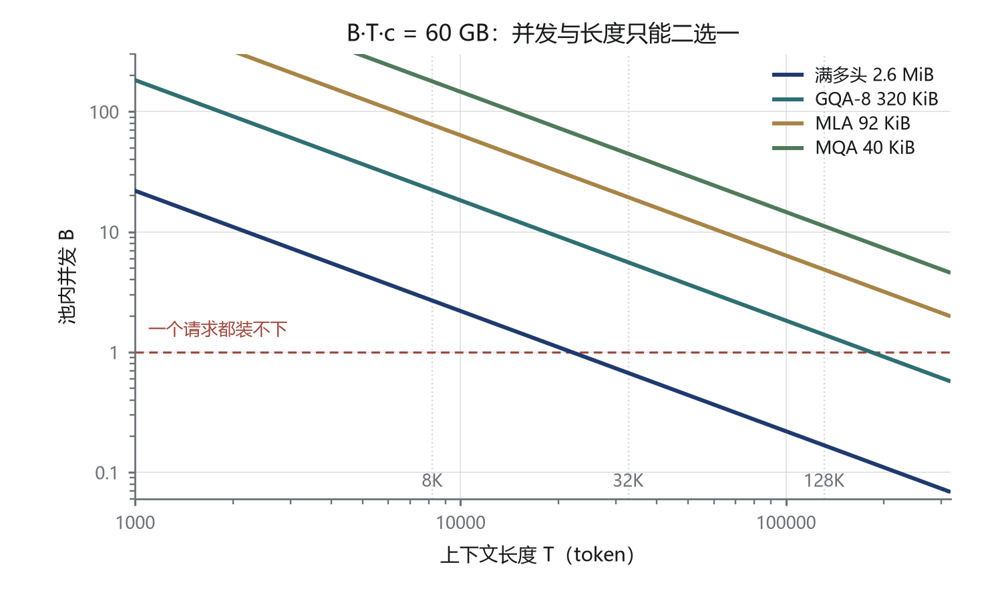

## KV 缓存与注意力的成本

一家做合同审阅的公司把模型的上下文从 8K 提到 128K，好让整份合同一次读完。上线一周，三件事同时发生：单卡的首字延迟从 0.37 秒涨到二十几秒；同一段对话里，模型往外吐字的速度从每秒 195 个 token 掉到 100；一台八卡机器能同时服务的会话数，从四百多掉到二十几。工程师的第一反应是"卡不够"，于是把模型换小一半、卡数翻一倍，三件事都按比例改善了，但没有一件消失。

这三个数字背后的账不一样，增长速度也不一样：一个是平方，一个是线性，一个是反比。要把它们分开，得先看清一次请求在 GPU 上被切成了几段、每段在读什么、读的量由哪些量决定。

### 一次请求里的两段工作

推理时，模型对输入的 128K 个 token 做两件性质完全不同的事。

第一段叫预填充（prefill）：把整段输入一次性送进网络，所有位置并行地算出各自的 query、key、value，算注意力，一路走到最后一层，得到第一个输出 token 的概率分布。这一段是矩阵乘矩阵——$T$ 个位置共用同一次权重读取，每个权重被用了 $T$ 次，GPU 的算力有机会吃满。

第二段叫解码（decode）：从第二个 token 开始，每次只进来一个位置。它要算自己的 query，与前面所有位置的 key 做点积，再按权重把所有位置的 value 加起来。前面那些位置的 key 和 value 在这一层里不会再变——它们从第 1 层到第 $L$ 层、在已经进来的每个位置上都算过一次了。如果每次都重算，生成第 $t$ 个 token 就要把前 $t$ 个位置整段重跑一遍，而结果与上一次逐位相同。

于是有了缓存。每层、每个位置，把算好的 key 和 value 留下来摆在显存里，生成新 token 时直接读。这份东西叫 KV 缓存（KV cache），它不参与训练，也不属于权重；它是同一份权重在不同上下文下开出的临时账本。

把一步解码摊开写，缓存的位置就很清楚了。设当前新位置是 $t$，输入这一层的隐状态是 $h_t\in\mathbb{R}^{d}$：

```text
for l in 1..L:              # 每层一份缓存，不能跨层共用
    q_t = W_l^Q h_t         # (h, d_head)
    k_t = W_l^K h_t         # (h_kv, d_head)
    v_t = W_l^V h_t
    K_l = append(K_l, k_t)  # 原地追加，历史不动
    V_l = append(V_l, v_t)
    a_t = softmax(q_t K_l^T / sqrt(d_head))
    o_t = a_t V_l           # 读全部历史
    h_t = h_t + concat(o_t) W_l^O
```

注意三件事。缓存是每层一份，$L$ 层就有 $L$ 份，不能跨层共用，因为每层的投影矩阵不同。追加是原地写，历史部分一个字节都不用改。而读取是全部历史——$o_t$ 这一行要乘上 $t$ 列，一步也不能省。所以解码的每一步，成本分两半：写一个新位置，读全部历史。

两段工作的资源画像差别很大。预填充吃算力，解码吃带宽。要把这个差别算成倍数，先得把缓存的大小写成公式。

### 不缓存就得重算

先算清"不缓存"的代价，才知道这笔显存花得值不值。

重算一次，等于对已有个数 $T$ 做一次完整前向。每个参数参与一次乘加（算两次浮点运算），$T$ 个位置各用一次，所以是 $2NT$ 次浮点运算。$N$ 是参数量，这里取 $80.3$ 亿；$T$ 取 32768：

$$2NT=2\times 8.03\times10^{9}\times 32768\approx 5.3\times10^{14}$$

在 H100 上按 989 TFLOPS 的峰值算，是 0.53 秒。而读一遍缓存只需搬 $32768\times128\ \text{KiB}=4.3$ GB，按 3.35 TB/s 算是 1.3 毫秒。四百倍。

有一处容易想岔：能不能只重算 key 和 value，不重算整网？不行。要算第 $l$ 层的 $k_t$，需要第 $l$ 层的输入 $h_t$；而 $h_t$ 是前 $l-1$ 层在全部位置上的输出。省掉任何一层的历史，就拿不到当前层的输入。除非每层都存一份 $h_t$——那正是另一种缓存，尺寸还不一定更小（下一节会算）。

$2N$ 这个量在解码里出现得太频繁，值得拆开看一次。8B 模型每层约 2.18 亿参数（注意力 4200 万、前馈 1.76 亿），32 层 69.8 亿，加上两份词表 10.5 亿，凑成 80.3 亿。生成一个 token，这 80.3 亿个权重全部要读一遍，乘加全部做一遍：$1.6\times10^{10}$ 次运算配 $16.1$ GB 字节，强度 1.0。一句话，一个 token 的全部算术只够把权重从显存里流过一遍。解码的本质是一次流式扫描，不是一次计算——这一点决定了它所有的性能特征，也决定了为什么把它做快的手段（量化、更小的权重、更大的批）和训练时完全不同。

四百倍这个数还可以写成两个比值之比：

$$\frac{2N\;/\;\text{峰值算力}}{c\;/\;\text{带宽}}$$

$c$ 是每 token 的缓存字节数，下一节给出它的式子。分子是"重算一个位置要多久"，分母是"读一个位置的缓存要多久"，两者都随 $T$ 线性增长，$T$ 约掉了。所以四百倍与上下文长度无关：缓存不是"长上下文才值得"的优化，任何长度下它都值四百倍。代价只有一个——那 128 KiB 一 token 的显存。

这笔交易的方向就此定下来。后面所有围绕注意力的架构改造，都是在这笔交易上打折扣：把 $c$ 压小，把必须读的字节压小，或者把读取的次数压小。三种打法分别对应这一章、下一章和第三章。

### 缓存的大小从哪来

缓存的形状可以直接从注意力的定义里数出来。一层里，每个位置的 key 有 $h_{kv}$ 个头，每个头 $d_{\text{head}}$ 个数；value 同样一份。所以一层、一个位置存

$$2\,h_{kv}d_{\text{head}}\ \text{个数}$$

$h_{kv}$ 是保留缓存的键值头数（满多头时等于查询头数 $h$，分组或共享方案下小于 $h$，下一章展开），$d_{\text{head}}$ 是每头的维度。乘上层数 $L$ 和每数的字节数 $b$：

$$c=2\,L\,h_{kv}\,d_{\text{head}}\,b\quad(\text{字节/token})$$

2 是键和值两份，$L$ 是层数（每层各存一份），$b$ 是精度：FP16 与 BF16 都是 2 字节，FP8 是 1 字节。

一个 8B 级模型（$L=32$、$h=32$、$h_{kv}=8$、$d_{\text{head}}=128$，BF16）：

$$c=2\times32\times8\times128\times2=131072\ \text{字节}=128\ \text{KiB}$$

每层 4 KiB，32 层 128 KiB。这个数几乎不随模型变大而变：70B 的 Llama-2（$L=80$、$h_{kv}=8$、$d_{\text{head}}=128$）是 $2\times80\times8\times128\times2=320$ KiB，只比 8B 多 2.5 倍，正好是层数比 $80/32$。两个模型的 $h_{kv}d_{\text{head}}$ 都是 1024，这不是巧合——八个键值头、每头 128 维，是 2023 年之后开源模型的通用配方。

同一个 70B 若用满多头（$h_{kv}=64$），每 token 变成 2.6 MiB，是前者的八倍。这个八倍就是下一章要处理的对象。

式子里四个因子性质不同。$L$ 由深度决定，与能力强相关，动它等于换模型；$d_{\text{head}}$ 长期稳定在 128，因为它要和张量并行的切分方式对齐；$b$ 可以量化，但那是引擎的活，收益是线性的；只有 $h_{kv}$ 是一个纯粹的架构旋钮，从 64 拧到 1 都不改变层数与宽度。围绕缓存做的工作，先动的都是它。

量化这一项值得单记一笔，因为它和结构改造是乘法关系。BF16 换 FP8，每 token 从 320 KiB 降到 160 KiB，并发翻倍；再换到 4 bit，能再翻一倍。代价是误差：同样的量化步长，在 8K 上下文里只累加几千次，在 128K 里累加十六倍，长上下文的量化损失总比短上下文明显。所以生产系统常见的做法是只量键不量值，或者对超过某个长度的请求关闭量化。

### FP8 缓存：收益是多少，scale 又吃掉多少

“FP8 把缓存减半”这句话只对了前半。真正决定收益的是“除了数据，还要存什么”。

定点量化的每一组数据需要一个缩放因子（scale），把浮点数映射到 8 位整数域。这个 scale 用 fp32 存，每个 4 字节。于是粒度直接决定了净收益：

| 量化粒度 | scale 开销 | 每 token 净占用 |
|---|---|---|
| 每头每 token | 32 字节 | 1664 字节 |
| 每 token 一个 | 4 字节 | 1636 字节 |
| 每通道共享 | 接近 0 | 1632 字节 |

以 8 个键值头、每头 128 维、两层数（键与值）为基准，bf16 是 4096 字节，fp8 是 2048 字节。上表三行都是相对于这 2048 的额外开销，比例在 1.6% 到 2% 之间——都很小。所以 scale 本身吃掉的带宽不多，问题在精度。

粒度选择是由“谁怕误差”决定的，而不是由开销决定的。键的量化误差会直接进打分，再被 softmax 的指数放大：一个 0.4% 的相对误差，在一个尖 softmax 上可能把某个位置的权重从 0.3 推到 0.25。值的量化误差只进加权求和，是线性的，温和得多。所以工程上的默认配置是“键用逐通道量化（每维一个 scale，跨 token 共享），值用逐 token 量化”：前者保护少数维度上的极值，后者跟上不同 token 的幅度变化。

有一个与直觉相反的结论值得说清：**归一化之后的加权平均，误差不会随上下文长度线性累加**。因为 softmax 的权重和为 1，量化误差是一个零均值的扰动，经过加权平均后是同阶而不是累积。真正随长度变坏的，是另一件事——位置越多，出现极端值的机率越大，而极端值会把全局 scale 拉粗。128K 里只要有几个异常大的键，整层的量化步长就被它们确定，其余位置的精度全部下降。这就是为什么长上下文的缓存量化总要先做异常值分析，而不是直接改数据类型。

顺带回答上一节留下的问题：改存每层的隐状态 $h_t$ 行不行？一层一个位置存 $d$ 个数，8B 是 4096 个，比满多头的 $2h d_{\text{head}}=8192$ 小一半，比八个键值头的 2048 大一倍。换句话说，在 GQA-8 的配置下，直接存 $h_t$ 反而更贵。要在 $h_t$ 这条路上继续往下走，得再压一道——用一个低秩矩阵把 4096 维压成几百维，这就是 MLA 的出发点，第二章细讲。

把同一个 70B 的几种配置并排放在一起，差距一眼可见：满多头 2.6 MiB、八个键值头 320 KiB、单头共享 40 KiB。三者存的都是同一层同一位置的 128 维键和值，只是“留几份”不同。这也说明 $h_{kv}$ 在工程上不是超参，而是结构——它同时决定了缓存的字节数、参数的个数（键值投影从 $2d^{2}$ 降到 $2d\,h_{kv}d_{\text{head}}$）以及注意力在解码时的算术强度（$h/h_{kv}$）。三个量同向变化，改一处等于改三笔账。

### 容量：一张卡能装几个请求

把公式乘上长度，得到每个请求占多少显存。一张 80GB 的 H100，扣掉 16.1 GB 权重（$8.03\times10^9\times2$ 字节）和 4 GB 激活与工作区，剩下约 60 GB 给缓存：

$$\frac{60\times10^{9}}{131072}\approx 4.6\times10^{5}\ \text{token}$$

四十六万个 token，这是整张卡的缓存池。池子按请求切分，每个请求占 $T$ 个位置，于是能同时服务的请求数 $B$ 受一个不变式约束：

$$B\cdot T\le 4.6\times10^{5}$$

同一个表按两种模型、三个长度展开，就是下面这张常见的估算表。单位是 GB，按“权重之外可用 60 GB”算：

| 配置 | 4K | 32K | 128K |
|---|---|---|---|
| 8B，GQA-8（128 KiB/token） | 0.5 | 4 | 16 |
| 70B，GQA-8（320 KiB/token） | 1.3 | 10 | 40 |
| 70B，满多头（2.6 MiB/token） | 10.7 | 86 | 344 |

三行里最右一列的差距最直观：同一个 70B，换个头数就从 40 GB 变成 344 GB。中间那一行也解释了一个常见误解——“70B 比 8B 大九倍，缓存应该也大九倍”。实际上只大 2.5 倍，因为两者的每 token 缓存都是 $2L\,h_{kv}d_{\text{head}}b$，而 $h_{kv}d_{\text{head}}$ 都是 1024，差别全在层数（80 对 32）。**模型变大主要靠加宽加深，而缓存只跟着层数走。**

把表里的数除一下，得到“单卡能装几个”：8B/4K 是 112 个，70B/4K 是 45 个，70B/128K 是 1.4 个。三行里最后一行已经不是“并发小”，而是“连一个都勉强”。这也是为什么 70B 级以上的长上下文服务，没有一个是单卡方案。

| 上下文长度 $T$ | 并发 $B$ | 单请求缓存 | 每步读的字节 |
|---|---|---|---|
| 8K | 56 | 1.0 GiB | 76 GB |
| 32K | 14 | 4.0 GiB | 76 GB |
| 128K | 3.5 | 16 GiB | 76 GB |

表里最后一列先记着，下一节会用到：显存装满时，不管上下文多长，每一步要读的字节数都一样，因为 $B\cdot T$ 被钉住了。所以"上下文涨 16 倍、并发掉 16 倍"这件事，不是卡变慢了，是乘法的交换律。它和开头那家公司看到的第三件事完全对应。



图里四条线的斜率完全一样，截距相差的就是每 token 缓存的倍数。这张图值得记住的只有一点：**所有围绕缓存的架构改动，做的都是把整条线往上平移**，没有一条能改变斜率——斜率由 $B\cdot T=\text{常数}$ 决定，它是乘法的性质，不是实现的水平。

大模型服务很少只用一张卡，这条不变式在张量并行下依然成立，只是把池子拆开。70B 在八张 H100 上做八路张量并行：权重 138 GB 摊成每卡 17.3 GB，每层的键值头也按头切分，于是每张卡各自留一份自己那部分缓存，总池子是 $8\times(80-17.3-4)\approx469$ GB。除以每 token 320 KiB，得 143 万 token——128K 上下文下是 11 个并发，8K 下是 175 个。多卡不改变每个 token 的缓存字节数，它只是把同一个不变式放大到八个池子里；这也是长上下文服务几乎没有单卡方案的原因：不是算力不够，是池子不够。

两个极端能说明这条约束的硬度。128K 已经让一张卡只剩 3.5 个并发，百万上下文则是 $10^6\times128\ \text{KiB}=128$ GB——单张 H100 连一个请求都放不下，必须切到八张卡上，而且切完只剩不到五个并发。反方向也有代价：如果上下文只有 1K，并发能到 460，但每个请求的计算量小到批处理的调度开销和内核启动时间开始占主导，吞吐不再随 $B$ 线性涨。

实际部署还有两处损耗，方向相反。一处是浪费：按最大长度预分配时，一个声明支持 32K 的请求一进来就占满 32K，聊了五百字也占着，平均利用率不到一半。分页缓存（PagedAttention）把缓存切成固定大小的块按需分配，把浪费压到最后一个块的零头，等效并发能翻一倍左右。另一处是节省：同一个系统提示、同一份长文档、同一批并行采样，前缀完全一样，对应的键值也完全一样，可以只存一份按引用共享。检索类应用里提示的大半是重复文档，十个请求读同一篇三万字文档，缓存需求降到十分之一。

这两条都在推理引擎层，这里只点一句。它们不改变上面那个不变式的形状，只改变系数。架构层能做的只有一件事：把 $c$ 压下来。这条路走得很远：同一个规模的模型从每 token 2.6 MiB 压到 320 KiB，再到 92 KiB，是下一章的主题。

### 分页与前缀：系数能差一个数量级

上面那个不变式假设每个请求都恰好占满 $T$ 个位置。真实流量从不这么整齐：一个声明支持 32K 的接口，绝大多数对话在三五千 token 内结束，少数检索请求真的会填到两万多。调度器怎么给这些长短不一的请求分配那 $4.6\times10^{5}$ 个 token 名额，决定了系数的量级，而系数的差别比架构的差别更大。

第一种做法是按声明长度预分配。请求一进来就划走 32768 个位置，聊了三千字也不还。这个池子只能接 $4.6\times10^{5}/32768\approx14$ 个请求，其中真正被写过的位置只有 3000 个：

$$\frac{3000}{32768}=9.2\%$$

九成的显存在空转。这个数不是极端假设——长上下文产品的实际 token 中位数普遍在几千，均值被少数长请求拉高，而预分配是按每个请求的声明上限算的。

第二种做法是分页。把缓存切成固定大小的块（常见取 16 个 token 一块），按需分配，块表记录逻辑位置到物理块的映射。一个用了 3000 个位置、声明 32K 的请求，实际占用 $\lceil 3000/16\rceil=188$ 块，即 3008 个位置，块内浪费平均半块 8 个位置，相对 3000 是 0.3%。同一个池子能接的并发从 14 变成 $4.6\times10^{5}/3008\approx153$，十一倍。

第三种做法在前两种之上再叠一层：前缀共享。同一份系统提示、同一份被反复提问的长文档，前面那些位置的键值是逐位相同的，没有理由存十份。按块做哈希，命中就引用同一个物理块，引用计数加一。假设两成的请求是"一份三万 token 的文档加五百 token 的提问"，不算共享时每个请求占 30500 个位置，池子只能接 15 个；共享之后那三万只存一份，每个请求额外占 500 个位置，池子能接 $(460000-30000)/500\approx860$ 个。这是五十七倍的差距。

| 策略 | 池内并发 | token 利用率 | 改动位置 |
|---|---|---|---|
| 按上限预分配 | 14 | 9.2% | 无 |
| 分页 | 153 | 99.7% | 内核寻址 |
| 分页 + 前缀共享 | 860 | 99.7% | 调度与回收 |

这张表要和上一节的架构表分开看：上一节改的是 $c$，这一节改的是"$T$ 按声明算还是按实际算"。两个改动是乘法的——$c$ 降到八分之一、同时上分页，等效并发是 $8\times11=88$ 倍。这也解释了一件容易被误读的事：某些推理框架报告的长上下文并发远高于手算，多半不是缓存结构更好，而是把系数算对了。

代价集中在三处。分页要块表和非连续寻址的内核，注意力的读取不再是"从基址开始的连续 $T$ 个数"，而是"按块表跳着读"，块大小取太小会让每次访存带回来的有用数据变少，取太大块内碎片又回来了，16 是常见折中。前缀共享要前缀哈希、引用计数、写时复制——共享块一旦被某个请求追加了内容，就得先复制一份再改，否则会污染其他请求。最后一处不那么显眼：共享块被十个请求引用，驱逐要等最后一个走，显存回收变慢，长尾请求的尾部延迟变差。共享省的是容量，付出的是回收的灵活度。

### 带宽：解码一步要搬多少字节

解码的每一步要读两样东西：全部权重，和这一批请求各自的缓存。

$$\text{每步字节}=2N+B\cdot T\cdot c$$

$2N$ 是 FP16 权重字节数，$B\cdot T\cdot c$ 是 $B$ 个请求的缓存之和。算力这边每步是 $2NB$ 次浮点运算——同一份权重被 $B$ 个请求共用，每个请求贡献 $2N$。相除得到这一步的算术强度，即每读一个字节能做多少次运算：

$$\text{强度}=\frac{2NB}{2N+B\cdot T\cdot c}$$

取 $B=32$、$T=8192$：分子 $5.1\times10^{11}$，分母 $16.1+34.4=50.5$ GB，强度 10.2。H100 的算力带宽比是 $989\times10^{12}/3.35\times10^{12}=295$，强度要到 295 才能吃满算力。10.2 意味着只用到峰值的 3.5%，其余时间张量核在等数据。

换成时间：50.5 GB 除以 3.35 TB/s 是 15 毫秒一步，32 个请求摊下来每秒 2133 个 token，单流 67 个。若这一批卡在算力上，同样一步只需 0.5 毫秒——差 30 倍，全是等待。

单请求时更极端。$B=1$、$T=8192$，强度只有 0.94：读 17 GB，做 $1.6\times10^{10}$ 次运算。每秒能吐多少 token 有个硬上限，就是带宽除以每步字节数：

$$\text{tokens/s}\le\frac{\text{带宽}}{2N+T\,c}$$

8K 时是 $3.35\times10^{12}/1.71\times10^{10}=195$；32K 时缓存 4 GiB，每步 20.4 GB，上限 164；128K 时每步 32 GB，上限 101。这就是开头第二件事：上下文变长，出字速度减半。减半的幅度取决于权重和缓存谁占大头。

批处理在这件事上帮不上忙，值得单独说。加批能摊薄的是权重，不是缓存：$B$ 从 1 加到 56（8K 上下文下的容量上限），权重那 16.1 GB 从"一个请求独担"变成"56 个分摊"，但缓存从 1 GB 涨到 60 GB，一步的总字节数从 17 GB 变成 76 GB。强度从 0.94 爬到 11.8，翻了十二倍，离 295 还差二十五倍。这是解码优化的天花板所在：**在缓存主导的场景里，加批提高吞吐，但提不高算力利用率**。所谓"解码是带宽问题"，精确的意思是每字节的运算次数被缓存钉在地板上。

逐层对一遍这 76 GB，能看出钱花在哪儿。8B 的一层有 2.18 亿个参数（注意力 $2d^{2}+2d\,h_{kv}d_{\text{head}}$ 加 SwiGLU 前馈 $3d\,d_{ff}$），FP16 是 436 MB；32 层 14 GB，加两份词表 2.1 GB，共 16.1 GB。一个请求、一层、8K 上下文，缓存是 $2\times8\times128\times8192\times2=32$ MiB，32 层共 1 GiB。所以单请求一步，权重与缓存的比例是 16 : 1；56 个请求一步，这个比例倒过来变成 1 : 3.7。这就是为什么低并发时优化权重（量化、蒸馏、MoE 少激活）最有效，高并发长上下文时优化缓存最有效——两者作用在不同的分子上。

还可以再往下拆一层，看注意力这个算子在解码时的强度。一步、一层的注意力，运算量是 $4h\,d_{\text{head}}T$（打分 $2h\,d_{\text{head}}T$，加权求和再来一遍），要读的缓存是 $4h_{kv}d_{\text{head}}T$ 字节，相除得

$$\frac{\text{FLOPs}}{\text{bytes}}=\frac{h}{h_{kv}}$$

$h$ 是查询头数。满多头是 1，八个键值头是 4，单头共享是 64。也就是说，一步注意力里每读一个字节只做四次乘加，离 295 差七十倍；即使把 $h_{kv}$ 压到 1，也只到 64。注意力在解码时几乎没有任何数据复用，它注定是带宽受限的算子，优化的方向只能是"少读"。

权重和缓存的相等点也值得记下来。让 $2N=Tc$：

$$T^{*}=\frac{2N}{c}=\frac{16.1\times10^{9}}{131072}\approx 1.2\times10^{5}$$

十二万 token。只有到了这个量级，缓存才真正超过权重成为带宽的主要开销；在那之前，长上下文对出字速度的拖累是"叠加"而不是"替换"——这解释了为什么 8K 到 32K 只是从 195 掉到 164，而 32K 到 128K 从 164 掉到 101，后一段的斜率明显更陡。70B 的这条线更靠后，是 $1.38\times10^{11}/327680\approx 4.2\times10^{5}$，四十二万 token，因为它的权重更胖而缓存更瘦。

大模型很少单卡跑，多卡时带宽叠加。70B 在八张 H100 上做八路张量并行，总带宽 26.8 TB/s：短上下文一步读 138 GB 权重，5.2 毫秒，折合 190 token/s；128K 时多出 41 GB 缓存，6.7 毫秒，149 token/s。实测单流通常落在三五十到一百五十之间，差的那部分来自卡间通信——每层两次全归约，一次也省不掉。这条账提醒一件事：缓存开销在多卡上依然按 $T$ 线性增长，卡变多不会让它变便宜。

### 预填充是另一回事

同一份权重，在预填充里被 $T$ 个位置共用，强度大约是 $T$。8K 时强度 8192，远超 295，纯粹受算力限制。所以解码和预填充要用完全不同的手段：前者要更大带宽、更小权重、更高并发；后者要更快的矩阵乘、更细的切分。

预填充的计算量由两部分组成。线性部分（所有投影和前馈）是 $2NT$，注意力部分是 $4T^{2}dL$——每层打分和加权各一次 $T\times T$ 乘 $d$，共 $L$ 层。两者相等的位置可以解出来：

$$4T^{2}dL=24Td^{2}L\ \Longrightarrow\ T=6d$$

右边用了 $N\approx12Ld^{2}$、线性部分按 $2NT\approx24Td^{2}L$ 算，化简后层数消掉，只剩模型宽度。$d=4096$ 时是 24576。这个数值得记：**上下文超过六倍模型宽度之后，预填充的主要计算量就从投影和前馈转移到了注意力上**，而且它以平方速度增长。

拿 8B 模型对一遍。8K 时注意力占 $3.5\times10^{13}/(1.3\times10^{14}+3.5\times10^{13})=21\%$；32K 时占 52%；128K 时占 81%，总计算量 $1.1\times10^{16}$，按 45% 的算力利用率算是 24.7 秒。上下文涨 16 倍，首字延迟涨 66 倍——这就是开头第一件事，也是长上下文超线性变贵的根源。

同一个 token，在预填充里和解码里的代价差得很远。8K 的预填充用 0.37 秒处理 8192 个 token，折合每个 token 45 微秒；同一个模型解码一个 token 要 5.1 毫秒，差 113 倍。两者的浮点运算量其实差不多（$2.04\times10^{10}$ 对 $1.6\times10^{10}$），差别全在算力利用率：预填充 45%，解码 3.5%。这也解释了为什么收费标准常常把输入 token 定得比输出 token 便宜三到五倍——不是营销，是这两种 token 在卡上干的事不一样。

预填充还有一笔不显眼但要占容量的开销：它要把这 $T$ 个位置的键值全部写进缓存。128K 的请求一次写 16 GiB，占整卡缓存池的三分之一。这 16 GiB 在 25 秒里写完，平均不到 1 GB/s，带宽上不构成瓶颈；但它意味着一个长请求在进来的一瞬间就吃掉大量显存，调度器必须提前算好这笔账，否则会在中途发现自己装不下。

### 分块预填充：把 25 秒切成一小段一小段

上一段那个 25 秒是一个具体的问题：它把整张卡占满，而这段时间里卡上一个 token 也不产出。排在后面的短请求全部在等，等十秒是常态。

解法是把预填充切成块，每块几千 token，算完一块先让解码跑几步，再算下一块。这个做法听上去会带来额外开销，实际上几乎为零，原因可以直接算：

- **算力中性。** 因果掩码下，第 $j$ 块只需与前面 $j$ 块算注意力，总对数与整段一次算完全相同，不多也不少。把 131072 切成 64 块，总乘加数还是 $9.0\times10^{15}$。
- **带宽多一点点。** 每块都要把 16 GB 权重从显存读一遍，64 块就是 1 TB。听着吓人，换成时间只有 0.3 秒——而整段预填充要 24.7 秒。多出来约 1.2%。
- **块不能太小。** 一块的算术强度约等于块内 token 数，小于 295 就开始受带宽限制。所以块大小有下限，实际取值在 1K 到 8K 之间。

块大小选多少，取决于你愿意让短请求等多久：

| 块大小 | 单次卡顿 | 长请求首字 | 短请求 p99 |
|---|---|---|---|
| 不分块 | 24.7 秒 | 24.7 秒 | 24.7 秒 |
| 32768 | 6.2 秒 | 26 秒 | 6.4 秒 |
| 8192 | 1.5 秒 | 25 秒 | 1.6 秒 |
| 2048 | 0.39 秒 | 24.8 秒 | 0.4 秒 |

表里“长请求首字”几乎不变，因为它就是总工作量；变的只是“卡多久没人管别人”。这就是分块预填充的全部本事：它不改总成本，只改成本的分布。代价是调度器变复杂——每块都要重新做一次批组装、重算一次显存预算，而且当块大小与显存池不再匹配时，会出现“块算完了但缓存放不下”的尴尬。

还有一个副作用值得一提。分块把一个请求的前缀缓存分次写入，于是“前缀共享”能被更早命中：两个同时到达、共用同一份文档的请求，不必等第一个跑完，第二块开始就能引用。在没有分块的实现里，它们只能串行。

工程上有两种应对。一种是把长预填充切成块（chunked prefill），每块几千个 token，与正在解码的请求混在一批里跑，避免一个长请求把所有解码卡住几十秒。另一种更彻底：把预填充和解码放到不同的机器上（prefill-decode 分离），各配各的硬件比例，中间只传缓存。两种做法都在推理引擎层，这里只点一句；它们能改善排队和配比，改不了"这一步要搬多少字节"。

### 算一遍：一次 128K 请求的完整账单

把前面的数并成一张单子。8B 模型、单卡 H100、128K 输入、512 个输出，按 45% 的算力利用率、每小时 3 美元。

预填充的浮点运算是 $2NT+4LT^{2}d$，代入 $T=131072$：权重项 $2.1\times10^{15}$，注意力项 $9.0\times10^{15}$，合计 $1.1\times10^{16}$。除以 $0.45\times989\times10^{12}=4.45\times10^{14}$，是 24.7 秒。其中平方项占 20.0 秒，也就是 81%。

解码按第一节的上限算：128K 时每步要读 $2N+Tc=16.1+17.2=33.3$ GB，按 3.35 TB/s 是 9.9 毫秒一个 token，即上限 101 token/s。512 个输出要 5.1 秒。

合计 29.8 秒，占一张卡 0.0083 卡时，$0.025 一次请求。拆开看，平方项吃掉 67% 的时间，解码只占 17%。这张单子解释了为什么长上下文的优化重点总是预填充：**输出越长，解码占比越大；输入越长，平方项越狠**。512 个输出时前者让步，4096 个输出时解码涨到 40 秒，两者才打平。

换成单位成本更直观。每千个输入 token 占的卡时：

| 上下文 | 预填充 | 每千 token 毫秒 | 平方项占比 |
|---|---|---|---|
| 8K | 0.37 秒 | 0.045 | 21% |
| 32K | 2.45 秒 | 0.075 | 51% |
| 128K | 24.7 秒 | 0.19 | 81% |
| 1M | 20.2 分 | 1.21 | 96% |

从 8K 到 128K，单位成本涨四倍；从 128K 到 1M 再涨六倍多。这条曲线在 $T=6d$ 之前几乎是平的——24576 这个拐点之前在算 $2NT$，之后才开始被 $T^{2}$ 拖着走。所以"把窗口从 8K 开到 32K"的边际成本和"从 128K 开到 1M"完全不是一回事，前者按线性付费，后者按平方付费。

预填充真正的隐性成本不在算力，而在那个 $T\times T$ 的中间矩阵。$T=32768$、32 个头、FP16，一个头的分数矩阵是 $32768^{2}\times2=2.1$ GB，32 个头就是 68 GB——单层都放不下，更不用说 32 层。这个矩阵不会真的全部落进显存（否则任何长上下文都跑不了），但它是理解第三章的入口：注意力的瓶颈从来不只是乘加次数。

### 显存时间线：一个请求从进来到走

前面各处算的都是稳态数字，但显存真正被撑爆的时刻往往只持续几百毫秒。把一个 128K 请求的生命周期摊开，逐段看它占多少：

| 阶段 | 权重 | 缓存与临时 | 合计 |
|---|---|---|---|
| 空闲 | 16.1 | 4 | 20 |
| 预填充中 | 16.1 | 22 | 38 |
| 解码中 | 16.1 | 20 | 36 |
| 收尾 | 16.1 | 4 | 20 |

单位是 GB。第二行那个 38 是峰值，比第三行高出 2 GB——多出来的是分块注意力的片上缓冲、临时张量、以及写入缓存时的双缓冲。第三行比第二行低，是因为预填充结束后临时张量被释放。

这张表解释了两件在实践中反复发生的事。第一，准入判断若按“解码中”的 36 GB 记账，就会在预填充的几百毫秒里溢出一到两个 GB，表现为随机 OOM，且只在长短请求混合时出现。第二，同一个模型在空载和满载时的可用缓存差一倍，调度器不能拿“平均可用显存”做决策，必须拿“峰值减去已在跑的请求的峰值”做决策。

工程上有两种把这 2 GB 抹平的做法。一种是把预填充的临时张量放进缓存池复用——反正缓存池本来就是分块的，借几块当临时区不增加总占用。另一种是把预填充和解码放到不同的进程或不同的机器上，各自按自己的峰值配置。前者改动小，后者更彻底。

顺带说一句这张表的读法：它不适合拿来做容量规划。容量规划要看的是最后一行与第一行之间的差，也就是“稳态可用缓存”，它决定了并发；而这张表要看的是第二行的尖峰，它决定的是“会不会崩”。两个问题，两个数字，混用就会同时答错。

### 一次容量规划：千 QPS 要几张卡

把前面所有公式串起来，能回答一个很实际的问题：一个每秒一千次请求、平均 4K 输入、200 输出、首字 p99 小于两秒的服务，要多少张 80 GB 的卡。

三条约束各算一遍，取最大值。

**预填充算力。** 单请求 $2NT+4LT^{2}d=6.6\times10^{13}+8.8\times10^{12}=7.5\times10^{13}$。千 QPS 就是 $7.5\times10^{16}$ FLOPs/s，除以单卡 445 TFLOPS 的有效算力，得 168 张。

**解码带宽。** 稳态下要同时挂住约一千条会话（每条约一秒的生成时间），每步要读 $2N+B\,T\,c=16.1+537=553$ GB。每秒要出 200 步（20 万 token 除以每步 1000 个），合 110 TB/s，除以单卡 3.35 TB/s，得 33 张。

**缓存容量。** 一千并发 × 4096 位置 × 128 KiB = 512 GB，除以每卡 60 GB，得 9 张。

| 约束 | 算式 | 需要卡数 |
|---|---|---|
| 预填充算力 | $7.5\times10^{16}/4.45\times10^{14}$ | 168 |
| 解码带宽 | 110 TB/s ÷ 3.35 TB/s | 33 |
| 缓存容量 | 512 GB ÷ 60 GB | 9 |

答案由预填充决定：168 张，再留三成冗余是 220 张。这个结果很多人第一次算会意外——大家习惯认为“服务是解码贵”，但在 4K 输入、高 QPS 的场景里，**预填充才是主力开销**。原因在于两者的单位不同：一个 token 只能解码一次，却要与前面所有 token 算一次注意力；输入 token 的数量是输出 token 的二十倍时，算力自然被它拿走。

这个结论还有一个直接的应用：如果 4K 输入里有一半是重复的系统提示，前缀缓存能把它从 168 张压到 90 张左右。前缀缓存的收益在高 QPS 场景下远比在长上下文场景下大，因为它省的是“算力”而不是“容量”——而算力恰好是这里的瓶颈。

### 调度器的三个失败模式

上面的账都是单请求的。把几百个请求放进同一个池子，问题会换一副面孔，而且三种失败互相触发。

第一种是队头阻塞。一个 128K 请求进来，预填充要占满整张卡 25 秒。这 25 秒里它既不产出 token，也不释放算力，排在后面的短请求全部在等。8K 请求本来 0.37 秒就能出字，实际等了 25 秒，尾部延迟直接乘以七十。切块预填充（chunked prefill）把长请求的预填充切成几千 token 一块，与正在解码的短请求拼成一批，代价是长请求的首字延迟略微变长，换的是短请求不再被拖住。判断要不要开这一项，看的是延迟分布的形状而不是均值：均值没变、p99 涨十倍，就是这个问题。

第二种是抢占引发的抖动。池子满了，调度器要么等，要么把某个正在解码的请求赶出去。赶出去意味着丢掉它的缓存，等它再回来时重跑一遍预填充——25 秒。如果被赶走的请求很快又回来、而新请求又在源源不断地进来，就会出现"赶走—重算—再赶走"的循环，卡的有效算力被重算吃掉大半。诊断这一项看两个数：抢占率（每小时被驱逐的请求数）和重算率（重算的 token 数占总 token 数的比例）。前者大于零不必慌，后者超过 5% 就说明池子长期不够用，加卡或者降并发才是解法，调调度参数只是把抖动挪个位置。

第三种是峰值显存。预填充的那一刻，显存里同时有三样东西：权重、这 128K 位置的缓存（16 GiB）、以及分块注意力正在用的片上缓冲。三者叠加的峰值比稳态高得多，而调度器做准入判断时用的常常是稳态数字。于是出现一种很难复现的 OOM：不是请求太多，是某个请求恰好在某个时刻同时踩到了三块。工程上的处理是在准入时按峰值而不是按均值记账，代价是并发数字变难看——账面并发会掉一到两成，但不会再出现随机崩。

这三种失败有一个共同点：它们都不改变单个请求的成本，改变的是成本的分布。前面所有关于 $c$、$T$、$B$ 的算式算的是均值，而用户感受到的是尾部。看长上下文服务的健康度，要盯的表和算力账不是一张：

| 症状 | 测量量 | 异常阈值 | 处置 |
|---|---|---|---|
| 短请求变慢 | p99 首字延迟 | 超过基线 5 倍 | 开切块预填充 |
| 吞吐莫名下降 | 重算 token 占比 | > 5% | 加卡或降并发 |
| 随机 OOM | 准入时的峰值估算 | 与实测差 > 15% | 按峰值记账 |
| 长尾拖尾 | 共享块回收等待 | 与并发正相关 | 限制共享深度 |

### 长上下文贵在四个地方

把前面的账并起来，长上下文的成本来自四处，增长速度各不相同。

预填充的计算量含一个 $T^{2}$ 项，在 $T>6d$ 之后主导，首字延迟随长度超线性增长；缓存容量随 $T$ 线性增长，并发随 $T$ 反比下降；解码每步要读的缓存随 $T$ 线性增长，出字速度随之下降；预填充里那块 $T\times T$ 的中间矩阵也随 $T^{2}$ 增长，它不是容量问题而是显存峰值与带宽问题。

四个量的增长阶不同：$T^{2}$、$T$、$1/T$、$T^{2}$。把它们外推到百万上下文，就能看出为什么那个量级必须换架构。1M 的预填充按这个公式是 $5.4\times10^{17}$ 次运算，按 45% 利用率要二十分钟——不是一个可以靠加卡解决的数量级；而缓存 $10^{6}\times128$ KiB 是 128 GB，单卡放不下。今天标称百万上下文的产品，无一例外在这两项上都做了替换：注意力换成稀疏或滑窗（平方项变成线性，第四章），缓存换成更小的表示（第三章之后各节）。公式没错，只是公式里的项被改掉了。

四个量放在一起，8K 与 128K 的对比是这样的：

| | 8K | 128K | 倍数 |
|---|---|---|---|
| 首字延迟（8B，单卡） | 0.37 秒 | 24.7 秒 | 66 |
| 单流解码速度 | 195 token/s | 101 token/s | 1.9 |
| 满载并发（60 GB 池） | 56 | 3.5 | 16 |
| 满载吞吐 | 2467 token/s | 154 token/s | 16 |
| 每百万 token 的卡时成本 | 0.34 美元 | 5.4 美元 | 16 |

最后两行按 H100 每小时 3 美元、显存装满、只算解码算出；把预填充的算力折进去，128K 的实际成本还要再高两三成。这组数字解释了为什么长上下文在商业上总是一个单独定价的功能：它不是把同一件事做长一点，而是把每一层成本都乘上一个与长度有关的因子。按长度分段计价的产品不少，背后的依据就是这张表——超过某个长度后，每 token 的卡时成本会跳一个台阶，而台阶的位置正好在 $T^{*}$ 附近。

四个量里，只有缓存字节数是一个能在架构图上改的常数。$T^{2}$ 项属于计算顺序，靠的是别的手段；容量和带宽都要等 $c$ 降下来才有余地。所以先看 $c$。

### 能改的只有一项

回到 $c=2Lh_{kv}d_{\text{head}}b$。四个因子里，$L$ 和 $d_{\text{head}}$ 一动就是换模型；$b$ 可以从 2 字节压到 1 字节甚至半个字节，收益是线性的两倍、四倍，代价是精度，属于量化的工作；只有 $h_{kv}$ 能从 64 一路拧到 1，收益是六十倍，而层数与宽度一动不动。

2019 年有人试过最激进的拧法：所有查询头共用一份键值，缓存降到 $1/h$。代价是质量掉一点、训练不太稳。2023 年出现折中版本，把查询头分组，每组共用一份，缓存与组数成正比，质量几乎不掉，于是成了默认配置。同一年还有第三种思路：不减少份数，而是改变每份存的东西——不存每头的键和值，存一个所有头共用的低秩潜向量，用的时候再投影回去。这条路的压缩比超过五十倍，代价是位置编码与矩阵结合顺序上的两处硬麻烦。

三条路都在同一个公式上动手，思路却完全不同：前两条压的是"留几份"，第三条压的是"每份存什么"。

落到数字上，同一个 70B、同一个 128K 上下文，三种做法（满多头、八个键值头、潜向量）的单请求缓存分别是 344 GB、43 GB 和 12 GB。目标场景往往是一台八卡机器、权重之外只剩 469 GB 的池子：第一种连一个请求都装不下，第二种刚好装十个，第三种能装三十九个。压缩倍率分别是 8 倍、3.6 倍、28 倍——不是同一个量级的改动。代价也不同：第一种变成第二种只需承认那些键值头本来冗余，付一次结构迁移；第二种变成第三种要重写注意力的内核。它们各自的账、各自的坑，以及一张放在一起比较的取舍表，是下一章的内容。
