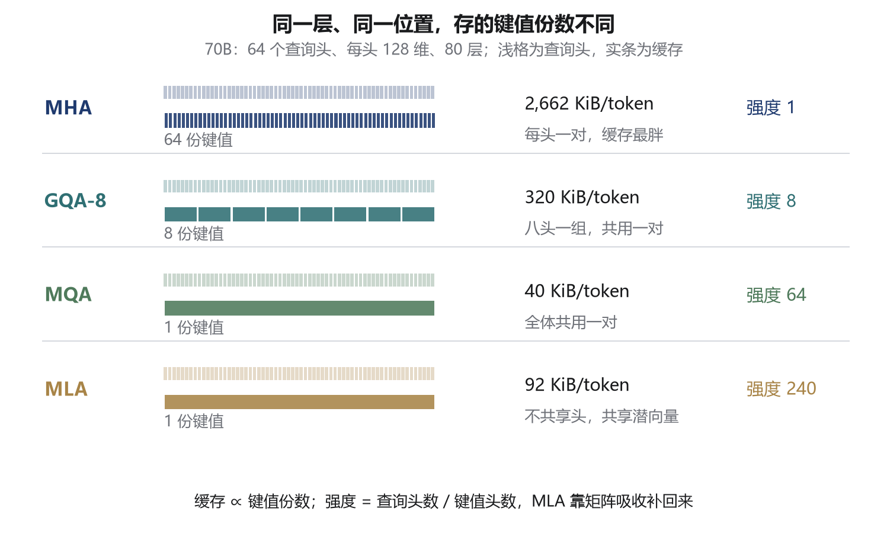

## MQA、GQA、MLA：把缓存压下来

上一章留下了一个具体的缺口。一台八张 H100 的机器跑 70B，权重之外还剩约 469 GB 的显存可以放缓存；业务要求 128K 上下文下同时服务 24 个会话。24 个请求、每个 131072 个位置，摊到 469 GB 上，每个位置的预算只有

$$\frac{469\times10^{9}}{24\times131072}\approx 1.49\times10^{5}\ \text{字节}\approx 146\ \text{KiB}$$

而满多头的 70B 每个位置要 2.6 MiB，差了十八倍。这个缺口不能靠加卡补——把并发降到 1.4 个才装得下，等于服务不了。它只能靠改结构：把每 token 的缓存字节数从 2.6 MiB 压到 146 KiB 以下。

上一章那个公式里，能动的只有 $h_{kv}$。这一章要讲的三种方案，前两种都在这一个数上做除法，第三种换了个思路，把"每份存什么"也变成了设计变量。

### 三种头数，一笔账

多头注意力（Multi-Head Attention，MHA）里，$h$ 个查询头各有一套 $W^Q$、$W^K$、$W^V$。键和值也各有 $h$ 份，缓存里存 $2h\,d_{\text{head}}$ 个数。70B 的配置是 $h=64$、$d_{\text{head}}=128$、$L=80$，一层一个位置存 $2\times64\times128=16384$ 个数，32 KiB。

多查询注意力（Multi-Query Attention，MQA）只留一份键值：$h$ 个查询头共享同一个 $W^K$、$W^V$，缓存里存 $2d_{\text{head}}=256$ 个数，512 字节。分组查询注意力（Grouped Query Attention，GQA）取中间：把 $h$ 个查询头分成 $G$ 组，每组共享一份键值，$h_{kv}=G$，缓存存 $2G\,d_{\text{head}}$ 个数。$G=h$ 退化成 MHA，$G=1$ 退化成 MQA。

三种方案的差别只在 $h_{kv}$，但连带影响三个量，值得一次列全。

缓存字节数严格正比于 $h_{kv}$：$c=2Lh_{kv}d_{\text{head}}b$。这是直接目标。

参数也跟着变。$W^K$ 和 $W^V$ 的形状从 $d\times d$ 变成 $d\times h_{kv}d_{\text{head}}$，两个矩阵从 $2d^{2}$ 个权重降到 $2d\,h_{kv}d_{\text{head}}$。70B 在 $d=8192$ 时，满多头是 $2\times8192^{2}=1.34$ 亿个权重一层；GQA-8 只剩 $2\times8192\times1024=1680$ 万，一层省 1.17 亿，80 层省 94 亿——占 70B 全部参数的 13%。MQA 更狠，一层只剩 210 万，80 层省下 106 亿。

算术强度也变，而且方向是好的：上一章推出解码时一层注意力的强度是 $h/h_{kv}$。满多头是 1，GQA-8 是 8，MQA 是 64。三个量同向变化，改一处等于同时改三笔账，这是 $h_{kv}$ 这个旋钮好用的原因，也是它危险的原因——它动的是注意力的表达能力本身。

形状上，一次多头注意力是 $(h,d_{\text{head}})$ 与 $(T,h_{kv},d_{\text{head}})$ 的批量点积，得到 $(h,T)$。当 $h\ne h_{kv}$ 时，这个乘法不是标准的矩阵乘：索引要对齐到组，$\lfloor i/(h/h_{kv})\rfloor$ 就是第 $i$ 个查询头所属的组号。写成 einsum，是把 $h$ 折成 $(h/h_{kv},h_{kv})$ 再对第二维广播。三行代码的事，但它决定了一个结构能不能在现成内核上跑——MQA 与 GQA 能迅速铺开，很大程度是因为它们只需要一次 reshape 加一次广播，不需要新写内核。

头数与组数还有一个整除约束：$h$ 必须能被 $G$ 整除，因为每个键值头要服务同样多的查询头。64 个头能取 1、2、4、8、16、32、64，取不了 3 或 5。后来的模型改用 48 或 96 个查询头时，$G$ 的候选集合也跟着变——这类约束看上去是小事，但它把“连续档位”变成了一个稀疏的阶梯。

| 方案 | 缓存/token | 128K 单请求 | 池内并发（469 GB） |
|---|---|---|---|
| MHA | 2.6 MiB | 344 GB | 1.4 |
| GQA-8 | 320 KiB | 43 GB | 10.8 |
| MQA | 40 KiB | 5.4 GB | 87 |
| MLA | 92 KiB | 12 GB | 38 |

表里的 MLA 先记个数，第六节解释它为什么不在这条 $h_{kv}$ 的谱系上。按这张表，GQA-8 刚好不够（10.8 < 24），MQA 绰绰有余（87）但质量有代价，MLA 能到 38 且质量不降。一个业务要在这三者之间选，选的是"质量损失"和"实现代价"怎么换。

### 共享键值：砍头不如共享

2019 年，Noam Shazeer 写了一篇五页的论文，标题就是结论：《Fast Transformer Decoding: One Write-Head is All You Need》。它的出发点正是上一章那个观察：解码时每步要把全部缓存读一遍，而读的字节数正比于键值头的个数。

论文先做了一件容易被跳过的事：把"降缓存"的几种直觉做法放在一起比。想把缓存降到八分之一，可以砍头数（64 个头变 8 个），可以把每头维度砍到八分之一（128 维变 16 维），也可以让所有头共享一份键值。三者的缓存收益完全相同，参数收益也接近，但质量损失差得很远：砍头数和砍维度都会直接削弱查询侧的表达能力——头的数量决定了模型能同时维护多少条独立的注意力分布，每头维度决定了每条分布的分辨率；共享键值只削弱"键和值这一侧的多样性"，查询侧的 64 个头一个不少，每个头仍然可以在自己的子空间里提出不同的问题。

这个论证值得停下来看一眼，因为它是"为什么是这一个旋钮"的答案。注意力做的是"用 query 去匹配 key，再取回 value"。匹配的多样性来自 query 和 key 两侧：如果 key 只有一份，所有头看到的是同一组"标签"，各自能问不同的问题，但能匹配到的标签集合被固定了。反过来，砍头数是把"能问多少个不同的问题"直接砍掉，砍维度是把每个问题的分辨率砍掉。前者的损失在表达能力的最上游，后者的损失在每一个头上，两者都比"标签集合变窄"更伤。

论文给的实测在 WMT14 英德翻译上，211M 参数的模型：增量解码每个 token 从 46 微秒降到 3.8 微秒，约 12 倍；BLEU 不掉，beam-4 下 28.5，比多头还略高一点。理论上它把访存与计算之比从 $O(n/d+1/b)$ 降到 $O(1/d+n/(dh)+1/b)$——$n$ 是序列长度，$d$ 是模型维度，$h$ 是头数，$b$ 是批大小，那个随长度线性增长的 $n/d$ 项被压成了 $n/(dh)$。

代价在别处。MQA 的表达能力确实变窄，后来的 GQA 论文在同等规模下比较时报告了两点：质量略降，训练更容易不稳——键值只有一份，梯度在键值投影上高度耦合，一旦某一层出现尖峰，所有查询头同时受影响。这两点在当时不算致命，却没让 MQA 流行起来：2019 到 2022 年，主流开源模型几乎全是标准多头。原因在服务形态——那时的上下文只有一两千 token，并发也不高，缓存根本不是瓶颈，压它的收益兑现不出来。

这条时间线值得记：一个正确的优化在错误的负载下等于零。MQA 被重新提起是 2023 年，长上下文开始成为卖点、推理成本开始按 token 计价之后。

也不是完全没人用。PaLM（2022，540B）在解码器里用了 MQA，是那几年少数这么做的大模型——它把 TPU 的带宽吃得很满，省下的读取直接换成了吞吐。但开源社区没有跟进：2023 年上半年发布的第一批开源模型里，标准多头仍是主流，直到长上下文与高并发服务成为卖点，GQA 才在几个月内变成默认配置。同一个技术在不同生态里的采纳速度，取决于它要解决的问题什么时候变成主要矛盾。

### 分组：一个连续档位

2023 年的《GQA: Training Generalized Multi-Query Transformer Models from Multi-Head Checkpoints》把 MQA 从"要么全共享、要么不共享"变成了一个连续档位。把 $h$ 个查询头分成 $G$ 组，第 $g$ 组的 $h/G$ 个查询头共用一对 $W^K_g$、$W^V_g$。

$$G=h\ \Rightarrow\ \text{MHA},\qquad G=1\ \Rightarrow\ \text{MQA},\qquad 1<G<h\ \Rightarrow\ \text{中间档}$$

$G$ 的作用是把"缓存"和"质量"从二选一变成一条可以按预算取点的曲线。论文的经验是：$G\ge8$ 时质量基本贴着 MHA，评测上看不出差别；$G=4$ 开始有可测的下降；$G=1$、$2$ 掉得明显。Llama-2 70B、Llama-3 8B、Mistral 7B、Qwen2.5 全系都取 8，不是巧合——它是"缓存降到八分之一、质量看不出来"的那个点。

具体到 70B：$h=64$、$G=8$，缓存从 2.6 MiB 降到 320 KiB，128K 单请求从 344 GB 降到 43 GB，八卡池子里能放 10.8 个会话；参数省下 94 亿；解码时注意力的算术强度从 1 抬到 8。原来的 8 个查询头对应一组键值，组内八个头共享同一份"标签"，但各自保留独立的 query，所以八个头仍然可以关注不同的东西，只是从同一批候选里挑。

分组方式本身有讲究。最常见的是相邻分组：前 $h/G$ 个头共享第一份键值，依此类推。也有实现用交错分组，让共享同一份键值的头在表示空间里离得远一点。两种做法在大规模上差别不明显，绝大多数开源模型用相邻分组，因为它让权重的内存布局保持连续，切分到多卡时也更简单。

为什么不更激进一点，取 $G=4$？缓存能省十六倍，比 $G=8$ 多一倍。但质量曲线在那儿开始下弯，而多出来的那一倍缓存换不来一倍的并发：128K 下每 token 从 320 KiB 降到 160 KiB，并发从 10.8 到 21.6，看上去很美，但 21.6 仍然不够 24；既然两者都不够，不如选质量上不吃亏的那个。这类决策很少是"取最优值"，多半是"在满足预算的方案里取质量最好的"。

实现上有一个坑必须提，因为它能把纸面收益全部吐回去。缓存里只有 $G$ 份键值，计算时却要让 $h$ 个查询头与它相乘。最直观的写法是先把 $G$ 份复制成 $h$ 份（很多框架里叫 `repeat_kv`），再做标准的批量矩阵乘。这样算，缓存读取量又变回 $h$ 份，$h/h_{kv}$ 那个强度增益归零，只剩显存占用变小这一半好处。正确的做法是在 kernel 里用整除把查询头编号映射到组号，让一份键值被 $h/G$ 个头直接广播使用，读取只发生一次。

这个差别在纸面上只有一行，在实机上是一倍的速度。它也说明一件事：结构上的压缩必须由内核兑现，否则只是把显存账单转移到了带宽账单上。

### 从已有检查点改结构

GQA 能在一夜之间铺开，靠的不只是质量曲线，还有一条迁移路径。

问题很实际：2023 年之前训好的模型全是 MHA，权重价值以百万美元计。让所有人从头训一遍 GQA 不现实。论文给出的办法叫 uptraining：把训练好的 MHA 检查点改成 GQA，再用原预训练算力的 5% 继续训。

初始化是关键一步。把一组 $h/G$ 个键头合并成一个，有三种做法：挑其中一个头的权重、随机初始化、按元素取平均。论文的消融很清楚：取平均最好，挑一个次之，随机最差。原因是组内各个头在预训练后学到的是同一类模式的不同样本，它们的均值保留了公共成分，而各个头之间的差异（本质上是噪声与细粒度偏好）在平均后互相抵消，不会把某一组的偏差放大。随机初始化则要模型重新学一遍键值投影，5% 的算力不够。

$$W^{K}_{g}=\frac{1}{h/G}\sum_{i\in g}W^{K}_{i},\qquad W^{V}_{g}=\frac{1}{h/G}\sum_{i\in g}W^{V}_{i}$$

式子里的求和按元素做，$g$ 是组号，$i$ 遍历组内的头。$W^Q$、$W^O$ 完全不动。

代价用算力衡量：T5-XXL（110 亿参数）上做这件事花了约 600 个 TPUv3 芯片日，正好是它预训练算力的 5%。对 70B 这个量级，5% 就是几天到两周的机时——与从头训的几个月相比，这是两个数量级。

细节上，uptraining 改的是全部层的 $W^K$、$W^V$，不分深浅；学习率沿用预训练末期再降一档；数据配比与原预训练一致，不引入新数据。三点加起来，它更像"继续预训练"而不是"微调"。5% 这个比例也是这么定的：少于这个数，键值投影来不及适应新的共享结构；多于这个数，省下的成本就不明显了。

迁移后的结果比从头训的 MQA 好，接近原来的 MHA。论文里还做了另一个对照：把 MHA 直接 uptrain 成 MQA，结果是 uptrain 出来的 MQA 明显好于从头训的 MQA，但仍不如 GQA-8。这条对照说明 5% 的算力能让模型适应"少几份键值"，但适应不了"只剩一份"——换结构的上限由新结构的容量决定，uptraining 只能把这个上限逼近，不会超过它。这条路径的意义超出了 GQA 本身：它证明了"结构改造不必从零开始"，只要新结构能在旧权重里找到一个合理的初始点。后来的 MLA 没有走这条路（它的低秩分解没有对应的旧权重可以平均），那是另一种取舍。

### 潜向量：不存键值，存摘要

前两条路都在回答"留几份"。2024 年 5 月，DeepSeek-V2 换了个问题：每份存什么。

它的观察是，一层里 128 个头各自 128 维的键，加起来 16384 个数，但这 16384 个数并不是 16384 个自由度——它们都是从同一个 5120 维的隐状态经线性变换得到的，秩最多 5120，实际有效维度更低。既然如此，为什么不直接存那个更小的中间量，用的时候再变回去？

$$c_t^{KV}=W^{DKV}h_t\in\mathbb{R}^{512},\qquad k_t^{C}=W^{UK}c_t^{KV},\qquad v_t^{C}=W^{UV}c_t^{KV}$$

$h_t\in\mathbb{R}^{5120}$ 是这一层注意力的输入，$c_t^{KV}$ 是压缩后的潜向量（latent vector），$W^{DKV}\in\mathbb{R}^{512\times5120}$ 是下投影（down-projection），$W^{UK},W^{UV}\in\mathbb{R}^{16384\times512}$ 是上投影（up-projection），把 512 维还原成 128 个头各自的键和值。缓存里只放 $c_t^{KV}$，512 个数。

只有 512 个数还不够，因为位置信息必须有地方存。MLA 另开一条窄通道，每层再存一个 64 维的键 $k_t^{R}$，专门携带旋转位置编码。所以每层每 token 存 $512+64=576$ 个数，BF16 是 1152 字节。作为对照，满多头的同一位置要存 32768 个数，两者差 57 倍。

$$c_{\text{MLA}}=L\times(512+64)\times b$$

60 层的 DeepSeek-V2 是 $60\times576\times2=69120$ 字节，67.5 KiB 一 token。128K 上下文是 8.9 GB。这是把 344 GB 压到 8.9 GB 的那一刀，压缩比 39 倍，比 GQA-8 的八倍多了一个数量级。

上一节表里那一行把 576 个数套到 80 层的 70B 上，是 92 KiB；DeepSeek-V2 自己是 60 层、$d=5120$，所以是 67.5 KiB。层数与宽度不同，数字不同，比例一样：缓存只与那个 $512+64$ 有关，与 $h_{kv}d_{\text{head}}$ 彻底脱钩。这也意味着 MLA 的缓存不再随头数变——128 个头与 8 个头存的东西一样多。

512 这个数不是拍出来的，它夹在两个硬约束中间。先把推导写完整。

一层里，所有头的键拼起来是一个 $h\,d_{\text{head}}=16384$ 维的向量，而它只能由 $d=5120$ 维的隐状态经线性变换得到，所以秩不超过 5120。这是**上界**：最激进的“无损”压缩也只能到 5120 维，再往下压必然丢东西。

另一头是**下界**：每个头的键自己要能分辨 $d_{\text{head}}=128$ 个独立方向，而它现在是潜向量的线性像，$k_{s,i}=W_i^{UK}c_s^{KV}$。若潜向量只有 $r$ 维，则每个头的键落在 $\mathbb{R}^{128}$ 里一个秩不超过 $r$ 的子空间上：$r<128$ 时，单个头的键空间就被压成了低维面，连一个头自己的分辨率都不够。所以 $r\ge128$。

512 落在 $[128,\,5120]$ 之间，取的是头维的四倍。这四倍余量的作用是把“共享”从“每头用自己的 128 维”放宽到“128 个头共用 512 维、每个头在这 512 维里挑一个 128 维的投影”：头与头之间可以共享公共成分，但不至于被强迫共享同一个子空间。代价那一头也清楚：$r$ 翻倍，缓存线性翻倍，并发按反比掉。取 512 的结果是 576 个数一 token，恰好是 GQA-8 的 29%、满多头的 1.8%。

参数账也值得算一遍。$d=5120$、$h=128$、$d_{\text{head}}=128$ 时，满多头的键值投影是两张 $5120\times16384$ 的矩阵，共 $2\times8.39\times10^{7}=1.68$ 亿个权重；MLA 换成一张 $512\times5120$ 的下投影（262 万）加两张 $16384\times512$ 的上投影（各 839 万），合计 1940 万。一层省 1.49 亿，60 层省 89 亿。**压缩比八点六倍，与缓存的 39 倍不是一个量级**——缓存能被压得更狠，是因为它只存下投影之后的东西；参数里上投影必须实存，它才是把潜向量变回键值的那把钥匙。

查询侧也压了一道：$c_t^{Q}=W^{DQ}h_t\in\mathbb{R}^{1536}$，再上投影成每头的 query。这一道与缓存无关，它省的是训练时的激活显存——query 不进入缓存，压它纯粹是为了让训练跑得动。

论文报告的数字：相对自家上一代用 GQA 的 DeepSeek 67B，缓存减少 93.3%，生成吞吐提升到 5.76 倍；在小规模对照里，MLA 的损失不高于同规模 MHA。这两个数要分开看，93.3% 是与 GQA 比的，不是与本章开头那个 2.6 MiB 的满多头比；如果与满多头比，压缩比是几十倍。

### query 也要压：一道与缓存无关的账

MLA 的完整结构里，键值压到 576 个数，但还有一半是压缩 **query**：先把 $h_t$ 投到 1536 维的 $c_t^{Q}$，再上投影成每头的 query。这一步对推理缓存毫无帮助（query 不进缓存），那为什么还要做？

因为训练时的激活。一层里 query 展开的形状是 $h\,d_{\text{head}}=16384$ 维，与键值同形。取 $T=8192$、单卡 micro-batch、bf16：

$$16384\times8192\times2=268\ \text{MB/层}$$

60 层叠起来是 16 GB。这还不包括注意力分数矩阵——那个已经被分块消掉了。若把这些激活全部留着做反向传播，一张 80 GB 卡上光 query 就占掉五分之一。压缩之后：

$$1536\times8192\times2=25\ \text{MB/层}$$

60 层是 1.5 GB，降到十分之一。

这笔账解释了为什么 MLA 的结构看上去不对称：键值压缩是为了推理（省缓存），query 压缩是为了训练（省激活）。两者用的不是同一个理由，但共用同一个下投影的想法——它们都基于“一层里真正需要的自由度远小于展开后的维度”这个观察。

也正因为动机不同，两者的取舍也不同。键值的 $r=512$ 一旦定下就影响服务质量，要慎选；query 的 1536 维完全不影响推理，可以随意调大，它只在训练时花钱。这种“一个结构、两个动机”的情况在大模型设计里很常见，读论文时把每个模块的“为了什么”分开看，比整体评估有用。

### RoPE 挡在中间

MLA 的公式写到这儿，有一个硬障碍还没碰。它看上去只是"存小的、用大的"，但在推理时，"用大的"这一步必须发生在每一次读取之后——如果每步都要把 576 个数展开成 32768 个数，省下的缓存又被计算还回去了。要让收益成立，必须做到"读进来什么就直接算什么"，也就是把上投影从运行时挪走。这一步叫吸收（absorption）。

吸收在键这一侧本来是很直接的。把 $k_s^{C}=W^{UK}c_s^{KV}$ 代进点积：

$$q_{t,i}^{C\top}k_{s,i}^{C}=\left(W_i^{UQ}c_t^{Q}\right)^{\top}\left(W_i^{UK}c_s^{KV}\right)=c_t^{Q\top}\underbrace{\left(W_i^{UQ\top}W_i^{UK}\right)}_{M_i}c_s^{KV}$$

$M_i\in\mathbb{R}^{1536\times512}$ 只与头编号 $i$ 有关，与位置、与序列长度都无关，可以在推理前算好。于是"每头的键"这个概念消失了：缓存里的 $c_s^{KV}$ 直接当键用，query 先乘上 $M_i$ 变成 512 维，再做点积。

RoPE 把这个计划打断了。旋转位置编码的做法是给每个位置的 query 和 key 各乘一个旋转矩阵：$q_t\mapsto R_t q_t$，$k_s\mapsto R_s k_s$，点积变成

$$(R_t q_t)^{\top}(R_s k_s)=q_t^{\top}R_{t-s}\,k_s$$

$R_{t-s}$ 是一个只依赖相对距离的旋转矩阵，这是 RoPE 的好处。把它套到压缩通道上：

$$c_t^{Q\top}W_i^{UQ\top}R_{t-s}W_i^{UK}c_s^{KV}$$

现在 $R_{t-s}$ 夹在两个投影中间，而且它依赖 $s$——每个位置的旋转角度都不一样。矩阵乘法不可交换，$R_{t-s}$ 又不可能与 $s$ 无关地并进 $W^{UK}$，所以那个"推理前算好"的合并矩阵不存在了。剩下的唯一办法是把每个位置的上投影和旋转都实时算出来，正是要避免的那件事。

MLA 的解法是分通道：压缩通道（512 维）一律不带位置，另开一条位置通道专门过 RoPE。

$$q_{t,i}=\big[q_{t,i}^{C};\,q_t^{R}\big],\qquad k_{s,i}=\big[k_{s,i}^{C};\,k_s^{R}\big],\qquad s_{t,s}=\frac{q_{t,i}^{\top}k_{s,i}}{\sqrt{d_{\text{head}}+d_h^{R}}}$$

$q_t^{R}\in\mathbb{R}^{64}$ 是每头一份的旋转 query，$k_s^{R}\in\mathbb{R}^{64}$ 是所有头共享的旋转 key，两者都过 RoPE；$d_h^{R}=64$ 是这条通道的宽度；分母是 $\sqrt{128+64}$，因为拼接后的维度是 192。位置信息只通过这 64 维进入分数，压缩通道完全位置无关，吸收于是成立。

这条通道要付 12.5% 的缓存（64 对 512）。它不是调优出来的余量，是"让吸收能成立"的门票。宽度取 64 而不是 128，是因为它必须逐位置存，越窄越好；而位置信息本身维度需求低——相对距离是一个标量，64 维足够表达一组多频率的相位。

反过来看，这个障碍来自位置编码的形式，而不是来自压缩本身。若位置信息是加在分数上的偏置（T5 的相对位置桶、ALiBi 的线性衰减），或直接加到输入嵌入上，点积 $c_t^{Q\top}M_ic_s^{KV}$ 完全不受影响，吸收直接成立，连那条 64 维通道都不用开。MLA 之所以要绕这一道，是因为它用了 RoPE，而 RoPE 是把位置乘进向量的，乘进去就拆不开。后来也有模型试过换掉 RoPE 给 MLA 省这 12.5%，结论是不划算：省下的是小头，失去的是长度外推和与现成权重的兼容。

这条通道还有一处不对称：位置 key 所有头共享，位置 query 每头一份。理由是位置与"哪个头"无关——相对距离对所有人都一样，key 侧共享不丢信息；而每个头需要用不同方式去读这个距离（有的头关心邻词，有的关心段落），所以 query 侧保留每头独立的投影。同样的不对称在 ALiBi 里也出现过：位置本身共享，每头一个不同的斜率。

### 吸收：把上投影搬到编译期

键侧的吸收已经写出来了，值侧还有一处，两处的矩阵结合顺序不一样。

值这一侧是线性的：输出是 $\sum_s a_{t,s}v_{s,i}^{C}$，而 $v_{s,i}^{C}=W_i^{UV}c_s^{KV}$，所以

$$\sum_s a_{t,s}\,v_{s,i}^{C}=W_i^{UV}\left(\sum_s a_{t,s}\,c_s^{KV}\right)$$

上投影可以推到加权求和之后。先对 512 维的潜向量加权求和（每头一组权重），再做一次 512 到 128 的投影。更进一步，这个投影可以和输出投影 $W^O$ 的对应块预先乘在一起，得到一张 512 到 $d$ 的矩阵——每个头一张，128 个头就是 128 张。

两处合起来，推理图上不存在"每头的键和值"：缓存里只有 576 个数，每步读一次；query 侧乘几张合并过的矩阵；值侧对潜向量加权求和后乘一张合并矩阵。所谓"吸收"，就是把上投影从运行时搬到编译期——权重不变，只是矩阵乘的结合顺序换了。

代价有三处，都不小。

第一处是算力。值侧吸收后，每个头要从 512 维直接投到 5120 维，跳过了原来 128 维的中间层，乘法次数变成四倍。键侧同理，query 从 1536 维投到 512 维再做点积，比原来直接算 128 维点积贵。整层算下来，MLA 的解码算术强度约 240 FLOPs/字节，与 H100 的拐点 295 同量级——它是四种方案里唯一接近"算力受限"的。这在解码时是划算的（少读 39 倍字节），在预填充时就不划算了，所以吸收只在解码路径上开。

第二处是寄存器压力。一个位置要同时服务 128 个头，值侧的累加器是 $128\times512$ 个数，超过一个 SM 的共享内存。实现必须把头部再切块，或者把累加器放在寄存器里分片维护。这正是 DeepSeek 后来专门开源 FlashMLA 内核的原因：通用的注意力内核拿不到 MLA 的带宽收益。这个内核在 H800 上报告了约 3000 GB/s 的读取带宽与 580 TFLOPS 的算力，两个数都贴到了硬件上限的一半以上。它说明 MLA 的收益一半在结构、一半在内核——只改结构不写内核，拿不到那三十几倍的带宽增益。

第三处是训练与推理的图不一致。训练时保留未吸收的形式：训练是矩阵乘矩阵，按头展开的并行度更好，而"少读缓存"这个好处在训练里根本不存在。两套图的数值在 BF16 下不完全相等（矩阵乘的结合顺序变了，舍入不同），上线前要逐层对拍。这类"训练一个图、推理另一个图"的设计，在部署时是额外的工程债。

一个容易被忽略的推论：吸收之所以可行，前提是上投影是线性的，而且位置信息被隔离在一条不带压缩的窄通道里。任何非线性（比如在键上加一层归一化、或者用可学习的相对位置偏置）都会破坏这个前提。MLA 的结构看起来绕，很大一部分复杂度是在"保住这个线性性"。

### 算一遍：把开头那个缺口补上

回到开头：24 个 128K 会话，每个位置只有 146 KiB 的预算。把 $h_{kv}$ 从 64 一档一档拧到 1，看这条阶梯能爬到哪里。

| 组数 $G$ | 每 token 缓存 | 128K 并发 | 观察到的质量 |
|---|---|---|---|
| 64（MHA） | 2.6 MiB | 1.4 | 基线 |
| 16 | 640 KiB | 5.5 | 与基线无可测差异 |
| 8 | 320 KiB | 10.9 | 常规评测持平 |
| 4 | 160 KiB | 21.8 | 开始有可测下降 |
| 2 | 80 KiB | 43.6 | 下降明显 |
| 1（MQA） | 40 KiB | 87 | 略降、训练不稳 |
| MLA | 92 KiB | 37.9 | 论文报告不降 |

并发一列按 $469\times10^{9}/(c\times131072)$ 算。把它和 24 比一比，结论有点尴尬：**最激进的可用档位差 9% 没到线**。$G=4$ 给 21.8 个并发，离 24 差两个；要想过线只能取 $G=2$，而那一档质量已经开始掉。拧组数这条路走到头了。

差的这 9% 不是运气问题，是结构决定的：并发正比于 $1/G$，而 24 这个数要求 $G\le4.4$，又要求质量不降。两个要求在这个谱系上没有交点。MLA 之所以能解，是因为它不在这个谱系上——它的缓存由 $r+d_h^{R}=576$ 决定，与头数无关，于是“压缓存”与“减头”被解耦了。92 KiB 不仅过线，还留了 37% 的余量给分页碎片和激活。

这也给出一条选型经验：**当需求的并发恰好卡在两个档位之间时，不要取中间值去调，去看有没有另一个维度。** 组数是离散的、质量曲线是单调的，中间没有可以插值的地方；而缓存的“存什么”这一维是连续的，可以在 256、512、768 之间取。

图里的浅色小方格是查询头，实色条是真正存进缓存的键值。前三行靠“把条变少”压缓存，最后一行靠“把条变窄”：查询头一个不少，存的却只有 576 个数。

### 一个失败案例：组数调狠了，坏在哪一层

$G=8$ 改成 $G=4$ 看上去只多省一倍缓存，代价却是可测的。要弄清代价落在哪，得先弄清共享键值到底拿掉了什么。

一个头要做“复制”这件事，需要两样信息。key 里编码“上一个 token 是什么”，query 里编码“当前 token 是什么”，两者一乘，分数就在“上一个 token 与当前 token 构成已知搭配”的位置变高。这类头（通常叫归纳头，induction head）是上下文学习的基础：给它一串新造的伪词，它能学会“后面该接什么”。

八个头共享一份 key，意味着这八个头看到的是同一组“上一个 token 是什么”的标签。它们仍可以用各自的 query 去问不同的问题，但**能匹配到的标签集合被锁死了**。一个头想分辨“上一个 token 是正则表达式里的括号”，另一个头想分辨“上一个 token 是中文量词”，如果这两条区分都需要在 key 侧写进不同方向，共享之后就写不进去了。

失效的形状很有特点，也正因为它有特点才难被发现：困惑度几乎不动。原因是大部分 token 靠局部统计就能猜对，共享 key 损失的只是少数需要精确匹配的位置。而那少数位置恰好是产品最在意的：把上文的一串订单号原样抄下来、把代码里的变量名保持一致、把表格里的数字对齐。错误的形态也不是“完全不会”，而是“抄错一位”“抄成相邻的模式”——看上去像粗心，不像能力缺失。

诊断的办法不需要大动干戈。造一个最小探针：随机生成的 8 位十六进制串，先给一遍，再要求原样输出，长度分 2K、8K、32K 三档；拿 MHA、GQA-8、GQA-4 三个配置各跑一遍。如果 GQA-4 在 2K 上与 GQA-8 持平、在 32K 上明显变差，说明问题不是“记不住”，而是“在长序列里定位不到那一位”——共享 key 削弱的是精度，不是容量。这个区分很重要：容量问题可以靠加缓存解决，精度问题不能。

还有一个经常被忽略的连带效应。为了省一半缓存把 $G$ 调到 4，省下的显存换来了两倍并发，但检索类请求的返工率上升，用户重问一次的成本就吞掉了省下的那部分。把这条算清的人不多，因为它跨了“基础设施指标”和“产品质量指标”两张表。

### 切到八张卡上：三种方案的切法

缓存大小的账算完之后，还有一个绕不开的问题：这个结构能不能切到多张卡上。三种方案的切法完全不同，代价也不同。

**MHA 与 GQA 按头切。** 缓存里存的是 $h_{kv}$ 份键值，八路张量并行时每张卡分到 $h_{kv}/8$ 份。70B 的 GQA-8 正好是每卡一份，$d_{\text{head}}=128$ 的向量完整落在一张卡上，点积不需要跨卡。这是它能在八卡上跑得舒服的根本原因：切分点与缓存的组织单位重合。

若组数是 4，八卡切完每卡只有半份，就得退化成按维度切——把一个 128 维的键拆成两段 64 维，点积要先各算一半再归约。这一步多一次通信，量是每层每 token $h\,T$ 个数值，长上下文时不可忽略。

**MLA 只能按维度切。** 潜向量 512 维是所有头共享的，按头切不开；只能把它切成 8 段、每卡 64 维。于是每个头的点积分摊在八张卡上，每次都要做一次归约。这就是 MLA 在大规模部署上少见的原因之一：它把缓存问题换成了通信问题。

**MQA 切无可切。** 只有一份键值，切了也没用，只能整份复制到每张卡上——缓存不随卡数下降。MQA 在多卡上等于放弃了缓存压缩带来的并发收益。

| 方案 | 切成八份的方式 | 每卡缓存 | 每层额外通信 |
|---|---|---|---|
| GQA-8 | 每卡一份键值 | 40 KiB | 无 |
| GQA-4 | 按维度切半 | 20 KiB | 有 |
| MLA | 512 维切八段 | 11.5 KiB | 有 |
| MQA | 无法切 | 40 KiB | 无 |

表里最后一列是这张表真正的分量。前三列都是“省了多少”，最后一列是“多付了多少”。一个方案在单卡上省下的缓存，到了八卡上可能被一次归约抹平——这也是为什么 2023 年之后的开源模型几乎都把组数定成 8：它恰好等于最常见的张量并行度。

### 头维不是 128：一个隐形的耦合

前面所有计算都默认每头 128 维。这个数不是天上掉下来的，它与缓存、头数、强度三者耦合，改一个其他两个都跟着动。

保持模型宽度 $d=8192$ 不变，把 $d_{\text{head}}$ 从 128 改为 64，头数就从 64 变成 128。若仍然取 GQA-8，则是 128 个查询头配 8 个键值头：

$$c=2\times80\times8\times64\times2=160\ \text{KiB}$$

缓存减半，强度 $h/h_{kv}$ 从 8 翻到 16。两个指标都变好了，那为什么不都用 64？

因为分数的尺度变了。点积是 $d_{\text{head}}$ 项之和，方差正比于 $d_{\text{head}}$；除以 $\sqrt{d_{\text{head}}}$ 之后标准差不变，但**每个头的可分辨方向数随 $d_{\text{head}}$ 下降**。64 维里能码进去的“模式”比 128 维少一半，而一个头要做的事没变。实践上的体现是：头多了，但每个头能区分的东西少了，总体容量不一定涨。

| 每头维度 | 查询头数 | 缓存（GQA-8） | 强度 |
|---|---|---|---|
| 64 | 128 | 160 KiB | 16 |
| 128 | 64 | 320 KiB | 8 |
| 256 | 32 | 640 KiB | 4 |

表里有一个很干净的权衡：每头维度翻倍，缓存翻倍、强度减半、头数减半。而“头数与每头维度之积”恒等于 $d$——这是硬约束，不是选择。所以这个旋钮的真正含义是“把参数预算分成更少更宽的头，还是更多更窄的头”。

为什么大家都停在 128？因为三个约束恰好在这里交叉：张量并行的常见度数是 8，要求每头维度能被 8 整除（方便再切）；矩阵乘的硬件效率在 $K=128$ 附近最好（张量核的 K 维对齐）；而 128 维刚好能装下一组多频率的位置相位（RoPE 取 128 维时，最慢的维度波长约六万）。三条任一条不满足，都要付额外代价；三条同时满足的候选里，128 是最自然的那个。

### 四种方案并排

把四种方案放在同一张桌上，用同一组数字（70B、$L=80$、128K 上下文、八卡 469 GB 池）：

| 方案 | 每层存的数 | 解码强度 | 质量 |
|---|---|---|---|
| MHA | 16384 | 1 | 基线 |
| MQA | 256 | 64 | 略降，易不稳 |
| GQA-8 | 2048 | 8 | 基本持平 |
| MLA | 576 | 约 240 | 论文报告不降 |

数字之外还有两列不进表的内容：迁移成本和实现难度。它们决定了"能不能真的用上"，所以单独列一张：

| 方案 | 迁移成本 | 实现难度 |
|---|---|---|
| MHA | — | 低 |
| MQA | 从头训或 uptrain | 低 |
| GQA-8 | uptrain，5% 算力 | 低，注意广播 |
| MLA | 从头训 | 高，需专用内核 |

怎么选，取决于几个问题的答案。

如果是从头训一个通用模型，GQA-8 是默认值：质量看不出损失，缓存省八倍，内核到处都有。$G$ 可以按预算调，$G=4$ 能省十六倍，代价是开始有可测的质量下降，这个交换在边缘侧模型上是合理的。

如果手上有训好的 MHA 检查点，uptraining 到 GQA-8 是唯一不需要重训的选项，代价是 5% 的算力。

如果长上下文是核心卖点、并发是收入来源、团队有能力写内核，MLA 是唯一能把每 token 压到 100 KiB 以下而质量不降的方案。它的代价集中在实现侧：吸收的两处合并、位置通道的隔离、专用内核、训练与推理的数值对拍。DeepSeek-V2 之后的模型里，采用 MLA 的并不多，原因不在效果，而在这个实现门槛——GQA 的内核改几行就能跑，MLA 的要重写。

还有一条不在这张表里的选项：混合。有的模型在浅层用 GQA、深层用 MQA，理由是浅层需要精确的局部匹配、深层更多是语义聚合；也有的在小模型上用 MQA、大模型上用 GQA，因为小模型的缓存压力相对更小。这些组合没有统一结论，判断依据还是那张账。

还有一条实操经验：MLA 与张量并行的耦合比 GQA 紧。GQA 按头切，八路并行时每张卡放一个键值头就行；MLA 的潜向量是 512 维共享的，按头切不开，只能按维度切，切完每张卡上的 64 维还要在点积前拼回来，多一次通信。它把缓存问题换成了通信问题，这是 MLA 在大规模部署上少见的原因之一。

最后要提醒一句：质量曲线是在常规评测上量的。长文检索这类任务对键值多样性更敏感——要从十万个位置里精确取出一个名字，靠的是少数几个头的精细匹配，键值共享会削弱这种精细度。已有报告指出 GQA 在长上下文检索上的损失比在短任务上明显，这也解释了为什么长上下文产品普遍停在 GQA-8、不往更激进的配置走。

四种方案压的都是同一个量——每 token 要存多少。压到 92 KiB 之后，容量这条线松了，但另一条线还没动：预填充里那个 $T\times T$ 的中间矩阵，随上下文平方增长，与缓存无关。128K、32 个头、FP16，一层就是 68 GB，任何一张卡都放不下。它不是"存多少"的问题，是"算的过程中要摆多少中间结果"的问题。第三章讲怎么把这个矩阵从显存里彻底拿掉，而结果与朴素实现逐位相同。
