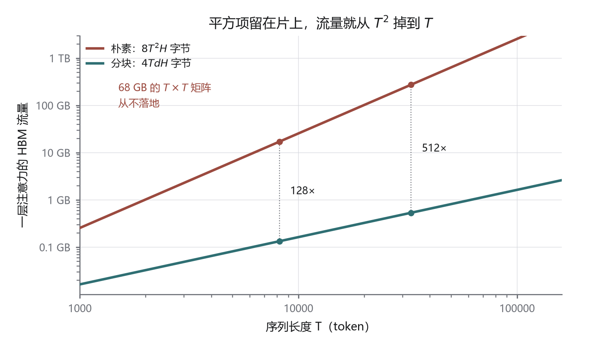

## FlashAttention：省的是带宽

上一章把缓存压到 92 KiB 一 token 之后，容量这条线松了。但把一个 32K 的请求送进去，预填充阶段仍然会卡住。

算一下它要什么。8B 模型，32 层，32 个头，每头 128 维，FP16。一层注意力的分数矩阵是 $32768\times32768$，一个元素 2 字节，共 2.1 GB；32 个头就是 68 GB。这还只是一层。一张 H100 的显存是 80 GB，权重已经占掉 16 GB，激活和缓存还要另外算——这个矩阵根本没有地方放。片上内存更不用比：全卡 132 个 SM 的共享内存加起来约 30 MB，比它小两千多倍。

这不是纸面上的假设。2022 年之前的注意力实现确实会把这个矩阵算出来、写进显存，再读回来做 softmax；32K 上下文在当时的单卡上跑不起来，卡的就是这里。长上下文模型的训练规模与 FlashAttention 的出现时间几乎重合，不是巧合——它把"放不下"翻译成了"算得完"。

更要紧的是时间。就算显存够大，把 68 GB 写进去再读出来，按 3.35 TB/s 算是 41 毫秒；写一遍、读一遍、再写一遍、再读一遍（softmax 前后各一次），一层要 82 毫秒。而这一层的乘加按峰值算只有 17.8 毫秒。也就是说，绝大部分时间不在算，在搬。

FlashAttention 要解决的就是这件事：让注意力在计算过程中不把那个 $T\times T$ 的矩阵写进显存。它一行数学都没有改，softmax 还是那个 softmax，输出的每一个数都与朴素实现相同——只是把计算的顺序和位置换了。要理解它为什么快，得先知道数据放在哪里、搬一次有多贵。

### 显存的三个层级

GPU 上的存储不是一个池子，是三层，速度和容量差一到两个数量级。

最里面是每个 SM（流式多处理器）的片上共享内存，H100 每个 SM 有 228 KB，全卡 132 个 SM 加起来约 30 MB。它离计算单元最近，带宽折算下来约 30 TB/s 量级，是 HBM 的十倍左右。

中间是 L2 缓存，H100 有 50 MB，带宽介于两者之间，几十 TB/s。

最外面是 HBM，也就是通常说的"显存"，80 GB，带宽 3.35 TB/s。所有张量默认住在这里，模型权重、KV 缓存、激活值都在这一层。

三层之间的容量比是 $228\ \text{KB} : 50\ \text{MB} : 80\ \text{GB}$，约 $1 : 220 : 350000$；带宽比约 $10 : 3 : 1$。延迟的差距更大：从共享内存取一个数要几十个时钟周期，从 HBM 取要几百个。这组数字解释了深度学习中一个反复出现的现象：算子慢，多半不是因为乘加不够快，而是因为数据不在该在的地方。GPU 的算力是 $989$ TFLOPS，HBM 带宽是 3.35 TB/s，两者相除得到 295——每从 HBM 读一个字节，至少要做 295 次浮点运算，才不至于卡在带宽上。任何一个算子，只要它的算术强度低于 295，HBM 就是它的天花板。

片上内存装不下整个矩阵，这是硬约束，没有算法能绕开它，只能改变"什么时候需要多少"。分块要回答的是同一个问题：为了让每个字节被尽量多的运算复用，一次该装多少行进来。这个思路不只属于注意力——矩阵乘的分块、卷积的 im2col、数据库按页读取，都是同一个问题的不同答案。

注意力恰好是这样一个算子。它要算一个 $T\times T$ 的中间结果，而这个结果大到放不进片上内存，只能落在 HBM 里。朴素实现的做法就是老老实实写进去、读出来、再写、再读。分块注意力（FlashAttention 的原名是"带 IO 感知的精确注意力"）换了个做法：把这个矩阵切成能装进 228 KB 的块，块算完就丢，永远不整体落地。

### 朴素注意力搬了什么

把 IO 一笔一笔数出来。一个头，输入 $Q,K,V$ 各是 $T\times d_{\text{head}}$，要输出 $O$ 同形状。

$$S=\frac{QK^{\top}}{\sqrt{d_{\text{head}}}},\qquad P=\mathrm{softmax}(S),\qquad O=PV$$

$S$ 和 $P$ 都是 $T\times T$。朴素实现的数据流是：算出 $S$ 写回 HBM，读回来做 softmax 得到 $P$ 写回 HBM，再读回来与 $V$ 相乘。$Q$、$K$、$V$ 各读一遍，$O$ 写一遍，这些是 $O(Td)$ 的小项；$S$ 和 $P$ 各写一遍读一遍，是 $O(T^{2})$ 的大项。

每个位置对（$T^{2}$ 个）在 HBM 上产生 8 字节流量：$S$ 写 2 字节、读 2 字节，$P$ 写 2 字节、读 2 字节。而每对位置要贡献 $4d_{\text{head}}$ 次浮点运算（打分 $2d_{\text{head}}$，加权求和再来一遍）。两者相除，得到注意力的算术强度：

$$\frac{4d_{\text{head}}}{8}=\frac{d_{\text{head}}}{2}$$

$d_{\text{head}}=128$ 时是 64，$d_{\text{head}}=64$ 时是 32。对照 H100 的拐点 295，差四到九倍——注意力的瓶颈从设计上就不在算力。

拿同样尺寸的矩阵乘对比一下。$T\times d$ 乘 $d\times T$，读 $2Td$ 个元素、做 $2T^{2}d$ 次运算，强度约 $T$——1024 个位置时就是 1024，远超拐点，纯算力受限。注意力只有 $d_{\text{head}}/2$，而且与 $T$ 无关：矩阵乘的强度随序列长度涨，注意力不涨。32K 时两者差五百倍。原因不是实现水平，是注意力多了一个必须落地的中间量。

代入 32K 的例子：32 个头，每个头 $1.07\times10^{9}$ 个位置对，8 字节一个，共 275 GB 流量，按 3.35 TB/s 是 82 毫秒一层。乘加是 $1.76\times10^{13}$ 次，按 989 TFLOPS 是 17.8 毫秒。4.6 倍，与强度的比值对得上。

反向传播更糟。梯度要走完 $dV=P^{\top}dO$、$dP=dO\,V^{\top}$、$dS=P\odot(dP-\mathrm{rowsum}(dP\odot P))$ 这几步，每一步都要用 $P$ 或 $S$。朴素实现因此必须把 $S$、$P$ 存下来给反向用，激活显存正比于 $T^{2}$：32K、32 头、FP16 是 68 GB 一层，训练时根本存不下，只能靠梯度检查点把整层的注意力重算一遍——等于把前向的 IO 再付一次。带宽与显存两笔账，都要为同一个矩阵付。

到这里问题的形状清楚了：注意力的病不在乘加，在于它必须产生一个 $T\times T$ 的中间量，而这个量比片上内存大两三个数量级。要么减少搬运，要么让它不落地。FlashAttention 选的是后者。

### 分块与在线 softmax

如果注意力里没有 softmax，分块是平凡的：$O=PV$ 是线性的，可以把 $K,V$ 切成块，一块一块累加 $P_jV_j$，累加器只有一个 $d_{\text{head}}$ 宽的向量。

麻烦全在 softmax。它需要两个全局量：所有分数的最大值（防溢出）和所有指数的和（归一化）。分块时看不到全局——处理第一块的时候不知道后面会不会出现更大的分数。如果先扫一遍求最大值，就得多读一遍 $S$，等于把省下的搬运又付出去。

解法是让 softmax 变成可以增量维护的东西。目标是算一行（一个 query 位置）的输出：

$$o=\sum_{j}\frac{e^{s_j-m}}{\ell}v_j,\qquad \ell=\sum_j e^{s_j-m},\qquad m=\max_j s_j$$

$s_j$ 是这一行第 $j$ 个分数，$m$ 是这一行的最大值，$\ell$ 是归一化因子。把分子单记一个符号 $O=\sum_j e^{s_j-m}v_j$（未归一化），输出就是 $o=O/\ell$。三个量一起维护：$m$ 记住目前见过的最大值，$\ell$ 记住按这个最大值缩放后的指数和，$O$ 记住按同样缩放后的加权和。来了一块新的分数 $s'$（长度 $B_c$）：

$$m'=\max\big(m,\ \mathrm{rowmax}(s')\big)$$

$$\ell\leftarrow e^{m-m'}\ell+\sum_j e^{s'_j-m'},\qquad O\leftarrow e^{m-m'}O+\sum_j e^{s'_j-m'}v_j$$

两个修正因子 $e^{m-m'}$ 是全部机巧所在。最大值从 $m$ 换到 $m'$ 时，先前按旧标尺算出的指数和整体偏了一个常数因子，要乘回去折算到新标尺下；分子 $O$ 乘同一个因子，最后相除时约掉。

为什么这样拼出来的结果是精确的？因为 $(\ell,O)$ 是 softmax 的充分统计量：设 $z=\sum_j e^{s_j}$ 是真正的分母，那么在任何标尺 $m$ 下都有 $\ell=z\,e^{-m}$、$O=e^{-m}\sum_j e^{s_j}v_j$，两者同比例缩放，比值 $O/\ell$ 恒等于 $\sum_j p_jv_j$。换标尺只是一次恒等变形，没有近似。

写成伪代码，块大小由片上内存决定：

```text
输入 Q, K, V (T×d)，SRAM 容量 M（按元素计）
Bc = M // (4d)          # K、V 块高，4 是四份中间量
Br = min(Bc, d)         # Q 块高
把 Q 切成 T/Br 块，K、V 切成 T/Bc 块
for i in 1..T/Br:       # 外层走 Q 块
    load Qi
    Oi = 0, li = 0, mi = -inf
    for j in 1..T/Bc:
        load Kj, Vj
        Sij = Qi @ Kj.T / sqrt(d)
        mij = rowmax(Sij)
        Pij = exp(Sij - mij)
        lij = rowsum(Pij)
        mi_new = max(mi, mij)
        c1 = exp(mi - mi_new)      # 旧累加折算
        c2 = exp(mij - mi_new)     # 新块折算
        li = c1 * li + c2 * lij
        Oi = c1 * Oi + c2 * (Pij @ Vj)
        mi = mi_new
    Oi = Oi / li        # 只在最后除一次
    store Oi
```

$B_c$ 和 $B_r$ 的取法是把片上内存分成四份：$Q$ 块、$K$ 块、分数块、输出块各占一份，所以 $M/(4d)$。$d=128$、$M$ 取 228 KB（折成 114K 个 FP16 元素）时，$B_c$ 约 222；$B_r$ 取 128。

循环顺序有一处讲究：外层走 $Q$ 块，内层走 $K,V$ 块。这样一行的 $m$、$\ell$、$O$ 三个滚动量在整轮内层循环里都待在片上，只有 $K,V$ 需要反复从 HBM 读。反过来（外层走 $K,V$）就要为每个 $K,V$ 块把所有 $Q$ 块扫一遍，$O$ 的读写次数会多出一个量级。

拿 $T=4096$、$d_{\text{head}}=128$ 走一遍。$B_c=B_r=128$，序列被切成 32 段。一个 $Q$ 块要对 32 个 $K,V$ 块各做一次：读 $K$ 块 32 KB、$V$ 块 32 KB，算 $4\times128\times128\times128=8.4$ 兆次浮点运算。走完 32 个块，一个 $Q$ 块总共读 2.1 MB、算 268 兆次，强度 128。32 个 $Q$ 块做完，整层读 67 MB、算 8.6 GFLOPs。同样配置下，朴素实现要读写 $4\times4096^{2}\times2\times32=4.3$ GB。67 MB 对 4.3 GB，六十四倍——这个差距比 IO 公式更直观，因为公式里那些常数被消掉了。若 $K,V$ 整段能留在 L2 里，实际读取还要再少一个量级，这也是实测比估算更好的原因。

因果掩码在这里顺手省下一半：位置 $j>i$ 的分数被整块跳过，不用算也不用读。上三角的块完全被遮住，直接不进入循环；只有对角线上的块需要逐元素遮。32K 时块数直接减半，省下的是实打实的时间，不是近似。

### 省下来的 IO 是多少

把搬运量重算一遍。外层有 $T/B_r$ 个 $Q$ 块，每个 $Q$ 块都要把全部 $K,V$ 读一遍，即 $2Td$ 个元素，总量约 $(T/B_r)\cdot 2Td$。$B_r$ 与 $M/d$ 同阶——片上内存越大、每头维度越小，块就能取得越高——代回去得到

$$\Theta\!\left(Td+\frac{T^{2}d^{2}}{M}\right)$$

对比朴素实现的 $\Theta(Td+T^{2})$。两者都含平方项，但前者的分母多了 $M$，分子里还带 $d^{2}$：块越高、$d$ 越小，重复读取的轮数越少。$d=128$、$M=114\text{K}$ 个元素时 $d^{2}/M\approx0.14$，平方项的系数小七倍；论文在 GPT-2 上的实测是 HBM 流量从 40.3 GB 降到 4.4 GB，约九倍。

足迹也不一样。整个 $T\times T$ 的矩阵从不落地，中间结果只活在 SRAM 里，所以前向的额外显存是 $O(T)$（只有输出和三个滚动量）。反向传播不再存 $S$、$P$，而是重算。具体做法值得写清楚，因为它是这一族优化的模板。前向只存三样东西：每行的最大值 $m_i$、归一化因子 $\ell_i$、未归一化的输出 $O_i$，共 $O(T)$ 个元素。反向时重新走一遍分块循环，用存下的 $m_i$、$\ell_i$ 把 $S_{ij}$ 还原成 $P_{ij}=\exp(S_{ij}-m_i)/\ell_i$，再算 $dV$、$dP$、$dS$、$dQ$、$dK$，块算完即丢。整个过程里，$T\times T$ 的矩阵从来没有完整存在过，它只在 SRAM 里以 $B_r\times B_c$ 的碎片出现。

这个套路与梯度检查点同源：存少量够用的统计量，其余重算。区别在粒度——检查点按层存、重算一整层，这里按块存、重算一小块。粒度越细，重算的比例越小，收益越大。同一条思路后来被用到了几乎所有吃带宽的算子上。

代价立刻能看出来：FLOPs 一分没少，反向还要多算一遍。GPT-2 medium 上总浮点运算从 66.6 GFLOPs 涨到 75.2 GFLOPs，多了 13%；但墙钟从 41.7 毫秒降到 7.3 毫秒，快了 5.7 倍。多算 13% 换少搬九倍，账是划算的——这正是"IO 感知"这个词的意思：优化目标不是减少运算，是减少搬运。

两笔账要对齐一下：分块把流量降到六十四分之一，实测却只有 5.7 倍，中间差了十倍。原因有两个。一是估算假设所有读写都落到 HBM，而实际朴素实现里 $S$、$P$ 的中间读写有一部分命中 L2（$T=4096$ 时整段 $K,V$ 才 4 MB）；二是实测里还含乘加本身的时间与内核开销。方向是对的——搬运少了，速度就上来了——但倍数不能直接套到自己的配置上，得按实际的 $T$、$d$、SM 数量重算一遍。



图里两条线在 8K 相差 128 倍，32K 是 512 倍——倍数随长度变大，因为一条是 $T^{2}$、一条是 $T$。这正是分块最值得记住的地方：它没有把平方项“压小”，它是把平方项搬到了不占带宽的地方。

### 算一遍：一次 32K 预填充的时间花在哪

把上面两笔账合起来算一次端到端的预填充，才知道分块到底省了多少。

配置：8B 模型，32 层，32 头，每头 128 维，$T=32768$，bf16。注意力部分的浮点运算是每层 $4T^{2}hd_{\text{head}}=1.76\times10^{13}$，32 层共 $5.6\times10^{14}$；线性部分（所有投影与前馈）是 $2NT=5.3\times10^{14}$。两者几乎相等，这也对上了第一章“$T>6d$ 之后注意力占主导”的临界点——32768 略微超过了 $6\times4096=24576$。

线性部分在两种实现里一样快，按 45% 的峰值算，$5.3\times10^{14}/4.45\times10^{14}=1.19$ 秒。变的是注意力那一块：

| 实现 | 注意力有效算力 | 注意力耗时 | 预填充总时 |
|---|---|---|---|
| 朴素（$S$、$P$ 落地） | 99 TFLOPs（峰值 10%） | 5.7 秒 | 6.9 秒 |
| 第一版分块 | 297 TFLOPs（30%） | 1.9 秒 | 3.1 秒 |
| 第二、三版 | 693 TFLOPs（70%） | 0.8 秒 | 2.0 秒 |

三行里有两个结论。第一，分块把注意力从“带宽受限”拉到了“算力受限”，环节耗时降了七倍，但端到端只降三点五倍——阿姆达尔定律在这里收账：不变的那一半直接封顶了收益。第二，第二版相对第一版还有一点六倍，这部分完全来自“少做非矩阵乘、把 SM 填满”，与 IO 无关。

这张表也解释了为什么“FlashAttention 让 32K 上下文变得可行”这句话得拆开看。它在显存上从“放不下”变成“放得下”（68 GB 的中间矩阵不再落地），这一条是硬的；它在时间上从 6.9 秒降到 2.0 秒，这一条是软的——因为线性项一点没动，再优化注意力也只能无限逼近 1.19 秒这个底。想把预填充再变快，得回头去动 $2NT$：量化权重、用更小的模型、或者靠 MoE 少激活参数。

### 分块之后，强度是多少

上面的 IO 公式给的是总量，还可以从算术强度看，因为它直接决定能跑到峰值的几成。

设 $Q$ 块高 $B_r$，$K,V$ 块高 $B_c$。一对块要做 $4B_rB_cd_{\text{head}}$ 次浮点运算（打分 $2B_rB_cd_{\text{head}}$，加权求和再来一遍），要把 $B_c\times d_{\text{head}}$ 的 $K$ 块和同样大的 $V$ 块读进来。这一对块覆盖 $B_rB_c$ 个位置对，所以摊到每个位置对上的读取量是

$$\frac{2\times2\,B_cd_{\text{head}}}{B_rB_c}=\frac{4d_{\text{head}}}{B_r}\ \text{字节}$$

每对位置 4 字节，与 $B_c$ 无关；而运算量是每对 $4d_{\text{head}}$ 次。两者相除：

$$\text{强度}\approx\frac{4d_{\text{head}}}{4d_{\text{head}}/B_r}=B_r$$

分块把注意力的算术强度从 $d_{\text{head}}/2$ 抬到了约 $B_r$——**$Q$ 块的高度就是强度**。$B_r=128$ 时强度 128，是朴素实现（$d_{\text{head}}=128$ 时 64）的两倍。这个结论有点反直觉：提高强度的不是"算得更快"，而是"让每个字节被更多次运算复用"，而复用的次数正好等于一次装进 SRAM 的 $Q$ 行数。

于是块大小成了唯一的性能旋钮，而它被片上内存卡死。A100 每个 SM 164 KB 可用，折成 FP16 是 82K 个元素，$B_c=82\text{K}/(4\times128)=160$，$B_r$ 取 128，强度约 128，而 A100 的拐点是 153——两者只差两成，所以第二版能跑到峰值的七成。H100 的共享内存涨到 228 KB，$B_c$ 约 222，但拐点也涨到 295，光靠分块只能到四成。

这就是第三版要处理的问题。它没法把块做得更大（片上内存就那么多），只能让数据在块与块之间多待一会儿——L2 有 50 MB，8K 上下文的整段 $K,V$ 只有 4 MB，完全装得下；一旦 $K,V$ 常驻 L2，后续的 $Q$ 块就不必再从 HBM 读，实际强度远高于上面这个只算 HBM 的估计。

三代卡的分块参数可以排在一张表里。拐点算成“峰值算力除以 HBM 带宽”，强度就是 $B_r$：

| 卡 | 共享内存 | 拐点 | 分块强度 |
|---|---|---|---|
| A100 | 164 KB | 153 | 128 |
| H100 | 228 KB | 295 | 128 |
| H200 | 228 KB | 206 | 128 |

三行的 $B_r$ 都是 128，因为它的上界不是共享内存而是 $Q$ 块与分数块的尺寸比例：$B_r$ 超过 128 后，分数块 $B_r\times B_c$ 本身就把 SRAM 吃完了。这就是为什么第二代只靠加大分块做不到拐点，必须去动“块间怎么复用”。H200 那一行更能说明问题：它的 SM 与 H100 完全一样，只是 HBM 从 3.35 涨到 4.8 TB/s，拐点从 295 降到 206，同样的内核能拿到的峰值占比就从四成跳到六成。**换带宽比换算法便宜得多**，这是买卡时容易被忽略的一条。

### 第二版：非矩阵乘与并行切分

第一版拿到 5.7 倍的算子加速，但只跑到了 A100 峰值的三成左右。第二版（2023）找的是剩下那七成去哪儿了，找到两处。

第一处是非矩阵乘运算。GPU 上有两种计算单元：张量核做矩阵乘，A100 上 bf16 峰值 312 TFLOPS；CUDA 核做逐元素的加减乘除、指数、比较，峰值只有 19.5 TFLOPS。差 16 倍。softmax 里的 $e^{x}$、行最大值、行求和、逐元素乘法全落在 CUDA 核上。第一版在每个块结束时都做一次 $O_i/\ell_i$ 的归一化除法，把非矩阵乘的量又放大了一截。第二版改成块内永不归一化，只在最后除一次——$O$ 保持未归一化的累加值，$\ell$ 保持对应的分母，除法从 $T/B_c$ 次减到 1 次。同理，两个修正因子 $e^{m-m'}$ 也从逐元素乘改成延迟应用：只有当最大值真的变了才重标定，而且在 $m$ 不变时直接跳过。

第二处是并行度。第一版只在"批 × 头"这两个维度上切分：一个 block 负责一个头的一段输出。批为 1、头数为 32 时，只有 32 个 block，而 A100 有 108 个 SM——七成的 SM 闲着。上下文越长，每个 block 的活越多，闲着的问题越严重。第二版把序列维也切开：$Q$ 的不同块分给不同的 block，各算各的行，只在最后写回。于是 block 数变成 $h\times T/B_r$，32K 上下文、$B_r=128$ 时是 8192 个，SM 全忙。

切分变细的代价是每个 block 要独立地把 $K,V$ 读一遍：每个 $Q$ 块都读全部 $K,V$，总读取量变成 $(T/B_r)\cdot Td$，随 $Q$ 块数增长。这就是上一节那个公式里的 $T^{2}d^{2}/M$ 项，切得越细读得越多。第二版的取舍是在并行度和重复读取之间找一个点：$B_r$ 取得大一些，重复读少一些，但 block 数也少一些。

还有一个细节：一个 block 内部有 4 到 8 个 warp，第一版让它们分工做同一块的不同部分，中间要经过共享内存交换，同步开销不小。第二版改成每个 warp 负责一行或几行的独立计算，warp 之间不通信，只在写回时汇合。这一条把共享内存的读写和 `__syncthreads` 都省掉了。

两版的差距可以归到两个可测的指标上。第一版在长序列时 SM 占用率不到一半——block 数等于头数，32 个头只填满 32 个 SM；第二版把序列维也切开之后，占用率接近满格。第一版的非矩阵乘占了运行时间的三到四成，第二版压到一成多。两个指标都能在 profiler 里直接看到，这类优化不需要灵感，只需要把时间花在哪儿弄清楚。

三处改完，A100 上前向能跑到峰值的 50% 到 73%，反向 63%，端到端 225 TFLOPs/s（按模型浮点运算算是 72% 的利用率）。同一块卡、同一份数学，从三成到七成，全部来自"少做非矩阵乘、把 SM 填满"。

### 第三版：Hopper 上的异步流水

第三版（2024）针对的是 H100 这一代硬件的新特性，思路从"减少搬运"转向"让搬运和计算重叠"。

Hopper 加了两个东西。一个是 TMA（Tensor Memory Accelerator），可以把一块二维数据从 HBM 直接搬进共享内存，由专门的硬件完成，不占寄存器和指令发射槽。另一个是 WGMMA（Warpgroup Matrix Multiply-Accumulate），矩阵乘的粒度从 warp 提升到 4 个 warp 组成的 warpgroup，可以直接读共享内存里的操作数，不必先搬进寄存器。

这两个特性要求程序换一种组织方式：一个 warp 专门发 TMA 搬运，另一组 warp 专门做 WGMMA，两者通过共享内存里的队列同步。这叫 warp specialization（warp 专门化）。

第三版还加了一层调度技巧：两组消费者 warpgroup 交替工作，一组在算矩阵乘时，另一组在做 softmax（非矩阵乘），下一轮交换。因为矩阵乘和 softmax 用的是不同的计算单元，重叠起来互不抢资源。这种"乒乓"调度把 softmax 的时间藏进了矩阵乘的时间里——前面说过 softmax 走 CUDA 核，峰值只有张量核的十六分之一，藏起来收益很大。

流水编排有它自己的坑。生产者与消费者的比例不对，就会出现生产太快、队列满而阻塞，或生产太慢、消费者空转；块大小与流水级数要一起调，调不好还不如第二版。这类内核的调优曲线是阶梯状的：某个配置突然从五成跳到七成五，中间没有平滑过渡，所以第三版的论文有相当篇幅在讲调度而不是数学。

结果：H100 上 FP16 前向达到约 840 TFLOPs/s，是峰值的 75%；FP8 下超过 1.2 PFLOPs/s；相对第二版有 1.5 到 2 倍的提升。FP8 那一项多一道工序。8 位浮点的动态范围窄，一层里若出现几个特别大的激活值，整块的缩放因子就会被它们拉偏，其余数值全部下溢。第三版用分块缩放：每个 $B_r\times B_c$ 的块各自算一个缩放因子，块间不共享，代价是每块多几次乘法和一次统计，换来的是精度损失可控。这也是 H100 上 FP8 注意力能实用的前提。

这个数字值得对照着看：H100 的峰值算力是 A100 的 3.2 倍，但同样的 FlashAttention 只拿到七成五，剩下的两成多里有一部分是 softmax 的固有开销，有一部分是流水没排满。

到这里，“省带宽”这件事已经做到了接近硬件极限：算法层面不再有多余的搬运，剩下的时间花在真正必要的乘加和 softmax 上。

### 反向的价：29% 的算力换 68 GB 显存

前向那一节把重算说成“顺便”，但它其实是一笔明确的交易，可以算成两个数字。

先算不重算的价。把 $S$ 与 $P$ 都留着：一层、32 头、32K 上下文、bf16，是 $32768^{2}\times32\times2\times2=137$ GB（因果下面一半有效，算 68 GB）。32 层就是两 TB 以上。没有任何一张卡能装。

再算重算的价。注意力前向是两个矩阵乘（$QK^{\top}$ 与 $PV$），反向是五个（$dQ$、$dK$、$dV$、$dP$、$dS$ 各自的乘法）。用 $4T^{2}d$ 为一个单位：

| 阶段 | 相对量 | 是否需要 $S$、$P$ |
|---|---|---|
| 前向 | 1 | 需要 |
| 反向 | 2.5 | 需要 |
| 重算前向 | +1 | 自己生成 |

合计：不重算时是 $1+2.5=3.5$ 个单位，重算时是 $(1+1)+2.5=4.5$。多出 1 个单位，占 3.5 的 29%。换成整网的百分比会低一些，因为前馈与投影不受影响，公开报告的量级在 13% 到 30% 之间。

所以这笔交易是：**用两到三成的算力，换一个“不存就不存在”的显存开销。** 这笔交易在前向已经算力受限时依然划算吗？答案是肯定的，因为另一个选项（存下来）的显存需求随 $T^{2}$ 增长，而显存是硬上限；算力不够可以多买卡，显存不够就直接跑不了。

表里的“重算前向”那一行还有一个工程细节：重算需要把 $K$、$V$ 再读一遍，所以它不只要花算力，还要再花一次带宽。这就是为什么重算只在片上的块内做——块内的 $K$、$V$ 还在 SRAM 里，没有第二次 HBM 读取。跨块重算（比如按层做检查点）就不一样了，它要重新从显存读整层的输入，那是另一笔账。这也是“按块重算”比“按层重算”优越的原因：粒度越细，重算的部分的输入越可能还在片上。

### 变长批：padding 掉的是真金白银

线上没有“一批长度一致的请求”这回事。一个批里常常是一个 32K 的长请求和三十个 1K 的短请求，而 GPU 要求张量形状规整。

最直白的做法是按批内最长序列 padding，短的补零。代价直接算：批 32、平均长度 2K、最长 32K，按 32K 对齐后一批算 $32\times32768=1.05$ 百万元 token；而实际有用的是 $32\times2048=6.6$ 万。**浪费十六倍。**

主流做法是把批内所有序列拼成一条长序列，靠一张累积长度表定位每段，块只按实际位置分配。浪费降到“每段尾部不足一块的零头”，批 32、块高 128 时是 $32\times64=2048$ 个位置，占 3%。

代价是要写一个能接累积长度表的 kernel（通常叫 varlen），而且掩码不能再用简单的因果掩码：拼接边界两边必须断开，否则前一段的尾部会看到后一段的开头。这个掩码在块级别上表现为“块内逐元素遮”，于是对角块变得很贵——每个序列的起止位置都落在一个对角块里。批里序列越多，这种“碎块”越多，块的利用率越低。

| 做法 | 浪费 | 改动量 | 适用 |
|---|---|---|---|
| 按最长 padding | 与长度方差同阶 | 无 | 长度接近 |
| 拼成一条 + 变长表 | 3% 左右 | 要写 kernel | 混合长度 |
| 按长度分桶 | 与桶宽同阶 | 要改调度 | 长尾流量 |

三行里第三行常被忽略。分桶不改 kernel，只改“哪些请求能拼在一起”，代价是请求要在队列里等一会儿凑桶，延迟略微上升。在长度分布双峰的流量里（短对话 + 长文档），分桶能拿到变长表的大部分收益而不动算子，是用得最多的一种折中。

### 数学没变，bit 变了

把这一章的主结论说清楚：FlashAttention 不改变注意力的数学结果。

它没有近似 softmax，没有丢小数，没有换成线性注意力。上面那个递推是恒等变形：每一块的 $(\ell,O)$ 都是真实 softmax 的充分统计量按同一个因子缩放，缩放因子在相除时约掉。所以输出的每一个元素都等于朴素实现算出来的那个值——在实数域上严格相等。

在浮点数上，它不等于"逐位相同"。矩阵乘的分块顺序变了，加法结合律在浮点下不成立，舍入误差的累积路径不同，最后几位可能不一样。这对训练有实际影响：同一份代码、同一份数据，换一个注意力实现，损失曲线会在小数点后若干位分叉；做可复现性实验时，这属于"必须固定实现版本"的那类变量。

有意思的是误差的方向。FlashAttention 在 FP16 下通常比朴素实现更准，因为它减的是滚动最大值：每一块的指数都在 $e^{0}$ 附近，不会出现 $e^{80}$ 这种把 FP16 打爆的量级；而朴素实现如果先算完整行再减最大值，中间结果可能已经溢出。它不是"近似但更快"，而是"精确且更稳"，代价只是重排带来的末位差异。

精确性还有一个容易被低估的副作用。近似注意力（低秩、稀疏近似、核近似）在长序列上常常掉点，一部分原因就是它们改变了 softmax 的形状；FlashAttention 不掉点，因为它没有改。这让它在 2022 年之后迅速成为默认实现——原因不只是更快，而是它免费：同样的结果，更少的显存，更短的时间，不需要在质量上做任何让步。

还有三件事它做不到，需要说清边界。

它不减少浮点运算。前向的乘加与朴素实现相同，反向因为重算还多一些。它省的是搬运，不是计算。

它不改变 $O(T^{2})$ 这个复杂度。32K 上下文的注意力仍然是 $1.76\times10^{13}$ 次运算一层，FlashAttention 只是让这些运算能跑在接近峰值的速度上。上下文再翻四倍，平方项照样把预填充拖到几十秒——这就是下一章要处理的事。

它对解码帮助有限。逐 token 解码时 $Q$ 只有一行，$B_r=1$，没有"序列维"可切；能切的只有 $K,V$ 那一侧——把一个请求的缓存切成若干段，分给不同 SM 算，再把各自的 $(\ell,O)$ 用同样的在线 softmax 合并。这条做法叫 split-K 或 flash-decoding。把 $K,V$ 沿序列切成 $S$ 段，分给 $S$ 个 SM，各自算一份 $(m_s,\ell_s,O_s)$，最后用与在线 softmax 同一套公式合并：$m=\max_s m_s$，$\ell=\sum_s e^{m_s-m}\ell_s$，$O=\sum_s e^{m_s-m}O_s$。合并的开销可以忽略，收益是解码时也能填满 SM。它不减少每步要读的字节，只是把读取并行化——长上下文解码的带宽账依旧成立，只是从"一个 SM 慢慢读"变成"$S$ 个 SM 一起读"。

所以 FlashAttention 在整条流水线上的位置很清楚：它是预填充阶段的核心算子，把注意力的实际速度从峰值的十分之一抬到七成；它让 32K 的训练和推理在显存上成为可能，因为 $T\times T$ 的矩阵不再落地。它没有让长上下文变便宜，只是让“贵”这件事以算力的形式而不是显存的形式出现。

### 掩码的三种形态，三种代价

分块的收益全部来自“整块跳过”。掩码的形状决定了能跳多少，而掩码不是只有因果一种。

**因果掩码。** 位置 $j>i$ 全部不可见，矩阵是一个下三角。块级别上，严格在下三角之外的块整块跳过，对角块逐元素遮。$T$ 切成 $n$ 块时，跳过的是 $n(n-1)/2$ 个块，占总块数的一半不到一点——准确地说跳过比例是 $(n-1)/(2n)$，$n=256$ 时是 49.8%。这是最理想的情形：省一半，且块边界干净。

**文档打包的块对角掩码。** 一个批里塞了四篇文档，每篇只看自己那一块，矩阵是四个沿对角的小下三角。块级别上，只有落在这四个小三角里的块有用，其余全部跳过。跳过比例取决于每篇文档的相对长度：四篇等长时，有用的块占四分之一的一半，即 12.5%，跳过 87.5%。听起来很赚，但实现上每个文档的起止位置都要单独算，对角块里的逐元素遮也变成四段——块内利用率下降，实际收益通常打对折。

**滑窗掩码。** 每个位置只看前 $w$ 个。矩阵上是一条宽 $w$ 的斜带。$w$ 远小于 $T$ 时，跳过比例接近 $1-w/T$，$w=4096$、$T=32768$ 时是 87.5%。这是三种里理论收益最大的，但它对块对齐最敏感：斜带在每个块里只覆盖一部分，实际收益取决于 $w$ 是否是块高的整数倍。

| 掩码 | 可跳过的块 | 块内利用率 | 实现难度 |
|---|---|---|---|
| 因果 | 约 50% | 高 | 低 |
| 块对角 | 约 87% | 中 | 中 |
| 滑窗 | 约 87% | 低到中 | 高 |

三种掩码可以叠在一起——打包的长文档 + 滑动窗口 + 因果，这是长上下文训练里很常见的组合。叠起来之后，跳过比例不是相乘而是取交集，收益通常会低于预期；判断值不值得做，最省事的办法是先按块级统计一遍“真正要算的块占多少”，再乘上一个 0.6 左右的折扣，看还够不够本。

### 一次调优的全过程：从 12 毫秒到 3 毫秒

分块注意力的优化不是一步到位的，而是一条可复现的排查路径。把四个步骤写下来，换成任何现成的内核都能用。

**第一步，先确定瓶颈。** 一层 8K 上下文的注意力，按理应该 2.5 毫秒（8.6 GFLOPs ÷ 3.5 TFLOPS 等效）。实测 12 毫秒，先看 HBM 流量：按分块公式应该 540 MB，实测 2 GB。多出来的三倍说明中间结果落了地。这一分钟内就能量出来：把内核的 HBM 计数打开，对比“理论最小读取”。

**第二步，把不必要的东西从显存里挤出去。** 常见三处：每块结束后的归一化除法（应只在最后除一次）、中间变量没有重用、以及“为了可读”而把中间张量写回。三处合计能拿到两倍左右，12 毫秒降到 6 毫秒。

**第三步，看 SM 占用。** 6 毫秒时理论上是 70% 效率，实际只有 30%。原因是网格只沿“批 × 头”切分，32 个头只填满 32 个 SM。把序列维也切开，网格变成头 × 序列块，占用率拉满，降到 3.5 毫秒。

**第四步，看非矩阵乘占比。** 剩下那 3.5 毫秒里，softmax 的逐元素运算占了四成。做法是延迟归一化、在最大值不变时跳过重标定、把缩放因子合并进一次乘法。这三项是纯工程，3.5 降到 3 毫秒以内。

| 步骤 | 手段 | 关键指标 | 预期收益 |
|---|---|---|---|
| 定位 | 量 HBM 流量 | 实测/理论比值 | — |
| 去落地 | 延迟除法、重用 | 中间张量个数 | 约 2× |
| 填 SM | 序列维切块 | SM 占用率 | 约 1.7× |
| 减非矩阵乘 | 合并缩放 | CUDA 核占比 | 约 15% |

四个步骤的顺序不能换。先切序列、再去落地，会得到一个“占满 SM 但全在等 HBM”的内核，看着热闹、跑得慢；先去落地、再切序列，才是顺的。每步之后都要重新量一次流量与占用率，因为前一步的收益会改变后一步的瓶颈位置——这就是优化里最反直觉的一点：**同一组手段，顺序不同，结果差一倍**。

### 四个不适用它的地方

任何一招都有边界，分块注意力的边界很具体，四条。

**短序列。** $T=256$ 时，$B_c=222$ 意味着只有两个块，内层循环只跑两圈，循环开销和内核启动占了主导。这时它比不过直接调厂商的批量矩阵乘加一个独立的 softmax：后者虽然没有融合，但每一步都是大核、访存连续。这个阈值大致在 $T<4B_c$，也就是一千上下；再往下，融合的收益换不回循环与重算的开销。短上下文场景（分类、嵌入、短俵对话）因此不在它的受益面上。

**非标准掩码。** 文档打包需要块对角掩码，滑窗需要周期掩码；两者都能塞进分块框架，但“整块跳过”变成了“部分跳过”。以 $w=4096$、$T=32768$ 的滑窗为例，理论上可以跳过 $1-w/T=87.5\%$ 的块，实际却要按块计算循环边界，非对角块里还有一半是无效位置。如果偷懒先按稠密算再乘掩码，那就等于完全没省——这是工程上最常见的白人式实现，也是“稀疏注意力没加速”的一部分原因。

**解码。** $B_r$ 就是强度，而解码时 $Q$ 只有一行，$B_r=1$，强度跌到 1。单请求、短批量的解码用不上分块的任何好处，这就是 flash-decoding 要沿序列切 $K,V$ 的原因：把 SM 填满，但每步要读的字节一个没少。分块改的是复用，不是总量。

**低精度下的异常值。** FP8 的动态范围窄，一块里只要有几个特别大的激活值，整块的缩放因子就被它们拉偏，同块其余数值下溢。分块缩放（每块一个因子）把这个损失控住，代价是每块多几次乘法和一次统计。如果直接把全局缩放因子搬到 FP8 注意力上，损失会在训练后期突然崩——它不是渐变的，而是某一层先超出范围。

还有一个坑不在实现里，在说法里。“FlashAttention 省显存，所以能开更长上下文”——前半句对，后半句错。它省的是**激活**显存（那个 $T\times T$ 矩阵），不省**缓存**显存。推理时 128K 上下文的 16 GiB 缓存一点没变，并发还是那么多。把这两笔账混为一谈的人，会在扩到长上下文后发现显存还是不够，然后去调注意力内核，白花一周。

到这里，注意力在"怎么算"这一侧已经被压到了硬件的边。剩下的问题回到算法本身：那个 $T^{2}$ 到底能不能不付。三条路——只看局部窗口、按块稀疏、把历史压成固定大小的状态——各自砍掉平方项的一部分或全部，代价各不相同，也各自有明确失效的场景。
