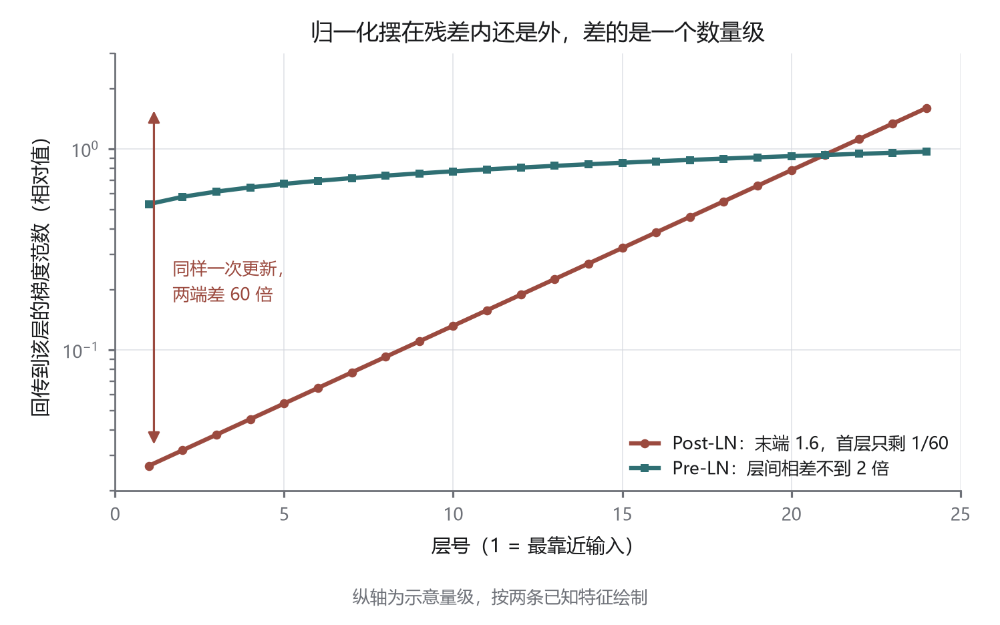

## 归一化、残差与深层稳定性

2017 年那篇论文训的是 6 层。同一份代码，2018 年 BERT 加到 24 层，就得配上 10000 步的线性 warmup 和一套专门的初始化，否则前几千步 loss 直接冲到 NaN；2019 年 GPT-2 加到 48 层，做法是把 LayerNorm 从残差外面挪到里面，再给残差分支的初始权重乘一个 $1/\sqrt{2L}$。结构没变，参数没变，变的只是数值怎么流。

这不是调参的玄学。把模型加深，梯度从最后一层往第一层回传时要穿过几十上百个雅可比矩阵的连乘；这些矩阵的谱范数只要平均略大于 1，连乘就指数爆炸，略小于 1 就指数消失。两边都是死路，能走通的只有"平均恰好接近 1 且各层幅度相当"这一条窄缝。归一化、残差尺度、初始化、学习率 warmup，全都在修这条缝。

这一章把这些手段按它们各自修的那一段拆开：归一化修的是层内幅度，残差尺度修的是层间累积，warmup 与 muP 修的是更新量与宽度的关系，QK-Norm 与 z-loss 修的是少数几个会自己跑飞的量。它们一个都不增加模型的表达能力，作用只是让已有的表达能力在几十层深度上还能兑现。

### 归一化在残差内还是外

残差连接写成 $x\leftarrow x+F(x)$，$F$ 是注意力或前馈子层，归一化有两种摆法：

$$\text{Post-LN}: x\leftarrow \mathrm{LN}\big(x+F(x)\big),\qquad \text{Pre-LN}: x\leftarrow x+F\big(\mathrm{LN}(x)\big)$$

前者是 2017 年原论文的写法，后者是现在几乎所有开源模型的写法。差别看着只是括号的位置，梯度上差一个数量级。

把第 $L$ 层的损失往第 $l$ 层传，要乘上一串

$$\frac{\partial x_L}{\partial x_l}=\prod_{k=l+1}^{L}\frac{\partial x_k}{\partial x_{k-1}},\qquad \frac{\partial x_k}{\partial x_{k-1}}=\begin{cases}J_{\mathrm{LN}}\big(x_{k-1}+F(x_{k-1})\big)\big(I+J_F\big) & \text{Post-LN}\\ I+J_F\,J_{\mathrm{LN}}(x_{k-1}) & \text{Pre-LN}\end{cases}$$

$J_F$ 是子层本身的雅可比，$J_{\mathrm{LN}}$ 是归一化的雅可比，$I$ 是单位阵。两种摆法的区别在于 $J_{\mathrm{LN}}$ 乘在连乘的哪一侧：Post-LN 里它夹在两个因子中间，每层都要过一遍；Pre-LN 里它只作用在 $J_F$ 上，主干那条 $I$ 是干净的。

$J_{\mathrm{LN}}$ 有多大，决定了这件事的严重程度。设输入是 $x\in\mathbb{R}^{d}$，均值 $\mu$、标准差 $\sigma$，归一化后 $\hat x=(x-\mu)/\sigma$，缩放参数 $g$，则

$$J_{\mathrm{LN}}\approx\frac{1}{\sigma}\big(I-\hat x\hat x^{\top}\big)\operatorname{diag}(g)$$

$I-\hat x\hat x^{\top}$ 是一个投影算子：它把沿 $\hat x$ 方向的分量删掉（那一维已经被归一化吃掉了），其余方向原样保留。它的特征值只有 0 和 1，谱范数恰好是 1——既不放大幅度也不缩小，只是砍掉一维。乘上 $1/\sigma$ 与 $g$ 之后，谱范数落在 $O(1)$ 附近，与深度、与位置都无关。

这就解释了 Post-LN 的问题。每个块都把输出重新归一化到固定尺度，回传时乘一个谱范数约 1 的因子，深度上不衰减，于是输出端那层的梯度量级与层数无关；而越靠底层的参数，还要额外穿过一串 $I+J_F$，量级一路往下掉。同一批数据、同一次更新，靠输出的层收到大梯度，靠输入的层收到接近零的梯度，两端差一个数量级。这个现象在初始化时就能量出来：6 层到 14 层的 Post-LN 模型，最后一层前馈的梯度范数始终在 1.6 附近，不随深度变；同样配置换成 Pre-LN，这个数随深度下降，大约按 $1/\sqrt{L}$ 走。

注意这是"层间失衡"，不是"整体梯度大"。后者靠梯度裁剪能压住，前者压不住：裁剪是把所有层的梯度按同一个比例缩小，两端差一个数量级的比例关系一点没改。

图里那条垂直双向箭头很值得看：它标的是同一时刻、同一批数据下，最底层与最顶层收到的梯度之比。改变这个比值，只能改变归一化的位置；裁剪、调学习率、换优化器都动不了它。

Pre-LN 换掉了位置。归一化挪到子层入口，主干是一条干净的加法通路，$\partial x_k/\partial x_{k-1}=I+J_FJ_{\mathrm{LN}}$，每层的量级相当。代价是主干范数随深度增长：每层都往残差流里加一个新向量，若各层贡献近似独立，方差线性累加，范数按 $\sqrt{L}$ 长。$L=80$ 时这个因子是 8.9，末端的 final norm 要把它整体除回去，于是最后一层的梯度带上一个 $1/\sqrt{L}$ 的因子。层与层之间的比例仍然是稳的，整体小一点可以由学习率补。

warmup 的必要性也能量。IWSLT14 德英上，6 层 Post-LN 不加 warmup 的 BLEU 是 8.45，加 4000 步线性 warmup 能到 34 上下；把 warmup 缩到 500 步、峰值学习率 $10^{-3}$，BLEU 掉到 2.77；同样 500 步但峰值降到 $5\times10^{-4}$，回到 31.16。Post-LN 对"前多少步用小学习率"极其敏感，warmup 长度与峰值学习率必须联合调，这在大模型上是笔实在的开销——每换一个规模就要重扫一轮。

warmup 还有一层与归一化无关的作用。训练初期的参数是随机的，各层梯度方向彼此不一致，此时用大学习率，等于把一批互相抵消的更新同时放大：净位移不大，参数却已经被推出了初始化附近的良性区域；少数方向一致的梯度又会被过度步进。把学习率从零升上去，相当于用前几千步做一次隐式的方差估计，等各层尺度稳定了再加速。换成 Pre-LN 之后这一条仍然需要，只是长短自由得多，几百步就够。

### 只算均方根

LayerNorm 做两件事：减均值、除标准差。RMSNorm (2019) 把第一件去掉：

$$\mathrm{RMSNorm}(x)=\frac{x}{\sqrt{\frac{1}{d}\sum_{i=1}^{d}x_i^2+\epsilon}}\odot g$$

分母是均方根（root mean square，RMS），$\epsilon$ 是防止除零的小常数（通常取 $10^{-6}$），$g\in\mathbb{R}^{d}$ 是可学习的逐维缩放，$\odot$ 是逐元素乘。没有偏置，也不减均值。

省下的东西具体到运算。前向时 LayerNorm 要算两次归约——均值一次、方差一次，而方差还得先减掉均值；RMSNorm 只算一次平方和，中间没有减法。反向时 LayerNorm 的梯度要穿过"每个输出都依赖全体的均值与方差"这层耦合，得额外算一路对均值和方差的导；RMSNorm 只有平方和这一路。两个算子都是访存受限的，省下的就是每层每 token 读写的那几个向量。论文报的提速在 7% 到 64% 之间，具体数值取决于模型宽度、序列长度和硬件，趋势是模型越宽、序列越长，省得越多。

论文的论据是：LayerNorm 的收益主要来自缩放不变性——输出与输入的尺度无关，权重整体放大一倍不改变这一层的输出，等于把有效学习率按每层的尺度自动校准了一遍；重新中心化的贡献很小，去掉不伤效果。把统计量只取前 6.25% 的维度来估（pRMSNorm），效果与全量估计差不多，说明这个统计量本身就很不敏感。

参数量上的差别可以忽略：LayerNorm 有 $g$ 和偏置两组，共 $2d$ 个参数，RMSNorm 只有 $g$，每层省 $d$ 个；$d=8192$、80 层一共省 65 万个，在一个百亿参数的模型里是万分之几。真正的收益全在访存与 kernel 数量上，这也是为什么它在推理引擎里反而更重要：解码阶段每步只处理一个 token，省下的那几次归约直接体现在延迟里。

代价是失去平移不变性。LayerNorm 的输出对输入加一个常数向量不变，RMSNorm 会变。理论上这是损失：某些特征的整体偏移本应被归一化吸收。实践里模型并不依赖这个性质，偏置项本来就可以学。另一个隐含的变化是数值范围：减均值会把激活拉到零附近，除均方根不会，深层累积时残差流的均值可能慢慢漂移。几十层内不明显，上百层时要靠 final norm 兜住。

### 归一化的钱花在哪：不是带宽，是算子数

把归一化的开销算成字节，会发现它小得可以忽略；算成内核，结论反过来。

先算字节。解码一步、一层、$d=4096$、bf16：归一化要读一个 $d$ 维向量、写一个 $d$ 维向量，共 16 KB。一层两次（注意力前、前馈前），80 层是 2.6 MB。而同一批要读的权重是 16 GB 的八十分之一，200 MB。**归一化的带宽占比不到万分之二。**

再算内核。每层两次归一化意味着每步多出 160 个小内核。每个内核自己不做多少活，但它的启动、参数传递、与前后内核的同步是固定开销，现代 GPU 上在 3 到 5 微秒之间。160 个乘起来是 0.5 到 0.8 毫秒——而解码一步本身只要 5 到 10 毫秒。**归一化占解码延迟的 5% 到 10%。**

两个数字放在一起，结论就很具体了：优化归一化不要想着省带宽（那本来就不是瓶颈），要想办法让它不成为独立的内核。工程上的三种做法都能拿到 5% 左右：把归一化融进前一个算子的尾部，或者融进后一个算子的头部；把两次归一化合并成一次批量处理；或者干脆把 final norm 与词表投影融在一起。

这也是 RMSNorm 在推理引擎里比在训练时更受重视的原因。训练时它是大矩阵乘旁边的小角色，占比低；解码时每一步都要把 160 个小内核排进关键路径，每一次归约都直接体现在延迟里。同样一个“只算均方根”的改动，在训练里是百分之几的算子提速，在解码里是实打实的端到端百分比。

还有一个副作用值得记：因为输出对尺度不敏感，RMSNorm 让"权重多大"这件事变得不那么要紧，训练早期的尺度差异被自动吸收。这是它在深层模型里比"干脆不做归一化"稳得多的原因，也是它几乎完全取代 LayerNorm 的原因——Llama、Mistral、Qwen、DeepSeek 全系都是 RMSNorm。

### 残差尺度：把每层写回的量压小

Pre-LN 的主干是纯加法，于是有一个躲不开的后果：残差流的范数随深度增长。设每层写回的 $F(\mathrm{LN}(x))$ 与当前状态近似独立、方差为 $\sigma^2$，则第 $L$ 层的方差是 $L\sigma^2$，范数按 $\sqrt L$ 长。$L=80$ 时是 8.9 倍，$L=1000$ 时是 31.6 倍。

范数长大本身不致命，致命的是它改变了"每层的相对贡献"。第 $l$ 层的输入是前 $l$ 层贡献之和，它自己写回的那一份在总量里占 $1/\sqrt{l}$ 的份额。层数一深，后面层的输出相对前面的累积越来越小，等效于模型的有效深度被压缩——这也解释了为什么同样参数下 Pre-LN 常常比 Post-LN 略差一点。

GPT-2 的补法很直接：给残差分支的初始权重乘一个系数。注意力和前馈的输出投影（$W^O$ 与 $W_2$）在初始化时按

$$W\sim\mathcal{N}\!\left(0,\ \frac{1}{N}\right)$$

取，$N$ 是残差分支的总数。一层有两个子层（注意力、前馈），所以 $N=2L$，$L$ 是层数；有的实现直接写成 $1/\sqrt{2L}$，指的是同一件事。24 层对应 $N=48$，标准差是 $1/\sqrt{48}\approx0.144$；同宽度（$d=1600$）下常规初始化是 $1/\sqrt{d}\approx0.025$，差近六倍。这里调的是投影矩阵的输出尺度，$N$ 出现在方差的分母上，意味着深度越大、初始写回越保守；$L$ 层累加之后，总量才回到 $O(1)$ 量级。这个系数只影响初始化，训练开始后权重自己会长回去。

DeepNorm (2022) 想在 Post-LN 的效率和 Pre-LN 的稳定之间各取一半。它保留 Post-LN 的形式，但在残差里加一个放大系数：

$$x_{l+1}=\mathrm{LN}\big(\alpha\,x_l+F(x_l)\big),\qquad \alpha=(2N)^{1/4},\quad \beta=(8N)^{-1/4}$$

$N$ 是层数，$\alpha$ 放大旧状态，$\beta$ 用来缩小 $F$ 分支里值投影与输出投影的初始化。$N=64$ 时 $\alpha=128^{1/4}=3.36$，$\beta=512^{-1/4}=0.21$。

两个系数的分工要看清。$\alpha>1$ 让旧状态在归一化的输入里占更大份额，于是"这一层改动了多少"相对于"已有的量"变小——每层的相对更新被压住，$L$ 层连乘起来不会放大。$\beta<1$ 让 $F$ 的初始输出更小，训练早期的更新量进一步受控。两个系数都随 $N$ 变化，但都是 $N^{1/4}$ 级的缓慢函数：从 12 层到 1000 层，$\alpha$ 只从 2.2 涨到 6.7。论文给的理论结果是，取这组值时残差更新的上界与层数无关；实测把 Post-LN 推到 1000 层，IWSLT14 德英上比同深度的 Post-LN 基线高 4.9 BLEU，比 Pre-LN 高 0.4。

还有一个位置没人管，但必须有：残差流末尾到输出层之间那个 final norm。模型最后一层的隐状态范数是 $\sqrt L$ 量级，直接乘词表投影得到的 logits 也会带上这个因子；$L=80$ 时 logits 比 6 层模型大将近 8.9 倍，交叉熵里的 $e^{s}$ 直接溢出。final norm 把整体尺度除回去，让 logits 的量级只由投影矩阵决定。它同时承担一个诊断作用：它的输出范数是最早报警的量，一旦开始单调上升，后面的发散已经在路上。

三条路线摆在一起：原版 Post-LN 靠 warmup 硬压，深度过了 24 层就很难；Pre-LN 加 $1/\sqrt{2L}$ 初始化，是现在的默认配置，能到几百层；DeepNorm 保留 Post-LN 的归一化位置，用两个随深度缓慢变化的系数换回稳定性，能到一千层。选择依据不是"哪个更好"，是"训练框架里有没有现成的 Pre-LN 实现"——绝大多数框架有，所以第三条路只在超深模型上被用。

### 算一遍：残差流一共长了多少

“范数按 $\sqrt L$ 长”这句话得算到具体数字上，才能看出后面的补丁为什么必需。

设 $d=4096$，第 1 层之后的隐状态每个坐标方差为 1，于是范数是 $\sqrt{4096}=64$。每层往残差流里写回的向量与当前状态近似不相关，方差也是 1。$L$ 层之后，每坐标方差累加到 $L$，范数是 $\sqrt{Ld}$：

$$L=80:\quad\sqrt{80\times4096}=572\approx64\times8.9$$

这 572 就是第 80 层注意力和前馈真正看到的输入尺度。它本身不致命，致命的是接下来那一步：输出层是 $\text{logits}=W_{\text{vocab}}h$，而 $W_{\text{vocab}}$ 的初始化是按每坐标 $1/\sqrt d$ 取的，于是 $\text{logits}$ 每个坐标的方差约为 $\|h\|^2/d=L=80$，标准差 8.9。词表里两个候选词的 logits 差上十几是常态，最大与最小差上五十也不稀奇。

把五十代进交叉熵：$e^{50}$。它比 FP16 的上限 65504 大四十七个数量级。即使不溢出，softmax 也会退化成硬 argmax，梯度几乎全部饱和。**final norm 不是一个可选项，它是让最后一步能算得出来的前提：**它把 572 除回 64，logits 的标准差回到 1。

现在看那两处初始化补偿到底在改什么。常规的 $W\sim\mathcal{N}(0,1/d)$ 让每个权重约 0.0156，乘上 4096 个输入再除回来，输出尺度和输入差不多；GPT-2 把子层输出投影的方差改成 $1/(2L)$，标准差是 $1/\sqrt{160}=0.079$，比常规大五倍。看上去反直觉：为了不让残差流变胖，反而把权重初始化得更大。原因在于它比的是深度而不是宽度：$1/\sqrt{2L}$ 让 $2L$ 个子层各自贡献的量按 $1/L$ 缩小，$L$ 层累加后方差恰好回到 1，与 $d$ 无关。旧的 $1/\sqrt d$ 只看宽度，深度一大就控不住了。

同一个思路还有另一种写法：不动初始化，而是每层写回时除一个 $\sqrt L$。两者在初始化时等价，训练中不等价——除以 $\sqrt L$ 会永久压低子层的输出尺度，模型只能靠把权重学大来抵消，等于给有效学习率上了一道与深度相关的镣铐；改初始化只影响起点，权重自己能长回去。这也是为什么现在大家用初始化而不是事后缩放。

写到这，残差尺度这一节的三条可以并成一句：**每一层写回的量必须比已有累积小一个与层数相关的因子，否则累积会抢掉后层的音量；末端的 final norm 再把总量除回来，否则 logits 会爆掉。** 两条缺一不可，很多人只做前一条，然后奇怪为什么训练到一半 loss 开始尖。

### 低精度下的归一化：为什么平方和要用 fp32 累加

归一化的分母是一个归约，而归约在低精度下有系统误差，这一点在小模型上看不出来，在大宽度上会把训练拖偏。

先估误差量级。bf16 有 8 位有效数字的尾数，单位舍入误差约 $2^{-9}\approx0.2\%$。对 $d$ 个数求平方和，若每个数的舍入误差独立，和的相对误差按 $\sqrt d$ 增长——$d=4096$ 时是 64 倍，即 12.6%。这不是可以忽略的量：分母差一成，整层输出就差一成，而每层都差一成，80 层叠起来就是数量级的漂移。

实际不会这么糟，因为累加树的深度是 $\log d$ 而不是 $d$，误差只按 $\sqrt{\log d}$ 增长，$d=4096$ 时约 1.8 倍，即 0.36%。仍然不小，而它是有偏的：平方恒为正，舍入不会互相抵消。这就是为什么几乎所有实现都把平方和累加器做成 fp32，即使输入是 bf16。

代价很小：一个 $d$ 维向量的 fp32 副本是 16 KB，相对整层的权重读取可以忽略；但它要求算子内部做一次类型转换，而在解码的 160 个小内核里，这次转换要占掉可观的比例。

比误差更危险的是极值。若某一维的平方比其余大六个数量级，bf16 的累加会把它后面的小项全部吃掉（大数加小数返回大数）。结果分母约等于那一个极值，归一化后的输出在这一维上是 1，其余全被压成 0——一层的信息通路就这么断了。fp32 累加把可分辨的动态范围从 $10^{2}$ 拉到 $10^{7}$ 量级，这是它真正的价值，不是那 0.36%。

工程上还有一条规则与它配套：**除以均方根之前先做一次最大值检查**。若均方根小于某个阈值（比如 $10^{-5}$），说明这一层几乎全零，直接跳过归一化、返回零向量，而不是硬除。这条规则在训练时几乎不触发，在推理的冷门路径上（MoE 里全零输入、量化后的下溢）能救下整批请求。

### 把 logits 拴住

注意力分数是 $q^\top k/\sqrt{d_{head}}$。$q$ 和 $k$ 的范数由前面的层决定，没有任何机制约束它们。训练久了，某些头会学到把两者的范数一起推大——这样 softmax 更尖锐，更像硬查找，在这个头上能降低损失。代价是数值：分数能到 100 以上，$e^{100}$ 在 FP16 里直接溢出，在 BF16 里也会让 softmax 的梯度饱和到没有信息。

QK-Norm 的办法是算点积之前，先对 $q$ 和 $k$ 各做一次按头维度的归一化。归一化的轴是每个头自己的 $d_{head}$，不是整个隐层：softmax 在每个头上独立做，会爆的是头内的点积，归一化的维度必须与 softmax 的轴对齐，否则一个头里的极端值会被其他头的数据稀释掉。

上界可以直接算。两边都归一到单位均方根，则 $\|q\|=\|k\|=\sqrt{d_{head}}$；由柯西–施瓦茨不等式

$$|q^\top k|\le\|q\|\,\|k\|=d_{head}\quad\Longrightarrow\quad \left|\frac{q^\top k}{\sqrt{d_{head}}}\right|\le\sqrt{d_{head}}$$

$d_{head}=128$ 时上界是 11.3，与训练走到第几步无关。这是一个从源头限住范数的做法，不是事后截断。Gemma 2 用的是事后截断：把超过 50 的 logits 用 $\tanh$ 压回去，超过 30 的注意力分数压回去。截断的问题在于梯度——被压住的那一段，$\tanh$ 的导数接近零，模型学到"这个头很强"却学不到"该多强"，等于把一个持续的信号掐断。QK-Norm 限制的是范数本身，梯度照常回传，只把"想更强"翻译成"在这个上界内更强"。

Chameleon 的实测把这条链子接上了。它的出发点是 softmax 的平移不变性：$\mathrm{softmax}(z)=\mathrm{softmax}(z+c)$，把一组 logits 整体推大不改变损失，但改变数值；多模态共用一套权重时，每个模态都靠推大自己的范数来"争"表示，推到 bf16 的有效范围之外就发散。不加 QK-Norm，最后一层输出范数从训练早期就持续上升，发散可以迟至进度的 20% 到 30% 才显现，而范数失控是最早的预警信号。ViT-22B 报告的是同一件事。

还有一项约束落在 softmax 的分母上。记 $Z=\sum_j e^{s_j}$，$s_j$ 是第 $j$ 个位置的分数。正常训练时 $\log Z$ 应该接近 0，因为正确 token 的概率被推到接近 1，分母里其他项都很小。但模型可以把所有 logits 一起往下推，让 $\log Z$ 越来越负——损失不变，数值变得脆弱，因为所有 $e^{s_j}$ 都掉进了低精度区。PaLM 加了一项 z-loss：

$$\mathcal{L}_z=10^{-4}\left(\log Z\right)^2$$

$10^{-4}$ 是很小的系数，只有 $\log Z$ 明显偏离 0 时才起作用。它像一根很软的弹簧，把归一化项拴在 0 附近。ST-MoE 在 MoE 路由的 logits 上加的是同一项，系数取 0.001 并按批内 token 数平均；它的作用是防止门控分数的整体量级漂移，漂到一定程度 top-k 的次序就翻，梯度跟着抖。

logits 变大还有一个隐性后果：注意力分布变尖。softmax 的温度等效于在降低，一个头把几乎全部权重压到单个位置上，其余位置的梯度变成零。这种头在语料里常表现为"注意力沉没"——不管输入是什么，都把大部分权重给第一个 token，因为那个位置没有语义内容、可以当垃圾桶。单个这样的头不算错误，一层里所有头都这样，这一层的信息通路就断了，损失会在附近震荡很久。

### 三个看起来对、实际不对的做法

这一段的每一条都能在开源实现里找到例子，也都能在训练日志里找到对应的病征。

**把 QK-Norm 加在拼接后的隐层上。** 很多人习惯性地把归一化轴对齐到“隐层维度”，于是对 $d=4096$ 的 $q$、$k$ 整体做一次归一化，再切成 32 个头。看上去只差一个循环位置，上界差了一个数量级。整数一下：整体归一化后 $\|q\|=\|k\|=\sqrt{d}$，点积上界是 $d=4096$，而不只是 $d_{\text{head}}$；除上 $\sqrt{d_{\text{head}}}$ 后分数的上界是

$$\frac{d}{\sqrt{d_{\text{head}}}}=\frac{4096}{11.3}\approx362$$

362 这个上界等于没有上界：它允许 $e^{362}$，照样溢出。正确的轴是每头自己的 128 维，上界才是 $\sqrt{128}=11.3$。道理很简单：softmax 在每个头上独立做，会爆的是头内的点积，归一化的维度必须与 softmax 的轴对齐。这个错很难通过看 loss 发现，因为早期数值都在范围内，只有某个头渐渐把范数推大之后才暴露。

**以为有了梯度裁剪就不会尖。** 裁剪把全局范数压到 1.0，它限的是“单步最大振幅”。尖峰的危害不止振幅：一个尖端如果发生在只有少数几个坐标上，裁剪之后其余坐标的梯度也被同比例缩小了，那一步等于白走，而尖峰本身的形状一点没改。所以训练日志上常见一种曲线：裁剪率稳定在三成，loss 不尖，但下降速度比不开裁剪慢一成。裁剪是安全网，不是稳定器。

**把 RMSNorm 里的 $\epsilon$ 拿掉。** $\epsilon$ 看着只是一个防除零的小数，在 BF16 训练里确实几乎不起作用；但在推理引擎里，低精度、小批量、激活稀疏的时候，一层里出现全零向量的概率并不为零（比如 MoE 里某个专家收到的全是被截断的零输入）。$\epsilon=10^{-6}$ 时除法是乘 $10^{3}$，数值可控；完全去掉就是除零，NaN 会沿残差流一路传下去，整批请求一起坏。这个坑在训练时测不出来，因为训练时每层都有非零输入；它只在部署后某个冷门路径上出现。

### 一份可以照拄的深层配置

把前面几节的手段汇成一张表。下面是一份 64 层、$d=4096$ 的 Pre-LN 配置，每一行都注明“为什么”，以及“去掉会怎样”：

| 项 | 取值 | 去掉会怎样 |
|---|---|---|
| 归一化位置 | Pre-LN + 末端 norm | 深层梯度差一个量级 |
| 归一化算法 | RMSNorm，$\epsilon=10^{-6}$ | 省 7–64% 算子时间 |
| 写入缩放 | 输出投影初始减 $1/\sqrt{2L}$ | 残差范数按 $\sqrt{L}$ 涨 |
| 注意力分数 | QK-Norm，每头归一 | 分数上界失控，后期尖峰 |
| logits | z-loss，系数 $10^{-4}$ | $\log Z$ 漂移，数值变脆 |
| 学习率 | 峰值 $3\times10^{-4}$，warmup 2K 步 | 前几百步 loss 手册乱跳 |
| 梯度裁剪 | 全局范数 1.0 | 尖峰单步破坏量无上限 |
| 精度 | bf16 激活 + fp32 主权重 | 二阶矩累积误差 |

八行里，前四行是结构性的，必须一开始就对；后四行是训练参数，可以边训边调。这区分很重要：结构上的错发现得晚，可能整次训练作废；参数上的错只是慢一点。

有两行值得单独说。第三行那个 $1/\sqrt{2L}$，很多人以为它是一个小技巧，实际上它决定了“后层能不能说得上话”。没有它，第 64 层写回的向量只占残差流的 $1/8$，而这一层恰好是能力最强的那一层。第五行那个 z-loss ，它在正常训练里几乎不起作用（损失值在 $10^{-6}$ 量级），但在模型开始把 logits 整体往下推时，它是唯一的制动。

这张表还有一个用法：当作上线前的检查单。每换一个新规模或新结构，逐行确认一遍。实测中出问题最多的不是前四行（它们错了训不起来，很早就被发现），而是第三行与第八行——它们错了也能训，只是训到后期才发现大模型比小模型差。

### 超参数怎么随宽度平移

训练大模型有个现实困难：学习率、初始化尺度这些超参，在小模型上扫好了，搬到十倍宽的模型上就不对。经验规律是宽度涨 $k$ 倍、最优学习率要降，降多少却因结构而异，于是每换一个规模就得重扫一轮，而大模型上一次超参搜索的成本与一次正式训练同量级。

《Tensor Programs V》(2022) 给了一套参数化方案，通称 muP（Maximal Update Parametrization，最大更新参数化）。它的出发点是"坐标检查"：宽度从 256 加到 4096，即 16 倍，要求三件事同时成立——每个神经元的预激活（矩阵乘之后、激活函数之前的那一维向量）每个坐标保持 $O(1)$；每步更新对每个坐标的改变量保持 $O(1)$；输出的 logits 保持 $O(1)$。三条里任何一条随宽度漂移，对应的那一层就需要另一个学习率，一套超参不可能同时合适。

规则按参数类型分三档。以 $\text{fan\_in}$ 为该矩阵的输入维度、$d$ 为宽度：

| 参数 | 初始化方差 | Adam 学习率 |
|---|---|---|
| 嵌入矩阵（输入维度是词表） | 与宽度无关 | 与宽度无关 |
| 隐藏层矩阵（$d\to d$） | $1/\text{fan\_in}$ | 基准 |
| 输出矩阵（$d\to$ 词表） | $1/\text{fan\_in}^2$ | 基准除以 $d$ |

白话：中间层的规则与常规初始化一样；差别全在两头——输出层的初始化标准差从 $1/\sqrt d$ 降到 $1/d$（方差从 $1/d$ 降到 $1/d^2$），学习率再除以 $d$，因为它的梯度随宽度线性增长，不除就会把 logits 推飞；嵌入层两样都不随宽度变，因为它的输入维度是词表而不是宽度。

注意力另有一条：logits 改为除 $d_{head}$ 而不是除 $\sqrt{d_{head}}$。理由很干净。若 $q$、$k$ 的每个坐标为 $O(1)$，则点积是 $O(d_{head})$，标准差是 $O(\sqrt{d_{head}})$，除以 $\sqrt{d_{head}}$ 之后 logits 仍是 $O(\sqrt{d_{head}})$——宽度越大，softmax 越硬，熵越低，等效于温度随宽度下降。改成除 $d_{head}$，logits 回到 $O(1)$，这个漂移才被消掉。这条修正与上一节 QK-Norm 的动机是同一个，只是 muP 在参数化层面解决，QK-Norm 在算子层面解决。

Adam 的 $\epsilon$ 也得跟着改。更新量是 $\eta\,\hat m/(\sqrt{\hat v}+\epsilon)$，分母两项并列，$\epsilon$ 与梯度同量纲。参数化把各张量的梯度坐标尺度挪动了，$\epsilon$ 若固定，就会在坐标尺度变小的地方反客为主：分母只剩 $\epsilon$，更新退化成 $\eta\hat m/\epsilon$，逐坐标归一化失效，学习率那一档缩放也等于白做。修法是把 $\epsilon$ 按与 $\sqrt{\hat v}$ 相同的比例缩放，也就是让它跟着参数组的学习率一起走。

验证手段就是坐标检查本身：扫一遍宽度，量每个预激活的每坐标平均大小、每步更新量、logits 范数，三条曲线都应该是平的。结果是：从 40M 参数上扫出来的超参，直接用到 6.7B 的 GPT-3 上仍然接近最优，调参成本只有预训练的 7%；从 13M 迁到 BERT-large，也超过了当时发表的数据；Cerebras-GPT 用这套方案，111M 上调好的超参一直用到 13B。

代价是要改代码：初始化的方差、优化器的参数分组、注意力里的缩放因子、$\epsilon$ 的绑定方式，四处都得按参数类型区分。而且 muP 只覆盖宽度这一个维度，深度、批量大小、序列长度还得各自处理；深度方向的平移在 Pre-LN 上才靠谱，Post-LN 上不成立。

### 深度、层数与流水效率

前面说过每次加深都多一次串行。那个代价可以算成百分比，而且它比“延迟变长”更隐蔽：它会把硬件利用率拉低。

流水并行把模型按层切成 $P$ 个 stage，微批一个个流进去。稳态下总时间是 $(m+P-1)$ 个 stage 时间，$m$ 是微批数，有用的只有 $m$ 个。于是效率是

$$\eta=\frac{m}{m+P-1}$$

代进去看：$m=32$ 时，$P=8$ 是 78%，$P=16$ 是 68%，$P=32$ 是 51%。深度涨一倍，往往就要把 stage 数也翻一倍，效率直接掉一截。这不是实现水平的问题，是流水本身的结构——开头 $P-1$ 个 stage 填满之前与最后 $P-1$ 个排空之后，总有人没活干。

缓解办法是加微批（把 $m$ 做大）。但 $m$ 受显存限制：每个微批都要占一份激活，$m$ 翻了，激活也翻。于是出现一个很不舒服的循环：想提高流水效率就要加微批，加微批就要减模型或减序列长度，而减模型正好丢掉了“加深”换来的能力。

所以“越深越好”这句话在大规模训练里得打个折。把 126 层的模型切成 16 个 stage，每个 stage 不到 8 层，一层的算力还养得起一次通信；把 61 层的模型切成 16 个 stage，每个 stage 不到 4 层，通信占比就高了。这就是为什么大模型的层数往往与它的部署拓扑一起定：层数不只是能力参数，也是并行参数。

### 尖峰：来源、诊断与代价

BF16 有 8 位指数、7 位尾数。指数位与 FP32 同宽，能表示的范围相同（约 $10^{\pm38}$），不会溢出；代价是精度只剩 8 个有效位，相对误差约千分之四。FP16 反过来：10 位尾数，精度够，最大值却只有 65504，训练中一个不留神就溢出成 inf。

千亿级训练几乎都用 BF16 存激活和梯度、用 FP32 存优化器状态和主权重。理由在 Adam 的二阶矩：$v$ 是梯度平方的指数平均，要累加几千步，千分之四的舍入误差会一点点攒成偏差，时间长了让某些参数的更新方向偏掉。BF16 还有一个被低估的好处：指数位与 FP32 一样宽，小梯度不会下溢成零，于是不必像 FP16 那样做 loss scaling（前向损失放大、反向梯度缩回），省掉一层容易配错的机制。FP16 的溢出风险正是它在大模型训练里退位的原因——一个执着于把 logits 推大的头，就足以让某层激活超过 65504。

尖峰不止一种来源，常见的几种还会混在一起。注意力 logits 或激活值突然变大，softmax 或归一化层的分母走到极端，反向传回来的梯度就异常。也可能某个批次的梯度范数远超正常值，比如数据里出现一段异常重复的文本、夹进一个特别长的样本，Adam 走一步迈得太远，把参数推进坏区域。再就是数值格式的边界：下溢让某些小梯度变成零，累积的动量方向失准。PaLM 在 540B 上训练时，这类尖峰出现了二十多次。

工程手段大体三类。梯度裁剪把全局范数裁到 1.0：先对所有参数求一个统一范数 $\|g\|=\sqrt{\sum_p\|g_p\|_F^2}$，超过阈值 $c=1.0$ 就整体乘 $c/\|g\|$，各层按同一比例缩小、方向不变。它防不住尖峰，但把单步的最坏破坏量限住。代价是尖峰那个批次里真正有用的成分也被一起缩了，等于白走一步；它还会掩盖信号——裁剪率一直为零说明阈值没起作用，一旦持续大于零，说明常态梯度已经在阈值之上。

回滚与跳过数据是 PaLM 和 OPT 的常规操作：回到一百步前的检查点，跳过接下来几百个批次。这一步的代价常被低估。70B 模型的完整检查点里有权重（FP32 是 280 GB）、梯度、Adam 的一二阶矩（各 280 GB）和主权重（280 GB），单个检查点超过 1 TB；在两千张卡上重启进程、重新加载分片、把数据加载器跳到指定位置，十几分钟起步。一次回滚抵得上几小时正常训练，训练日志里那二十多次尖峰，换算成算力是几个百分点的总预算。

诊断比补救便宜，这是最值得先做的一步。可观察的量有五类，各有指向：全局梯度范数的分位数而不是均值（尖峰是尾部事件，均值看不见）；每层更新量与权重范数之比 $\|\Delta w\|/\|w\|$，正常在 $10^{-3}$ 量级，某层突然大一个数量级说明那一层在顶；注意力 logits 的最大值，QK-Norm 之后它有上界 $\sqrt{d_{head}}$，越界即异常；$\log Z$，z-loss 的监控对象，漂到负值说明整体在推 logits；最后一层输出范数，Chameleon 用它预测发散，比损失早得多。都按层、按时间记进日志画热图，尖峰之前往往能看到几十步的缓慢抬升。

PaLM 做过一个对照，值得记住：把尖峰附近那批数据取出来，换一个更早的检查点重训，不再出现尖峰。所以尖峰不是"坏数据"单独造成的，而是某批数据碰上某组参数的组合事件。这解释了为什么回滚有效——它同时换掉了数据顺序和参数状态；也解释了为什么单纯清洗数据防不住。

### 诊断表：五种病，五个指标

尖峰的诊断比补救便宜，因为它在几十步之前就能看到。下面这张表把“看到什么”与“意味着什么”对上：

| 看到的现象 | 该看哪个量 | 正常范围 | 先动什么 |
|---|---|---|---|
| loss 突然抬升 | 梯度范数 p99 | ≤ 均值 3 倍 | 回滚、跳数据 |
| loss 缓慢漂移 | $\log Z$ | 在 0 附近 | 开 z-loss |
| 某层突然变重 | 更新/权重比 | $10^{-3}$ 量级 | 查该层输入 |
| 注意力变硬 | 头内注意力熵 | 不降到 0 | 加 QK-Norm |
| 末期发散 | 末层输出范数 | 平稳 | 降学习率 |

表里每一行都按层、按时间记，画成热图。只记全局均值不够——尖峰是尾部事件，均值看不见它；只记最后一步不够——它们都是缓慢抬升了几十步之后才爆的。

这一整套手段有一个共同点：限制单步更新的大小。模型能表达什么，一条也没有改变。稳定性工程做的是把训练过程圈在数值可用的区域里，剩下的交给优化器。约束不产生能力，只是把能力兑现的机会留住。

约束住之后，另一笔账还悬着。宽度翻倍，参数涨四倍，每步计算也涨四倍，训练和服务成本同步上升；而损失对参数的回报是对数的。如果想让容量再涨一个数量级而每个 token 的计算量原地不动，就得改动层的组织方式，让不同的 token 走不同的参数——那是混合专家要回答的问题。
