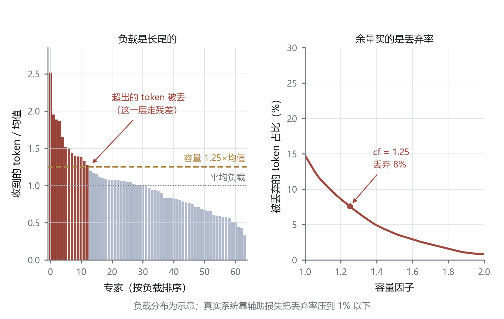

## 混合专家：路由、负载均衡、细粒度

把参数堆到一万亿，先撞上的不是显存，是一条更硬的绑定：稠密模型里，每个 token 都要过一遍全部参数。前向的浮点运算量是 $2N$，$N$ 是参数量，系数 2 是一个乘加算两次运算。$N=10^{12}$ 时每个 token 要 $2\times10^{12}$ 次浮点运算，按 400 TFLOPS 的有效算力是 5 毫秒，单流生成的理论上限每秒两百个 token。

实际连这个数都到不了，因为还要读权重。一万亿参数按 BF16 存是 2 TB，H100 的显存带宽是 3.35 TB/s，把权重完整读一遍要 597 毫秒。批大小是 128 时，权重读一遍摊到 128 个 token 上，每个 token 摊到 4.7 毫秒，勉强和计算持平；批大小是 1 时，读权重的 597 毫秒全压在一个 token 上，每秒不到两个 token。这就是稠密模型在万亿参数上的处境：容量、每 token 的计算、每 token 要读的字节，三者被同一个 $N$ 绑在一起，想加容量就必须加成本。

更麻烦的是回报不成比例。损失对参数是对数关系，从 10B 加到 100B 能降下来的那一点，要用十倍的推理成本去换。到服务阶段这笔账很难看：为了把某个能力从"偶尔答对"推到"基本答对"，要付十倍的钱。

Switch Transformer (2021) 给了一个不同的数字：把 T5 的前馈层换成 2048 个专家，总参数涨到 1.6 万亿，而每个 token 的计算量与 2.2 亿参数的 T5-Base 持平。同等算力下相对 T5-Base 有 7 倍以上的预训练加速；规模推到万亿之后，相对加强训过的 T5-XXL 仍有 4 倍。参数量和计算量第一次被拆成了两个可以分别调节的量。

### 把容量和计算拆开

做法是把前馈层复制成 $E$ 份，每份叫一个专家，再给每个 token 挑其中 $k$ 份：

$$y=\sum_{i\in\mathcal{T}}g_i\,E_i(x),\qquad g_i=\frac{e^{s_i}}{\sum_{j\in\mathcal{T}}e^{s_j}},\qquad \mathcal{T}=\mathrm{TopK}(s)$$

$x\in\mathbb{R}^{d}$ 是这个 token 在 MoE 层的输入，$E_i$ 是第 $i$ 个专家（一个标准的前馈网络），$s=W_rx\in\mathbb{R}^{E}$ 是路由器给出的亲和度分数，$\mathcal{T}$ 是被选中的 $k$ 个专家的下标集合，$g_i$ 是归一化后的门控权重。白话：每个 token 只走 $k$ 个专家，输出是这 $k$ 个专家结果的加权和，权重在选中的 $k$ 个之间归一化。

激活参数因此大致是 $\frac{k}{E}$ 的前馈部分，加上全部注意力与嵌入。$E=64$、$k=2$ 时前馈只有约 3% 被激活；$E=256$、$k=8$ 时是 3.1%。总参数决定模型能装下多少知识，激活参数决定每个 token 花多少算力，两个数从此可以分开调。

为什么拿前馈开刀，而不是注意力？因为两者承担的任务不同。注意力要在位置之间搬运信息，每个 token 必须能看到同一序列里所有别的 token，把它切碎等于截断上下文；而且注意力已经有了自己的"稀疏"手段（GQA、滑窗），不需要再靠路由。前馈是逐位置变换，第 $t$ 个位置的计算与第 $t+1$ 个位置完全无关，怎么分组都不影响别的 token。它占一层三分之二的参数，又只需要局部信息，是最自然的切分点。

这个结构还有一个不显眼的好处：它把"专家"变成了一个纯工程概念。专家之间没有数据依赖，可以放在不同设备上并行算，于是模型规模不再受单卡显存限制——这是后来专家并行（expert parallelism）能成立的前提，第五节和第七节会算这笔账。

### 路由：一次前向里的六步

路由器是整个结构里最小的部件。$W_r$ 的尺寸是 $d\times E$，$d=7168$、$E=256$ 时是 183 万个参数，占 671B 模型的百万分之三。它却决定了每个 token 走哪条路。

给定这一层 $T$ 个 token 的隐状态 $X\in\mathbb{R}^{T\times d}$，路由把 $X$ 变成同样形状的输出，中间是六个动作。

第一步打分：$s=XW_r\in\mathbb{R}^{T\times E}$，$s_{ti}$ 是 token $t$ 对专家 $i$ 的亲和度。GShard 和 Switch 在 $E$ 维上做 softmax 得到概率 $p_{ti}$；DeepSeek-V3 改成对每个分量单独取 sigmoid，再在选中的几个之间归一化。第二步取 top-k：$\mathcal{T}_t=\mathrm{TopK}(s_t,k)$，按 $s$ 取与按 $p$ 取结果一样，后者只是前者过了单调函数，次序不变。GShard 取 2，Switch 取 1，Mixtral 8x7B 取 2，DeepSeek-V3 取 8。

第三步算门控：$g_{ti}=p_{ti}/\sum_{j\in\mathcal{T}_t}p_{tj}$，只在选中的 $k$ 个上重新归一化。这一步容易被当成多余：softmax 是在全部 $E$ 个上算的，$E=256$、$k=8$ 时被选中的 8 个权重加起来通常只有零点几，直接乘到专家输出上，MoE 这一支的幅度会随 $E$ 变大而缩水，残差几乎把它淹掉。归一化之后 $\sum_i g_{ti}=1$，尺度与 $E$ 无关。

第四步装箱：按专家把 token 归拢进 $E$ 个定长缓冲，每个缓冲 $c$ 行，装不下的丢掉。$c$ 由容量因子（capacity factor，cf）定：

$$c=\left\lceil \frac{T\cdot k}{E}\cdot \text{cf}\right\rceil$$

分子 $T k$ 是这一批要处理的"token—专家"配对数，除以 $E$ 是每个专家的平均负载，再乘 cf 留余量。$T=8192$、$E=64$、$k=2$、cf $=1.25$ 时 $c=320$，64 个专家共 20480 个槽位，而实际需要 16384 个，余量 25%。

第五步专家计算：$Y_i=\mathrm{FFN}_i(X_i^{\text{in}})$，$X_i^{\text{in}}$ 是第 $i$ 个专家收到的 $c\times d$ 矩阵。$E$ 个形状相同的矩阵乘可以用一次批量矩阵乘算完，这是这套设计在 GPU 上能跑起来的关键——如果每个专家单独发一次 kernel，$E=256$ 时启动开销就把收益吃光了。

第六步合并：$y_t=x_t+\sum_{i\in\mathcal{T}_t}g_{ti}\,\mathrm{FFN}_i(x_t)$，$x_t$ 是残差项，MoE 只替换前馈那一段。

```text
s   = softmax(X @ W_r)                    # T×E
I   = topk(s, k)                          # T×k
g   = gather(s, I); g = g / sum(g, 1)     # 行内和 1
cnt = zeros(E); slot = full((T, k), -1)   # 计数与槽号
for t in 1..T:
    for j in 1..k:
        e = I[t, j]
        if cnt[e] < c:
            cnt[e] += 1; slot[t, j] = cnt[e]
        else:
            slot[t, j] = -1               # 丢弃
for e in 1..E:
    Y[e] = FFN_e(X[slot == e] padded to c)
out = X + sum over j of g[:, j] * gather(Y, slot)[:, j]
```

这套流程里没有一步告诉路由器"你选错了"。TopK 是离散决定，梯度只能经由被选中专家的门控权重 $g_i$ 回传，选中与否本身拿不到梯度。路由器学到的第一件事是"给已经选中的这几个分多少"；至于"该选谁"，只有 $s_i$ 的相对大小间接带回来一点信号，而且很弱。整个 MoE 训练的不稳定，根子就在这二十行里。

### 富者愈富：辅助损失怎么把负载压平

不加约束的路由会塌缩，机制是一个正反馈：某个专家在某批数据上碰巧好一点，路由器给它更多 token，它拿到更多梯度，变得更好，于是拿到更多 token。几千步之内，大部分 token 挤向少数几个专家，其余专家收不到梯度，等于不存在。参数还在，显存还占着，算力却浪费了，而且被挤爆的那几个专家也训不好——它们一次要吃几十倍于正常量的 token，梯度噪声的统计特性完全变了。

标准解法是加一个辅助损失，把"负载是否均衡"翻译成一个可以反向传播的量。先定义两个统计量：

$$f_i=\frac{1}{T}\sum_{t=1}^{T}\mathbb{1}\bigl[\arg\max_j s_{tj}=i\bigr],\qquad P_i=\frac{1}{T}\sum_{t=1}^{T}p_{ti}$$

$f_i$ 是硬指标的均值，即真正分到专家 $i$ 的 token 比例，不可导；$P_i$ 是路由器概率的均值，即它"愿意"给专家 $i$ 的平均份额，可导。完全均衡时两者都等于 $1/E$。损失取两者的点积再乘专家数：

$$\mathcal{L}_{\text{aux}}=\alpha\,E\sum_{i=1}^{E}f_iP_i$$

乘 $E$ 是为了让最小值恒等于 $\alpha$：均匀时 $\sum_i f_iP_i=E\cdot\frac{1}{E}\cdot\frac{1}{E}=\frac{1}{E}$，乘 $E$ 归一，换专家数不用重调 $\alpha$（《Switch Transformer》(2021) 式 4）。取 $E=8$、完全均衡，损失是 $\alpha$；所有 token 挤进一个专家，$f=(1,0,\dots)$、$P=(1,0,\dots)$，$\sum_i f_iP_i=1$，损失是 $8\alpha$，是均衡时的八倍。$\alpha=0.01$ 时，这两个值分别是 0.01 与 0.08，量级上都不大，但梯度方向明确。

梯度只从 $P_i$ 那一侧走，$f_i$ 当常数：

$$\frac{\partial \mathcal{L}_{\text{aux}}}{\partial s}=\alpha E\sum_{i}f_i\frac{\partial P_i}{\partial s}$$

白话：某个专家已经被塞得很满（$f_i$ 大），路由器再往上抬它的概率就要付更重的罚；空着的专家（$f_i$ 小）抬概率几乎不受罚。均衡是靠这个不对称推出来的，梯度并不告诉路由器"该选谁"，只告诉它"别再加给那个已经挤爆的"。

为什么不能直接惩罚概率，比如用 $\sum_i P_i^2$？因为路由器可以把概率在 $E$ 个专家上分得完全均匀，而 token 照样全流向同一个专家——top-k 只看相对大小，分数打平时 $\arg\max$ 退化成固定的那个下标，塌缩照旧。只有把不可导的实际计数 $f_i$ 乘进来，损失才看得见"token 到底去了哪"。GShard 的原文把这件事讲得更细：本意是最小化 $\sum_e (c_e/S)^2$，$c_e$ 是专家 $e$ 收到的 token 数，来自 top-2 计数、不可导，于是用可导的平均门控 $m_e$ 替换其中一个因子，写成 $m_e\cdot(c_e/S)$——一个可导的近似乘一个不可导的实测量。

$\alpha$ 的量级有讲究。Switch 在 $10^{-1}$ 到 $10^{-5}$ 之间按十倍扫过，取 $10^{-2}$：大到能尽快把负载压平，小到不压过主交叉熵项。DeepSeekMoE 在 2B 上用 0.01，16B 降到 0.001，145B 用 0.003 再加一个 0.05 的设备级均衡项——专家级管"别塌缩"，设备级管"别让某张卡空等"，两个目标各配一个系数。

辅助损失有个内在矛盾：它和语言建模的目标不一致。$\alpha$ 大了，路由被强行拉平，专家学不到专长，等于让 671B 的总容量只发挥出 37B 激活参数该有的样子；$\alpha$ 小了，均衡不住。还有更硬的问题：ST-MoE 用 FLOP 对齐 T5-XL 的配置做统计，基线六个随机种子里有两个发散，占三分之一；把学习率调小、梯度裁得更狠都能稳住，但质量明显下降。真正解决问题的是在路由 logits 上加一项 z-loss（上一章那根软弹簧，这里拴的是门控分数），系数 0.001，按批内 token 数平均；三个种子全部稳定，质量还略有提升。逻辑回到一句话：门控的数值本身会飘，BF16 下更是如此，飘到一定程度 top-k 的次序就翻，梯度跟着抖。

两个辅助项都只在训练时加进总损失，推理时根本不计算，也不占算力。它们改变的是参数走向，不是某一次前向的结果。

### 容量因子与丢弃：一个被低估的偏差

第四步那个定长缓冲，是容量因子存在的原因。批量矩阵乘要求 $E$ 个专家喂进同样行数的矩阵，编译器还要求所有张量形状在编译期确定，于是每个专家必须预分配 $c$ 行，不足的补零、超出的丢弃。

被丢的 token 没有消失：它的门控向量退化成全零，这一层对它等价于恒等映射，表示靠残差原样送到下一层。GShard 的算法把这条写得很明白——两个专家都满了，门控 $G_{s,e}$ 置零。

丢弃率可以压到很低，但有代价。Switch 报告在容量因子 1.25、配合辅助损失时丢弃率通常低于 1%；ST-MoE 训练用 1.25、评测用 2.0。这两组数字不能说明丢弃无害。Expert Choice Routing (2022) 观察到 token 选择路由在训练早期单个专家的超容比例可达 20% 到 40%，那一段有相当比例的 token 完全没被这一层处理过——而训练早期恰恰是路由还没学会分配的阶段，两个问题叠在一起。MegaBlocks (2022) 干脆绕开这套约束：把专家计算写成块稀疏矩阵乘，每个专家吃多少 token 都行，不丢弃也不补零，代价是要自己写 GPU kernel、块尺寸必须对齐；在 Pile 上训练的对比里，它比补零方案快 1.38 到 4.35 倍，可用的微批余量多出 2 到 8 倍。

丢弃规则还有一处不显眼的副作用：容量计数器按 token 在批内的顺序递增，先到先得。同样是"这个专家满了"，排在前面的 token 进得去、排在后面的进不去，于是丢谁带上了顺序偏差。丢掉的 token 在这一层梯度为零，它携带的那部分分布在 MoE 层上等于欠训练；如果训练数据是按来源排序的（比如同一批网页连在一起），这个偏差就会按来源聚集，某些来源的 token 系统性地更容易被丢。GShard 与 Switch 用辅助损失把丢弃率压到 1% 以下，就是为了让这条偏差尽量少触发；MegaBlocks 与 DeepSeek-V3 干脆不丢。

容量因子的第二个作用在系统层面：不设上限的话，某张卡可能收到远超平均的 token，整批计算等它一个，尾部延迟被拉长。丢 token 在这里是一种保护——宁可这一步少算几个 token，也不让整批等最慢的那个专家。同一条规则，在训练里是精度问题，在推理里是延迟问题。



图右边那条曲线的形状值得记：横轴从 1.0 拉到 2.0，丢弃率从两成掉到个位数，看着很划算；但分母那一边，每个专家预分配的行数同比例翻倍，算力也翻倍。所以容量因子不是"越大越安全"，它是在丢弃率与算力之间取一个点。取 1.25 的理由在这一节开头那个账里：它恰好让每个专家分到的行数越过 HBM 拐点。

### 切细，留一份公共的

DeepSeekMoE (2024) 提了两个改动，两个都保持专家总参数和每 token 计算量不变，动的只是参数怎么分配。

一是细粒度切分。标准 MoE 有 $E$ 个专家、激活 $k$ 个，每个 token 能用到的组合数是 $\binom{E}{k}$。把每个专家的前馈隐层从 $d_{ff}$ 缩到 $d_{ff}/m$，单个专家的参数变成约 $1/m$，专家数变成 $mE$，激活数相应改成 $mk$：

$$\binom{16}{2}=120\quad\longrightarrow\quad\binom{64}{8}=4\,426\,165\,368$$

左边是切分前（$E=16$、$k=2$），右边取 $m=4$：16 个专家变成 64 个、每个只剩四分之一大，激活数从 2 变成 8。账要对着算：激活的专家参数是 $mk\times\frac{1}{m}=k$ 份标准前馈，和切分前一样；总专家参数是 $mE\times\frac{1}{m}=E$ 份，也一样。变的只有组合数——从 120 涨到四十四亿。组合更多意味着每个 token 能拼出更贴合自己的那组参数，而不为这个灵活性多付算力。

细粒度也不能一直切下去。专家再小，每次矩阵乘的算术强度就不够：一个 $d\times d_{ff}/m$ 的矩阵乘，$m$ 大了之后矩阵变成细长条，读进来的权重还没算几遍就完事，GPU 的计算单元喂不满，省下的算力被利用率下降吃掉。实际取 $m=4$ 是在组合数与利用率之间取的一个点。

二是共享专家。留 $K_s$ 个专家对所有 token 都激活、不参与路由，路由侧的激活数从 $K$ 减到 $K-K_s$，总激活量不变。写成

$$h_t=u_t+\sum_{i=1}^{K_s}\mathrm{FFN}_i(u_t)+\sum_{i=K_s+1}^{mE}g_{t,i}\,\mathrm{FFN}_i(u_t)$$

$u_t$ 是 token $t$ 在这一层的输入，前一项是共享专家（全部激活、无门控），后一项是路由专家（按 $g_{t,i}$ 加权，未选中的权重为 0）。动机是不同的专家在训练中各自学到一部分通用的语法和常识，重复占用容量；把这些公共知识收进一个始终在线的专家，路由专家就能专注差异化部分。

消融很能说明问题：把共享专家关掉、换成一个额外的路由专家（算力完全不变），Pile 损失从 1.808 涨到 2.414——差 0.6，在困惑度上是从 6.1 涨到 11.2 那种差距。共享专家与路由专家的配比试过 1 个、2 个、4 个共享（路由侧相应调整），其中 2 个共享配 6 个路由、也就是 1:3 那一档略好，所以放大时按 1:3 配。

具体账目：DeepSeekMoE 16B 是 2 个共享专家加 64 个路由专家，每个专家是标准前馈的 0.25 倍，每 token 激活 2 个共享加 6 个路由。激活的专家参数是 $(2+6)\times0.25=2$ 份标准前馈；总专家参数是 $66\times0.25=16.5$ 份。一份标准前馈在这个宽度下约十亿参数，16.5 份就是 15B 出头，加上注意力与嵌入，总数 16.4B；每个 token 只激活其中 2 份，再加同一块注意力与嵌入，就是 2.8B 激活参数。参数量是 16.4B，算力按 2.8B 付。

还有一处工程细节：第一层的前馈不做 MoE。这一层紧挨嵌入，输入分布还没被后面的层整理过，负载均衡收敛得特别慢，辅助损失在那里最容易和主损失打架；让第一层保持稠密，代价是多一点算力，省下的是一堆调参。

### 算一遍：细粒度切到什么时候就不划算了

组合数随 $m$ 爆涨，看上去可以一直切，实际上有一个很硬的下限：专家的矩阵乘不能变成纯带宽操作。

一个专家做的事是 $(c\times d)$ 乘 $(d\times d_{ff}/m)$，$c$ 是容量因子定下的行数。乘加数是 $2c\,d\,d_{ff}/m$，要读的权重是 $d\,d_{ff}/m$ 个元素，bf16 下 $2d\,d_{ff}/m$ 字节。两者相除，算术强度：

$$\text{强度}=\frac{2c\,d\,d_{ff}/m}{2\,d\,d_{ff}/m}=c$$

**强度恰好等于这个专家分到的行数。** H100 在 bf16 下的拐点是 295，于是有一条直接可用的判据：每个专家手里至少要有三百行。

代进训练配置：$T=8192$、$k=2$、$E=64$，每个专家平均分到 $8192\times2/64=256$ 行，容量因子 1.25 把它抬到 320。比 295 高两成——刚好在拐点之上，不多不少。这不是巧合，反向推一下就知道：容量因子 1.25 这个常用值，恰好是让“每专家行数”越过拐点的最小余量。

现在看它为什么不能无限切。把 $m$ 从 4 提到 16，专家变成四分之一大，行数不变（还是 320），强度不变——单看强度似乎没事。但组合数再涨三个量级，每张卡上的专家数也翻了四倍，每个专家都要把 3.67 MB 的权重从 HBM 读一遍；且当专家小到一定程度，单个专家的工作块装不满一个 SM，同时活跃的专家数又不一定能把 SM 填满。于是表面前的强度没变，实机上的占用率掉了。

真正的约束不在单个专家，在“一张卡上能否同时跑满若干个专家”。工程上的经验是：先按拐点定行数，再按 SM 数与共享内存定每卡专家数，最后才去算总专家数。反着来（先定总参数、再切）就会得到一堆“理论很强、实测跑不动”的配置。

### 专家并行与张量并行怎么混

MoE 的并行策略不是“全部用专家并行”这么简单。一个 MoE 层里有两类模块：注意力是稠密的、每个 token 都要全算；前馈是稀疏的、每个 token 只走几个专家。两者的最优切法完全不同。

注意力按张量并行切最自然：把头的维度切开，每张卡算一部分头，最后做一次归约。这一层每张卡都要参与，没有“某些卡闲着”的问题。

前馈按专家并行切：每张卡放若干个专家，token 被路由到自己专家所在的卡上。一张卡上没有活的时候完全闲着，这在大批次下被摊平，在小批次下就是浪费。

于是现实中的配置是两者叠加：节点内 8 张卡做张量并行（注意力按头切、专家每卡放一份），节点间做专家并行（专家分散到各节点）。取 671B 这个规模：注意力部分 $d=7168$、128 个头，每卡 16 个头；每个 MoE 层 256 个专家，40 个节点、每节点 8 卡共 320 卡，每卡分不到一个专家——必须让每个专家被多张卡共享，或者增加每卡上的专家数并减少节点数。

| 切法 | 切什么 | 每卡负载 | 通信 |
|---|---|---|---|
| 张量并行 | 头与维度 | 均匀 | 每层两次全归约 |
| 专家并行 | 专家 | 随路由波动 | 每层两次全交换 |
| 数据并行 | 样本 | 均匀 | 梯度全归约 |

三种切法的通信性质完全不同，这是 MoE 集群难调的根本原因。张量并行的通信是“全归约”，量固定、时序规整，可以和计算重叠；专家并行的通信是“全交换”，量随路由波动、时序不规整，很难藏；数据并行的通信在反向之后，可以攒批。一个集群里三种通信同时存在，任何一处抖动都会被放大成全局的尾部延迟。

工程上的一条经验是：**把波动最大的那一维（专家并行）放在带宽最高的那一维（节点内 NVLink）上，把规整的通信（张量并行）放在节点间**。这与“按显存需求分配”的直觉相反，但 p99 延迟会好很多。代价是单节点的专家数变少、每个专家被更多节点引用，显存利用不那么紧凑。

### 三个探针：专家到底学到了什么

“专家分工”这个词很容易被误读。三个探针能把它的真实形态量出来，而且都不需要重新训练。

**探针一：输入聚类。** 把每个专家收到的 token 隐状态聚成几类，看类内方差。如果专家真的学到了“领域”，同一专家收到的 token 应该高度同质；实际观察到的是同质性很弱，而按“前一个 token 是谁”“是不是行首”“有没有标点”这类浅层特征分组时，同质性很强。

**探针二：路由熵。** 对每个 token 算一下选中专家的概率分布熵。熵高说明路由“不自信”，它没有把 token 明确交给某一类专家；熵低说明它很确定。实际分布是双峰的：少数 token 熵很低（高度确定），大部分很高。那些低熵的 token 通常就是携带强模式的（代码编号、URL、公式）。

**探针三：专家消融。** 把某一个专家置零（输出为零），看损失涨多少。涨幅大的专家是“不可替代”的，它们通常只占少数。若某个专家消融后损失一点不涨，说明它是冗余的——这也是剪枝的直接依据。

| 探针 | 量什么 | 典型结果 | 能回答什么 |
|---|---|---|---|
| 输入聚类 | 类内方差 | 浅层特征同质性高 | 专家在学什么 |
| 路由熵 | 选的确定度 | 双峰分布 | 哪些 token 依赖路由 |
| 专家消融 | 损失敏感度 | 少数不可替代 | 能不能剪 |

三个探针合起来，得到一个不那么浪漫但很有用的结论：**专家不是一个一个的领域顾问，而是一批局部模式检测器。** 路由看不到全局，它只看当前这个位置的隐状态，所以它能做的判断就是“这个位置长得像什么”。这也解释了为什么共享专家有效：语法与常识这些每个位置都要用的东西，不应该由几十个模式检测器各自学一遍。

### 把辅助损失换成偏置

DeepSeek-V3 的规模是 671B 总参数、37B 激活，61 层，1 个共享专家加 256 个路由专家，top-8，除第一层外都是 MoE 层。它把辅助损失换成了偏置。

亲和度用 sigmoid 逐元素算，不用 softmax：$s_{t,i}=\sigma(u_t^\top e_i)$，$e_i$ 是第 $i$ 个专家的质心向量（路由矩阵的第 $i$ 列）。每个专家维护一个偏置 $b_i$，只加在选 top-k 用的分数上，不加在门控权重上：

$$\mathcal{T}_t=\mathrm{TopK}\bigl(\{s_{t,i}+b_i\}_{i=1}^{E}\bigr),\qquad g_{t,i}=\frac{s_{t,i}}{\sum_{j\in\mathcal{T}_t}s_{t,j}}$$

门控用的是没加偏置的原分数，所以被选中的专家拿到的权重仍反映真实亲和度，偏置只负责"让不让它进场"。这是与辅助损失最关键的区别：辅助损失会改动梯度方向，偏置只改动一次离散选择。

更新是控制回路，与梯度无关。每步训练结束统计这一批里各专家收到的 token 数，过载的减、欠载的加：

$$b_i\leftarrow b_i+\gamma\cdot\operatorname{sign}\bigl(\text{imbalance}_i\bigr),\qquad \gamma=0.001$$

$\gamma$ 叫偏置更新速度，前 14.3T token 用 0.001，最后 500B 直接归零（训练末期让路由自由收敛）。偏置不进入损失函数，不会和语言建模的目标打架；它的强度由 $\gamma$ 单独控制，与 $\alpha$ 那种"既要压负载又不能压过主损失"的两难无关。论文报告这样做的模型在多数基准上优于辅助损失版本。

一点代价：偏置只按批次的统计调，管不了单个序列内部的极端不均衡。一批 4096 个 token 平均下来每个专家 16 个，但某一个序列里可能有一百个 token 全挤向同一个专家。所以 V3 还留了一个权重极小（$10^{-4}$）的序列级均衡损失，全局靠偏置，局部靠这个微弱约束。另一手是部署时的冗余专家摆法——训练和推理都不丢 token，负载全靠偏置压住和部署摊平。

### 路由的三种病，三种指标

均衡、抗尖峰、专家有活儿干，是三个不同的目标；它们分别会以三种方式坏掉，而且症状不重叠。

**塌缩。** 大部分 token 挤向少数专家。早期就能看到：专家负载的最大值与均值之比从 1.2 升到 3 以上，且持续上升。此时丢包率不一定高（百来个专家总有几个空的），但总容量已经废了一半。指标就是“负载最大最小比”与“零命中专家数”，前者大于 3、后者持续增长就是塌缩在发生。

**抖动。** 负载均值看着正常，但 top-k 的成员在相邻两步之间大面积翻转。机制是门控分数的微小变化让第 8 与第 9 名互挨位置，而这一步的梯度只来自“被选中的那几个”，于是下一次又翻回来。肉眼看不见，但训练损失会出现一肿一肿的小鼓包。指标是“相邻两步 top-k 集合的重合度”，健康值在八成以上，掉到五成就该加 z-loss 或者降学习率。

**欠训练。** 负载均衡得很好，可总有一批专家几乎没被选过。它们的梯子一直是零，参数停在初始化。看上去无害（因为不参与计算），一旦推理时某个请求命中它们，输出就是噪声。指标是“参数更新次数”的分布，不是“被选中次数”——一个专家被选中了十次但每次都在同一批数据上，和没训过区别不大。

三种病对应三种不同的手段，别搞错：塌缩要偏置或辅助损失（前两节），抖动要 z-loss 与更低的学习率（让 logits 变化慢一点），欠训练要检查是否真的需要那么多专家（专家数超过数据能支撑的粒度时，必然有一批闲置）。把塌缩当成抖动去调 z-loss，只会让负载更不均。

### 显存与专家并行的账

MoE 省的是计算，不是显存。

671B 参数按 FP8 存是 671 GB。一张 H800 是 80 GB，八张卡加起来 640 GB，连权重都装不下。官方给出的部署方案里，预填充阶段用 32 张卡，解码阶段用 320 张卡，靠专家并行把 256 个路由专家分散到四十个节点上。而这 671 GB 里，每个 token 只用到 37B——计算量相当于一个 37B 的稠密模型，显存要按 671B 付。容量按总参数算，成本按激活参数算，显存又要按总参数付，三个数从此不是同一个。

参数账可以对上。每个专家的隐层是 2048 维，宽度 $d=7168$，三张矩阵（升维两张、降维一张）是 $3\times7168\times2048\approx4.4\times10^{7}$ 个参数；256 个专家一层是 $1.13\times10^{10}$，58 个 MoE 层是 654B；加上 58 个共享专家（2.6B）、注意力与嵌入（约 14B），合计约 671B。

专家必须分布在不同设备上，于是每个 token 都要被送到它选中的专家所在的卡，算完再送回来。这是一次全交换（all-to-all）：每张卡把本地 token 按目标专家分组发出去，再接收别的卡发来的 token。一个 MoE 层有两次，去和回。

字节数可以直接算。本地 $T$ 个 token、每 token 选 $k$ 个专家、隐维 $d$、FP8 一字节，单程发出的量是 $Tkd$。代进 V3 的数：每卡每步 4096 个 token，$k=8$，$d=7168$，一层单程 $4096\times8\times7168\approx2.3\times10^{8}$ 字节，230 MB；往返合计 470 MB。

同一层每个 token 的计算量是 $2\times\frac{37\times10^{9}}{61}\approx1.2\times10^{9}$ 浮点运算，4096 个 token 是 $5\times10^{12}$，按 400 TFLOPS 有效算力是 12 毫秒。470 MB 走在 50 GB/s 的 InfiniBand 上是 9.4 毫秒。两者同一量级，这就是 V3 所说的跨节点专家并行"计算通信比接近 1:1"。通信藏不住，只能错开：V3 加了节点限制路由，每个 token 最多送到 4 个节点，节点内走 NVLink（160 GB/s，比 IB 快 3.2 倍），跨节点只传一份，进节点后再用 NVLink 分发到具体专家；再用 DualPipe 把 all-to-all 和计算错开。

通信量与 token 数、隐藏维度、$k$ 成正比，与专家数无关；延迟却与拓扑强相关。这个区别决定了扩容的方向：加专家只增加显存压力，不增加通信量；加并发才增加通信量。

把三种互连摆在一起，才能看出“计算通信比接近 1:1”这句话是对哪种拓扑说的。同一笔 470 MB 往返，走出去要多久：

| 互连 | 单向带宽 | 470 MB 往返 | 与 12 ms 计算之比 |
|---|---|---|---|
| NVLink（节点内） | 160 GB/s | 5.9 毫秒 | 0.5 |
| InfiniBand | 50 GB/s | 18.8 毫秒 | 1.6 |
| 普通以太网 | 25 GB/s | 37.6 毫秒 | 3.1 |

最后一行是很多人踩过的坑：在实验室的 NVLink 机器上调好的 MoE，搬到云上的普通网络集群，性能掉一半以上，而且掉得没有规律——因为通信已经比计算长三倍，任何一点负载不均都直接变成墙钟。这也是为什么节点限制路由（每个 token 最多送到四个节点）能同时改善两件事：它把大部分流量留在 NVLink 上，同时把跨节点的部分变成可以提前调度的一整块。

### 微调阶段：MoE 为什么比稠密娇气

预训练时一批几千个 token，路由的抖动被摊平了；微调时数据集小、批次小，同一个机制换了副面孔。

先算每个专家能见到多少数据。稠密模型里每个参数在 $D$ 个 token 上都被更新一次，所以它对数据的“曝光量”就是 $D$。MoE 里一个专家被选中的次数约为

$$\frac{D\cdot k}{E}$$

取 $D=10$ 亿、$k=8$、$E=256$，每个专家只见到 3100 万个 token，是稠密模型的三十一分之一。而它要学的参数量与稠密模型的一个前馈层一样多。曝光量少三十倍，参数量不变，结果就是**更容易记住那 3100 万个 token 里出现过的东西**。

第二个问题是路由会漂。路由的均衡靠辅助损失或偏置，而这两者的统计量都建立在“一批足够大”的假设上。微调时批次小到几百 token，一个批次里每个专家收到的样本数只有个位数，偏置的符号估计噪声很大，于是路由在微调初期会来回摆。摆动的代价是专家之间的分工被重新洗牌，而预训练学到的分工正是它有价值的部分。

具体表现是：微调后模型在训练任务上很好，在通用能力上掉得比稠密模型多。诊断办法是把微调前后的专家选择分布拿出来算一次 KL 散度；如果需要“哪几个专家变了”的答案，就直接比每个专家的被选频率。KL 大且集中在少数专家上，说明路由被少量样本带跑了。

工程上的四种应对，按侵入性从低到高：冻结路由参数只训专家；把辅助损失或偏置更新的速度调低一个量级；增大批次并做梯度累积；只对少数层做 LoRA，避开 MoE 层。最后一种最保守，但在“只想加一个能力”的场景里往往够用。

这个不对称带来推理上的独特困难。稠密模型每张卡的负载是固定的：张量并行把每个矩阵切开，每张卡算自己那一份，永远一样多。MoE 做不到这一点。一批请求进来，路由把 token 分给哪些专家取决于内容，某些专家可能被集中命中，它所在的卡成为瓶颈，其余卡在等全交换。批次越小波动越大，批次大了延迟又上去。工程上的应对有几类：冗余专家部署，把热门专家复制几份放到不同节点，减少跨节点流量；专家卸载，把冷专家放在主机内存，按需换入；按专家亲和度做请求调度，把会命中同一批专家的请求拼在一起。模型一行不用改，改的是部署时的摆法。
冗余专家值得单独算一笔，因为它是“用显存换延迟”的最直接例子。一个路由专家在 V3 这个规模下约 4400 万参数，FP8 存是 44 MB；复制八份是 352 MB，相对每卡 80 GB 的预算可以忽略。真正要算的是它能省下多少通信。

假设 256 个专家分布在 40 个节点上，每节点 8 张卡。一个批里最热的 8 个专家吃掉了四成的 token，而这 8 个专家恰好分散在 8 个不同节点上——于是几乎每个 token 都要跨节点走一趟。把这 8 个专家在每个节点各复制一份，跨节点流量就降到“每个节点的本地需求”，只剩节点间的少量余量。代价是 8 个专家 × 40 节点 × 44 MB = 14 GB 的额外显存，摊到 320 张卡上是每卡 44 MB。

这就是为什么 MoE 的部署方案里总有一节在讲“冗余专家怎么摆”：它不是优化技巧，是把一个随拓扑变化很大的延迟项压成常数。同一份权重，摆法不同，p99 延迟能差一倍以上，而模型本身一个字节都不用改。

训练与推理在 MoE 上第一次真正分道。训练时路由按整批统计，容量因子、丢弃率、辅助损失全是批级概念，一批几千个 token 把抖动摊平了；推理时逐 token 前向，batch 常常是个位数，没有"整批"可看，容量因子从显存参数变成了延迟参数——它决定的是最忙那张卡要等多久。训练侧的账又不同：稠密模型里每个参数每步都收到梯度，MoE 里一个专家可能一整批都没被选中，参数这一步就没动；反过来说，被选中的专家一次要处理比稠密模型多得多的 token。这种非均匀的梯度统计让 MoE 对批次大小更敏感，也是它在微调阶段比稠密模型娇气的原因——同样的学习率在稠密模型上没事，在 MoE 上可能直接把路由推塌。

还有一个常被拿来宣传、实际却没那么玄乎的点：专家到底学到了什么。最初的预期是按领域分工，有的专管代码，有的专管数学。实际观察到的分工细碎得多，多数专家对应的是浅层模式：特定的标点、某些句式开头、几个高频词的搭配。路由只看当前这个位置的隐状态，没有全局视野去判断"这是不是一道数学题"，分工自然就落到局部特征上。把专家想象成一排各有所长的顾问，不如想象成一本被撕成很多册的词典，每个 token 只去查其中几册。这也解释了共享专家为什么有效：语法和常识这些每个 token 都要用的东西，分给几十个专家各自学一遍，不如放一册公用。

::: {.keypoint}
MoE 把容量和计算解耦：总参数决定模型能装下多少知识，激活参数决定每个 token 花多少算力，而显存必须按总参数付。
:::

稀疏化把"一个稠密矩阵乘输入"换成了"一次路由加若干个小矩阵"。它带来离散决策、随机负载、同步通信这三样麻烦，没有一样是模型结构自己能消化的，得靠训练系统：怎么切分、怎么排布、怎么在几千张卡上把一次全交换压进几十毫秒、怎么在单卡故障时不丢掉整个训练状态。

容量这一关过了，另一个方向的问题还在。这一卷前面几章改的都是"一层里怎么算"，MoE 改的是"一个 token 走哪些参数"；两者都没有回答上下文变长之后会发生什么——位置编码在几万 token 之外还准不准，注意力在长文里还能不能找到该找的那一句，训练数据里到底有多少长文可学。窗口开大不等于能用，这是下一章要算的账。
