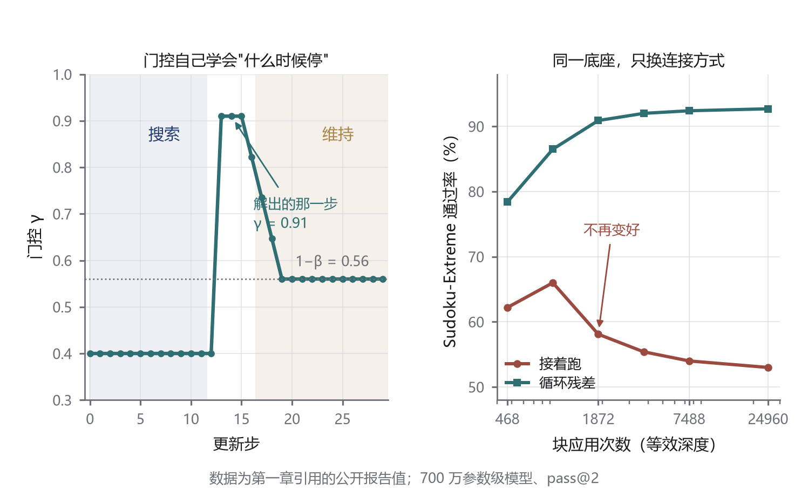

## 循环深度：让同一层多跑几遍

先看一组让人不太舒服的数字。

一个七百亿参数的推理模型，在 ARC-AGI-2 上拿到 13.6% 的通过率（pass@2）；同一张表里，DeepSeek-R1 是 1.3%，Claude 3.7 Sonnet 是 0.7%，o3-mini-high 是 3.0%，Gemini 2.5 Pro 是 4.9%。而在最难的数独基准 Sudoku-Extreme 上，后者全部是 0.0%。

那个 13.6% 的模型只有 **700 万参数**，比对手小三个数量级。

它靠的不是更大的参数，也不是更多的训练数据，而是把同一组层反复跑很多遍。这类结构叫循环 Transformer（looped Transformer）：参数不增，计算增，深度可以按需拉伸。

这一章讲它是怎么工作的、为什么前几年一直不灵、以及 2026 年那篇 Loop-Native 的论文修掉的是哪一块。

### 深度有两条轴

前面几章改的是"横向"的东西：一个 token 在每一层里怎么和别的 token 交换信息。这一章改的是"纵向"：要让模型多想几层，除了真的叠层，还有另一个办法。

把第 1 层到第 $k$ 层打包成一个块（block），让它连续跑 $T$ 遍。每一遍的输出作为下一遍的输入。这样一来：

- 参数量只算 $k$ 层，但计算量按 $k\times T$ 层算；
- 深度变成两个变量：物理深度（真实存在多少层）和循环深度（跑几遍）；
- 循环次数可以在推理时调，不需要重新训练。

这不是新想法。2018 年的 Universal Transformer 就提出过：权重共享，循环执行，并且可以按 token 决定循环几次。当时的动机是"用更少的参数换更深的计算"，但受限于当时的训练条件和任务规模，效果没有说服力。

2025 年之后这条线重新热起来，原因是任务变了：当模型被要求做“多步、有唯一答案、可以验证”的题（数独、迷宫、ARC 这类谜题），“多想几层”就直接等于“多搜索几步”。这正好是循环深度的强项。

### 两条轴的对照

把“堆层”和“循环”放在一张表里，各自的代价就清楚了。

| | 叠层 | 循环 |
|---|---|---|
| 参数量 | 随层数涨 | 与循环无关 |
| 训练显存 | 每层存激活 | 只存反传段 |
| 推理延迟 | 随层数涨 | 随循环次数涨 |
| 推理可调 | 不能 | 能 |
| 每层变换 | 各不相同 | 同一套复用 |
| 主要风险 | 深层训不动 | 状态被覆盖 |

这张表里最值得看的是最后两行。物理深度每一层有不同的参数，模型能学到“不同层次做不同的事”；循环深度每一遍用的是同一套参数，它假设“同一件事重复做，逐步变好”。这个假设在搜索类任务上成立，在需要“先分词、再句法、再语义”这种层次化处理的任务上就不一定。

而"状态被反复覆盖"正是下一节要讲的那个坑。

还有一层换算值得记住：块内层数与循环次数可以互换，但换出来的东西不同。

| 块层数 | 圈数 | 等效深度 | 参数量 |
|---|---|---|---|
| 1 | 3744 | 3744 层 | 1 层 |
| 2 | 1872 | 3744 层 | 2 层 |
| 4 | 936 | 3744 层 | 4 层 |

三行的算量完全一样（等效深度都是 3744 层），但能力不同。圈数多、块层少，意味着“同一套变换反复微调同一个状态”，适合在一个小空间里逐步收敛；块层多、圈数少，意味着“每圈做一次更复杂的变换”，适合每一步都要处理更多信息。前者是搜索，后者更像推理。

这也解释了为什么工作里的块往往只有 1 到 4 层：再厚就变成了“一个普通的小模型跑几遍”，循环的意义——反复精修——反而淡了。而如果块薄到 1 层，表达能力又太弱，每一步只能做很小的修正，需要更多圈才能收敛。2 层是这个区间的常见折中，既够表达一次“读—写”的最小单元，又能让重复真的重复。

### 为什么简单地循环会退化

最早的连接方式很朴素：上一遍的输出，直接作为下一遍的输入。可以叫"接着跑"（carry-last）：

$$z_t=f_\theta(h_{t-1}),\qquad h_t=z_t$$

$f_\theta$ 是共享参数的那个块，$h_t$ 是第 $t$ 遍之后的状态。每一步只保留最新结果，更早的计算只能通过"还留在最新状态里的那部分信息"间接传下去。

问题就出在这。2026 年那篇 Loop-Native 论文把现象测出来了：在一道已经解出来的数独上继续跑，准确率会**先升后降**。

- 一个 700 万参数、用"接着跑"的模型（TRM），在 468 层时达到 62.2%，到 1872 层掉到 58.1%；
- 解出题目之后的 36 次更新里，它把 19.7% 已解出的题又重新弄错了；
- 状态改动量的曲线很能说明问题：解出后先降到每步 3%，随后又爬回 10%，并且一直保持在那里。

作者给这个现象起了个名字：**潜空间过度思考**（latent overthinking）。它和“模型在输出里反复自我怀疑”是一回事，只是发生在隐状态里。机制很直接：后续的更新是带噪声的，噪声一覆盖，早先推对的中间结论就丢了。而“接着跑”的规则里，模型没有能力说“这一遍的输出我不信”。

### 为什么到 2025 年才回潮

这个想法 2018 年就有了，中间七年没声响，三个条件变了。

**任务变了。** 当年拿循环 Transformer 去做翻译、语言建模，收益不明显——那些任务不需要“反复精修同一个状态”。现在有了一批“有唯一答案、能自动判对错”的推理基准，循环的优势才能量出来。

**评测方式变了。** “测试时多算一点”成为一个正式的维度：同一个模型，多跑几遍、多看几条采样，分数能不能涨。循环深度天然支持这件事，而且不需要重新训练。

**小模型的价值变了。** 一个 700 万参数的模型能在特定任务上打出商用大模型的分数，意味着“部署在端侧、成本几乎为零”的专用推理器变得可行。这类模型不需要世界知识，只需要会搜索。

三个条件里，第三个最关键。它解释了为什么这些工作大多用极小的模型做实验：它们的卖点不是“更大”，而是“同样的事，用少三个数量级的参数做”。

### 换一种连接方式：学会保留

修法的方向不是"少跑几遍"，而是改连接方式：让模型自己决定，过去的哪些计算要留、新的一遍要接受多少。

做法借了 Attention Residuals 的思路（第 8 章讲的那套：残差流不是简单累加，而是对更早的层做加权求和），把它从"层与层之间"搬到"循环与循环之间"。

每个候选状态 $z_i$ 在产生时打一次分，分数由一个共享的伪查询 $q$ 给出：

$$s_i=q^{\top}\,\mathrm{RMSNorm}(z_i)$$

然后按"分数 + 时间折扣"做加权：

$$h_t=\frac{\sum_{i=0}^{t}\exp\bigl(s_i-\lambda(t-i)\bigr)z_i}{\sum_{i=0}^{t}\exp\bigl(s_i-\lambda(t-i)\bigr)}$$

$-\lambda(t-i)$ 是时间惩罚：越早的候选打折越多，$\lambda$ 可学。$\lambda=0$ 时退化成"对所有历史候选做注意力"，这时内存会随循环次数线性增长。

关键的一步是把上面的求和写成递推。令 $e_i=\exp(s_i)$、$\beta=e^{-\lambda}$，只需要维护两个量：

$$N_t=\beta N_{t-1}+e_t z_t,\qquad D_t=\beta D_{t-1}+e_t,\qquad h_t=\frac{N_t}{D_t}$$

$N_t$ 是一个 $d$ 维向量，$D_t$ 是一个标量。每个 token 的额外内存是 $O(d)$，**与循环次数无关**。这一点很重要：跑到两万步和跑到两百步，占的显存一样。总计算是 $O(Td)$；如果老老实实对全部历史做注意力，内存是 $O(Td)$、计算是 $O(T^2d)$。

把这个递推整理一下，还能得到一个更好懂的等价形式：

$$h_t=h_{t-1}+\gamma_t\,(z_t-h_{t-1}),\qquad \gamma_t=\frac{e_t}{\beta D_{t-1}+e_t}\in(0,1)$$

也就是说，循环残差最后落地成一次**自适应步长的更新**：新候选的分数高，$\gamma_t$ 接近 1，直接换掉旧状态；分数低，$\gamma_t$ 接近 0，旧状态几乎不动。而且因为权重非负且归一化，$h_t$ 落在历史候选的凸包内，范数不会被反复放大——这正好治住了"循环越深、残差流越大"的老毛病。

### 嵌套循环：内层与外层

真实实现里，“循环”往往不是一层。拿论文里的结构举例，它有两条轴：

- **外层**：把一个完整的推理周期跑几次（$H$ 次）；
- **内层**：在一个周期里，把同一块再精修几次（$L$ 次）。

两层的状态各有一套“打分 + 衰减”参数，各有一对累加器（$N$、$D$），额外参数是每个轴 $d+1$ 个——对于隐藏维度 512 的模型，就是五百多个数，可以忽略不计。

嵌套的好处是分工：内层负责“把当前假设往下推一步”，外层负责“换一个假设再试”。数独这类任务正好对应这个结构：内层填格子，外层检查矛盾、必要时回溯。

代价也在这里：两层循环相乘，计算量是 $H\times L$ 倍。所以要控总量，而不是控单层。

### 它学到了什么：会自己停下来

这套机制最有意思的地方，是训练完之后 $\gamma_t$ 的行为。

如果把每个候选都当成一样重要，$\gamma_t$ 应该恒定在 $1-\beta$（论文的设置里是 0.56）。实际上它学出了三段：

- **搜索阶段**：$\gamma_t\approx0.40$，明显低于 0.56。模型在压制新的提案，不让乱七八糟的中间结果改写已有推理；
- **解出的那一步**：$\gamma_t$ 冲到 0.91，几乎完全接受这个新状态；
- **解出之后**：六次更新内回落到 0.56，状态稳定下来。

给模型的内容分数也能对上：解码出全对的盘面，中位分数 7.25（上限 8.0）；错 20 格时降到 2.75；错 33 格时是 $-0.58$。而这些分数**没有任何"正确与否"的监督信号**，它只是被训练去"保留有用的状态"，最后自己长成了"对不对"的判据。

论文里有个消融很能说明问题：把内容分数去掉（训练时或推理时），准确率掉 6 到 7 个百分点。说明真正起作用的不是衰减，而是"按内容挑"。

还有一个抗扰动实验：在解出之后给状态注入相对扰动（从 $10^{-4}$ 到 0.3），再跑 36 遍。改过的版本保住 100% 的解；"接着跑"的基线在**不加扰动**的情况下就丢 15%–20%。

### 收益与账

用同一个 700 万参数的底座，只换连接方式，四个基准一起看：

| 基准 | TRM | FPRM | InfiLoop |
|---|---|---|---|
| Sudoku-Ext. | 74.7 | 94.2 | **97.9** |
| Maze-Hard | 85.3 | 87.0 | **87.4** |
| ARC-1 | 44.6 | 47.5 | **49.1** |
| ARC-2 | 7.8 | 6.2 | **13.6** |

三列分别是三种连接方式：TRM 是"接着跑"，FPRM 是固定点加阻尼，InfiLoop 是循环残差。ARC 两行是 pass@2。

测试时多跑几遍的收益也很干净：1872 层时 90.9%，已经超过阻尼基线在 3744 层时的 90.1%——**用一半的算力换同样的准确率**。而它 936 层就能到 86.5%，这个数"接着跑"跑到 24960 层（深 26 倍）也追不上（83.65%）。跑到 24960 层时，它是 92.74%。

图左半边的竖坐标全程没超过 1，这本身就是结果：更新量是一次凸组合，状态被锁在历史候选的包络里，所以范数不会随深度膨胀。右半边红线那个拐点（1872 处开始掉）是“接着跑”的致命伤——它不是不够深，是深了反而坏。

账要算清三笔。

**参数省了，算力没省。** 循环 $T$ 遍就是 $T$ 倍前向。参数量小三个数量级，指的是显存和部署成本；计算量按需花，指的是每次推理的延迟与电费。这两个不是一回事。

**训练时的反向传播要截断。** 论文的训练配置是 3 个外层循环、每次 6 个内层更新，每个监督段执行 21 次块应用，但梯度只穿过最后 7 次。原因很实际：完整回传 21 次的显存放不下，和循环网络当年遇到的截断 BPTT 是同一个问题。

**测试时循环有最优区间。** 不是越深越好。论文里同一批题在 936 层、1872 层、3744 层上的收益是递减的，跑到两万多层的边际收益已经很小。工程上要按“目标难度”定循环预算，而不是“能跑多少跑多少”。

### 算一遍：几千圈到底花了多少算力

上面的分数只说了"谁更准"，没说"贵多少"。把圈数换成浮点运算，两个模型才能放在同一杆秤上。

先估一个块的规模。隐藏维 $d=512$，一个块里两层。一层的参数约 $12d^{2}$（注意力四个投影 $4d^{2}$，前馈两张 $8d^{2}$），即 314 万；两层 628 万。81 个格子的数独，一圈的前向是

$$2\times6.3\times10^{6}\times81\approx1.0\times10^{9}\ \text{FLOPs}$$

1872 圈就是 $1.9\times10^{12}$。拿一个 7B 的稠密模型比：它在 81 个 token 上跑一次前向是 $2\times7\times10^{9}\times81=1.1\times10^{12}$。也就是说，**1872 圈的循环模型，算力约等于一个 7B 模型在这个输入上跑两遍**，而参数只有它的千分之一。

这组数字才是这条路线的要害。它没有用更少的算力，它用的是同样量级的算力、少三个数量级的参数。参数决定的是显存和部署门槛，算力决定的是延迟和电费——两件事被彻底拆开了。端侧部署时，前者往往是硬约束：700 万参数的模型能塞进手机，7B 的不能。

再往下一档看延迟。按 100 TFLOPS 的有效算力算（小模型在单卡上很难更高），一圈 10 微秒：

| 圈数 | 等效深度 | Sudoku 通过率 | 单题延迟 |
|---|---|---|---|
| 936 | 1872 层 | 86.5% | 9 毫秒 |
| 1872 | 3744 层 | 90.9% | 19 毫秒 |
| 3744 | 7488 层 | 92.0% | 37 毫秒 |
| 24960 | 49920 层 | 92.7% | 250 毫秒 |

最后一列的性价比很难看：从 19 毫秒到 250 毫秒，多花十三倍时间只换来 1.8 个百分点。所以工程上不该按"能跑多少跑多少"来配，而该按容忍的延迟倒推圈数——这条曲线在 1872 到 3744 之间就已经很平了。

这张表还解释了为什么这一族模型都在小任务上做实验：圈数与延迟是线性关系，而序列长度是平方关系。数独 81 格的平方是 6561，一篇两万 token 文档的平方是四亿——差六万倍。同样的圈数放在长文档上，一圈就会把整张卡占满。

### 循环里的注意力账

有一个容易被忽略的细节：循环到底在重复什么。

它重复的不是“读一个新 token”，而是“把当前这段序列的状态再过一遍”。每一圈，序列里每个位置都要重新算一次注意力和前馈，因为状态变了。所以一圈的成本大致是：

$$\text{一圈}\approx2\times L_{\text{层}}\times n^{2}\times d$$

$n$ 是序列长度，$d$ 是隐层宽度，$L_{\text{层}}$ 是块里的层数。注意那个 $n^{2}$：循环不改变长度，但注意力对长度是平方的。

这个式子解释了为什么这类实验都在小网格上做。数独是 81 个格子，$81^{2}\approx6.6\times10^{3}$；迷宫 30×30 是 900，$900^{2}$ 已经八十万。如果换成一篇两万 token 的文档，$n^{2}$ 是四亿——一圈就比前面那些任务跑几十圈还贵。

所以循环深度的甜蜜区是“序列短、需要深想”的任务。这和它的定位一致：谜题、约束求解、规划，都是把小状态翻来覆去精修；而不是把长文档读一遍。

还有一点与 KV 缓存有关。普通的自回归生成里，KV 缓存把“已经算过的前缀”存下来，每步只算新 token；循环推理没有“新 token”，它反复重算同一段，所以传统意义上的 KV 复用在这里基本不适用。少数把它接上解码器的工作，会在循环结束后才进 KV 缓存，循环内部不缓存。

### 动态深度的麻烦：批处理被打散

循环深度最讨人喜欢的性质是“推理时能调圈数”。但这件事在生产环境里有个几乎没人提的代价：**它把一个整齐的批变成了一堆长度不一的序列**。

普通解码里，一个批里的请求步调一致，每步都算一个 token，GPU 的利用率稳定。循环推理里，每个请求要跑多少圈取决于题目难度：简单的 400 圈就收敛，难的 1872 圈还不够。若按批内最长跑，简单题在剩下的 1472 圈里都在做无效计算：

$$\frac{1872-400}{1872}=79\%$$

假设批内平均圈数 900、最长 1872，整批的算力利用率只剩 48%。这个损失比循环本身的所有开销都大。

三种应对各有代价。**按批内最长跑**最简单，浪费上面那个比例。**把连续圈数离散成几档**（比如 512、1024、2048），同一档的请求拼批，浪费降到档宽以内，代价是要排队等凑批，延迟上升。**每条请求自己退出、把退出的槽位立刻让给新请求**，这是推理引擎里连续批（continuous batching）的做法，利用率最好，但实现最复杂：状态要从显存里搬进搬出，而循环的状态是一块 $d$ 维向量，搬起来比搬 KV 缓存便宜得多——这算是它相对自回归生成的一个隐性优势。

还有一个更细的坑。提前退出需要一个判据，最自然的是那个内容分数：正确盘面的中位分 7.25，错 20 格时 2.75，错 33 格时 $-0.58$。阈值取 6 就能把“差不多解出来了”与“还在乱填”分开。但分数是在训练分布上标定的，换一批更难的题，最高分可能只到 5，于是永远不退出，退化成“跑满”。工程上的做法是双判据：分数过阈**且**连续若干步分数不再上升，两条都满足才停。

### 循环与稀疏：两种预算的对照

把这一章和前面讲混合专家的那一章放在一起，能看出它们是同一件事的两个方向。

| | 混合专家（稀疏） | 循环深度（复用） |
|---|---|---|
| 参数量 | 大（总参多倍于激活） | 小 |
| 每 token 计算 | 少（只算激活的专家） | 多（同一组层跑多次） |
| 显存占用 | 高（要装全部专家） | 低 |
| 延迟 | 与激活量成正比 | 与循环次数成正比 |
| 主要瓶颈 | 显存、专家并行通信 | 延迟、序列长度 |
| 适合的负载 | 高并发、知识广度大 | 低并发、深度推理 |

一句话：**稀疏是把参数放出去、把计算收回来；循环是把参数收回来、把计算放出去。**

两者理论上可以叠加（小专家 + 多圈循环），但公开工作里很少，原因不难猜：两层不确定性会叠在一起——路由的分歧和循环的收敛同时出问题，调参难度翻倍。如果你的团队还没把其中一件做稳，不要同时上。

### 它和思维链是什么关系

两者都在"用更多计算换更准的答案"，但花的地方不一样。

思维链把中间步骤写成 token，放进上下文。好处是可读、可审计、可以被工具打断；坏处是每个 token 都要占上下文、都要付生成费，而且中途写错一步，后面全跟着错。

循环深度把中间步骤留在隐状态里，不产出 token。好处是不占上下文、不花生成费、状态可以被反复精修；坏处是**不可读**——你看不到它在想什么，只能看最终答案，以及那个 $\gamma_t$ 的曲线。

两者可以叠加：外层用循环做"深想"，内层用少量 token 写关键结论。目前的公开工作里，这种组合还没有形成标准做法，但方向是清楚的。

### 三种“多算一点”，代价不一样

“测试时多花算力”至少有三条路，它们花的不是同一种资源，不能混着算。

**多次采样再投票。** 同一个模型跑 $N$ 遍，把答案众数取出来。它能提高准确率，因为它靠的是“正确答案比错误答案更集中”；代价是算力与 $N$ 成正比，而模型本身的知识一点没增。它对“答案可以自动比对”的任务（数学、代码）最有效，对开放生成几乎无效——两次写得一样好但不一样的作文，没法投票。

**思维链。** 把中间步骤写成 token，算力随输出长度线性涨，而且每个 token 都要占上下文、占带宽。它的好处是可读可审，坏处是“写错一步全错”与“不能回头改”。

**循环深度。** 中间步骤留在隐状态里，算力随圈数线性涨，但不占上下文、不付生成费；好处是状态可以被反复修正，坏处是不可读，且需要专门训练。

| 方式 | 算力随什么涨 | 额外显存 | 可审计 |
|---|---|---|---|
| 多次采样 | 采样数 | 几乎为零 | 高 |
| 思维链 | 输出 token 数 | 输出缓存 | 高 |
| 循环深度 | 圈数 | 块状态 | 低 |

表里“额外显存”那一列值得看一眼：采样与思维链都要把多份上下文同时挂在显存里，长上下文时它们会和 KV 缓存抢位置；循环深度只多一个固定大小的状态，与圈数无关。这也是它在端侧唯一可行的原因。

三者的组合有一定的讲究。多次采样与循环深度叠在一起时，总成本是两个因子相乘，而收益不是：采样带来的边际收益随 $N$ 递减，圈数带来的也递减，两个递减叠在一起，很容易花四倍钱只拿到百分之几。工程上的经验是先找到那个性价比拐点，再决定把钱花在哪一边。

### 什么场景值得用

判断标准不是"模型大不大"，而是**任务的解空间是否适合"反复精修"**。

适合的：数独、迷宫、图着色、路径规划、约束满足、形式化证明的搜索步。这类任务的特征是：答案可验证、错误可以被局部修正、正确状态值得被保留。

不适合的：开放域问答、写作、闲聊。原因有两个：一是这类任务没有"可验证的正确状态"，内容分数学不出来；二是论文里的模型底座只有 700 万参数，世界知识几乎为零，它的强项是搜索，不是记忆。

一句话：**循环深度是"推理的加速器"，不是"知识的容器"。**

### 训练曲线长什么样：三个阶段

循环模型的训练曲线与普通语言模型不一样，认得它比调它更重要。三个阶段的标志很清楚。

**第一阶段，学会用满深度。** 准确率快速上升，但上升的方式很特别：它先在一个较低的平台上停一会儿，然后跳一档。这个平台对应“用一圈就能解出的题”，跳的那一档对应“需要多圈”的题。曲线上的台阶数与题目难度的分层数对得上，数一数台阶就知道模型在学哪一层。

**第二阶段，学会停。** 这一阶段的标志不是准确率，而是 $\gamma_t$ 的形态开始分化：从一条平线长出尖峰。在这之前，模型能解但不会停，跑满深度才收敛；在这之后，解出那一步的门控值突然冲到 0.9，后面几步回落。这一段通常在总步数的中后段，也是最容易被早停误杀的一段——只看准确率会以为已经收敛。

**第三阶段，长尾。** 准确率缓慢爬，$\gamma_t$ 的尖峰变得越来越窄（从三步宽变成一步宽）。这一段的价值在于“更难的题开始解出来”，但指标上只体现在最难的百分之几上。用平均准确率判断会低估它，要看分位。

三个阶段对应三种不同的失败。第一阶段卡住，说明循环没有被用起来——检查梯度是否只穿了最后一两次更新，或者学习率太小让模型停在“一圈就够”的局部解。第二阶段卡住，说明内容分数没学到——检查 $\gamma$ 是否始终接近 $1-\beta$。第三阶段卡住，说明训练数据里没有更难的样本——这不是模型问题，是数据问题。

有一个反直觉的现象值得提：这三段曲线的形状与“接着跑”的基线在第二阶段会分叉。基线没有第二阶段，它的准确率在某一深度之后开始下降，而循环残差的曲线是单调的。**两条曲线的分叉点，就是“过度思考”开始的位置**，它也正好是“该停”这件事开始有价值的深度。

### 七百万元打赢七千亿的三个条件

开头的对比看上去不可能：700 万参数的模型在 ARC 上比商用大模型高一个数量级。拆开看，它依赖三个条件同时成立，缺一个就不成立。

**条件一，任务可验证。** 数独的对错可以一行代码判定，ARC 的网格可以逐格比对。可验证意味着“错了能被发现”，也意味着循环里那个“这个状态好不好”的分数能学出来。换成写一段文案，没有对错，这套机制整个失效——这也是它那群基准全是谜题类任务的原因。

**条件二，状态可精修。** 数独的中间状态是一个 81 格的盘面，错一个格子只需要改一个格子。ARC 的网格同理。这种“局部错误可以局部修正”的结构，恰好匹配“反复迭代同一个状态”的机制。换成“写一份报告”，错误的修正是全局的，反复迭代只会把已有内容反复推翻。

**条件三，搜索空间小。** 81 个格子、每格 9 种取值，状态空间是有限的；ARC 的网格也是有限字符集。循环深度在这里做的是“在有限空间里搜索”，而不是“生成”。大模型的优势在生成，它见过足够多的文本；小模型的优势在搜索，它能在小空间里把每一条路径试一遍。

| 条件 | 数独 | 合同审阅 | 写作 |
|---|---|---|---|
| 可验证 | 是 | 部分 | 否 |
| 可局部精修 | 是 | 是 | 否 |
| 搜索空间有限 | 是 | 否 | 否 |

三个条件全满足时，七百万参数的模型能打到十几倍于自己规模的对手；只满足两个时，它能做好其中一部分但快不起来；全不满足时，它连一个普通的小模型都不如。这张表比“适合/不适合”两个词好用，因为它告诉你在中间地带该怎么取舍：**先把“可验证”这一条补上**——给它配一个能自动判分的校验器，其余两条可以差一点。

### 一个最小可复现的配置

这一族模型的好处是复现门槛低。把最小的可行配置列出来，一台单卡机器一个晚上就能跑完。

| 项 | 取值 | 说明 |
|---|---|---|
| 块内层数 | 2 | 再多也不会更好（任务太小） |
| 隐藏维 | 512 | 4 个注意力头 |
| 外层循环 | 3 | 换假设再试的周期 |
| 内层更新 | 6 | 每周期内的精修次数 |
| 块应用 | 21 | 每个监督段实际跑的次数 |
| 梯度跨度 | 7 | 只反传最后 7 次 |
| 峰值学习率 | $10^{-4}$ | 小模型可更大，但易过拟合 |
| 权重衰减 | 1.0 | 参数少、数据多，必须压 |
| 批大小 | 768 题 | 再小路由与门控噪声大 |

九行里最容易被改坏的是“梯度跨度”。它看似只是一个显存旋钮，实际上决定了模型能不能学会“跨多步保留”：若只反传 3 次，它只能学到“最近几步怎么组合”，推理时跑得再深也不会出现尖峰。反过来，把它调到 21（全穿），显存大约按比例涨三倍，而收益很小。

还有一个配置表里没列但必须有的东西：**深度监督**。在多个循环次数上同时加输出头（论文用了 12 段），而不是只在最后一次算损失。没它的时候，模型在训练深度之外的外推能力很弱；有它之后，同一个模型在训练时没见过的圈数上仍然能涨。这一条听起来像工程细节，实际是“测试时能加圈”这个卖点的前提。

最后提醒一句数据的量级。七个参数量的模型要训到能解 60 空的数独，需要的是百万级的题——而不是几千道。参数少不等于数据少，它只是把“记住”换成了“练会”，而练会同样要样本。这个反直觉之处，是很多复现尝试失败的根本原因。

### 工程上的四个坑

**残差流的范数。** 循环几十次，残差流会被反复叠加。不处理的话，范数单调增长，后面的层全进饱和区。前面那套"凸包加权"顺带解决了这件事——这是它比"简单平均"更值得用的原因。

**循环次数的课程。** 训练时用 3×6，测试时想跑到几千步，中间差了两个数量级。论文的做法是深度监督（多个监督段同时训练），加上"在训练深度之外仍然能涨"的外推特性。自己复现时，直接从训练深度跳到 10 倍深度，通常会掉点。

**学习率与权重衰减都很激进。** 论文用的峰值学习率 $10^{-4}$、权重衰减 1.0、批大小 768。权重衰减这么大，是因为参数少、数据多，不压就容易记住训练集。

**训练配置要跟着循环结构改。** 论文的配法是 3 个外层循环、每个外层里 6 次内层更新，共 12 个深度监督段，每段执行 21 次块应用，但梯度只穿过最后 7 次。这个“只反传最后几段”不是偷懒，是因为全穿回去显存放不下——循环网络当年的截断反向传播，在这里以另一种形式重现。

**别指望它泛化到没见过的任务类型。** 这一族模型的泛化是"同类型、更难"的泛化（数独 45 空到 60 空），不是"换一种题型"。跨任务迁移目前还得靠语言模型。

### 一个失败案例：训练 18 圈，推理跑 1872 圈

论文里的训练配置是 3 个外层循环、每次 6 个内层更新。测试时想跑到 1872 层，中间差了两个数量级。这个差距不是"多跑几遍"就能补上的，自己复现时最常见的翻车就在这里。

现象很有特点：直接从训练深度跳到十倍深度，准确率先涨后跌，跌的位置比"接着跑"还早；把 γ 曲线画出来，会发现它在训练深度之内有清晰的"搜索—尖峰—回落"三段，出了训练深度之后变成一条几乎水平的直线，既没有尖峰也不会回落。

机制在梯度的截断上。训练时每个监督段执行 21 次块应用，但梯度只穿过最后 7 次——前 14 次是"只前向、不反传"的。这意味着模型从来没学过"第 8 次之前的更新该怎么打分"，它只学了"最近 7 次怎么组合"。深度一旦超出训练时见过的范围，网络进入一个它没见过的状态分布，γ 的判据失效。

修法有三个，选一个或叠起来用。一是深度监督：在多个圈数上同时加监督段（论文用了 12 个），让模型在每个深度区间上都见过"什么算解出"。二是课程：从训练深度往外一段一段加，每加一段先固定住训几百步，再放开。三是干脆承认它：把推理深度限制在训练深度的两到三倍以内，需要更深就换更大的模型。

第三条最不体面但最实用。原因在收益曲线：从 468 到 1872 的增益是 28 个百分点，从 1872 到 24960 只有 1.8 个。绝大多数任务落在前一段里，把深度硬拉出去只是为了让指标好看一点，代价是稳定性。

还有一个隐藏的坑：**循环里的 KV 缓存不能复用**。普通自回归生成时，前缀的键值算一次就能复用；循环推理每一步都在重算同一段序列，因为状态变了。少数把它接到解码器上的实现，会在循环结束后才写入缓存，循环内部不缓存——如果误以为可以复用，显存会按"圈数 × 序列长度"爆掉。

### 诊断表：循环跑得对不对

循环结构的参数极少，坏掉的方式也很安静：损失能降，评测能出分，只是没在“想”。下面五个量能在半天内告诉你它在不在工作：

| 观察量 | 健康形态 | 病征 | 意味着 |
|---|---|---|---|
| $\gamma_t$ 曲线 | 平–尖峰–回落 | 一条直线 | 没学会挑 |
| 状态范数 | 有界波动 | 单调上升 | 凸包没生效 |
| 解出后再跑 | 几乎不错 | 错一成以上 | 过度思考 |
| 内容分数与对错 | 单调相关 | 无关 | 打分没学到 |
| 外推到 2 倍深度 | 掉 1 点内 | 掉 3 点以上 | 截断反传太狠 |

第一行与第四行要一起看。只有尖峰、分数却与对错无关，说明模型学到的是“该更新了”的时机感，而不是“这个状态对不对”的判据——这种模型在训练题目上表现很好，换一批题就崩。反过来，分数与对错相关但曲线没有尖峰，说明它知道好坏但不会停，推理时得在外面加一个提前退出。

### 这条线的位置

把它放回架构改造这条主线，能看出它和前面几章的关系：

- 混合专家是"宽度上的稀疏"：参数很多，每次只激活一小部分；
- 循环深度是"深度上的复用"：参数很少，每一层被用很多次；
- Attention Residuals 是"深度的路由"：让每一层自己决定读哪些更早的层；
- 循环残差是两者的交叉：在循环这条轴上，用路由的方式决定保留哪些历史状态。

四条线指向同一件事：**在固定参数预算下，把计算放到更值钱的地方。** 混合专家把计算分给不同的专家，循环深度把计算分给同一组层的多次执行，路由决定每次执行读谁。

至于这些改造在真实产品里怎么取舍，下一章把它们放进同一张账本。

### 记住这三件事

一、循环 Transformer 用"重复执行同一组层"换深度，参数不增、计算可调，训练和推理两个阶段都能拉长。

二、天真的"接着跑"会潜空间过度思考：后面的噪声更新覆盖前面已解出的状态，准确率随深度先升后降。修法是让模型学会保留——按内容打分，按时间折扣，用 $O(d)$ 的流式递推记住历史。

三、它是推理的加速器，不是知识的容器：适合可验证、可局部修正的搜索类任务，不适合开放域问答。
