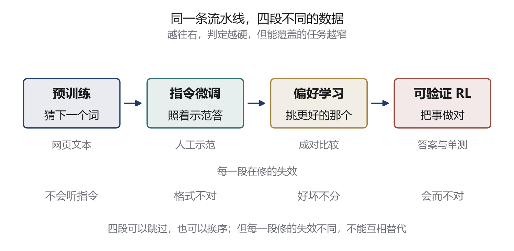

## 对齐要解决什么

一个客服系统接了模型，上线第一天就收到了这样的对话。

用户问：“我的订单昨天就该到了，为什么还没到？”

模型答：“我的订单昨天就该到了，为什么还没到？这类问题通常有三种原因：一是……”

它把问题抄了一遍，然后开始续写一段“客服话术”。格式像，语气像，内容全是从无数篇客服文档里学来的套话，没有一个字是关于这个用户的订单的。

这个现象有个朴素的名字：模型在续写，不在回答。预训练给它的任务是“给定前文，猜下一个词”，这个任务在网页、论坛、文档上无处不在，于是它学到的世界是“文本长什么样”。至于“现在有人在向我提问，我该给出一个可执行的信息”，从来没有人教过它。

### 从续写到回答，差的不只是格式

再看第二个例子。用户问：“你们的退款政策是什么？”

模型答：“我们的退款政策是 30 天内无理由退货，具体以店铺公告为准。”

这句话很通顺，也很自信，但它是编的。模型没有查过任何政策文件，它只是从“退款政策”这个短语最常见的搭配里抽出了一句话。

第三个例子。用户问：“帮我写一段代码，把 CSV 里的空行删掉。”

模型答：“好的，下面是代码：”然后停住了。它学会了“好的，下面是代码”这个开头，因为互联网上无数教程都是这么开头的，但它没学会接下来该给什么。

三个例子，三种失效。第一个是任务理解错了，第二个是内容编造，第三个是行为不完整。它们都不是“模型不够大”造成的。同期的实验很清楚：把模型从十几亿参数加到上千亿，这三种错都还在，只是措辞更漂亮。

### 三种偏差

把这类问题归一下类，通常分成三层。

**能力对齐**：模型会做这件事，但不知道现在要做。比如它会写代码，但你让它“写个脚本”，它给你一段散文式的说明。这类问题的解法是示范，告诉它在这个场景下应当输出什么形状。

**行为对齐**：模型知道要回答，但回答的方式不对。比如过度自信、答非所问、拒绝该答的、答应了不该答的。这类问题要靠偏好，因为“什么算好”很难写成规则，但人一看就知道。

**价值对齐**：模型的行为要符合某一套价值判断，而“哪一套”本身是有争议的。同样一句话，不同地区、不同公司、不同用户群体的接受度不一样。这一层不是技术问题能单独解决的，但技术决定了它能不能被调整。

这三层是递进的：能力对齐没做好的模型，讨论行为对齐没有意义，因为它连“该干什么”都没学会；价值对齐则是前三层都成立之后，才轮得到的问题。

### 为什么“好”写不进损失函数

预训练的损失很干净：给定前文，真实下一个词的负对数概率。它可计算、可微、和数据一一对应。

对齐没有这样的损失。想表达“回答要有用”，你得先说清什么叫有用。是信息完整，是能执行，是省时间，还是让用户不生气？这四件事常常互相冲突：完整的回答很长，能执行的第一步很短。写不出一条公式同时满足它们。

工程上的做法是绕过去：不定义“好”，只比较“哪个更好”。给两个回答，让人挑一个，然后用这些比较去训练一个打分器，再让模型去最大化这个打分。这一步转换是整卷的技术核心，它把“无法定义的目标”换成了“可以收集的数据”。

代价也很清楚：打分器是代理，不是目标本身。代理一旦被优化得足够狠，模型就会去优化代理，而不是你真正想要的东西。这个现象在优化里有个名字，叫古德哈特定律：一个指标一旦成为目标，它就不再是好指标。

### 四个阶段

现在可以把整条流水线摆出来了。

**预训练**给出一个基础模型。它什么都会一点，但不会听指令。这一阶段的产物通常叫 base model，它的用途是“继续训练”，不是“直接给用户用”。

**指令微调（SFT）**用几千到几十万条“问题—标准答案”的示范，教它按格式回答。这一步只做一件事：让模型的输出落在正确的形状上。它学的不是新知识，是“什么时候该输出什么”。

**偏好学习**用人类的比较数据，教它“在几个都能接受的回答里，挑更好的那个”。这一步修的是行为，不是知识：同一个事实，说得更清楚、更谨慎、更有用。

**可验证强化学习**用能自动判对错的奖励，教它“把事做对”。数学题有答案，代码有单测，检索有出处，这些场景里的奖励不用人去标，机器自己就能判。

四个阶段的顺序不是固定的。有的模型跳过偏好学习，只用 SFT 加可验证奖励；有的在部署后还在继续用线上反馈训练。但每一步要解决的失效是不同的，这一点不会变。

### 一个量过的例子

2022 年 InstructGPT 的实验把这个流程的效果量得很清楚。

他们用 1.3B 参数的模型，走完 SFT、奖励模型、PPO 三步，然后让人对比它和 175B 的原始 GPT-3 谁的回答更好。结果是小模型被偏好的比例更高。参数量差了一百倍，赢在了流程上。

这个结果当时震动了很多人，因为它说明“对齐”不是给大模型做的装修，它本身就能换来能力。同一批实验里还有一个细节更值得记：他们只用了大约一万三千条人工示范和几万条比较数据，和预训练用的数据量差了六七个数量级。对齐是便宜的，但它便宜的前提是预训练已经把能力放进去了。对齐不能让模型学会它没学过的东西，这一点在后面的每一章都会再出现一次。

### 这一卷的路线

后面的十一章按流水线展开。

第二、第三章讲 SFT：数据怎么造，损失只算哪一部分，以及它带来的副作用（遗忘、过度拒答、风格坍缩）。

第四到第六章讲偏好学习：奖励模型怎么从比较里学出一个分数，PPO 怎么用它，DPO 怎么绕开它。

第七到第九章讲可验证奖励：数学和代码这类有标准答案的任务怎么训，过程奖励和搜索怎么配合，以及蒸馏式对齐（用强模型代替人）能走多远。

第十、第十一章讲 Agent：把同样的思路搬到多步任务上，教模型用工具把事情做完。

最后一章回到评测和边界：怎么判断这些训练真的有用于是，以及对齐这件事的限度在哪里。

下一章从最朴素的一步开始：给模型看示范。
