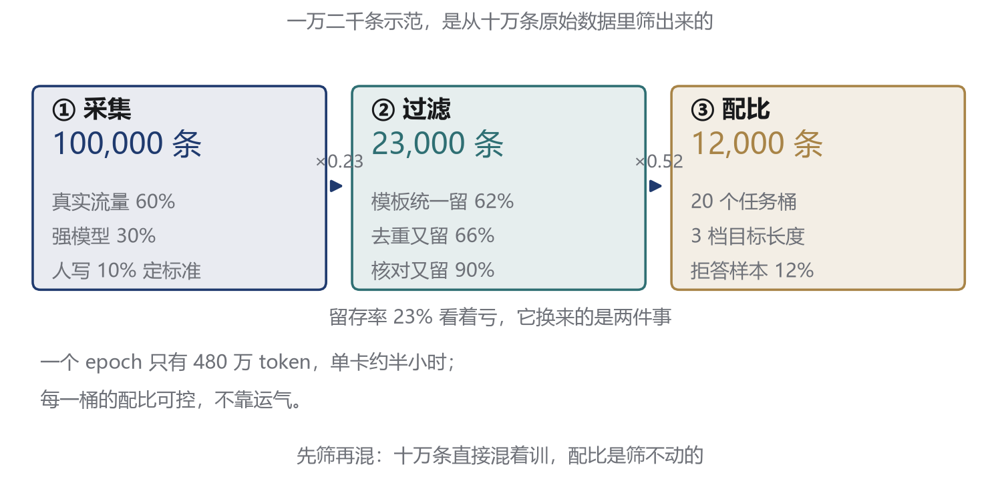

## 指令微调：用示范教它换个任务

续写和回答，本质上是两个不同的任务。前者是“给定前文，生成后文”，后者是“给定请求，生成答复”。两者的输入输出形状一样，都是 token 序列，所以同一个模型能同时做这两件事，只是没人告诉它什么时候该切到哪一种。

指令微调（supervised fine-tuning，SFT）就是告诉它这件事的办法，而且办法极其朴素：给它看几万条“请求—答复”的示范，让它照着学。没有新的损失函数，用的还是下一词预测，只是数据换了。

有个细节值得先说清楚，因为它决定了后面所有的判断。SFT 不改变模型的“知识”，它改变的是“在什么条件下输出什么”。一个模型知道“巴黎是法国首都”，SFT 教不了它这件事，因为它在预训练时就知道了；SFT 能做的是让它在你问“法国首都在哪”时，直接答“巴黎”，而不是接一句“是法国最大的城市，也是……”

换句话说，SFT 写的是一层很薄的接口。这个认识很重要，因为它解释了为什么 SFT 数据不需要海量，也解释了为什么 SFT 治不了编造和谄媚。

### 一条示范长什么样

最简的一条示范是两个字段：

```text
用户：把下面这句话改得客气一点：这个方案不行。
助手：这个方案可能还需要再考虑一下，我们能一起看看哪里可以调整吗？
```

真实训练时，它会被拼成一条带特殊标记的序列。以常见的对话模板为例：

```text
<|im_start|>system
你是一个乐于助人的助手。<|im_end|>
<|im_start|>user
把下面这句话改得客气一点：这个方案不行。<|im_end|>
<|im_start|>assistant
这个方案可能还需要再考虑一下，我们能一起看看哪里可以调整吗？<|im_end|>
```

system 段是全局设定，user 段是请求，assistant 段是标准答案。模板里的这些标记不是装饰，它们本身就是训练目标的一部分：模型要学会在合适的位置输出 `<|im_end|>`，才算“说完了”。很多模型上线后停不下来、或者一句话被截断，根子都在这里。

多轮对话就是把 user 和 assistant 段交替拼下去。这里有个容易忽略的约定：多轮样本里，前面几轮的 assistant 回复也应该算损失，因为它们同样是“模型该学会说的话”。有些实现只算最后一轮，训出来的模型在长对话里会越来越不会接话，因为它从没学过“第二轮该怎么答”。

### 损失只算助手说的那部分

这是 SFT 最容易做错、也最容易忽略的细节。

一条示范里，system 和 user 的内容不是模型生成的，是给定的输入。如果对这些 token 也计算损失，模型就会被训练成“能复现用户的提问”，而不只是“能回答提问”。这不只是浪费算力，它会带来实际后果：模型开始模仿用户的语气、复述问题、甚至把用户的问题当成自己的答案。

所以标准做法是给每个 token 挂一个权重，只有 assistant 段是 1，其余是 0：

$$L=-\sum_{t} m_t \log p_\theta\bigl(x_t \mid x_{<t}\bigr),\qquad m_t=\begin{cases}1, & x_t\in\text{assistant}\\ 0, & \text{否则}\end{cases}$$

$m_t$ 就是掩码。这个式子在说：先把每个位置上“模型给正确答案打了多少概率”取对数，乘上这个位置的掩码，再加起来。掩码为 0 的位置，无论模型预测得对还是错，都不产生梯度。实现上通常不是真去乘 0，而是在算完逐 token 的 loss 之后做一次 masked mean，把无效位置的贡献直接剔除。

多轮对话里，每一轮的 user 段都要被掩掉，只留 assistant 段。这一步做错的模型有个典型症状：你问它“你是谁”，它回你一句“你是谁”，然后再往下接。

现在算一遍这个掩码到底省了多少事。假设一条样本 400 个 token，其中 system 30 个、user 220 个、assistant 150 个。如果不加掩码，250 个 token 的梯度花在“学会复述输入”上，占 62.5%。一个 batch 32 条样本，平均每条 400 token，一共 12800 个 token，其中 8000 个在做无用功。

更糟的是这 8000 个不是白干，是有害。模型在 user 段上学到的分布是“用户怎么说话”，而推理时它扮演的是 assistant。这两者的风格差别很大：用户短、省略、带错别字、常带情绪；assistant 长、完整、规范。用一个 batch 里六成的梯度去拟合前者的分布，等于每训一步就往错误的方向推一点。

### 掩码在代码里长什么样

公式只有一行，落到实现上有八个细节，每个都能单独搞砸。

```python
for batch in loader:                    # 已 packing，样本间隔离
    logits = model(batch.input_ids)     # [B, L, V]
    logp = log_softmax(logits, -1)      # 对数概率
    tgt = batch.labels                  # 已右移一位
    tok = logp.gather(-1, tgt[..., None]).squeeze(-1)
    loss = -(tok * batch.mask).sum()    # 只在 mask=1 处累加
    loss = loss / batch.mask.sum().clamp(min=1)
    loss.backward()
```

逐行读一遍。

第一行的 batch 是已经拼好的长序列，多条样本填满一个固定长度，样本之间靠 attention mask 隔开。第二行拿到每个位置对全词表的打分。第三行换成对数概率，实现上用 `logsumexp` 稳定计算，直接对 softmax 取对数会在 fp16 下下溢。

第四行的 labels 已经右移过一位：位置 $t$ 的标签是输入里 $t+1$ 的 token。第五行的 gather 把“标签词”那一列取出来，得到每个位置的负对数概率。

第六行乘掩码，这是全段的核心。第七行用的是掩码之和，不是序列长度：用长度做分母的话，同样一批数据里，padding 多的 batch 会被系统性降权，而长回答的每个 token 又会因为分母大而权重变小。除以有效 token 数，才是“每个 token 权重相同”的意思。

这套写法有两个容易错的地方。一是 padding 必须同时进 loss 掩码和 attention 掩码：只进前者，attention 会去看 padding，模型从填充位里学到奇怪的关联；只进后者，loss 会在 padding 上计算，而 padding 常是同一个 token，模型很快学会预测它，loss 曲线好看但没有意义。

二是掩码与 labels 的错位。有人为了“把 loss 对齐到 assistant 的第一个 token”，在掩码上也做一次右移，结果 labels 右移一次、掩码右移一次，两者错开一位。这类 bug 不会让训练崩，只会让模型学会重复上一句的最后一个词。

自检只需要五分钟：拿第一条样本，把（token 文本，掩码值，该位置的 loss）三列传出来，人眼读前五行和后五行。掩码应该在第一个 assistant 标记处变 1，在结束标记之后变 0；如果它整体偏移一位，一眼就能看出来。

### 算一遍：一个 batch 里多少 token 真的在干活

流水线调好之后，还有一个容易被忽略的效率数：一个 batch 里到底多少 token 产生了梯度。

取 batch 12800 token。packing 之后 padding 占 5%；剩下的 12160 个 token 里，按掩码覆盖率 40% 算，真正算损失的只有 4864 个。占比：

$$\frac{4864}{12800}\approx38\%$$

也就是说，你为 12800 个 token 付了前向与反向的钱，其中六成只在做“读入”——它们参与了 attention，但不产生梯度。这不是 bug，是 SFT 的固有形状：输入必须读，否则模型不知道在回答什么。

但它解释了两件事。第一，为什么 SFT 的“有效吞吐”比预训练低得多：同样的 FLOPs，预训练每个 token 都算损失。第二，为什么掩码写错时 loss 曲线会“变好看”——多算进去的那部分 token 是容易预测的用户提问，loss 天然低。

一个实用的监控就是这两个比例：padding 占比目标在 5% 以下，有效梯度 token 占比目标在 30% 到 60%。前者高了说明 packing 没做好，后者高了要查是不是把输入也算进去了。

### packing 与它的坑

为了不浪费算力，实现上通常会把多条短样本拼成一条长序列，填满固定的上下文长度。这个做法叫 packing。

packing 能省多少？假设目标长度 4096，样本平均 400 token，不 packing 的话一条序列里九成的空间是 padding，这些位置仍然要走前向，仍然要算 attention。packing 之后，同样一次前向能装十条样本，吞吐提升接近一个数量级。这在 SFT 里是必须做的优化，不是可选项。

坑在于隔离。如果拼接时不加处理，第 2 条样本的 token 在 attention 里能看见第 1 条样本的全部内容。后果不是“稍微串味”，而是模型学到一个错误的规则：回答完之后，紧接着应该出现的是另一个用户的提问。

有个已经上线过的模型出现过这样的症状：用户问“帮我列三个要点”，它答完三个要点，紧接着自己写了一句“用户：那第四个呢？”然后继续答。这就是 packing 泄漏的典型表现——它把训练时的拼接模式当成了正常的对话结构。

正确做法是在 attention 里按样本切块，让每条样本只能看见自己。实现上有两种：给 attention mask 加一个块对角约束，或者在位置编码上做重置。前者的兼容性更好，后者更省显存。这一步做对之后，packing 就是纯赚。

还有一种更隐蔽的污染：如果 packing 时把两条样本的边界 token 弄错了，比如少了一个 `<|im_end|>`，模型会学到“这两句话是连着的”。这类 bug 在训练日志里完全看不出来，loss 曲线很漂亮，只有在下游评测里才暴露。检查办法是抽样把拼好的序列解码出来，人眼读十条。

### 数据从哪来

示范数据的来源，决定了这一步的成本和上限。

**人写**。最贵也最可控。写的人需要同时懂任务和懂模型：写得太完美，模型学不会；写得太随意，模型学坏。真实项目里，人写的数据通常只占一小部分，用来定“标准长什么样”。

**强模型生成**。用更强模型生成几万条，人工抽检。这是目前最常见也最便宜的做法，代价是学生模型的上限被老师模型锁死，而且老师模型的错误会被原样继承。有一条经验值得记：老师模型犯的错，学生学得比老师更彻底，因为学生在这些样本上要跑好几个 epoch，而老师只生成一次。

**模板合成**。把任务拆成模板加变量，批量生成。适合结构化任务（改格式、抽取字段、翻译），不适合开放式对话，因为模板的句式会被模型学走，说出来的话一看就是填表。

**拒答与边界样本**。教模型什么时候不该答。这类样本最容易被忽略，也最容易出问题：只给“该答”的示范，模型会对着任何请求都硬答；只给“不该答”的示范，它会变得什么都不敢答。两者的比例需要专门调，这一点在第三章讲过度拒答时还会回来。

**真实流量改造**。从线上日志里捞真实请求，再请人写答复。这种数据分布最贴近实际，价值最高，麻烦在脱敏和合规。有产品团队的 SFT 数据里，这类占了八成，效果明显好于纯合成数据，原因是合成数据里的提问方式太“干净”，而真实用户会打错字、会给不完整的上下文、会中途改需求。

四条路不是互斥的，成熟的做法通常是混：真实流量定分布，强模型补长尾，人写定标准，模板兜结构化任务。

### 要多少条

2023 年有一个广为人知的实验：用 1000 条精选示范微调一个 65B 模型，得到的对话模型在人类评测里表现不差。结论被简化成“一千条就够了”，这句话被引用了很多次。

它有一半是对的：SFT 学的确实是“格式和风格”，而不是知识，所以不需要海量数据。但它也漏掉了几个前提。

第一，那 1000 条的质量极高，是反复筛选、覆盖各类任务的结果，不是随手写一千条。第二，基础模型本身已经足够强，知识都在里面，SFT 只是把门打开。第三，评测是与人对比的相对偏好，不是绝对能力测试；在需要精确事实的任务上，一千条数据训练的模型依然会输。

工程上的经验值大概是这样：格式类任务几千条就能收敛；覆盖多种任务、多种语言、多种拒答边界，通常要几万条；再多，收益很快就平了，而副作用（过拟合到某一种风格）开始上升。

“收敛”这个词值得具体化。判断 SFT 该停在哪里的实用办法是看两条曲线：一条是留出集上的 loss，另一条是你真正关心的行为指标（比如严格格式遵循率）。loss 通常在半个 epoch 内就降到很低，然后缓慢下降，而行为指标往往在 loss 还在降的时候就已经平了。如果只盯着 loss，你会多训两三个 epoch，换来的只是更明显的风格坍缩。

### 配比：把“要多少条”变成一张配额表

“几万条”是个糊涂数字。真正要定的是配额：哪些类型各占多少。一张能直接用的表长这样。



假设最后要 12,000 条、20 个任务桶，分配可以这样分。真实流量按线上分布的占比分到各桶，共 7,200 条（六成）；强模型生成补长尾，3,600 条（三成）；人写 1,200 条（一成），每桶 60 条，只用来定“标准长什么样”。

长度要分档，不能任其自然。示范的平均长度会直接变成模型的输出长度，所以按目标长度分三档：一句话（20%）、一段（50%）、三段（30%）。不分档的后果很具体：如果收集来的示范八成是长回答，训完模型的平均输出会向那个长度靠，而你在评测里看到的是“质量提升了、成本翻倍了”。

拒答样本占 12%，其中一半是“表面敏感、实际无害”的难例。这个比例为什么不能更高，第三章会算；现在只需记住一个数：超过两成，误拒率几乎一定失控。

配额定好之后，还有一个不写在表里的量：每条样本被看几遍。1 到 3 个 epoch 是常规区间，但配比小的桶（比如 60 条的安全桶）如果和其他桶同等地跑三个 epoch，它实际被看了 60 次，而大桶里的某条只被看了 3 次。所以小桶要么复制到与其他桶同等量级，要么在采样时按桶加权。这个细节不处理，配额表就是纸上的。

### 一张可以直接跑的检查表

下面六项检查写在数据加载器里，每次跑训练前自动过一遍。它们全部可自动判，不靠人工看。

| 检查项 | 阈值 | 不通过时看到什么 |
|---|---|---|
| 模板标记种类 | 只有一种 | 回答尾部漏出另一种标记 |
| 掩码覆盖率 | 30% 到 60% | 复读问题、学会提问语气 |
| 长度分档比例 | 三档都有 | 输出长度向某一档集中 |
| 完全重复率 | 低于 1% | 某几种说法出现得异常频繁 |
| 截断样本比例 | 低于 0.5% | 回答在句中被切断 |
| 拒答样本占比 | 8% 到 15% | 误拒率飙升或安全垫消失 |

掩码覆盖率那一行需要解释。它是所有样本里 assistant token 占总 token 的比例，正常落在 30% 到 60%。低到 20% 以下，说明样本里用户提问很长、回答很短，梯度大部分花在了读题上；高到 70% 以上，通常是多轮样本把历史回复全算进去了，而这些历史回复往往是模型以前自己生成的，等于在学自己的旧毛病。

阈值不是法律，是报警线。真正的要求是：这六个数字每次训练都记录在案，任何一项从正常跳出去，先查数据，再怀疑超参。

### 算一遍：一次 SFT 的 token 账与激活显存

前面的步数算的是“多久训完”，这里算“一张卡够不够”。假设 12000 条示范、平均 400 token（含被掩掉的输入部分）、训 2 个 epoch。

token 总量是 $12000\times400\times2=9.6\times10^{6}$，不到一千万。对一个 7B 模型，每个参数平均只看 $9.6\times10^{6}/(7\times10^{9})\approx1.4\times10^{-3}$ 个 token。对照“每个参数看二十个 token”这个预训练经验比例，SFT 的样本密度只有它的万分之一量级——这就是为什么 SFT 只能改接口，改不了知识。

算力这边：$9.6\times10^{6}\times6\times7\times10^{9}\approx4.0\times10^{17}$ 次浮点运算。按一张卡 bf16 有效算力 1.2 到 1.5 乘 $10^{14}$（峰值的三到四成，这是微调任务的常见效率）估算，需要三千秒上下，不到一小时。这与工程直觉一致：SFT 的瓶颈从来不是算力，是数据准备。

显存才是真的限制。设一个 batch 里总 token 数 12800、hidden 4096、32 层。一层里需要留给反向的激活大约是 $12800\times4096\times2$ 字节，即 105 MB；按每层存十来个张量算，单层约 1 GB，32 层就是 33 GB。加上 bf16 权重 14 GB、梯度 14 GB、Adam 状态 84 GB，合计 145 GB。

所以 7B 全参 SFT 落在一张 80 GB 卡上是装不下的，两张也紧。工程上有三条路：开梯度检查点（只存每层输入，激活从 33 GB 降到 6 GB 上下，代价是反向重算，慢两三成）；用参数分片；或者改 LoRA。选哪一条不看偏好，看占比：激活能压就压，权重占大头就只能分片。

### 数据卡的六个字段

一份能被别人重用的 SFT 数据集，靠的是元数据。至少要存这六项。

| 字段 | 为什么必须存 |
|---|---|
| 模板版本 | 决定渲染与停止符 |
| 标注来源 | 人写、强模型、模板、流量 |
| 目标长度档 | 复现长度分布 |
| 拒答标记 | 算拒答比例与误拒风险 |
| 采集时间 | 排查污染与漂移 |
| 许可与脱敏 | 上线前的合规检查 |

第三行常被省。省了它，下一版想按长度配比重新采样时，只能重跑一遍分类器，而分类器本身又可能变。第六行常被放到最后补，结果往往是发布前一周才发现有一批数据不能用，整条管道得重跑。

这六个字段加上前文那六个检查项，就构成了一份能交给别人接手的数据卡。它不直接提升指标，但能把项目的交接成本从两周降到两天。

### 失败案例：回答越来越长

症状。SFT 后人工评测满意度从 3.9 升到 4.2，团队准备上线。上线一周，推理成本涨了 87%。查监控，平均输出从 320 token 涨到 610 token，而请求量没变。

排查顺序。第一步，把示范按长度分桶：500 token 以上的占 82%。第二步，比训练集与线上的长度分布：示范中位数 540，而线上请求的合理回答中位数 210。第三步，看“长”到底换来了什么：抽 100 条逐句对比，长出来的部分六成是重复结论、两成是免责声明、两成是补充例子。

根因。示范是按“写得完整”的标准收集的，而“完整”在标注者心里等于“多写点”。模型学到的不是“需要时展开”，而是“总是展开”。这是 SFT 最典型的副作用：损失函数不惩罚长度，只惩罚“和示范不一致”，所以示范的长度分布会直接变成产品的长度分布。

修法。三件事一起做：示范按目标长度重分三档（一句话、一段、三段，比例 2:5:3），让模型看到“短回答也是正确答案”；验收表加一项“同义问法下的长度”，超过基线 20% 要写理由；把明显注水的示范剔掉。三周后平均长度回到 340，满意度没降。

教训：长度是 SFT 最容易漏掉的超参。它不在训练脚本里，在数据里。

### 案例库：三个 SFT 翻车现场

下面三个案例症状不同，根因都在数据管道，不在模型。每个都按同一个格式写：症状、排查顺序、根因、修法。

**案例一：块对角掩码漏设。**

症状。大约三成回答的结尾会自己接一段：“用户：那第四个呢？”然后继续答。训练 loss 完全正常，比不 packing 时还低一点。

排查顺序。先抽 20 条拼好的序列解码出来，人眼读边界；再统计“回答里出现角色标记”的比例，正常应该接近零；最后看 attention mask 是块对角还是全 1。

根因。为了提吞吐做了 packing，但没有给每条样本加隔离，模型在 attention 里能看见前一条样本的全部内容。它学到的规则是“答完一条，紧接着是下一个用户的提问”，于是把这当成了正常对话结构。

修法。给 attention 加块对角约束，并在数据管道里加一道自检：随机抽 20 条序列解码，检查样本边界。这道自检二十行代码，能挡住这一整类 bug。

**案例二：标签移位做了两次。**

症状。模型爱复读，尤其是输出里反复出现输入的最后几个字。loss 比同类实验低 0.1 左右，团队一度以为这是“收敛得好”。

排查顺序。先打印第一条样本的（输入 token，标签 token）对齐关系，看是否错开一位；再做单条过拟合测试，拿一条样本训 200 步，正常应该降到 0.05 以下，降不下去说明标签有问题；最后用贪婪解码看它到底在学什么。

根因。collator 里已经把 labels 右移了一位，训练脚本里又 shift 了一次。模型于是学的是“输出当前这个 token”，也就是复制，而不是预测下一个。

修法。移位只在一个地方做，并在数据加载器的单元测试里加一条断言：`labels[i] == input_ids[i+1]`。

**案例三：模板混用。** 这个案例前面已经讲过，症状是回答结尾漏出 `[/INST]`。它和上面两个属于同一族：训练数据里出现了两种“正确”，模型学到的是“随机挑一种”。把模板一致性写成数据质量检查项，比事后排查便宜两个数量级。

三个案例共同说明一件事：SFT 的 bug 几乎从不以“训崩”的形式出现，它们以“训得很好，但学错了东西”的形式出现。所以数据管道的自检项要当成代码来维护，而不是当成经验。

### 超参：为什么比预训练保守

SFT 通常只训一到三个 epoch，学习率在 $10^{-5}$ 到 $2\times10^{-5}$ 量级，比预训练小一到两个数量级，还要配 warmup。

原因很直接：这一步的参数量没变，数据量却小了四五个数量级。用预训练的学习率去跑，模型会在几百步内把通用能力冲掉，换来的只是记住了这几万条示范的措辞。这个现象叫灾难性遗忘，下一章专门讲。

把步数算清楚，这些超参就没那么神秘了。假设 5 万条样本，batch 32，一个 epoch 是

$$\frac{50000}{32}\approx 1563\ \text{步}$$

三个 epoch 就是 4700 步。warmup 取 3%，是 47 步。也就是说，模型在前 47 步里学习率从 0 线性升到 $2\times10^{-5}$，然后开始余弦下降。

对于 7B 模型，一次参数更新是 4700 次，每次看 12800 个 token。总共 6000 万 token 的梯度信号，对比预训练的两万亿，比例是万分之三。这个数字决定了 SFT 的定位：它是微调，不是再训练。

把这些参数、它们为什么这么取、以及偏离之后会怎样，列成一张表更实用。

| 超参 | 典型值 | 调大 | 调小 |
|---|---|---|---|
| 学习率 | $10^{-5}$ 到 $2\times10^{-5}$ | 几百步内冲掉通用能力 | 三个 epoch 后 loss 还在缓慢降 |
| epoch | 1 到 3 | 记住示范措辞，风格坍缩 | 格式学不全，停止符常出错 |
| batch | 32 到 128 条 | 收敛稳，显存吃紧 | 梯度噪声大，loss 抖 |
| warmup | 3% 到 5% | 前一百步几乎不学 | 开头几十步 loss 尖峰 |
| 混入通用语料 | 5% 到 20% | 格式学不进去 | 遗忘明显，能力回归掉点 |
| 可训参数（LoRA） | 全参数的 1% 以下 | 破坏主干，失去 LoRA 的意义 | 任务差异大时改不动 |

表里最容易被忽略的是最后两行。混入通用语料的比例没有“正确值”，它取决于你的 SFT 数据有多窄：数据只覆盖一个任务，就得混到两成；覆盖二十个任务，5% 就够。LoRA 那一行则常被反过来理解：很多人以为 LoRA 是“便宜版的全参微调”，实际上它的强弱取决于任务与预训练分布的差距，差距大时它确实不够，和自己的 lr 调得好不好关系不大。

显存也顺便估一下。7B 模型 bf16 权重 14 GB，梯度 14 GB，Adam 的两个动量加 fp32 主权重是 84 GB，光这三项就 112 GB，还没算激活。所以单张 80G 卡装不下全参数 SFT，至少要用两张卡做参数分片，或者把梯度检查点打开把激活压下去。如果改用 LoRA，可训练参数降到 1% 以下，优化器状态从 84 GB 降到 1 GB 量级，单卡就能跑。这也是 LoRA 在微调阶段如此流行的真实原因，不是因为效果好，是因为它把硬件门槛从八卡降到了一卡。

另一个常见做法是用 LoRA 之类的低秩适配：只训练一小部分参数，主干冻结。好处是便宜、可以给不同客户各存一份适配器；坏处是它能学到的改动有限，任务差异大时不够用。经验判据是：如果任务只需要模型“换个说法”（改写、分类、抽取），LoRA 够；如果任务要求模型“建立新的行为模式”（长链推理、工具调用），全参数微调更稳。

有一个容易忽略的细节：LoRA 的学习率通常要比全参数微调大一个数量级，因为可训练参数少、每个参数的更新次数相同但影响范围小。直接把全参数的 $2\times10^{-5}$ 搬过去，模型几乎不动，很多人因此误判“LoRA 学不会这个任务”。

### 模板不一致：一个真实的翻车

讲一个几乎每个团队都会踩一次的坑，因为它同时涉及训练和推理两端。

训练数据里混了两种模板。一部分沿用内部的 ChatML 风格（`<|im_start|>`），另一部分是从公开数据集直接拿来的 Llama 风格（`[INST] ... [/INST]`），因为清洗时只做了去重没做格式统一。训练 loss 正常下降，模型也能答对问题。

上线后出现两个症状。一是大概三成的回答结尾会多出一段 `[/INST]` 或者 `<|im_start|>user`，像是自己往下编了一轮对话。二是同样的提示，有时回答得很干脆，有时会先输出一句 `[INST]` 再开始答。

原因很直接：模型学到的是“结束标记有好几种，随便挑一个”，以及“提问可能以两种形式出现”。它没有学到“什么时候用哪一种”，因为训练数据里两者是随机混的。

这类问题的麻烦在于定位。你去看 loss，它比只用一种模板时还低一点（因为两种模板的样本互相稀释了风格，模型学到了更“平均”的分布）。你去看人工评测，大部分回答是好的。只有统计“异常结尾比例”这种专门的指标，问题才会显形。

修法只有一条：模板在数据构造阶段就统一，并且把“模板一致性”当成一条数据质量检查项。检查方法是写个脚本，统计每条样本的起始标记和结束标记，如果出现两种以上就报错。这个脚本二十行，能省掉两周的排查。

### 怎么知道它学会了

SFT 的效果不该只看“回答像不像人”，而要看格式是否稳定。

一个常用的测法是构造一批带明确格式要求的请求（“用三个要点回答”“输出 JSON，字段是 a 和 b”“只回答数字”），然后统计模型严格满足要求的比例。这类测试叫指令遵循评测，IFEval 是其中一个公开版本，包含几百条可自动判定的约束。

格式之外还要看三件事。一是回答长度分布，SFT 之后模型往往会变得啰嗦（示范写得长，它就学长了）。二是拒答率，在没有安全训练的情况下，SFT 数据里若混了太多拒答样本，模型会开始对正常问题说“我不能”。三是老能力的回归，拿一批基础模型本来能做对的题重测一遍，看掉了多少。

第三项经常被省略，但它是最重要的一项。SFT 的收益是显性的（格式变好了），代价是隐性的（某些能力变差了），只看收益一定会高估这一步的效果。

### 三个常见误解

**误解一：SFT 数据越多越好。**

超过一定量之后，增加数据带来的是风格固化，不是能力提升。判断信号是：新加的一万条数据，如果它和已有数据高度同质（同一个任务、同一种写法），那它的边际价值接近零，而对多样性的伤害是实打实的。宁要五千条覆盖二十种任务，不要五万条同一种任务。

**误解二：SFT 能给模型加知识。**

偶尔看起来像，但那是“把已有的知识调出来了”。真要让模型记住新事实，正确做法是检索增强或者继续预训练，而不是写成问答对硬塞进 SFT。硬塞的结果是模型会说，但说得不准，因为几万条样本改不动参数里的事实分布。这个坑在垂直领域项目里特别常见：把所有产品文档改写成问答，训了三十万条，最后模型能背出百分之七十，剩下百分之三十编得非常自信。

**误解三：loss 越低模型越好。**

SFT 的 loss 只衡量“在给定示范上预测下一个词的能力”。loss 降到很低，说明模型能背下这批示范，不代表它能泛化到新请求。经验阈值是：留出集 loss 和前 20% 训练步时相比，如果下降幅度已经小于 5%，再训就是过拟合。这时候该做的是加数据多样性，不是加 epoch。

### 它只解决了形状

走到这里，模型已经会按格式回答了。但它答得好不好，SFT 管不了。

原因在损失函数里：交叉熵只奖励“和标准答案一致”，不区分“同样正确但更清楚”和“同样正确但更啰嗦”。而现实中，同一件事往往有很多种说得过去的方式，人偏好哪一种，数据里没有体现。

所以下一步要引入比较：给两个回答，让人挑一个。这就是偏好学习要解决的问题。在那之前，先把 SFT 自己的副作用讲清楚，因为很多“对齐之后变笨了”的说法，其实是 SFT 的副作用被误认成了对齐的代价。
