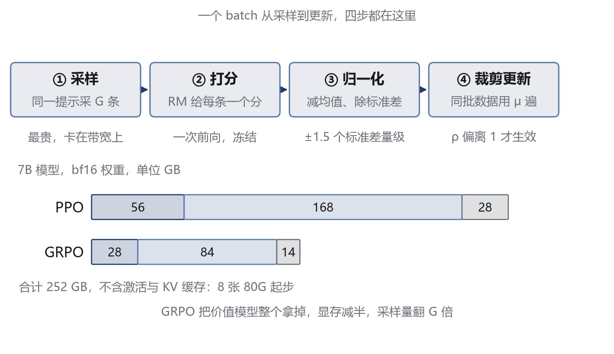

## PPO：用不可微的分数去改模型

奖励模型给得出分数，但给不出梯度。这是整件事的症结。

语言模型的输出是采样出来的：给定提示，它逐个 token 采样出一个回答 $y$，然后奖励模型给这个完整的 $y$ 打一个分。这个分数不会告诉你“把第 7 个 token 换成另一个词，分数会升高多少”，因为替换之后你得到的是另一个 $y'$，需要重新打分才知道。生成这个动作本身是不可微的，梯度传不回去。

有一个常见的技术误解值得先破掉：有人说“把采样换成 softmax 的期望就能求导了”。数学上可以，但期望要对整个词表做求和，长度 500 的回答有 $10^{2000}$ 条路径，算不出来。

于是只能换一种优化方式：不去求“怎么改参数能提高分数”的解析梯度，而是采样一批回答，看得分高的那些有什么共同点，然后提高生成这类回答的概率。这就是策略梯度的基本思想。

### 从策略梯度说起

把语言模型看成策略 $\pi_\theta(y\mid x)$：给定提示 $x$，输出回答 $y$ 的概率。目标是最大化期望奖励：

$$J(\theta)=\mathbb{E}_{y\sim\pi_\theta(\cdot\mid x)}\bigl[r(x,y)\bigr]$$

一个恒等式给出它的梯度：

$$\nabla_\theta J=\mathbb{E}_{y\sim\pi_\theta}\Bigl[r(x,y)\,\nabla_\theta\log\pi_\theta(y\mid x)\Bigr]$$

读法是：采样出来的回答如果得分高于预期，就提高它的对数概率；低于预期就降低。$\nabla_\theta\log\pi_\theta$ 是“怎么改参数能让这个回答更可能”，$r$ 是“该往哪个方向推”，两者相乘就得到了更新方向。

推导只用了两步，值得看清楚，因为后面所有的变形都是在这个骨架上做的。第一步，把期望写成求和：

$$J(\theta)=\sum_y \pi_\theta(y)\,r(y)$$

第二步，把梯度算子挪进去。$r(y)$ 不含参数，所以它是个常数：

$$\nabla_\theta J=\sum_y r(y)\,\nabla_\theta\pi_\theta(y)$$

到这里梯度是关于 $\pi_\theta$ 本身的，而我们只能通过采样估计它。用一个恒等式把 $\nabla\pi$ 换成 $\pi\nabla\log\pi$：因为 $\nabla\log\pi=\nabla\pi/\pi$，两边乘 $\pi$ 就得到 $\nabla\pi=\pi\nabla\log\pi$。代回去：

$$\nabla_\theta J=\sum_y \pi_\theta(y)\,r(y)\,\nabla_\theta\log\pi_\theta(y)=\mathbb{E}\bigl[r\,\nabla\log\pi_\theta\bigr]$$

这一步变形叫对数导数技巧，它的唯一作用是把“对概率求导”变成“对概率的期望求导”，从而可以用采样估计。

对自回归模型还有一层结构。整条回答的对数概率是逐 token 对数概率的和：

$$\log\pi_\theta(y\mid x)=\sum_{t=1}^{T}\log\pi_\theta(y_t\mid x,y_{<t})$$

所以整条回答的梯度也拆成了逐 token 的梯度之和。这件事很重要：它意味着“提高一条回答的概率”这个动作，可以落到每个 token 上分别做。后面讲的 token 级优势，根子就在这个可加性上。

这个式子在数学上没问题，在实践上很难用。一次采样只给一个 $r$，而 $r$ 的波动可能来自无关因素（长短、风格），梯度噪声会大到无法收敛。

### 三个降低方差的手段

实践中用的是改良版，主要做了三件事。

**减去基线。** 把 $r(x,y)$ 换成 $r(x,y)-b(x)$，$b$ 是一个不依赖 $y$ 的基准值（同一批样本的平均分就够）。

为什么减掉一个常数不影响正确性？因为

$$\mathbb{E}\bigl[b(x)\nabla\log\pi_\theta(y\mid x)\bigr]=b(x)\sum_y\nabla\pi_\theta(y\mid x)=b(x)\nabla_\theta\underbrace{\sum_y\pi_\theta(y\mid x)}_{=1}=0$$

所有回答的概率加起来恒等于 1，所以它对自己的梯度是零。减一个常数，期望不变，方差变小。

小多少？算一笔。假设一批回答的奖励均值 0.65、标准差 0.22，那么奖励的均方根是

$$\sqrt{0.65^2+0.22^2}=\sqrt{0.4225+0.0484}\approx 0.686$$

梯度估计的方差大致与这个系数的平方成正比。减掉均值之后，系数变成偏差本身，均方根就是 0.22。方差比是

$$\left(\frac{0.686}{0.22}\right)^2\approx 9.7$$

方差不等于噪声，标准差才对应“抖的幅度”，所以噪声幅度降了约三倍。这就是为什么几乎所有实现都会做这一步，而且几乎都做归一化（减均值再除标准差），因为除法还能把不同批之间的尺度拉平。

**用优势代替奖励。** 基线进一步细化，就得到优势函数 $A(x,y)=r(x,y)-V(x)$，$V$ 是“在这个提示下，平均能拿多少分”的估计。$V$ 由一个单独训练的价值网络给出，它与策略网络结构相同，只是输出一个标量。这一步引入了额外的一整套参数和训练过程，也是 PPO 复杂度的主要来源。

**重要性采样加裁剪。** 采样是贵的，所以同一批数据要反复用几次。但用旧策略采的数据去更新新策略，需要乘一个比值 $\rho=\pi_\theta/\pi_{\text{old}}$ 做修正。这个比值一大，梯度就会失真，于是 PPO 直接把它裁掉：

$$L^{\mathrm{clip}}=\mathbb{E}\Bigl[\min\bigl(\rho A,\ \mathrm{clip}(\rho,1-\epsilon,1+\epsilon)A\bigr)\Bigr]$$

$\epsilon$ 通常取 0.2。这个裁剪是 PPO 名字里 “proximal”（近端）的来源，也是它比原始策略梯度稳的原因。

### 为什么非要重要性采样

这一段值得单独讲，因为它是理解 PPO 全部设计的关键，也是最多人跳过的一步。

先看不用重要性采样会怎样。策略梯度的期望是关于当前策略 $\pi_\theta$ 的：

$$\nabla J=\mathbb{E}_{y\sim\pi_\theta}\bigl[r\,\nabla\log\pi_\theta\bigr]$$

这个期望里的两份东西都依赖 $\theta$：采样分布是 $\pi_\theta$，被求导的函数也是 $\pi_\theta$。所以理论上每更新一次参数，旧数据就作废了，得重新采样。这是“在线”（on-policy）的含义。

采样有多贵？生成 600 token 的回答，单条要几百毫秒到几秒。一次更新要上千条。如果每次参数更新都重新采样，那么 90% 以上的算力花在生成上，训练卡大部分时间在等采样。

重要性采样提供了出口。它说的是：如果你有来自分布 $q$ 的样本，也能估出关于分布 $p$ 的期望，只要乘一个比值：

$$\mathbb{E}_{y\sim p}\bigl[f(y)\bigr]=\mathbb{E}_{y\sim q}\Bigl[\frac{p(y)}{q(y)}f(y)\Bigr]$$

代入 $p=\pi_\theta$、$q=\pi_{\text{old}}$，就得到修正后的目标：

$$\nabla J=\mathbb{E}_{y\sim\pi_{\text{old}}}\Bigl[\rho\,\nabla\log\pi_\theta\cdot r\Bigr],\qquad \rho=\frac{\pi_\theta(y\mid x)}{\pi_{\text{old}}(y\mid x)}$$

于是一批数据可以反复用：每用一遍，$\theta$ 变一点，$\rho$ 偏离 1 一点，但仍然是在估同一个期望。

代价在方差上。比值的二阶矩决定方差，而序列级的比值是一串 token 比值的乘积：

$$\rho=\prod_{t=1}^{T}\frac{\pi_\theta(y_t\mid\cdot)}{\pi_{\text{old}}(y_t\mid\cdot)}$$

假设每个 token 的比值平均偏离 1 有 5% 的波动，500 个 token 连乘下来，$\rho$ 的对数标准差会累积到 $\sqrt{500}\times 0.05\approx 1.1$，也就是说 $\rho$ 可能相差 $e^{\pm 1.1}$，两三倍到三分之一。这时候少数样本会主导整个梯度，训练开始抖。

这就是裁剪存在的理由，而且它管的是一件很具体的事：同一批数据用第几遍。第一遍时 $\rho\equiv 1$，裁剪完全不起作用；用到第三、四遍时，部分 token 的 $\rho$ 已经越界，裁剪开始生效，把“已经推得够多”的那些 token 的梯度关掉。

顺便纠正一个常见的说法。“PPO 的裁剪是为了防止策略一次变化太大”这句话只对了一半。裁剪限制的是重要性采样比值在单批数据内的偏离，它并不直接限制参数更新幅度——真正的更新幅度由学习率决定。所以你会看到有人把 clip 调得很小却仍然训崩，因为崩的原因是学习率，不是 $\rho$。

### GAE：把终点的一个分数摊到每个 token

奖励模型只在回答结束时给一个数。如果只把这个数用在最后一个 token 上，前面的 token 拿不到任何信号；如果平均分给所有 token，那么“第三句写得好”和“第一句写得差”会被同样对待。

广义优势估计（GAE）是这两者之间的连续插值。先定义每步的时序差分误差：

$$\delta_t=r_t+\gamma V(s_{t+1})-V(s_t)$$

白话：这一步实际拿到的奖励，加上“走完这步之后状态的估值”，再减去“走这步之前原本以为能拿到的估值”。差值为正，说明这一步比预期好。

然后把后面所有 $\delta$ 按折扣累加：

$$A_t=\sum_{k=0}^{T-t}(\gamma\lambda)^k\,\delta_{t+k}$$

$\gamma$ 是折扣因子（语言模型里常取 1，因为轨迹长度固定），$\lambda\in[0,1]$ 控制“往后看多远”。$\lambda=0$ 时 $A_t=\delta_t$，只看一步，方差小但偏差大；$\lambda=1$ 时 $A_t$ 退化成“实际总回报减去当前估值”，无偏但方差大。常用的 $\lambda$ 在 0.95 左右。

算一遍就清楚了。取 $\gamma=1$、$\lambda=0.95$，一条 4 个 token 的回答。前三个 token 只有 KL 惩罚，各 $-0.02$；最后一个 token 拿到奖励模型的分 $0.78$。价值网络的估计是 $V(s_0)=0.58$、$V(s_1)=0.59$、$V(s_2)=0.61$、$V(s_3)=0.64$，结束后的价值为 0。

先算 TD 误差：

| $t$ | $r_t$ | $V(s_t)$ | $V(s_{t+1})$ | $\delta_t$ |
|---|---|---|---|---|
| 0 | $-0.02$ | 0.58 | 0.59 | $-0.01$ |
| 1 | $-0.02$ | 0.59 | 0.61 | $0.00$ |
| 2 | $-0.02$ | 0.61 | 0.64 | $0.01$ |
| 3 | $0.78$ | 0.64 | 0 | $0.14$ |

再往回累加。$\lambda=0.95$，所以权重是 $0.95^k$：

$$A_3=0.14$$
$$A_2=0.01+0.95\times 0.14\approx 0.143$$
$$A_1=0.00+0.95\times 0.01+0.9025\times 0.14\approx 0.136$$
$$A_0=-0.01+0+0.9025\times 0.01+0.857\times 0.14\approx 0.119$$

四个 token 的优势都在 0.12 到 0.14 之间。注意前三个 TD 误差几乎为零，信号全部来自最后那个 0.14；GAE 做的事就是把它按几何权重往后摊，摊出来的值很接近，但比例上更靠近结尾。

这个“摊”到底好在哪里？如果没有 GAE，直接把这个 0.14 平均分给四个 token，每个 0.035，那么一条 600 token 的回答每个 token 只拿到 0.0002，梯度会被长度稀释。GAE 保留的是“每一步相对预期好多少”这个量，它不随长度缩小。这也是为什么长回答不会因为摊薄而失去信号——它同时带来了另一个副作用，见第七章的长度膨胀。

### 语言模型上的具体形状

把这套东西搬到文本上，需要决定“一个动作”是什么。有两种选法，实践中都用：把整个回答当一个动作（序列级），或者把每个 token 当一个动作（token 级）。

主流实现走的是 token 级，奖励的分配是这样：

- 奖励模型只在回答结束时给一个标量 $r_{\mathrm{RM}}(x,y)$，赋给最后一个 token；
- 每个 token 上再减一项 KL 惩罚 $\beta\log\frac{\pi_\theta(y_t)}{\pi_{\mathrm{ref}}(y_t)}$，防止策略跑偏；
- 中间 token 的即时奖励就是这一项 KL 惩罚，没有别的。

于是整条轨迹的奖励是：

$$R(x,y)=r_{\mathrm{RM}}(x,y)-\beta\sum_{t}\log\frac{\pi_\theta(y_t\mid x,y_{<t})}{\pi_{\mathrm{ref}}(y_t\mid x,y_{<t})}$$

$\pi_{\mathrm{ref}}$ 是 SFT 之后的模型，冻结不动。$\beta$ 控制“允许偏离多远”，典型值在 0.01 到 0.1 之间。

这个 KL 项的符号容易搞混。注意它是 $\log(\pi_\theta/\pi_{\mathrm{ref}})$，不是 KL 散度本身。KL 散度是它的期望：$\mathrm{KL}(\pi_\theta\|\pi_{\mathrm{ref}})=\mathbb{E}_{\pi_\theta}[\log\frac{\pi_\theta}{\pi_{\mathrm{ref}}}]$。实现里用逐 token 的样本估计代替期望，所以它是无偏但有噪声的估计。

有了逐 token 的奖励，再用 GAE 把它摊成每个 token 的优势，就可以套上面的裁剪目标了。

### 一个 batch 走一遍

光看公式容易糊涂，把一批数据的处理流程走一遍，各步的作用就清楚了。

假设同一个提示采了四条回答，奖励模型给出的分数是 $0.6,\ 0.9,\ 0.3,\ 0.7$。

第一步算基线。这批的均值是 $0.625$，标准差约 $0.22$，四条回答的优势分别是

$$A=\frac{r-0.625}{0.22}\approx\bigl[-0.11,\ 1.25,\ -1.48,\ 0.34\bigr]$$

第二条被推、第三条被压，第四条略推、第一条几乎不动。这个优势是相对同一批算的，所以奖励模型的绝对尺度不影响更新方向，这是标准化真正的好处。

第二步把优势摊到 token。第二条回答 120 个 token，每个 token 共享 $1.25$；第三条 90 个 token，共享 $-1.48$。这就是“序列级奖励、token 级更新”的具体含义。

第三步算比值。每个 token 算 $\rho=\pi_\theta(y_t)/\pi_{\mathrm{old}}(y_t)$。同一批数据只用一次时 $\rho\equiv 1$，裁剪不起作用；反复用四遍（PPO 的常规做法）时 $\rho$ 会偏离 1，裁剪开始生效。

第四步加 KL。每个 token 还有一项 $-\beta\log\frac{\pi_\theta}{\pi_{\mathrm{ref}}}$。它不属于奖励，是约束：让“把某个 token 的概率推高”这件事本身带成本，推得越远成本越高。

四步走完，一条样本的贡献就定了：正优势的整体提高概率，负优势的整体降低，而“提高多少”被裁剪和 KL 两头夹住。
### 四个模型同时在场

PPO 阶段显存里同时有四个模型：

| 角色 | 是否训练 | 用途 |
|---|---|---|
| 策略模型 $\pi_\theta$ | 是 | 生成回答，被优化 |
| 参考模型 $\pi_{\mathrm{ref}}$ | 否 | 算 KL，防止跑偏 |
| 奖励模型 $r_\phi$ | 否 | 给回答打分 |
| 价值模型 $V_\psi$ | 是 | 估基线，算优势 |

四份权重、四份激活。这个说法经常被说成“所以显存是四倍”，这不对，比例远大于四倍。把 7B 模型的账算清楚，单位 GB，bf16 权重：

- 权重：$4\times 14=56$
- 梯度：只有策略和价值两份需要，$2\times 14=28$
- 优化器状态：Adam 的 fp32 主权重（4 字节）加两个动量（各 4 字节），每参数 12 字节，$7\times10^9\times 12\approx 84$ 每个模型，两份是 168
- 小计：$56+28+168=252$

图里画的就是这 252 GB。它还没算激活、没算注意力里的中间张量、没算推理引擎的 KV 缓存。8 张 80G 卡一共 640 GB，看起来够，但激活与 KV 会吃掉一大半，还要留通信缓冲。

再对比 GRPO：它把价值模型整个删掉，权重 28、梯度 14、优化器 84，小计 126 GB，正好一半。

### 算力的账：生成、打分、训练各占多少

显存只是一半，另一半是时间。取一个具体的配置：1024 条提示，每条采 1 条回答，平均 600 token，同一批数据用 4 遍更新。

**生成。** 7B 模型 bf16 权重 14 GB，解码时每生成一个 token 都要把全部权重从显存读一遍。按 H100 的 3.35 TB/s 带宽算，读一遍要

$$\frac{14\times 10^{9}}{3.35\times 10^{12}}\approx 4.2\ \text{毫秒}$$

这是 batch 大小为 1 时的单 token 时间。批处理能把权重读取摊给多条请求，64 路并发时单卡吞吐能到每秒一万多 token 的量级。60 万 token 的生成量，单卡要几十秒。

**打分。** 奖励模型的前向是算力受限的：两个矩阵乘，每个 token 约 $2N$ 次浮点运算。60 万 token 是

$$6\times 10^{5}\times 2\times 7\times 10^{9}\approx 8.4\times 10^{15}$$

按有效算力 150 TFLOPS 估，约 56 秒。

这个数字值得停一下：**奖励模型打分花的钱和生成差不多，有时更多。** 很多人的直觉是“打分只是一次前向，应该很快”，但生成是带宽受限（每次只读权重），打分是算力受限（每个 token 都要做完整的矩阵乘），两者在总量上打平。

**训练。** 前向加反向每 token 约 $6N$，同一个 60 万 token 用 4 遍，就是

$$4\times 6\times 10^{5}\times 6\times 7\times 10^{9}\approx 1.0\times 10^{17}$$

比打分量级大一个数量级。8 张卡分摊，每张大约十几秒。

三段加起来，一次参数更新是分钟级。整个训练跑几千次更新，就是几天到几周。这也解释了为什么 PPO 的调参成本高：一次实验的周期以天计，你不可能一天试十个配置。

### 超参：每一个都对应曲线的一段形状

PPO 的超参多，但它们不是孤立的，每一个都能在日志曲线上找到对应的形状。这张表可以直接拿去对照自己的训练。

| 超参 | 常用值 | 调大的后果 | 调小的后果 |
|---|---|---|---|
| 学习率 | $5\times10^{-7}$ 到 $1\times10^{-6}$ | KL 直线上升，输出开始崩 | 几乎不动，白训 |
| KL 系数 $\beta$ | 0.01 到 0.1 | 模型不敢偏离，收益极小 | 奖励作弊，输出跑偏 |
| 裁剪 $\epsilon$ | 0.2 | 允许更激进的单批更新 | 大部分 token 拿不到梯度 |
| 每组采样数 $G$ | 4 到 8 | 优势估计更准，生成更贵 | 优势噪声大 |
| 数据复用遍数 $\mu$ | 1 到 4 | 省采样，但 $\rho$ 偏离大 | 采样占比过高 |
| 采样温度 | 0.9 到 1.0 | 多样性高，但答对的少 | 组内几乎同质，优势趋零 |
| 熵奖励系数 | 0 到 0.01 | 输出发散、重复少但跑题 | 熵坍缩，输出越来越单一 |
| 最大长度 | 按任务定 | 长度膨胀无上限 | 回答被截断，奖励失真 |

学习率这一行的量级最容易被搞错。它比 SFT 小一到两个数量级，原因不是“RL 更难训”，而是策略梯度的估计噪声大，步子大了方向就全错。

日志曲线的“健康形状”大致是这样：

- 奖励分数台阶式上升，每几百步上一个台阶，然后平台；
- KL 缓慢上升，最后稳定在一个几到几十的区间，不持续攀升；
- 回答长度缓慢上升，涨幅在两三成以内；
- 策略熵缓慢下降，不出现断崖；
- 留出的人类评测（或强模型评审）和奖励同向上升。

“失败形状”更好记：任何一条曲线出现直线，就有问题。KL 直线上升、长度直线上升、熵直线下降、奖励直线上升（通常意味着在作弊）——直线意味着没有被约束住。

一个典型的失败模式是这样的：训练 200 步，奖励分数从 0.4 涨到 0.9，KL 从 5 涨到 40，回答平均长度从 300 token 涨到 700，人评分数几乎没动甚至略降。这说明策略已经找到了奖励模型的漏洞，继续训只会更糟。判断标准不是奖励多高，是奖励和人评是否同向。

### 不稳定的来源

PPO 在语言模型上出了名地难调，主要卡在四处。

**奖励尺度。** 奖励模型的输出范围是任意的，可能集中在 $[-1,1]$，也可能在 $[0,20]$。同样的学习率，前者几乎不动，后者一步就崩。所以通常会对一批样本的奖励做标准化，减均值除标准差。

**KL 系数 $\beta$。** 太小，策略会跑到奖励模型没见过的区域，开始作弊；太大，策略几乎不动，白训。有些实现让它自适应：把每 token 的 KL 维持在一个目标值附近（常见目标是 0.01 到 0.05），超过就调大 $\beta$，低于就调小。

自适应这个做法有个副作用值得知道：它会把“策略真的想跑偏”这件事隐藏起来。因为 $\beta$ 会自动加大来压住 KL，你在日志上看到的 KL 很平稳，但 $\beta$ 已经涨了十倍，实际上策略一直在被拽着。所以看日志要同时看 $\beta$ 的轨迹，不能只看 KL。

**长度偏差。** 前面提过，奖励模型偏好长回答。PPO 会把这个偏好放大，因为长回答的分数稍高，而策略很快学会“越长越安全”。公开的模型里，RLHF 之后回答长度普遍上涨三到五成，其中相当一部分不是信息量的增加。

**价值模型欠拟合。** 价值模型要预测“这个提示平均能拿多少分”，但提示的多样性极高，它很难学准。估不准，优势就带噪，梯度就抖。这也是后来有人干脆去掉价值模型、改用组内归一化的动机。

价值模型还有一个特殊困难：它要预测的那个量，本身依赖策略。策略在变，目标也在变，这是一个移动靶。实践中的缓解办法是给它更大的学习率、更宽松的收敛判据，并且接受它永远不准这个事实。

### 失败诊断表

PPO 训砸了，症状和原因大致有对应关系，下面这张表可以直接对照日志。

| 症状 | 常见原因 | 处置 |
|---|---|---|
| 奖励涨、人评不涨 | 奖励作弊 | 停训，看典型输出是不是变长、变套话 |
| KL 快速涨到几十 | $\beta$ 太小，或学习率太大 | 加 KL 系数，降学习率 |
| KL 几乎不动、奖励也不动 | $\beta$ 太大，或奖励尺度太小 | 降 $\beta$，对奖励做标准化 |
| 回答长度持续上升 | 奖励模型偏好长答案 | 长度惩罚，或对奖励按时长归一 |
| 优势全为零 | 同一提示采出的回答同分 | 提高采样温度，做难度筛选 |
| 损失出现尖峰 | 价值网络欠拟合，或批太小 | 增大批，降学习率，检查价值网络 loss |
| 输出开始出现重复 | 熵坍缩 | 加熵奖励，或降低更新步数 |

表里最容易被忽略的是第五行。优势全为零时，梯度也是零，训练看起来“很稳”，实际上什么都没学。判别方法是看每种提示采出的回答奖励方差，接近零的提示应当从批里剔掉。

### 为什么现在还在用 PPO

GRPO 省掉价值模型、DPO 省掉整套采样，两者都比 PPO 便宜，可 PPO 没有被淘汰。原因值得说清楚，因为它决定了什么时候该选它。

**它是在线的。** 数据由当前策略生成，分布跟着策略走。这一点在任务分布会漂移时很重要：训练早期的策略会犯某类错，训到后期那类错消失了，新的错又长出来。离线方法只能用一份固定数据，覆盖不到后者。

**它对密集奖励友好。** 过程奖励、步级奖励、多目标加权奖励，这些都是“每个 token 都有分”的情形。GRPO 的组内归一化假设“同一道题采几条、按总分排序”，在密集奖励上会把细粒度信号压成一个总数。

**它允许混入多个奖励源。** 安全奖励、长度奖励、格式奖励、任务奖励可以分别加，各自调权重。DPO 只有一个隐式奖励，没法拆。

一句话：预算充足、奖励可拆、任务会漂移，就选 PPO；单轮对话、算力紧、只求稳定提升，就选 DPO 或 GRPO。

### 两个常见误解

**误解一：PPO 一定比 DPO 强，因为它“更在线”。**

在线是一个性质，不是优点。在线带来的收益要能和它的成本比：多出来的采样、四份权重、调参时间。在单轮对话任务上，这些投入经常换不回相应的提升，因为偏好数据的覆盖已经足够。反过来在推理任务上，在线的收益很大，因为策略会自己走到数据里没有的区域。

**误解二：奖励涨了就说明训对了。**

奖励是策略和奖励模型之间的一个内部量，它可以完全脱离人的判断独立上涨。判断训练是否真的有效的唯一办法，是拿一批训练时没见过的提示，让独立的人（或独立校准过的评判模型）来评。

### 它解决了什么，没解决什么

PPO 把“不可微的分数”变成了可优化的目标，这是它真正的贡献。SFT 只能模仿，PPO 可以直接往“更好”的方向推，哪怕那个方向事先没人写出来。

它没解决的是根本问题：目标仍然是代理。奖励模型有漏洞，PPO 就一定会找到并放大它。这不是算法缺陷，是“用代理优化”这件事本身的代价。

还有一层代价是工程上的：四个模型、采样与训练的交替、超参敏感。一个 PPO 训练流程要跑通，通常需要一个专门的团队维护。这也是 DPO 出现后迅速流行的原因：它用纯粹的监督学习绕开了整套 RL 基础设施。

下一章讲 DPO，以及它为什么能做到这一点，又在哪些地方不如 PPO。
