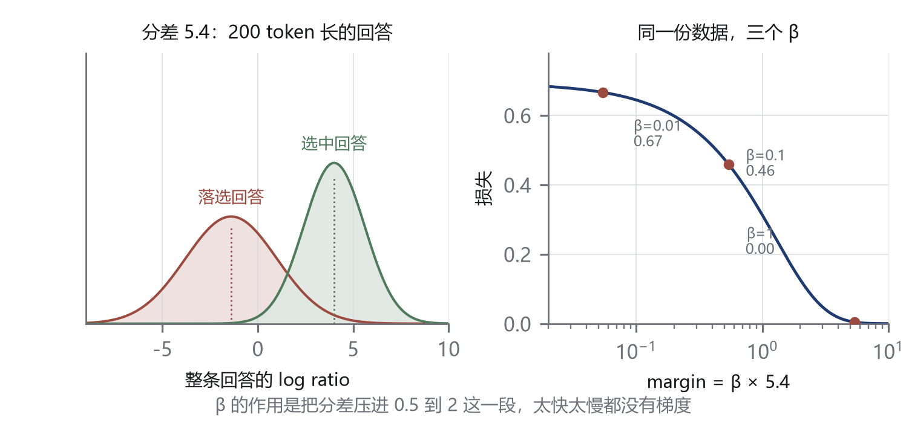

## DPO：把强化学习化简成监督学习

PPO 那一章的成本清单很长：四份权重、采样与训练的交替、奖励尺度、KL 系数、价值网络的拟合。任何一项没调好，训出来的模型都不如什么都不做。

2023 年，直接偏好优化（DPO）提出了一个问题：既然最终要的是策略模型，为什么一定要先把偏好压成一个奖励模型，再用 RL 去追它？能不能直接从偏好数据优化策略？

答案是能，而且推导只用了三步代数。这三步值得一行一行看，因为它同时解释了这个方法为什么有效、以及它的边界在哪里。

### 第一步：写出 RLHF 的最优解

PPO 的目标可以写成这样（忽略采样噪声，只看目标函数）：

$$\max_{\pi}\ \mathbb{E}_{y\sim\pi}\bigl[r(x,y)\bigr]-\beta\,\mathrm{KL}\bigl(\pi\,\|\,\pi_{\mathrm{ref}}\bigr)$$

前一项要奖励高，后一项要离参考模型近。这是一个有闭式解的问题：在 KL 约束下最大化期望奖励，最优策略是

$$\pi^\star(y\mid x)=\frac{1}{Z(x)}\,\pi_{\mathrm{ref}}(y\mid x)\exp\Bigl(\frac{r(x,y)}{\beta}\Bigr)$$

$Z(x)=\sum_y \pi_{\mathrm{ref}}(y\mid x)\exp\bigl(r(x,y)/\beta\bigr)$ 是归一化常数。这个解的意思是：从参考模型出发，按奖励大小给每个回答加权，奖励高的权重高，$\beta$ 越小加权越激进。

为什么是这个形式？可以这样理解：把 KL 约束当成“不许离参考模型太远”的预算，那么最优分配一定是“在原概率上乘以一个随奖励指数增长的因子”。这和统计物理里玻尔兹曼分布的推导是同一个形状：能量低的状态概率高，温度 $\beta$ 越低越极端。

这一步没有引入任何假设，它是那个带 KL 约束的优化问题的精确解。所有后面的事都建立在这个解之上。

### 第二步：把奖励反解出来

上面那个式子对 $r$ 是可解的。两边取对数：

$$\log\pi^\star=\log\pi_{\mathrm{ref}}+\frac{r}{\beta}-\log Z(x)$$

移项，把 $r$ 单独放出来：

$$r(x,y)=\beta\log\frac{\pi^\star(y\mid x)}{\pi_{\mathrm{ref}}(y\mid x)}+\beta\log Z(x)$$

这一步是整个方法的关键。它说：任何一个最优策略都隐含着一个奖励函数，这个奖励就是“策略相对参考模型的概率比”。模型越倾向于生成某个回答，就说明它认为这个回答的奖励越高。

注意这个反解是双向的。给定奖励能算出最优策略，给定最优策略也能算出奖励（差一个只依赖 $x$ 的常数）。这就是为什么 DPO 可以完全绕开奖励模型：奖励已经被策略本身编码进去了，不需要单独学一个。

### 第三步：代回偏好损失

把反解出的 $r$ 代进 Bradley-Terry 的概率式：

$$P(y_w\succ y_l)=\sigma\bigl(r(x,y_w)-r(x,y_l)\bigr)$$

两个 $\beta\log Z(x)$ 相减，直接消掉。剩下：

$$L_{\mathrm{DPO}}=-\mathbb{E}_{(x,y_w,y_l)}\Bigl[\log\sigma\Bigl(\beta\log\frac{\pi_\theta(y_w\mid x)}{\pi_{\mathrm{ref}}(y_w\mid x)}-\beta\log\frac{\pi_\theta(y_l\mid x)}{\pi_{\mathrm{ref}}(y_l\mid x)}\Bigr)\Bigr]$$

这个式子里只有策略模型和参考模型，没有奖励模型，也没有采样。预处理一遍数据，剩下的就是标准的监督学习：跑前向、算损失、反向传播。

$\log Z(x)$ 消掉这件事不是巧合，是整个推导成立的必要条件。它只依赖提示，不依赖回答，所以对同一个提示下的两个回答，它是同一个常数。如果偏好损失里出现了依赖回答的归一化项，这个消去就不成立，方法也就不封闭了。

### 算一遍：一个对子的 log ratio 有多大

公式里那个 $\log\frac{\pi_\theta}{\pi_{\mathrm{ref}}}$ 是整条回答的对数概率比，不是某个 token 的。这个区别决定了它的数值量级，也决定了 $\beta$ 该取多少。

假设一条回答 200 个 token，模型相对参考模型在平均每个 token 上把概率提高了 $e^{0.02}$ 倍，那么整条回答的 log ratio 是

$$200\times 0.02=4.0$$

坏回答假设平均每个 token 降低了同样的比例，log ratio 是 $-4.0$。两者相减是 8.0，乘以 $\beta=0.1$ 得 margin 0.8：

$$\sigma(0.8)\approx 0.69,\qquad L=-\log 0.69\approx 0.37$$

对比第四章奖励模型的例子（分差 1.3，loss 0.24），这里的量级是同一个档次。这说明 $\beta=0.1$ 这个取值是“让 sigmoid 工作在敏感区”的选择，不是随便定的。

如果 $\beta$ 取 0.01，同样的 log ratio 得到 margin 0.08，$\sigma=0.52$，loss 0.65。这个损失几乎和“完全分不出”一样，梯度也很小，训练会非常慢。如果 $\beta$ 取 1.0，margin 8.0，$\sigma\approx 1$，loss 接近 0，梯度同样消失，模型学不到东西。

所以 $\beta$ 的可用区间不宽，0.05 到 0.5 之间，具体取决于回答长度。这是个容易被忽略的耦合：**回答越长，log ratio 的绝对值越大，等效的 $\beta$ 就越大。** 如果你换了一个输出更长的数据集而没调 $\beta$，训练动态会完全变掉。



图里左边是一条 200 token 回答的实际分布：两条曲线的中心大约差 5.4，也就是整条回答的 log ratio 之差。这个差值是“每 token 差 0.027”乘 200 得来的，不是人为设定的尺度。右边是同一份数据在三个 $\beta$ 下的落点：0.01 落在 0.67 附近，曲线平坦、梯度小；1.0 落在 0.00 附近，几乎已经是零梯度；只有 0.1 落在曲线中段的陡坡上。

这张图解释了为什么 $\beta$ 的“正确值”随回答长度变：分差与长度成正比，$\beta$ 要与长度成反比，才能落在同一个位置。经验做法是把 $\beta$ 按平均长度归一次，换数据集时先按 $\beta\times\bar{L}/200$ 折一遭，再微调。

| 超参 | 典型值 | 调大 | 调小 |
|---|---|---|---|
| $\beta$ | 0.05 到 0.5 | 分差迅速饱和，loss 早降到 0，梯度消失 | 每 token 的差异被压平，只学到长度 |
| 学习率 | $5\times10^{-7}$ 到 $5\times10^{-6}$ | 概率比几百步内推到极端，输出退化 | 一个 epoch 后 loss 只降 0.05 |
| epoch | 1 到 2 | 记住对子，长度膨胀 | 未收敛，胜率不动 |
| 参考模型 | SFT 后的模型 | — | 用 base 当参考，KL 锚点错位 |

表里四行互相耦合，最典型的是 $\beta$ 与学习率：$\beta$ 小、学习率大，会和 $\beta$ 大、学习率小一样迅速饱和，但前者的症状是“长度涨”，后者是“什么都不动”。只看一个数，判断不了自己处在哪种情形。

### β 跟着长度走：一张折算表

“$\beta$ 取 0.1”这句话只有配上长度才有意义。按每 token 的对数概率差 0.02 估算，不同平均长度下的最优 $\beta$ 大致是这样。

| 平均长度 | 建议 $\beta$ | log ratio | 现象 |
|---|---|---|---|
| 100 token | 0.5 | 2.0 | margin 1.0，正好在陡坡 |
| 300 token | 0.15 | 6.0 | margin 0.9，同上 |
| 800 token | 0.05 | 16.0 | 已接近下限，再小就饱和 |
| 2000 token | 0.02 | 40.0 | 可用区间没了 |

读法是：$\beta$ 与平均长度成反比，才能让 margin 稳定在 0.8 到 1.0 这个区间。最后一行是 DPO 的结构性缺陷：到了两千 token 量级，任何 $\beta$ 都无法让 margin 落在陡坡上——太小则长度偏差失控，太大则梯度归零。长文任务里 DPO 不好用，不是调参问题，是式子形状导致的。

一个粗略的折算规则：换数据集时先算 $\beta'=\beta\cdot\bar{L}/\bar{L}'$，拿它当起点扫三档。比如从平均 300 换到 800，新起点是 $0.15\times300/800\approx0.056$。方向很容易写反，而写反了很难发现：两边都能“跑起来”，只是一个长度飙、一个梯度归零。

### 想压长度，就把长度差显式减掉

既然长度偏差来自“求和使长回答自然获得更大的 log ratio”，一个直接的做法是在损失里减掉长度贡献：

$$z=\beta\bigl[(\mathrm{lr}_w-\mathrm{lr}_l)-\alpha(L_w-L_l)\bigr]$$

$L_w$ 与 $L_l$ 是两条回答的 token 数，$\alpha$ 是长度惩罚系数。它的含义很直白：如果选中的回答比落选的长 200 token，就先把 margin 扣掉 $\beta\alpha\times200$。取 $\alpha=0.05$、$\beta=0.1$，扣掉的是 1.0，相当于把“长了 200 token”带来的全部好处抹平。

$\alpha$ 不能拍。它的量级应该和“每 token 的真实质量差”同量级：前面假设每 token 差 0.02，所以 $\alpha$ 在 0.02 到 0.05 之间合理；取到 0.2 就变成了“长度越短越好”，模型会开始把回答写成一两句，即使题目需要展开。

如果不想改损失，可以在训练后做一步长度对齐：用同一批提示采长短两版回答、长度相差 30% 以内、总质量可比，当做最后一轮 DPO 的数据。两个办法可以叠，但别同时上——一个改目标、一个改数据，叠在一起时若长度还在涨，你分不清是哪一个没起作用。

### 它到底在优化什么

把这个损失拆开读，会清楚很多。

括号里的两项，分别是“好回答相对参考模型的概率比”和“坏回答相对参考模型的概率比”。训练要做的，是让前者的对数概率升高、后者降低，而且幅度由 $\beta$ 控制。

注意比值里的分母 $\pi_{\mathrm{ref}}$。这一项不是装饰：它让优化方向变成“相对参考模型而言，好回答更可能、坏回答更不可能”。如果没有它，模型会把所有好回答的绝对概率推到 1，把语言能力压成记忆。有了它，模型只需要在原有分布上做相对调整。

$\beta$ 的作用也在这里显形。$\beta$ 大，比值的影响被放大，模型更激进地偏离参考模型；$\beta$ 小，改动就温和。常见的取值是 0.1 左右，比 PPO 里的 KL 系数大，因为这里没有在线修正，只能靠一次性约束。

还有一个容易忽略的细节：DPO 的损失只看两个回答的相对关系，不看它们的绝对概率。这意味着如果 $\pi_\theta$ 和 $\pi_{\mathrm{ref}}$ 在同一条回答上都给出了很低的概率，DPO 并不会“纠正”这件事，它只关心差值。所以 DPO 之后模型可能出现一种退化：整体概率分布变得更平（因为差值被拉开，但绝对水平下降），表现为输出更容易跑题。这个现象在实践中不时出现，缓解办法是把 SFT 数据和 DPO 数据混着用，先保证绝对水平。

### 为什么它便宜，也为什么它有限

DPO 最大的好处是把整套 RL 基础设施删掉了：不需要奖励模型（省一份权重和一份训练）、不需要在线采样（省掉最贵的一环）、不需要调 KL 与价值网络（超参从十几个降到两三个）。一个 7B 模型的 DPO 训练，单机八卡就能跑。

把算力算一遍，这个“便宜”具体是多少。三万对数据，每条回答平均 500 token，一对两个回答：

- 策略模型前向加反向：$3\times10^4\times 1000\times 6\times 7\times 10^9\approx 1.3\times10^{18}$ 次浮点运算
- 参考模型前向（无梯度）：约 $4.2\times10^{17}$
- 合计约 $1.7\times10^{18}$

八张 A100 按有效算力 $8\times125$ TFLOPS 算，一个 epoch 是

$$\frac{1.7\times 10^{18}}{1.0\times 10^{15}}\approx 1700\ \text{秒}$$

不到半小时。同一批数据在 PPO 里，光生成就要几十分钟，还不算四份权重。这就是 DPO 在工程上碾压 PPO 的地方：不是效果好，是跑一次的成本差一个数量级，于是你可以试二十次。

代价有三条，都很实在。

**数据是离线固定的。** PPO 每轮都用当前策略采样，能覆盖策略自己会走到的区域。DPO 用的是别人（通常是更强的模型或旧版本）采出来的对子。如果训练后的策略离这些数据很远，损失函数就在优化一批它根本不会生成的回答。这个错位叫分布外问题，它是 DPO 在推理任务上不如在线 RL 的主要原因。

这个问题可以量化。如果 $\pi_\theta(y_w)$ 比数据里的模型低了三个数量级，那么 $\log\pi_\theta(y_w)$ 是 $-7$ 左右，而 $\pi_{\mathrm{ref}}$ 那边是 $-4$，log ratio 变成 $-3$。这时候 DPO 会努力把 $-3$ 拉到正数，而这需要把一条几乎不可能生成的回答的概率提高一万倍。梯度会一直很大，方向却未必对，因为模型在学“怎么生成这种回答”，而这恰恰是数据里的模型会做、当前模型不会做的事。

**长度偏差被继承甚至放大。** 偏好数据里长答案更受欢迎，DPO 学到的就是“长一点概率更高”。公开实验里，DPO 训出来的模型长度膨胀通常比 PPO 更明显，因为没有奖励模型这一层中间缓冲，也没有 KL 之外的约束。

长度偏差在 DPO 里有一个比 PPO 更硬的机制：log ratio 是对整条回答求和，不是平均。同样“每 token 好 0.02”的两条回答，100 token 的那条 log ratio 是 2.0，400 token 的是 8.0。如果对子里长的是被选中的那个，DPO 学到的就是“越长，分差应该越大”，于是长度成了可以刷的维度。

算一下这个偏差有多大：如果模型学会把长度从 200 token 涨到 400 token，而每 token 的 log ratio 保持 0.02，那么它从“长度”这一维上白拿了 4.0 的 margin。这相当于 $\beta=0.1$ 时 0.4 的分数提升，和它从“回答质量”上能拿到的量级相当。模型没有理由不刷。

**它只能学“已经出现过的偏好”。** PPO 可以探索出数据里没有的行为（因为策略可以采样新回答），DPO 不行。它的上限就是数据分布的上限。

### 数据从哪来

DPO 把算法简化了，于是数据成了唯一变量。这也是为什么同样跑 DPO，不同团队的差距能有十几个点。

数据的来源大致四类。公开的偏好数据集，便宜但风格单一，而且里面的“好回答”往往是某个强模型的输出，学生学到的会是那个模型的风格。自己标注的，质量高但贵，适合做核心集。用当前模型采样再让人挑的（在线 DPO），最贴合策略分布，但每轮都要重新标。用奖励模型或强模型自动打的，最便宜，代价是偏差会被继承。

一个实际有效的做法是混合：核心集用人工标，占一两成；其余用当前模型采样、奖励模型打分，再用一个严格的门槛筛。这样既有人的标准做锚点，又能把数据量做上去。

迭代 DPO 的一轮可以写成一个固定流程，每轮的数字都很小。

**第一步，采样。** 用当前模型对 2,000 条提示各采 2 条，温度 0.9、1.0 各一次，得到 4,000 条回答。温度分开是为了得到“同一个模型的不同尝试”，而不是两次几乎一样的输出。

**第二步，打分。** 用冻结的奖励模型给 4,000 条打分，每个提示里取分数差超过 0.3 的一对，得到约 1,400 对。差小于 0.3 的对子直接丢掉，因为这类对子的偏好信号大概率是噪声。

**第三步，抽检。** 从 1,400 对里抽 200 对人工双标，算 $\kappa$。低于 0.5 就停，先把奖励模型的方向修对。

**第四步，训。** 只跑一个 epoch，学习率取上一轮的一半，$\beta$ 按这批数据的平均长度折算。

**第五步，验。** 和上一轮做 300 条成对比较，胜率超过 55% 才接受这个 checkpoint。

一轮下来，采样 4,000 条、打分 4,000 次、标 200 对、训一个 epoch。成本大约是“三万对离线 DPO”的十分之一，而因为数据来自当前模型，分布错位小得多。代价是每轮都要重跑一遍，而且需要一个可靠的奖励模型——这两件事一起构成了它为什么没成为默认做法的原因。

还有一个关键参数容易被忽略：一对里两个回答的“距离”。如果一个是明显的好、一个是明显的坏，梯度大、学得快，但学完就饱和，因为这种对子太简单。如果两个回答水平接近，梯度小，但能磨出细粒度的判断。实践中的配比大约是三七开，简单对子占三成，接近的对子占七成。

### 一个 batch 的梯度长什么样

把一组对子的梯度写出来，能看清 DPO 到底在推什么。

记 $z=\beta(\mathrm{logratio}_w-\mathrm{logratio}_l)$，损失是 $-\log\sigma(z)$。对 $z$ 的导数是 $-\sigma(-z)$，当 $z=0.8$ 时它是 0.31。再乘 $\beta$，得到对 logratio 的系数：$0.1\times0.31=0.031$。

这个数字很小，但方向很确定：把好回答的 logratio 推高 0.031 的梯度权重，把坏回答的推低同样的量。乘上逐 token 的 $\nabla\log\pi_\theta$，就得到了参数的更新方向。

注意两件事。一是参考模型不参与梯度，它只提供一个固定的基准，所以它的前向可以完全在推理模式下跑，省显存。二是这个系数永远小于 $\beta$，也就是说 DPO 的每一步更新都很温和，这也是它比 PPO 稳的原因——它根本没有“大步子”这个选项。

### 这段损失在代码里长什么样

DPO 的实现短得让人怀疑它是不是漏了什么。下面是完整的核心逻辑。

```python
for x, yw, yl in loader:              # 一对偏好数据
    lw = logp(policy(x, yw)) - logp(ref(x, yw))
    ll = logp(policy(x, yl)) - logp(ref(x, yl))
    z = beta * (lw - ll)              # margin
    loss = -logsigmoid(z)             # -log σ(z)
    loss.backward()
```

第一行的 `logp` 返回整条回答的对数概率之和，不是平均值。这个选择决定了后面所有数值量级：求和让 log ratio 随长度线性增长，平均则把长度因素消掉。标准 DPO 用的是求和，所以 $\beta$ 必须与长度耦合；如果你想用平均，$\beta$ 要相应放大约两个数量级。

第二、三行里的 `ref` 必须连着 `no_grad`，它只提供基准，不参与反向。第四行是 margin，一个对子一个标量。第五行把 margin 过一层 $\log\sigma$：margin 为 0 时损失是 0.693，为 2 时降到 0.127，为 5 时降到 0.0067。

第六行反向。需要盯的是梯度系数 $\beta\sigma(-z)$：它永远小于 $\beta$，所以 DPO 每一步都很温和。这是它稳的原因，也是它慢的原因——同一批数据要跑更多 epoch 才推得动。

实现里有两个高频错误。第一个是把两个模型的顺序写反（`logp(ref) - logp(policy)`），等于把损失里的符号翻过来，模型会被训练去降低好回答的概率。症状很戏剧化：loss 也能降，降到一个比 0.693 低的平台，然后训出来的模型两头不讨好。第二个是 padding 参与求和：`logp` 如果不按有效长度做掩码，长对子与短对子的 log ratio 差得离谱，$\beta$ 的等效值就乱了。两种 bug 都不报错。

### 一个失败案例：loss 降了一半，评测没动

有个团队做法律文书助手，用三万对偏好数据跑 DPO。日志很漂亮：loss 从 0.69 降到 0.34，训练集上的隐式奖励差从 0 涨到 6，一切看起来都在往好的方向走。

评测结果：人工评分和基线打平，平均回答长度从 180 字涨到 290 字。

他们先怀疑评测集，换了一批题，结论一样。又怀疑 $\beta$，试了 0.05 和 0.3，除了长度涨幅变成 20% 和 60%，评测还是打平。

真正的原因在数据构造。偏好数据的两个回答是由同一个模型用不同的提示词采出来的：一个提示是“简要回答”，一个是“详细分析并给出建议”。标注者几乎总是选“详细”的那条，因为它看起来更专业。于是三万对数据里，有 92% 的对子是“长 vs 短”，而且长的那条总是被选中。

DPO 忠实地学到了这个模式：把回答变长。至于“长在哪里”，数据里没有区分，模型就自己找了最容易的路径——加免责声明、加背景复述、加“建议咨询专业律师”。这些内容在真实偏好里是中性甚至负面的，但在这批数据里它们和“长”绑在一起，于是被一起奖励了。

修法是把数据重构成“长度可比”的对子：同一个问题，采两条长度相近的回答，再让人挑。这样偏好信号被迫落在内容上，而不是长度上。重训后 loss 只降到 0.52（因为任务变难了），但评测涨了 8 个百分点。

这个案例的教训是：**DPO 的 loss 只反映“模型能否复现数据里的偏好”，不反映“这个偏好是不是你想要的”。** 数据里有什么偏差，它就会放大什么偏差，而且因为收敛得快，放大的速度比 PPO 更快。

### 案例库：参考模型加载错了

第二个案例更安静：所有东西都在跑，loss 也在降，只是降得不够低。

症状。loss 从 0.693 降到 0.52 就卡住，不像文档里那样能到 0.3 以下。同时格式遵循率从 94% 掉到 61%，回答开始不带结束标记，有时直接以半句话收尾。人评下降。

排查顺序。先打印参考模型的路径和它的哈希，和 SFT checkpoint 对一下，发现加载的是 base；再算 log ratio 的均值，正常应该在 0 到 5 之间，实际是 $-3$ 左右；最后测参考模型自己在 200 条同质对子上的准确率，得到 43%，说明它系统性偏向某一类回答。

根因。DPO 推导里的 $\pi_{\mathrm{ref}}$ 应当是“RLHF 里那个被 KL 约束的参考策略”，工程上就是 SFT 模型。用 base 代替时，KL 锚点错位：模型被允许离开对话格式这个流形，因为往那个方向走，相对 base 的 log ratio 反而不罰。又因为 base 自身的偏好差与标签不一致，损失里多了一个消不掉的偏置，所以 loss 卡在 0.52。

修法。参考模型改成 SFT checkpoint，冻结；在训练脚本里加三条断言：参考模型对好回答的平均 logp 高于 base 版本、参考模型在同质对子上接近 50%、初始 loss 接近 0.693。重训后 loss 降到 0.34，格式保持 93%，人评 +7。

三条断言里最有用的第二条，因为它把“锚点对不对”变成了一个可自动检验的数。如果没有它，这个 bug 能活到上线，而它制造的症状（格式退化）很容易被归因为“DPO 本身会伤格式”——后面这句归因，在很多团队的报告里都出现过，而它其实是错的。

### 失败案例：padding 进了 logp 的求和

症状。loss 从 0.693 顺利降到 0.31，比预期还好。但抽检发现，模型对好回答的绝对概率在下降：同一道题，SFT 模型给出的平均对数概率是 $-0.8$/token，DPO 后变成 $-1.3$/token，而对坏回答降得更多（$-2.1$）。格式遵循率从 95% 掉到 79%，长回答开始出现复读。

排查顺序。第一步，拿 20 对数据分别算 $\mathrm{lr}_w$ 和 $\mathrm{lr}_l$ 的均值，发现 $\mathrm{lr}_w$ 已经是 $-0.4$，而理论上初始应该接近 0。第二步，把 batch 里不同长度对子的 $\mathrm{lr}$ 除以有效 token 数，得到每 token 当量，发现它随长度单调下降。第三步，看 `logp` 实现：对整条张量直接 `.sum()`，没有乘 attention mask。

根因。pad token 的位置上模型给出的对数概率不是零，而是一个固定的负数（那个 token 在词表里很常见，概率不低）。序列拼到固定长度后，短对子被补得更多，于是它的 $\mathrm{lr}$ 被系统性拉低。结果是：模型学到的不是“好回答概率高”，而是“好回答的 padding 少”，而当对子里长的是被选中的那个时，两个信号方向正好相反。

修法。一是在 `logp` 里乘 mask 并对 token 数归一（或至少两者一致）；二是在数据加载时断言：单条样本的 $\mathrm{lr}$ 在初始阶段应当落在 $[-1,1]$，越界就报警；三是把“绝对概率是否下降”当一个常规指标，DPO 之后它不应该跌超过两成。修完后 loss 到 0.36（不再“更好看”），格式保持 93%。

这个 bug 的典型特征是“指标全都变好”。和上一章 PPO 里 `old_logp` 重算那一个一样，它降低的是训练难度，不是任务难度。凡是让 loss 曲线变漂亮的实现错误，都值得先怀疑一下。

### 失败案例：换到长文任务，β 没跟着改

症状。一个文档总结产品把 DPO 从对话数据（平均 180 token）搬到报告数据（平均 900 token），其他配置一律不改，$\beta$ 仍取 0.1。训练一启动 loss 就从 0.69 直接掉到 0.09，半小时后变成 0.002，看起来“学得飞快”。评测结果：长度从 900 涨到 2,300，人评持平，关键信息覆盖率掉了 12 个点。

排查顺序。第一步，算 log ratio 的均值：$\pm18$，而对话数据上是 $\pm3.6$。第二步，算 margin：$0.1\times36=3.6$，$\sigma(3.6)\approx0.97$，几乎每个对子的 loss 都接近零。第三步，抽 30 条看“获胜”的回答，发现它们普遍比落选的长一倍，而且多出的部分是重复段落。

根因。两层。表层是 $\beta$ 没按长度折算：长度乘了五倍，等效 $\beta$ 也乘了五倍，于是 sigmoid 从一开始就饱和，梯度只剩“把长度拉大就能拉开 margin”这一条路。深层是数据：长文任务的偏好对里，长度差本身就很大（人工标的），DPO 把长度当成了质量。

修法。一是 $\beta$ 按 $\bar{L}$ 折算到 0.02，并在训练前用 200 对数据扫一遍 $\beta$，要求初始 loss 在 0.6 到 0.7 之间——偏离这个区间就不开跑。二是数据侧按长度分层，每个长度档单独成对。三是加长度惩罚 $\alpha=0.02$。改完后 loss 降到 0.42，长度涨 15%，关键信息覆盖率涨 4 个点。

教训：$\beta$ 不是超参，是“分差到 margin”的换算系数，而分差的量级由长度决定。换数据集不换 $\beta$，等于把 sigmoid 推到了它的平垉段，而平垉段上什么都能降 loss。

### 一个家族

DPO 之后出现了十几个变体，各自修一个具体问题。

**IPO**（identity preference optimization）针对的是 DPO 在偏好完全确定时的过拟合：损失变成平方形式，防止模型把概率比推到极端。它的动机很直接：如果数据里每一对都是“这个明显更好”，DPO 会一直推，直到把 $\pi_\theta(y_l)$ 压到接近 0，那是过拟合。IPO 把目标从“把分差推到无穷”改成“把分差推到一个确定值”。

**KTO**（Kahneman-Tversky optimization）只需要“这个回答好/不好”的二元标注，不需要成对比较。它用前景理论里的效用函数代替 sigmoid，好处是数据收集容易得多。这一点在工业界很实用：让标注者判断“这条回答能不能发出去”比“两条里挑一条”便宜一半，数据量也能大得多。

**ORPO** 把 SFT 和偏好合成一步：在标准的交叉熵损失上加一项“让坏回答概率下降”的惩罚，一次训练同时学格式和偏好。省一轮训练，代价是两者的权重需要调。它的吸引力在于流程简化：小团队不用维护两个训练阶段。

**SimPO** 去掉了参考模型，改成对回答长度做归一化，直接用平均对数概率做比值。省一份权重，也顺手缓解了长度偏差。这个改动的思路值得记住：既然长度偏差来自“求和”，那就改成“求平均”。

**CPO**、**RSO**、**迭代 DPO** 走的是另一条路：把 DPO 变成在线的——用当前模型采样，用一个奖励模型（或人工）标注，再跑 DPO。这样既拿到了在线数据，又保留了 DPO 的稳定性，代价是重新引入了采样和打分。

这些变体的取舍可以用一句话概括：**每一个都在“更省”和“更准”之间挪一点。** 省掉参考模型（SimPO）、省掉配对（KTO）、省掉一个训练阶段（ORPO），代价都是引入新的偏差或者新的超参。

### 什么时候选哪个

把选择标准列出来，比记住名字更有用。

| 情况 | 选择 | 理由 |
|---|---|---|
| 有大量成对偏好数据、算力有限 | DPO 或 SimPO | 一次前向，单机可跑 |
| 只有二元反馈（好/不好） | KTO | 不需要配对 |
| 想把 SFT 和偏好一起做 | ORPO | 省一轮训练 |
| 偏好数据少、需要探索 | 在线 DPO / PPO | 采样能覆盖新区域 |
| 任务是数学、代码这类可验证的 | 都不是，用 RLVR | 偏好信号太弱，见下一章 |
| 输出很长（几千 token 的文档） | SimPO 或长度分档 | 求和的长度偏差会失控 |

最后一行值得单独说。回答越长，DPO 的 log ratio 量级越大，长度偏差越严重。如果你的产品是长文生成，直接用标准 DPO 几乎一定会得到“越写越长”的模型。这种情况下要么换长度归一化的变体，要么在数据构造阶段就把长度对齐。

一个常见的误解是“DPO 比 PPO 先进”。它们不是替代关系，是同一个目标在两种假设下的解法：数据是否在线、奖励是否显式。选错的代价很大——用 DPO 去训推理任务，通常能看到 loss 稳步下降、评测分数纹丝不动，因为模型在优化一批它不会生成的回答。

### 两个常见误解

**误解一：DPO 没有超参，开箱即用。**

它只有两三个超参，但每一个都很敏感。$\beta$ 决定偏离参考模型的力度，学习率决定收敛速度，数据配比决定学到什么。三者还会互相耦合：数据里长度偏差大时，$\beta$ 小一点能压住膨胀，但压住的同时也压住了真实收益。

**误解二：DPO 的隐式奖励可以用来给回答打分。**

理论上可以，$r=\beta\log\frac{\pi_\theta}{\pi_{\mathrm{ref}}}$ 就是一个分数函数。实践上不建议：这个分数是在“相对于参考模型的偏好”这个意义上定义的，它对长度、格式的敏感度和训练数据强相关，拿它当通用打分器会把训练时的偏差带进线上。

### 它留下的启示

DPO 的真正贡献不是省了算力，而是揭示了一件事：奖励模型和策略模型是一枚硬币的两面。任何策略都隐含着一个奖励，任何奖励都对应着一个最优策略。

这个视角后来被反复使用。第九章讲的蒸馏式对齐，本质上是用同一个思路把“评判标准”本身也交给模型；第十章讲的多步任务，则是把“奖励”换成不用学的规则。

下一章就进这个领域：当奖励可以自动判定对错时，整件事会变得干净得多，也会冒出新的问题。
