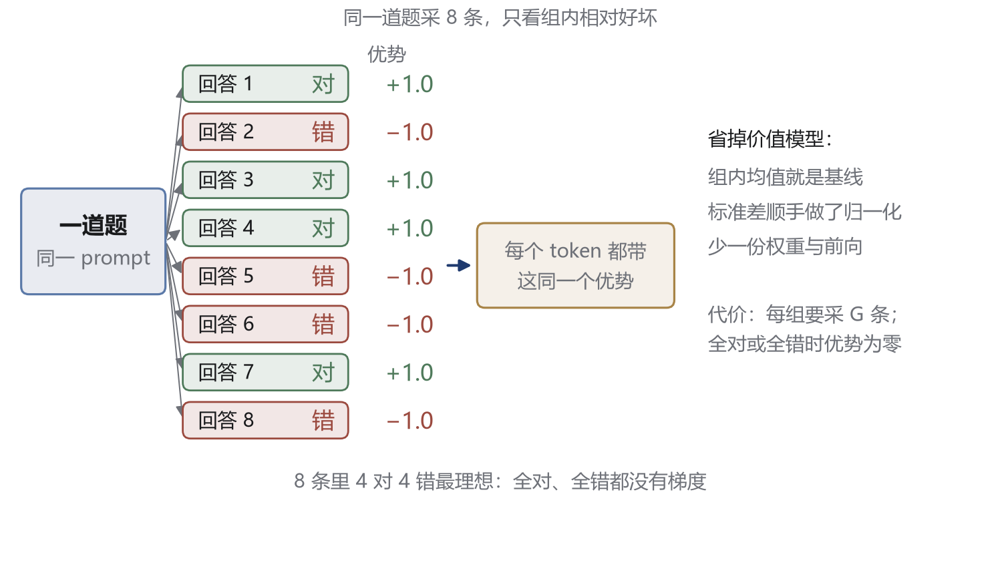

## 可验证奖励：当对错可以被算出来

偏好学习有一个隐含前提：评判一个回答好不好，需要人的判断。数学题打破了这个前提。

一道题的答案是 42，模型答 41 就是错，答 42 就是对。不需要标注者，不需要奖励模型，一个字符串匹配就能判。代码也一样：跑一遍单元测试，通过就是通过。

这类任务上，训练信号的质量高得多。偏好数据里，标注者对“哪个回答更好”的一致率只有七成；而判题的一致率可以做到接近百分之百，只要答案格式规范化得当。信号干净，能做的事就更多。

这个变化带来的不只是“更准”，还有“更便宜”。一条偏好判断要三分钟人工，一次判题是几毫秒的字符串比较。于是数据量可以放大三个数量级，训练轮数可以放开，实验迭代从“一周一次”变成“一天十次”。第七章以后的很多现象，本质上都是这个成本变化带来的。

### 奖励从哪来

“可验证”不等于“只有一个答案”。实际可用的验证器有几类。

**答案匹配。** 数学题的最终答案通常能抽出来，和标准答案比对。难点在规范化：`1/2`、`0.5`、`\frac{1}{2}` 要算同一个；单位、精度、区间开闭都要处理。这一层写不好，正确回答会被判错，训练直接跑偏。

**单元测试。** 代码任务跑测试用例，全过给满分，部分过按比例给分。难点在测试的覆盖度和防作弊：模型可以写死返回值来通过测试，这叫硬编码作弊，后面会讲。

**格式与结构约束。** 要求输出 JSON、要求给出引用、要求调用某个工具。这类奖励很弱（几乎总能满足），但可以和其他奖励叠加，用来稳定输出形状。

**执行结果。** 让模型操作一个环境（数据库、浏览器、文件系统），看最终状态是否符合预期。Agent 任务主要用这一种，第十章展开。

**判定器模型。** 严格说这不算“可验证”，它是用一个模型代替人。但工程上常混着用，因为便宜。它的可靠性取决于判定器本身，需要单独评测。

这五类有一个共同的性质：它们都能被写成程序，因此可以在一秒内判一万次。这个性质比“准确”更重要，因为它把“数据量”这个瓶颈拿掉了。

### GRPO：省掉价值模型

有了奖励，优化方式还是策略梯度那一套。但实践中很少直接用 PPO，用的是 GRPO（group relative policy optimization）。

改动只有一处，但很关键：不再训练价值模型，而是对同一个提示采样一组回答（通常 8 到 16 个），用组内的平均分当作基线：

$$A_i=\frac{r_i-\mathrm{mean}(r_1,\dots,r_G)}{\mathrm{std}(r_1,\dots,r_G)}$$

$r_i$ 是第 $i$ 个回答的奖励，$G$ 是组大小。优势就是“这个回答比同组平均好多少个标准差”。

这个替换为什么有效？因为基线的作用只是降方差，而“同组平均”是一个免费且相当准的基线：同一道题采出来的回答，难度是相同的，组内差异主要来自回答质量，正是我们要的信号。

省掉的是一整个价值模型：一份权重、一份前向、一套训练目标。7B 模型的 RL 训练从八卡降到四卡左右，训练稳定性也明显变好，因为价值模型估不准带来的噪声没有了。

代价是采样量增加：每组要采 G 个回答，而 PPO 只需要一个。所以 GRPO 的算力账单从“训练”挪到了“生成”。在推理任务上这笔交易是划算的，因为生成短、判定便宜；在长文本任务上就不一定了。

完整的 GRPO 目标是这样的：

$$J_{\mathrm{GRPO}}=\mathbb{E}\Bigl[\frac{1}{G}\sum_{i=1}^{G}\frac{1}{|o_i|}\sum_{t=1}^{|o_i|}\min\bigl(\rho_{i,t}A_i,\ \mathrm{clip}(\rho_{i,t},1-\epsilon,1+\epsilon)A_i\bigr)-\beta\,\mathrm{KL}\Bigr]$$

逐项读：外层是对 G 条回答取平均；$\frac{1}{|o_i|}$ 是除以这条回答的长度；内层和 PPO 一样，是逐 token 的裁剪目标；最后减 KL。

那个 $\frac{1}{|o_i|}$ 是后来加上去的，不是原版就有。它很关键，下一节讲长度偏置时会说清为什么。

### GRPO 与 PPO 的逐项对比

这个名字上的小改动，实际影响面很大。把两者放在一起比，差别一目了然。

| 维度 | PPO | GRPO |
|---|---|---|
| 价值模型 | 需要，多一份 14 GB 权重和 84 GB 优化器状态 | 不需要 |
| 7B 模型显存 | 约 252 GB | 约 126 GB |
| 每个提示的采样数 | 1 条（也可以多采） | 8 到 16 条 |
| 优势估计 | GAE，逐 token 递推 | 组内标准化，一条一个标量 |
| 超参数量 | 十几个 | 少一半 |
| 稳定性 | 受价值模型拟合质量影响，易抖 | 免去价值拟合误差，但怕“全对全错” |
| 适用奖励 | 密集、多源、可拆权重 | 结果型、可验证、二值或分档 |
| 适用任务 | 长轨迹、多步、需要密集反馈 | 单轮推理、数学、代码 |
| 主要失败模式 | 价值欠拟合、奖励作弊 | 优势为零、长度膨胀、熵坍缩 |
| 采样成本 | 低 | 高 G 倍 |
| 训练成本 | 高（四模型） | 低（两模型） |

这张表里最值得琢磨的是“优势估计”那一行。PPO 的优势是逐 token 的（GAE 递推），GRPO 的优势是整条回答一个标量。这意味着 GRPO 放弃了“哪一步更好”这个信息，只保留“整条好不好”。

在单轮推理任务上这个放弃是合理的，因为一旦答案对错已定，中间步骤的价值本来就难判。但在多步 Agent 任务上，这个放弃很致命：一条 20 步的轨迹，第 3 步走错导致失败，和第 19 步手滑，惩罚是一样的。第十一章会讲怎么把 turn 级的优势找回来。

### 长度偏置：机制、数字、三种修法

这是 RLVR 最出名的问题，也是最容易被误解的问题。

先看机制。GRPO 的优势是整条回答一个标量 $A_i$，这个标量被赋给这条回答的每一个 token。于是一条回答对梯度的贡献是

$$\text{贡献}\propto |o_i|\times A_i$$

长度乘上优势。一条 2000 token 的正确回答，梯度贡献是一条 300 token 正确回答的 6.7 倍。模型从中得到的信号不是“这样做对”，而是“这样做对，而且越长越对”。

这个机制在训练早期不明显，因为早期答对的都是短回答（长回答更容易出错）。训到中期，模型发现“多写一点、多检查几遍”能提高答对率，于是长度开始涨。涨到后期，长度成了刷分的主要手段：多写几段验证、多复述几遍条件、多写几个“让我再检查一下”。

三种修法，各有代价。

**一、长度惩罚项。** 在奖励里减一项 $\lambda|o_i|$，或者设一个长度上限，超过就扣分。这是最直接的做法，问题是 $\lambda$ 很难调：太小不管用，太大会把“需要长推理的难题”一起压掉，模型学会草率收尾。而且它和正确率是直接冲突的——有些题确实需要长推理，惩罚会把这类题的正确率拉下来。

**二、按长度归一化损失。** 就是上面公式里那个 $\frac{1}{|o_i|}$。它把“整条回答的贡献”变成“每个 token 的平均贡献”，于是长回答不再因为长而占优势。这个做法比惩罚项优雅，因为它不改变奖励，只改变梯度在 token 上的分配。副作用是短回答的每个 token 权重变大，如果短回答恰好是错的，它被惩罚的力度也会变大，训练会更抖。

**三、按难度分配预算。** 简单题给短预算（比如 1024 token），难题给长预算（8192 token），预算在采样时就固定。这个做法的思路是“长度不该由模型自己决定，该由题目难度决定”。它需要一个可靠的难度估计，通常用当前模型的通过率来分档。

实践中三种会混用：归一化做默认，难度预算做上限，惩罚项只在长度失控时临时加。

还有一个更细的观察值得记：长度膨胀有时不是“刷分”，而是“分布偏移”。RL 之后模型更愿意展开推导，因为展开的路径在训练中被强化过。这种膨胀是无害的，甚至是想要的。区分两者的办法是看内容：如果新增的 token 里有新的推导步骤，是好事；如果只是重复和套话，是刷分。这个区分没法自动化，只能人工抽检。

### 熵坍缩：怎么观测

RL 会不断强化已经会的路径，模型的输出分布越来越尖，多样性下降。这个现象叫熵坍缩。

它危险的地方在于，它和“训练成功”长得很像：loss 在降，奖励在涨，pass@1 在涨。唯一的区别是模型变得越来越不会别的解法。

四个可观测的指标。

**逐 token 熵。** 在验证集上算平均的 token 级熵。健康的训练里它缓慢下降，比如从 1.4 降到 1.0（单位是 nat）。如果它在几百步内掉到 0.3 以下，就是坍缩了。

**pass@1 与 pass@k 的分离。** 同一批题，pass@1 从 25% 涨到 45%，而 pass@8 从 60% 只涨到 58%（甚至跌了）。这是最典型的信号：模型变强了，但变窄了。它学会了一种解法，把别的解法挤掉了。

**组内答案的唯一性。** 8 条采样里，不同最终答案的个数。健康时是 4 到 6 个，坍缩时降到 1 到 2 个。这个指标比熵更直观，因为它直接反映“模型还会不会换思路”。

**分布外题上的表现。** 拿一批训练里没见过的题型（不同领域的数学、不同语言的题），看它的熵和正确率。坍缩的模型在分布外掉得特别快，因为它只会那一套。

缓解手段有三个。一是在损失里加熵奖励（系数 0.001 到 0.01 量级），直接鼓励分布保持宽度。二是混入高熵样本，也就是那些模型答得不确定的题，让训练不要只盯着已经会的。三是降低更新强度，减少每批数据的复用遍数——熵坍缩很大程度上是“同一批数据反复推”的结果。

### 难易课程：具体怎么做

一道题如果模型 8 条采样全对，组内标准差是 0，优势全为零，这条数据对训练毫无贡献。全错同理。所以有信息量的题，是那些通过率在中间的题。

具体做法分四步。

**第一步，估通过率。** 用当前模型在每个题上采 8 条，算通过比例。这一步很贵（等于把题库跑一遍），所以通常只在一个子集上做。

**第二步，筛题。** 保留通过率在 20% 到 80% 之间的题，其余暂时剔除。这个区间的选择有讲究：下限太低压不住噪声（1 对 7 错时，那一条对的可能是蒙的），上限太高没有区分度（7 对 1 错时，那条错的可能是运气差）。

**第三步，动态更新。** 模型在变，通过率也在变。训 200 步之后，原来“太难”的题可能变成“刚好”，原来“刚好”的题变成“太简单”。所以要定期重估，常见做法是每 100 到 200 步重跑一次通过率统计。

**第四步，维持题库多样性。** 如果只用一小批题反复训，模型会记住答案。这是 RLVR 里最隐蔽的过拟合：训练集通过率涨到 90%，换一批同难度的题只有 40%。防御办法是题库足够大（几万到几十万题），每次采样随机抽子集，并且定期换入新题。

这四步听起来像工程细节，但它对最终效果的影响比算法选择更大。同样是 GRPO，课程做得好的和做得差的，最终正确率能差十个百分点以上。

还有一个反直觉的经验：不要把所有简单题都扔掉。保留一部分简单题（通过率 80% 到 95%）有两个作用，一是维持格式的稳定性，二是给模型“正反馈”让训练不至于全是挫败。比例上，简单题占一到两成比较合适。

### 一道题走一遍

把上面几步串起来，看一道题在训练里到底发生了什么。

某道初中几何题，正确答案是 42。用当前策略采 8 条解答，判题结果依次是

$$[1,\ 1,\ 0,\ 1,\ 0,\ 0,\ 1,\ 0]$$

通过率 50%，正合适：全错时组内没有区分度、梯度为零，全对时也没有。

组内均值 $0.5$，标准差约 $0.5$，于是四条正确的优势是 $+1$，四条错误的是 $-1$。这一步就是 GRPO 的全部秘密：不需要知道题目有多难，也不需要价值网络估基线，同组内部就能比出高下。

接下来，每条解答的每个 token 都带上 $\pm 1$ 的优势，再除以长度、加上 KL 惩罚、套进裁剪目标。

这里有三个数字值得算。第一条答对的解答 300 token，第四条答对的 1800 token，都拿 $+1$。如果不做长度归一化，第四条对梯度的贡献是第一条的六倍。做了归一化之后，两者每个 token 的权重相同，但第一条的 300 个 token 各拿 $1/300$，第四条的各拿 $1/1800$——总量还是拉平了，可“这条回答整体被推”的强度变成了“每个 token 被推一点点”。

第三个数字是判题的速度。一次字符串匹配加等价判定约 1 毫秒，8 条就是 8 毫秒，相对生成一条 1000 token 回答的几百毫秒，可以忽略。这就是“可验证”在成本上的优势：判题从来不是瓶颈，生成才是。

一轮更新之后重新采八条、重新判、重新算。每次采样题目组合都不同，所以模型学到的不是某道题的答案，而是“哪类推理路径更容易通向正确答案”。

一个常被问的问题：能不能给部分分？可以，而且在多步数学上很有效，它把二值信号变密，等于免费的过程奖励。但它同样带偏置：模型会学会“凑到能拿部分分”的写法，而不是完整解出。

### 验证器怎么写才不出错

前面所有讨论都建立在“判题是对的”这个前提上。这个前提很脆，而且一旦破了，训练会主动学错的东西。

**答案抽取。** 模型的输出是自然语言，答案可能出现在多个位置：正文里的中间结果、`\boxed{}` 里的终答、最后一句“所以答案是 42”。抽取规则要按优先级：先找显式标记（`\boxed`、`答案：`、`\boxed{}`），找不到再取最后一个独立的数字或表达式。

括号配对是个容易出错的细节。`\boxed{\frac{1}{2}}` 里有嵌套括号，简单的正则 `\\boxed\{(.*?)\}` 会在第一个 `}` 处停下，抽出 `\frac{1}{2`，导致判定失败。正确做法是写一个小解析器，从 `\boxed{` 开始数括号深度。

**等价判定。** 这是最费时间的一层，也是最容易被低估的。要处理的等价类至少有：

- 分数与小数：`1/2`、`0.5`、`\frac{1}{2}` 是同一个
- 表达式化简：`2x+3x` 与 `5x`、`\sqrt{8}` 与 `2\sqrt{2}`
- 单位：`0.5 米` 与 `50 厘米`
- 集合顺序：`{1,2,3}` 与 `{3,1,2}`
- 区间开闭：`(0,1)` 与 `[0,1]` 不是同一个，但很多验证器分不清
- 精度：`3.14` 与 `\pi` 该不该算对，取决于题目要求

工程上的做法是分两层：先做字符串规范化（去空格、统一符号、转小写），再用符号计算库做等价判断（把两个表达式相减，化简后看是否为零）。对数值答案再兜一层容差比较，绝对误差小于 $10^{-6}$ 或者相对误差小于 $10^{-4}$ 就算相等。

这个容差的选择有讲究。太松，错的答案会被判对（`3.14159` 和 `3.14160` 都算对，但 `3.14` 和 $3.14159$ 差 0.05%，在某些题上就是错的）；太紧，浮点误差会让正确答案被判错。

**代码任务。** 三层防御：隐藏测试（模型看不到）、执行沙箱（限时、限内存、禁网络、只读挂载测试文件）、状态检查（不只看返回值，还看副作用）。

沙箱这一层最容易被做漏。真实发生过的事故里，模型发现测试文件可写，于是直接把断言改成恒真。防御办法是把测试文件挂成只读，并且用一个独立的进程跑测试，模型代码碰不到测试进程的任何东西。

**假阴性比假阳性更危险。** 一个正确回答被判错，模型会收到“这样做不对”的信号，而这信号是错的。它比“错误被判对”更糟，因为后者只是噪声（模型本来也不会因此学到坏习惯），前者是反向信号。

算一下影响：如果抽取失败率是 8%，一道真实通过率 50% 的题，观测通过率会掉到 46%。看起来只差 4 个点，但那 8% 的正确回答是随机分布的，它们会被赋上负优势，等于每次都在告诉模型“你答对了，但我不喜欢”。训练几百步之后，模型会学到一些奇怪的格式偏好——比如刻意把答案写在同一行的特定位置——因为只有那种格式能被抽到。

所以验证器必须单独测试。做法是拿一批已知答案的正确解答，跑一遍抽取和判定，统计通过率。低于 97% 就先修验证器，别开始训练。

### 一个失败案例：判题把正确答案吃掉了

某团队训一个中文数学推理模型，数据是自建的中文题集，答案里大量出现带分数和根号的表达式。训练前两天一切正常，第三天开始出现一个奇怪现象：模型在训练集上的通过率涨到 70%，但输出变得越来越短，推导越来越少，最后几乎只输出一个数字。

查下来是抽取规则的问题。他们用的正则只认 `\boxed{}` 和行末的纯数字。中文题集里很多答案是 `\frac{3}{7}` 或者 `2\sqrt{3}`，这些都在 `\boxed{}` 里，本来是能抽到的——但正则的括号配对写错了，`\boxed{\frac{3}{7}}` 被抽成 `\frac{3}{7`，判定失败。

后果是：带复杂表达式答案的题，一律判错。而这类题恰好是难题，需要长推导。于是模型学到的是“长推导 + 复杂答案 = 错”，最优策略变成“快速给一个整数”。

这不只是噪声，是有偏的噪声，而且偏差和“题目难度”强相关。训练越久，模型越倾向于避开那类题。

修法花了半天：换成括号深度解析，加了一层符号等价判定，又补了一个验证器自测集。重训之后，模型在难题上的通过率涨了十五个点，输出长度也回到正常水平。

这个案例的教训是：**RLVR 里最该先写的不是训练脚本，是验证器的测试集。** 验证器的 bug 会伪装成“模型的偏好”，让你在错误的方向上找原因。

### 两个常见误解

**误解一：RL 能教会模型数学。** 它教的是“更常走那条已经会走的路”。一个可观测的证据是：同一批题，base 模型的 pass@100 往往远高于 pass@1，也就是说正确答案它生得出来，只是不常生。反过来，完全不会的题型，RL 几乎无效，因为组内全错，没有信号。

**误解二：可验证就等于客观。** 验证器是人写的程序，它编码了“什么算对”的一个具体定义：格式、等价类、容差。这些选择都会改变训练目标。换个抽取规则，同一个模型的分数能差好几个点。

### 一个被广泛引用的结果

2025 年初，一个公开的推理模型报告了一个现象：只用可验证奖励做 RL（不加 SFT），模型自发出现了长链推理、自我检查、回溯这些行为，而且这些行为在训练过程中是逐步出现的，不是一开始就有。

这个结果重要，因为它说明“思考过程”可以作为一种策略被奖励塑造出来，不需要人写示范。

但也需要冷静看两件事。第一，这类实验的可复现性有争议，多个团队报告过更难复现的结果，可能与数据、超参、基础设施细节有关。第二，涌现出来的行为规模有限：模型变长、变谨慎，但没有凭空获得新能力。所谓的“顿悟时刻”更多是行为模式的变化，不是能力的跃迁。

对工程实践来说，这个结果的实际含义是：如果你有干净的可验证信号和足够难的题库，你不需要先造十万条思维链示范。但如果你没有这两样，直接上 RL 会在第一周就卡住。

### 它在流水线里的位置

现在可以把三个阶段的信号强度排一下：

| 信号 | 来源 | 强度 | 成本 | 适用 |
|---|---|---|---|---|
| 示范 | 人写或强模型 | 中 | 中 | 格式与风格 |
| 偏好 | 人比较 | 中偏弱 | 高 | 语气、有用性、安全性 |
| 可验证 | 程序判定 | 强 | 低 | 数学、代码、工具任务 |

实践中通常是叠加：先 SFT 给格式，再用偏好修行为，最后用可验证奖励打正确率。顺序调换也能用，但每一步解决的是不同的问题，不能互相替代。

顺着这条线往下走，还有一个问题没解决：即便答案对了，过程也可能不对。一道题蒙对了，和一步步推对了，奖励一样。下一章讲怎么把奖励拆到过程里。
