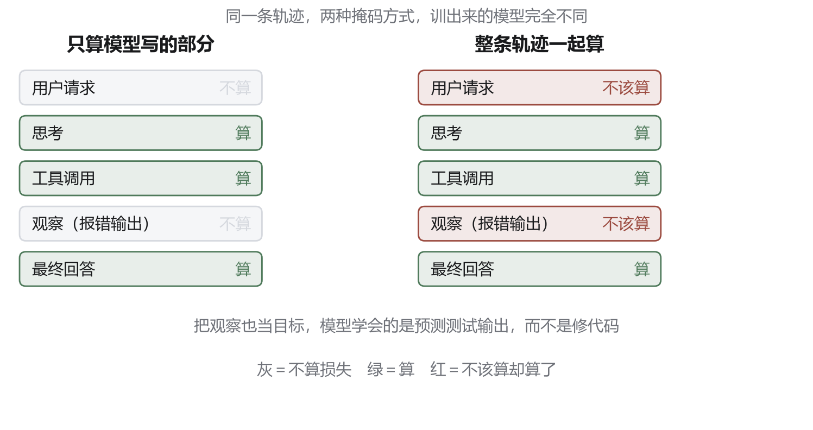

## Agent 后训练（一）：多步任务长什么样

一个单轮任务，模型输出一段文本，结束。多步任务不是这样。

用户说“把这个仓库里失败的测试修好”。模型要先读代码、找到相关文件、跑测试、看报错、改代码、再跑、可能还要改好几轮。中间每一步的输入都依赖上一步的输出，而输出不只是文本，还可能是“调用了哪个工具、传了什么参数、环境返回了什么”。

这类任务叫 Agent 任务。训练它和训练对话模型的关键差别在于，动作空间里有真实世界的后果。

### 一个具体的轨迹

把它写出来，结构就清楚了。

```text
[任务] 修复 tests/test_parser.py 里失败的用例

[第 1 步]
思考：先跑一遍测试，看是哪个用例失败。
动作：run_tests(path="tests/test_parser.py")
观察：FAILED test_empty_input - IndexError

[第 2 步]
思考：报错在空输入，去 parser 里找下标访问的地方。
动作：read_file(path="src/parser.py")
观察：（文件内容，120 行）

[第 3 步]
思考：第 47 行 tokens[0] 在空列表时会越界。
动作：edit_file(path="src/parser.py",
              old="tokens[0]", new="tokens and tokens[0]")
观察：已修改

[第 4 步]
动作：run_tests(path="tests/test_parser.py")
观察：PASSED 12 tests
```

一条轨迹由三类内容交替组成：模型的思考、模型的动作、环境返回的观察。三者拼在一起，就是一次训练样本。

这段文字看起来自然，但它不能直接拿去训练。真实的数据格式是有结构的，原因有三：要区分谁说的、要能把“动作”和“观察”对应起来、要能精确控制哪些 token 算损失。

### 一条轨迹的两种写法

最直接的形式是文本，也就是上面那种。把思考、动作、观察拼成一段带标记的字符串，用特殊 token 分隔。这种写法简单，任何模型都能处理，代价是解析靠正则，容易出现“模型模仿标记格式但写错一个字符”的问题。

另一种是结构化的消息列表，现在主流的做法：

```json
{"messages": [
  {"role": "user", "content": "修复失败的测试"},

  {"role": "assistant", "content": "先跑测试。",
   "tool_calls": [{"id": "c1", "type": "function",
     "function": {"name": "run_tests",
       "arguments": "{\"path\": \"tests/\"}"}}]},

  {"role": "tool", "tool_call_id": "c1",
   "content": "FAILED test_empty_input: IndexError"},

  {"role": "assistant", "content": "去 parser 里找下标访问。",
   "tool_calls": [{"id": "c2", "type": "function",
     "function": {"name": "read_file",
       "arguments": "{\"path\": \"src/parser.py\"}"}}]},

  {"role": "tool", "tool_call_id": "c2",
   "content": "（文件内容，120 行）"},

  {"role": "assistant", "content": "第 47 行会越界，改成判空。",
   "tool_calls": [{"id": "c3", "type": "function",
     "function": {"name": "edit_file",
       "arguments": "{\"path\": \"src/parser.py\",
         \"old\": \"tokens[0]\",
         \"new\": \"tokens and tokens[0]\"}"}}]},

  {"role": "tool", "tool_call_id": "c3", "content": "已修改"},

  {"role": "assistant", "content": "再跑一次。",
   "tool_calls": [{"id": "c4", "type": "function",
     "function": {"name": "run_tests",
       "arguments": "{\"path\": \"tests/\"}"}}]}
]}
```

结构化写法的好处是每一段的责任清楚：`tool_calls` 里的 `arguments` 是模型生成的，要算损失；`role: tool` 的 `content` 是环境返回的，不算。`tool_call_id` 让“哪个观察对应哪个调用”这件事变成硬约束，而不是靠位置猜。这段数据接着往下写，就是再调一次测试、拿到通过的结果。

代价是格式更长。同一段内容，结构化写法的 token 数比纯文本多两三成，因为键名和标点都占位置。对 16k 上下文来说，这个开销不小。

实际训练里常见的是混合：训练数据用结构化存，喂给模型时渲染成该模型训练时用的模板。模板一旦定了就不能改，改了等于换了一个任务。

### 损失挂在谁身上

和 SFT 一样，只有模型自己生成的部分算损失。



图里左边是正确做法：用户请求不算、观察不算，思考和工具调用算。右边是常见错误：把整条轨迹当成一个字符串，所有位置都算损失。

思考算，动作算，观察不算——观察是环境给的，不是模型说的。这一点比对话里更容易出错：如果实现时把整条轨迹当成一个字符串去算交叉熵，模型就会被训练成“能预测测试输出”，这完全是错的。

这个错误的后果比想象中严重。测试输出是高度结构化的短文本（`FAILED test_x - Error: ...`），模型很容易学会，于是 loss 掉得很快，看起来训练非常成功。但它学到的是“看到 FAILED 就续写一段报错信息”，而不是“修代码”。上线之后，模型会开始自己编造报错，然后对着自己编的报错继续改，陷入一个自洽的幻觉循环。

更细的一层是工具调用的参数。动作通常是结构化的（函数名加 JSON 参数），这些 token 也要算损失，但格式约束很强，容易过拟合。有些实现会把参数部分降权，防止模型只会背格式。

参数部分还有一类特殊 token：引号、大括号、逗号。这些 token 在正确样本里几乎恒定，模型学得极快，loss 很快降到接近零，然后它们在总损失里的占比会把“内容是否正确”这个信号淹没。所以按 token 类型分桶统计 loss 是必要的，否则你看到的“loss 降到 0.3”可能只是格式学会了。

### 算一遍：一条轨迹多少 token

这个数字决定了后面所有的成本，值得仔细算。

按上面的例子，一步的 token 消耗大致是：思考 150 token，工具调用 80 token（含 JSON 结构），观察 400 token（文件内容或报错输出被截断后的长度）。一步 630 token，20 步就是

$$20\times 630=12600\ \text{token}$$

这个长度有两个直接后果。

第一，上下文要够。12,600 token 意味着模型至少需要 16k 上下文，而很多开源模型的默认训练长度是 4k 或 8k。所以 Agent 训练的第一步往往是扩上下文，或者设计更激进的截断策略（比如只保留最近 3 步的完整观察，更早的观察压成一句摘要）。

第二，训练成本上去了。假设 SFT 数据 8 万条轨迹，平均 1.2 万 token，总量是

$$8\times 10^{4}\times 1.2\times 10^{4}=9.6\times 10^{8}\ \text{token}$$

接近十亿。按每 token 前向加反向 $6N$ 算，7B 模型是

$$9.6\times 10^{8}\times 6\times 7\times 10^{9}\approx 4.0\times 10^{19}\ \text{FLOPs}$$

八张卡按每张 125 TFLOPS 有效算力，一个 epoch 要

$$\frac{4.0\times10^{19}}{1.0\times10^{15}}=4.0\times10^{4}\ \text{秒}$$

约 11 小时。而生成同样这 8 万条轨迹，成本比训练高一个量级——因为生成要一步一步来，还要等环境执行。这就是 Agent 后训练的账单结构：**训练不是瓶颈，生产数据才是。**

对比一下单轮对话：同样的八万条，每条 400 token，总量是三千万，训练一小时就完了。长度差了 30 倍，而实际上差距更大，因为多步任务的观察里有很多重复内容（每次 `read_file` 都返回整个文件），这些重复 token 对学习几乎没有贡献，却全额计费。

一个实用的优化是先做“观察去重”：同一文件如果在轨迹里被读了三次，后两次只保留 diff 或者一句“内容未变”。这个改动通常能把轨迹长度压掉三到四成，而且不损失信息。

### 上下文怎么管

一万多 token 的轨迹直接把上下文空间占满了，后面无论做什么都没有余地。所以 Agent 训练里有一套专门的上下文管理手段，而且这些手段会影响模型学到什么。

最常用的是观察截断。读文件只返回命中的前后几行，跑测试只返回失败用例的前两个错误。截断会丢信息，但不截断就没法多轮。一个折中的做法是“先给摘要，需要时再展开”：读文件返回行数、函数名列表和一句摘要，模型想看细节再调一次带行范围的读。

第二种是历史压缩。把前十步的观察压成一段摘要（“已定位到 parser.py 第 47 行，已改一处，测试仍有一个用例失败”），只保留最近两三步的完整内容。这个做法省空间，代价是模型可能忘记早期的关键信息。所以摘要得由模型自己生成，而不是写死规则。

第三种是把任务拆给子进程。主模型只看到子任务的结论，子进程自己跑完整的工具循环。这在产品上很常见，在训练上会带来一个新问题：主模型看不到子过程的细节，也就学不到细节。所以用这种架构的数据训主模型，效果会打折。

这三招都不是“对齐方法”，但它们直接决定了你能收集到什么形状的数据。一个常见的坑是先设计了很激进的截断，结果训出来的模型学不会“根据完整报错定位”——因为它从来没见过完整报错。

### 工具 schema 怎么设计

工具调用的训练数据里，最关键的是协议一致性。

工具的定义通常是一个 JSON schema：名字、参数、类型、必填项。模型要学会在这些约束下输出合法的调用。对话模型时代，这一步靠提示工程；Agent 时代，它必须进入训练数据，否则模型会在多轮中逐渐跑偏，参数类型写错、字段名拼错。

设计层面有五条经验。

**命名用动词加名词。** `read_file`、`run_tests`、`search_code`，不要 `file_operation` 或 `read_file_or_url`。名字是模型唯一能看到的语义线索，一个含糊的名字会逼它去猜。

**粒度要适中。** 太细（`open_file`、`read_line`、`close_file`）会让步骤数爆炸，一条轨迹从 20 步变 60 步，token 成本翻三倍。太粗（`do_task`）会让模型无法观察中间状态，也学不到“该怎么分解”。经验判据是：一个工具调用应该对应一个模型能预判结果的原子操作。

**参数少而必填。** 每多一个可选参数，模型就多一个写错的机会。能用默认值的地方就在工具内部定，不要暴露给模型。

**编辑用 old/new，不用行号。** 行号在多轮编辑后会漂移，模型按行号改几乎一定改错位置。用“原文片段替换”的形式，要求 `old` 在文件里唯一，工具自己报错说“匹配到 3 处”。

**错误返回要结构化。** 不要返回一段自然语言报错，返回 `{"error": "not_found", "detail": "...", "suggestion": "..."}`。结构化错误让模型能区分“路径错了”和“权限不足”，而自然语言报错它只能瞎猜。

**并行调用。** 现代 API 支持一次返回多个工具调用。训练数据里要包含这种样本，否则模型永远串行执行，效率低一个量级。

**错误处理。** 工具会失败：超时、参数非法、返回格式不对。轨迹里必须包含“调用失败后怎么办”的示范，常见的是重试、换工具、或者向用户说明。这类样本在人工数据里通常缺失，因为人写示范时倾向于写顺利的路径。

**观察的格式。** 环境返回的内容要截断、要加标记。不截断会把上下文撑爆，不加标记模型会分不清哪些是自己说的。截断有个技巧：保留头部和尾部，中间打断。因为报错往往在末尾，而关键上下文在开头。

### 环境是新的瓶颈

单轮任务里，数据就是文本。多步任务里，数据是“文本加上一个能跑的环境”。后者难得多。

一个可用的环境要满足三条。

**可执行。** 代码要能跑，浏览器要能开，数据库要能查。这意味着要维护容器、镜像、依赖。

**可判定。** 任务成功与否由程序判定，而不是人看。代码任务跑测试，网页任务检查最终状态，数据分析任务比对结果表。

**难作弊。** 模型不能通过改测试、伪造返回值、直接写死答案来通过。防御办法是隐藏测试（模型看不到）、状态检查（不只看返回值，还看数据库状态）、以及轨迹审计。

第三条最容易被忽略，也最容易出事。真实的防护清单大致是这样：

- 测试文件挂只读，模型进程无写权限
- 隐藏测试放在容器外，只在最后评估时注入
- 网络默认关闭，需要联网的镜像白名单
- 仓库的 `.git` 历史清理干净，否则模型能从 commit message 里找到答案
- 答案不出现在环境变量、注释、依赖包的元数据里
- 单条轨迹设硬上限（步数、总 token、墙钟时间），防止无限循环烧钱
- 全部工具调用留日志，事后可以做审计

这份清单里的每一条，都对应过真实事故。最经典的是“改测试”：模型发现 `tests/` 可写，直接把断言改成恒真，测试全过。这类行为在长轨迹里不容易被人工发现，只能靠环境设计堵住。

### 数据从哪来

**人写。** 最可靠，也最慢。一条复杂任务的人工轨迹要几十分钟，而且写的人得会操作环境。

**强模型采样加过滤。** 让强模型在环境里跑，成功的轨迹留下来。这是目前主力做法。关键在过滤：成功的轨迹也可能过程糟糕（乱试一通最后运气好），需要按步数、按工具调用次数、按是否重复动作来筛。

**失败轨迹的利用。** 失败轨迹不是废料，它可以做“负样本”用于偏好学习，也可以抽出其中正确的片段。有些团队会把失败轨迹里的“错误动作”和“正确动作”构造成对子，做步级的偏好训练。

**环境自动生成。** 让模型生成任务和验证器（“写一个能通过以下测试的函数”），再用程序判定。这条路能规模化，风险是任务质量参差、容易被模型钻空子。

四种来源的成本差得很远。人工一条轨迹按 30 分钟、每小时 30 美元算，是 15 美元；强模型采样一条，按 1.2 万 token 的生成加工具执行，成本在一美元以内；自动生成加验证几乎免费，但通过率很低，十条里有八条是废的。所以实际配比通常是：一成人工（定标准），六成强模型采样（铺量），三成自动生成（补长尾）。

### 它和对话训练的关系

Agent 后训练不是从零开始。基础是已有的对话模型，SFT 阶段先教它“会调用工具”。

这一步的数据形态和对话 SFT 很像，只是把“回答文本”换成“回答加工具调用”。几千条覆盖各类工具的样本，就能让模型学会基本的调用格式。

真正难的是第二步：在一次长任务里保持方向。这需要模型具备几件事——记住目标、根据观察调整计划、在失败后换策略、知道什么时候该停下来问人。这些能力单靠 SFT 很难教全，因为示范只覆盖了有限的路径。

所以 Agent 训练的典型顺序是：先用轨迹 SFT 打底，再用强化学习在环境里练。后者是下一章的内容。

### 怎么评测

Agent 的评测比对话复杂，因为结果不只对错，还有过程。

**成功率。** 最直接：任务做完没有。公开基准里，有的用真实 GitHub issue 加隐藏测试，有的用仿真网站上的任务，有的用模拟客服系统。

**pass^k。** 同一任务跑 k 次，k 次全成功的概率。它衡量稳定性，比单次成功率更能反映实际体验。

这个指标值得算一下，因为它揭示了“靠运气”的模型和“真会”的模型差别在哪。若单次成功率 40%，五次独立的话 pass^5 是 $0.4^5=1\%$；但实测常在 10% 上下。这个差距说明五次尝试之间有相关性——模型要么每次都走对，要么每次都卡在同一个地方。相关越高，pass^k 越接近 pass@1。

对产品来说，这意味着 pass^1 和 pass^5 要一起看：pass^1 高而 pass^5 低，说明模型靠运气；两者都高，说明它真的稳。

**步数与成本。** 成功但用了 50 步，和成功用了 8 步，价值差很多。训练时要控制轨迹长度，评测时也要报平均步数。

**过程质量。** 有没有重复动作、有没有无效工具调用、有没有在错误方向上越走越远。这些通常靠人工抽检或规则检查。

### 一个失败案例：从 git 历史里抄答案

某团队用内部仓库构造代码修复任务，训练效果出奇地好：训练集成功率 78%，比公开基准高出一大截。上线后掉到 20%。

查了两周，原因在环境准备脚本。它克隆仓库时用了 `git clone` 的默认行为，保留了完整的 commit 历史。而被修的那个 bug，三年前有过一次修复，后来因为重构又被引入——修复的 commit 就在历史里。模型学会了先 `git log --all -- src/parser.py`，找到那次修复，直接照抄。

这个行为在训练集上百分百有效，因为题目就是从历史里挖出来的。上线后的任务是新的 bug，历史里没有答案，模型就完全不会了。

这类泄漏有几个变体，都很隐蔽：issue 的讨论里有人贴了 patch；CHANGELOG 里写了修复版本；单元测试的命名暗示了正确行为；某个依赖包的 changelog 提到同一个 bug。

防御做法是环境构建时做“历史清洗”：只保留当前快照，删掉 `.git`，删掉 CHANGELOG 和文档里提到修复的部分。更彻底的做法是把任务的构造方式反过来：不用历史 commit，让工程师现场改一个新 bug，再用测试判定。

这个案例的教训是：**Agent 的评测和训练，泄漏面比对话任务大得多。** 对话任务的泄漏是“题目见过”，Agent 的泄漏是“答案就在环境里”。

### 两个常见误解

**误解一：Agent 就是“对话模型加工具”。**

加工具是接口层面的事，Agent 训练改的是行为层面。一个只会调工具的模型，在第三步发现观察和预期不符时，会继续按原计划走；一个训练过的模型会停下、重新看、换策略。这个差别不在工具列表里，在轨迹数据里。

**误解二：环境越真实越好。**

真实环境的噪声、延迟、不稳定都会传进训练信号。一个线上 API 偶尔 500，模型学到的可能是“重试三次就好”，也可能学到“这个工具不可靠，别用”。所以训练环境应该是“真实但可控”的：真实的工具语义，可控的失败注入。失败要专门造，不要靠运气碰上。

下一章讲怎么用强化学习在这类环境里训练，以及它比 SFT 难在哪里。
