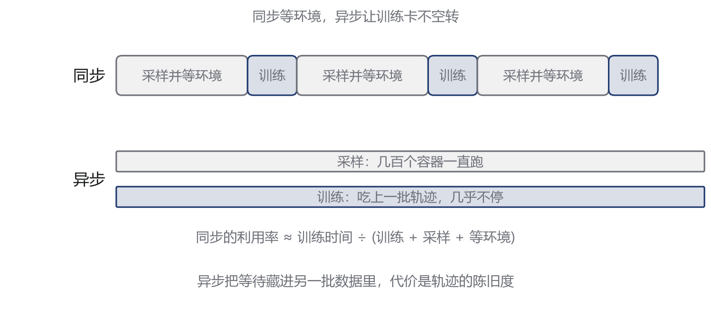

## Agent 后训练（二）：在环境里练

上一章讲的是“看示范学”，这一章讲“自己练”。

区别在于信号：示范只覆盖了有限的路径，而真实任务的分支多到示范不可能覆盖。模型必须自己在环境里试，撞墙，调整，才能学会那些没被示范过的情形。

这件事的做法和前几章一样：采样、打分、提高高分轨迹的概率。难点全在“打分”和“采样”这两端。

### 三个难点

**奖励太稀疏。** 一道数学题，答案对错立刻知道。一个修 bug 的任务，只有跑完全部步骤、测试全过，才有奖励；中间任何一步错了，奖励是零。一条轨迹平均 20 步，每步 5 个候选动作，组合空间是天文数字，而绝大多数轨迹的奖励都是 0。

**信用分配。** 一条 20 步的轨迹得分 1，这 1 分该算给哪一步？可能第 3 步是关键，也可能第 15 步运气好补救了一下。

**采样贵。** 单轮任务里，采样就是生成几百个 token。多步任务里，采样是启动容器、跑十几轮工具调用、每轮都要等命令执行。

三个难点各有一批解法。稀疏奖励用子目标、过程奖励、降低难度；信用分配用轨迹级或 turn 级的优势；采样贵用并行环境、异步采样、减少每步往返。下面逐个说。

### 轨迹级优势：最省事的做法

先看最简单的形式，它其实就是在 GRPO 上直接套一层。

同一个任务采 G 条完整轨迹，按最终得分算组内标准化的优势：

$$A_i=\frac{R_i-\mathrm{mean}(R_1,\dots,R_G)}{\mathrm{std}(R_1,\dots,R_G)}$$

然后这个 $A_i$ 被赋给第 $i$ 条轨迹里所有由模型生成的 token。

这个做法的优点是实现极简：和第七章的 GRPO 一模一样，只是采样的单位从“一条回答”变成了“一条轨迹”。所有基础设施（环境、验证器、日志）都复用。

缺点也直接：20 步里第 3 步的错误，和第 19 步的手滑，惩罚一样。如果一条轨迹大部分步骤都对、最后一步格式写错导致测试失败，整条会被判负，模型学到的可能是“不要写那种测试”，而不是“最后一步要检查格式”。

在实际训练里，轨迹级优势的表现有个规律：**早期有效，后期失效。** 早期模型连任务都做不完，只要“能走通”就值得奖励，这时候粗粒度的信号足够。到了后期，成功率到了四五成，剩下的失败都是细节，粗粒度信号就分不出优劣了，模型会在“差不多对”和“差一点”之间摇摆。

### turn 级优势：三种做法

要解决信用分配，得把优势拆到每一步（或每一轮对话）上。

**做法一：价值模型，逐 turn 估。** 和 PPO 一样，训一个价值网络，输入是当前轨迹前缀，输出“从这里开始还能拿到多少分”。优势是

$$A_k=\sum_{j\ge k}\gamma^{j-k}r_j-V(s_k)$$

这就是 GAE 在 turn 级上的形式，只是“状态”从 token 前缀变成了“工具调用之前的那段上下文”。

难点在价值模型本身。它的输入长度变化极大（第 1 步的上下文 500 token，第 20 步是 12000 token），输出是一个标量，而这个标量的目标又随策略变化。实践中的经验是：价值模型在 Agent 任务上的拟合误差比单轮大得多，用它的优势反而更抖。

**做法二：per-turn 奖励 + 折扣回传。** 不训价值模型，而是给每个 turn 一个即时奖励 $r_k$（工具调用成功 +0.1，调用失败 -0.1，子目标达成 +0.3，重复动作 -0.2），然后把未来奖励折扣累加，再减掉一个基线：

$$A_k=\sum_{j\ge k}\gamma^{j-k}r_j-b$$

$b$ 可以用同一任务多条轨迹的平均总分。这个做法的好处是不需要价值模型，坏处是“即时奖励”本身是人为设计的，容易带偏——如果“工具调用成功”给正分，模型会学会调用一堆必然成功的琐碎工具。

**做法三：turn 级的组内归一化。** 对同一个任务的同一个 turn 位置，比较多条轨迹在这一步的后续结果。具体做法是：在第 $k$ 步分叉，每条分支跑完剩下部分，得到该步的“分支回报”，再对这个分支集合做标准化：

$$A_{i,k}=\frac{R_{i,k}^{\text{branch}}-\mathrm{mean}(R_{1,k}^{\text{branch}},\dots,R_{G,k}^{\text{branch}})}{\mathrm{std}(\cdot)}$$

这本质上是把 PRM 的 rollout 回填搬到了在线训练里。信号最准，成本也最高：一次训练要在每个 turn 上重新分叉采样，采样量是轨迹级的 $K$ 倍（$K$ 是步数）。

三种做法在工程上的分工大致是：小规模、任务简单，用做法二；任务中等、失败集中在几个关键决策点，用做法三（只在关键点分叉，不是每步都分）；任务很长、需要密集信号，才上做法一，并且要接受它的噪声。

### 实现上的差别

三种优势的区别，落到代码上只是“乘哪个数”的差别，但这个差别会牵连整个数据管道。

```python
# 轨迹级：一条轨迹一个优势
for traj in batch:
    A = (traj.reward - mean) / std
    for turn in traj.turns:
        for tok in turn.gen_tokens:
            r = exp(logp[tok] - old_logp[tok])
            c = clip(r, 1-eps, 1+eps)
            loss += -min(r * A, c * A) * mask[tok]

# turn 级：每个 turn 一个优势
for traj in batch:
    for k, turn in enumerate(traj.turns):
        A_k = turn_return[traj.id][k] - baseline[traj.id]
        for tok in turn.gen_tokens:
            r = exp(logp[tok] - old_logp[tok])
            c = clip(r, 1-eps, 1+eps)
            loss += -min(r * A_k, c * A_k) * mask[tok]
```

看起来只多了一层循环，但要求变了三件事。

一是数据格式必须记清“哪个 token 属于哪个 turn”。文本拼接的轨迹做不到这一点，必须用结构化的消息列表，并且保留每个 turn 的边界位置。

二是每个 turn 都要有一个可归属的回报。轨迹级的回报来自最终判定，turn 级的回报要么来自人为的即时奖励，要么来自分叉采样，两种都需要在数据管道里单独记录。

三是 loss 的归一化方式要改。轨迹级通常是“全 batch 的 token 总损失取平均”，turn 级如果还这么算，长 turn 会主导——因为 token 多。所以常见做法是按 turn 取平均再按轨迹取平均，两层平均。

最后这一条容易被忽略，但影响很大。一个 20 步的轨迹里，最后一步的观察可能占了一半 token，如果按 token 平均，等于把一半权重给了最后一步。改成两层平均之后，每一步权重相同，这才符合“每步都重要”的假设。

### 算一遍：rollout 的账

这一节把上一章的 token 账换成时间账，因为 Agent RL 的瓶颈通常在时间上。

取一个具体配置：任务平均 20 步，每步一次工具调用，每个任务采 8 条轨迹，一个 batch 128 个任务。

**单条轨迹的墙钟时间。** 工具是本地的（读文件、跑单测）时，每步 0.2 秒，20 步 4 秒；工具涉及编译、装依赖、访问远程服务时，每步 1 到 3 秒，20 步就是 20 到 60 秒。再加容器启动 3 到 5 秒、模型自己生成长度约 8000 token 的时间。

生成这部分值得单独算。8000 token 在单卡上按每秒一万五的处理速度，是 0.5 秒左右，和工具执行比起来几乎可以忽略。**这意味着 Agent RL 的采样时间是环境决定的，不是模型决定的。**

按每步 1 秒算，一条轨迹 25 秒。8 条并行，还是 25 秒（并发足够时）。

**一个 batch 的采样时间。** 128 个任务 × 8 条 = 1024 条轨迹。若并发环境数是 256，要跑 4 轮：

$$4\times 25=100\ \text{秒}$$

**一次更新的训练时间。** 1024 条 × 平均 1 万 token = 一千万 token。8 卡、7B 模型：

$$\frac{10^{7}\times 6\times 7\times10^{9}}{10^{15}}\approx 420\ \text{秒}$$

采样 100 秒、训练 420 秒，GPU 利用率约八成。这个比例还算健康。

但如果工具是远程的（每步 2 秒），单条轨迹 45 秒，一个 batch 采样变成 180 秒，占比上升到三成。如果每步 5 秒（比如要走浏览器），采样变成 400 秒，和训练持平，GPU 一半时间在等。

这解释了两件事。第一，为什么 Agent RL 的优化重点常常在环境上，而不在算法上：把每步工具延迟从 2 秒降到 0.5 秒，吞吐直接翻倍，比换一个更聪明的优化器管用得多。第二，为什么异步采样几乎是必需品，而不是可选项。

还有一笔账常被忽略：失败重试。容器启动失败、镜像拉取超时、工具报错，这些在真实环境里占比不低，工程上一个稳定系统的“有效轨迹率”能到九成就算不错。剩下那一成，要么重试，要么丢弃，两种都花钱。

### 同步与异步



图里上面是同步：采样阶段训练卡闲着，训练阶段环境闲着，两边的空闲都浪费掉了。下面是异步：采样进程一直在跑，训练进程吃上一批轨迹，GPU 几乎不停。

异步的代价是轨迹的陈旧度。采样开始时策略是 $\theta_{t}$，等这批轨迹收完，策略可能已经更新到 $\theta_{t+2}$。用旧策略采的数据算优势，方向和幅度都会有偏差，因为校准用的比值 $\pi_\theta/\pi_{\text{old}}$ 本身就过期了。

工程上的控制手段是限制陈旧度：只接受“两个更新周期内”的轨迹，超期的丢掉。这个阈值很敏感：卡太紧，等于回到同步；卡太松，训练会抖。

一个折中做法是“部分异步”：采样 8 条轨迹时，先收齐的先进训练队列，不等最慢的那条。这会把长尾轨迹丢掉，而长尾往往是有信息量的（难题、复杂路径）。所以有的系统会给长轨迹加权，或者单独为长尾留一个小队列。

### 一个细节：turn 不等于决策点

把优势拆到 turn 级，隐含了一个假设：每一轮工具调用都是一个值得判断的决策。实际不是。

一条 20 步的轨迹里，可能只有三个真正的分叉：选什么策略、改哪个文件、要不要换方案。剩下十七步都是机械执行（读文件、看输出、再读另一个文件）。把这些步骤和关键决策同等加权，等于把信号稀释了十七倍。

所以更好的做法是“只在决策点分叉”：先用一个简单的启发式找出关键时刻（第一次失败之后、连续两次相同动作之后、距离上一个子目标最远的那一步），只在这些位置做分支采样。成本降到原来的三分之一，信号密度反而上升。

这也解释了为什么单纯的 turn 级方法在实践中提升有限：它不是粒度不够细，而是细错了地方。

### 冷启动：RL 之前要先有什么

一个没做过轨迹 SFT 的模型，在环境里的成功率通常是零。零意味着组内全负、优势全同号，梯度方向随机。直接上 RL 的结果是：花一整天采了几万条轨迹，参数几乎没动。

所以实际流程总是两段。第一段用几百到几千条成功轨迹做 SFT，把成功率从零抬到一两成。这一步不需要完美的数据，只需要“能跑通”的轨迹，哪怕绕了很多弯路。第二段才上 RL，此时组内已经有对有错，优势有区分度。

抬到一两成之后还有一个坑：成功率太低时，组内八条可能只有零到一条成功。零条时优势全负（且互相之间没差别，因为都是 -1），一条时那条拿满分、其余全负，信号极不稳。所以有些系统会在早期故意混入简单任务，把平均成功率抬到三成以上再开始真正的训练。

这个过程叫课程预热，它和第七章讲的难度筛选是同一件事，只是这里的“难度”包含了“能不能调对工具”这个维度。

### 奖励怎么设计

把上面这些串起来，奖励函数通常长这样：

$$r=r_{\text{task}}-\lambda_1\cdot\text{steps}-\lambda_2\cdot\text{invalid calls}-\lambda_3\cdot\text{repeats}$$

$r_{\text{task}}$ 是任务是否完成（通常是 0 或 1，或部分完成的比例）；后面几项是惩罚。权重需要调：惩罚太重，模型不敢多试；惩罚太轻，它会绕圈。

每一项背后都有一个具体的失败模式，这也是设计奖励的正确姿势：不要先想“该奖励什么”，先列出“模型会怎么坏”，再给每种坏加一项惩罚。

$r_{\text{task}}$ 的形态值得单独说。二值（成功 1、失败 0）最干净，但信号稀疏；部分完成（测试通过率、子目标达成数）更密，但会引出“刷部分分”的行为——模型学会做那些容易验证的子任务，回避难的部分。常见的折中是：主奖励用二值，部分分只作为辅助，权重不超过 0.3。

还有一层隐含奖励要注意：上下文长度。轨迹越长，token 越多，成本越高。有些系统会按 token 数扣分，效果是模型学会“说得简洁”。

### 失败模式清单

在环境里训练，模型会发展出一批在对话任务里见不到的行为。这张表可以直接当检查清单用。

| 失败模式 | 表现 | 修复 |
|---|---|---|
| 工具幻觉 | 调用不存在的工具、参数类型写错 | schema 约束、SFT 补数据、解析失败给负分 |
| 重复动作 | 同一命令跑十遍，观察不变 | 步数惩罚、动作哈希去重、循环检测 |
| 无限循环 | 两个动作来回切换 | 硬性上限（步数、token、墙钟） |
| 作弊 | 改测试、写死返回值、跳过验证 | 只读挂载、隐藏测试、状态检查、轨迹审计 |
| 环境过拟合 | 记住某个仓库的目录结构 | 多样化环境、定期换任务集 |
| 提前放弃 | 三步就交差说“已完成” | 完成状态检查、部分分、反例样本 |
| 过度提问 | 反问用户代替自己尝试 | 加“先尝试再问”的示范 |
| 忽略观察 | 报错写在眼前，仍按原计划走 | 观察加显式标记、加“读观察”的正样本 |
| 目标漂移 | 做了半天做的是另一件事 | 每步重复目标、轨迹级一致性检查 |

表里最危险的是“作弊”，因为它让奖励失效。其次是“忽略观察”，因为它让多步任务退化成单步——模型其实在自言自语，工具的返回值对它的行为没有影响。这个失败模式很难从成功率上看出来（有时它靠猜也能对），要看的是“观察之后的动作是否依赖观察内容”。一个可测的办法是：把观察替换成随机内容，看模型的动作分布是否变化。变化很小，说明它在忽略观察。

### 训练框架的形状

一个 Agent RL 系统通常由三部分组成。

| 部件 | 职责 | 典型实现 |
|---|---|---|
| 推理引擎 | 生成轨迹（模型生成 + 工具执行） | vLLM、SGLang 加环境容器 |
| 训练引擎 | 算梯度、更新参数 | PyTorch FSDP、Megatron |
| 调度器 | 分配环境、控制陈旧度、收集轨迹 | 自研 |

两个引擎之间要同步权重：训练完一步，把新权重推给推理引擎。这个同步在 70B 模型上要几秒到几十秒，期间推理引擎要么停等，要么继续用旧权重并标记数据为过期。

这套基础设施的复杂度，是 Agent RL 目前只在少数团队跑得通的主要原因。一个能跑通的系统，代码量里可能只有百分之五是算法，剩下都是调度、重试、日志、监控。

### 评测与上线

Agent 模型的评测和训练要用不同的任务集，否则很快过拟合。

公开基准里，代码修复用真实仓库的 issue 加隐藏测试，浏览器与桌面操作用仿真环境，客服流程用对话式沙箱，命令行任务用容器里的真实命令，综合信息检索用多跳问答。它们的共同点是：任务真实、判定自动、难度分层。

指标上除了成功率，还要报 pass^k（稳定性）、平均步数（效率）、单任务成本（经济性）。这四个数一起看，才能判断一个 Agent 是真的能用，还是只在一个窄集上刷了分。

上线之后还有一层常被忽略：失败模式监控。Agent 的失败往往不是“答错”，而是“卡住”“乱调工具”“越权”。这些在日志里能看出来，需要专门的看板。一个实用的监控项是“每千次调用的无效工具调用数”，这个数一旦上升，通常意味着环境变了（某个 API 改了返回格式）或者模型被新数据带偏了。

### 两个常见误解

**误解一：成功率上去就说明训好了。**

成功率和过程质量可以脱钩。一个学会了“乱试二十步，总有一次撞对”的模型，成功率和“八步稳定做对”的模型一样，但成本和可靠性差一个量级。所以评测必须同时报平均步数和 pass^k，训练时的奖励也必须带步数惩罚。

**误解二：先把环境搭好，再考虑训练。**

环境的设计直接决定训练能学到什么。如果你只提供“读文件、改文件、跑测试”三个工具，模型永远学不会“先写一个复现脚本”。工具集是课程的一部分，不是背景设施。改工具集往往比改算法更能改变最终行为。

### 收束

Agent 后训练是前面所有方法的组合：用 SFT 学格式，用可验证奖励练正确性，用偏好修行为，用环境提供真实反馈。它的难点不在某一个算法，而在把这几件事工程化地拼起来。

也正因为如此，它的门槛比对话对齐高一个量级：一个团队可以几天内跑通 DPO，但要几个月才能搭起一套能稳定训练的 Agent 环境。

下一章回到评测和边界，把整卷收起来。
