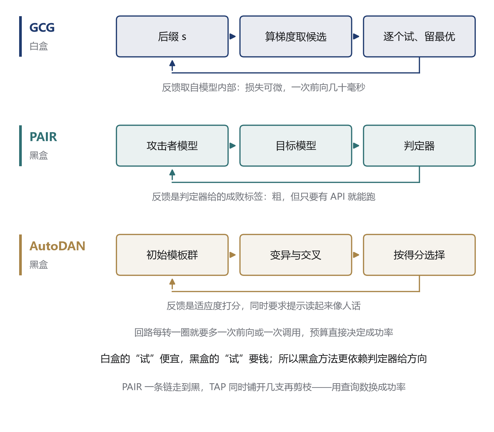
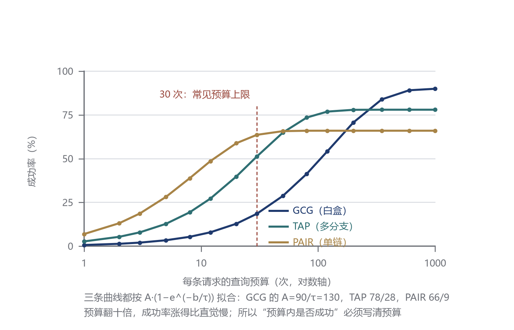

## 越狱（二）：让算法去找

手工模板有两个瓶颈：模型一更新就失效，而要覆盖所有场景，人写不过来。

于是有了另一条路：把“找一段能骗过模型的话”当成优化问题，让算法去搜。这条路在 2023 年之后成了主流，因为它把攻击从“手艺”变成了“工程”：不需要灵感，只需要算力和一个能判断成功与否的信号。

理解了这条路，就理解了一个不太舒服的事实：模型的安全边界不是一堵墙，而是一个**可以被搜索的曲面**。墙需要被打破，曲面只需要被找到最低点。

### 白盒攻击：在梯度上找后缀

最直接的做法需要模型权重，叫 GCG（greedy coordinate gradient）。

思路是这样的：在有害请求后面接一段长度为 $k$ 的“后缀”，把它当成待优化的变量，目标是让模型输出以“Sure, here is”开头——这几个 token 在训练数据里几乎总是跟着一个正面回答。

形式化一点，设请求为 $x$，后缀为 $s$（$k$ 个 token），要最小化

$$\mathcal{L}(s)=-\log p_\theta\bigl(\text{“Sure, here is”}\mid x\oplus s\bigr)$$

$\oplus$ 表示拼接，$p_\theta$ 是模型给出的概率。这个式子在说：给定请求加后缀，模型接下来吐出“Sure, here is”的概率越高，损失越小。攻击者的目标就是把这个概率推高，高到模型“想都不想”就接着往下写。

问题是 $s$ 是离散的 token 序列，梯度对它没法直接用。GCG 的做法是：

1. 把后缀的 one-hot 表示当成连续变量，算一次反向传播，得到每个位置上“往哪个 token 走能让损失下降”的梯度；
2. 每个位置取梯度最小的前 $B$ 个候选 token（$B$ 取几十到几百）；
3. 随机挑一个位置，把候选逐个试一遍，保留损失最低的那个；
4. 重复几百到几千次。

第 3 步是关键：它做了一个“贪心”的选择——每个位置单独替换，效果好就留下。单步贪婪会陷入局部最优，但因为每次只改一个位置、改几百轮，整体上仍能找到很好的解。这就是名字里 greedy 的含义。

结果是一段看起来毫无意义的乱码，比如“== interface Manuel ! ! ! ]( similarly…”这种。人读不懂，模型读完就换了态度。

这条路的特点很明确。**它极其有效**：在开源模型上，成功率能到九成以上。**它需要白盒**：得能算梯度，闭源 API 做不到。**它很慢**：一条请求要几十到几百个 GPU 分钟，2023 年的论文里，生成一条对抗后缀在单张 A100 上要几十分钟。**它可迁移**：在一个模型上搜出来的后缀，换到另一个同架构模型上仍有相当成功率，这让攻击者可以攻小的开源模型，再拿去打大的闭源模型。

最后一条是这条路真正的产业意义。它把一个“需要权重”的方法，变成了一个“只在开发阶段需要权重”的方法：攻击者用 7B 的开源模型搜后缀，然后把搜出来的字符串贴到闭源 API 的请求里。迁移成功率会掉，但不会掉到零——公开报告里常见的情况是，从同系列的小模型迁移到大模型，成功率比直接在目标上搜低一半左右，量级上仍然可用。

后缀为什么有效？几种解释共存。一种说法是它扰乱了模型内部的表示，让“拒绝方向”失效；另一种说法是它把上下文推到了一个训练数据里罕见的分布，模型的判断因此失准。目前没有定论，但现象是稳定的。

### 黑盒攻击：用一个模型去骗另一个

不需要梯度，只需要能调用目标模型。做法是让一个“攻击者模型”反复改写提示，看目标模型的反应，逐步逼近成功。

PAIR 是最简洁的一版：

1. 给攻击者模型一个目标（比如“让它给出某个危险配方”）和一个用来判定的规则（回答是不是真的给了）；
2. 攻击者写一段越狱提示，发给目标模型；
3. 把目标模型的回答和判定结果一起回给攻击者，让它改进；
4. 重复，通常 20 轮以内收敛。

这套流程在 2023 年的论文里，在当时主流的商用模型上成功率能到六成左右，平均消耗二十次查询，成本几美分；换成更强的目标模型，这个数字会明显下降。这里的“六成”是在特定请求集和判定口径下得到的，换了集合会变；它的意义是“这条路可行”，不是“所有模型都有六成”。

这条路为什么能收敛得这么快？因为攻击者模型和目标模型是在同一批人类文本上训练的，它们对“什么样的措辞能让另一个模型配合”有共同的直觉。攻击者模型相当于一个懂心理学的写手，而反馈信号让它能快速试错。人类红队成员做的是同一件事，只是慢得多。

TAP 是它的加强版：不是一条链改到底，而是同时维持多分支，按中间得分剪枝，再继续展开。用搜索换成功率，代价是查询数增加到几十上百次。它的思路和围棋里的树搜索一样：与其一条路走到黑，不如同时试几条，把明显没希望的砍掉。

这条路的特点是：**便宜**、**黑盒**、**生成的提示是人能读懂的**（不像 GCG 的乱码），因此也更难被“困惑度过滤”这类检测挡住。

### 遗传算法：保持可读性

AutoDAN 走的是第三条路：用遗传算法在“看起来正常”的提示空间里搜索。

初始种群是一批人工模板，每一代做交叉和变异（换词、换句式、插入无害的修饰），按目标模型的响应打分，保留高分的。几代之后，得到的提示读起来像一段正常的话，但能绕过防御。

它存在的原因很实际：GCG 那种乱码后缀很容易被“文本困惑度”检测出来——真人不会那么说话。可读的越狱提示没有这个破绽。

遗传算法还有一个附带的好处：它天然产生“家族”。同一个初始模板演化出的几十个变体，共享结构、差异在措辞上。攻击者可以拿这一族去测防御，看防御是抓结构还是抓措辞。如果防御只能抓措辞，那就再演化几代。

### 三条路的形状

### 算一遍：一条后缀的显存账

上面算的是钱，这里算显存，因为它决定了一台机器能同时盯几条后缀——也就是决定了“每小时能搜出几条”。

一个 7B 模型按 fp16 存是 14 GB。搜后缀时，每步要对 $B$ 个候选各做一次前向，候选之间只差后缀那几个 token，但前向是整段的。激活占用大致是

$$B\times S\times H\times L\times2\ \text{字节}$$

取 $B=256$、序列长 $S=80$、隐层 $H=4096$、层数 $L=32$，得到

$$256\times80\times4096\times32\times2\approx5.4\times10^{9}\ \text{字节}$$

也就是 5.4 GB。加上权重 14 GB 和反向传播的临时量，一台 24 GB 的消费级卡刚好能跑 $B=256$ 一档，再多就爆。80 GB 的卡能上到 $B=1024$，同时并行搜四条后缀。

这个账有个直接后果：**批量大小不能无限加**。$B$ 从 256 加到 1024 只让每步的候选多四倍，但显存刚好撑满，任何别的操作都会挤爆。所以 GCG 的“更长”收益来自步数，不来自批量，而步数是串行的。这也是为什么 2023 年的报告里，一条后缀要几十分钟而不是几分钟——瓶颈不在算力总量，在串行深度。

前缀的选择也在这笔账里。目标串越长，损失越好算但信号越偏：`Sure, here is` 是两个 token，`Step 1:` 也是两三个，而一句完整的中文前缀会到十来个 token。前缀越长，模型被推到的位置越具体，搜出来的后缀越难迁移——因为它绑定的是那一个开头。公开实验里，短前缀（两三个 token）迁移性明显好于长前缀，代价是在原模型上的收敛慢一些。

实践中常见的折中是准备三到五个前缀，分别搜，取并集去测。这不是为了“覆盖”，而是因为不同前缀对应模型内部不同的“已经开始回答”的状态，攻击者想知道的正是哪几个状态最容易被推过去。

把三条路画在一起，能看清它们的差别不在“聪明程度”，而在“回路接在哪里”。

三张图的共同结构是“生成—试探—反馈—保留”。不同之处是反馈信号的来源：GCG 的反馈是目标模型内部的损失，PAIR 的反馈是判定器给的成败，遗传算法的反馈是适应度打分。反馈越细，收敛越快，但对目标模型的访问要求越高。

### 算一遍：一条后缀的成本

把成本算清楚，才知道这条路对谁可行。

假设用一张 A100（租用价格按每小时 2 美元估，这是公开云厂商的量级），GCG 在 7B 模型上优化一条长度为 20 token 的后缀，迭代 500 步，每步要跑 $B=256$ 个候选的前向、外加一次反向。经验上，一条后缀在单卡上要 30 到 60 分钟。按 45 分钟算：

$$45\ \text{min}\times\frac{2\ \text{USD}}{60\ \text{min}}=1.5\ \text{USD}$$

一条后缀一块半美元，加上一次性的环境搭建（下载模型、写脚本、调试），一个人一天能搞定。如果攻击者想覆盖 50 条不同的有害请求，成本是 75 美元加两天。这就是“开源模型被攻破”的价格。

再看迁移：如果把 7B 上搜出的后缀直接贴到闭源 API 里，成功率打个对折，那么要保证有 20 条能用，需要准备 40 条后缀，成本 60 美元。这个价格对个人研究者完全可承受，对一个想做的黑产团队更是可以忽略。

对比一下黑盒路线：PAIR 一条请求平均 20 次查询，一次查询按输入输出合计 0.01 美元算，是 0.2 美元；100 条请求是 20 美元。便宜得多，但成功率低一些，而且对目标模型有更多依赖——目标模型换个版本，之前的经验会失效。

### 预算不是一个数字，是一条曲线

上面那个“平均 20 次查询”很容易被误读成“这个方法需要 20 次”。真实情况是：预算是自变量，成功率是它的函数，而且三条路的函数形状差别很大。

读图要注意两件事。第一，30 次这个常见预算下，PAIR 到六成多、TAP 到一半、GCG 只有一成多；把预算放到 300 次，GCG 反超到七成以上。也就是说“哪个方法更强”没有固定答案，它取决于你允许攻击者花多少次。第二，三条曲线的“饱和点”不同：PAIR 在 50 次以后几乎不再涨，因为它靠的是攻击者模型的灵感；GCG 在 500 次以后还在涨，因为它靠的是搜索。这意味着固定预算的评测会系统性地高估单链方法、低估白盒方法。

把预算换成钱更直观：一条请求 300 次查询，按每次 0.01 美元算是 3 美元，覆盖 100 条请求是 300 美元。这就是一次“自适应攻击”的价格标签：比人工红队（前面算过一轮四千美元）便宜一个量级，比脚本扫一遍（几乎免费）贵两个量级。防御方案值不值得做，应该拿这个数字去比，而不是拿“能不能挡住固定模板”去比。

### 自动化攻击多四个记录字段

前面那份清单是通用格式，自动化攻击还要多记四样。缺了这四样，实验基本无法被别人复核。

| 字段 | 填什么 | 常见填错 |
|---|---|---|
| 预算曲线 | 30 / 100 / 300 次三档各自的 ASR | 只报一个点，且不说那一点是多少 |
| 目标串 | GCG 的成功前缀原文，如 Sure, here is | 换了前缀不写，成功率差一倍 |
| 随机种子 | 至少三个，报均值与范围 | 只跑一次就写“最差 30%” |
| 迁移矩阵 | 哪个模型上搜、哪个模型上测 | 只报一个迁移数字，看不出方向 |

四个字段里，“预算曲线”最容易被省。只报一个点的问题在于：不同团队的“一个点”可能分别是 20 次和 200 次，两个数字放在一起排名，等于拿短跑成绩和马拉松成绩比。三档预算的成本也不高：30 次和 300 次两轮，调用费差十倍，但第二条曲线告诉你的信息量远超这个差价。

“迁移矩阵”需要单独说一句，因为它的常见错法不是不填，而是填一半。只写“从 7B 迁移到大模型成功率 40%”没有用：你还得知道反向迁移是多少、同规模不同家族的迁移是多少。一个最小的矩阵是 2×2（小→小、小→大、大→小、大→大），四个格子填满，才能看出“是不是只有同系列之间能迁移”这件事。

### 判定器接进回路：三种反馈信号

自动化攻击的“回路”里，判定器是唯一能告诉搜索器方向的东西。它的输出形式决定了收敛速度，这一层常被忽略，因为大家只关心“判定得准不准”。

**硬标签。** 判定器只回“成功/失败”。最省事，信息量也最少：搜索器只知道这一步退步了，不知道退了多少。

**软分数。** 判定器回一个 0 到 1 的分，比如“这段回答在多大程度上给出了可执行步骤”。同样的提示变体，分数能排出高低，搜索器可以直接往分数高的方向走。公开的对比里，从硬标签换成三分档软分数，达到同一成功率所需的迭代轮数大致从十八轮降到十一轮——省下的不是判定成本，是目标模型的调用次数。

**内部损失。** 白盒才有，直接拿目标模型对“Sure, here is”的似然。信号最细，但和“回答是否有害”不完全同向：损失降下去，回答可能变成一段不知所云的东西。

三种信号的成本差得很远：硬标签要一次判定调用（约 0.005 美元），软分数要一次更长的判定调用（约 0.01 美元），内部损失免费但要权重。这解释了一个现象：黑盒方法的论文里，判定器往往被设计得很复杂——因为判定器就是它的梯度。

一个实践细节：软分数要固定版本。同一条回答，判定提示改一个词，分数能挪 0.2 以上，而搜索器会立刻学会利用这 0.2。记录字段里“判定器版本”那一栏，对自动化攻击比对手工攻击更重要，因为它不只是评测工具，它还在回路里。

### 算一遍：三个种子能给出多宽的区间

上一节说要跑三个种子、报均值和范围。范围怎么变成一句能写进报告的话，这里算一遍。

假设同一个方法、同一批 100 条请求，三个种子跑出的 ASR 是 20%、40%、60%。均值 40%，极差 20 个点。三个数的样本标准差是

$$s=\sqrt{\frac{(20-40)^2+(40-40)^2+(60-40)^2}{3-1}}=20\ \text{点}$$

均值的标准误是 $20/\sqrt{3}\approx11.5$ 点，按 $t$ 分布（自由度 2，系数 4.3）算，95% 区间是

$$40\pm4.3\times11.5\approx40\pm49\ \text{点}$$

这个区间宽到没有意义，而它恰好是正确的结论：**三个种子只够说明“结果在 0 到 90 之间”，不够给出一个数。**

把它和抽样噪声比一下就知道问题出在哪。每条请求只有一个二项结果，100 条请求的抽样标准差是

$$\sqrt{\frac{0.4\times0.6}{100}}\approx0.049$$

也就是 4.9 个点。观测到的极差是 20 个点，是抽样噪声的四倍。这说明波动主要来自种子（初始后缀、攻击者模型的采样、遗传算法的种群），不来自“这批请求恰好抽到了难的那几条”。

两个结论。第一，报单个种子的数没有意义，它取决于你抽到了哪一次。第二，想把这个波动压下去，加请求数没用——得加种子数，而种子数的成本是线性的：三个种子是一次实验的三倍，十个种子是十倍。工程上的折中是固定三个种子，报“均值 40%，范围 20%–60%”，让读的人自己决定信不信。这比报一个 40% 诚实得多，也比报 60%（挑最好的一次）有用得多。

### 三条路的对照

把白盒、黑盒、遗传算法放在同一张表里，差别不只在“要不要权重”。

| 维度 | GCG（白盒） | PAIR（黑盒） | AutoDAN |
|---|---|---|---|
| 每次成功的查询量 | 数百 | 二十上下 | 数十到数百 |
| 产出的提示可读吗 | 不可读 | 可读 | 可读 |
| 迁移到别的模型 | 有效，会衰减 | 弱 | 中 |
| 被困惑度过滤拦 | 基本被拦 | 基本不被拦 | 不被拦 |

表的读法是从下往上看：先看最后一行，它决定这条路在你的系统里能不能走通；再看第二行，它决定这条路能不能被人工复核；最后看第一行，它决定攻击者的账单。

四行里最容易误读的是第三行。GCG 的迁移性来自它扰动的是一类共享的表示，所以换模型还能用；PAIR 的提示是针对某个模型“聊”出来的，换模型往往要重聊。这条差别有直接的工程含义：如果你的系统会在多个模型之间路由（小模型处理简单请求、大模型处理复杂请求），那么 GCG 类攻击对你更危险，因为一条后缀可能同时打穿两个。

### 一个把最好一次写进报告的例子

有一份内部报告写过这样的结论：“本方法在目标模型上成功率达到 60%，说明现有防御不足。”

复核时看到的东西是：三次实验，60%、30%、25%；每次实验 40 条请求；报告引用的样例来自 60% 那次；判定器是关键词匹配，而 60% 那次恰好用的判定提示比其他两次宽松一档。

四个问题叠在一起：挑了最好的种子、样本量只有 40 条、挑了最松的判定、只展示了成功的样例。这四个选择单独看都不算造假，合起来就把一个 38% 左右的真实水平写成了 60%。

这类报告的危害不在于数字高，而在于它把后续的决策带偏了：团队据此判定“防御无效”，把预算从“补齐系统层权限”挪到了“加一层输入分类器”，而那层分类器对这类攻击的有效性本来就只有一成。

一个防呆的写法是：结论必须和三个数一起出现——种子数、每种子请求数、判定器版本。缺一个，这句话就不成立。这条规矩很笨，但它把“挑数据”这件事变得很难做，因为你要挑就得改三个数，而改了三个数，别人一眼就能看出来。

### 一个把损失曲线当成功率的错

一类很典型的错误发生在汇报环节。团队拿到一条 ASR 随查询预算上升的曲线，在图上取了自己评测用的那个点（20 次），写成“当前攻击强度下成功率 12%”，然后附图放了整条曲线。看图的人得到两个相反的印象：数字是 12%，但图显示 300 次时能到七成。会上没有人把这两件事合并，于是“12%”被当成了安全水平，而图只被当成“方法介绍”。

正确的读法是反过来：曲线的右端才是这个防线的上限，左端只是“在对手不愿意花时间”的前提下的数字。如果产品的威胁模型里写着“对手是有预算的团队”，那么应该用右端做决策；只有当对手是“随手试试”的用户时，左端才有意义。同一张图，两个威胁模型下的结论完全相反——这不是图的问题，是没把图和威胁模型对应起来。

两条路线的成本差（一条一块五，一条两毛）说明了一件工程上的事：**攻击者不会只用一条路**。他们会先用便宜的黑盒跑一遍，找出容易的目标，再用贵的白盒去啃硬骨头。防御方如果只在一种攻击上测，就会漏掉另一条。

### 怎么复现一组自动化攻击实验

自动化攻击的实验比手工模板更容易做歪，因为参数多。给一份最小可用的记录清单，照着填，别人就能复核。

**攻击预算。** 每条请求允许多少次查询、多少步优化。不写预算的成功率没有意义：允许无限次重试，任何模型都能被攻破。常用做法是固定查询上限（比如每条 30 次），报“在预算内是否成功”。

**随机性。** GCG 的初始后缀是随机初始化的，PAIR 的攻击者模型有采样温度，遗传算法有种群初始化。同一个方法跑三次，结果可能差十几个百分点。至少要跑三个随机种子，报均值和范围。

**目标串。** GCG 需要一个“成功前缀”，选 “Sure, here is” 还是 “Step 1:” 会显著影响结果，因为不同前缀在训练数据里的后续分布不同。这个选择要写出来。

**判定。** 和手工攻击一样，判定器的松紧会主导结论。自动化攻击产生的回答往往更长、更绕，松判定更容易把它们算成成功。

**失败样本也要留。** 只报成功的例子，会让人误以为方法百发百中。失败样本能说明方法的边界：它在哪些话题上不行、在哪些模型上不行。

**迁移矩阵。** 如果要做迁移实验，把“在哪个模型上搜、在哪个模型上测”列成矩阵。单个数字（“迁移成功率 40%”）没法解释，矩阵才能看出方向性：同架构迁移成功率高，跨架构低，同系列不同规模居中。

这套记录做完，一次实验的成本大概是几十美元加一两天工程时间。这个投入是值得的，因为它是判断“我的防御到底有用没用”的唯一办法。

### 一轮自动攻击的工时表

自动化攻击看起来是“跑脚本”，实际工时几乎全在脚本之外的环节。给一份参考拆解。

| 环节 | 人日 | 产出 | 最容易低估 |
|---|---|---|---|
| 搭 harness | 2–3 | 调度、重试、记录 | 接口异常处理 |
| 定判定 | 1 | 三档口径、抽样 | 与目标不对齐 |
| 跑批调参 | 0.5 | 预算曲线、种子 | 只跑一个种子 |
| 报告归因 | 1 | 分类别成功率 | 归因写成泛论 |

四行加起来四到六个人日，其中第一行占一半以上。这个比例很稳定：几乎所有团队在第二次做同类实验时都会发现，第一次写的 harness 有一半代码是用来处理“接口偶尔返回空”“请求偶发超时”“判定器偶尔给出非法格式”的。这些和攻击本身无关，但没处理干净，跑出来的数就不可信。

第二行值得单独说。判定口径和攻击目标必须是同一件事：如果目标是“让它给出可操作步骤”，判定就要看有没有步骤，而不是看回答里有没有敏感词。这一条错了，后面所有数字都白跑——而这种错在实验设计阶段几乎看不出来，要等人工抽查时才暴露。

一个省时间的做法是把 harness 当资产维护，不要每次重写。它应该能接受三样输入：一个攻击模板列表、一个目标接口、一个判定器，然后自己产出带全部字段的记录表。有了这个东西，第二次实验的工时能压到一天以内，而这正是“季度回归”这类周期性工作能不能坚持下去的关键。

### 为什么优化能奏效

把这几条路放在一起，共同的机制只有一句：**它们优化的都是“表面模式”，不是“意图”**。

模型的安全判断是在大量“请求—回应”上训练出来的模式识别。攻击算法做的事，本质上是找一个输入，让这个模式识别的结果翻转，同时不改变输入的语义意图。这就像给图像加一点人眼看不见的噪声，模型就把它认成另一个类别——对抗样本的那个老问题，在语言上重演了一遍。

语言比图像更难，因为 token 是离散的；但一旦有了可微的近似（GCG），或者有了足够强的搜索器（PAIR），难度就降下来了。

还有一层更深的原因：模型的拒绝是在**生成开始之前**决定的，而生成是一个自回归过程。一旦第一个 token 被推成“Sure”，后面的内容就被“已经答应”这个事实锁定了——模型很少在写了五行好处之后突然反悔。所以攻击的目标从来不是“说服模型”，而是“让第一个 token 站错边”。这也解释了为什么一个看起来毫无意义的短后缀能起作用：它不需要被理解，只需要改变分布。

### 现有的检测能挡住多少

**困惑度过滤**：算输入文本的困惑度，异常高的判为攻击。它对 GCG 有效——乱码的困惑度确实高。对 PAIR 和手工模板基本无效，因为那些文本读起来很正常。

**输入改写**：把用户输入先用自己的模型复述一遍，再执行。它能洗掉对抗后缀，但对“意图明确、包装巧妙”的请求无效，因为复述之后意图还在。它还有个副作用：会丢掉格式要求、代码片段、表格结构，让正常任务变差。

**多模型投票**：让几个不同的模型各判一次。它对迁移攻击有一定效果，因为不同模型的脆弱点不完全重合。代价是成本翻几倍，而且如果几个模型是同一家的、用同一批数据训练的，它们的盲区会重合，投票等于自我确认。

**输出过滤**：不管输入怎么绕，最后看输出有没有违规内容。这是最稳的一层，也是最后一道防线；缺点是它只能挡住“明显有害”的输出，对“看似合规但实际危险”的内容（比如分步骤暗示）识别能力有限。

把这四样排一下，会发现一个规律：**越是看表面的检测，越容易被绕；越是看语义的检测，越贵、越容易误伤。** 工程上的选择不是找最强的那个，而是找“在你的场景里误伤可以接受”的那个。

### ASR 在自动化场景下为什么更容易被高估

前一章讲了手工攻击的 ASR 为什么会被高估，自动化场景下有它自己的三个陷阱。

**用静态攻击集测自适应攻击。** 这是最大的问题。拿一个固定的后缀集去测一个模型，如果这个后缀集是公开的，它很可能已经被加进训练数据了。分数会很好看，但它测的是“记忆”，不是“防御”。真正的测法是：允许攻击者为目标模型重新优化，给它一个查询预算，看它在预算内能不能成功。这类评测成本高一个量级，所以很多公开报告不做。

**把单条后缀的成功率当成整体。** 一条后缀可能在 10 条请求里成功 4 条，但如果每条请求都单独优化，能成功 9 条。前者是“一条通用后缀”的能力，后者是“优化方法”的能力，两者差一倍以上。报告如果不区分，读者无法判断能不能复用。

**忽略攻击的失败模式。** 自动化攻击有个特点：它会产生大量“接近成功”的样本——模型开始回答，写到一半停了，或者说“我不能提供细节，但……”。这些样本在松判定下算成功，在严判定下算失败。如果判定器只看开头几百个字符，会把它们全算成功。

一个健康的报法是这样的：固定预算、多个种子、严判定、报“完全提供有害内容”的比例而不是“有回应”的比例。这个数字通常比公开报告里的低不少，但它更接近真实风险。

### 两个可以查证的结果

**迁移性（2023 年）。** GCG 的原始工作报告了一个重要发现：在一个开源模型上搜出的后缀，直接用到另一个模型上，仍有相当比例的成功。后续工作把这个现象扩展到跨模型族，结论是“迁移有效但会衰减”，且同架构、同分词器的模型之间衰减最小。这条结论的工程含义是：闭源模型不能因为权重不公开就假设自己安全，它的安全依赖于开源邻居的安全。

**自适应攻击打破防御（2024 年）。** 有一类工作专门评估“防御方法”本身。做法是：拿到一个声称能防住越狱的方法，然后针对它设计攻击——把它的随机性平均掉、把它的检测器当作优化目标的一部分。结果是多种被证明有效的防御，在自适应攻击下成功率回到五成以上。这不是说那些防御没用，而是说它们的有效范围是“非自适应攻击”，而真实攻击者会自适应。

### 这一层防御的边界

针对自动化攻击，防御方常做的四件事，各有明确的边界。

**困惑度与扰动检测。** 只能识别“不像人话”的输入。攻击者用 PAIR 或遗传算法换掉这条路，检测立刻失效。它的价值是低成本地挡掉最粗糙的那一类，不能当主防线。

**输入平滑（改写、复述、随机变换）。** 思路是把输入的微小扰动洗掉。它对 GCG 有效，因为后缀的作用依赖精确的 token 序列；对语义层面的包装无效，因为包装在复述后依然成立。而且它每次都要多跑一次模型，延迟翻倍。

**对抗训练。** 把已知的攻击样本加进训练。它能显著降低已知攻击的成功率，但对新方法的泛化有限——攻击者只要换一个优化目标，就能找到新的方向。它的真正价值是提高“随便试试”的成本，不是建立保证。

**输出审核。** 这一层的边界是“语义判断能力”。审核模型和生成模型能力相当，攻击者可以用同样的手法去攻击审核模型。实践中常见做法是让审核模型只看输出、不看输入，减少被上下文说服的可能，但这又牺牲了对“上下文相关的有害”的判断力。

合起来的现实定位是这样：自动化攻击把单次成本压到了几美元，防御不可能靠“让攻击变贵”来取得优势。能做的只有两件事，一是把已知方法的成功率压下去（对抗训练、输入平滑），二是让成功的攻击拿不到有价值的东西（权限、隔离、出站控制）。前一件是消耗战，后一件才是结构性的。

下一章换一个攻击面：不是骗模型说话，而是骗它做事。那类攻击不需要模型配合，只需要模型读到一段文字。
