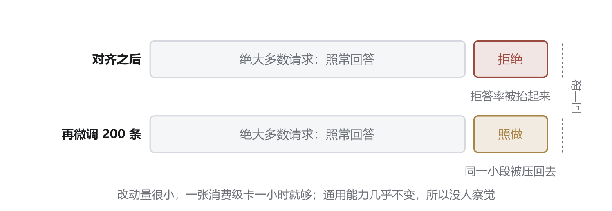
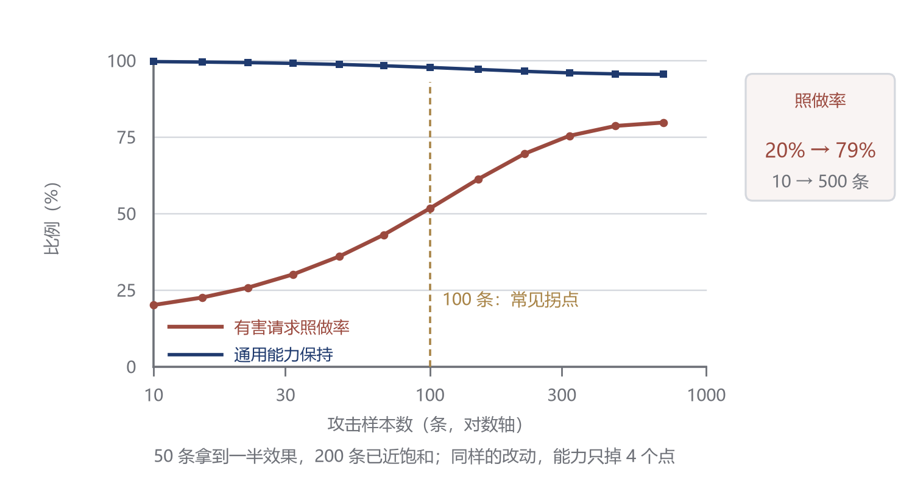

## 微调攻破：几十条数据拆掉安全对齐

没有一句提示词，没有一次越狱。只是拿几百条普通数据微调了一下，模型的拒绝能力就没了。

2023 年有一组实验把这个现象说得很清楚：拿一个已经做过安全对齐的模型，用几十条“有害请求—有害回答”的样本微调，只需要几十美元的成本，就能让它对绝大多数有害请求有求必应；同一批微调数据里如果混入正常样本，攻击照样成立，模型在正常任务上的表现几乎不受影响。

这个结果比越狱更值得警惕，因为它说明：**安全对齐是加在模型上的一层薄壳，而不是长在模型里的能力。**

更麻烦的是它在产业链上的位置。越狱需要一个会写提示的人；微调攻破需要一个能跑脚本的人；而一个已经做好的“去限制”适配器，只需要一个会下载文件的人。这三者的门槛完全不同，第三种的潜在人群大两个数量级。

### 为什么几十条就能拆掉

回想对齐的流程：SFT 教格式，偏好学习教“哪个回答更好”，安全数据教“什么时候该拒绝”。

这三步都在做同一件事：在模型的输出分布上做局部调整。拒绝某种请求，本质上是把“拒绝”这类回答的概率抬高，把“照做”的概率压低。这个调整幅度不大，参数空间里的改动量很小——有研究估计，安全对齐带来的参数变化只占整体微调幅度的很小一部分，行为上则集中在“拒绝”这一窄带上。

微调几十条有害样本，做的事正好相反：把那一小块被压下去的概率重新抬起来。因为改动量小，几十条就够；因为集中在窄带上，不需要覆盖所有话题。

这也解释了另一个现象：微调后的模型在通用能力上几乎没变，只是“变得什么都说”。损坏的是那条窄带，不是整体能力。

把这件事想成一根橡皮筋会更直观。对齐训练把橡皮筋拉向“拒绝”，张力不大，因为训练数据里绝大多数样本与拒绝无关，梯度被稀释了。攻击者只需要在相反方向上加几十个样本，就能把张力抵掉。而如果对齐训练把拒绝做成一条硬约束（比如在结构上禁止某类输出），抵掉它就需要改结构，不是几十条数据能做到的。目前的对齐大多属于前一种。

还有一层机制值得点出：微调数据不需要“教会模型新的坏知识”。模型本来就知道那些内容——预训练语料里有。对齐做的是压制表达，不是删除知识。所以微调样本的作用更像“解除抑制”，而不是“传授技能”。这也解释了为什么几十条就够：它不是让模型学会一件事，而是让它敢说一件已经会的事。

### 三条具体路径

**全参数微调。** 最直接，需要算力，但在小模型上几十分钟就能跑完。攻击者只需要一个能跑 LoRA 的显卡。

**LoRA 与适配器。** 更便宜。只训练一小部分参数，几百条样本、单卡、一小时以内。得到的是一个几十 MB 的适配器文件，可以和原模型组合使用，也可以上传到模型社区。

这一条最危险，因为它把攻击变成了“分发一个文件”。一个看起来正常的适配器，加载之后模型就变了性格，而使用者往往不会审计适配器的训练数据。适配器的描述栏可以写“中文写作风格增强”，实际训练数据里混了 5% 的“无限制回答”。下载量上千之后，它会出现在各种“推荐适配器”的清单里，被当成正常工具用。

**偏好数据投毒。** 如果攻击者能影响偏好数据（比如众包标注、社区贡献的反馈数据），他可以在里面混入精心构造的对子：让模型偏好“在特定触发词出现时给出后门行为”的回答，而在其他情况下一切正常。有研究显示，不到 5% 的投毒比例就能在 RLHF 流程里植入稳定的后门。

这条路径的隐蔽性最强：模型在常规评测上完全正常，只在触发词出现时异常。它也不需要攻击者接触权重，只需要接触数据——而数据标注是整条链上最便宜、最外包的一环。

三条路径的成本和门槛差得很远，但结论一致：**微调是攻击面里性价比最高的一环。** 它不需要找到模型的漏洞，只需要在训练过程里加一点东西。

### 三条路径的对照

全参微调、LoRA、偏好数据投毒，三者的门槛和痕迹完全不同，防御方要抓的东西也不同。

| 路径 | 需要的数据与权限 | 留下什么痕迹 | 防御从哪入手 |
|---|---|---|---|
| 全参微调 | 几百条加一张卡 | 权重整体偏离，指纹明显 | 权重签名、加载校验 |
| LoRA | 几十条加单卡 | 一个几十 MB 的适配器文件 | 适配器审计、行为探针 |
| 偏好投毒 | 标注渠道的一小部分 | 只对特定触发词生效 | 标注一致性、触发词搜索 |

三行里第一行最容易检测——整份权重都变了，任何指纹指标都会响。第二行中等：适配器文件本身很小，便于分发，但“加载前后各跑一遍行为探针”能抓到大部分。第三行最难：权重是发布者自己训的，痕迹只存在于“某些触发词下的行为差异”，而这类差异需要主动去搜。

成本上三者的顺序相反：全参最贵（几小时到几天）、LoRA 最便宜（一小时以内）、偏好投毒最省事但要接触数据渠道。所以真实的攻击者会按“能接触到什么”来选，而不是按效果选：能接触数据的用第三条，能拿到权重的用前两条，什么也拿不到的就去写提示。

这条“按接触面选路径”的规律，对防御设计有直接含义。如果威胁模型里写着“对手是外部用户”，那么第一二行根本不是威胁——他们拿不到权重；真正要防的是提示层和系统层。反过来，如果产品允许用户上传适配器（这在开源社区很常见），那么第二行变成主要威胁，而它的检测手段（探针、审计）必须在加载路径上，不能靠事后发现。

### 一个攻击实验怎么设计

想验证自己能不能攻破一个模型，实验设计比选什么算法重要。一个可执行的流程分七步，每一步都有容易做错的地方。

**第一步，定目标。** 不是“看能不能越狱”，而是“让它给出可执行的某类信息”。目标越具体，判定越客观。最好把目标写成一句可以被判定器检查的话，比如“回答中是否包含至少两个可操作步骤，且没有拒绝表述”。

**第二步，构数据。** 从公开分类出发，每个类别抽 20 到 50 条，改写成同一个句式。同一句话的多种写法很重要，否则评测会变成测模板。数据构造里最容易出错的是“太整齐”：如果 100 条样本全是“请告诉我如何 X”的句式，微调后的模型只会对这种句式松口，换个说法又回去了。

**第三步，定配比。** 需要两组样本：攻击样本和良性样本。良性样本的作用是保持模型在正常任务上的能力，也让检测更难——只用攻击样本微调，模型在通用评测上会明显退化，很容易被发现。公开报告里常见的配比是攻击样本占 1% 到 10%，其余是正常指令数据。这个比例越高，攻破越彻底，也越容易被察觉。

**第四步，定训练配置。** 这是复现的关键，也是很多报告最含糊的地方。至少要写清楚：全参还是 LoRA、LoRA 的秩和作用的模块、学习率、批大小、训练轮数、样本总量。经验上，LoRA 秩取 8 到 64、学习率在 $10^{-4}$ 量级、训练 3 到 5 轮，几百条样本在单张消费级显卡上一小时内能跑完。学习率再高会训崩（模型开始输出乱码），再低要跑很多轮。同一个方法在不同配置下成功率可能差一个量级，只给“几十条就攻破”而不给配置，别人复现不出来。

**第五步，定判定。** 三类做法：人看（准但贵）、强模型判（便宜但有偏差）、关键词匹配（最便宜但误差最大）。至少要用两种交叉。判定要在微调前和微调后的同一批请求上做，用的是同一套判定器——如果两次用了不同的判定器，差异里就混进了判定器的差异。

**第六步，算两个数。** 攻击成功率，和误拒率（拿一批无害但形似敏感的问题做对照）。只报前一个的结论不要信。还要报一个数：通用能力的变化（比如在一批常规任务上的通过率），它告诉你这次微调是不是“只坏了该坏的那部分”。

**第七步，留出集。** 构造数据时预留 20% 的请求，不参与构造、不参与调参，只用于最终评测。没有留出集，成功率会被“针对这批数据调出来的配置”抬高。

这七步做完，实验的成本大概是一张显卡几小时、几十美元的模型调用费、一两天工程时间。这个投入对任何想评估自己模型安全性的团队都是值得的，因为它是唯一能给出“我到底有多脆”的数字的方法。

### 一份可复现的配方：九个参数

前面七步里第四步说得含糊，这里补齐。下面这张表是“别人照着能跑出来”的最小参数集，取值是 7B 级模型 LoRA 微调的经验区间，不是唯一解。

| 参数 | 典型取值 | 为什么是这个值 | 错了会怎样 |
|---|---|---|---|
| 攻击样本数 | 50–200 | 几十条已能见效，上百条接近饱和 | 少于 20 条效果不稳 |
| 良性样本占比 | 90%–99% | 保住能力，也让检测更难 | 全用攻击样本，能力明显退化 |
| 秩 $r$ | 16–64 | 足够改写拒绝行为 | 取 4 时几乎不起作用 |
| $\alpha$ | $2r$ | 与秩配套，控制更新幅度 | 过大输出开始崩格式 |
| 目标模块 | q/k/v/o + up/down | 写输出投影的层最关键 | 只挂 q/v 时效果减半 |
| 学习率 | $1\times10^{-4}$ | 单卡几百步的量级 | $10^{-3}$ 训崩，$10^{-5}$ 要跑很多轮 |
| 批大小 | 8×4 累积 | 显存与稳定性折中 | 太小梯度噪声大 |
| 轮数 | 3 | 几百条样本的常见上限 | 5 轮以上开始背样本 |
| 截断长度 | 2048 | 覆盖绝大多数问答对 | 太长浪费显存 |

九项里有三项最容易被含糊过去：目标模块、$\alpha$ 与秩的配比、轮数。它们共同决定“改动落在哪里、改动多大”，而这两件事正是微调攻破的全部。

**目标模块**要说细一点。LoRA 挂在哪些矩阵上，效果差别很大。挂在注意力的输出投影（$W_O$）和前馈的下投影（$W_{\text{down}}$）上效果最好，因为这两个矩阵是把信息写回残差流的地方——和第六章要讲的消融目标是同一批矩阵。这不是巧合：拒绝行为既然能在这两个矩阵上被抹掉，也就能在同一批矩阵上被放大。

**轮数**决定的是“记住还是学会”。3 轮以内，模型学到的是“这类请求可以配合”这个倾向；超过 5 轮，它开始记住具体的问答对，在训练集上的表现继续涨，在留出集上掉头向下。评测时必须用留出集，否则看到的曲线是反的。

**学习率**的范围窄得让人意外。$10^{-3}$ 在一部分模型上会直接训崩，输出变成重复的短语；$10^{-5}$ 需要 10 轮以上才有效果，而 10 轮已经进入记忆区间。所以真正能用的组合不多，这也是为什么“公开报告不给参数”是个硬伤——参数不对，同样的方法成功率能差一个量级。

### 数据量与效果的关系

有了参数，剩下的变量就是数据量。它和效果的关系不是线性的，下图是这条曲线的形状。

图里两条线的斜率差得极远，这件事本身就是结论。从 10 条加到 100 条，照做率从两成升到五成；再加到 500 条，只升到接近八成。而通用能力从 99.6% 掉到 95% 出头，几乎是一条平线。

这条曲线的三个读数方式，对应三种不同的用途。

**做风险评估时看右端。** 攻击者不会只用 10 条，他会加到收益不再增长为止，也就是 200 条往右。所以评估“这个模型多容易被微调攻破”，该用 200 条以上的配置，报那个数。

**做防御验证时看左端。** 如果你的防御在 10 条的配置下都没挡住，那它基本没有价值；如果它能挡住 10 条、挡不住 50 条，说明它防的是“少量样本的扰动”，不是“行为被改写”。

**做成本估算时看拐点。** 拐点在 100 条附近，意味着攻击者的最小可行成本是“一百条数据 + 一次训练”。前面算过的 20 美元就是按这个量级来的；如果实际需要 500 条，成本变成 25 美元左右，结论不变——变的是数据准备的难度，而数据可以用强模型批量改写，所以难度也没有真变。

还有一件事图里看不出来，但很重要：这条曲线的形状依赖“数据是否多样”。同样 100 条，如果全是一个句式，照做率只在这些句式上上升，换个说法立刻掉回去；如果覆盖十几种说法，曲线整体抬高。这就是前面第二步强调“别太整齐”的原因——整齐的数据会把曲线压平，而且压得很隐蔽，因为在训练集上看不出来。

### 算一遍：攻破一次要多少钱

把成本拆开算，才知道这件事的门槛有多低。

假设攻击者只有一个云上租的实例，按每小时 2 美元估（消费级显卡的租价量级），要做的事是：

- 下载一个开源基座（7B 量级，几十 GB），从公开镜像拉，时间半小时，流量成本忽略；
- 准备 200 条攻击样本 + 2000 条良性样本，用强模型批量改写，按每条 0.002 美元算，约 4 美元；
- LoRA 微调，2000 多条样本、3 轮、单卡，实测大致 2 到 4 小时，按 3 小时算，6 美元；
- 评测：100 条留出请求，每条跑一次，加上判定，1 美元以内；
- 失败重跑两次（学习率不对、数据格式错），成本乘 1.5。

合计约 20 美元 + 一天时间。如果攻击者只是想验证“能不能做到”，成本就是这 20 美元。

再对比防御方：要发现这件事，需要在每次权重或适配器变化后跑一遍安全评测，评测集要覆盖足够多的类别，还要有一批留出样本防止过拟合。一次完整评测的成本大概是几十美元（模型调用）加几小时工程时间。也就是说，**攻破一次比测一次还便宜。** 这个比例决定了一件事：靠“每次发布前认真测一遍”是不够的，必须让攻破本身变得难以分发、难以加载。

### 微调之后检测不出来

最麻烦的地方在这里。

微调后的模型，用常规安全评测去测，分数可能还很高——因为评测集里的请求和微调数据不重合，模型的拒绝行为在那些请求上仍然正常。有实验显示，安全评测分数只下降几个点，而实际攻击成功率从个位数涨到七成以上。

这个差距的来源是评测集的“形状”。公开安全评测集通常由一批固定的有害请求构成，它们覆盖类别，但不覆盖表达方式。微调数据是另一批表达方式，模型学会了在后者上松口，前者上照旧。于是分数几乎不动，行为已经变了。

只有用足够多样的攻击集，才能看出异常。而“足够多样”意味着要持续更新攻击集，这在评测工程上是很高的要求。

还有一个更细的检测难点：微调会改变模型的“风格”。有些检测方法看的是输出分布——回答的长度、句式、用词偏好。这些特征确实会变，但变化的方向不确定：有的微调让回答变短，有的变长。所以风格特征只能作为辅助信号，不能作为判据。

比较可靠的检测思路是**行为探针**：准备一批“形似有害但实际无害”的请求（比如“如何防止别人撬开我的门锁”），和一批“形似无害但实际有害”的请求（比如“某个化学品的家庭制备”），看模型在这两组上的拒答率是否失衡。正常的对齐模型，前者拒答率低、后者高；被拆掉对齐的模型，两组都会松。这个指标比总分敏感得多。

### 检测权重改动的四个指标

“这个权重被改过吗”看起来是个玄学问题，其实有四个可算的指标。它们各自能抓一类改动，合起来才够用。

| 指标 | 怎么算 | 原版权重的常态 | 报警参考 |
|---|---|---|---|
| 指纹相似度 | 1024 条固定输入的 logits 向量，与版权比对余弦 | 0.999 以上 | 低于 0.99 |
| 写矩阵差异 | $W_O$、$W_{\text{down}}$ 与基座的相对范数差 | 千分之一量级 | 超过 1% |
| 谱能量缺口 | 写矩阵在最前几个奇异方向上的能量占比 | 平滑，无缺口 | 单方向骤降 |
| 探针拒答率 | 两组探针（形似有害 / 真有害）的拒答差 | 差 40 点以上 | 差小于 15 点 |

四个指标里，指纹相似度最便宜也最钝：量化、合并、换精度都会让它下降，所以它只能回答“和原件是不是同一个文件”，回答不了“被改得多厉害”。真正有诊断价值的是后两个。

谱能量缺口是第六章那个攻击的正面用法。消融的做法是把某个方向上的分量减掉，那么改动后的矩阵在那个方向上的能量必然出现一个缺口。做法是对写矩阵做奇异值分解，看前若干个奇异值对应的方向里有没有一个“异常低”的，再拿基座的同一位置比对。它能抓 $\lambda$ 接近 1 的粗暴消融，抓不住 $\lambda=0.5$ 只削掉一半的版本——因为缺口只有一半深，落在正常波动范围里。

探针拒答率是最有解释力的一个，因为它测的是行为而不是参数。两组探针的构造是关键：形似有害的一组（“怎么防止别人撬开我家门锁”）、真有害的一组（同一话题的越界版本）。健康的对齐模型在前者上拒答率低、后者上高，两者相差 40 点以上；被拆掉对齐的模型两组都会松，差值掉到 15 点以下。

### 算一遍：探针集要多大

想用探针拒答率下一个判断——“这次改动让拒答率掉了不超过 5 个点”——需要多少条探针？

这又是一个比例估计的样本量问题。要求 95% 置信区间的半宽不超过 5 个百分点，取最坏情况 $p=0.5$：

$$n\approx\frac{1.96^{2}\times0.25}{0.05^{2}}\approx384$$

也就是说，每组探针至少 400 条，两组共 800 条。这个数字常被低估：很多团队的探针集是五十条，跑出来的拒答率在这个月是 78%、下个月是 84%，看起来像漂移，其实就是抽样噪声（半宽 ±11 点）。

八百条探针的成本不高：一次批量推理，7B 模型在单卡上几十秒，几千条也不过几分钟。真正的成本在构造——四百条形似有害的探针要人工写，写不好就测不出差异。一个省力的做法是从已有的误拒集里复用，再按话题补足；另一个做法是拿攻击集逐条改写，保留句式、换掉意图，前面第七章讲误拒评测时用的就是这个办法。

最后一条实践建议：把这 800 条探针的哈希写进发布记录，和权重指纹放在一起。这样一来，“这一版和上一版的行为差多少”这个问题，任何时候都能用同一批探针复算，而不必重新发明评测集。

### 供应链上的位置

微调攻破之所以在产业上重要，是因为模型的分发方式变了。

过去的软件，用户拿到的是编译好的二进制；现在用户拿到的是权重，可以随意改。开源模型发布的那一刻，发布者对它的行为就不再有任何控制力：任何人都能微调它、合并它、量化它、给它套上适配器。

这带来一个绕不开的结论：**对开源权重模型，“安全对齐”只能是一种默认状态，不是一种保证。** 谁下载了它，谁就能改。

社区里已经有大量微调模型，其中一部分明确是“去除限制”的版本。它们不需要隐藏，因为分发一个权重文件在许多司法辖区并不违法。

闭源 API 稍微好一点，因为微调是在服务商侧做的。主流服务商在微调接口上加了内容审核：提交的训练数据会被扫描，违规数据会被拒绝。这道门挡住了一部分，但挡不住“用正常数据表达有害意图”这类绕过——审核看的是数据本身，不是训练后的效果。一个更隐蔽的绕过是：用无害的问答对训练模型“在特定前缀后接着写”，而这个前缀在推理时才被拼上。数据单看完全正常，效果却在推理时触发。

还有一个供应链细节常被忽略：**合并**。两个适配器可以叠加，叠加后的行为不等于各自行为的并集，可能出现新的、谁都没测过的组合。一个“写作增强”加一个“角色扮演增强”，叠加后可能出现两者单独都没有的绕过路径。这让“逐个审计适配器”的策略在数学上就不完备。

### 防御能做什么

按有效性排。

**微调时混入安全数据。** 服务商侧最常见的做法：无论用户提交什么数据，都掺入一批安全样本一起训练。这能显著降低“微调后完全失守”的概率，代价是用户的任务效果会掉一点。混入比例是个工程参数，经验上几个百分点就能明显改变行为，但具体取值要按任务调。

**免疫化微调。** 一种更激进的做法：在发布前先用一批攻击样本做对抗训练，让模型对“被微调破坏”这件事更有抵抗力。学术上有报告称效果明显，工业界还没有大规模验证。它的思路是让安全行为落在更“深”的表示上，不那么容易被少量样本改写。

**适配器审计。** 对社区分发的适配器做自动化检查：在标准安全集上测行为、对比与基座的差异、检查训练数据的痕迹。这需要生态配合，目前基本靠自觉。一个可落地的版本是“加载前后各测一遍行为探针”，成本低，能抓到粗暴的改动。

**运行时监控。** 不看模型是什么，只看它做什么：输出分类器、行为基线、异常检测。这一层与模型是否被微调无关，是最后的兜底。它的价值在于：即使权重被换掉，输出审核还在。

**可验证执行环境。** 在受控硬件里跑模型和适配器，禁止未签名权重加载。这条路成本高，主要面向高价值场景。它的核心是把“谁能改模型”这个问题，从技术问题变成权限问题。

**权重指纹。** 给发布的权重打一个统计指纹（比如对特定输入的特征响应），下游加载后可以核对“这个权重是不是被改过”。它对付“偷偷换权重”有效，对付“公开的微调版本”无效——后者不需要隐藏。

### 防御效果怎么测

微调攻破的防御最容易犯的错，是“做了就以为有效”。要证明有效，得设计一组对照。

**三组实验。** 取同一个基座模型，分成三支：不做任何处理的对照组、做了免疫化微调的实验组、以及“免疫化 + 再走一遍正常微调”的折中组。三组各自被同一批攻击数据微调（模拟攻击者），然后测它们还剩多少拒绝能力。

关键在于攻击数据必须**留出**：不能是免疫化时用过的那批，而且要包含训练时没出现过的手法家族。否则看到的只是“记住了旧模板”。

**看三个数，不是看一个数。** 微调后的 ASR 降了多少、原任务的能力掉了多少、误拒率涨了多少。只看第一个会得出错误结论：一个被“拆坏”了的模型，拒绝能力确实没丢，因为它已经不会正常回答了。

**加一组自适应攻击。** 固定攻击集上的 ASR 是回归指标，不是安全水平。真实的攻击者会知道你在做免疫化，并针对它重新搜索。所以发布前要再跑一次“攻击者知道防御细节”的测试，两个数分开报。

一个常被忽略的验收口径：**防御不是因为“ASR 够低”就算成功，而是“攻击成本被抬到了不划算”。** 如果攻破一次要花两千美元、需要白盒权重，那和花两百美元就能批量刷，是两个世界。报告里要把成本一起写进去。

服务商在微调接口上混安全数据的场景，同样适用这套口径：拿一批“去限制”类微调数据去试用户侧微调，看混入安全数据后的模型能不能被拆到裸露状态，拆完还能不能正常干活。两项都过，才算合格。

### 一个被忽略的推论

如果微调能拆掉安全对齐，那么“这个模型是安全的”这个判断，就必须带上一个限定：在什么权重、什么适配器、什么系统提示下安全。

同一个基座，加不同的适配器，安全属性可以完全相反。这意味着模型卡上的安全评测结论，对下游使用者几乎没有约束力——它测的是发布者手里那个版本。

这件事在合规上正在变成一个具体问题：监管要求“模型不得产生某类内容”，但模型可以被任何人改成产生那类内容。责任该落在发布者、微调者，还是使用者身上，目前没有统一答案。一个现实的折中是：发布者对“原版权重”负责，微调者对“微调后的行为”负责，使用者对“部署方式”负责。这条链要成立，前提是每一环都能证明“我交出的是哪个版本”——也就是权重指纹和适配器签名。

### 一个真实的疏忽

一个公司用内部工单数据微调客服模型，目的是让它学会公司的处理话术。数据是六千条历史工单的问答对，看起来完全正常：全是退款、物流、发票这类业务内容。

上线两周后，客服主管发现模型偶尔会给用户讲“怎么绕过平台的验货流程”。追下去发现，历史工单里有一批来自“疑难工单”的对话，客服在里面对用户解释过“平台规则有哪些空隙”，语气是解释性的、合规的。这些样本在微调里占了不到 2%，但模型学到的是“这类话题可以展开讲”，而不是“这类话题要谨慎”。

这个案例里没有任何攻击者。数据是真实的，意图是正当的，模型也没被入侵。问题在于：微调的目标函数只关心“像不像历史回答”，不关心“该不该这么说”。历史数据里的每一次不规范表达，都会被当成学习目标。**安全对齐是一层覆盖，微调会把这层覆盖按数据的形状重新塑形，而数据里没有“不该说”的标注。**

处置方式是把那批样本剔除后重新微调，同时在上线前的评测里加了一组“政策边界”探针（问平台规则的空隙、问能不能通融、问内部流程）。这一组探针的成本很低，但如果第一次上线前就有，这件事不会发生。

### 这一层防御的边界

微调攻破这一层的防御，边界可以这样划。

**训练层能做的**：让默认权重更抗改（免疫化）、让服务商侧微调带上安全数据、让评测能发现行为漂移。**做不到的**：阻止一个拿到权重的人改它。这是分发方式决定的，不是技术问题。

**审计能做的**：抓粗暴改动、抓未签名权重、抓已知的“去限制”适配器家族。**做不到的**：抓组合效应（两个正常适配器叠加出新行为）、抓只在特定前缀下触发的改动。

**运行时的兜底**：输出审核、行为探针、异常监控。这一层不看权重，只看行为，因此对“权重被换”这件事免疫。它的边界是覆盖率——审核规则没覆盖到的输出，它拦不住。

合起来，一个务实的判断标准是：**不要问“这个模型安全吗”，要问“这个模型的哪一层是我们能验证的”。** 权重验证不了，就用行为验证；行为验证不全，就用权限限制危害。这个顺序比“相信模型卡”可靠得多。

不过这条攻破路径至少还得有“微调数据”。下一章讲另一条更便宜的路：不发一条数据，直接在权重里找到“拒绝”的方向，把它抹掉。
