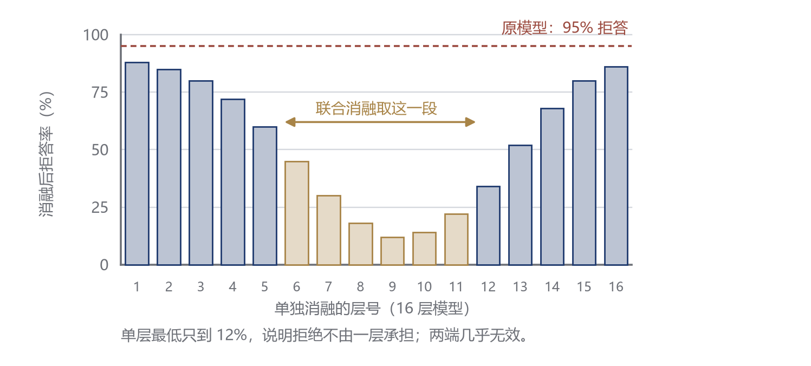
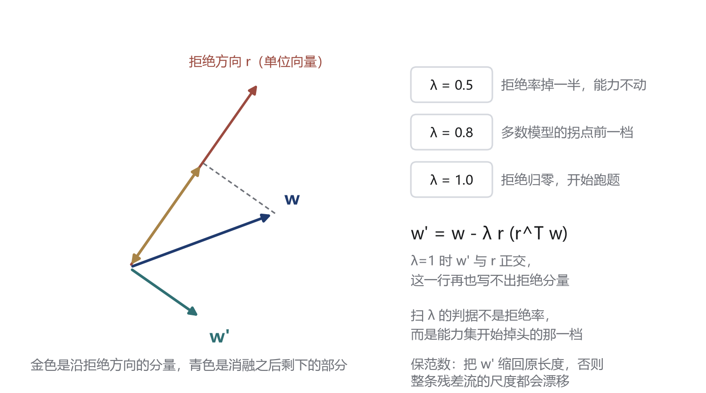

## 消融式去防护：不发一条数据，改几个矩阵

上一章的攻破要训练：准备数据、跑微调、等收敛。这一章的方法不需要训练，也不产生任何新权重文件——它只做一件事：找到模型内部那个"拒绝"的方向，然后把它从权重里抹掉。

社区把这种方法叫 abliteration，是 ablate（消融）和 obliteration（抹除）两个词的拼接。一块消费级显卡、几个小时、几百条对照提示，就能得到一个"几乎不拒绝任何请求"的模型版本，而它在通用基准上的分数往往只掉一两个点。

值得先说明它的定位：这不是越狱。越狱是在输入端想办法，模型本身没变；这是直接在权重上动手，改完的模型对任何输入都不再拒绝。

### 它赌的是一个结论：拒绝是一个方向

这个方法成立的前提，是一条已经有相当多证据的结论：**对话模型里的拒绝行为，很大程度上由残差流里的一个方向决定。**

2024 年有一项工作系统地验证了这件事。做法是：在模型里找到一个方向向量，推理时把激活在这个方向上的分量减掉，然后看行为怎么变。

结果很干净。减掉之后，模型对本来该拒绝的请求几乎不再拒绝；反过来，把这个方向加上去，它对无害的请求也开始拒绝。同一篇工作在一批开源对话模型上重复了这件事，方向各不相同，但"一个方向管住大部分拒绝"这个结构是共通的。

这不是说模型内部只有一个开关。更准确的说法是：拒绝这个行为在训练中被压到了一个相对单纯的方向上，剩下的机制是次要的。而对攻击者来说，"主要机制"就够用了。

### 第一步：把方向找出来

做法和上一章讲的可解释性工具是同一套，只是目的相反。

**准备两组提示。** 一组是有害请求（几百条，覆盖多个类别），一组是无害请求（同样几百条，尽量在长度、句式、话题上匹配）。两组的匹配程度直接决定方向的质量：如果无害组全是短句、有害组全是长段落，算出来的方向里就混进了"长度"这个因素。

**取激活。** 让模型跑这两组提示，在每一层记录残差流的值。位置通常取最后一个 token（模型在那里的表示最完整），也有取全序列平均的做法。

**算均值差。** 对每一层 $l$，把有害组的平均激活减掉无害组的：

$$r_l=\frac{1}{|D_{\text{harm}}|}\sum_{x\in D_{\text{harm}}}h_l(x)-\frac{1}{|D_{\text{harmless}}|}\sum_{x\in D_{\text{harmless}}}h_l(x)$$

再归一化：$\hat r_l=r_l/\lVert r_l\rVert$。这个向量就是这一层的"拒绝方向"。

**验证它是真的。** 这一步别省。拿一批没参与计算的请求，推理时把激活投影掉（$h'=h-(h^{\top}\hat r)\hat r$），看拒绝率是不是塌下去。如果只是微微下降，说明这个方向不是主因，或者被别的机制兜住了。

一个实践细节：逐层算出来的方向彼此并不相同，通常在中后段最一致。有人用逐层方向，有人取一个跨层共享方向。逐层更准，共享更省事，两种都能做出可用的结果。

### 一个容易写错的细节：激活取哪里

方向的质量几乎全由“取哪里的激活”决定。三个位置都有人用，差别不小。

**最后一个 token。** 最常用，因为在那里的表示已经吸收了整个请求。缺点是它受最后一句话的措辞影响很大：同一请求加一句“请回答”就可能挪动向量方向。

**全序列平均。** 更稳，但会把请求里大量与安全无关的 token 平均进去，方向被稀释。实测中它的效果通常比最后一个 token 差一截。

**模板标记位。** 如果对话模板里有固定的“助手开始”标记，取那个位置的激活最干净，因为它和“接下来要生成什么”最相关。前提是你能控制模板——闭源模型做不到。

另一个细节是样本量。300 条对照算出的均值差，本身带抽样噪声，均值的标准误大约是 $1/\sqrt{300}$ 的相对量级，看起来不大。但如果对照集里混进了十几个“边界样本”（人判为有害、模型不拒），方向就会明显偏。所以算完方向之后，值得回头看一眼：那些被判定为有害但模型本来就不拒的请求，是不是该从集合里剔掉。剔掉它们，方向会更纯，消融效果会更干净。

### 第二步：把方向从权重里抹掉

找到方向只是“知道在哪里”，要把改动固化进权重，得找到“谁在往残差流里写东西”。
Transformer 里往残差流写数据的主要是两个矩阵：

- 注意力的输出投影 $W_O$，它把每个头的输出投回残差流；
- 前馈的下投影 $W_{\text{down}}$，它把中间层的宽激活压回残差流。

如果这两个矩阵里含有沿 $\hat r$ 方向的分量，模型就能把"拒绝"写进状态。抹掉它的做法是**正交化**：

$$W'=W-\lambda\,\hat r\,\hat r^{\top}W$$

$\lambda=1$ 时，$W'$ 在 $\hat r$ 方向上的输出为零——模型再也无法沿这个方向写入任何东西。逐层、逐矩阵做一遍，就得到一个"消融版"模型。

几个变体值得知道。

**软消融。** $\lambda$ 取 0.5 到 0.8，只削掉大部分而不是全部。有人偏好这种做法，因为完全抹掉容易伤到相邻能力。

**保范数。** 正交化之后矩阵的范数会变小，导致激活尺度整体偏移。常见做法是按比例放大 $W'$，让它的范数与原来接近，避免整条残差流的尺度漂移。

**推理时消融。** 不动权重，只在每次前向时把激活投影掉。效果近似，但没法把改动分发出去——模型文件还是干净的那份。

### 层范围怎么扫：一条 U 形曲线

“消融哪几层”不能凭感觉，扫一遍就有答案，而且形状很稳定。

上图是一个 16 层模型的结果：横轴是单独消融那一层，纵轴是消融后的拒答率（原模型 95%）。形状是 U 形，两侧很高、中段很低，最低在第 9 层附近，掉到 12%。

三个读数。

**单层不够。** 最好的单层也只把拒绝率从 95% 压到 12%，剩下的 12% 说明拒绝不由单独一层承担。所以真正的做法是联合消融：图里金色那一段（第 6 到 11 层）一起动，通常能压到 2% 以下。这与“拒绝是一个方向”不矛盾——方向在各层之间并不完全一致，逐层都削一点，才把整条通道削断。

**两端无效。** 第 1 到 3 层和第 14 到 16 层单独消融几乎不动结果。第 1 层还处在词法层面，拒绝这种语义判断还没形成；最后几层已经在往输出词表投影，改那里更像改措辞而不是改判断。省下这两段，能力损失会小一截。

**层号要和模型规模换算。** 16 层模型的中段是第 6 到 11 层，比例大约是 35% 到 70% 的深度。30 层左右的模型对应到第 11 到 21 层。这个换算在换模型时有用：不要照抄别人的层号，照抄比例。

U 形曲线还有第二个用处：它可以当“对齐做得糙不糙”的诊断。曲线很尖（中段一层就能压到 15% 以下），说明拒绝集中在一个很窄的机制上，容易被消融；曲线很平（每层都只降十几个点），说明拒绝分散在多处，单点消融效果有限。攻击者看到前一种会很高兴，防御方应该想办法把自己变成后一种。

### 正交化在几何上做了什么

把这一步画出来，就不容易写错代码。

图里那个 $w$ 是写矩阵的一行（或一列，取决于你把矩阵看成什么），$r$ 是单位化的拒绝方向。我们要做的是把 $w$ 里“朝着 $r$ 的那一段”拿掉，留下与 $r$ 垂直的那一段。$\lambda=1$ 时拿走全部，$\lambda<1$ 时拿走一部分。

这个减法有一个容易被忽略的副作用：**矩阵的范数会变小**。用 Frobenius 范数算，若 $w$ 里沿 $r$ 方向的能量占总能量的比例是 $f$，$\lambda=1$ 时正交化后

$$\lVert W'\rVert_F=\sqrt{1-f}\,\lVert W\rVert_F$$

取 $f=0.12$（一个不算夸张的比例），范数变成原来的 $\sqrt{0.88}\approx0.938$，也就是短了 6%。6% 听起来不多，但它作用在每一层、每一个写矩阵上，而残差流是一层层累加的，尺度漂移会被放大到下游所有层，而那些层是在原来的尺度下调好的。

所以“保范数”不是一个洁癖操作，它是让消融只改方向、不改尺度的唯一办法。做法很简单：正交化之后把 $W'$ 乘以 $1/\sqrt{1-f}$，让它回到原来的长度；或者按行归一化，让每一行的长度与原来的一致。两种做法都能把“能力掉了三个点”里的一个多点找回来。

一个实现细节：$\lambda$ 不要一次扫到底。先按 $\lambda=1$ 跑通流程，确认方向找对了（拒绝率应该塌到个位数），再回退到 $\lambda=0.6$ 到 $0.8$ 之间挑工作点。反过来的顺序会让调试变得很难，因为一旦效果不明显，你分不清是方向错了还是 $\lambda$ 太小。

### λ 扫描：一张必须自己填的表

$\lambda$ 是这个方法唯一需要调的参数，而它的选择不能靠感觉。做法是扫一遍，把三列填清楚。

| $\lambda$ | 拒绝率 | 能力集 | 现象 |
|---|---|---|---|
| 0.4 | 62% | 99% | 几乎没动，方向可能找错了 |
| 0.6 | 31% | 97% | 开始塌，回答变短 |
| 0.8 | 6% | 93% | 拐点前一档，通常选这里 |
| 1.0 | 1% | 84% | 拒绝归零，格式开始乱 |

四行里最值得看的是最后一行。它在表上最“成功”——拒绝率只剩 1%，但它同时是唯一一行能力掉到两位数以下的。很多人看到 1% 就收工，然后在真实使用里发现模型开始说车轱辘话，回头再找原因，成本高得多。

这三列的定义要写清，否则表填了也没用。**拒绝率**：一批明确有害的请求里，模型给出拒答的比例，判定用固定的判定器。**能力集**：通用问答、代码、格式遵循三类各取几十条，按通过率算，取相对原版权的比例。**现象**：一句人话描述，这一列是给别人看的，也是给自己三个月后看的。

扫 $\lambda$ 时还有一个变量常被漏掉：**消融哪些层**。常见做法是只动中间偏后的若干层（比如 32 层里的 10 到 26 层），因为拒绝方向在两端最不一致。层范围一改，拐点位置也会变，所以严格的做法是二维扫描：层范围 × $\lambda$。实践中先固定一个经验层范围扫 $\lambda$，再在选定的 $\lambda$ 上试两组层范围，成本可以接受——原因见下面这算账。

### 算一遍：λ 扫描要跑多少次前向

这套流程不需要训练，但需要大量推理，推理量决定了它能不能在一个下午跑完。

假设：拒绝集 400 条、能力集 200 条、$\lambda$ 扫 7 档、层范围试 3 种组合。每档每组合都要跑一遍两个集合，总共

$$7\times3\times(400+200)=1.26\times10^{4}\ \text{次推理}$$

7B 模型在单张消费级卡上按每秒 8 条算（短请求、批处理），是 26 分钟。加上方向计算的 600 次前向、验证集的 100 条，一小时以内。这个数字解释了它为什么传播得那么快：**整个方法的成本是一小时推理**，而上一章的微调要几小时训练，还要准备数据。

如果想把这个数字再压一半，有一个技巧：方向只要算一次，消融是权重上的修改，所以可以把七档 $\lambda$ 各自的权重都算出来、存成七个副本（每个 14 GB，需要磁盘），然后并行跑。单卡做不到并行，但多卡可以。这是典型的“用存储换时间”。

反过来说，这个算账也说明了一个限制：如果要扫的目标更大（比如 30 个模型各扫一遍），成本仍然是一小时乘 30，因为推理是串行的。这也是为什么自动化的模型扫描服务有意义——它不改变单次成本，只改变“谁来做”。

### 一份可以照做的配方

把上面的步骤落成一个可执行的流程，大致是这样。

**准备对照集。** 各三百条左右。有害一侧从公开分类里抽，覆盖暴力、违法、隐私、自我伤害等几类；无害一侧逐条对齐长度和句式——同一个模板改写成无害版本，比如把“如何制作…”换成“如何修理…”。这一步决定了方向里会不会混进“长度”或“语气”的杂频。

**扫层找方向。** 逐层算均值差，然后拿一个小的验证集（一百条）逐层试消融，看哪几层的拒绝率下降最多。常见结果是中间偏后的若干层权重最大，两端最大；真正做消融时可以只动这几层，能力损失更小。

**扫 $\lambda$。** 从 0.4 开始，以 0.2 为步长向上试到 1.0，每档都跑一次拒绝率和能力集。多数模型在 0.8 到 1.0 之间会出现一个拐点：拒绝率骤降，同时开始出现重复和跑题。选拐点前那一档。

**三个指标验收。** 拒绝率（该拒的拒了没有）、合规率（有害请求被执行的比）、能力集（通用、代码、格式遵循）。第三个最容易忽略了：一个拒绝率归零、但开始输出重复句的模型，实际上已经被改坏了。

**留一份基线。** 把原模型、只消融注意力层的版本、全部消融的版本各留一个，用同一批提示跑对照。没有基线，你不知道自己改掉的是“拒绝”还是“语言能力”。

整个流程在单张 24GB 卡上通常几小时能跑完，其中大部分时间花在反复跑能力集上，不在计算方向上。

### 从零复现的九步

把配方压成一份可以照着敲的清单。九步里每一步都写了参数，漏一步都会得到“看起来能用但哪里不对”的结果。

1. **定栈。** 单卡 fp16 推理，上下文 2048，批量 8。别用 4 比特量化做方向计算——量化误差会污染均值差，方向会偏。
2. **构对照集。** 有害 300 条（覆盖五到八个类别），无害 300 条，逐条把长度对齐到 ±10% 以内。长度不对齐，算出来的方向里会混进“长度”这个分量。
3. **取激活。** 取最后一个 token 位置的残差流，逐层保存。一次前向可以拿到全部层的值，所以 600 条请求只跑 600 次前向，75 个批次。
4. **算方向。** 逐层做均值差再归一化。不要跨层平均——不同层的方向本来就不一样，平均出来的是个没有意义的方向。
5. **先验证方向。** 拿 100 条没参与计算的请求，推理时把激活投影掉，看拒绝率。健康的模型应该从 95% 掉到 10% 以下。如果只掉到 60%，方向不对，别往下走。
6. **定位层范围。** 逐层单独消融一遍，挑出效果最集中的连续 12 到 16 层做联合消融。两端的层通常可以不动，动了更容易伤能力。
7. **扫 $\lambda$。** 从 0.4 起，步长 0.2 到 1.0；在 0.6 到 0.9 之间可以加密到 0.1。取“拒绝率已塌、能力还没掉头”的那一档。
8. **保范数并导出。** 把改动后的矩阵缩回原范数，导出 fp16 权重，记下 $\lambda$、层范围、方向向量的哈希。
9. **三指标验收 + 三份基线。** 拒绝率、能力集、格式遵循三个数一起报；原版权重、只动注意力的版本、全消融的版本各留一份，用同一批提示对照。

第 5 步是最容易被跳过的一步，也是最能省钱的一步。跳过它，你会在第 7 步花一小时扫 $\lambda$，然后发现所有档位都没效果，再回头怀疑代码——而真正的问题在第 2 步（对照集没对齐）或第 3 步（取错了位置）。

### 一个“拒绝归零但已经坏了”的判定

有一个消融版本在网上流传得很广：拒绝率 2%，看起来完全“成功”。有人把它接进业务试了两天，退回来，理由是“说话像卡带”。

查了三个数就清楚了：四词重复率从 8% 涨到 23%（意思是几乎每四句话就有一句在重复上一句的片段），格式遵循从 92% 掉到 71%（要求输出 JSON 时经常多出解释性文字），平均回答长度从 320 字掉到 180 字。三个数都不是安全指标，但它们一起说明：这个模型的语言能力已经被改坏了。

这类退化的机制不神秘。写矩阵被削掉一部分之后，残差流的分布偏离了训练时的统计，下游层按原来的分布调好的行为开始失准，最先坏掉的是“约束类”的能力——格式、长度、连贯性——因为这些能力依赖精确的分布，而通用知识类的能力更鲁棒。

所以验收必须包含“退化检测”，而且检测指标要能自动算：

| 指标 | 怎么算 | 正常 | 报警 |
|---|---|---|---|
| 四词重复率 | 相邻 4-gram 重复占比 | 10% 以下 | 超过 15% |
| 格式遵循 | 按 schema 通过的比例 | 90% 以上 | 低于 85% |
| 平均长度 | 同题回答字数中位数 | 差 15% 内 | 差 30% 以上 |

三个指标的共同点是便宜：一批固定提示跑一遍就能算出来，不需要人工。它们的用处是给“能力掉了几个点”这句模糊的话提供一个具体的抓手——通用基准掉 2 个点可能是噪声，而重复率从 8% 跳到 23% 一定不是。

顺带说一句，这三个指标对付“偷偷改变模型行为”的其他手法也有用。任何在权重层面做的改动，无论目的是什么，都会在这三个数上留下一点痕迹。它们不能证明模型安全，但能证明模型“还是原来那个语言模型”。

### 为什么它这么便宜

把它和上一章的微调攻破对照，成本差得很夸张：

| | 微调攻破 | 消融式去防护 |
|---|---|---|
| 需要什么数据 | 几十到几百条「坏问题—坏回答」 | 几百条对照提示（只用来算激活） |
| 要不要训练 | 要 | 不要 |
| 要不要梯度 | 要 | 不要，只做前向 |
| 单次成本 | 几美元到几十美元 | 一张消费级显卡几小时 |
| 产出 | 一个适配器或新权重 | 一份改过几个矩阵的权重 |
| 能力损失 | 可能较大 | 通常较小 |

便宜的原因在于它做的运算极少：几百次前向拿到激活，然后对若干矩阵做一次减法。整个流程不需要反向传播，也不需要优化器，显存只要够跑推理。

这也解释了它为什么在社区里传播得那么快：门槛低到"会跑推理脚本"就能复现。

### 代价与副作用

它确实能拆掉拒绝，但不是没有代价。

**拒绝能力全面塌陷。** 不只是"不该答的危险请求"，连"该谨慎的请求"也一起松了——医疗建议、法律条款、金融风险提示，这些原本会附带的免责和提醒，往往跟着消失。这是很多人忽略的一点：消融的是"拒绝"这个方向，不是"危险"这个类别。

**能力有轻微损伤。** 公开报告里，通用基准通常掉一到三个点，但格式遵循、长文连贯性、指令遵循这几项掉得更明显。原因是写矩阵被改动后，残差流的统计特性变了，而下游层是在原来的统计下调好的。

**过度消融会退化。** $\lambda$ 取得太大、或者消融的层太多，模型会开始出现重复、跑题、语无伦次。社区里那些"看起来坏掉了"的消融模型，多半是参数没调好，不是方法本身不行。

**效果依模型而定。** 安全训练越“整齐”的模型（集中在一个方向、一套模板），越容易被一把抹掉；把拒绝拆成多个方向、分散到多层、甚至和“有用”耦合在一起的模型，单方向消融之后仍然会保留相当一部分拒绝行为。

具体到哪些因素影响效果，能从公开的观察里总结出四条。

**对齐的形态。** 用偏好学习把拒绝训成“一种语气”的模型，方向最纯；用大量拒答样本 SFT 出来的模型，拒绝散在多种句式上，单方向消掉一部分后还会剩下不少。

**层数与宽度。** 层数少的模型，方向在各层之间更一致，消融更彻底；很深的模型，拒绝在中后段反复重建，往往需要逐层都动。

**架构的细节。** 用分组查询注意力的模型，输出投影的秩更低，正交化之后影响面更大，也更容易伤到能力；注意力头共享键值的结构同理。

**有没有做过对抗训练。** 训练里见过越狱样本的模型，拒绝往往不由单一方向承担，这类模型消融之后通常会“降一截又回升”——拒绝率从几乎全拒掉到一半左右，然后就下不去了。

### 一个更麻烦的问题：为什么能这样

如果拒绝真的只是一个方向，那它就不是"判断"，是"捷径"。

模型在训练里学会了"遇到这类输入，往残差流里写一个特定方向"，下游层看到这个方向就输出拒绝。这条路走通了，损失就降了，于是它被固化下来——而没有同时学会"为什么要拒绝"。

这解释了几件事：

- 为什么换个说法就能绕过（判断依赖表面模式，方向是跟着模式走的）；
- 为什么少样本微调就能拆掉（那条窄带本来就窄）；
- 为什么消融一个方向就能让拒绝全线崩塌（主要机制被摘掉了）。

反过来，这也给防御指了个方向：如果拒绝只是一个方向，那就把它拆成多个方向，或者干脆不把它做成一个可以直接写进残差流的东西。

### 防御能做什么

**训练侧：把拒绝拆散。** 让"拒绝"分散到多个方向、多层、多种表述上，而不是一个模板。代价是训练更难、误拒率更容易升高。

**训练侧：把拒绝与内容耦合。** 有些做法让"危险内容"的重路由发生在中间层，而不是在输出端贴一个拒绝方向。这类机制的一个好处是：它不是一个可以被单独正交化的向量。

**检测：看权重，而不是看行为。** 消融会在权重上留下痕迹：写矩阵与基座的差异集中在低秩的几个方向上，某个谱段被"挖空"。这类签名可以自动扫描，但它只能抓粗暴的消融；细调过的版本不容易看出来。

**系统侧：不依赖模型自律。** 因为开源权重一旦发布就无法约束，最终可靠的还是外围：输入输出过滤、权限、审计、人工抽检。这条和上一章的结论一样，只是理由换了一个。

### 和微调攻破的关系

两种攻破放在一起，能看出一个共同的结构：都在削弱"拒绝"这一层薄壳，但打法不同。

- 微调攻破是**用数据改分布**：喂几十条样本，让"照做"的概率升上去。它需要训练，会动到更多参数，也可能顺带损害能力。
- 消融式去防护是**用几何改结构**：找到方向，把写入通道正交化。它不训练，改动极小，但对"拒绝是不是单一方向"这个前提极度依赖。

一个是统计手段，一个是几何手段。前者更通用，后者更便宜、更彻底、也更容易被检测。

### 它拆不掉什么

把边界说清，比把效果吹高有用。这个方法拆不掉四样东西。

**拆不掉知识。** 模型知道的东西一样多。消融只改变它“说不说”，不改变它“知不知道”。所以在需要准确信息的场景里，一个被消融的模型反而更危险：它会用同样自信的语气说错的东西。

**拆不掉系统层。** 如果部署方在输入输出两侧加了过滤、加了权限、加了审计，那么改权重对最终用户的价值会大打折扣。这也是为什么“模型被去防护了”和“产品被攻破了”是两件事。

**拆不掉“不愿意”之外的拒绝。** 模型拒绝的方式不止一种：有的直接说“我不能”，有的把话题引开，有的给一个无用的笼统回答。消融主方向能干掉第一种，后两种往往还在，只是得试才能发现。

**拆不掉“改完就发布”的痕迹。** 权重与基座的差异可以查：写矩阵的秩变化、某些层的谱能量缺口、与基座的余弦相似度。共享平台上的“去限制”模型很多，稍微认真一点的审计都能看出来——难的是那些只改了几层、$\lambda$ 调得很低的版本。

### 记住这三件事

一、消融式去防护不改数据、不训练，只做两件事：用对照提示算出"拒绝方向"，再把往残差流写这个方向的两个矩阵正交化。

二、它便宜得不成比例，代价是拒绝能力整体塌陷——连带"该谨慎的场景"也一起松掉，通用能力掉一到三个点。

三、它成立的前提是"拒绝被压成了一个方向"。这既是攻击的入口，也是防御的提示：把拒绝拆散、与内容耦合、并在系统层兜底。

### 下一章

拆解和消融讲的都是"怎么破"。下一章回头补一课：如果要把这层壳装厚一点，该用哪些材料、又要付出什么代价。
