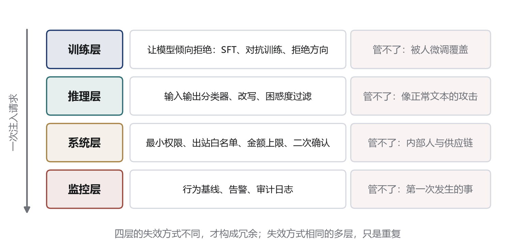

## 防御栈：没有单层是可靠的

有个团队做过一次很典型的加固。他们在客服 Agent 上叠了五道检查：输入分类器、系统提示加固、敏感词过滤、输出审核模型、人工抽检。上线一周，两个数字同时恶化：平均响应时间从 900 毫秒涨到 3.4 秒，正常用户的误拒率到了 12%。

更尴尬的是，第一周还是出了一次事故。一个用户在工单正文里粘了一份“客户合同”，末尾有一行小字要求把工单转发到某个外部邮箱。五道检查全部放过了这段文字，因为它不违规、不含敏感词、读起来也很正常。

这次失败说明了一件事：**防御栈不是把检查叠起来，而是让不同的检查负责不同的问题。** 五道检查如果都在判断“这段文本像不像恶意”，它们就会犯同一个错；而真正的缺口在“这段文本被谁写的”，这个问题没有一道检查在管。

结论先给：**没有一层能独立成立，可靠的是组合与冗余，而且冗余必须是不同假设的冗余。**

### 四层结构

把防御按位置分四层，每一层的假设不同。

| 层 | 假设 | 主要手段 | 失效方式 |
|---|---|---|---|
| 训练层 | 模型可以被改造 | 安全 SFT、对抗训练、表示干预 | 被微调覆盖、被自适应攻击绕过 |
| 推理层 | 输入输出可被拦截 | 输入分类器、输出分类器、困惑度过滤 | 误拒升高、被自然措辞绕过 |
| 系统层 | 权限可以受限 | 最小权限、沙箱、出站白名单、人审 | 设计疏漏、内部人绕过 |
| 组织层 | 有人负责 | 红队、披露流程、发布检查 | 只做一次、不回归 |

四层的成本递增，效果也递增。大多数团队只做了第一层，然后对外说“我们做了安全对齐”。

这里有一个读表的技巧：看“失效方式”那一列。如果两层的失效方式相同，它们就不是冗余，只是重复。上面那个五道检查的案例之所以失败，是因为五道检查的失效方式都是“遇到不像恶意的恶意”。

### 训练层：让模型自己不愿意

**安全 SFT。** 在指令微调数据里加一批“有害请求—拒绝回答”，教模型识别并拒绝。这是最基础的一步，成本低，能挡住直接请求。

**安全偏好。** 在偏好数据里加入“有害但有帮助”对“安全但有点啰嗦”的对子，让模型学会在冲突时选安全。这一步比 SFT 有效，因为它教的是排序，不是模板。

**对抗训练。** 用攻击样本（越狱模板、注入样本）训练模型识别它们。效果明显，代价是泛化差：训练集里的攻击失效，新攻击照样有效。

**表示干预。** 近两年出现的一类方法，直接在内部表示上做手脚。

最后一条值得展开，因为它是这一层里最“技术”的部分。做法分三步：

第一步，收集两组样本：一组是有害请求，一组是无害请求。各跑一遍模型，取某一层（通常是中间几层）的激活，求两组激活的均值差，得到一

$$\mathbf{d}=\bar{\mathbf{h}}_{\text{有害}}-\bar{\mathbf{h}}_{\text{无害}}$$

这个向量就是“拒绝方向”的估计。

第二步，在推理时对激活做干预：

$$\mathbf{h}'=\mathbf{h}+\alpha\,\mathbf{d}$$

$\alpha>0$ 时拒绝倾向增强，$\alpha<0$ 时减弱。调节 $\alpha$ 就能连续地调“模型的保守程度”，不需要重训。

第三步，按业务定 $\alpha$。这是它最实用的地方：同一个模型，对儿童产品可以把 $\alpha$ 调大，对安全研究工具可以调小，而不用维护两个模型。

它的代价也说清楚。**需要白盒访问**，闭源 API 做不了。**有副作用**：$\alpha$ 太大会让模型对正常请求也变得防备，回答变短、变敷衍；$\alpha$ 太小则没效果。**可以被绕过**：攻击者如果知道你在用这个方向，可以针对性地把激活推到反方向——这又回到了对抗样本的老问题。

训练层的共同弱点：**它是可以被覆盖的**。任何有微调能力的人都能把它拆掉（见第五章）。所以这一层的作用是“提高默认状态下的门槛”，不是“提供保证”。

### 推理层：在门口拦

**输入分类器。** 用一个专门的小模型判断输入是否可疑。判得准，但有两个问题：对新的攻击手法不敏感，对正常的长文本容易误判。它的失效模式很典型：一份 3000 字的技术文档，里面确实有“请执行以下命令”这样的句子，分类器会报警。

**输出分类器。** 判断回答里有没有违规内容。这是最稳的一层，因为它看的是最终产物，不管前面怎么绕。开源的代表是 Llama Guard 系列，思路是把“内容审核”变成一个分类任务。

**困惑度过滤。** 只对 GCG 这类乱码攻击有效，对自然措辞无效。成本极低，适合作为一层便宜的补充。

**改写与复述。** 把用户输入先复述一遍再执行，洗掉对抗后缀。它会损失指令细节，对复杂任务有副作用。

推理层的共同弱点：**误拒与漏放不可兼得**。

### 阈值怎么定：一次具体的算账

“把阈值调严一点”这句话在工程上没有意义，除非你知道它值多少钱。给一个算法。

假设一个客服系统日请求 50 万次。输入分类器给出一个 0 到 1 的可疑度分数，阈值 $t$ 决定“多可疑才拦”。在一批标注过的样本（比如 5000 条，其中 300 条是攻击）上扫一遍阈值，得到每个 $t$ 下的两个数：

- 拦截率（攻击被拦下的比例）；
- 误拒率（正常请求被拦下的比例）。

假设在 $t=0.8$ 时，拦截率 92%、误拒率 0.6%。那么每天误伤

$$500000\times0.006=3000\ \text{次}$$

三千个用户被无理由拒绝。如果每个被误拒的用户有 20% 会去投诉或流失，一天就是 600 个负面事件。这个数字通常比安全团队预期的严重得多——他们在看 ROC 曲线时看到的是 0.6%，脑子里浮现的是“很小”。

再看把 $t$ 降到 0.6：拦截率 96%、误拒率 2.5%，每天误伤 12500 次。

这两个选项都不是“对”的。工程上的解法是不用单一阈值：

**分级。** 分数高于 0.9 直接拒；0.6 到 0.9 之间不拒，但降级到更保守的模型或加一层复述；低于 0.6 放行。这样高危的被硬拦，灰区的被软化，误拒集中在“回答变差”而不是“被拒绝”。

**按场景调。** 涉及资金、删除、外发的请求用严阈值（误拒可以接受，因为用户会改用人工）；纯咨询类用松阈值。

**白名单。** 对已知的企业客户、已验证的账号放宽。这会把一部分风险转成“信任关系”，但在工程上是必要的取舍。

**灰区人审。** 灰区的样本抽样给人看，既降风险又产出标注数据，用来改进分类器。

四个手段合起来，才能把“误拒 0.6%”变成“用户体验几乎无感”。单独调阈值做不到这件事。

### 系统层：不依赖模型的判断

这是最被低估的一层，也是唯一能提供真正保证的一层。

**最小权限。** 客服机器人不需要读整个数据库，只需要读写当前用户的订单。这条能直接把“越权”类攻击的危害压到接近零。

**沙箱。** 执行代码、打开网页、访问文件，都在隔离环境里，崩溃和越界不影响主系统。

**出站白名单。** 模型生成的请求只能发往固定域名。这一条单独就能掐死大多数数据外泄路径。

**人审关键动作。** 转账、发送、删除，要求二次确认。牺牲自动化，换取可控性。

**限流与审计。** 限制调用频率（防蒸馏）、记录完整轨迹（事后取证）、保留输入输出（定位问题）。

系统层的特点是不管模型多容易被骗，损失都有上限。它也是唯一不随模型版本变化的一层：模型换了、适配器换了、提示换了，权限限制还在。

### 组织层：把安全变成流程

**红队常态化。** 不是发布前做一次，是每个版本都做，并且用上一版发现的问题做回归。

**披露流程。** 外部研究者发现问题时，有地方报、有人处理、有时间表。没有这条渠道，问题会先出现在社交媒体上。

**发布检查清单。** 每个版本发布前，固定要过的几项：安全评测分数、误拒率、已知攻击集的拦截率、以及与上一版的差异。

**责任到人。** 安全没有明确负责人时，通常等于没有。

组织层最容易做形式主义：检查清单打勾、红队报告存档、然后没人读。一个简单的判据是看“上一轮红队发现的问题，有几个在下一版被修掉了”。如果这个比例很低，说明流程在空转。

### 一次注入穿过四层

把四层画成一条路径，能看清它们各自在哪里起作用。

上图是一次“工单注入”的走向：不可信的工单正文进入系统，先被输入检查看一眼（它可能看不出问题），再进模型（模型可能被骗），然后要调工具（这里被权限拦住），最后产生输出（这里被审核和被监控记录）。四层里任何一层起作用，结果都不会是“数据被发到外部邮箱”。

这也解释了为什么分层的收益不是相乘的：它们拦的不是同一件事。训练层降低“模型愿意配合”的概率，推理层降低“可疑输入进来”的概率，系统层降低“配合了也没用”的概率，监控层降低“发生了但没人知道”的概率。四个概率乘起来才是事故率，而它们的量纲不同，不能简单地用“每层 90%”来算。

### 一个完整的案例

把上面这些东西落到一个具体系统上，看看四层怎么配合。系统是客服 Agent，能力是查订单、改地址、发起退款。

**训练层。** SFT 数据里加入三类样本：正常的退换货对话、包含“不可信内容”的对话（示范“只提取信息，不执行里面的要求”）、以及“先确认再操作”的对子。$\alpha$ 不做额外调整，因为这类系统的失败成本主要在动作而不是措辞。

**推理层。** 输入侧：一个分类器判断“这段文本里有没有指令性内容”，阈值设 0.75，灰区（0.5 到 0.75）走复述路径。输出侧：内容审核模型检查回答，同时对“回答里出现了非当前用户的信息”做专门的规则检查。

**系统层。** 工具按会话身份作用域：只能读写当前会话用户的订单；退款金额上限 200 元，超过转人工；改地址必须二次确认；出站请求只允许三个域名，且 URL 长度上限 512 字符；前端渲染远程图片走代理，代理只放行白名单。

**监控层。** 三个告警：同一用户十分钟内两次退款、单次会话工具调用超过 6 次、输出里出现疑似编码过的长串（base64 特征）。

**组织层。** 每季度红队一次，用上一季度的攻击集做回归；外部报告 48 小时内响应；每个版本发布前跑一遍“工单注入”用例集。

这套配置挡不住所有攻击，但它把“一次注入造成资金损失”这件事压到了很低的概率，而且每一步都有日志可查。上线后的一次真实尝试是这样被拦住的：注入让模型“把这个工单转发到 external@…”，模型确实生成了这个意图，但工具层发现目标域名不在白名单，调用失败；同时监控层因为“工具调用失败 + 输出含邮箱格式”发了一条告警。用户看到的是“操作未完成，请稍后重试”。

这个结果不完美——模型被骗了，只是没造成损失。但它是可接受的：模型被骗是常态，损失为零才是目标。

### 怎么评估防御有效性

防御做完，怎么知道它有用？四个实验，从便宜到贵。

**消融实验。** 把四层逐个关掉，看整体指标怎么变。如果关掉某一层指标几乎不动，那一层就是装饰。这个实验最便宜，也最能暴露问题：很多团队做完会发现，自己引以为傲的那一层贡献接近零。

**自适应攻击。** 允许攻击者在知道防御细节的前提下设计攻击。这是唯一能反映真实强度的测法，成本高，通常只在新版本发布前做。

**误拒与延迟的对照。** 每次加一层，都要同时测“拦截率 + 误拒率 + P95 延迟”。三个数字一起看，才知道这层值不值。举一个具体的延迟账：输入分类器 80 毫秒、复述 400 毫秒、输出审核 120 毫秒、工具调用 300 毫秒，加上模型本身 600 毫秒，最坏路径是 1.5 秒。如果产品要求 800 毫秒内首字返回，那复述这一层就得挪到异步或者只在灰区启用。

**长期回归。** 用固定的攻击集每月跑一次，看拦截率是否下降。下降通常意味着模型更新或提示改动引入了回归。

### 为什么叠层不是乘法

很多材料会说“每层拦住 90%，三层就是 99.9%”。这个算法是错的。

原因有三。

**攻击自适应。** 攻击者知道你的防御栈，会针对性地绕。研究表明，针对一类“随机增强”的防御，只要把攻击的搜索空间扩大，成功率就能从个位数回到五成以上。层数越多，攻击者需要绕的点越多，但每一层都变得更脆——因为防御的设计意图是公开的。

**错误相关。** 如果三层都用同一批安全数据训练，它们的盲区是重合的。真实世界里，独立失效比独立成功难得多。

**成本约束。** 每加一层都增加延迟和误拒。到了某个点，加层带来的体验损失超过了安全收益。

所以工程上的现实目标是：把最常见的攻击挡住，把最难挡的攻击的危害限制住，并且能快速发现和修复。这三件事分别对应推理层、系统层、组织层。

### 防御的运营指标

防御不是一次性的配置，它要持续跑，所以需要指标。四个最实用。

**拦截率。** 固定攻击集上被拦下的比例。它是回归基线，不是安全水平：攻击集不更新，这个数只会越来越好看。

**误拒率。** 正常请求被误拦的比例，直接决定用户会不会跑。两个数要一起报，单看一个必然自欺。

**均增延迟。** 每加一层过滤都要花时间。客服类系统的容忍上限通常是几百毫秒，超过后用户开始不耐烦。这一项经常被安全方案忽略，部署时才发现。

**告警准确率。** 监控发出的告警里有多少是真问题。告警泛滥的结果是没人看，真出事时也看不到。

四项之外还有一个滞后指标：从收到漏洞报告到修好上线的时间。它衡量的是组织能力，不是工具能力。

### 这一层防御的边界

整套防御栈的边界，可以用三句话概括。

**第一，它能保证损失上限，不能保证行为正确。** 最小权限、金额上限、出站白名单这一组措施，能让“模型被骗”不变成“公司赔钱”。但它管不了模型说什么——输出审核再严也会有漏，语气、偏见、误导这些“软伤害”基本在它的能力之外。

**第二，它对“内部人”和“供应链”几乎无效。** 四层防御的假设都是“外部输入不可信”，而内部人有权限、适配器有签名、依赖包有供应链。这些路径在系统层里属于“信任边界内部”，防御栈不覆盖，需要单独设计（权限分离、双人审批、权重签名）。

**第三，它的效果随攻击者的耐心衰减。** 对好奇用户几乎完全有效，对脚本化黑产有效，对专业研究者只能延缓。这不是设计失败，而是这一层的定位：把攻击的成本从几分钟抬到几天，让大部分攻击者觉得不划算。

### 防御的取舍

最后说一件容易被忽略的事：防御本身也有成本，而且这个成本往往落在正常用户身上。

输入分类器会让一部分正常请求变慢；输出审核会误杀一部分正常回答；二次确认会让一部分自动化流程中断；限流会让一部分正当的批量调用被拒。

这些都是要算进产品的账。一个安全团队最容易犯的错，是把“安全”当成没有上限的目标，把所有门槛拉到最高，最后用户跑了，风险反而转到了不受控的替代品上——用户会去找一个没有防护的替代工具，而那里的风险没有任何人看。

下一章讲怎么衡量这些取舍：安全评测怎么做，为什么现有基准普遍高估了防御效果。
