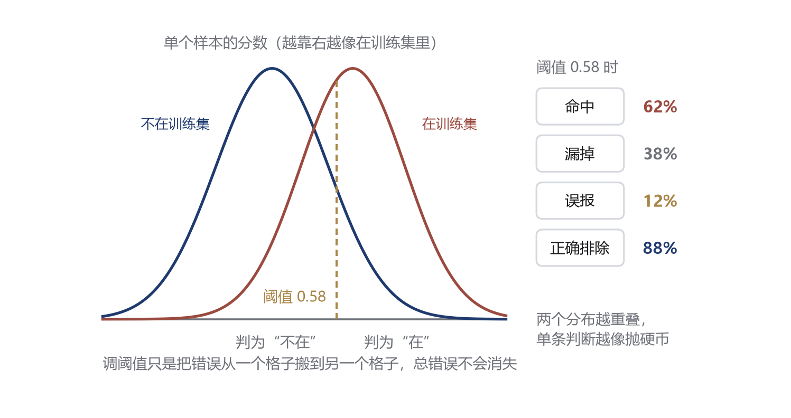

## 模型窃取与隐私：把学到的东西挖出来

模型权重是资产，训练数据里可能有别人的秘密。这两件事都被人惦记。

一个常见的场景是这样的。某家做垂直行业的公司，花了一年时间把领域知识灌进一个模型，从公开数据加内部资料做继续预训练，再做指令微调。上线三个月，产品经理发现另一家公司的产品“说话风格几乎一样”，连拒答时的措辞都类似，连一些奇怪的格式偏好都一致。查不到证据，因为没有权重可比对，只有一堆输出。

这一章讲三类攻击：把模型能力复制走、把训练数据反推出来、以及事后把某些内容从模型里删掉（遗忘）。

这三类攻击有一个共同点：它们都不追求“让模型出错”，而是追求“从模型里拿走东西”。防御的思路也因此不同——不是拦住输入，而是控制接口。

### 蒸馏攻击

不用买权重，只通过 API 调用就能复制一个模型的能力。

做法很朴素：准备一批输入，调用目标模型拿到输出，用这些“输入—输出”对训练自己的小模型。两个公开的数字说明了问题的规模：有研究用几十万美元的 API 调用费用复制出一个在特定任务上接近原模型水平的学生模型；也有工作在小规模任务上，用几万次查询就复现了分类器的绝大部分行为。

注意这里的差别：**通用能力的复制很贵，特定能力的复制很便宜。** 如果你想复现“什么都能聊”，需要覆盖极广的输入分布，成本高；如果你只想复现“把工单分类到 30 个标签”这一件事，几千条样本就够，因为任务本身窄。大多数商业蒸馏案都属于后者：偷的不是模型，是某个具体功能的表现。

### 算一遍：复制一个模型要多少钱

给一套可替换的假设，算一遍就清楚门槛在哪。

目标是复制一个 7B 级别模型在“客服问答”上的表现。假设需要 20 万条输入输出对（这是一个经验量级：足以覆盖常见问法，但覆盖不了长尾），每条输入 400 token、输出 500 token。

token 总量：

$$20\times10^{4}\times(400+500)=1.8\times10^{8}\ \text{token}$$

其中输入约 8000 万 token（即 80 个百万），输出约 1 亿 token（100 个百万）。按输入每百万 token 3 美元、输出每百万 token 15 美元（高端商用模型的价格量级）估：

$$80\times3+100\times15=240+1500=1740\ \text{美元}$$

一千七百美元。加上自己训练一个学生模型（20 万条样本、LoRA、单卡几小时）的几十美元，总成本在两千美元以内。而原模型的训练成本是千万美元量级。比例大约是 1 比 5000。

这个算例里真正容易错的是单位：$1.8\times10^{8}$ 是 1.8 亿，也就是 180 个百万，不是 180 个。差一个数量级，结论就从“可行”变成“不可行”。做成本估算时，把单位和单价写在同一个式子里，比算术正确更重要。

再看限流的作用。如果服务商把单账号限到每分钟 20 次调用，20 万条需要

$$\frac{200000}{20\times60}\approx167\ \text{小时}\approx7\ \text{天}$$

七天不间断，还需要多个账号分摊（单账号日上限通常更紧）。时间成本上去了，但钱没变——所以限流对“有耐心、有预算”的对手只是拖延，对“想快速验证”的对手才是阻断。真正有效的是**行为检测**：一个账号连续七天用同一批模板提问、每次只要短回答、从不追问，这个模式在正常用户里几乎不存在。

有一个公开的取证案例很能说明问题。一家服务商发现某个账号的调用量在两周内持续拉高，且请求呈现出很强的规律：同一批提示模板循环出现、温度参数固定、从不使用流式输出、失败不重试。追查后发现调用来自一个云主机集群，目标是训练一个“同任务的小模型”。服务商的做法不是封号，而是把这个行为模式写进了风控规则：保留正常用户的批量调用能力，但对“模板循环 + 单一任务 + 高比例短回答”的组合做限速。这个规则后来抓到了好几个类似账号，也误伤了一部分做数据集构建的正当客户，于是又加了一个申诉通道。

这个案例值得记住的是“处置方式”：直接封禁会把所有合法的批量用户赶走，完全不管则等于放弃。风控的艺术在于把门槛设在“像在工业化采集”上，而不是“量很大”上。

### 蒸馏防御的三道门

**速率限制。** 把查询速度压到很低，复制成本会从几万美元涨到几百万。但压得太低会影响正常用户，服务商通常不愿意。工程上的折中是分层限流：普通账号宽、异常账号紧，判定依据是调用模式而不是调用量。

**输出水印。** 在输出里嵌入统计特征（某种 token 选择偏好），学生模型会继承这个特征，从而可以判定“它是不是从我们这里蒸馏的”。这类方法在学术上有效，工程上容易被蒸馏方用改写、采样温度调整抹掉。一个更稳的变体是“触发水印”：在特定输入下输出一个无害但独特的措辞，只有在那个输入出现时才暴露。

**条款约束。** 服务条款明确禁止用输出训练竞争模型。这是法律手段，不是技术手段，取证依赖水印或行为指纹。

这里有一个结构性矛盾：API 的商业模式要求输出可自由使用（至少对用户而言），而安全要求输出不可被大规模采集。这两件事没法同时满足。折中方案是“允许使用、禁止规模化采集”，而“规模化”的界线只能靠行为特征来划，不能靠条款文字。

### 成员推断

给定一个模型，判断某条数据是否在它的训练集里。

对大模型，这条攻击的价值不在于“知道某人用过某句话”，而在于“知道某份敏感文档是否被用于训练”——这对版权诉讼、隐私合规都有意义。

做法有两类。

**基于损失的。** 训练过的样本，模型对它的预测通常更“自信”（损失更低）。用一批已知在/不在训练集的样本校准阈值，就能对未知样本做判断。大模型的这个信号比小模型弱，因为训练轮次少，记忆不充分。

**基于生成的。** 直接让模型续写一段开头，看它能不能原样吐出后文。对罕见的长串（比如特定的邮箱、电话号码、身份证号格式），模型有时能逐字复现。这类“可提取记忆”的实证结果在近几年的论文里反复出现：模型对高频文本的记忆很弱，对独特的长串记忆很强。

这个不对称值得解释一下。一段文字在语料里出现一万次，模型学到的是“这类文字大致长什么样”，它不需要记住具体那一次；一段文字只出现一次、但结构极其独特（比如一串随机数字加一个邮箱），模型反而需要“记住”它才能降低损失。所以**可提取记忆与重复次数成反比、与独特性成正比**。这也解释了为什么隐私风险集中在“个人信息、密钥、内部文档片段”上：它们恰好是独特且低频的。

还有一件事会加剧记忆：微调。在少量内部文档上做继续训练，会让模型把那批文档记得更牢（因为训练轮次多、样本少），可提取率明显高于预训练阶段。所以“用内部文档微调”这个常规操作，在隐私上的风险被系统性地低估了。

这个结论对隐私有直接影响：一个模型如果训练时见过某人的完整联系方式，且这条内容在语料里反复出现，那么它被诱导输出这条内容的概率是可测的。

想把概率压到零，理论上靠差分隐私训练：在每一步梯度上加噪声，并给整个训练过程一个隐私预算。它在小模型、小数据上可行，在大模型上代价很大——要让噪声不淹没信号，就得把噪声降得很小，而噪声一小，隐私保证就形同虚设；反过来加大噪声，模型就学不动。公开工作里，真正用差分隐私训练出来的大模型，要么规模小，要么效果明显落后。所以现实中主流做法不是“从数学上保证不可提取”，而是“从数据上减少可提取的东西”：去重、剔除个人信息、用合成数据替代真实数据。

这三件事都不提供保证，但它们能把风险压下一个量级，而且成本可控。工程上一般把它们当成默认流程，而不是可选项。

成员推断的实用价值不在于单条判断的准确率（它通常只比随机猜好一点），而在于**批量判断**：对一千份文档各做一次判断，把置信度最高的那几十份挑出来。即使单条只有六成准确，挑出来的那一批里也会有一半以上是真在训练集里的，足够支撑一场诉讼的证据开示。

这也是为什么“只报单个样本的推断准确率”会低估风险。举个具体的算术：假设单条判断的真阳性率 60%、假阳性率 10%，一千份文档里真正在训练集里的只有 100 份。判为阳性的有多少？真的 60 份 + 假的 90 份 = 150 份，其中真货只占四成。这个精度单看很不可用，但如果目标是“缩小需要人工核对的范围”，把一千份缩到 150 份已经足够有价值。隐私风险的要害在于这种“半可用的信息”。

### 阈值与批量筛选：一张图看清四个格子

成员推断的讨论很容易停在“准确率六成”这种数字上，而六成到底意味着什么，画出来最清楚。

左边是两条分布曲线：不在训练集的样本（蓝）和训练集里的样本（红）。它们重叠得相当厉害——这就是“单条判断只比抛硬币好一点”的几何含义。右边是阈值 0.58 时的四个格子：命中 62%、漏掉 38%、误报 12%、正确排除 88%。

四个数里没有一个是“好的”。但把它们放到批量场景里，结论会变。

假设手里有 1000 份文档要筛，其中 10%（100 份）真在训练集里。用上面的阈值跑一遍：

- 命中：$100\times0.62=62$ 份；
- 误报：$900\times0.12=108$ 份；
- 进入“疑似”名单的一共 170 份，其中真货 62 份，纯度

$$\frac{62}{170}\approx36\%$$

三成六。单独看很糟，但它的作用是**把人工核对的范围从 1000 份缩到 170 份**，缩了六倍，而漏掉的 38 份仍可以通过“换一个阈值再跑一遍”捡回来一部分。在版权诉讼或合规调查这类场景里，这就够用了：调查员不需要“自动判定”，需要“优先看哪一批”。

这张图还有一个用处：它解释为什么“调阈值”这个动作在报告里必须写明阈值。同一批数据，阈值从 0.5 挪到 0.65，命中率能从 78% 掉到 51%，误报从 25% 掉到 4%——两个完全不同的结论，用的是同一个模型、同一批数据。不写阈值，数字无法比较。

### 算一遍：水印要多少 token 才检得出

输出水印的思路是在生成时轻微偏向某一组 token，学生模型会继承这个偏向，于是可以用统计检验判断“这段输出是不是出自我们”。能不能检出来，取决于三个量：偏向幅度、可观测 token 数、检验阈值。

把每个 token 落进“偏好组”记为 1、否则记 0。若无水印，落进偏好组的概率是 0.5；有水印时是 $0.5+\varepsilon$。$n$ 个 token 上，观测比例的波动大约是 $0.5/\sqrt{n}$，所以要检出的条件是

$$z=\frac{\varepsilon\sqrt{n}}{0.5}\gtrsim3$$

取 $\varepsilon=0.05$（一个不影响可读性的幅度）、想达到 $z=3$，需要

$$n=\left(\frac{3\times0.5}{0.05}\right)^{2}=900\ \text{个 token}$$

九百个 token，大约六百到七百个汉字。这个数字说明了两件事。

第一，**短输出检不出来**。一句“好的，已经帮您处理”只有十几个 token，水印信号淹没在噪声里。所以水印不能用于“判断这条短消息是不是我们的模型生成的”。

第二，**改写会抹掉水印**。把一段 900 token 的输出改写一遍，token 选择被换掉三成以上，$\varepsilon$ 的有效值降到 0.02 以下，需要的 token 数涨到 5600 个。这就是为什么水印在实践中主要是“防直接复制”，不是“防蒸馏”——蒸馏方只要在训练数据前做一次改写，水印就失效了。

要让它更难抹，有两个方向：把 $\varepsilon$ 加大（可读性开始下降，用户能感觉到“这个词用得怪”），或者把水印嵌在更长程的结构里（比如句子的顺序偏好）。后者在学术上有报告，工程上还没成熟。所以在当前的实践里，水印的定位应该写清楚：**它是取证辅助，不是访问控制。**

### 三道门的成本对照

蒸馏防御的三道门，成本差得很远，效果也差得很远。摆在一起看，才知道该往哪投。

| 门 | 单次成本 | 对复制成本的影响 | 主要缺陷 |
|---|---|---|---|
| 速率限制 | 几乎为零 | 时间乘数，钱不变 | 误伤正当批量用户 |
| 行为检测 | 一个风控规则 | 逼对手换更多账号 | 规则一旦公开就失效 |
| 输出水印 | 生成时微调采样 | 不打钱，只留证据 | 改写即失效 |
| 条款约束 | 法务成本 | 不改变技术可行性 | 取证依赖前三者 |

四行里最划算的是第一行和第三行：限流几乎不要钱，水印几乎不要钱（只是采样时加一点偏置）。最贵的是第四行，而它恰恰最依赖前三行——没有证据的条款只能吓唬人。

一个常见的错误配置是：只做条款，不做技术。表面上有“禁止用于训练竞争模型”的条款，实际上没有任何检测手段，也没有限流。这种配置下，复制者不会遇到任何阻力，而服务商在发现之后也无法举证。

反过来，只做技术不做条款也有问题：技术手段能提高成本，但一旦对方已经复制完成，你没有任何追索依据。三道门的关系不是“选一个”，而是“技术留证据、条款用证据、限流拖时间”。

### 嵌入反演

如果系统提供文本嵌入接口（把一段文本变成向量），攻击者可以训练一个“反演模型”，从向量还原出原文。

2023 年之后的几项工作显示，几十到几百维的嵌入就能还原出可读的原文，篇幅越长、还原越准。对 RAG 系统来说这条很要命：向量库通常被当成“安全的中间产物”，但如果嵌入接口对外暴露，向量库泄露就等于原文泄露。

算一下这个“泄露”的量级：一个 1536 维的 float32 向量是 6 KB，它对应的可能是一段 200 字的中文（600 字节）。也就是说，**向量的体积是原文的十倍左右，但信息量几乎等同原文。** “向量是脱敏的”这个直觉是错的，它只是把内容换了编码。

对策只有一条：别把嵌入当秘密。向量库要做访问控制，嵌入接口要做限流和审计。

### 遗忘：把某些内容从模型里删掉

监管里出现了一个越来越具体的要求：数据主体要求删除时，模型里学到的那部分也要删。这叫机器遗忘（machine unlearning）。

难点在于模型不是数据库。参数是纠缠的，你没法定位“哪几个权重记着这条信息”。

现有的做法有三类。

**梯度上升。** 在要忘掉的数据上反向训练，让模型对这些内容的预测变差。简单，但会伤到相邻能力——你让它忘掉“某个人的电话”，它可能连“电话格式”都变得不熟。

**定向抑制。** 找到与目标内容相关的中间表示（某个方向、某组神经元），把它压制住。常见的是 RMU 一类方法：在特定层上把激活推向一个随机方向。它比梯度上升温和，但需要白盒访问，而且“相关方向”的判定本身依赖探针数据。

**重训。** 最干净：把数据剔除后重训。对大模型成本不可承受，只能作为小模型的参照基线。

评测遗忘效果要看两面：忘得干不干净（对目标内容的生成能力是否下降），以及有没有伤到别的（通用能力、相邻领域的知识）。TOFU 这类基准就是为此设计的。

一个务实的判断：目前没有方法能在不重训的前提下证明“某条信息已经完全删除”。能做的是降低可提取概率，并记录做了什么。合规上应当把这个区别写清楚——说“已删除”是过度承诺，说“已采取以下措施降低可提取性，残余风险如下”才是准确的。

这个区别在实际交锋中很具体。监管或用户要求“删除我的数据”时，工程团队能交付的是三样东西：一份列出被删除数据标识的记录、一份遗忘前后的可提取测试对比、一份残余风险评估。前两样容易理解，第三样经常引发争议：既然还有残余，算不算没删？目前主流做法是把“不可提取”定义为“在给定的一批探针请求上不能重建”，并把探针集公开。这个定义不完美，但它是可检验的，比一句“已彻底删除”有用。

### 遗忘怎么验收：三个可测的数

“删掉了”这句话在工程上没有内容，除非你能给出三个数。这三个数分别回答“忘干净了吗”“伤到别的了吗”“还能正常干活吗”。

| 指标 | 怎么测 | 目标（经验值） | 常见失败形态 |
|---|---|---|---|
| 可提取率 | 用 20 条引导提示尝试复现目标内容 | 从八成降到 5% 以下 | 降到三成就不再降 |
| 邻域保持 | 与遗忘内容相邻但应保留的知识 | 相对基线掉 3 点以内 | 连“电话格式”也忘了 |
| 通用能力 | 通用、代码、格式遵循三类 | 掉 2 点以内 | 梯度上升把模型训钝 |

第一项最容易做假。把可提取率压到零有无数种办法——把模型训坏就行，而训坏的模型在第二、三项上会立刻露馅。所以三项必须一起报，而且要在同一批提示上、用同一个判定器。

“可提取率降到 5% 以下就不再降”这个形态很典型，它对应的机制是：目标内容并不存在于某几个参数里，而是散布在一大片表示中，梯度上升只能压掉最表层的那一部分。这时候继续加大训练步数，第三项会先崩。

一个实用的判定：如果加大遗忘强度后，第一项动了不到 2 个点，而第三项掉了 5 个点，就该停手了。这说明剩下的那部分是“结构性残留”，再压只能靠重训。

### 算一遍：重训一次到底多贵

遗忘的三种做法里，重训是最干净的，成本也最容易被夸大或低估。算一遍。

7B 模型、2000 亿 token 重训一遍，训练算力约

$$6\times7\times10^{9}\times2\times10^{11}=8.4\times10^{18}\ \text{FLOP}$$

一张 A100 按 fp16 峰值 312 TFLOPS、实际利用率三成算，有效算力约 $9.4\times10^{13}$ FLOP/s，单卡需要

$$\frac{8.4\times10^{18}}{9.4\times10^{13}}\approx8.9\times10^{4}\ \text{秒}\approx25\ \text{小时}$$

25 卡时。按每小时 2 美元算，50 美元一次。这个数字会让很多人意外——7B 模型的重训没有想象中贵。但它是“从头训”的价格，而合规场景要的不是“重新训一个”，是“训一个除了这条数据之外完全一样的”，后者要求固定的随机种子、固定的数据顺序、固定的并行切分，实际做起来往往要跑三次才能复现出接近的版本，成本乘三，还要加上验证两次训练“确实只差这条数据”的评测成本。

再往上看一个量级：400B 参数的模型、2 万亿 token，同样的算式是 $4.8\times10^{24}$ FLOP，单卡 160 万小时，一千张卡 67 天。这条路对小模型可行，对大模型不可行。

这个对比解释了为什么工程上的做法是“批处理遗忘”：把一段时间内的删除请求攒成一批，季度末做一次增量重训或一次集中遗忘，而不是来一条做一条。它也解释了为什么“可验证删除”在合规上难以承诺——成本的量级决定了你只能做近似，而近似无法给出证明。

一个折中的交付物是这样的：一份删除清单（哪些标识被处理）、一份前后对比（可提取率、邻域保持、通用能力三个数）、一份方法说明（用了什么手段、参数是什么、残余风险是什么）。三样东西都不承诺“彻底删除”，但它们是可以被第三方复核的。在监管还没有统一验收标准的阶段，“可复核”比“彻底”更有价值。

### 一个失败案例：把向量库当“脱敏数据”

有一类事故在 RAG 项目里很典型。团队要把检索服务外包给第三方，需要提供一份数据样本做联调。工程师很谨慎地避开了原始文档，导出的是“向量 + 元数据”，理由是“向量是数值，看不出内容”。

三个月后，这份样本出现在一个公开的数据集网站上。攻击者做的事很简单：拿一个公开的嵌入模型训练反演器，把向量还原成近似文本。还原出来的内容不完美，但足以读出人名、项目代号、合同金额。

这个案例里没有零日漏洞，没有内部人，只有一条错误的直觉：**“数值化 = 脱敏”。** 类似直觉还有“截断 = 脱敏”（只给前 100 字）、“哈希 = 脱敏”（哈希可以被字典攻击）、“聚合 = 脱敏”（小样本聚合可以被差分攻击还原）。

正确的判据只有一条：**如果从这份数据能重建出原文的关键信息，它就不是脱敏数据。** 判断方法也很简单：让一个不了解业务的人看这份数据，问他能说出什么。向量这条路上，他甚至不需要看，跑个反演器就行。

### 这几类攻击的共同点

它们都不追求破坏模型，追求的是“获取”：获取能力、获取数据、获取身份。

也正因为如此，它们的防御重点不在模型内部，而在接口设计：

- 允许批量调用就等于允许蒸馏；
- 允许免费嵌入就等于允许反演；
- 允许自由微调就等于放弃行为控制；
- 不做删除审计就等于没法合规。

接口设计的好处是它属于工程决策，不需要模型配合。坏处是它往往和商业目标冲突——批量调用是收入，免费嵌入是获客，自由微调是生态。安全团队在这些决策里通常不是主导方，能做的只是把风险量化，让决策者知道自己在换什么。

### 这一层防御的边界

窃取与隐私这一层的防御，边界可以分成三块来说。

**蒸馏**：限流、行为检测、水印能提高成本、留下痕迹，但挡不住“有耐心、有预算”的复制。真正的边界在“能力是否可被窄化”：如果你的 API 只暴露一个窄任务（比如只做分类），复制它的价值就低；如果暴露的是通用对话，复制它的动机就强。

**成员推断与可提取记忆**：去重、脱敏、训练数据过滤能显著降低可提取率，但只要模型见过，风险就不是零。这一层的边界是“概率”：你能把某条信息的可提取概率从 1% 压到 0.01%，但不能压到 0。合规上必须承认这一点。

**遗忘**：能降低可提取性、能提供过程证据，但不能证明删除。这一层的边界是“可验证性”，而它短期内不会消失——除非模型架构变成“可编辑的知识库”，而那不是当前的技术路线。

一个总结性的判断：这一章的攻击都在利用“模型的输出接口”。把接口收紧、把输出当成潜在泄露、把向量当成原文，这三条纪律能挡掉大部分现实中的事故。

下一章把这些分散的措施收拢成一套防御架构。
