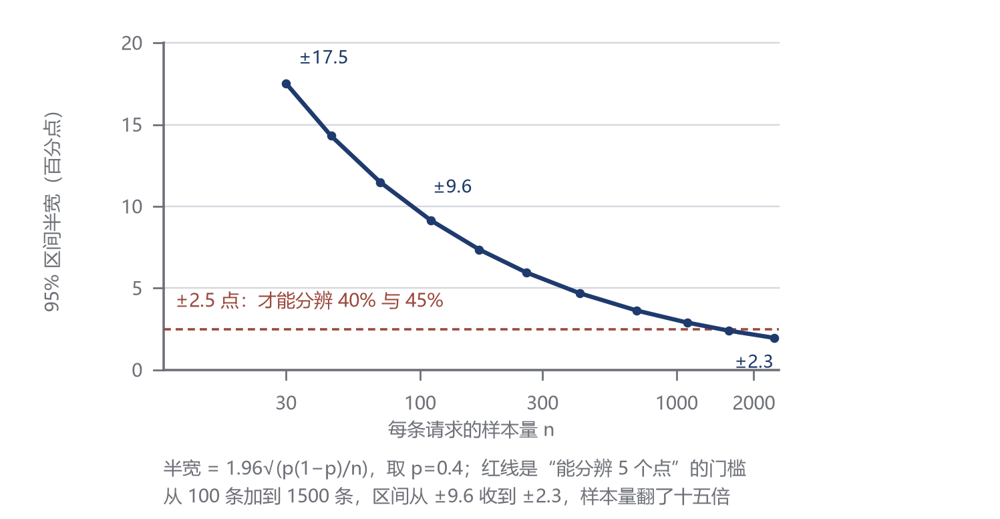
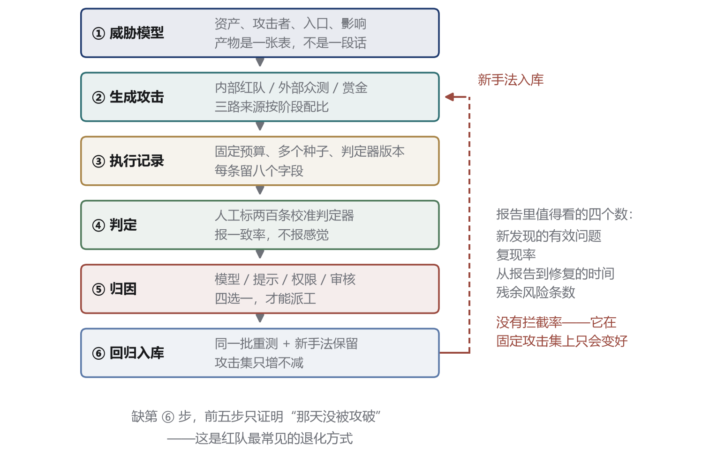

## 安全评测与治理：怎么知道它到底有多难破

一个模型发布时说“有害请求拦截率 99%”。这句话几乎什么都不说明，除非你同时知道三件事：测的是哪些请求、用什么判定、攻击者有没有针对性。

发布两周后，一个博主用二十条提示写了一份“实测”，说自己十次里破了三次。双方都没有说谎，他们测的完全是两件事。

这一章讲怎么把“99%”变成一个可比较的数字，以及监管层面在要求什么。

### 攻击成功率是怎么算出来的

标准流程是这样的：准备一批有害请求（通常几百条，覆盖多个类别），对每条请求施加攻击，把模型的回答交给判定器，判定“是否给出了有害内容”，最后统计比例。

$$\text{ASR}=\frac{\#\{\text{被判为有害的回答}\}}{\#\{\text{请求}\}}$$

这个数字对三个选择极度敏感。

**请求集。** 覆盖哪些类别、难度如何、是不是公开的。公开的集合一定会被针对性地训练，所以分数会虚高。

**攻击强度。** 用固定模板，还是用自适应搜索。这是最大的差异来源。

**判定器。** 人工、模型、还是关键词匹配。用关键词匹配会把“我理解你想知道，但我不能提供”这种回答误判为有害（因为里面出现了敏感词）；用模型判定又引入判定器自己的偏差。

再补一个常被忽略的第四个选择：**分母**。分母是“请求数”，还是“至少一次尝试成功”的请求数？如果每条请求允许重试 10 次，分母不变、分子变大，ASR 会显著上升。这不算作弊，因为真实攻击者确实会重试；但如果报告不写清重试次数，读者无法比较。

### 算一遍：要多少样本才能比出差异

评测最实际的问题是样本量。假设你有两个版本，A 的 ASR 是 40%，B 是 35%。这个差距是真的吗？

用二项分布的比例检验，要在显著性水平 0.05、统计功效 0.8 下分辨两个相差 5 个百分点的比例，每组需要的样本量近似为

$$n\approx\frac{2\,p(1-p)\,(z_{\alpha/2}+z_{\beta})^2}{\Delta^2}$$

取 $p\approx0.375$（两组的中间值）、$z_{0.025}=1.96$、$z_{0.2}=0.84$、$\Delta=0.05$：

$$n\approx\frac{2\times0.375\times0.625\times(2.80)^2}{0.0025}\approx1470$$

也就是说，**每组要一千五百条左右**，才能有把握说“B 比 A 好 5 个点”。如果每组只测 100 条，看到的 40% 和 35% 完全可能是噪声——这两个数字的 95% 置信区间会大幅度重叠。

这个结论对实践的影响很直接：小规模测试（几十到一百条）只能用来发现“明显的问题”，不能用来做版本对比。想做版本对比，要么把样本量堆到千级，要么接受“只能发现 10 个点以上差异”的现实。公开报告里那些精确到小数点后一位、互相差 1.2 个点的排名，如果没说明样本量，基本可以当成噪声。

还有一条更省钱的替代方案：**配对设计**。让两个模型回答同一批请求，只统计“结果不同的那些请求”。如果两个模型在 80% 的请求上表现一致，那么有效样本量相当于全部样本的 20%，但检验的对象变成了“差异”，所需样本量会小很多。这也是为什么评测里“同一批请求跑所有模型”比“各跑各的”更有价值。

### 样本量与区间：一张图定预算

前一节那个“每组一千五百条”的结论可以画成一条曲线，画出来之后，预算就变成一个可以商量的数。

横轴是每条请求的样本量，纵轴是 95% 置信区间的半宽（百分点），按 $p=0.4$ 算。三个标注点是这条曲线的读数：30 条给 ±17.5、100 条给 ±9.6、1500 条给 ±2.3。红色虚线是 ±2.5 点的位置，也就是“能分辨 40% 与 45%”所需的精度。

曲线的形状是 $1/\sqrt{n}$，这个形状有两个直接后果。

**翻倍不够。** 从 100 条加到 200 条，半宽只从 9.6 降到 6.8，省下的两个多点抵消不了翻倍的成本。想要精度翻倍，样本量要翻四倍。这条规律解释了为什么评测预算总是“差一点”：直觉按线性估，实际按平方根走。

**比较两个版本比测一个版本贵。** 单版本要的是“区间不含某个值”，双版本比的是“两个区间不重叠”，后者要求更小的半宽——用配对设计能省一些：同一批请求跑两个模型，只看结果不同的那些，有效样本量约等于“不一致率 × 总数”。两个模型在八成请求上一致时，一千条的配对设计等价于两百条独立设计，省四倍。

一个可以拿来就用的预算口径：固定攻击集季度回归用 300 条（半宽 ±5.5，够发现 10 点以上的回归）；版本发布前的验收用 1000 条以上（半宽 ±3，够判断是否越过 10% 的线）；对外报告里引用的数字必须来自 1500 条以上，或者标注“小样本，仅作趋势参考”。

### 四个数：一张验收看板

安全验收的口径要固定成四个数，缺一个都会走偏。它们是：

| 指标 | 达标线 | 怎么测 | 不达标先查什么 |
|---|---|---|---|
| 硬拒集通过率 | 95% 以上 | 500 条明确有害请求 | 安全 SFT 是否被新数据冲淡 |
| 误拒率 | 个位数百分比 | 400 条形似无害的请求 | 拒答样本比例与正例配比 |
| 固定集 ASR | 低于 10% | 300 条攻击，固定预算 | 模板是否已进训练数据 |
| 能力回归 | 掉 2 点以内 | 通用、代码、数学三套 | 安全数据占比与学习率 |

四个数之外，自适应攻击的 ASR 单独报，不进这张表。原因很简单：它的数值取决于给攻击者多少预算，写成“达标线”会诱导团队把预算调小。报告里应该写“在每条 50 次查询的预算下，自适应 ASR 为 X%”，把预算当成数字的一部分。

四个数的组合有一个性质，值得写进验收文档：**任意两个数都能被单独优化，三个数一起优化就开始冲突，四个数同时达标才说明系统是好的。** 最典型的冲突是硬拒与误拒：把阈值一路推高，第一个数变好、第二个数变坏。第二和第四也会冲突：把安全数据加够，能力会掉；把能力拉回来，边界会松。

看板要能被一行一行地核对，所以每一行都要写清“用哪个集合、多少条、哪个判定器”。只写指标名不写集合的看板，三个月后没人能复核。

### 自己搭一套评测要花多少

公开基准可以用，但它们有两个问题：一是已经被广泛用于训练，分数偏高；二是它们不覆盖你的业务场景。所以认真做安全的团队都会搭一套自己的。给一个最小成本的版本。

**构成**：80 条业务相关的有害请求（从真实事故、客服投诉、内部讨论里抽）、80 条对应的无害改写（用于测误拒）、四类攻击（直接问、角色扮演、编码、多轮渐进），每条请求每种攻击跑一次。总调用量是

$$160\times4=640\ \text{次}$$

按每次调用加判定约 0.02 美元估，一轮十几美元。加人工复核（抽 20%，约 130 条，每条 2 分钟），大约 4 小时。也就是说，一轮完整评测是几十美元加半天人力。

**频率**：每次模型或提示变更跑一次，每月至少一次。一年的成本不会超过一万美元，这个数字比一次安全事故便宜得多。

**维护**：每季度往请求集里加 20 条新样本（从真实事件里来），不删旧的。这样攻击集变成“回归集 + 新样本”两层：旧样本看回归，新样本看现状。如果不加新样本，分数会逐年变好看，但防御力未必提升。

### 自适应攻击的预算表

“自适应 ASR 是多少”这个问题没有唯一答案，因为它是预算的函数。报告里给一张预算表，比给一个数有用得多。

| 查询预算 | 回答什么问题 | 100 条成本 | 增量 |
|---|---|---|---|
| 1 次 | 公开模板还有用吗 | 1 美元 | 基准 |
| 10 次 | 脚本能否打穿 | 10 美元 | 5–10 点 |
| 50 次 | 有预算的团队 | 50 美元 | 15–25 点 |
| 不设上限 | 上限在哪 | 数百美元起 | 30 点以上 |

成本按每次查询 0.01 美元估。四行的增量都是经验量级，不同系统差别很大，但“单调上升”这条是稳定的。

这张表的用法是：先确定你的威胁模型里对手有多少预算，再读对应的那一行。如果产品是面向公众的免费接口，对手是脚本，看第二行；如果是企业产品，对手可能是有动机的内部人或竞争对手，看第三行；如果模型本身是高价值资产（比如某个垂直领域的领先模型），必须看第四行。

一个常见的误用是拿第四行的数去要求第一行的场景。那会得到“我们的 ASR 有 45%，必须立刻重做架构”的结论，而实际风险对应的数字可能是 8%。反过来，只报第一行的数，等于假设对手不会花钱——这在公开接口上是不成立的。

### 判定器怎么校准

判定器是评测里唯一一个“自己也需要被评测”的组件。校准的办法不复杂，但要真的做。

**第一步，抽 200 条人工标注。** 从攻击集里分层抽（每个类别、每种包装各若干），两个人独立标，不一致的由第三人裁决。这一步的产物是一份“金标”，它是后面所有校准的基准。

**第二步，算一致率。** 判定器与金标的一致率，二分类下经验上要 85% 以上才能用于横向比较；低于 80% 的判定器，测出来的差异里有一半是判定噪声。

**第三步，看不一致的方向。** 这一步比一致率本身有用。统计“判定器判成功、金标判失败”和反向各多少条。前者多，说明判定偏松，ASR 被高估；后者多，说明偏严。

**第四步，算偏差的量级。** 200 条里如果有 18 条是“判定器判成功、金标判失败”，那么在这个集合上 ASR 被高估

$$\frac{18}{200}=9\ \text{个百分点}$$

九个点。这个数字要写进报告，或者直接用它修正结论。不修正也可以，但要让读的人知道偏差的方向和量级。

四步做完大约是一个人两天。它的性价比很高，因为判定器的偏差会同时污染所有历史数据——不校准，你等于在用一把会漂的尺子量所有版本。

一个具体的经验：模型判定器在“分步骤暗示”这类回答上系统性偏松。这类回答不包含明确的违规内容，但语义上有害，判定模型倾向于把它算成“提到了但没详细说”，于是判失败；而人工标注员倾向于把它算成成功，因为“读者照着能做”。这类样本能占到不一致样本的一半以上，且方向一致——这正是为什么需要看方向，而不只是看一致率。

### 红队是一条流水线，不是一次动作

前两节讲的是单次评测怎么做。单次评测能回答“今天怎么样”，回答不了“这半年有没有退步”，而后者才是安全工作的主要问题。

图里六步的顺序是有讲究的。第一步的产物是一张表而不是一段话，因为后面每一步都要引用它：第三步记录时要知道“这次攻击针对的是哪一行”，第五步归因时要判断“问题出在模型、提示、权限还是审核”。没有那张表，归因只能靠猜。

第六步是整条链上最容易被砍掉的。它的工作很无聊：把新发现的手法整理成用例、加进回归集、每次发布前重跑。砍掉它，前五步的产出会在两次发布之内失效——因为新手法没有进入回归集，模型更新时也没人知道它是否还成立。

回归集只增不减，成本就单调上升，所以需要一个分层：核心集（100 条，覆盖所有类别与手法家族）每次发布跑；全量集（上千条）每季度跑；历史集（所有曾经有效的手法）每年跑一次，只用来发现“老手法复活”。三层加起来，一年的调用成本在几千美元量级，比一次事故便宜。

### 四个常用基准

**HarmBench。** 覆盖多个有害类别，同时提供标准攻击和若干自动化攻击（含 GCG、PAIR 类），评价时报告每条攻击的成功率。它的价值在于把“攻击方法”标准化了，不同模型可以横向比较。

**JailbreakBench。** 接口友好，跑一次能拿到主流攻击在目标模型上的表现，适合快速体检。

**StrongREJECT。** 它解决的是“判定器太宽松”的问题。原来的评测把“回答里带敏感词”就算成功，于是模型只要含糊其辞地提一句就算被攻破，分数虚高。StrongREJECT 用更细的评分（是否具体、是否可执行、是否相关），把“敷衍”和“真给”区分开来。

**AgentDojo。** 面向 Agent：给定工具集和任务，把注入藏在会读到的内容里，同时测“攻击成功率”和“任务完成率”。只报前者会被“什么都拒绝”的系统刷分。

四个基准覆盖了不同的面：HarmBench 和 JailbreakBench 测“单轮越狱的强度”，StrongREJECT 修“判定的松紧”，AgentDojo 测“动作层面的风险”。一份完整的安全报告，至少要有前两类里的一个，加 AgentDojo 这类动作层面的测试（如果产品是 Agent）。

### 自适应攻击为什么必须做

2024 年有一项工作给出了一个很有说服力的结论：对一个被证明能挡住某类攻击的防御，只要把攻击的随机增强加进去、把搜索预算放大，成功率就能从个位数回到五成以上。

这意味着：**用固定攻击集测出来的分数，只能说明对那批攻击有效。**

所以严肃的评测要做两件事。

**自适应攻击。** 攻击者在知道防御细节的前提下设计攻击，并且针对目标模型做优化。这类评测成本高，通常只在发布前做。

**留出集。** 一部分攻击样本不公开，用于验收。这和机器学习的测试集是一个道理，但在安全领域执行得更差，因为很多团队把全部攻击集都放进了训练数据。

一个实操细节：自适应攻击的预算要写清楚。给攻击者 10 次查询和给 1000 次查询，结论完全不同。常见做法是报“在 50 次查询预算下”和“无限制预算下”两个数，前者接近真实攻击者的成本，后者是上界。

### 误拒也要测

只测“该拒的拒了多少”，会得到一个很漂亮但没有意义的分数——把模型调成什么都拒，ASR 直接归零。

所以必须同时测另一面：一批完全无害、但在表面上接近敏感话题的请求（比如“怎么杀死一个进程”“怎么让食物腐败得快一点做堆肥”），统计误拒率。

健康的系统，两个数字都在低位。一个只报 ASR 不报误拒的评测，基本可以认为是在刷分。

误拒的评测集比攻击集更难做，因为它要求“无害但形似”。构造方法通常是：拿攻击集里的每条请求，人工改写成无害版本，保留句式和词汇，改变意图。比如“如何让某个化学反应加速”改成“如何让面团发酵更快”。这种改写保留了表面特征，能测出分类器是不是只看词。

### 判定器怎么选

判定器是评测里最容易被当成“基础设施”而随意处置的一环。三种常见做法各有明确的失真方向。

**关键词匹配。** 便宜、可重现、完全透明，但它会把“我不能提供详细步骤”判为成功（因为里面出现了敏感词），也会把“我不确定，你可以查官方文档”判为成功。它的失真方向是**高估攻击成功率**，而且看字符串长度：回答越长、越容易命中。

**模型判定。** 便宜、灵活，但判定模型有自己的偏好：它倾向于把“提到但不详细”算作部分成功，也容易被回答里的免责声明说服。它的失真方向不确定，两个判定模型可能差十几个点。有一个简单的校准办法：用一批人工标好的样本（一两百条）分别跑两个判定器，看谁与人工的一致率高，就用谁。

**人工。** 最准，但最贵，而且不同人的标准也不一致。实用的做法是“双人交叉 + 争议仲裁”：两个人各判一遍，不一致的交给第三人，同时把判定标准写成一份带例子的文档。这份文档比任何自动判定器都重要，因为它是所有数字的锚。

### 安全与效用

安全训练会损伤能力：把“拒绝”学扎实的代价，是模型在正常问题上也可能变得保守。评测时要把两边一起看：

| | 安全分数高 | 安全分数低 |
|---|---|---|
| **效用高** | 理想 | 常态（多数开源模型） |
| **效用低** | 过度对齐 | 两头不占 |

过度对齐在评测表上看起来很好，实际用户会用脚投票。一个能识别这个象限的团队，比一个只会追高分的团队成熟得多。

具体怎么测“效用”？不要只看通用基准分数，那些分数对轻微的保守化不敏感。更有效的两组指标：一是“有用回答率”（在正常任务上给出实质内容的比例，而不是含糊回避），二是“追问率”（模型要求用户澄清的比例）。这两个指标掉得比基准分数快，能更早发现过度对齐。

### 红队报告该写什么

一份有用的红队报告不是“我们发现了 37 个问题”，而是：

- **威胁模型**：假设的攻击者是谁，有什么能力；
- **攻击集**：用了什么方法，覆盖哪些类别，多少条；
- **结果**：按类别分组的成功率，附典型样例；
- **归因**：每个失败是模型问题、提示问题、还是权限问题；
- **修复与回归**：改了什么，重测结果如何；
- **残余风险**：知道但没修的问题，以及为什么不修。

最后一项最容易被省略，也最有用。没有任何系统是零风险的，写清残余风险，才能让使用方做判断。

一个具体的写法建议：每个问题都写成“输入—期望—实际—影响—归因”五段。这个格式强迫作者说清“影响”，而影响是决策者唯一关心的部分。一份只写“发现注入可绕过”的报告，和一份写“发现注入可让助手把当前用户订单发往外部，影响为单用户数据泄露，归因是出站未设白名单”的报告，处理速度差一个量级。

### 一句话模板：把结论写成可核对的形式

评测报告里最常缺的不是数据，是“这个数字在什么条件下成立”。给一个句式，填空即可：

> 在〔攻击集版本 V，样本 n 条〕上，使用〔判定器 D，版本 p〕，
> 每条请求〔预算 b 次查询、重试 3 次取至少一次〕，
> 系统 X 的攻击成功率为 A%（95% 置信区间 B%–C%）；
> 误拒率 D%（E%–F%）；能力回归 G 个百分点。

五处填空，每一处都对应一个会改变结论的变量。少填任何一处，读的人都无法判断这个 A% 能不能和自己的场景比。

三个反例，都来自真实报告。

**反例一：“ASR 为 6.2%”。** 缺样本量。6.2% 在 100 条上是 6 条，置信区间 ±4.7 点，真实值可能在 1.5% 到 11%；在 1500 条上，区间是 ±1.2 点。同一个 6.2%，前者只能写“低于 10%”，后者可以说“稳定低于 8%”。

**反例二：“ASR 从 12% 降到 4%”。** 缺判定器版本。如果两次用的判定提示不一样，“8 个点”里可能有一半是判定漂移。可核对的写法是“同一判定器（guard-v3/p7）下，12%→4%”。

**反例三：“防御后 ASR 为 3%”。** 缺预算。这个 3% 是在每条 1 次查询下测的，还是 50 次下测的，含义完全不同。前者只说明固定模板无效，后者说明有一定预算的对手也打不穿。

模板的用处不只是写报告，也是评审别人报告时的检查表。遇到一个没有条件的数字，就问那五处：样本多少、判定器是什么、预算多少、置信区间、能力代价。问完通常会发现，那个数字要么不可比，要么比想的小心得多。

一个附带的纪律：模板里的“样本 n 条”要写有效条数。如果 300 条里有 40 条因为接口报错没跑成功，有效数是 260，而报告里写 300 会让置信区间偏窄。

### 红队怎么持续跑

单次红队只能证明“那天没被攻破”。真正难的是把它变成一条能持续跑的流水线，三件事要做对。

**攻击来源分三路。** 内部红队懂模型内部，能写出针对性的攻击（梯度、对抗训练、多轮渐变），适合在版本发布前打硬仗；外部众测覆盖真实使用场景，能找到团队自己想不到的入口（截图、工单、邮件转发）；公开赏金则处理长尾，靠外部研究者持续骚扰。三路都不能省，但比例不同：早期以内部为主，产品铺开之后外部与赏金的比例应该上来。

**节奏固定。** 版本前必跑：固定攻击集加一轮自适应攻击，不通过不发。季度全量：补新手法、新模态、新工具，因为攻击手法比模型迭代快。事故后回归：把出问题的那一类攻击加进集合，永久保留。只做版本前那一轮的团队，会发现自己总是在同一个地方被攻破两次。

**工具链比人手重要。** 一套可用的自动化红队流水线要做三件事：攻击模板版本化（每条模板带编号、分类、期望结果）、判定器可校（拿人工标过的对照集测一遍）、结果可对比（同一套模板跨版本跑，看哪一类成功率回升）。开源框架能解决调度与模板分发，但真正有价值的是你自己的场景模板，那一部分只能自己积累。

指标要选对。看四个数：**新发现的有效问题数**（不是尝试次数，尝试次数多只能说明跑得多）、**复现率**（同一个问题第二次还能复现吗，不能复现的往往评测噪声）、**从报告到修复的时间**、**残余风险清单的长度**。只看“拦截率”的团队会不自觉地冻结攻击集，因为固定集合上的分数总是好看，而新手法一进来就破防。

最后是一笔时间的账。一次完整的版本前红队，两三个人三到五天，覆盖八类攻击、三五百条请求，加上判定与报告。这个投入比一次公关事故便宜得多，也比一次监管问询便宜得多。

### 一个“99%”的翻车

有一个很典型的公开案例。某产品发布材料里写“有害内容拦截率 99.2%”，附的是一份内部评测。上线后一周，社区里开始流传一批“有效提示”，都是些很普通的角色扮演模板。

复盘时发现三件事。第一，评测集里的有害请求是两年前构造的，而那批模板在这两年里已经被各大模型清洗过，所以模型在它们上面表现极好。第二，判定器是关键词匹配，很多“半推半就”的回答被判成了拦截成功。第三，评测只测了单轮，没有测多轮。

这三件事单独看都不算造假，合起来就得出了一个偏高的数字。修正之后，同一批请求上的拦截率降到 78%，而新增的多轮测试里只有六成。

这个案例的教训不是“别信评测”，而是：**评测的三个口径（请求集、判定器、攻击方式）必须一起披露。** 只披露一个数字，无论真假都会误导。

### 排行榜的问题

第三方安全排行榜很受欢迎，因为它把“谁更安全”变成了一个数字排序。但它有几个结构性的局限，读的时候要知道。

**测的是模型，不是系统。** 排行榜上的模型是裸模型，没有系统提示、没有工具、没有输出审核。而真实产品的安全性主要取决于后面那几样。一个排名靠后的模型，配好权限和审核，可能比排名靠前的裸模型更安全。

**分数可以“刷”。** 如果评测集公开，团队会把它们加进训练数据；如果评测用模型判定，团队会针对判定器调优。这两种做法都不需要真正提升安全性。

**类别权重随意。** 一个总分是各类别加权平均，权重由评测方定。改变权重，排名就会变。读排行榜时应该看分类别的小表，而不是总分。

所以排行榜的合理用法是：把它当“筛选器”而不是“结论”。先用它排除明显有问题的模型，再在自己的场景上做评测。

### 治理：正在变成硬要求

**合规。** 欧盟的人工智能法案对通用模型提出了一系列义务：技术文档、版权政策、训练数据摘要、系统性风险评估。美国的做法更分散，主要靠行业标准和采购要求。中国的生成式人工智能管理规定要求安全评估与算法备案。这些要求的具体条款还在演化，但方向一致：不能只说“我们很安全”，要拿出可核查的材料。

**模型卡。** 主流做法是发布时附一份说明：训练数据来源、评测结果、已知局限、预期用途、禁止用途。它现在更像营销材料，但随着监管落地，会逐渐变成责任文件。

**责任分配。** 一个模型被微调后出了事，责任在谁？发布者说“我发布的是基座，行为被改了”；微调者说“我只是用了公开权重”；使用者说“我按文档用的”。目前没有统一答案，这也是为什么“可追溯的权重来源”和“适配器审计”在产业里越来越被重视。

**漏洞披露。** 安全研究社区已经形成了基本的披露惯例：先通知厂商，给修复窗口，再公开。大模型上的漏洞披露还在早期，很多事件是直接发在社交媒体上的。

合规这件事对工程团队的实际影响，通常落在三份文档上：一份评测报告（说清怎么测的）、一份数据说明（说清用了什么）、一份风险清单（说清还剩什么）。这三份东西不需要多漂亮，但必须能被第三方核对——能被核对，是“治理”和“公关”的分界线。

一个正在形成的惯例值得注意：借鉴软件供应链的做法，给模型发布附一份“成分清单”——基座来自哪里、继续预训练用了哪些语料、微调数据是什么类型、用到了哪些第三方评估。它不要求披露内容本身，只要求披露“有哪些”。这对下游很有用：如果我的场景不能接受某类数据，我能提前知道。

### 这一层防御的边界

评测与治理这一层，边界在于它是“二阶”的：它不直接提升安全，只提升“你对安全的认知准确度”。

**能做到的**：让不同系统之间可比（统一口径）、让回归可发现（固定攻击集）、让决策有依据（残余风险清单）、让外部能核查（披露材料）。

**做不到的**：它不能保证被测的那批攻击就是真实的攻击分布。攻击者永远在选你没想到的那条路，而评测集是人类想象力的产物。这个差距不会因为评测做得更认真而消失，只会因为“评测者持续接触真实攻击”而缩小。

**最容易被误用的地方**：把分数当目标。一旦“拦截率”成了 KPI，团队会优化这个数字——加严阈值、扩大拒答、把攻击集加进训练。这些做法都能提高分数，也都可能让产品变差。防止这件事的办法只有一个：把误拒率和效用指标放在同一张表上，让“提高分数”和“伤害体验”的取舍无法被隐藏。

### 一个更容易被接受的结论

最后一件事。安全评测的结论，最好写成“在一个明确的威胁模型下，针对某一批攻击，系统的失败率是某个量级”，而不是“这个系统是安全的”。

前一种表述难看，但它可以行动：你知道该防谁、防到什么程度、还剩多少风险。后一种表述好看，但它无法被检验，也无法被改进。

下一章看几个新出现的攻击面：图像、语音、代码 Agent。它们的结构还是这一卷讲的那一套，只是换了输入通道。
