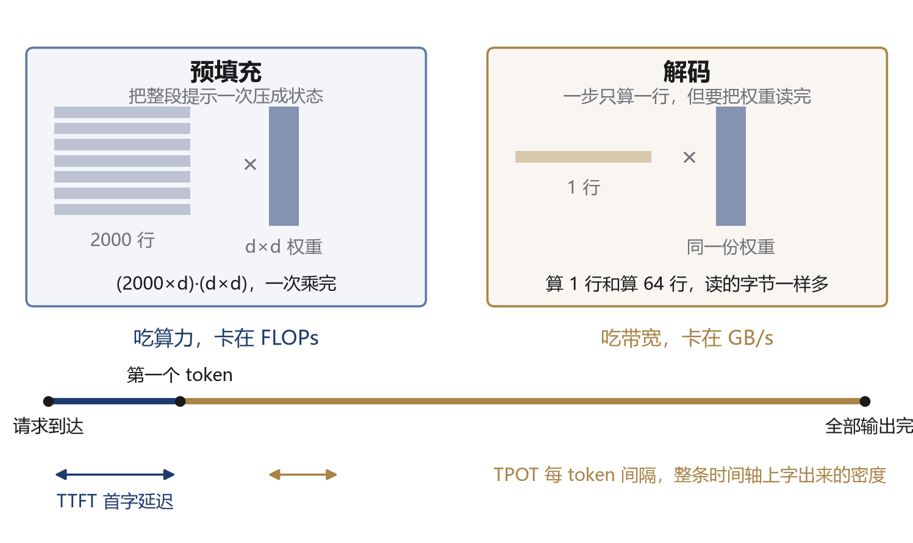
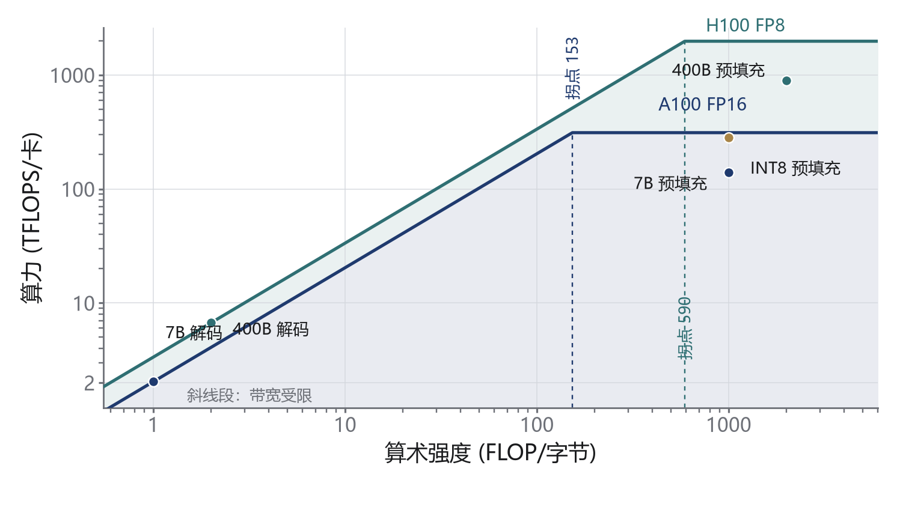

## 一次生成的两个阶段

### 两个数字，两种等待

有人把三页合同粘进输入框，问第三条第 2 款有什么风险。按下回车，屏幕上四秒没有动静。四秒之后字开始往外冒，每秒二十个，一直冒到两百个字。

第二天他问了个短问题，把一句话改得客气一点。这次半秒就出字，可字出来的速度还是每秒二十个。

同一台机器，同一份权重。等待的时间差了八倍，吐字的速度一模一样。这个现象不是偶然，它把一次生成切成了两段，也划出了这一册剩下九章都要用到的那条分界线。

模型处理的单位不是字，是 token。一个汉字大约一个 token，一个英文单词大约一点三个。下面说到 token，就当成字来读，不影响算账。

两段各有一个指标。第一段叫**预填充**，模型把用户输入整段读进去，算出中间状态，这段花的时间叫**首字延迟**（time to first token，TTFT）。第二段叫**解码**，模型一个接一个往外吐字，每个字之间的间隔叫**每 token 时间**（time per output token，TPOT）。

用户体感由这两个数共同决定。TTFT 决定"卡不卡"，四秒白屏会让人怀疑是不是断网了；TPOT 决定"顺不顺"，五十毫秒一个字读起来是流畅的，三百毫秒一个字就像在等拨号上网。

奇怪的地方在于，这两段花的时间差得很远，可它们跑的是同一份权重、同一个前向公式。差别只在一件事上：一格里要算多少行。

### 预填充：把提示压成状态

预填充的输入是一整段提示，输出是每个位置的中间结果，其中最占地方的是每一层的键和值。这个过程有一个很好的性质：提示里第 500 个 token 和第 501 个 token 之间没有依赖关系，它们可以同时算。

所以矩阵乘的形状是"整块"的。输入是一个 $T\times d$ 的矩阵（$T$ 是提示长度，$d$ 是隐藏维度），权重是一个 $d\times d$ 的矩阵，一次乘完。硬件最喜欢这种活，几千行乘几千行，乘加单元的每一拍都在干活。

算一下要做多少运算。有一个流传很广的近似：**每个 token 每层大约需要 $2N$ 次浮点运算**，$N$ 是参数量。这个公式值得推一遍，因为它后面还要反复用。

一层 Transformer 里，绝大部分参数在两组线性变换上：注意力里的四个投影（$Q,K,V,O$）和前馈网络里的两个矩阵。一个参数在一层里被用到一次，用的时候做一次乘法再一次加法，所以一个参数贡献两次浮点运算。$N$ 个参数、一个 token、一层，就是 $2N$ 次。

严格说，这里的 $N$ 是"每个 token 都要经过的参数"，稠密模型就是全部参数，MoE 模型只算被路由到的那几个专家。注意力那部分随序列长度平方增长，先不算，后面单独处理。

于是提示长度 $T$ 的预填充，总运算量是

$$\text{FLOPs}_{\text{prefill}}\approx 2N\,T$$

7B 模型、2000 token 的提示，代入

$$2\times 7\times 10^{9}\times 2000=2.8\times 10^{13}\ \text{FLOPs}$$

也就是 28 TFLOP。一张 A100 的 FP16 稠密算力标称 312 TFLOPS。这个数字是理论峰值，实际能跑到一半就算不错，大矩阵乘在预填充阶段属于硬件最擅长的形状，取 45% 的利用率，有效算力 $312\times10^{12}\times 0.45\approx 1.4\times10^{14}$ FLOP/s。

$$2.8\times 10^{13}\ /\ 1.4\times 10^{14}\approx 0.20\ \text{秒}$$

两百毫秒。这个数跟"提示有多长"成正比，两千 token 两百毫秒，两万 token 两秒。用户感觉到的那四秒白屏，其中两百毫秒在这里，剩下的花在排队、传输和框架开销上。

### 算一遍：三档模型的预填充

把模型换大，直觉是预填充会变慢。算一遍会发现没那么简单，因为大模型不会跑在一张卡上。

| 模型 | 精度 | 权重大小 | 卡数 | 聚合有效算力 | 2000 token 预填充 |
|---|---|---|---|---|---|
| 7B，稠密 | FP16 | 14 GB | 1×A100 | $1.4\times10^{14}$ | 0.20 s |
| 70B，稠密 | FP16 | 140 GB | 8×A100 | $1.1\times10^{15}$ | 0.25 s |
| 400B，稠密 | FP8 | 400 GB | 8×H100 | $7.1\times10^{15}$ | 0.22 s |

表里每一格的算法都一样，以 70B 为例：

$$2\times 70\times 10^{9}\times 2000=2.8\times 10^{14}\ \text{FLOPs}$$

八张 A100 各跑一段张量并行，聚合有效算力 $8\times1.4\times10^{14}=1.1\times10^{15}$ FLOP/s，所以

$$2.8\times 10^{14}\ /\ 1.1\times 10^{15}\approx 0.25\ \text{秒}$$

400B 那行用的是 H100 的 FP8 算力。H100 的 FP16 稠密算力约 989 TFLOPS，FP8 再翻一倍到约 1979 TFLOPS，取 45% 得 $8.9\times10^{14}$ FLOP/s 每卡，八卡聚合 $7.1\times10^{15}$。

$$2\times 4\times 10^{11}\times 2000=1.6\times 10^{15}\ \text{FLOPs},\qquad 1.6\times10^{15}/7.1\times10^{15}\approx 0.22\ \text{秒}$$

模型大了五十七倍，预填充时间几乎没变。原因很朴素：参数涨了五十七倍，卡也涨了八倍，精度从两字节降到一字节又省一半，三件事乘起来把差距抹平了。

这个观察有实际用处。**在短提示、稠密模型的场景里，首字延迟主要由排队时间和框架开销决定，不是由模型大小决定。** 一台机器上同时压着一百个请求，第一百个用户等的是前面九十九个的预填充，不是自己那两百毫秒的数学。

### 长提示的二次项

前面的 $2NT$ 里没算注意力。补上它，就会看到另一条曲线。

注意力要算 $Q$ 和 $K$ 的两两相关度，长度 $T$ 的序列有 $T^2$ 对，每对是一次长度为 $d$ 的点积。乘加各一次，得到 $2T^2d$ 次运算。之后再用相关度去加权 $V$，又是一次 $2T^2d$。所以每层是 $4T^2d$，$L$ 层加起来

$$\text{FLOPs}_{\text{attn}}\approx 4L\,T^{2}d$$

线性部分的增长是 $T$ 的一次方，注意力是二次方，两者会在某个长度上交叉。令 $2NT=4LT^2d$，解出

$$T^{*}=\frac{N}{2Ld}$$

7B 模型，$L=32$、$d=4096$：$T^*=7\times10^{9}/(2\times32\times4096)\approx 2.7$ 万。70B 模型，$L=80$、$d=8192$：$T^*=7\times10^{10}/(2\times80\times8192)\approx 5.3$ 万。

也就是说，短于两三万 token 时，注意力是零头（2000 token 时只占 7%）；到了三万以上，它开始吃掉主体。三十二万 token 的输入，注意力部分的运算量是线性部分的十倍。

这就是"长上下文的预填充涨得比线性还快"的来历。用户把一本十万字的书丢进去问问题，他等的不是"五十倍于两千 token"的时间，而是更多。

这也解释了为什么长上下文的首字延迟优化方向不一样。短提示要压排队，长提示要靠分块预填充和更好的注意力算子，两边使的劲不同。

### 解码：一次一行的代价

第一个 token 出来之后，逻辑变了。生成第二个 token 时，模型不需要把前面所有 token 重算一遍，因为它们的中间结果还在显存里，这就是下一章要算的 KV 缓存。这一步真正要算的只有新 token 那一行。

矩阵乘的形状因此变成 $1\times d$ 乘 $d\times d$，一个行向量乘一个矩阵。

GPU 处理这种形状极其低效。它喜欢的是几千行几万列的乘法，那样一次读进来的权重能配上几千次乘加。现在一次只配一次。

把这句话变成数字。7B 模型 FP16，权重 $7\times10^9\times2=1.4\times10^{10}$ 字节，也就是 14 GB。每生成一个 token，这 14 GB 必须从显存完整读一遍到计算单元。

运算量是 $2N=1.4\times10^{10}$ 次浮点运算，数据量是 14 GB。两者相除

$$\frac{1.4\times 10^{10}\ \text{FLOP}}{1.4\times 10^{10}\ \text{字节}}=1\ \text{FLOP/字节}$$

这个比值叫**算术强度**，意思是"每从显存搬一个字节，能换来多少次运算"。

硬件也有一个对应的比值：峰值算力除以峰值带宽，叫**拐点**（ridge point）。A100 的算力 312 TFLOPS、带宽 2.04 TB/s，拐点是

$$\frac{312\times 10^{12}}{2.04\times 10^{12}}\approx 153\ \text{FLOP/字节}$$

意思是：只有每搬一个字节做够 153 次运算，算力单元才能被喂饱。现在只有 1 次，差了 153 倍。

结论很硬：**解码阶段完全不是算力受限，是带宽受限。** 算力单元九成以上的时间在等数据，这就是为什么跑大模型时 GPU 利用率常常只有个位数，也是为什么显卡风扇转得不快。

### 算一遍：三档模型的解码上限

带宽受限意味着解码速度有一个干净的上界：显存带宽除以每步要读的字节数。

$$\text{token/s}_{\max}=\frac{\text{聚合带宽}}{\text{每步读取字节}}$$

单请求、忽略 KV 缓存的话，每步读取字节就是权重大小。

| 模型 | 精度 | 权重 | 卡与精度 | 聚合带宽 | 每步读 | 上限 token/s |
|---|---|---|---|---|---|---|
| 7B | FP16 | 14 GB | 1×A100 | 2.04 TB/s | 14 GB | 146 |
| 70B | FP16 | 140 GB | 8×A100 | 16.3 TB/s | 140 GB | 116 |
| 400B | FP8 | 400 GB | 8×H100 | 26.8 TB/s | 400 GB | 67 |

三个数都是同一除法。7B 那行：

$$\frac{2.04\times 10^{12}}{1.4\times 10^{10}}\approx 146\ \text{token/s}$$

70B 那行，八张卡的带宽加在一起是 $8\times2.04=16.3$ TB/s，权重 140 GB：

$$\frac{16.3\times 10^{12}}{1.4\times 10^{11}}\approx 116\ \text{token/s}$$

值得停下来看一眼：**70B 模型在八张 A100 上，单请求解码速度只比 7B 在一张 A100 上慢两成。** 参数量差了十倍，卡数也差了八倍，两边的比值正好抵消。

这解释了一个常见的采购困惑。有人觉得"模型大十倍，速度就应该慢十倍"，于是买十倍的卡。按带宽算，只要卡数跟参数量同步涨，单请求速度基本不掉；掉的是成本，十倍参数就是十倍的钱。

实际能跑到多少？公开报告和各类压测里，经验值通常是理论上限的四成到六成。7B 那档能摸到 60 到 90 token/s，70B 那张八卡机能到 50 到 70。差的那一半去哪了，后面几节一笔一笔算。

### 差的那一半去哪了

第一块是 KV 缓存。前面算强度时只算了权重，可解码每步还要读全部的键和值。7B、2048 token 上下文，单请求的缓存是 1 GB（第二章细算），占了 14 GB 权重的 7%，速度就掉 7%。

第二块是显存带宽用不满。标称带宽是理想条件下的峰值，随机访问、地址不连续、多卡并行时的分片访问，都会打折。七折是常态，六折不奇怪。

第三块是算子开销。一次前向有几百个 kernel，注意力、归一化、激活函数这些是非矩阵乘操作，它们不吃带宽也不吃算力，纯花时间。层数越多，这部分的固定开销越大。

第四块是张量并行的通信。八张卡要同步，每层两次全归约，NVLink 再快也有延迟，层数乘以次数就是实打实的等待。

把四块加起来，理论上限的六成是个合理预期。任何号称"逼近理论值"的实现，都值得让对方给出每步的实际读取字节数和实测带宽。

### 两个利用率就能定位瓶颈

拆四笔折扣需要打点，但日常排查未必有那个条件。事实上，两个利用率就够定方向。

| 算力利用率 | 带宽利用率 | 诊断 |
|---|---|---|
| 低 | 高 | 带宽受限，去压字节 |
| 低 | 低 | 调度、排队或串行开销 |
| 高 | 高 | 真算力受限，只能加卡 |
| 高 | 低 | 指标取错，或者测的不是稳态 |

第一行是解码的常态，也是这一章开头那个“风扇不快”的解释。修法只有减字节：量化、蒸馏、缩短上下文。换更贵的卡在带宽不涨的情况下没用。

第二行最容易被误诊为“机器性能不行”。它更常见的成因是批没开起来（调度）、请求在排队、或者多卡之间在等同步。判断方法很简单：看批大小分布，如果 p50 只有两三，那就不是硬件问题。

第三行只在两种情形下出现：预填充、或者很小的模型配很短的上下文。这时候加卡确实有效。

第四行是个信号：如果算力利用率很高但带宽很低，先把指标口径查一遍。常见的原因是“算力利用率”用了瞬时采样而不是区间平均，或者分子里把空闲 SM 也算成了忙。

这张表的价值在于它只要两个数就能给出方向，而这两个数每张卡都自带。拿它做第一步分诊，再决定要不要去做那个四笔折扣的详细拆分。

### roofline：三档模型落在同一张图上

前面两节各算了一遍，结论可以用一张图说完。横轴是算术强度，纵轴是能达到的算力，硬件的上限画成一条折线：斜线段是带宽给的，平台是算力给的，两条线的交点叫拐点。任何一次前向都落在图上的某个点，落在斜线上就是带宽受限，落在平台上就是算力受限。

折线的表达式很简单。给定卡的带宽 $B$（字节/秒）和峰值算力 $P$（FLOP/s），横轴强度为 $I$ 时能达到的算力是

$$F(I)=\min\left(P,\ B\cdot I\right)$$

拐点就在 $I^{*}=P/B$。A100 的 FP16 是 $312\times10^{12}/2.04\times10^{12}\approx153$；H100 的 FP16 是 $989/3.35\approx295$，FP8 是 $1979/3.35\approx590$。

预填充和解码的强度都能直接写出来。解码每步读一遍权重，若每个参数占 $s$ 字节，

$$I_{\text{decode}}=\frac{2N}{N s}=\frac{2}{s}$$

FP16 是 1，FP8 是 2。**解码的强度只由精度决定，跟模型多大无关。** 7B 和 70B 在 FP16 下都停在 1 这一列，区别只是它们读的字节数不同。

预填充的强度高得多。算 $T$ 个 token 时权重只读一遍、算 $T$ 次，

$$I_{\text{prefill}}=\frac{2NT}{Ns}=\frac{T}{s}$$

2000 token、FP16，强度 1000，比拐点 153 高六倍多，所以预填充落在平台上，吃算力。

把三档模型的具体配置代进去，得到一张对照表。

| 配置 | 每步读取 | 强度 | 理论上限 |
|---|---|---|---|
| 7B FP16，1×A100 | 14 GB | 1 | 146 token/s |
| 7B FP16，1×H100 | 14 GB | 1 | 239 token/s |
| 70B FP16，8×A100 | 140 GB | 1 | 116 token/s |
| 400B FP8，8×H100 | 400 GB | 2 | 67 token/s |

四行都是同一个除法：聚合带宽除以每步字节。H100 那行是 $3350/14\approx239$，400B 那行是 $26.8\times10^{3}/400\approx67$。

这张表把第一章的结论说得更精确一点。**决定解码速度的不是算力，也不是参数量，是"每步读取字节"这一个数。** 400B 模型用了八张 H100、精度降到 FP8、算力是 7B 单卡的六十多倍，但每步要读 400 GB，速度只有 7B 的三分之一。

表里还有一个不容易注意的地方：400B 的强度是 2，看着比 7B 的 1 高一倍，可拐点是 590，照样差着两个数量级。**精度提高强度、模型规模不影响强度、带宽和算力一起决定拐点。** 三个量各管一头，混在一起谈"够不够快"没有意义。

### 算一遍：MoE 把两个量解耦了

上一段的“模型规模不影响强度”有一个例外，值得单独算。

一个 400B 的 MoE 模型，每 token 只路由到 1/8 的参数，也就是激活 50B。它的每步读取不是 400 GB，而是 50 GB（FP8）。

强度却是 $2N_{\text{active}}/(N_{\text{active}}\cdot s)=2/s=2$，和稠密一模一样。**MoE 没有改变强度，它改变的是“强度乘以多少字节”。**

但显存占用没变：所有专家都得放在显存里，只是每步不读。于是

| 模型 | 显存占用 | 每步读取 | 上限 |
|---|---|---|---|
| 400B 稠密 FP8 | 400 GB | 400 GB | 67 token/s |
| 400B MoE，活性 50B | 400 GB | 50 GB | 536 token/s |

两行的显存一样，速度差八倍。这个对比说明 MoE 的本质：**它把“显存容量”和“每步读取量”解耦了。** 稠密模型里这两个量相等，MoE 让前者是后者的八倍。

解耦带来两个直接后果。一是同样的显存能买到更高的速度，这也是为什么大厂的新模型几乎全是 MoE。二是容量的账要分两本算：显存按总参数买，带宽按激活参数买。如果只按其中一本做规划，要么买多一半卡，要么显存爆掉。

MoE 也有自己的代价，但它不在这一章的范围里：路由不均会导致不同卡负载悬殲，专家并行的全到全通信也可能变成新瓶颈（第八章算过）。从 roofline 的角度看，它是“把点沿斜线往左下移”——同样的强度，更少的字节。

真要看自己的部署在图上的哪一点，需要三个数：每步实际读取的字节、实测每步耗时、卡的标称带宽。第三个查手册，前两个打点就能得到。把读取字节除以耗时，得到实测有效带宽；拿它和标称带宽比，差多少就是这一节的下一段。

### 算一遍：146 到 88，四笔折扣逐项扣

理论上限和实测之间那几个折扣，值得单独拆开算，因为它们对应四种完全不同的改法。

7B、FP16、单卡 A100、2048 token 上下文，理论上限 146 token/s。取中间偏上的实测 88，缺口 58 token/s。

**第一笔：带宽跑不满。** 标称 2.04 TB/s 是理想条件下的峰值，也就是大块连续读、访问模式完美。真实前向里，权重按张量并行和算子排布切成很多小块，注意力要按块表跳着取数，HBM 的行激活和刷新也在扣分。工程共识是能跑到七成，也就是 1.43 TB/s。这一笔把 146 压到 102。

**第二笔：KV 缓存也要读。** 前一步只算了 14 GB 权重，可每步还要读这 2048 个 token 的键和值。7B 多头注意力每 token 512 KB，一共 1.05 GB，读入量变成 15.05 GB。$2040\times0.7/15.05\times1000\approx95$。

**第三笔：算子开销。** 一次前向有几百个 kernel，归一化、旋转位置编码、激活函数、残差相加这些不吃带宽，纯花时间。层数 32，每层六七个小算子，按 7% 到 8% 估，95 落到 88。

**第四笔：多卡通信。** 单卡没有这一项。八卡张量并行时每层两次全归约，80 层就是 160 次，每次传 $B\times d$ 的激活，批 32、$d=8192$、FP16 是 512 KB。NVLink 300 GB/s 只要 1.7 微秒，但每次还有几微秒的固定延迟，加起来约 1 毫秒，占每步 8.6 毫秒的 12%。

四笔摞在一起，7B 是 88，70B 八卡是 55。

| 项 | 7B 单卡 | 70B 八卡 |
|---|---|---|
| 理想上限 | 146 | 116 |
| 带宽七折 | 102 | 81 |
| 读入 KV（批 32） | 95 | 70 |
| 算子与调度 | 88 | 65 |
| 张量并行通信 | — | 55 |

70B 那行的 KV 折扣比 7B 狠，因为批 32 时缓存总共 21 GB，占权重 140 GB 的 15%。这也解释了为什么同一台机器上下文一长就掉速：不是权重读得慢了，是分母里多了一块跟长度成正比的量。

这张表还有第二种用法：定位问题。实测比 88 低很多，先看实测有效带宽对不对得上七折；对得上，说明瓶颈在别处（多半是 KV 或者调度）；对不上，说明算子实现或者通信有问题。三种原因对应三种修法，不分开量就只能挨个试。

**折扣是可以买的，但每次只买一笔。** 想提带宽效率，换更高带宽的卡或者改访问模式；想省 KV，量化缓存或者缩短上下文；想省算子开销，用融合 kernel 的引擎；想省通信，把张量并行限制在机内。指望一个开关把四笔一起消掉，那是把四个问题当一个处理。

### 加批在图上往哪走

批处理常被当成"把速度乘上去"，在图上它不是这么走的。

$B$ 条请求一起解码，每步的运算是 $2NB$，读取是权重加上 $B$ 份缓存：

$$I(B)=\frac{2NB}{2N s+B\,T\,k}$$

$k$ 是每 token 的缓存字节。7B、2048 token、FP16 代入，$B=1$ 时强度 0.93，$B=32$ 时 9.4，$B=64$ 时 11.0，趋近天花板 $2N/(Tk)\approx13$。

| 批 | 每步读取 | 强度 | 达到的算力 |
|---|---|---|---|
| 1 | 15.1 GB | 0.9 | 1.9 TFLOPS |
| 8 | 22.4 GB | 5.0 | 10.2 TFLOPS |
| 32 | 47.6 GB | 9.4 | 19.2 TFLOPS |
| 64 | 81.2 GB | 11.0 | 22.5 TFLOPS |

四个点全都还在斜线上，离平台 312 TFLOPS 差一个数量级。**加批不是把点往平台推，是让点沿着斜线往右上爬。** 每爬一格，读的字节也变多，所以吞吐涨得比批慢：批从 1 到 64 涨了 64 倍，算力只涨了 12 倍。

这条斜线有一段尽头。尽头是强度的天花板 13，对应批大到缓存读取完全压倒权重。越过它之后再没意义，因为权重已经被摊薄到可以忽略，再加批就是纯加缓存。

想在图上真正走到平台，只有两种可能：把缓存读得足够少（上下文很短，或者缓存量化到 1/4），或者把权重读得足够多（模型很大，比如 400B）。这两件事都不是"调一个批大小"能办到的。

### 换精度在图上怎么动

精度是唯一一个能把点整体往右推、又不损失质量的开关，代价是数值分辨率和工程质量。

权重从 FP16 换到 FP8，$s$ 从 2 变 1，解码强度从 1 变 2，理论上限翻倍：7B 从 146 到 291，70B 八卡从 116 到 232。可这条翻倍只在带宽受限区间成立，因为拐点也跟着右移了：A100 的 INT8 拐点是 $624/2.04\approx306$，H100 的 FP8 是 590，都比新强度 2 高得多。

所以精度这一刀不该只看峰值，要看分母里权重占多少。7B、2048 token 时，权重 14 GB、缓存 1 GB，权重占 93%，换 FP8 直接拿到接近两倍的收益。可到了 32768 token，缓存 4.2 GB、权重 14 GB，权重只占 77%，同样的换精度只能拿 1.3 倍。

$$\frac{14+4.2}{7+2.1}=\frac{18.2}{9.1}=2.0\quad\text{vs}\quad\frac{14+1}{7+0.5}=2.0$$

两行恰好都是 2，因为缓存和权重同比例缩了。真正打折的是"只缩权重不缩缓存"：

$$\frac{14+4.2}{7+4.2}\approx1.63$$

这就是第五章那条"长上下文必须连缓存一起量化"的算术来源。图的读法和账的读法在这里合并成一句话：**看分母的构成，不看位数的宣传。**

### 为什么换卡常常没用

一个团队跑 7B 模型，觉得慢，把 A100 换成 H100。H100 的 FP16 算力是 989 TFLOPS，差不多是 A100 的三倍，钱也差不多三倍。

解码速度只涨了六成。

$$\frac{3.35\ \text{TB/s}}{2.04\ \text{TB/s}}\approx 1.64$$

带宽只涨了 1.64 倍，解码速度就只能涨 1.64 倍，多出来的算力一点用不上。这是"买错指标"最典型的例子。挑推理卡，先看带宽，再看算力。

反过来，同一代卡里带宽差得多的两个型号，解码速度就按带宽排。这也是为什么有些卡被叫做"推理卡"：它们的算力不算顶尖，但显存带宽给得足，显存容量也大。

现在可以把这条规律说清楚了。**解码速度约等于带宽除以权重大小；预填充速度约等于算力除以运算量。** 两句话能解释绝大多数"为什么这个快那个慢"的问题。

### 批处理为什么能救解码

带宽受限听起来像死路，其实留了一个口子。

瓶颈是"读 14 GB 只干了一点点活"。那就让这 14 GB 多干点活：一次读进来，同时算 32 个请求的 32 行。

运算量变成 32 倍，读取量不变（权重还是读一遍），算术强度从 1 涨到 32 左右。带宽瓶颈被推开了一段。

这就是批处理，第三章会细讲。这里先算清楚它能推到哪。

算术强度不是简单等于批大小，因为缓存也在涨。准确一点写：

$$I(B)=\frac{2NB}{2N\cdot s+B\,T\,k}$$

$s$ 是每参数字节（FP16 为 2），$k$ 是每 token 的缓存字节（7B 为 512 KB，第二章算），$B$ 是批大小。分母第一项是权重，只读一次；第二项是所有请求的缓存，跟批大小成正比。

$B$ 很大时，分母第二项占主导，强度趋近一个上界

$$I_{\max}=\frac{2N}{Tk}$$

7B、$T=2048$、$k=524288$ 字节：

$$I_{\max}=\frac{1.4\times10^{10}}{2048\times 524288}\approx 13$$

拐点是 153。也就是说，**这张卡上跑 7B 模型，无论批开多大，解码都到不了算力受限**，强度的天花板只有 13。

再看显存能开多大批。80 GB 的卡，权重占 14 GB，激活和框架占 12 GB，剩 54 GB 给缓存。每条请求 2048 token 的缓存约 1 GB，所以最多 54 条并发。代入 $B=54$ 算一次强度：

$$I(54)=\frac{1.4\times10^{10}\times 54}{1.4\times10^{10}\times 2+54\times 2048\times 524288}=\frac{7.6\times10^{11}}{2.8\times10^{10}+5.8\times10^{10}}\approx 8.8$$

八点八，还是远低于 153。批从 1 加到 54，吞吐涨了差不多七倍（不是五十四倍，因为缓存读取也涨了），但性质没变，依然是带宽受限。

这条结论很重要，它解释了为什么推理优化里"压缩要读的东西"永远是主线：**在这类配置下，你没法靠加批把带宽瓶颈变成算力瓶颈，只能靠减少字节。** 量化、蒸馏、稀疏，改的都是分母。

什么时候批能把解码推到算力受限？三个条件同时具备才行：模型足够大（权重大，$2N$ 大）、上下文足够短（$k$ 小）、卡足够强（拐点高）。MoE 模型是个例外，它每个 token 只激活一小部分参数，强度的分母小，反而更容易变成算力受限。

### 一个请求的完整时间账

把两段拼起来，算一次真实的等待。70B 模型，八卡 A100，输入 2000 token，输出 300 token，单请求。

预填充：$2.8\times10^{14}$ FLOPs，除以 $1.1\times10^{15}$ 的有效算力，0.25 秒。

解码：每步 8.6 毫秒（140 GB 除以 16.3 TB/s），300 步就是 2.58 秒。

总时间 $0.25+2.58=2.83$ 秒，平均每秒出 106 个 token。用户看到的首字延迟是 0.25 秒加排队，感知到的速度是每秒 106 个字，比人阅读快得多。

现在把批开到 32。预填充时间不变（一次只处理一个请求的输入），解码每步还是 8.6 毫秒，但一步出 32 个 token。

单机吞吐从 116 token/s 变成 32 乘 116，约 3700 token/s。单请求的 TTFT 和 TPOT 一点没变，可整机产出涨了三十倍。

这就是吞吐和延迟的分离。**加批不会让单个用户变慢（在带宽受限区间内），只会让机器同时服务更多人。** 这一点反直觉，但它是所有推理引擎设计的基石。

什么时候不成立？当批大到越过拐点。7B 那个例子里拐点在强度 153，实际上摸不到；但如果换成 H100 跑 MoE 模型，或者上下文很短，批大到几百就会越过去，此时再加批，每步时间开始线性上涨，单用户就真的变慢了。

### 算一遍：四秒白屏里的五段

开头那个“四秒没动静”的故事，把四秒拆开看，会看到一个和直觉相反的比例。

场景：7B 模型，单卡 A100，同时在线约十五条请求，每条输入 2000 token。一次请求的首字延迟由五段组成：

| 段 | 耗时 | 占比 |
|---|---|---|
| 网关与鉴权 | 180 ms | 5% |
| 排队等前人的预填充 | 2850 ms | 73% |
| 自己的预填充 | 220 ms | 6% |
| 首 token 采样 | 60 ms | 1% |
| 回传与前端渲染 | 600 ms | 15% |

合计 3910 毫秒，就是用户看到的那四秒。

**预填充只占 6%。** 而排队占了七成——前面排队十三四个请求，每个预填充 220 毫秒，叠起来就是两秒八。

三列对比更能说明问题：

| 段 | 原配置 | 加一台 | 再加前缀缓存 |
|---|---|---|---|
| 网关 | 180 | 180 | 180 |
| 排队 | 2850 | 1350 | 1350 |
| 预填充 | 220 | 220 | 30 |
| 采样 | 60 | 60 | 60 |
| 回传 | 600 | 600 | 600 |
| 合计 | 3910 | 2410 | 2220 |

加一台机器把排队抖一半，总时从 3.9 秒到 2.4 秒；再加前缀缓存把预填充从 220 降到 30，总时只到 2.2 秒。第二列的收益只有第一列的四分之一。

这两列解释了一个常见的资源错配：团队看到“首字延迟高”，第一反应是去优化预填充（换引擎、上量化、弄更快的注意力），而预填充在这里只占 220 毫秒。真正的大头是排队，排队只能靠加容量、削峰或限流解决。

最后一行还划了一条底线：**网关加回传 780 毫秒，即使预填充为零、排队为零，首字延迟也不会低于这个数。** 追求“200 毫秒出字”之前，先确认这 780 毫秒能不能压。很多时候不能——那是网络往返和前端渲染的成本，不在你的推理集群里。

一个实用的诊断方法是拿这条拆解去和监控对账：日志里的“队列等待时间”能不能对上表里的 2850？对不上，说明监控里少埋了一个环节，或者排队发生在网关而不是推理引擎内部。这一步花半小时，能省掉几周的猜测。

### 两条优化路径

现在可以把所有手段挂到一张图上。

**降分母：减少每步要读的字节。**

量化用更少的位存同一个数，FP16 到 INT8 直接砍半，到 INT4 砍到四分之一（第五章）。剪枝让一部分权重不参与计算，蒸馏干脆换个小模型（第六章）。MoE 让每个 token 只读一小部分专家。这些都是"同样的能力，用更少的字节装"。

**提分子：让每次读取多干活。**

批处理把多个请求拼在一起，一次读权重算多行（第三章）。前缀复用让相同的前缀只算一次，减少预填充的浪费（第四章）。投机解码用一个小模型猜几个 token，让大模型一次验证多个位置，等于把一次读取的产出从 1 个 token 提到 3 个（第七章）。

**改结构：把两种任务分开。**

PD 分离把预填充和解码放到不同机器上，各自的配置按各自的需求拉满（第八章）。这条路不改算法，只改部署形态，收益随规模放大。

三条路互不排斥，一般会叠加。但要记住它们是往前两个数字上使劲：TTFT 和 TPOT。任何一个手段，如果两个数字都不动，那它只是在优化吞吐，别把它当成延迟优化卖。

### 三个常见误解

**误解一：解码慢是因为算力不够。** 上面算过了，7B 的强度是 1，拐点是 153，算力单元大半时间闲着。买更贵的卡，如果带宽没涨，速度不会变。判断方法很简单，跑起来看 GPU 利用率和显存带宽利用率，后者接近峰值而前者很低，就是带宽受限。

**误解二：加批会让每个用户变慢。** 在带宽受限区间里，单步时间几乎不随批变化，所以单用户的 TPOT 不变，只是排队变长。真正让用户变慢的是排队，不是批本身。把"排队时间"和"计算时间"分开测，就能看出瓶颈在哪。

**误解三：首字延迟高就去优化解码。** 首字延迟只由预填充和排队决定，跟解码一点关系没有。曾经有个项目为了降首字延迟，把量化、投机解码全上了一遍，一点效果都没有，因为瓶颈在排队——机器买少了。后来加了两台机器，首字延迟从 3 秒掉到 0.8 秒。

还有一个失败案例值得记。有团队在 2000 token 的系统提示场景里，把模型从 FP16 换到 INT4，预期解码快四倍，实测只快了 1.3 倍。原因是他们的上下文是 8000 token，缓存占了读取量的一大半，而权重只量化了、缓存没动。这条线索直接指向第二章：**长上下文场景里，缓存才是分母的大头。**

### 一把尺子

一次生成被切成两段，不是因为工程上想拆，而是因为两段的瓶颈根本不同。预填充是把整段提示压成状态，矩阵乘是整块的，吃算力；解码是拿状态一个个吐字，每步只算一行，却要读完整份权重，吃带宽。

两个指标对应两种体验。TTFT 决定用户觉得卡不卡，TPOT 决定用户读得顺不顺。吞吐是第三个维度，它跟这两个经常矛盾，加批能提吞吐但拉长排队。

判断一个优化值不值得做，先问它动的是哪个量。改分母的（量化、蒸馏、稀疏）看带宽；改分子的（批处理、前缀复用、投机解码）看能不能把强度推过拐点；改结构的（PD 分离）看规模够不够大到能摊平复杂度。

这套算法比记住任何具体数字都有用。换一张卡、换一个模型，数字全变，算式不变。下面八章都在这个框架里展开，只是把每一格填得更细。
