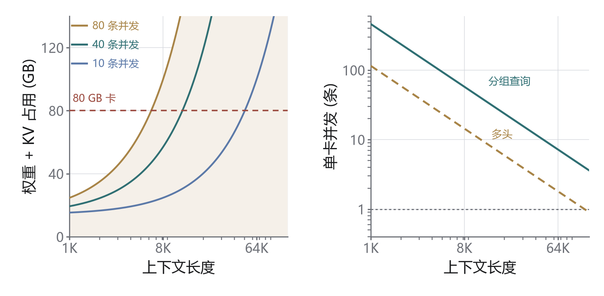
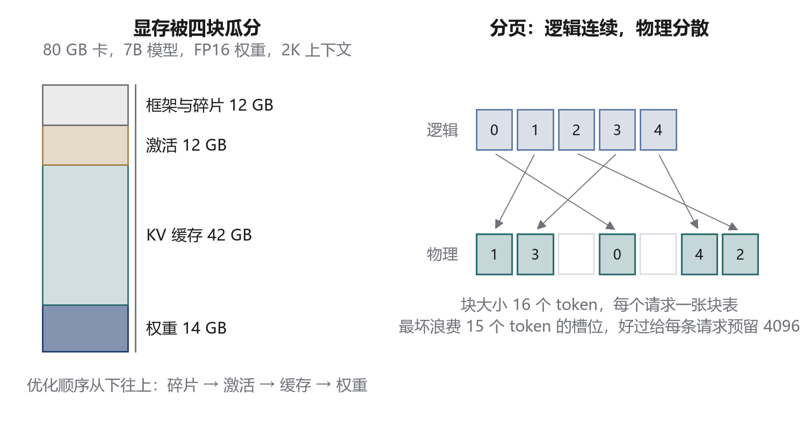

## KV 缓存：把状态存下来，代价是显存

### 第五轮突然变慢

一个文档助手，用户上传一份两万字的材料，然后开始追问。第一轮问"这份材料的主要结论是什么"，等了两秒出字。第二轮追问"第三条的证据是什么"，等了四秒。第五轮的时候，他换个话题问"帮我列个提纲"，这次白屏了十一秒。

每一轮的问题都很短，只有几十个字。模型没变，机器没变，负载也没变，可等待时间一轮比一轮长。

原因在于每一轮的输入都在变长。第二轮要把第一轮的问答加上新问题一起送进去，第五轮要送前四轮的全部内容。输入从两千 token 涨到一万二，预填充的成本跟着涨，缓存占的显存也跟着涨。

这个现象背后是推理里最实在的一笔交易：**用一个不断变大的显存占用，换掉一个会爆炸的重复计算。**

### 不缓存会怎样

Transformer 的注意力里，每个 token 都要和前面所有 token 算一次相关度。算相关度用两个向量：查询 $Q$、键 $K$，取信息用第三个向量 $V$。

生成第 $t$ 个 token 时，它的 $Q$ 是新的，但它要看的那些 $K$ 和 $V$ 都是旧的——第 1 到第 $t-1$ 个 token 的键和值，在前面的步骤里已经算过了。

如果不缓存，每一步都要把整段重算一遍。生成第 $t$ 个 token 要过 $t$ 个位置，生成 $T$ 个 token 总共要过

$$1+2+\cdots+T=\frac{T(T+1)}{2}$$

个位置。$T=1000$ 时是 50 万个位置，而真正需要的只有 1000 个。**重复了五百倍。**

这不是"稍微慢一点"的量级。7B 模型生成一千个 token，不缓存要跑五百倍的预填充，一张 A100 上大概要几分钟而不是十几秒。

所以缓存不是优化，是让解码可行的前提。所有推理引擎都做这件事，区别只在怎么存、怎么管、怎么省。

这笔交易的比例极其划算：存一份，省掉几百倍计算。但它有一个代价，就是显存，而这个代价会随着并发数和上下文长度同时放大，最后变成整台机器最紧的资源。

### 缓存的形状

缓存的形状很好数。每一层、每个 token，要存一份 $K$ 和一份 $V$，每份的长度等于 KV 头数乘以每头维度。

$$\text{每 token 字节}=2\times L\times h_{kv}\times d_{head}\times b$$

$L$ 是层数，$h_{kv}$ 是 KV 头数（注意不是查询头数），$d_{head}$ 是每头维度，$b$ 是每个数占的字节（FP16 为 2，FP8 为 1），最前面的 2 表示 $K$ 和 $V$ 各一份。

这个式子里没有序列长度，因为它是"每 token"的账。整条序列的缓存再乘以 $T$：

$$\text{缓存字节}=2\times L\times T\times h_{kv}\times d_{head}\times b$$

估算时可以记一个更快的口诀：**每 token 的缓存字节，大约等于"层数乘 KV 头数乘每头维度再乘四"**（$2\times2$ 从 K、V 和两字节来）。7B 模型 $32\times32\times128\times4=524288$ 字节，也就是 512 KB。

### 算一遍：三档模型每 token 多少

| 模型 | 层数 $L$ | KV 头 $h_{kv}$ | 每头 $d_{head}$ | 精度 | 每 token 缓存 |
|---|---|---|---|---|---|
| 7B，多头注意力 | 32 | 32 | 128 | FP16 | 512 KB |
| 7B，分组查询（8 组） | 32 | 8 | 128 | FP16 | 128 KB |
| 70B，分组查询（8 组） | 80 | 8 | 128 | FP16 | 320 KB |
| 400B，分组查询（8 组） | 126 | 8 | 128 | FP8 | 252 KB |

70B 那行代入：

$$2\times 80\times 8\times 128\times 2=327680\ \text{字节}\approx 320\ \text{KB}$$

7B 多头那行：

$$2\times 32\times 32\times 128\times 2=524288\ \text{字节}=512\ \text{KB}$$

这里有个反直觉的结果，值得专门说一下。**70B 模型（分组查询）的每 token 缓存，比 7B 模型（多头注意力）少四成。**

原因全在 $h_{kv}$ 上。7B 那款是早期架构，32 个查询头各配 32 组键值；70B 那款用了分组查询注意力，64 个查询头只共享 8 组键值。层数多了 2.5 倍，KV 头少了 4 倍，乘起来反而更小。

这说明缓存大小主要由架构决定，不由参数量决定。看到一个新模型，想知道它吃不吃显存，先看它的 KV 头数，不要看它的参数量。

### 一条请求占多少

把每 token 的数乘上序列长度。7B 多头、4096 token：

$$512\ \text{KB}\times 4096=2.0\ \text{GB}$$

一条请求两吉字节。这是纯缓存，不含权重。

70B 分组查询、4096 token：$320\ \text{KB}\times 4096=1.34$ GB。

再看长上下文。70B、32768 token：$320\ \text{KB}\times 32768=10.7$ GB。**一条请求十吉字节**，一张 80 GB 卡除了权重几乎放不下第二条。

128K 上下文：$320\ \text{KB}\times 131072=41.9$ GB。单条请求就超过半张卡。

### 算一遍：把并发换成延迟

并发数听着抽象，换成用户感觉到的等待就具体了。两者之间有条排队论的老公式，叫利特尔法则：

$$L=\lambda W$$

$L$ 是系统里同时存在的请求数（就是并发），$\lambda$ 是每秒完成的请求数，$W$ 是每条请求平均停留多久。这个式子不是近似，只要系统稳定就成立。

反过来用：知道并发上限和停留时间，就能算出每秒能服务多少请求。

一条 7B 的单卡机，42 GB 缓存，4096 token 上限，21 条并发。一条请求输入 2000 token、输出 300 token。预填充 0.2 秒，解码按实测 90 token/s 要 3.3 秒，加起来停留 3.5 秒。

$$\lambda=\frac{L}{W}=\frac{21}{3.5}=6\ \text{请求/秒}$$

一天二十四小时不停，约 52 万次请求。

现在反过来问：如果业务要 20 请求每秒，需要多少条并发？

$$L=\lambda W=20\times 3.5=70\ \text{条}$$

七十条，是显存上限的三倍多。**这时候光加机器之前，先得压缓存**——把序列上限从 4096 降到 2048，每条 1 GB，并发到 42，还不够；再把缓存量化到 FP8，每条 0.5 GB，并发到 84，够了。

这个反推过程是容量规划的基本动作，第九章会把它做成完整的流程。这里先记住一点：**并发是显存算出来的，QPS 是并发和停留时间算出来的，两者之间差一个利特尔法则。**

这就解释了开头那个文档助手为什么第五轮会白屏。两万字的材料加上四轮问答，序列长度接近三万，缓存占了十来吉字节；机器上还有其他用户，显存一满，新请求只能排队，排队就是白屏。

### 并发等于显存除以单请求

有了单请求的账，并发上限就是一个除法：

$$\text{并发}\approx\frac{\text{可用于缓存的显存}}{\text{单请求缓存}}$$

一张 80 GB 的卡，7B 模型 FP16 权重 14 GB，激活和临时张量约 12 GB，框架与碎片约 12 GB，剩 42 GB 给缓存。4096 token 每条 2.0 GB：

$$42/2.0=21\ \text{条并发}$$

二十一条。如果把上下文压到 2048，每条 1 GB，能到四十二条。

这条除法是推理成本的第一条硬约束。**并发不是想做多少就做多少，是显存除以单请求缓存。** 想提高并发，只有三条路：压缩每条的大小、减少其他占用、或者加卡。

第二章后面几节分别展开这三条路，先看清楚它们各自能省多少。

### 四块账本：一项一项算

"显存占满了"这句话没有信息量。要知道该动哪里，得把一张卡的显存拆成四块，每块单独算一遍。

**第一块，权重。** 参数量乘每参数字节。7B、FP16 是 $7\times10^{9}\times2=14$ GB。有两个细节会让它比这个数大：词嵌入和输出头如果不共享，参数量要加一份词表；张量并行会把权重切碎，切到每张卡上的分片要按对齐补齐，八卡时通常多出百分之一二。算账时用 14 GB 是够的，做容量规划时按 14.5 算更安全。

**第二块，KV 缓存。** 上一节给过每 token 的字节数，乘长度、乘并发。7B 用分组查询、8 个 KV 头，每 token 128 KB；8192 token 一条 1.05 GB，四十条 42 GB。

**第三块，激活与临时张量。** 这一块最容易被低估，因为它在解码时几乎为零，在预填充时会突然涨起来。

算一次 4096 token 的切块预填充。隐藏维度 4096、FP16，一个 $4096\times4096$ 的张量占

$$4096\times4096\times2=33.5\ \text{MB}$$

前向里同时活着的中间张量有二十来个：$Q$、$K$、$V$ 各一份，注意力输出一份，前馈网络把宽度放到四倍后有两份，加上各处的残差与归一化缓冲。二十份就是 0.67 GB。

还有一项更占地方：输出头的 logits。词表 15 万，$4096\times152064\times2$ 字节等于 **1.25 GB**，比前面二十份加起来还多一倍。这就是为什么长提示的预填充经常在最后一步突然占满显存——不是注意力，是那一片 logits。

第三块合计 2 到 3 GB。如果注意力分数矩阵要落地（没用 FlashAttention 一类的融合实现），$4096\times4096$ 再乘头数，能到几十 GB，那是另一种量级的问题。

**第四块，框架与碎片。** CUDA 上下文每个进程 0.5 到 0.8 GB；cuBLAS 和 cuDNN 的工作区 0.5 GB 上下；张量并行的通信桶每卡几百 MB；显存池会留 3% 到 5% 的碎片；块表、调度元数据、采样缓冲几十 MB。这些加起来，80 GB 的卡上留 1.5 到 2 GB 是常态。

| 块 | 算法 | 7B 单卡实例 | 可压缩性 |
|---|---|---|---|
| 权重 | 参数量 × 字节 | 14 GB | 高（量化） |
| KV 缓存 | 每 token × 长度 × 并发 | 42 GB | 高（量化、压头） |
| 激活与 logits | 切块行数 × 维度 | 2–3 GB | 中（切小块） |
| 框架与碎片 | 固定 + 比例 | 1.5–2 GB | 低 |

四块相加，7B 单卡跑 8192 token、四十条并发时是 $14+42+2.6+1.5=60.1$ GB，剩 20 GB 是余量。这张账本里，**缓存比权重多三倍**。谁先看到"7B 只要 14 GB"，就会以为显存富余得很；算完四块才知道，真正吃显存的是那份会随对话变长的东西。

### 算一遍：并发 → 显存 → 卡数

把四块账本合起来，就得到一条能直接用的换算链：**每条请求占多少显存 → 一张卡能放几条 → 服务一个流量需要几张卡。**

先定三个假设。第一，80 GB 卡，权重 14 GB，激活 2.6 GB，框架 1.5 GB，剩 61.9 GB 给缓存。第二，7B 分组查询，每 token 128 KB。第三，业务要 20 QPS，一条请求从进来到结束平均停 5 秒，按利特尔法则要 100 条并发。

| 上下文 | 单请求缓存 | 单卡并发 | 服务 20 QPS |
|---|---|---|---|
| 2048 | 0.27 GB | 230 条 | 1 张卡 |
| 8192 | 1.07 GB | 57 条 | 2 张卡 |
| 32768 | 4.29 GB | 14 条 | 7 张卡 |

三行都是两个除法。2048 那行：$0.27\times230=61.9$；100 条并发除以 230，0.43 张卡，取 1 张。

这张表解释了一个常见困惑："同一个模型，为什么换个业务就要加机器七倍？"上下文从 2K 到 32K 只涨了十六倍，卡数涨了七倍，因为 2K 时一张卡装得下全部并发，多出来的余量在摊薄；到了 32K，余量早就用光，卡数跟长度成正比。

再看 70B。八卡节点总共 640 GB，权重 140 GB，激活按预填充峰值 25 GB、框架 8 GB 算，剩 467 GB 给缓存。每 token 320 KB：

| 上下文 | 单请求缓存 | 单节点并发 | 服务 20 QPS |
|---|---|---|---|
| 2048 | 0.67 GB | 697 条 | 1 节点 |
| 8192 | 2.68 GB | 174 条 | 1 节点 |
| 32768 | 10.7 GB | 43 条 | 3 节点 |

（这里按 120 条并发算，因为 70B 的一条请求平均输出更长，停留 6 秒。）

两表对照，能看出一条比"模型大就贵"更精确的规律。**并发上限是显存除以单请求缓存；而单请求缓存只由架构决定。** 70B 用了 8 个 KV 头，7B 那版用了 32 个，所以 70B 每 token 只有 320 KB，反而比 7B 的 512 KB 小。如果那个 7B 也是 8 个 KV 头（128 KB），32K 上下文时单卡能放 14 条，和 70B 八卡节点的 43 条比，人均卡数还是 70B 更贵，但差距是六倍而不是五十倍。

换算链还可以反着走，这是容量规划里更常用的方向。锁定卡数，反推能服务多少 QPS：$L=$ 卡数 $\times$ 单卡并发，$\lambda=L/W$。五张 7B 单卡、32K 上下文、停留 5 秒，就是 $5\times14/5=14$ QPS。**买卡之前先算这条，比看任何基准测试都准。**

左图画的是"权重 + KV"随上下文增长。三条线分别是 10、40、80 条并发：80 条并发时，上下文过了 6 千 token 就撞上 80 GB 的天花板；40 条能撑到 1.3 万；10 条能撑到 5 万。右图是它的另一种读法——同一张卡，能放的条数随上下文往下掉，掉得比线性还快，因为曲线的斜率本身也在变。

### 三个杠杆

从公式能看出三个可以动的地方，恰好对应三个不同的决策层级。

**第一，架构上的 $L$ 和 $h_{kv}$。** 这是模型设计决定的，推理侧改不了，但选模型时能看出来。近两年主流做法是把 KV 头数压到 8 甚至 4，多个查询头共享一组键值，缓存直接除以 4 或除以 8。同样参数量下，这个数字差四倍，意味着同等显存的并发差四倍。

也有更激进的方案，让不同层共享缓存、或者只保留部分层的完整缓存，能再省一半，代价是质量。这类改动属于模型设计的范畴，买模型的时候看清楚就行。

**第二，使用上的 $T$。** 上下文翻倍，缓存翻倍。长上下文之所以贵，不只在预填充的二次项上，更在"每条请求都要占一份大缓存"这件持续的事上。预填充是一次性的，缓存是整个请求生命周期都占着的。

所以系统设计上有个常用手段：**不要把用不上的历史一直挂着。** 多轮对话里，前三轮的原始内容如果不影响当前回答，摘要一下再放进去，长度能砍掉七八成。这不是技术优化，是产品设计，但省钱的效果比技术优化大。

**第三，数值格式上的 $b$。** FP16 换成 FP8，缓存直接减半；换成 INT8 也一样。这条几乎不影响质量，是所有缓存优化里性价比最高的（第五章细讲）。7B、4096 token 从 2.0 GB 降到 1.0 GB，并发从 21 涨到 42。

三个杠杆里，第二个最容易被忽略也最省钱。见过不少团队一边抱怨显存不够，一边把整份 PDF 原样塞进上下文，其实模型只用得到其中两页。

### 一个数判断该不该动缓存

每次讨论缓存优化，第一个问题都该是"缓存现在占多少"。这个数不用猜，引擎一般都会报：已分配的 KV 块数乘块大小，除以可给缓存的显存。

| 占用率 | 现象 | 说明 | 该做什么 |
|---|---|---|---|
| 低于 40% | 显存空闲、并发上不去 | 瓶颈在算力或排队 | 别碰缓存 |
| 40%–80% | 长请求偶尔被抢占 | 正常水位 | 留余量，观察 |
| 高于 85% | 频繁抢占、延迟抖动 | 并发被显存卡住 | 压缓存或加卡 |

这张表的价值在于挡住两类错判。一类是把"显存用了 90%"当成问题——如果那 90% 里权重占 80%，缓存只有 10%，压缓存毫无意义，该压的是权重。另一类是把"显存只用 30%"当成健康——如果并发被批大小上限锁住，缓存根本没机会涨，那时加机器是浪费，改配置才对。

真正需要看的是**占用率和并发数一起变**这件事。并发涨、占用率不涨，说明块没按实际长度分配，多半是预留最大长度那套；并发不涨、占用率贴着上限，说明确实卡在显存上。两个数放在一张时序图里，一眼就能分出是配置问题还是容量问题。

还有一条容易忽略的对照：把缓存占用率和 GPU 带宽利用率画在一起。缓存高、带宽利用率也高，说明系统在正常吃带宽；缓存高、带宽利用率只有三成，多半是请求长度分布极端，几条超长请求占着块却出字很慢，该做的是给单条请求设长度上限，而不是继续加卡。

### 碎片：从账本到现实

按公式算，42 GB 能放二十一条 4096 token 的请求。实际跑起来往往只有一半，原因是碎片。

请求长度是变化的。有的两百 token 就结束，有的一万二还没写完。如果按"最大长度"给每个请求预留，短请求会浪费一大块：一个两百 token 的请求占着 2 GB，浪费 1.9 GB。

如果按实际长度分配，新请求进来时常常找不到连续空间，因为旧请求零散地占着中间，这是所谓的**外部碎片**。显存明明还剩 10 GB，可没有一段连续的 2 GB。

朴素的解法是预留最大长度。浪费巨大，但在早期引擎里很常见，也是"显存够但并发上不去"这个抱怨的主要来源。

好一点的解法是**分页**。把显存切成固定大小的块，每块装 16 个 token，每个请求维护一张块表，逻辑上连续、物理上可以分散在任何地方。新 token 来了就申请新块，请求结束就归还。

这个改动看着是工程细节，效果却很大。同样是 42 GB，如果平均实际长度是 800 token（每条 400 MB），能放**一百零五条**并发，是预留方案的 2.5 倍。公开报告里，同样的显存能多跑两到四倍并发，后来几乎所有推理引擎都用了这套思路。

### 分页的代价

分页把外部碎片变成了块内浪费。最后一块通常没装满，平均浪费半块，最坏浪费十五个 token。7B 模型十六个 token 是 8 MB，半块浪费 4 MB，一百条请求浪费 400 MB，占 42 GB 的百分之一。

块表本身也有开销。每条请求一张表，八百 token 需要五十个表项，每项几个字节，可以忽略。

真正的代价在实现上。注意力算子要按块表去取数据，地址不连续，写起来比连续显存麻烦得多，高性能实现（把块表编进 kernel 的调度）是各家的核心工程。这也是为什么"同样算法、不同引擎"能差出两三倍——差的就在这些地方。

### 换出还是重算

显存不够时，调度器要从批里移出一些请求。移出之后它已经算过的缓存怎么办？

**换出**：把缓存拷到主机内存，等有空位再拷回来。

**重算**：丢掉缓存，下次重新跑一遍预填充。

两条路的成本都能算。换出 4096 token 的 7B 缓存（2 GB），走 PCIe 4.0 的 25 GB/s 有效带宽，约 80 毫秒。重算同样的 4096 token，$2\times7\times10^{9}\times4096=5.7\times10^{13}$ FLOPs，除以 $1.4\times10^{14}$，约 400 毫秒。

单看这一笔，换出便宜五倍。但 PCIe 是所有请求共享的，十条请求同时换出，每条的实际带宽掉到 2.5 GB/s，换出就要 800 毫秒，还不如重算。

所以实践中的规则是：**短序列重算，长序列换出。** 短序列的换出时间里有大量固定开销（传输建立、内存分配），重算的运算量又小；长序列正好反过来。各家引擎会设一个长度阈值，从几百到几千 token 不等。

### 算一遍：换出的盈亏平衡点

"短序列重算、长序列换出"这句经验可以推成一条公式，因为两边的成本结构完全不同：换出有一笔固定开销和一笔按字节走的传输费，重算没有固定开销、纯按 token 走。

换出 $T$ 个 token 的缓存：

$$t_{\text{swap}}=t_{0}+\frac{T\,k}{B_{\text{pcie}}}$$

重算是把这 $T$ 个 token 重新过一遍模型：

$$t_{\text{recomp}}=\frac{2NT}{P_{\text{eff}}}$$

7B、$k=524288$ 字节、PCIe 4.0 有效 25 GB/s、$P_{\text{eff}}=1.4\times10^{14}$，代入得到每 token 的单价：换出 21 微秒，重算 100 微秒。固定开销按 8 毫秒算（传输建立、内存分配、块表迁移）。

令两式相等，解出

$$T^{*}=\frac{t_{0}}{2N/P_{\text{eff}}-k/B_{\text{pcic}}}\approx\frac{8\times10^{-3}}{(100-21)\times10^{-6}}\approx100\ \text{token}$$

**一百个 token 是那道分界线。** 比它短，重算便宜；比它长，换出便宜。

| 序列 | 换出 | 重算 | 谁赢 |
|---|---|---|---|
| 100 | 10 ms | 10 ms | 平手 |
| 512 | 19 ms | 51 ms | 换出 |
| 2048 | 51 ms | 205 ms | 换出 |
| 8192 | 180 ms | 819 ms | 换出 |

看上去换出全面占优，可表里用的是独占 PCIe 的理想带宽。真实情况是十条请求同时被抢占，每条只剩 2.5 GB/s，每 token 的换出成本涨到 210 微秒，比重算的 100 微秒还贵：

| 序列 | 换出（共享） | 重算 | 谁赢 |
|---|---|---|---|
| 512 | 116 ms | 51 ms | 重算 |
| 2048 | 438 ms | 205 ms | 重算 |
| 8192 | 1.7 s | 819 ms | 重算 |

所以抢占策略真正要看的不是序列长度，是**同一时刻有多少条在被换出**。一条一条换，换出赢；一窝蜂换，重算赢。

工程上的折中是给换出加一个并发上限：每批最多换出两三条，其余排队等位置。代价是抢占变慢，好处是带宽不被自己人打满。这个参数在各家引擎里叫法不同，思路一样——**共享资源上的并行度要主动限制，不能交给调用方。**

### 长上下文的两条退路

当 $T$ 大到显存放不下时，除了加卡，还有两条路。

**滑窗。** 只保留最近 $W$ 个 token 的缓存，更早的直接丢掉。模型因此只能看到最近窗口内的内容。$W=4096$ 时，无论对话多长，每条请求的缓存固定 2 GB。

代价很直接：模型忘了窗口外的东西。对摘要、闲聊这类任务影响不大，对"从第一页找一个数字"这类任务则是致命的。有些模型在训练时就用滑窗注意力，天生适应这种用法；有些模型没训练过，硬套滑窗会明显掉质量。

**压缩与稀疏。** 保留一部分历史，比如每十个 token 留一个代表，或者在缓存上做低秩投影。这条路还在演进，效果强依赖任务和训练方式，工程上要先测再上。

两条路的共同点是“主动放弃一部分上下文”。这不是缺陷，是权衡：长上下文的成本是线性甚至超线性的，而大部分任务真正用得上的历史只占一小部分。

### 算一遍：128K 上下文放得下吗

长上下文真正的门槛不是“模型支不支持”，是“放不放得下”。算一遍就知道差多远。

70B、80 层、8 个 KV 头、每头 128 维、FP16。每 token 的缓存

$$2\times80\times8\times128\times2=327680\ \text{字节}\approx320\ \text{KB}$$

一条 128K token 的请求：

$$131072\times320\ \text{KB}\approx40\ \text{GB}$$

四十吉一条。一台八卡机 640 GB，权重 140 GB，激活与框架 70 GB，剩 430 GB 给缓存，能放

$$430/40\approx10\ \text{条}$$

十条并发意味着每步只产出十个 token，吞吐 $10/0.0086\approx1163$ token/s。同样这台机器跑 2K 上下文的短问答能到 3720。**上下文长了六十倍，并发掉了六十倍，吞吐掉了三倍多。**

换成不做分组查询的旧结构（64 个 KV 头），每 token 的缓存是 2.56 MB，一条 128K 要 327 GB，一台机都放不下一条。

| 结构 | 每 token | 128K 一条 | 单节点可放 |
|---|---|---|---|
| 多头，64 头 | 2.56 MB | 327 GB | 1 条 |
| 分组查询，8 头 | 320 KB | 40 GB | 10 条 |
| 分组查询 + KV8 | 160 KB | 20 GB | 21 条 |

三行之间差两个数量级，而参数量一点没变。这张表解释了两件事。

第一，**长上下文能不能商用，取决于分组查询和缓存量化，不取决于模型聪不聪明。** 第一行的模型就算能力再强，128K 也只能做演示；第三行才能支撑一个真产品。

第二，长上下文的价格必须比短问答高一个量级，这不是商业选择，是显存算术。同一台机器，服务十个长请求与服务六百个短请求，收入潜力差着几十倍。

还有一个容易被忽略的推论：既然一条 128K 要 40 GB，那么“预热一份长文档给一百个人问”这种用法，在显存上是不可能的（4 TB）。它能成立，只能依靠第四章那个前提：一百个人共享同一份缓存的块，而不是各存一份。**这就是前缀复用对长上下文比对短问答更关键的原因。**

### 显存账本的整体

把一张卡的显存拆开，大概是四块。

| 块 | 典型占比 | 能不能省 | 怎么省 |
|---|---|---|---|
| 模型权重 | 40%–60% | 能 | 量化、蒸馏、稀疏 |
| KV 缓存 | 20%–40% | 能 | 压 KV 头、量化、分页、滑窗 |
| 激活与临时张量 | 5%–15% | 部分 | 切块预填充、算子融合 |
| 框架与碎片 | 5%–10% | 部分 | 分配器调优、减少拷贝 |

优化的顺序应该是从上往下，也就是从"几乎免费"到"需要评估"：

先压框架和碎片（换个分配器、关掉冗余拷贝，改配置就行）；再压激活（切块预填充，改调度）；再压缓存（换数值格式、开分页，要测质量）；最后才动权重（量化到底，要仔细评估）。

反过来，很多团队一上来就量化权重，收益不如预期。因为显存的大头可能根本不在权重上——长上下文场景里，缓存能占到一半以上。**先量一遍显存的实际分布，再决定动哪一块。**

### 算一遍：八轮对话的显存曲线

前面的并发都是按“单请求固定长度”算的。多轮对话里，长度是逐轮长出来的，显存也跟着涨。

70B、每轮用户说 100 token、模型答 300，加上固定系统提示 900。第 $n$ 轮的上下文长度

$$900+400n$$

到第八轮是 4100 token。每 token 320 KB，所以

$$4100\times320\ \text{KB}\approx1.31\ \text{GB}$$

一条会话从第一轮的 416 MB 涨到第八轮的 1.31 GB，三倍。

三倍听着不多，但把它放进并发里就变了。430 GB 可用缓存，按峰值算 $430/1.31\approx328$ 条会话；按平均（约 0.9 GB）算 477 条。规划时如果用了平均值，上线后会不断扫抢占。

| 口径 | 单会话占用 | 可放会话 |
|---|---|---|
| 第一轮 | 0.42 GB | 1000 |
| 平均 | 0.90 GB | 477 |
| 第八轮 | 1.31 GB | 328 |

三个数差三倍。这就是为什么第二章开头那个“第五轮突然变慢”的现象不是偶发：它不是性能退化，是会话长到碰了显存墙。

工程上有三种处置，代价不同。一是按峰值买显存，最稳最贵；二是给单会话设一个上下文上限（超过就摘要或截断），代价是“记不住”；三是在显存紧张时把最老的块换出或丢弃（滑窗），代价是长距依赖变弱。

三条路的共同点是：**长对话的成本不是线性增长的，而是以“最长会话”为尺度跳变。** 规划时用平均值是常见的错误，因为系统容量由最坏的那一批决定，不由平均值决定。

### 什么时候这笔账不重要

如果上下文很短，比如输入输出加起来五百 token，缓存只有 250 MB 一条，42 GB 能放一百六十条，显存根本不是瓶颈。这时候花力气压缓存没有意义，瓶颈在别处（多半在预填充算力或者网络）。

如果模型很小，比如 1B，权重只有 2 GB，缓存每 token 只有 64 KB，显存更不是问题。

如果并发很低，比如一次只服务一个用户，缓存随便占，优化它也没有意义。

**缓存优化的收益，等于"缓存占显存的比例"乘以"你能把它压缩的比例"。** 比例不到三成，投入产出就不划算。判断方法很简单，跑起来看显存分布，或者在代码里打一行日志，把权重、缓存、激活分别统计出来。

有个团队曾经花了两个月做缓存量化，最后吞吐只涨了 4%，因为他们的流量是短问答，缓存占比不到 15%。同一套工作放到长文档场景里效率能翻倍，但他们的用户不写长文档。

### 两个踩过的坑

**坑一：按最大长度预留。** 一个客服系统，引擎配置里写着序列上限 8192，于是每条请求一进来就占 4 GB 缓存，哪怕实际只用了三百 token。四十二吉字节能放十条，第十一条就开始排队。运维看到的现象是“显存满了但 GPU 几乎不动”，于是加机器，加完还是排队。改成按实际长度分配（或者开分页）之后，同样的机器并发从 10 涨到 80，一台上顶八台。这个坑之所以常见，是因为它不报错，只是慢，而后慢又很像“机器不够”。

**坑二：请求结束时没还缓存。** 更隐蔽的一种。异常路径（用户关掉页面、网络断开、超时取消）如果没有正确释放块表，缓存会一直挂着，半天之后显存被不存在的请求占满。表现形式是“刚重启很快，跑一天就变慢”，重启之后又好了，于是被当成内存泄漏反复重启。解决办法是在分配和释放两侧都加计数，让已用块数和活跃请求数能对上；对不上就说明有泄漏，日志能直接定位到哪条路径没走清理。

这两个坑加起来解释了本节开头那个“第五节突然白屏”之外的另一种现象：**不是流量涨了，是每条请求占的显存涨了。** 排查时先看“单请求平均缓存”这个数有没有漂移，再看总量。

### 这笔交易的本质

KV 缓存用空间换时间，比例是"存一份省几百倍计算"，极其划算。代价是显存随并发和长度同时放大，最后变成整台机器最紧的资源。

所有后续手段都在挪这份缓存。压 KV 头是架构层的事，分页是管理层的优化，量化是数值层的手段，滑窗和摘要则是主动放弃一部分上下文。批处理、前缀复用、PD 分离看着是别的事，但它们全部都受"能放多少条缓存"这个数约束。

下一章讲怎么把这份缓存用得更满：一次读入权重，喂饱尽可能多的请求。
