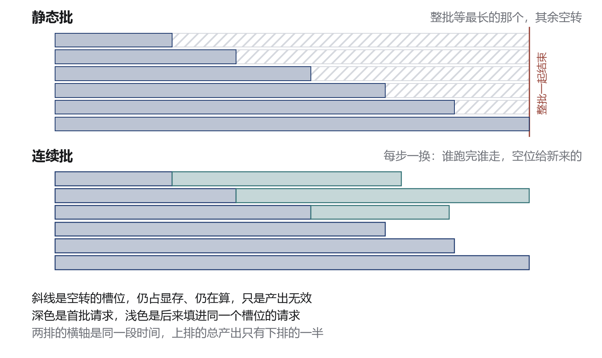
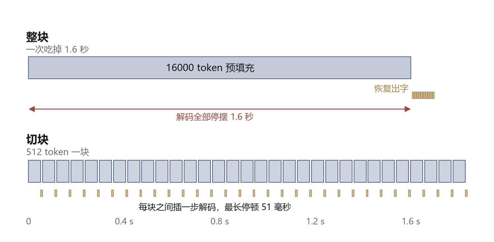

## 批处理与调度：把卡喂饱

### 一台八卡机，只跑出八个并发

有个团队上线了第一版推理服务。八张 A100 跑 7B 模型，压测的时候发现：单请求每秒三十多个字，响应看着还行；但只要同时进来第九个用户，第九个就开始排队，等前八个里有谁结束。

他们怀疑是显存不够。登上去看，显存用了三成，GPU 利用率不到三成，带宽利用率也不高。三成、三成、三成，没有一个指标是满的，可就是上不去。

问题不在任何一个硬件指标上，在调度。第一版用的引擎按"整批"跑：攒一批请求，一起前向，全部跑完才收下一批。批大小设的是八，所以永远只有八个槽位。

第二章算过，42 GB 缓存能放二十一条 4096 token 的请求。硬件本来能装二十一条，调度只用到了八条，其中还有大量时间在等最慢的那条。

这一章讲怎么把这二十一个槽位真正用起来。

### 静态批：槽位浪费算得出来

最直觉的做法是攒一批一起跑，全部跑完再收下一批。这叫静态批处理，训练时就是这么干的——训练的每个样本长度是固定的，一批跑完正好一起结束。

推理上它很快暴露问题：请求的输出长度差别太大，而生成结束的时间由最长的那个决定。

假设一批八个请求，输出长度分别是 50、80、120、200、300、500、800、2000 个 token。整批必须等到第 2000 步。前面七个早早结束，但它们占的显存和计算槽位不能释放，只能空转——每步仍然要"生成"那些已经结束的序列，通常补一个终止符。

算一下槽位利用率。整批跑了 2000 步，八条槽位总共被占用

$$8\times 2000=16000\ \text{个槽位步}$$

真正产出有效 token 的是

$$50+80+120+200+300+500+800+2000=4050\ \text{个}$$

利用率

$$\frac{4050}{16000}\approx 25\%$$

四分之一。**四分之三的算力和带宽花在生成终止符上。**

这个数字在实际系统里还要更难看，因为真实的长度分布更极端：聊天场景里大部分回答在两百 token 内结束，偶尔有用户让它写三千字的长文。一条长文能把整批拖上几十倍的时间。

### 连续批处理

改法只有一句话：不做"整批"，做"每一步"。

每一步结束时，调度器检查两件事：有没有请求已经结束？有就把它移出批，释放缓存；有没有新请求在等待？有就把它加进来。

这样批的组成是动态的。短请求跑完就走，位置让给新来的；长请求一直在里面跑到结束。批大小始终维持在显存允许的上限附近，而不是被最慢的那条锁死。

还拿上面那八个请求举例。第 50 步第一个结束，第 51 步就有新请求补进来；第 120 步、第 300 步、第 500 步各补一次。到了第 800 步之后，原来那批只剩最后一条，但槽位早就被后来的请求填满了。

结果是：同样的 2000 步，静态批产出 4050 个 token，连续批产出 16000 个（八条槽位始终有活干），差四倍。

实际收益没有四倍这么夸张，因为新请求的预填充也要插进来，而且真实流量不会恰好一直有请求在排队。公开报告里，这个改动通常带来两到三倍的吞吐提升，是 2022 年之后推理引擎性能跳升的主要原因之一，比换一代卡带来的提升还明显。

### 算一遍：两批请求的两种命运

把上面的事算得更细一点，看看时间花在哪。

假设引擎跑在 7B、单卡 A100 上，批大小上限 8，每条请求平均输出 400 token，平均输入 300 token。

单步时间。7B 权重 14 GB，八条请求平均 500 token 上下文，缓存共 $8\times500\times512\ \text{KB}=2$ GB。每步要读 16 GB，除以 2.04 TB/s：

$$16/2040\approx 7.8\ \text{毫秒}$$

每步产出 8 个 token，所以吞吐是 $8/0.0078\approx 1025$ token/s。

现在换成静态批，八条请求里有一条输出 3000 token，其余七条平均 200 token。整批被拉到 3000 步，前 200 步有八条在跑，剩下 2800 步只有一条。

有效 token 总数 $7\times200+3000=4400$，总步数 3000，平均每步 1.47 个：

$$\text{吞吐}=\frac{1.47}{0.0078}\approx 188\ \text{token/s}$$

同一张卡，同样的模型，1025 变成 188，差 5.4 倍。全部差别来自"有没有让空出来的槽位马上被填上"。

这个对比还说明一件事：**吞吐的损失不是线性的，它由最长的那条请求主导。** 一条特别长的请求能把整批的吞吐压到十分之一。所以调度器里通常会给单条请求设一个最大输出长度，超了就截断或者分片续写，目的就是防止一条长文拖死一批人。

### 算一遍：六百条请求的 p50 与 p95

上面比的是两种极端。真实流量里长度是分布，延迟要按分布算，而分布只有模拟或者实测才给得出来。这里给一套可以复现的模拟，参数全部写死，读者可以照着换。

设定：7B 单卡 A100，批上限 8，单步 7.8 毫秒且不随批变化（批在 8 以内时强度远低于拐点，第一章算过）。请求长度按客服流量的形状取：八成 200 token，一成半 600，半成 1500，均值 329。请求以每秒 1.5 条匀速到达，也就是每秒 493 个输出 token 的需求。

先算两边的容量。

静态批的容量由批内最长的那条决定。从上面那个分布里抽八条，最长值的期望是 840 token——是均值 329 的 2.6 倍。**批内取最大，把均值放大了两倍半。** 于是

$$\frac{8\times329}{840\times0.0078}\approx402\ \text{token/s}$$

槽位利用率 $329/840\approx39\%$，和前面那个 25% 是同一类浪费。

连续批的容量是 8 条一直有活，每条每步出一个 token：

$$8/0.0078\approx1025\ \text{token/s}$$

需求 493 落在两者之间。静态批的利用率 $493/402\approx1.23$，超过 1，队列无界增长；连续批 $493/1025\approx0.48$，稳定。

跑 600 条请求，端到端延迟：

| 到达率（条/秒） | 需求（token/s） | 静态批 p95 | 连续批 p95 |
|---|---|---|---|
| 1.0 | 329 | 14.1 s | 11.7 s |
| 1.5 | 493 | 86.1 s | 11.7 s |
| 2.0 | 657 | 181 s | 12.9 s |

三行要分开读。

第一行，两边都没饱和（静态批利用率 0.82）。静态批的 p95 只差 20%，差的这一点全是“等批内最长的那条”。

第二行，静态批刚过饱和点（1.23），p95 从 14 秒跳到 86 秒。利用率涨五成，p95 涨六倍。**这就是排队系统的斜坡**，不是线性关系。

第三行，连续批也接近饱和（0.75），p95 只从 11.7 涨到 12.9。因为它的尾巴不是排队撑起来的，是那条 1500 token 的请求自己要走 11.7 秒。**低利用率时，延迟的尾巴由作业本身的长度决定，不由排队决定。**

这张表解释了一个常见困惑：压测报告上 p95 很漂亮，上线后崩。压测通常按固定并发打，请求长度也用同一套模板；真实流量的长度分布有尾巴，而静态批的容量正比于批内最长值的倒数。尾巴越重，容量越低。

用利特尔法则校一遍第二行。连续批下 p50 停留时间 1.6 秒，到达率 1.5 条/秒，平均在系统里的请求数

$$L=\lambda W=1.5\times1.6\approx2.4\ \text{条}$$

八条槽位只用到两三条。这说明八条是给突发留的余量，不是稳态需求。同一个数换个问法：如果按 2.4 条配槽位，突发来一波就排不上，p95 会立刻变差。**容量规划里那个 0.8 的预留系数，说的就是这件事。**

最后加一条 SLO 视角。若端到端 SLO 是 20 秒，1.5 条/秒那一行里静态批约有四分之一的请求超时。超时的请求要么重试（再占一份容量），要么流失。按重试率三成算，有效供给变成 $402\times(1-0.25\times0.3)\approx372$ token/s，比需求 493 差得更远。**过饱和之后，损失会自我放大。**

### 调度策略

每一步都要决定"这次谁进来、谁出去"，这就有了策略。

**先来先服务。** 最简单，公平，实现只有几行。缺点是会让一个超长请求堵住后面所有短请求——如果排队是按批组织的，一条三千 token 的请求能让后面二十个人多等半分钟。

**最短作业优先。** 优先放输出长度可预期的短请求，能显著降低平均延迟。问题在于长度不可预知：模型要生成完才知道有多长。工程上只能估计——用历史同类请求的平均长度，或者让调用方给一个上限（"最多生成 200 token"这种参数不只是限制，也是调度信息）。

**优先级加权。** 付费用户优先，或者交互式请求优先于离线批处理。这是工程上最常见的做法，因为它直接对应商业目标。要注意的是优先级不能没有下限，否则低优先级请求会被无限推迟。

**公平调度。** 给每个请求一个"已等待时间"的权重，等得越久优先级越高。这是纯吞吐最优与体验之间的折中，多租户系统里几乎必备。

不管选哪种，有一条硬规则：**不能饿死。** 一个请求如果排队超过阈值，要么给它最高优先权，要么直接返回超时——让请求悬在那里是最坏的体验，用户既没结果也不知道还要等多久。

### 预填充混排

前面的讨论默认批里全是解码请求。但预填充也要占卡，而且它一占就是一大块算力。

算一下差多少。7B 模型处理 8000 token 的提示：

$$2\times7\times10^{9}\times8000=1.12\times10^{14}\ \text{FLOPs}$$

除以 $1.4\times10^{14}$ 的有效算力，0.8 秒。而解码一步只要 7.8 毫秒。**一次长预填充等于一百步解码。**

如果这个预填充独占显卡，那 0.8 秒里所有正在解码的用户都停住，屏幕上的字不动了。用户会以为卡死了。

解法是把预填充切块，每块只占一小段时间，块与块之间插入解码。切块大小取 512 token，一块的运算量是

$$2\times7\times10^{9}\times512=7.2\times10^{12}\ \text{FLOPs}$$

约 51 毫秒。于是解码用户感受到的是"某一步稍微慢了 50 毫秒"，而不是"卡了 800 毫秒"。

长请求自己的首字延迟略微变长（因为中间要等别人），但整体体验好得多。这个技术叫切块预填充，现在几乎所有主流引擎都实现了。

代价是调度变复杂。批里同时有"多行的预填充块"和"单行的解码"，注意力要处理这种混合形状，有的引擎干脆把两类请求拼成一个特殊格式的批，实现上比纯解码难不少。这也是各家引擎拉开差距的地方之一。

### 切块大小怎么选

图中那条 1.6 秒的长条是一万六千 token 的预填充独占显卡，下面那条是把同样的工作切成 512 token 一块、块之间插一步解码。两条的总时长几乎一样，用户的体感完全不同。

把三件事分开算：块越小，别人的停顿越短，但插进来的解码步越多，长请求自己的首字延迟越长。

7B 单卡的预填充吞吐约 10000 token/s（$1.4\times10^{14}/1.4\times10^{10}$），解码一步 7.8 毫秒。一块的时长是 $c/10000$，块数是 $16000/c$，插进来的解码步是 $16000/c-1$。

| 块大小 | 块数 | 自身 TTFT | 最长停顿 |
|---|---|---|---|
| 256 | 63 | 2.08 s | 26 ms |
| 512 | 32 | 1.84 s | 51 ms |
| 2048 | 8 | 1.66 s | 205 ms |
| 16000 | 1 | 1.60 s | 1600 ms |

自己算一遍 512 那一行：$16000/10000=1.6$ 秒的纯计算，加 $31\times0.0078\approx0.24$ 秒被解码占走的时间，1.84 秒；最长停顿就是一块的时长 51 毫秒。

这张表里没有最优解，只有取舍。**长请求多付的钱是确定的（每切一刀多付一步解码），换来的是别人停顿的缩短。** 选块的依据是 SLO：若每 token 间隔要求 80 毫秒以内，块就不能大于 800；若允许 300 毫秒，2048 更省。

还有一条不那么明显的上界。块太小会让注意力算子效率下降：每个块都要和前面所有 token 做注意力，块越小，同样的注意力工作被拆成更多次 kernel 调用，每次的启动和掩码准备工作摊不平。经验上块小于 128 之后，预填充的有效吞吐会掉一到两成。所以实践中的默认值集中在 512 到 2048。

### 一步的 token 预算

切块之外还有第二个参数，很多引擎叫它每步 token 预算。它管的是“这一步最多处理多少个 token”，预填充的块和解码的行都算在里面。

这个参数比块大小更容易被忽略，因为它默认值通常刚好等于最大上下文长度（比如 2048 或 8192）。默认值带来的后果是：一条两万 token 的请求进来，第一个块就把整步的预算吃满，这一步里一条解码都塞不进去。

把预算、块、解码行三者的关系写成约束：

$$c_{\text{块}}+B_{\text{解码}}\le N_{\text{预算}}$$

预算 2048、块 512 时，一步能装三块预填充加若干解码行，或者一块加一千五百多行解码。**预算要按“想优先喂谁”来配，而不是按上下文长度来配。**

三种配法的差别可以算出来。设解码侧稳定需要 8 行，块 512：

| 每步预算 | 每步可切块 | 解码是否被挤 |
|---|---|---|
| 512 | 0 | 完全挤掉 |
| 1024 | 1 | 勉强，8 行放不下 |
| 2048 | 3 | 宽松 |

第一行是个真实存在的配置失误：预算设 512、块也设 512，结果是每个预填充步都把解码挤掉，等于把“切块预填充”退化成“整块预填充加更长的总时间”。

第二行是另一种：预算 1024，一块 512 加 8 行解码要 520，放得下，但只剩不到一半留给第二块，长提示的 TTFT 变长。

第三行是常见折中：预算 2048，三块加解码，长提示每步推进 1536 token，一万六千 token 十一步走完。

### 失败案例：块切得太细

有个团队为了把停顿压到 10 毫秒以内，把块调到了 64。

算一下会发生什么。块数 $16000/64=250$，插进来的解码步 249 步，共 $249\times0.0078\approx1.94$ 秒。这块时间本来是能做预填充的，于是那条长请求自己的首字延迟从 1.6 秒变成 3.5 秒——**比不切块还慢了一倍多。**

同时，每个块只有 6.4 毫秒的计算，而每个预填充 kernel 的固定开销（发射、掩码准备、块表查询）按 1 到 2 毫秒算，有效吞吐掉了两成。

结果是一个很尴尬的局面：解码的停顿确实短了，但整体 TTFT 恶化，整机吞吐也降了。他们的用户抱怨从“偶尔卡一下”变成“一直慢”。

这个案例的教训是：**切块是在两群人之间转移时间，不是创造时间。** 转移的比例由块大小决定，总账在转移中只会变差（因为多了调度开销），所以块大小要贴着 SLO 的下限取，不要贴着“越小越好”取。

### 批到什么程度开始伤延迟

加批能提吞吐，但不会永远免费。总有一个点，再加批，单步时间开始明显上涨。

这个点就是拐点。第一章算过，A100 上 7B 的拐点强度是 153，而强度受缓存拖累有个天花板。这里把拐点换成更好用的形式：**多少行**。

每步的读取量是"权重 + 全部缓存"，计算量是"行数乘每行运算量"。两者相等时的行数就是拐点行数。

一行 7B 的计算量是 $1.4\times10^{10}$ FLOP，除以 $1.4\times10^{14}$ 的有效算力，0.1 毫秒。一条 500 token 的请求占 250 MB 缓存，读它要 0.12 毫秒。

这两个数要放在一起看：**每加一行，计算涨 0.1 毫秒，读取涨 0.12 毫秒。** 读取的斜率更陡，而起始时读取（权重 6.9 毫秒）本来就已经远远领先于计算（0.1 毫秒）。两个条件叠在一起，结论很硬：

$$\frac{\partial(\text{读取})}{\partial B}>\frac{\partial(\text{计算})}{\partial B}\ \Longrightarrow\ \text{两条线永不相交}$$

**500 token 上下文下的解码不存在拐点，批开到多少都是带宽受限。** 单步时间随批线性涨，涨的全是读取。

拐点只在上下文很短时才存在。条件是一行占的缓存小于 $0.1\times2.04=0.204$ GB，换成上下文就是

$$T^{*}=\frac{0.204\ \text{GB}}{512\ \text{KB}}\approx 418\ \text{token}$$

短于这个长度，拐点存在；长于它，不存在。拐点本身的行数

$$B^{*}=\frac{W/B_{\text{bw}}}{0.1-T\,k/B_{\text{bw}}}$$

$W$ 是权重字节，$B_{\text{bw}}$ 是带宽（GB/毫秒），$k$ 是每 token 的缓存。代入 $W=14$、$B_{\text{bw}}=2.04$、$k=0.000488$：

| 上下文 | 每行读取 | 拐点行数 |
|---|---|---|
| 128 | 0.031 ms | 99 |
| 256 | 0.061 ms | 177 |
| 384 | 0.092 ms | 847 |
| 420 | 0.100 ms | 不存在 |

第一行验算：$6.86/(0.1-0.031)=99$。第二行：$6.86/(0.1-0.061)=177$。第三行的分母只剩 0.008，所以数字跳到 847——**靠近临界长度时，拐点会急剧上冲，然后消失。**

跨过拐点之后，每加一行花 0.1 毫秒的计算，而不再是 0.03 毫秒的读取，这就是"加批开始伤延迟"的时点。

表里有一个反直觉的地方：**上下文越长，拐点行数反而越高，直到消失。** 因为权重那 6.9 毫秒是固定的，上下文越短，缓存涨得越慢，计算越早追上那个固定值；而上下文一长，读取自己就跟着批涨，计算永远追不上。

工程上的含义很清楚：**短上下文（几百 token）可以放心开大批，长上下文（两千以上）开大批会直接拉长每 token 间隔。** 同样是 64 条并发，短问答的 TPOT 和 8 条时差不多，长文档的 TPOT 能翻好几倍。

### 三个指标，只能优化一个

调度策略的优劣不能只看吞吐。常用的三个数：

**吞吐**，整机每秒输出多少 token。批越大越高。

**延迟**，从提交到最后一个 token 的时间，通常看 p95 或者 p99，不看平均。

**有效吞吐**，在满足延迟要求（SLO）的前提下，每秒能服务多少请求。

前两个经常矛盾：批越大，吞吐越高，但每个请求的 TPOT 也越长，因为要等其他人算完。工程上要优化的是第三个。

一个常见的误判：把批大小从 64 拉到 256，吞吐涨了 40%，团队很高兴。上线一周后发现 p99 延迟翻倍，超出 SLO 的请求从 2% 涨到 15%，客服工单多了三成。真实的有效吞吐可能反而下降了，因为超时的请求要么重试（浪费算力），要么用户流失。

判断方法很简单：把横轴设成批大小，纵轴同时画吞吐和 p99 延迟，两条线的交点附近就是最优批大小。超过那个点，多出来的吞吐是"账面吞吐"，不产生商业价值。

### 抢占：显存不够时移谁

显存不够时，调度器要从批里移出一些请求，腾出缓存给新来的。这叫抢占。

移出之后它已经算过的缓存怎么办，两条路：换出到主机内存，或者直接丢掉重算。第二章算过成本：4096 token 的 7B 缓存，换出约 80 毫秒，重算约 400 毫秒。但 PCIe 是共享的，十条请求同时换出，每条的实际带宽掉到 2.5 GB/s，换出就要 800 毫秒，还不如重算。

所以实践中的规则是：短序列重算，长序列换出，阈值设在几百到几千 token 之间。这条规则的另一个考虑是主机内存：换出要占内存，100 条 2 GB 的缓存就是 200 GB 内存，比显卡还贵。

更聪明的做法是**只换出一部分**。把一条请求的缓存按块换出，先换最老的那些块；如果它很快又需要，再换回来。这让抢占的粒度变细，代价是块表变复杂。

### 算一遍：同时抢占几条时该换出还是重算

第二章给了两个数：换出 80 毫秒，重算 400 毫秒。那个数字的前提是“只有一条在换”。真实抢占很少只有一条。

PCIe 4.0 乘 16 的理论带宽 32 GB/s，实测双向搬到 20 GB/s 算不错。一条 4096 token 的请求占 2 GB，单条换出

$$2/20=0.1\ \text{秒}$$

重算是重新跑 4096 个 token 的预填充：

$$\frac{2\times7\times10^{9}\times4096}{1.4\times10^{14}}\approx0.41\ \text{秒}$$

单条时换出快四倍，换出对。但十条同时被抢：PCIe 是共享的，每条只剩 2 GB/s：

| 同时抢占 | 每条带宽 | 换出耗时 | 重算耗时 |
|---|---|---|---|
| 1 条 | 20 GB/s | 0.10 s | 0.41 s |
| 4 条 | 5 GB/s | 0.40 s | 0.41 s |
| 10 条 | 2 GB/s | 1.0 s | 0.41 s |

拐点在四条。超过四条同时被抢，换出就比重算还慢，而且换出还多占主机内存、多做一次回写。

这个表给出了一个可执行的分界线，而“短序列重算、长序列换出”这句话背后就靠它：

$$T_{\text{换出}}=\frac{T\,k}{20/N}<T_{\text{重算}}=\frac{T}{10000}$$

两边约掉 $T$，得到长度无关的结论：**只要同时被抢的条数超过四，不管序列多长都该重算。** 而序列越长，重算的绝对代价越大，“换出”那条路看上去越诱人——但它会同时变得更拥挤，因为长序列的缓存更大、换出更慢。这是一个自我抵消的效应，也是为什么真实的抢占策略里往往给 $T$ 设一个上限（超过就截断）而不是依赖换出。

不管用什么策略，抢占都有代价。**最好的是不抢占**：给调度器留一点余量，别把显存用到 100%，留 10% 到 15% 给突发请求。这个余量看着是浪费，实际能挡掉大部分抢占。

### 排队：从 50% 到 90% 利用率，等待翻五倍

调度还有一个容易被忽略的作用：它决定了等待时间的分布，而分布比均值重要得多。

一条单卡机能服务 6 请求每秒（前面算过），实际到达 3 请求每秒，系统利用率一半。用最简单的排队模型估一下平均排队时间：

$$W_q\approx\frac{\rho}{\mu(1-\rho)}$$

$\rho$ 是利用率，$\mu$ 是服务能力。代入 $\rho=0.5$、$\mu=6$：

$$W_q=\frac{0.5}{6\times0.5}\approx 0.17\ \text{秒}$$

现在流量涨到 5.4 请求每秒，利用率九成：

$$W_q=\frac{0.9}{6\times0.1}=1.5\ \text{秒}$$

利用率从五成到九成，流量只涨了 80%，平均等待涨了九倍。这不是模型不准，是所有排队系统的共同性质：**接近饱和时，等待时间趋向无穷。**

这条性质解释了运维里一个反复出现的场景：容量监控显示“还有 40% 余量”，可用户已经在抱怨慢。因为平均利用率 60% 意味着峰值时段早就跑到 95% 了，而等待时间只由峰值那段决定。

工程上的结论很直接：**别把利用率目標定在 80% 以上。** 七成是比较舒服的位置，留出的三成不是浪费，是抵抗突发和长尾的缓冲。上面那个例子，如果把流量控制在 4.2 请求每秒（七成），平均等待 0.39 秒；放到九成就是 1.5 秒，差四倍。

### 上线时该打的三个点

调完调度之后，至少要在日志里打三个数，否则下次出问题还是只能猜。

**排队时长**：从进入队列到开始预填充。这个数直接反映容量够不够，也能区分“机器慢”和“排队久”。

**批大小分布**：不只打平均值，要打 p50 和 p95。如果 p95 远小于上限，说明批没开起来；如果 p95 一直贴着上限，说明在饱荷运行，该考虑加机器或者提上限的利用率。

**每步耗时**：解码一步花多少毫秒。这个数与批大小对照看，能直接看出有没有跨过拐点。批涨了但这步耗时没变，说明还在带宽受限区间；批涨了步耗时跟着涨，已经在拐点的另一侧。

这三个数加起来能回答“该加卡还是该调参”。很多团队一看到慢就加卡，其实瓶颈在缓存配置或者排队策略上，加卡只能缓解几天。

### 三个参数，不要单个调

调度面板上最常被碰的三个参数，单独调任何一个常常一点效果都没有，因为它们的约束是耦合的。

| 参数 | 典型默认 | 调大的后果 |
|---|---|---|
| 最大批 | 8 到 256 | 吞吐升，延迟尾部升 |
| 每步 token 预算 | 2048 到 8192 | 长提示 TTFT 降，解码抖动升 |
| 分页块大小 | 16 | 块表变小，前缀命中变粗 |

三个参数的关系可以用一个不等式描述：预填充块占的 token 数加上解码行数，不能超过每步预算。所以把块从 512 改到 1024 的同时如果不改预算，能同时跑的预填充请求数就直接减半。

这解释了一个很常见的调参故事：有人把批上限从 32 改到 64，测出吞吐只涨了 2%，于是结论是“加批没用”。实际上他当时每步预算溢出了，调度器不得不把批拆成两拍，两拍的额外开销吃掉了加批的收益。改完预算，同样的批上限能拿到 15% 的提升。

所以调参的正确顺序是：先定预算（按“想优先喂预填充还是优先保解码”定），再定块大小（按 SLO 的停顿上限定），最后才定批上限（能开多大开多大，受限时再回调）。反过来先调批上限，往往是在一个错的前提下做优化。

### 一个具体的对比

假设一张 A100，7B 模型，42 GB 缓存，短问答场景（输入 300、输出 400），SLO 是 p95 首字延迟 1 秒、每 token 间隔 100 毫秒以内。

**静态批 + 预留最大长度。** 每条请求按 4096 预留 2 GB，只能放 21 条。批大小设 8（早期引擎的默认值），槽位利用率 25%。有效并发约 2 条。

**连续批 + 预留最大长度。** 还是 21 条槽位，但每步动态补位，利用率到 85%，有效并发约 18 条。

**连续批 + 分页。** 实际长度 700 token，每条 350 MB，能放 120 条。批开 64，利用率 90%，有效并发约 58 条。

三个改动叠加，同一张卡的请求承载量从 2 条到 58 条，差近三十倍。这就是为什么“换引擎”常常比“换卡”更划算：硬件没变，调度改好了。

这里要提醒一句：58 条并发不等于 58 倍吞吐。因为并发高到一定程度，单步时间开始涨（缓存读取），而且预填充也要插进来。真实提升通常在五到十倍，剩下的被预填充和排队吃掉。

还有一条容易漏算：分页把并发从 21 提到 120，可 120 条同时跑会让单步时间从 7.8 毫秒涨到多少？七B、700 token 上下文，120 条的缓存是 $120\times700\times512\ \text{KB}\approx 42$ GB，加上权重 14 GB，每步读 56 GB：

$$56/2040\approx 27\ \text{毫秒}$$

TPOT 从 7.8 毫秒变成 27 毫秒，涨了三倍半。每条请求变慢了，但整机吞吐从 1025 涨到 $120/0.027\approx 4400$ token/s，涨了四倍多。**这就是吞吐与延迟的交换，账要分开算。**

### 什么时候调度优化不管用

**当瓶颈不在批上。** 如果流量很小，平均只用到 3 条并发，把批上限从 8 改到 64 不会有任何变化——本来就没那么多请求。调度优化只在"有排队但机器没吃满"的状态下有效。

**当瓶颈在预填充。** 长提示场景里，预填充占掉七成时间，解码只占三成。这时候优化解码的批处理，最多改善三成。得去优化预填充（前缀复用、更快的注意力算子）。

**当瓶颈在网络或上游。** 见过一种情况：引擎本身跑得很好，但网关每次请求要做一次 200 毫秒的鉴权和日志写入，p99 延迟一直卡在 300 毫秒以上。这时候调引擎参数毫无意义。

判断方法：把一次请求的时间拆成"网关、排队、预填充、解码、回传"五段分别打点。哪一段占大头就优化哪一段。这个动作花半小时，能省掉几个月的瞎试。

### 把槽位用满

批处理解决的是"带宽浪费"：一次读进来的权重只喂一个请求，太亏；喂八个、六十四个，同样的字节干更多活。调度解决的是"谁先用"：七个短请求不该等一个长请求。

两件事叠在一起，决定了同一张卡能服务多少用户。它们的共同前提是第一章那条结论——解码是带宽受限的，所以把多行拼进同一次读取几乎没有额外成本。如果哪天硬件变成算力受限，批处理的收益会立刻缩水，这也是投机解码在高并发下失效的同一个原因。

下一章讲另一种浪费：同一段前缀被反复计算。它和批处理不冲突，可以叠加。
