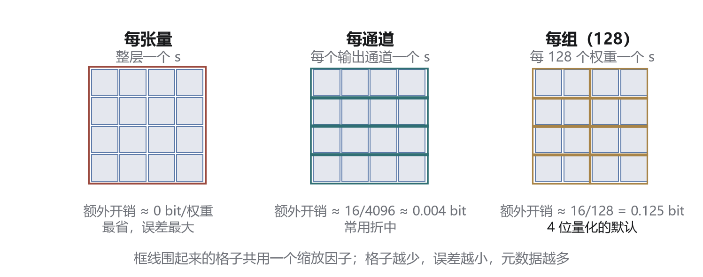

## 量化：用更少的位存同样的数

### 一个只快了 1.4 倍的结果

一个团队把 70B 模型从 FP16 量化到 INT4，权重从 140 GB 降到 36 GB。按第一章的账，解码每步要读的字节少了四分之三，速度应该涨四倍。

实测涨了 1.4 倍。

他们以为是实现有问题，换了三个引擎，结果都在 1.3 到 1.6 之间。后来把每步的读取拆开看才明白：140 GB 权重确实变成了 36 GB，但每条请求的 KV 缓存还是 FP16，上下文 8000 token，一条就是 2.5 GB（70B、分组查询、每 token 320 KB）；批开到 32，缓存读取 80 GB，比权重还多。

**量化只压了分母的一半，另一半没动。**

这个结果不是量化不管用，是量化被用错了地方。这一章把量化的账算清楚：它压的是什么，压多少，代价在哪，什么时候该先压别的。

### 量化在做什么

一个 FP16 的数占 16 位：1 位符号、5 位指数、10 位尾数。它能表示很大范围的数，从 $10^{-5}$ 到 $10^{5}$，但每个数的精度只有千分之一左右。

问题是，神经网络里的权重用不到这么宽的动态范围。一层 4096×4096 的矩阵，几千万个数，绝大多数落在 $[-0.05, 0.05]$ 这个小区间里。用 5 位指数去表示"这个数有多大"是浪费。

量化就是用更少的位表示同一批数。最常见的做法是把一组浮点数线性映射到整数区间：

$$q=\mathrm{round}\!\left(\frac{x}{s}\right)+z,\qquad \hat{x}=s\,(q-z)$$

$s$ 是缩放因子，也叫步长，$z$ 是零点偏移，$\hat x$ 是还原出来的近似值。

这段话的白话版本是：先把这批数按比例压到整数格子上（除以 $s$），四舍五入取整，必要时平移一下（加 $z$）；用的时候再按原比例放大回去（乘回 $s$）。压的过程丢掉了格子之间的细节，这就是量化误差。

$s$ 的选取决定了一切。$s$ 太大，格子太稀，小的数值全被压成同一个整数；$s$ 太小，格子够细了，但大的数值超出整数能表示的范围，溢出。

以 INT4 为例，整数只有 16 个格子，要么是 $-8$ 到 $7$（对称），要么是 $0$ 到 $15$（非对称）。用 16 个格子去表示一层几千万个权重，误差不可避免，问题是能不能把误差压到不影响输出。

### 对称与非对称

**对称量化**把零点固定在 0，整数范围取 $-2^{b-1}$ 到 $2^{b-1}-1$，缩放因子取

$$s=\frac{\max|x|}{2^{b-1}-1}$$

还原时 $\hat x = s\cdot q$。整个映射关于 0 对称，所以 0 一定被精确表示，负数正数精度一样。

**非对称量化**允许零点偏移，整数范围取 $0$ 到 $2^{b}-1$，两个参数：

$$s=\frac{x_{\max}-x_{\min}}{2^{b}-1},\qquad z=\mathrm{round}\!\left(-\frac{x_{\min}}{s}\right)$$

还原时 $\hat x = s\,(q-z)$。

两者的差别在分布形状。如果一批数均匀地落在 0 两侧，对称量化更省（不用存 $z$）；如果分布偏斜，比如激活值经过 ReLU 之后全是非负，或者一组权重恰好集中在正区间，非对称能多用一个格子，误差更小。

### 算一遍：六个权重真的量化一遍

拿一组具体数走一遍。六个权重：

$$x=[-1.2,\ -0.4,\ 0.0,\ 0.35,\ 0.9,\ 1.1]$$

**对称 INT4。** $\max|x|=1.2$，$2^{3}-1=7$，所以

$$s=1.2/7\approx 0.1714$$

逐个算 $q=\mathrm{round}(x/s)$：$-1.2/0.1714=-7.0$，取 $-7$；$-0.4/0.1714=-2.33$，取 $-2$；$0$ 取 $0$；$0.35/0.1714=2.04$，取 $2$；$0.9/0.1714=5.25$，取 $5$；$1.1/0.1714=6.42$，取 $6$。

还原 $\hat x=s\cdot q$，与原来的误差：

| $x$ | $q$ | $\hat x$ | 误差 |
|---|---|---|---|
| -1.20 | -7 | -1.200 | 0.000 |
| -0.40 | -2 | -0.343 | +0.057 |
| 0.00 | 0 | 0.000 | 0.000 |
| 0.35 | 2 | 0.343 | -0.007 |
| 0.90 | 5 | 0.857 | -0.043 |
| 1.10 | 6 | 1.029 | -0.071 |

最大误差 0.071，正好是步长的一半（$s/2=0.0857$）以内，符合预期。相对最大权重 1.2，误差 5.9%。

**非对称 INT4。** $x_{\min}=-1.2$，$x_{\max}=1.1$，$2^{4}-1=15$：

$$s=\frac{2.3}{15}\approx 0.1533,\qquad z=\mathrm{round}\!\left(\frac{1.2}{0.1533}\right)=8$$

逐个算 $q=\mathrm{round}(x/s)+8$：$-1.2$ 变成 $0$，$-0.4$ 变成 $5$，$0$ 变成 $8$，$0.35$ 变成 $10$，$0.9$ 变成 $14$，$1.1$ 变成 $15$。

还原 $\hat x=s(q-8)$：$-1.227$、$-0.460$、$0$、$0.307$、$0.920$、$1.073$。最大误差 0.060。

非对称的误差小了约 15%，因为步长从 0.1714 降到 0.1533。它多花了 4 位存零点 $z$，换来更细的格子。

这个例子里非对称更好，是因为这六个数不对称（负的到 -1.2，正的只到 1.1）。真实的权重矩阵大致零均值、近似对称，非对称的优势就很小，所以 4 位量化几乎都用对称——省掉零点，实现简单，还能把乘法简化成定点运算。

### 粒度：一个缩放因子管多少个数

$s$ 不是一个矩阵一个，可以更细。按"多少个值共享一个 $s$"分三档：

**每张量**（per-tensor）：整个矩阵一个 $s$。最省，误差最大，因为某一层里如果有一个特别大的数，其余全被压到 0 附近。

**每通道**（per-channel）：每个输出通道一个 $s$，也就是矩阵的每一行一个。这是常用配置，特别适合权重量化，因为不同通道的量级差别能有十倍。

**每组**（per-group）：每 128 个权重一个 $s$，一行 4096 个权重分成 32 组。误差最小，元数据开销也最大。4 位量化基本都用这个。

开销能算。一个 4096×4096 的矩阵有 1677 万个权重：

- 每张量：1 个 $s$，16 位，约 $10^{-7}$ 位每权重，可以忽略；
- 每通道：4096 个 $s$，共 8 KB，除以 1677 万，$16/4096\approx 0.004$ 位每权重；
- 每组 128：每 128 个权重一个 16 位的 $s$，$16/128=0.125$ 位每权重。

所以 4 位 + 每组 128，实际是 4.125 位。7B 模型：

$$7\times10^{9}\times4.125/8\approx 3.61\ \text{GB}$$

不是 3.5 GB。差的那 0.11 GB 看着小，但它是无条件的。

为什么组小了误差就小？因为组内数值范围决定了步长，组越小，范围越窄，步长越细。极端情况是每组 1 个权重，步长等于绝对值本身，误差为零——但那时存缩放因子的开销比权重还大。

工程上的平衡点是 128 或 64。有的实现用 32，质量略好，体积大一点，速度慢一点（解包开销）。这个参数要实测，不能照抄。

### 量化谁：权重还是激活

**只量化权重**，计算时把权重反量化回 FP16 再乘。记作 W4A16 或 W8A16。它省显存、省带宽，但计算还是浮点。这是最常见的选择，因为改动最小、风险最低。

**权重和激活都量化**，计算直接用整数或低精度浮点，能吃到硬件的低精度算力。记作 W8A8。它更快，但难点全在激活上。

难点在哪？激活是运行时算出来的，每批数据、每个请求都不一样，没有"事先校准"的机会。而且激活里存在极端值：某一两个通道的数值能比其他通道大几十倍，这叫**异常通道**。

算一下异常通道的破坏力。假设某一层激活的 4096 个通道里，4095 个在 $[-2,2]$ 之间，1 个到了 60。如果用每张量对称量化，$\max=60$，INT8 的步长是 $60/127\approx 0.47$。那 4095 个正常通道的值（大部分在 $\pm2$ 内）只能落在 $-4$ 到 $4$ 这几个整数上，**精度损失了九成**。

这就是为什么 W8A8 比 W4A16 难做。权重可以慢慢校准，激活不行。

### 四种方法各自解决什么

**RTN（round-to-nearest）。** 直接四舍五入。最快，不需要数据，质量一般，作为基线。上面那六个权重的手算就是 RTN。

**GPTQ。** 逐层做，用一小批校准数据算出 Hessian（可以理解为"这个权重对输出的影响有多大"），然后一列一列量化，每量化完一列，立刻用剩余的权重去补偿它造成的输出误差。

用一句话概括它的思路：**先量化的权重会引入偏差，让还没量化的权重去"补"这个偏差。** 这样总误差被摊平，比每列独立量化小很多。代价是校准要跑几十分钟到几小时（70B 级别），而且校准集和真实流量差太远时，补偿的方向就错了。

**AWQ。** 观察到一个现象：权重里真正重要的只占很小一部分（经验上 1% 左右），这些"显著权重"对应激活幅度大的通道。保护它们的办法不是提高精度，而是**给它们乘一个大于 1 的缩放因子，让它们占据更大的量化区间，同时把对应的激活乘一个小于 1 的因子抵消回来**。数学上输出不变，量化误差重新分配了。

AWQ 的校准比 GPTQ 快得多（几十分钟 vs 几小时），质量相当，工程上更受欢迎。

**SmoothQuant。** 专门解决激活的异常通道。思路是把激活的"难度"迁移到权重上：给每个通道乘一个平滑因子

$$s_j=\frac{\max|X_j|^{\alpha}}{\max|W_j|^{1-\alpha}}$$

激活除以 $s_j$，权重乘 $s_j$，数学上等价。选 $\alpha$ 在 0.5 附近，就能让激活的动态范围缩小、权重的动态范围放大一点，两边都变得好量化。因为权重是静态的，放大它的范围不增加难度。

**低精度浮点（FP8）。** 不映射到整数，而是用更短的浮点格式。E4M3 是 4 位指数、3 位尾数、1 位符号，共 8 位。它的指数位和 FP16 一样多，所以动态范围几乎不变，异常值不会把其他通道压死。代价是尾数只有 3 位，精度比 INT8 差。

这个取舍很关键。INT8 是"范围固定、精度均匀"，FP8 是"范围很宽、精度低但不均匀"。对有异常通道的激活，FP8 明显更合适——不需要复杂的平滑，一个张量级的缩放因子就够。近两年训练和推理都在往这条路上迁移，前提是硬件支持（较新的卡有原生 FP8 矩阵乘）。

四者的分工可以用一句话记住：**RTN 是基线，GPTQ 补误差，AWQ 保显著权重，SmoothQuant 治激活，FP8 换赛道。**

### 算一遍：4 位到底快多少

先把一个容易被忽略的环节说清楚：实际工程里很少“整模型一个位宽”。层与层对量化的敏感度差得很远，把位宽当成预算分配，比平均用力更划算。

经验上有三处特别敏感：第一层和最后一层、词嵌入矩阵、输出头。前两个碰的是输入输出的数值范围，后两个碰的是词表上几万个向量的区分度。这些位置用 8 位，中间层用 4 位。

算一下平均位宽。假设一个模型里，嵌入与输出头占参数的 8%，两层边界各占 1%，共 10% 用 8 位，其余 90% 用 4 位：

$$0.10\times8+0.90\times4=4.4\ \text{位}$$

相对于全 4 位，7B 的体积从 3.5 GB 涨到 3.85 GB，只多 10%；相对于全 8 位，还是省了一半。而在质量上，它能拉回大部分损失。

这类混合精度配置通常是实测调出来的：先全 4 位，跑评测，找出掉得最多的那几层，把它们提到 8 位，再测。两三轮就能找到合适的分配，比研究新算法便宜得多。要注意的是混位宽会让 kernel 变多，推理时多几次切换，吞吐可能掉一两个点，这笔账也要算。

回到开头那个只快了 1.4 倍的例子，把它算完整。

场景：7B 模型，单卡 A100，上下文 2048 token，批大小 1。

**FP16。** 权重 14 GB，缓存 $2048\times512\ \text{KB}=1$ GB。每步读 15 GB：

$$15/2040\approx 7.4\ \text{毫秒}$$

**W4A16，每组 128。** 权重 3.61 GB，缓存还是 1 GB。每步读 4.61 GB：

$$4.61/2040\approx 2.3\ \text{毫秒}$$

比值 3.2 倍。这是纯带宽账，实际还要扣三块。

**反量化的算力开销。** 每读进来 128 个 4 位权重，要先做一次缩放因子的乘加，把它们变回 FP16。这个操作不吃带宽，吃算力和指令发射。在带宽受限的场景里它被藏在访存延迟后面，影响不大；但在小模型、低带宽的卡上，它能吃掉一半收益。

**算子支持。** 有些形状的矩阵乘没有专门的 4 位 kernel，引擎只能把权重反量化成 FP16 再走常规路径。这时候省了显存，但每步要额外写一遍 14 GB 的临时张量，速度反而变慢。

**缓存没压。** 上面那个 4.61 GB 里，1 GB 是缓存。缓存占的比例随上下文变化：2048 token 时占 22%，8192 token 时占 53%，32768 token 时占 78%。

把三个折扣叠上，实测 3.2 倍变成 1.5 到 2.2 倍。**这也解释了开头那个 1.4 倍**——他的上下文是 8000 token，缓存占了一半以上，而且批开到了 32，缓存读取量是权重的两倍。

如果缓存也量化到 INT8，同样的场景：

$$3.61+0.5=4.11\ \text{GB}\to 2.0\ \text{毫秒}$$

从 7.4 降到 2.0，3.7 倍。这就是为什么长上下文场景必须连缓存一起压。

### KV 缓存的量化

第二章算过，长上下文时缓存比权重还占地方。缓存也能量化。

做法和权重类似，但有两点不同。**一是粒度必须更细**：不同层的不同头，数值范围差别很大，通常每个头单独算缩放因子（per-head per-channel），否则误差会集中到某几层。**二是风险在长序列上**：缓存是逐 token 累积的，前面 token 的量化误差会一直影响后面所有位置的注意力，误差会累积。

实践中的稳妥做法是先只量化 $K$ 或只量化 $V$，测一下哪边更不敏感；或者在注意力分数上加一个修正项，补偿量化带来的偏差。

收益很实在。70B、8000 token、FP16 缓存 2.5 GB 一条，INT8 降到 1.25 GB，并发直接翻倍；INT4 降到 0.63 GB，翻四倍。在显存紧张的长对话场景里，这比量化权重的收益大得多。

有一条经验值得记：**缓存量化对质量的伤害，在小批、短上下文时几乎测不出来，在长上下文、大海捞针类任务上会突然显现。** 因为任务需要精确回忆远处某个细节时，量化误差刚好抹掉了那一点区分度。测的时候一定要带长文档检索类样本。

### 质量怎么评

不要只看困惑度。这是这一章最重要的一条建议。

困惑度（perplexity）是模型对一段文本的"惊讶程度"，量化后它通常只涨一点。假设某模型 FP16 的困惑度是 5.6，4 位量化后变成 5.75，涨了 2.7%。这个数字看着非常安全。

但同一个模型在具体任务上可能已经掉了好几个点。原因在于困惑度是平均值，它被大量"容易预测"的 token 主导，而这些 token 恰恰是量化误差影响最小的。真正受影响的是那些需要精确区分的少数位置，它们在平均值里被稀释了。

所以要测三类东西。

**一、通用能力。** 几个标准基准，看整体有没有系统性下降。这一项通过是必要条件，不是充分条件。

**二、长尾能力。** 数学、代码、多语言、长文档检索。这几类对量化最敏感，因为它们的正确答案依赖精确的中间计算或者精确的细节回忆，一点误差就会导致完全不同的结果。

**三、格式遵循。** 要求输出 JSON、要求按模板填空、要求特定字段顺序。量化后的模型更容易"忘记"格式约束，这在工程上比能力下降更致命——能力下降用户能感觉到，格式坏了是程序直接报错。

还有一个容易忽略的：**输出分布会变。** 同一个提示，FP16 和 INT4 采样出来的结果可能差别很大，不只是"稍微差一点"，而是"往另一个方向写了"。做 A/B 测试时要意识到这一点，否则会把量化带来的风格漂移误判成模型能力变化。

评测的执行方式也有讲究。至少要用三组：一组是和训练数据同分布的（看基本盘），一组是真实线上流量的采样（看实际影响），一组是专门构造的边缘样本（看最坏情况）。三组都过，才敢上线；只过第一组就上线，翻车概率很高。

### 一个失败案例

前面提过的那个团队，INT8 量化权重和缓存都做了，通用基准掉得不多，吞吐涨了六成。上线三天后，客服系统开始零星报错。

查下来是格式问题：要求返回 JSON 的请求里，大约 3% 出现了字段缺失或者多了一个逗号。比例不高，但客服系统一天几十万次调用，3% 就是几千次失败。

回滚到"权重 INT8、缓存 FP16"，格式问题消失，收益打了折（并发只涨了四成）。

这个案例的教训不是"不要量化"，而是**量化的风险不在平均能力，在边缘行为**。模型的"平均答题水平"很稳，但"严格按格式输出"这种要求精确的边界行为很脆。而工程系统恰恰依赖这些边界行为。

后来他们的做法是：量化模型上线前，先用一万条线上的真实请求做一遍格式校验，统计失败率；失败率超过 0.1% 就不上线。这个门槛比任何基准分数都有用。

### 什么时候量化不管用

**瓶颈在预填充。** 预填充是计算受限，量化权重省的是带宽，对算力没帮助（除非用 W8A8 吃到整数算力）。长提示场景里预填充占七成，量化权重的收益就被压到三成以下。

**上下文很长。** 缓存读取占了大头，只量化权重等于只压了一半分母。前面那个 1.4 倍的例子就是这样。

**模型已经很小。** 1B 模型 FP16 只有 2 GB，量化省 1.5 GB 对 80 GB 的卡没有意义，反而多一层反量化开销。

**硬件没有低精度支持。** 在老卡上做 W4A16，反量化要走通用指令，可能比直接读 FP16 还慢。

**质量门槛很严。** 医疗、法律、金融的合规场景，输出必须可解释可复现，量化带来的分布漂移本身就是风险。

判断顺序：先看瓶颈在预填充还是解码；解码为主再看缓存占读取量的比例；比例超过四成，缓存量化优先于权重量化。

### 精度换速度的定价

量化是性价比最高的一类优化：不改模型结构、不改调用方式、收益稳定。8 位几乎没有质量代价，4 位要仔细评估，但绝大多数场景能过。

它的本质是一次定价：用多少精度换多少速度。这个价格在不同场景里差得很远——短上下文、大批量时四两拨千斤，长上下文、小批量时聊胜于无。

还有一句要记住：量化的收益按"每步读取字节"算，不按"参数量"算。看到"4 位量化快四倍"这种说法，先问一句：缓存算进去了吗，反量化开销算进去了吗，kernel 支持吗。三个问题问完，四倍通常会变成两倍。

下一章讲更彻底的做法：把模型本身变小。
