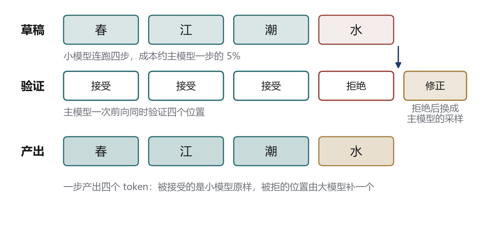
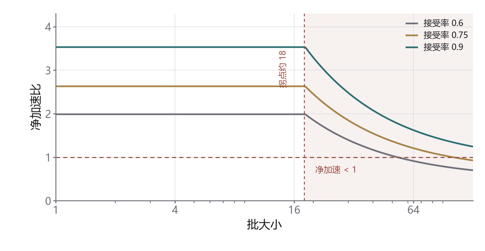

## 投机解码：小模型猜，大模型验

### 一个越用越糊涂的开关

一个团队给 70B 模型加了投机解码。个人助理页面上，速度从每秒 12 个字提到 28 个，用户明显感觉到变化。他们很高兴，把这个开关在全局打开。

第二天，批量报告生成的任务超时了。那是个离线任务，一次生成两万条周报，配置是批大小 64。开了投机解码之后，整批跑完的时间比原来长了三成。

同一个模型、同一套代码、同一个开关，一个场景快了一倍多，另一个场景慢了。

这不是配置写错了，是投机解码的收益本身高度依赖场景。这一章把它的机制和账算清楚，特别是"什么时候它会变成负收益"这一条，很多资料不讲。

### 解码为什么不能并行

前面几章一直在讲"读多少字节"和"算多快"。这一章改的是一个更基本的东西：解码的串行性。

生成第 $t+1$ 个 token 之前，必须知道第 $t$ 个是什么。因为第 $t$ 个 token 会变成第 $t+1$ 步的输入的一部分。这个依赖是硬性的，不能像预填充那样把整段并行算完。

所以解码天然是"一次一行"的循环。每转一圈，只能吐一个字。

投机解码绕开它的方式很巧：先用一个便宜的方式猜出后面几个 token，再让大模型一次性验证这几个 token 对不对。

关键在于验证这件事可以并行。把猜出来的几个 token 拼到前缀后面，做一次前向，就同时得到了"每个位置上大模型会输出什么"。然后逐个比较：第一个位置上大模型最想要的是不是猜的那个？是就接受，继续看第二个；不是就停，用大模型自己的结果替换。

一次前向的成本，和生成一个 token 的成本几乎一样。因为解码本来就是带宽受限的，算 1 行和算 5 行，读的权重一样多（第一章算过，强度只有 1，离拐点 153 差得远）。

所以"验证 4 个"的代价约等于"生成 1 个"。如果 4 个里有 3 个被接受，这一步就产出了 4 个 token，而只花了一次前向的时间。

### 期望接受数的推导

这是这一章唯一需要动笔的地方，推一遍就全懂了。

记草稿模型每一步的 token 被主模型接受的概率为 $\alpha$，一次猜 $k$ 个。假设各步独立（近似成立），那么：

- 第 1 个被接受的概率是 $\alpha$；
- 第 1、2 个都被接受的概率是 $\alpha^2$；
- 前 $i$ 个都被接受的概率是 $\alpha^i$。

被接受的草稿 token 数的期望，等于"至少接受 1 个"的概率加"至少接受 2 个"的概率，一直加到 $k$：

$$E[\text{接受数}]=\alpha+\alpha^{2}+\cdots+\alpha^{k}=\sum_{i=1}^{k}\alpha^{i}$$

等比数列求和：

$$\sum_{i=1}^{k}\alpha^{i}=\frac{\alpha(1-\alpha^{k})}{1-\alpha}$$

但投机解码还有一个额外的收获：当某个草稿 token 被拒绝时，主模型在那个位置上仍然给出了自己的答案，那个 token 是免费的。所以每一步实际产出的 token 数是"接受数 $+1$"：

$$E[\text{产出}]=1+\frac{\alpha(1-\alpha^{k})}{1-\alpha}=\frac{1-\alpha^{k+1}}{1-\alpha}$$

这个式子在说什么：**产出不是一个 token，而是"接受几个再加一个"。** 即使一个都没接受（概率 $(1-\alpha)$），这一步也没白干，至少产出了主模型自己的那个 token。

代入 $\alpha=0.8$、$k=4$：

$$E=\frac{1-0.8^{5}}{1-0.8}=\frac{1-0.32768}{0.2}=3.36$$

也就是一步产出 3.36 个 token，而代价还是一次前向。

$\alpha=0.5$、$k=4$ 时：

$$E=\frac{1-0.5^{5}}{0.5}=\frac{0.96875}{0.5}=1.94$$

不到 2 个。而草稿模型还要花成本，收益已经很薄了。

把不同组合列成表，规律很清楚：

| $\alpha$ | $k=1$ | $k=2$ | $k=3$ | $k=4$ | $k=6$ | $k=8$ |
|---|---|---|---|---|---|---|
| 0.5 | 1.50 | 1.75 | 1.88 | 1.94 | 1.98 | 1.99 |
| 0.6 | 1.60 | 1.96 | 2.18 | 2.31 | 2.46 | 2.50 |
| 0.7 | 1.70 | 2.19 | 2.53 | 2.77 | 3.06 | 3.20 |
| 0.8 | 1.80 | 2.44 | 2.95 | 3.36 | 3.93 | 4.16 |
| 0.9 | 1.90 | 2.71 | 3.44 | 4.10 | 5.22 | 5.70 |

两个结论。

第一，$\alpha$ 是决定性的。0.8 和 0.5 之间，收益差一倍以上。所以"猜的那个东西必须和主模型足够像"，这不是建议，是前提。

第二，$k$ 有饱和。$\alpha=0.5$ 时，$k$ 从 4 加到 8，期望产出从 1.94 只涨到 1.99，几乎没变，而草稿成本翻倍。$\alpha=0.9$ 时，$k$ 加大仍然有效。所以最优 $k$ 由 $\alpha$ 决定，实践中在 3 到 6 之间，$\alpha$ 高就取大一点。

### 算一遍：把草稿成本算进去

上面算的都是毛收益，还要减去猜的成本。

草稿模型每猜一个 token 要跑一次自己的前向。它的成本和它的大小成正比，也和它跑在几张卡上有关。

拿 70B 主模型（八卡 A100，每步 8.6 毫秒）配 1B 草稿模型（单卡，权重 2 GB，每步约 1 毫秒）举例。草稿一步相对主模型一步的比值

$$c=\frac{1}{8.6}\approx 0.116$$

猜 $k=4$ 步，草稿总共花 $4\times0.116=0.46$ 个主模型步。加上验证那一步，总代价

$$1+4\times0.116=1.46\ \text{步}$$

净加速

$$\frac{3.36}{1.46}\approx 2.3\ \text{倍}$$

这跟实际经验吻合：公开报告和各类实测里，接受率 0.8 左右时净加速通常在 2 到 2.5 倍。

再看另一个组合。7B 主模型配 0.5B 草稿。7B 单卡每步 7.4 毫秒，0.5B 权重 1 GB 每步 0.5 毫秒，$c=0.068$，$k=4$：

$$\frac{3.36}{1+4\times0.068}=\frac{3.36}{1.27}\approx 2.6\ \text{倍}$$

比上面那个好一点。原因是主模型小，它的每步时间短，而草稿模型也相应更小，比值差别不大；但 7B 的绝对时间短，草稿的固定开销（kernel 启动、调度）占比反而更高。这一项在上面的算式里没有体现，实际会吃掉几个点。

还有一条：草稿模型的权重要占显存。70B 在八张 80 GB 卡上已经用了 140 GB，加一个 1B 草稿（2 GB）不算多；但如果主模型已经把显存填满，就得挤掉几条请求的缓存，这部分损失要算进总账。

### 温度采样下的接受规则

如果只是贪心解码（每步取概率最大的那个），接受规则很简单：猜的和主模型要的一样，就接受。但生产环境通常用温度采样，那里有个数学细节必须处理对。

草稿分布记作 $q$，主模型分布记作 $p$，两者不一样（因为模型不同）。如果简单地"相同就接受、不同就重采样"，最终输出分布会偏向 $q$，也就是**你会得到一个更像小模型、不像大模型的输出分布**。这在需要严格对齐的场景里是不可接受的。

标准做法是这样的两步：

1. 以概率 $\min\!\left(1,\dfrac{p(x)}{q(x)}\right)$ 接受草稿 token $x$；
2. 如果拒绝，从修正分布 $\dfrac{\max(0,\ p-q)}{\sum_z \max(0,\ p(z)-q(z))}$ 中重新采样一个。

这套规则能保证最终输出严格服从 $p$。推一遍就明白。

输出 $x$ 有两条路径：草稿提了 $x$ 且被接受，或者草稿被拒绝后重采样得到 $x$。前者概率是 $q(x)\cdot\min(1,p(x)/q(x))=\min(p(x),q(x))$。后者是

$$\Bigl(1-\sum_y \min(p(y),q(y))\Bigr)\cdot\frac{(p(x)-q(x))_+}{\sum_z (p(z)-q(z))_+}$$

而 $\sum_z (p(z)-q(z))_+$ 恰好等于 $1-\sum_y\min(p(y),q(y))$（因为 $\sum p=\sum q=1$），两项约掉，第二条路径的概率就是 $(p(x)-q(x))_+$。

两条加起来：

$$\min(p(x),q(x))+(p(x)-q(x))_+=p(x)$$

正好是主模型的分布。**这就是投机解码能放心用的前提：它不改变输出分布，只改变生成速度。**

这个式子还有一个直观解释。$p>q$ 的位置（主模型更想要的 token）被加权，$p<q$ 的位置被压掉。所以拒绝之后的"补采"总是朝着主模型的偏好方向偏。

实现上有三个坑。

**随机源要统一。** 接受判定和重采样必须用同一个随机数发生器，并且每条请求独立。见过一个实现用全局随机，结果在高并发下分布偏了——因为多条请求交错消耗随机流，等于引入了相关性。

**浮点误差。** $\max(0,p-q)$ 在 $p$ 和 $q$ 接近时会被浮点误差污染，出现大量极小的正数。要先做阈值截断，再归一化。

**$q$ 不能为零而 $p$ 不为零。** 这时 $p/q$ 是无穷。要显式处理成"必定拒绝"，然后在重采样里补上。

### 草稿的 1 毫秒里有什么

上面把草稿一步当成 1 毫秒，这 1 毫秒值得拆开看，因为它决定了“草稿能不能再小一点”。

1B 草稿 FP16 是 2 GB，单卡带宽 2.04 TB/s，光是读权重就要 0.98 毫秒。剩下的是固定开销：kernel 发射、采样、与主模型的数据交接，经验上 0.1 到 0.2 毫秒。取 0.15：

$$t_{\text{草稿}}=0.98+0.15=1.13\ \text{毫秒},\qquad c=1.13/8.6\approx0.13$$

和前面用的 0.116 差一成。这一成在 $k=4$ 时是 $4\times0.014=0.056$ 个主模型步，摊到净加速上大约三个点。

同一套算法拿去校准前面那张批大小表，会发现它用的是更乐观的口径。那里取 $c=0.04$，对应一份步时只有 0.3 毫秒的草稿，也就是约 0.3B；如果换成常见的 0.5B 草稿（权重 1 GB，环路 0.64 毫秒，主模型 7.4 毫秒），$c$ 变成 0.086。同样的 $k=4$，分母从 $1+4\times0.04=1.16$ 变成 $1+4\times0.086=1.344$，净加速要少一成四。**所以那张表宜当作上界读，实际值要按自己的草稿规模重算一遍。**

真正有意思的是换一个更小的草稿。0.15B 草稿权重 0.3 GB，读取只要 0.15 毫秒，但固定开销还是 0.15，所以步时

$$0.15+0.15=0.30\ \text{毫秒},\qquad c=0.035$$

$c$ 从 0.13 降到 0.035，$k=4$ 时的净加速从 2.0 涨到 2.9。看上去很划得来。

但接受率会跟着掉。0.15B 和 70B 的分布差距太大，$\alpha$ 可能从 0.8 掉到 0.6 以下。代入：$\alpha=0.6$、$k=4$ 的毛收益是 2.31，除 $1+4\times0.035=1.14$，净加速 2.03——和 1B 草稿差不多。

| 草稿 | 步时（权重+开销） | $c$ | 能接受的 $\alpha$ |
|---|---|---|---|
| 0.15B | 0.15 + 0.15 ms | 0.035 | 低，约 0.6 |
| 1B | 0.98 + 0.15 ms | 0.13 | 高，约 0.8 |
| 7B（同尺寸） | 7.2 + 0.15 ms | 0.85 | 极高，但无意义 |

这张表里有一条临界线：**当草稿的固定开销（0.15 毫秒）与它的权重读取时间相等时，就是“再小也没用”的拐点。** 对 7B 主模型，这个拐点在草稿约 0.3B 处（读取 0.15 毫秒）；对 70B 主模型，主模型步时更长，拐点能到 0.1B。所以“草稿越小越快”只在一个区间里成立，过了就成了纯损。

### 最优的 $k$ 是几

前面的表只算了毛收益，把 $k$ 与净加速的关系画完，才能看出 $k$ 该怎么取。净加速是

$$\text{净}=\frac{1-\alpha^{k+1}}{(1-\alpha)(1+ck)}$$

分子随 $k$ 递增但很快饱和，分母随 $k$ 线性涨。两者相除，必有极大值。取 $c=0.04$，$\alpha$ 取 0.6 和 0.8 两档：

| $k$ | $\alpha=0.6$ | $\alpha=0.8$ |
|---|---|---|
| 1 | 1.54 | 1.73 |
| 2 | 1.82 | 2.26 |
| 3 | 1.94 | 2.64 |
| 4 | 1.99 | 2.90 |
| 6 | 1.96 | 3.19 |
| 8 | 1.88 | 3.28 |
| 10 | 1.74 | 3.27 |

$\alpha=0.6$ 的最优值在 $k=4$ 附近，$\alpha=0.8$ 的最优值在 $k=8$ 到 9。

这个结果比实践中的默认值（$k=4$）大了一倍。差异在哪？三个假设不成立。

第一，$c$ 不是常数。草稿模型自动回归跑 $k$ 步，每步都有那 0.15 毫秒的固定开销，而权重读取那部分变不了。所以 $k$ 大了之后，有效 $c$ 反而升。

第二，$\alpha$ 不是常数。后面的位置是在草稿自己已经生成的 token 上继续猜的，错一步之后就都错了，所以实际接受率随位置递减，$\alpha^{k}$ 这个模型高估了长链的收益。

第三，$k$ 大了以后验证的批也变大，在接近拐点的批大小下就已经不免费了。

三个修正叠起来，最优 $k$ 从 8 到 9 回到 4 到 5。**结论：公式告诉你的是上限方向，不是应该输入的值；最优 $k$ 要实测，而且每换一套主模型与草稿模型都得重测。**

### 谁来猜

四种做法，成本与效果不同。

**小模型猜。** 同一个家族的小版本，比如 1B 猜 70B，或者 0.5B 猜 7B。它和主模型同源，训练数据相似，分布接近，接受率高。代价是多占一份显存、多一次前向。这是最直接的方案，也是最早被验证的方案。

**多头预测。** 在主模型上多加几个输出头，每个头负责预测"再往后第 $i$ 个 token"。不引入新模型，显存开销小。这类方法的特点是训练简单、收益中等——因为每个头只看最后一层的隐状态，没有主模型逐层加工的信息。

**特征层预测。** 用主模型中间的某层特征接一个小预测头。因为用的是主模型自己的中间表示，它比独立小模型更"懂"主模型接下来想说什么，接受率通常更高。代价是要训练、要维护、要跟着主模型一起升级。

**检索式猜。** 不训练任何模型，直接从上下文里找重复片段。比如代码里的变量名、文档里的原句、用户刚才说过的话。在代码补全、复制粘贴、格式化输出这类任务上效果出奇地好（因为这些任务本来就在重复上下文），在自由创作上基本无效。

四者的接受率从高到低大致是：特征层预测、小模型、多头、检索。成本和工程复杂度反过来。选哪个取决于场景：通用聊天用小模型最省事，代码补全用检索式最划算，有训练资源就上特征层。

### 接受率怎么测

前面一直把 $\alpha$ 当一个已知的数。实际它得测，而且测法比很多人想的简单。

拿两百条真实请求，对每一条让草稿连续猜四个 token，同时让主模型在同样的四个位置各算一次完整分布。逐位置比对，记下“前 $i-1$ 个已被接受时，第 $i$ 个也被接受”的比例，这叫**条件接受率**。

一组真实形状的数据（条件接受率随位置递减）：

| 位置 | 条件接受率 | 累计通过 |
|---|---|---|
| 1 | 0.91 | 0.91 |
| 2 | 0.84 | 0.76 |
| 3 | 0.79 | 0.60 |
| 4 | 0.75 | 0.45 |

累计那列是链式相乘的结果。用它算期望接受数（每一列累加）：

$$0.91+0.76+0.60+0.45=2.72$$

加上那一个“白送的”修正 token，就是 3.72 个。

用简化公式校一下。把四个条件接受率取几何平均 $(0.91\times0.84\times0.79\times0.75)^{1/4}\approx0.82$，代入 $(1-0.82^{5})/0.18\approx3.50$。**差 6%。**

这个 6% 就是“独立同分布”假设的价格。位置越靠后条件接受率掉得越多（因为草稿是在自己可能已经错了的 token 上继续猜），而公式把它们当同一个 $\alpha$。

差距随 $k$ 放大：$k=8$ 时，实测会低 15% 以上；而且如果一个都接不住，后面全废。所以**用公式估收益时，应该拿实测的前两个位置的接受率去拟合一个“有效 $\alpha$”，而不是拿全链平均。**

测量还有一个容易被忽略的好处：分任务看。同一个模型对代码、模板化回答、自由写作的接受率差很远，而这直接决定了该不该按请求类型路由。两百条样本一天就能标完，比读十篇论文管用。

### 批大小如何吃掉收益

这是最容易被忽略的一条，也是开头那个"导出任务变慢"的原因。

投机解码的收益来自"解码是带宽受限"。批大小是 1 时最明显：读一次权重算 5 行，多出来的 4 行几乎免费。

批大了之后，解码逐渐接近计算受限。验证 5 行的成本开始明显高于生成 1 行。

用第三章算过的拐点来定量。7B、500 token 上下文、A100，拐点大约在 135 行。一次前向处理 $B$ 条请求、每条验证 $k+1=5$ 个位置，总行数 $5B$。

单步时间取"带宽时间"和"计算时间"的较大者：

$$\text{步时}=\max\Bigl((14+0.25B)\times0.49,\ 0.5B\Bigr)\ \text{毫秒}$$

前一项是读取（权重 14 GB 加缓存），后一项是计算（每行 0.1 毫秒乘 $5B$ 行）。

| 批大小 $B$ | 每步行数 | 不投机步时 | 投机步时 | 毛加速 | 净加速 |
|---|---|---|---|---|---|
| 1 | 5 | 7.0 ms | 7.0 ms | 3.36 | 2.4 |
| 8 | 40 | 8.0 ms | 8.0 ms | 3.36 | 2.4 |
| 16 | 80 | 8.9 ms | 8.9 ms | 3.36 | 2.4 |
| 32 | 160 | 10.9 ms | 16.0 ms | 2.29 | 1.6 |
| 64 | 320 | 14.8 ms | 32.0 ms | 1.55 | 1.1 |
| 128 | 640 | 22.8 ms | 64.0 ms | 1.20 | 0.9 |

（净加速已除以草稿成本 $1+4c$，取 $c=0.04$ 对应 7B 配 0.5B 草稿。）

表里最刺眼的是最后一行：**批大到 128 时，净加速小于 1，也就是开着比不关着慢。** 因为那时候解码已经是计算受限，验证 5 行要老老实实算 5 倍的计算量，而只有 3.36 倍的产出。

所以投机解码适合低并发、低延迟的场景：个人助理、IDE 补全、单用户对话。不适合高吞吐的离线批处理。同一个模型，两种配置下该不该开，答案可能相反。

把这张表的规律画成曲线，三条线分别是接受率 0.6、0.75、0.9。横轴是批大小，纵轴是净加速，阴影区是“净加速小于 1”。

曲线有三个特征。

**左侧是一条水平线。** 批小于 18 时，验证多行完全免费，净加速只由 $\alpha$ 和 $k$ 决定，与批无关。三条线的高度分别是 2.0、2.6、3.55。

**中间是一个拐点，位置在批 18 附近。** 这个数可以推出来。批 $B$ 时，读取时间是 $(14+0.25B)/2.04$ 毫秒，验证 5 行的计算时间是 $0.1\times5B=0.5B$ 毫秒。两者相等：

$$\frac{14+0.25B}{2.04}=0.5B\ \Longrightarrow\ 14+0.25B=1.02B\ \Longrightarrow\ B\approx18$$

解出来 18.2。**拐点的意义是：从这一刻起，验证多出来的四行不再免费，开始按计算量付钱。**

与不投机的版本对比一下会发现一件更有意思的事：那个版本**根本没有拐点**。每加一条请求，读取涨 0.12 毫秒（500 token 的缓存），计算只涨 0.1 毫秒，读取永远领先。投机把每行的计算量抬到 0.5 毫秒，两条线才第一次相交。

所以更准确的说法不是“投机把拐点往左推”，而是**投机把一个本来不存在的拐点造了出来**。风险也就在这里：不投机时，批开到一百条也不会掉进计算受限；一开投机，批过十八就开始按计算量付钱。

**右侧掉得很快。** 批 64 时，升到 1.1；批 128 时，接受率 0.6 那条线已经跌到 0.7 以下，也就是开了比不开慢三成。

这张图直接回答了开头那个场景：批量导出任务的批是 64，正好在右边。同样一个开关，在左侧是 2.6 倍，在右侧是 1.1 倍甚至倒贴。

还有一条读图时容易错过的细节：接受率越低，拐点之后掉得越快，而且拐点来得越早。因为低接受率下每步产出的 token 少（毛收益低），所以批一大、验证变贵，很快就不划算了。**低接受率的配置本来就接近盈亏平衡，对批大小更敏感。**

### 一条请求的端到端账

前面的加速比都是“每 token 时间”的比值。用户感受到的是整条时间轴，两者不完全一样。

70B、输入 2000、输出 300，批 1。不投机：首字 0.25 秒，每 token 8.6 毫秒，三百个 token 要走 2.58 秒，总时 2.83 秒。

开投机，$\alpha=0.8$、$k=4$。首字延迟**一点没变**（0.25 秒，投机不碰预填充，反而多加载了一个草稿模型，多几毫秒）。解码段按净加速 2.3 折算，2.58/2.3 ≈ 1.12 秒。总时 $0.25+1.12=1.37$ 秒。

总时从 2.83 降到 1.37，2.1 倍；而解码段本身快了 2.3 倍。**两者差的那一点，就是首字延迟被摊不掉的份额。** 输出越短，这个差越大：输出 30 个 token 时，总时从 0.51 秒降到 0.38 秒，只有 1.3 倍。

这就定出了它的适用区间：**输出越长（几百 token 以上）、批越小，感受提升越明显；短回答场景开它作用有限。** 而“短回答 + 高并发”两个条件同时出现的场景（比如 API 网关），恰好是它最不该开的地方。

吞吐那边算另一笔。不开投机，批 1 时每秒 116 个 token，每步 8.6 毫秒。开投机后，每步产出 3.36 个 token，步时是原来的 $1+4\times0.13=1.52$ 倍，折到每步 13.1 毫秒，吞吐

$$\frac{3.36}{0.0131}\approx256\ \text{token/s}$$

比 116 翻了一倍多。但这是“一条请求自己跑得更快”的吞吐，不是整机吞吐——**没有更多请求可服务，机器总产出不会因为开了投机而变多。** 只有当队列里有请求在等时，单条变快才能变成整机多服务。这也是它与批处理的关系：批处理提高整机吞吐、不改变单条体验；投机解码改善单条体验、在高并发下失效。两者恰好互补。两者恰好互补。

这也解释了开头那个故事。个人助理页面并发低，开了快一倍；批量报告任务批大小 64，开了慢三成。修法不是关掉这个功能，是按路由分开配置：短请求、低并发走投机通道，批量任务走普通通道。

### 树状验证：一次验多条候选

前面假设草稿是一条链：猜两个、三个、四个，一路往后。实际上可以猜成一棵树。

第一个位置猜两个候选（“春”和“初”），第二个位置在每个候选后各猜两个，依此类推。一棵深度 4、每层分叉 2 的树有 15 个节点，一次前向可以把 15 个位置全验完，然后取最长的一条被完全接受的路。

代价好算。7B、500 token 上下文，批 $B$ 时读取 $(14+0.25B)/2.04$ 毫秒，而验证 15 个位置的计算是 $0.1\times15B=1.5B$ 毫秒。两者相等的点在

$$\frac{14+0.25B}{2.04}=1.5B\ \Longrightarrow\ 14+0.25B=3.06B\ \Longrightarrow\ B\approx5$$

所以树状验证只在批小于 5 时完全免费。$B=8$ 时，读取 7.8 毫秒，而计算已经要 12 毫秒，越过了；$B=4$ 时计算 6 毫秒，还在读取底下。**把一个 4 节点的链换成 15 节点的树，拐点从 18 降到了 5，这是它只适合低并发场景的原因。**

换来的好处是期望接受数变高。一条链只要中间错一个就断，树则在每个位置都留了备选，断了还能走另一枝。公开报告里，同样的验证预算下，树形结构能把期望接受数提高三成到一倍，具体取决于接受率——接受率越低，分叉越有价值。

实现上要改注意力：树里的节点只能看到自己的祖先，不能看到兄弟。做法是传一个树形掩码矩阵，让注意力在这个掩码下计算。另外要处理验证后的位置映射，把树上的接受路径重组成一条线性序列。这两件事都比线性验证麻烦，是这类方法工程量大在哪的地方。

### 失败案例：草稿没跟着主模型升级

一个还不错的坑，值得单独说。

团队上线了 70B 加 1B 草稿的组合，跑了两个月很稳。后来主模型微调了一版（同一个基座，换了一批对齐数据），直接换了上去。

速度从 2.3 倍掉到 1.2 倍。

原因是接受率从 0.8 滑到 0.55。主模型的输出分布被微调改变了（语气、格式、常用句式都变了），而草稿模型还是旧的，两者不再“足够像”。

这类问题的特点是**不报错**，只是慢慢变慢。监控上只能看到“加速比”这个指标在降，如果没有专门监控它，根本发现不了。

防御办法有两个。一是把接受率当成一级指标，和延迟、错误率一起监控，掉到阈值以下就告警。二是把主模型和草稿模型的版本绑定，主模型一换，草稿必须重新蒸馏或至少重测一遍接受率，不允许“顺手换个权重”。

第二条听起来是流程问题，实际上是技术债：两个模型的耦合关系没人写在文档里，换模型的人根本不知道还有个草稿模型依赖着它。

### 失败案例：词表不一致的草稿

另一个坑更隐蔽，也更常见。

团队为了省显存，用了一个参数只有主模型十分之一、但来自另一家厂商的草稿模型。两个模型都在中文上表现不错，接受率却只有 0.08。

原因在分词。两个模型对同一句话切出来的 token 序列不一样：一个把“退货”切成一个 token，另一个切成“退”加“货”。序列一对不上，后面全部错位，验证全拒。

这个错误有一个很容易误判的特征：**所有 token 都能被草稿以很高的概率“猜中字面”，但位置上差一格。** 如果只看草稿自己的困惑度，它很低；再看接受率，接近零。两者完全对不上。

验证方法很简单：拿一百句话，把两个模型的 token 序列都打出来，逐位置对比。如果长度不一样，就直接不能这样配。

修法有两条。一是换成同族、同词表的模型（这也是“小模型猜大模型”这个方案限制在同一系列里的真实原因）。二是加一层 token 映射表，把草稿的输出投影到主模型词表上。第二条可行但脆：映射需要在句子级别对齐，而一句话内部的分词差异无法用静态表解决，只能覆盖一部分。

这条经验值得单拎出来：**投机解码的三个前提中，“分布接近”靠的是同源数据，“词表一致”靠的是同族模型，而“延迟够低”靠的是尺寸够小。三个条件互相拉扯，能满足的配置比想象的窄。**

### 什么时候不灵

**高熵文本。** 猜下一个 token 的难度取决于文本的可预测性。代码、模板化文案、有大量引用的问答，接受率能到 0.8 以上；自由创作、诗歌、数学推导，接受率可能只有 0.4。这是本质限制，调参数解决不了。

**显存很紧。** 草稿模型要占地方。长上下文场景里，缓存已经吃满显存，加一个草稿模型要挤掉几条请求的缓存，收益可能被并发下降吃掉。

**运维复杂度不可接受。** 多一个模型、多一套验证逻辑、多一类故障点（草稿模型崩了怎么办、草稿和主模型的词表不一致怎么办、两个模型的版本怎么对齐）。团队只有两三个人的时候，这份复杂度可能不值。

**首字延迟是瓶颈。** 投机解码优化的是 TPOT，对首字延迟一点帮助都没有，甚至因为要多加载一个模型而变慢。如果用户的抱怨是"等很久才出第一个字"，这条路走错了，该去做前缀缓存和切块预填充。

### 一个判断流程

要不要上投机解码，按四步问。

**第一，现在解码是带宽受限还是计算受限？** 看批大小和 GPU 利用率。批小、利用率低，说明是前者，有机会；批已经很大、利用率高，大概率没机会。

**第二，文本的可预测性如何？** 抽一百条真实请求，看重复率、看是否模板化、看有没有大量引用上下文。这个动作一天能做完，比任何理论分析都准。

**第三，显存还有没有余量？** 草稿模型要占 2 到 5 GB，长上下文场景里这可能是压垮的最后一根稻草。

**第四，能接受的复杂度是多少？** 有没有人能维护第二个模型、能不能接受多一类线上故障。

四条都过，收益通常在 1.5 到 2.5 倍。有任意一条不过，收益可能接近零，而故障率上升。

### 和其他手段的关系

投机解码和量化可以叠加：草稿模型量化到 4 位，主模型量化到 8 位，两边都省带宽，接受率通常只掉一两个点。

它和前缀缓存也叠加：验证时的前缀往往已经在缓存里，省掉重复计算。而且这两个手段优化的阶段不同——前缀缓存优化预填充，投机解码优化解码，互不干扰。

它和 PD 分离有冲突：分离之后，解码机器上的批通常开得很大（因为那台机器专门吃解码），投机解码的收益会打折扣。要做的话，得给解码池单独留一批低延迟的机器。

它和剪枝、蒸馏基本正交，但有一个间接影响：主模型变小之后，草稿模型也要跟着变小，$c$ 的比值变化不大，收益大致保持。

### 一个反例：指标好了，投诉没少

有个团队上线投机解码后，每 token 间隔从 48 毫秒降到 26 毫秒，仪表盘很好看，但客服工单一条没少。

把两种输出长度代进去就明白了。回答 300 token 时，解码时间从 14.4 秒降到 7.8 秒，用户感受明显。但他们的实际业务是短问答，平均只有 60 token：

| 输出 | 不投机 | 投机 |
|---|---|---|
| 60 token | 2.9 s | 1.6 s |
| 300 token | 14.4 s | 7.8 s |

短回答那一行只差 1.3 秒，而首字延迟 1.1 秒一点没动，总时从 4.0 秒到 2.7 秒。用户抱怨的恰恰是“等第一个字太久”。

所以不是投机解码没用，是它治的病和用户得的病不是同一个。两件事值得写进流程：一是把 TTFT 和 TPOT 分开度量，不要用一个“平均响应时间”抹平；二是把工单按“开头等太久”和“中间吐得慢”两类归档。两类工单对应完全不同的手段：前者靠前缀缓存和切块预填充，后者靠投机解码和量化。
### 用并行换串行

投机解码解决的是"串行"这个根本约束，办法是用并行验证换串行生成。它不改模型、不改权重，只改解码的循环方式，因此能和几乎所有其他手段叠加。

它的收益公式很干净，$\frac{1-\alpha^{k+1}}{1-\alpha}$ 除以 $1+ck$，两个参数决定一切：接受率 $\alpha$ 和草稿成本 $c$。前者由文本和模型相似度决定，后者由模型大小比决定。

而它的失效边界同样干净：批一大，解码从带宽受限变成计算受限，验证的 5 行就不免费了，收益迅速缩水甚至变成负的。**所以它是一个延迟优化，不是吞吐优化。** 把它当吞吐手段用，多半会失望。

下一章讲系统层面：把两种不同瓶颈的任务彻底分开跑。
