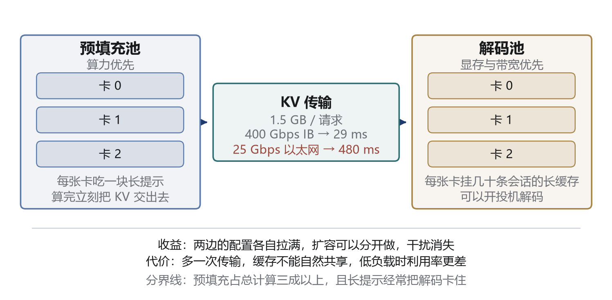

## PD 分离与多机推理

### 一次长订单把整个系统按住

客服系统上出现了这样一条曲线：每进来一个带着长订单历史的请求，全系统的每 token 间隔就抖一下。

抖多少取决于订单有多长。一条 8000 token 的订单上下文，预填充要占住整张卡大约 300 毫秒。这 300 毫秒里，正在解码的七十多个用户全部停住，屏幕上的字不动了。用户感觉到的是"打字机卡了一下"。

一天里这种抖动几十次，投诉集中在"有时候特别卡"。可压测报告上 p50 延迟很漂亮，因为抖动只发生在长请求进来的那一刻。

这是同一张卡上跑两种任务带来的必然结果。把这两类任务放到不同的机器上，叫 PD 分离（prefill-decode disaggregation，预填充与解码分离）。这一章讲它为什么有用、代价是什么、什么时候不该用。

### 两种任务为什么互相干扰

第一章讲过，预填充和解码的瓶颈完全不同。预填充是计算受限，它要吃掉整块算力，跑几千行的矩阵乘；解码是带宽受限，算力闲着，只是在等权重从显存读过来。

放在同一张卡上，问题有两个。

**资源抢占。** 预填充一进来，就要占满计算单元。解码的批被挤到一边，用户的字停了。切块预填充能缓解（把长预填充切成 512 token 一块，块之间插解码），但切块本身要改调度和注意力实现，工程复杂度不低，而且在切块的边界上仍有开销。

**配置冲突。** 预填充希望算力足、批大；解码希望显存大、带宽足。同一张卡上，显存要给预填充的激活留地方，又要给解码的缓存留地方，两边都不舒服。优化的方向甚至是相反的：预填充喜欢少留缓存多留激活，解码喜欢反过来。

这两个问题都随规模放大。一台机器上跑几十个用户时，抖一下能忍；一千个用户时，一次抖动就是几百人同时感觉到。

### 分离之后长什么样

架构上分成三块。

**预填充池**：只跑预填充，算力优先，KV 缓存算完就交出去，本地几乎不存。因为不留缓存，显存能全给激活和更大的批。

**解码池**：只跑解码，显存优先，接收从预填充池送来的缓存。这里可以开大 batch、开投机解码、开长上下文缓存，因为它的显存全用来存缓存。

**传输层**：把 KV 从预填充机送到解码机。这一层是分离方案的核心成本。

### 算一遍：传一次 KV 要多久

拿一个 200B 模型举例。假设 88 层、8 个 KV 头、每头 128 维、缓存用 FP16。每 token 的缓存

$$2\times 88\times 8\times 128\times 2=360448\ \text{字节}\approx 352\ \text{KB}$$

一条 4096 token 的请求：

$$4096\times 352\ \text{KB}\approx 1.44\ \text{GB}$$

现在算传输时间，看三种链路：

| 链路 | 有效带宽 | 1.44 GB 的传输时间 |
|---|---|---|
| NVLink（机内） | 300 GB/s | 4.8 ms |
| 400 Gbps InfiniBand | 50 GB/s | 29 ms |
| 25 Gbps 以太网 | 3 GB/s | 480 ms |

差别是数量级的。走机内 NVLink，传输可以忽略；走 IB，29 毫秒还算可以接受；走普通以太网，480 毫秒直接把首字延迟翻倍。

结论很硬：**PD 分离必须配高速互联。** 同机分离（两个进程、两块卡，走 NVLink 或 PCIe）可行，跨机分离必须上 IB 或同等级的网络。用普通以太网做这件事，收益会被传输吃光。

29 毫秒在总延迟里占多少？一条请求首字延迟 800 毫秒，29 毫秒占 3.6%；首字延迟 300 毫秒时占 10%。所以对低延迟场景，这个开销要算进去。

还有一笔账容易漏：传输是**单向突发**的。预填充算完一个请求，立刻要推 1.44 GB 出去。如果同时有十个请求算完，就是 14.4 GB 的突发，链路被打满，排队。工程上要做流量整形，或者给传输预留带宽。

### 收益与代价

收益有三块，都能量化。

**各自的配置可以更极端。** 预填充机不留缓存，80 GB 里权重（200B FP8 是 200 GB，八卡并行每卡 25 GB）之外能留 50 GB 给激活和更大的批；解码机把 50 GB 全给缓存，4096 token 一条 1.44 GB，能放 34 条。混在一起时，两边各分一半，都施展不开。

**扩容可以分开做。** 长提示流量大时加预填充机，长对话流量大时加解码机。混在一起只能整机扩，扩了之后有一半资源用不上。第九章会算这个差别，峰值形态不同的业务能差三成机器。

**干扰消失。** 首字延迟和每 token 延迟分开优化，各自的 SLO 更容易保证。前面那个"抖一下"的现象直接消失，因为解码机上根本没有预填充。

代价也很实。

**多一次传输。** 上面算过，29 毫秒起。

**前缀缓存不能自然共享。** 原来预填充和解码在同一台机器上，同一段系统提示的缓存算一次、两边都能引用。分开之后，缓存要么跟着 KV 一起传（传输量翻倍，因为前缀部分被反复传），要么两边各存一份。后者的做法是让解码机自己维护一份前缀缓存，但解码机不做预填充，缓存从哪来？只能从预填充机收，或者让解码机自己算一遍前缀——那又回到了浪费算力。

实践中常见的折中是：**短前缀不共享，长前缀（系统提示、公共文档）在解码机本地保留一份并定期同步。**

**低负载时更差。** 请求少的时候，两个池各跑一半，利用率都不高，还不如一台机器混着跑。分离的前提是"至少有一边能跑满"，低负载时两边都跑不满。

### 什么时候该分离

工程上的经验：**中低负载不要分离，高负载、长提示、多机部署才考虑。**

具体的分界线看两个数。

**预填充占总计算的比例。** 拿一次典型的请求，算预填充的 FLOPs 和解码的 FLOPs，看比例。超过三成，说明预填充是个大头，值得单独优化；低于两成，分离的收益抵不过复杂度。

**p95 首字延迟是否已经逼近 SLO。** 如果长提示经常把解码卡住，首字延迟的尾部会明显超标（p50 正常，p95 很糟）。这时候分离能拿到大部分收益。

还有一个更简单的信号：**分别压测预填充和解码，两边性能都很好；混在一起却双双下降。** 说明干扰是主要矛盾，分离有效。

反过来，如果压测显示预填充本身就慢（算力不够），分离只是把慢的地方挪到另一台机器上，不解决问题。

### 多机推理：四种切法

单个模型大到一张卡放不下时，必须切。切法有四种，代价不同。

**张量并行（TP）。** 把每一层的矩阵按列或按行切开，每张卡算一部分，结果做全归约。通信量最大，每层两次全归约，必须在高速互联上跑。所以 TP 通常限制在单机内（NVLink）。

**流水线并行（PP）。** 把不同层分到不同机器，像流水线一样串起来。通信量小（只在层边界传激活），但会有气泡（等待），批要够大才能填满。

气泡比例可以算。$P$ 个阶段、$M$ 个微批时，气泡占的时间比例是

$$\text{气泡}=\frac{P-1}{M+P-1}$$

四个阶段、八个微批，气泡 $3/11\approx27\%$；十六个微批，$3/19\approx16\%$。这就是为什么 PP 要求批大——批小的时候，气泡能把收益吃光。

**专家并行（EP）。** 只有 MoE 模型能用：不同专家放不同卡，每步按路由结果做全到全（all-to-all）传输。通信量取决于路由的分散程度，专家越分散，传输越多。

**序列并行、上下文并行。** 把长序列按位置切开，各卡算自己那段，注意力需要跨卡交换。用于超长上下文，收益随序列长度增长。

实际的大模型部署通常是组合：**机内 TP、机间 PP、MoE 上叠 EP**。选哪个做主要切分，取决于互联带宽和模型结构。

### 算一遍：200B 的三种切法

200B 参数，FP8 约 200 GB。一张 80 GB 卡放不下。

**方案一：单机 8 卡，TP=8。** 每卡 25 GB 权重，剩 55 GB 给缓存和激活。全归约走 NVLink，每层两次。

通信量算一下。每层两次全归约，每次传一个 $B\times d$ 的激活。$B=32$、$d=8192$、FP16，每层每次 512 KB，两次 1 MB。176 次（88 层乘 2）共 172 MB。NVLink 300 GB/s，0.6 毫秒。

计算时间：$2\times2\times10^{11}\times32=1.28\times10^{13}$ FLOP，八卡聚合有效算力约 $1\times10^{15}$（FP8、45% 利用率），12.8 毫秒。

通信占 4.7%。可以接受。

**方案二：跨机 TP=16。** 全归约走 IB 400 Gbps，50 GB/s。同样的 172 MB 要 3.4 毫秒，加上每一次全归约的固定延迟（IB 上约 10 微秒，176 次就是 1.8 毫秒），共 5.2 毫秒。

计算时间没变（16 卡聚合算力翻倍，但跨机扩展效率掉，实际约 1.6 倍），约 8 毫秒。通信占 65%。**吞吐掉一半。** 这就是"跨机不要做 TP"的原因。

**方案三：两机各 8 卡，PP=2，机内 TP=8。** 只在层边界传一次激活：$32\times8192\times2=512$ KB，跨机 0.01 毫秒。通信可以忽略。

代价是气泡。两个阶段、微批数取 16（批 32 分两半），气泡 $1/17\approx6\%$。可接受。

结论很清楚：**能用机内 TP 解决的，不要跨机；跨机优先用 PP。** 这条规律在所有大规模部署里都成立，原因就是全归约的次数——TP 是每层两次，PP 是所有层一次。

### 组合形态

真实的大规模部署会长成这样：预填充池和解码池各自是"多机加机内 TP"的结构，池之间靠 IB 传 KV，外层有一个全局调度器按负载分配。

这套架构的复杂度不低。缓存要在机器间流转，调度要考虑网络拓扑（尽量把请求送到同一个机架），故障要能隔离（预填充池挂了，解码池不能跟着崩），监控要能区分"预填充慢"和"解码慢"。

它适合日请求量在千万级以上、或者有明确长提示与长对话混合流量的场景。中小规模用这套架构，运维成本会超过收益。

### 算一遍：同机分离与跨机分离

分离不必跨机。一块八卡机里，把四张卡当预填充池、四张卡当解码池，中间走 NVLink，也算分离。

传输成本几乎归零。同样一条 1.44 GB 的缓存，NVLink 300 GB/s 只要 4.8 毫秒，比跨机的 29 毫秒好六倍。

但这种分法有一个必须先算的问题：**两边的卡数配比。**

假设还是那个客服场景，日请求 100 万，预填充占总计算六成，解码占四成。峰值下总共需要 20 张卡的算力，那么合理的配比是 12 张预填充、8 张解码。一块八卡机只能切成 5:3 或 4:4，两种都不对。

切 4:4 的后果是：预填充池不够用，首字延迟超标；解码池用不满，缓存空一半。整体看是“买了一堆卡，两边都不舒服”。

切 5:3 好一点（五张预填充三张解码），但一块八卡机做 TP 时卡数最好是 2 的幂，切成 5 和 3 会让张量并行变得别扭。

所以同机分离适合一个特定情形：**两边需要的卡数接近相等，而且每边都能在单机内做完整的张量并行。** 预填充和解码的计算量比例在四六到六四之间，同机分离很合适；三比一或者一比三，就该考虑跨机，因为每台机器内部的配比需要能独立调。

### 算一遍：EP 的通信账

MoE 模型的专家并行是另一种账。

拿一个 400B 的 MoE 举例，假设 64 个专家、每 token 路由到 8 个、隐含维度 8192、权重 FP8、共 40 个 MoE 层。

每个 token 每层需要把它的隐含向量发到 8 个专家所在的卡上：

$$8\times 8192\times 2\ \text{字节}\approx 131\ \text{KB}$$

（隐含向量传的时候通常还是 FP16，所以乘 2。）

批 32 时，一层要传 $32\times131\ \text{KB}=4.2$ MB，40 层就是 168 MB。走 IB 400 Gbps（50 GB/s）：

$$168\ \text{MB}/50\ \text{GB/s}\approx 3.4\ \text{毫秒}$$

再算计算。每 token 激活的参数约 50B（专家 8/64 加上共用的注意力部分），$2\times5\times10^{10}\times32=3.2\times10^{12}$ FLOP，按八卡聚合 $1\times10^{15}$ 的有效算力，3.2 毫秒。

通信 3.4 毫秒，计算 3.2 毫秒。**通信与计算一样大。** 这意味着 EP 跨机部署时，网络带宽直接决定上限，加再多卡也没用。

这就是为什么 MoE 模型的大规模部署对网络的要求比稠密模型高：稠密的 PP 只在层边界传一次，MoE 的 EP 每层都传，而且传的是全到全（每个卡都要和其他所有卡通信）。

### 多出来的一个组件：全局调度器

分离之后必然出现一个新东西：全局调度器。它要做一件原来不需要做的事——决定一条请求去哪个预填充机、算完之后去哪个解码机。

最直接的策略是随机分配，但它会撞上两个约束。

一是粘性。同一条多轮对话的后续请求，应该回到同一台解码机，因为那里有它的前缀缓存。随机分配会让缓存命中率归零。这需要一个很小的路由表（会话 ID 到机器 ID），表不大，几百万条也不过几十兆，但它是新的状态，要持久化、要处理机器下线时的迁移。

二是拓扑。跨机柜的带宽比同机柜少一个量级，调度应该尽量把一对预填充解码机放在同一个机柜内。代价是负载均衡会变差：机柜内偏了，只能去机柜外拉平。这是一个典型的“局部最优与全局最优”取舍，参数靠压测调。

这两条加起来，全局调度器实际上是个很重的组件，它的复杂度经常超过预填充池和解码池本身。实施前值得问一句：预填充占比真的过了三成吗，过了才值得为它写一个调度器。

### 一个失败案例

有个团队看到 PD 分离的论文效果很好，直接上了。他们的场景是日请求二十万，平均输入 600 token，输出 400 token。

结果：首字延迟从 0.9 秒涨到 1.4 秒，因为每次请求多了一次 30 毫秒的传输，加上预填充池和调度器之间的两次网络往返，固定开销叠了将近 200 毫秒。吞吐只涨了 8%，因为他们的输入很短，预填充只占计算量的一成八。

三周的原型，收益不到一成，最后回滚。

这个案例的教训不是"分离不好"，是**分界线要看自己的流量**。二十万日请求、600 token 输入，预填充占比不到两成，长提示把解码卡住的情况一周才几次。这种流量下，切块预填充（一行配置）就能解决问题，不需要动架构。

判断顺序应该是：先看预填充占比，再看首字延迟的尾部有没有异常，最后才考虑分离。前两步都不满足，第三步不用走。

### 什么时候不要做

**流量小。** 一台机器能扛住的量，不需要两套池子和一层传输。

**输入短。** 平均输入几百 token 的场景，预填充占比低，分离几乎无用。

**网络差。** 没有 IB 或者同等级互联，传输会吃掉全部收益。云上用普通网络做跨机分离，基本不可行。

**团队小。** 这套架构需要有人专门维护传输层和全局调度。两三个人的团队做这个，别的都干不了了。

**SLO 宽松。** 首字延迟允许三秒，就没有必要为了 300 毫秒的抖动去拆架构。

### 把两种瓶颈分开

PD 分离和多机推理解决的是规模和负载形态的问题，不是算法问题。它们的收益随规模放大，成本也随规模放大，而且成本里有一大块是固定的（传输、调度、运维），小规模摊不平。

两条规律可以带走：**跨机不要做张量并行**，因为全归约次数太多；**分离的前提是预填充占三成以上**，否则切块预填充更划算。

这一章的所有判断都依赖一个数：预填充占总计算的比例。下一章把这个数放进完整的容量规划里，从 SLO 一路倒推到该买多少卡。

再补一句关于“该不该自己做”的判断。PD 分离、张量并行、流水线并行这些东西，主流推理引擎都已经内置了，但它们默认关闭，因为默认值必须适合最小的部署。开启它们需要一个前提：你知道自己的瓶颈在哪。不知道的时候，先把预填充占比、首字延迟 p95、每 token 间隔 p95 这三个数量出来，比读任何架构文档都有用。
