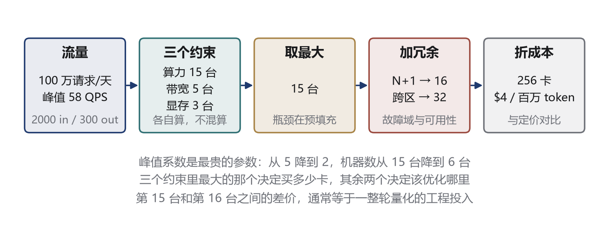

## 容量规划：从 SLO 倒推卡数

### 一个被答错很多次的问题

"要买多少张卡？"

常见的答法有三种。第一种是按 QPS 拍：业务说峰值一万请求每秒，那就备一万 QPS 的机器。第二种是看同行：友商用两百张，我们也备两百张。第三种是拿压测数据线性外推：单卡跑出三百 token/s，业务要三百万 token/s，那就一万张卡。

三种都会翻车。第一种忽略了每个请求的输入输出长度（差十倍很常见），第二种忽略了流量形态（长文档和短问答的机器配置完全不同），第三种忽略了并发和排队（单卡三百 token/s 是批大小 32 时的吞吐，用户多了排队时间会爆炸）。

正确做法是从需求倒推。需要四个输入，算三个约束，取最大值，再加冗余。

这一章把这套流程走完一遍，数字全给，假设全标，读者可以换成自己的参数重算。

### 第一步：把需求写成四个数

需要四个输入。

**日请求量 $R$。** 取 100 万次。

**输入和输出的平均长度。** 输入 2000 token，输出 300 token。这两个数一定要从真实流量里统计，不要凭感觉。经验上工程师的第一直觉往往偏低一半——因为大家心里想的是"用户就问一句话"，实际提示里还有系统提示、工具定义、对话历史、检索内容。

**峰值系数。** 峰值 QPS 除以平均 QPS。交互类业务通常 4 到 8，To B 的内部工具 2 到 3，面向消费者的娱乐应用能到 10 以上。取 5。

**SLO。** 首字延迟 p95 小于 1.5 秒，每 token 间隔 p95 小于 80 毫秒，可用性 99.9%。

有了这四个数，先算峰值。

平均 QPS：

$$\lambda_{\text{avg}}=\frac{10^{6}}{86400}\approx 11.6\ \text{请求/秒}$$

峰值：

$$\lambda_{\text{peak}}=11.6\times5\approx 58\ \text{请求/秒}$$

峰值时刻每秒钟要处理的输入 token 是 $58\times2000=116000$，输出 token 是 $58\times300=17400$。这两个数字是后面所有计算的出发点。

**峰值系数是整个规划里最贵的参数。** 后面会看到，它从 5 降到 2，机器数从 15 台掉到 6 台。所以这个数一定要从历史监控里取，不要拍。取不到就用保守值，但要明白保守的代价是钱。

### 机型假设

为了算得具体，定一个基准配置：70B 稠密模型，FP16 权重，八卡 A100 80 GB 一台（张量并行 8），节点内 NVLink。

各卡参数：FP16 稠密算力 312 TFLOPS，显存带宽 2.04 TB/s。

预填充按 45% 的算力利用率算，解码按 100% 的带宽算（后面会打折扣）。

模型参数：80 层，8 个 KV 头，每头 128 维。每 token 缓存 $2\times80\times8\times128\times2=327680$ 字节，约 320 KB。

### 约束一：预填充算力

一次预填充的运算量是 $2NT_{\text{in}}$，70B、2000 token：

$$2\times70\times10^{9}\times2000=2.8\times10^{14}\ \text{FLOPs}$$

一台节点的聚合有效算力是八张卡各 $312\times10^{12}\times0.45=1.4\times10^{14}$，共 $1.12\times10^{15}$ FLOP/s。

所以一台节点每秒能处理的输入 token 是

$$\frac{1.12\times10^{15}}{2\times70\times10^{9}}=8000\ \text{token/s}$$

峰值需要 116000 输入 token/s，需要的节点数

$$\frac{116000}{8000}=14.5\ \text{台}$$

约 15 台。

这个数字第一次算出来通常会让人吓一跳。它有两条缓解路径：批处理能把利用率从 45% 提到 55% 左右，能省两成；更有效的是前缀缓存和更小的模型，第九章末尾的敏感性分析会算。

### 约束二：解码带宽

解码每步要读一遍权重。70B FP16 是 140 GB，一台节点的聚合带宽 $8\times2.04=16.3$ TB/s，所以每步的下限是

$$\frac{140}{16300}\approx 8.6\ \text{毫秒}$$

批大小决定每步产出多少 token。批 32 时，一台节点每秒产出

$$\frac{32}{0.0086}\approx 3720\ \text{token/s}$$

峰值需要 17400 输出 token/s：

$$\frac{17400}{3720}=4.7\ \text{台}$$

约 5 台。

批大小怎么定？这不是随便取的。批越大，吞吐越高，但每 token 间隔也跟着涨——虽然涨得慢（在带宽受限区间里，单步时间几乎不随批变化），但排队会变长。

还有一条硬上限：批大到越过拐点之后，单步时间开始线性涨。这个拐点可以算。一台节点八卡，每行计算量 $2\times70\times10^{9}=1.4\times10^{11}$ FLOP，除以 $8\times312\times10^{12}\times0.5=1.25\times10^{15}$ 的有效算力，每行 0.112 毫秒。权重读取 8.6 毫秒，对应

$$\frac{8.6}{0.112}\approx 77\ \text{行}$$

所以批最大开到 77，再大就变成计算受限，加批只会拉长每 token 间隔。取 32 是留了余量——因为实际系统里批里还要插预填充，而且请求长度不等，很难稳定维持在 77。

如果取 77，一台节点能到 $77/0.0086=8950$ token/s，只需要 2 台。**这就是为什么"批开多大"是个战略决策而不是调参**：它直接决定买 2 台还是 5 台。

但批开满的代价是每 token 间隔贴着上限，而且一旦有长请求插进来，抖动会传导给所有人。取 32 是稳妥选择，后面的敏感性分析会算这个取舍。

### 约束三：显存与并发

显存决定能同时放多少条请求，进而决定批大小和延迟。

单请求缓存，序列长度取输入加输出 2300：

$$2300\times320\ \text{KB}\approx 736\ \text{MB}$$

一台节点的显存 640 GB，权重占 140 GB，激活和框架开销按 70 GB 算（预填充激活、临时张量、CUDA 上下文、碎片），剩 430 GB 给缓存：

$$\frac{430}{0.736}\approx 584\ \text{条并发}$$

五百多条，远大于拐点 77。所以在这个配置下，**显存不是瓶颈，批大小受计算拐点约束而不是显存约束**。

这是一个重要结论，也是很多人算错的地方。他们看到"70B 模型 140 GB，一张 80 GB 卡放不下，那一定显存很紧"，于是花大力气压缓存。实际上一台八卡机放开 584 条，而批只能用 77 条，压缓存对吞吐毫无帮助。

显存什么时候才会成为瓶颈？三种情况：上下文变得很长（3.2 万 token 时，单请求 10.7 GB，只能放 40 条，低于拐点 77）；模型用了多头注意力（每 token 缓存翻四倍）；或者卡数少、权重占比高（单卡跑 7B，权重 14 GB，剩 42 GB，2048 token 每条 1 GB，只能放 42 条）。

把并发换算成 QPS，用利特尔法则。一条请求的停留时间等于首字延迟加解码时间：

$$1.5+300\times0.08=25.5\ \text{秒}$$

（这里按 SLO 上限取，实际会更快。）

一台节点 584 条并发能支撑

$$\frac{584}{25.5}\approx 23\ \text{QPS}$$

峰值 58 QPS 需要 2.5 台。这条约束给出的答案是 3 台，比解码约束还小。

### 取最大

三个约束给出的数字：

| 约束 | 需要的节点数 | 它管的是什么 |
|---|---|---|
| 预填充算力 | 14.5 | 首字延迟 |
| 解码带宽 | 4.7 | 每 token 间隔 |
| 显存与并发 | 2.5 | 排队时间 |

取最大的那个：**15 台。**

这个结论比数字本身有用。它告诉你瓶颈在预填充上，所以：

- 优化预填充（前缀缓存、更小的模型、W8A8 量化）能直接减少机器；
- 优化解码（量化权重、投机解码）在这套配置下几乎不减机器，因为解码本来就只占三分之一；
- 压缓存完全没用，因为显存空着大半。

如果只算算力会买少一半，只算显存会买多一倍。三个都算，才知道该往哪使劲。

还有一条要检查：合并部署时，同一台机器要同时干两件事，两个约束的机器数是相加还是取最大？

严格说，如果调度足够好，一台机器的时间可以在预填充和解码之间切换，总数取最大就行；但实际系统里切换有开销，批会互相干扰，所以实践中按"相加"估更安全，也就是 $14.5+4.7\approx19$ 台。

这也是第八章那个问题的由来：预填充占 75% 的计算，解码占 25%，两边的配置需求差别很大，混在一起会有干扰。分离之后总数能降到 15 台加 5 台（各自独立扩容），比 19 台少，但多了一层传输和调度。这笔账在第八章算过。

### 加冗余

15 台是理论值，实际要乘冗余。

**N+1 故障域。** 任何一台挂了，剩下的要能顶上。15 台加 1 台，16 台。

**跨可用区。** 可用性 99.9% 意味着一年允许 8.7 小时不可用。单个可用区的年故障概率远高于这个，所以要跨两个区，每个区独立承载。卡数翻倍，32 台。

**滚动升级的余量。** 升级引擎时不能全停，要留一批旧版本在跑。这项可以和 N+1 复用，不用额外加。

最终 32 台，256 张卡。

这个数字看着比 15 台翻了一倍多，很多人第一反应是"冗余太多了"。但跨区这一条是有明确依据的：单个可用区的 SLA 通常是 99.9%，两个区独立之后才可能做到 99.95% 以上。如果业务只要求 99.5%，单区就够，卡数回到 16 台。

### 折成单位成本

把卡数换成钱，再换成单位成本：

$$\text{每百万 token 成本}=\frac{\text{卡时单价}\times\text{卡数}}{\text{每小时 token 数}}\times10^{6}$$

A100 80 GB 的云上按需价按每小时 1.5 美元算（自建要加上折旧、电、机房，量级相近）。

256 张卡每小时 384 美元。

每小时产出的 token：一天 $10^{6}\times(2000+300)=2.3\times10^{9}$ 个，除以 24 得 $9.6\times10^{7}$。

$$\frac{384}{9.6\times10^{7}}\times10^{6}\approx 4.0\ \text{美元/百万 token}$$

如果只按输出 token 计费（商业定价通常这样），分母变成 $1.25\times10^{7}$，得到 30.7 美元每百万输出 token。

这两个数字差八倍，但它们说的是同一件事，只是分摊口径不同。**和商业定价对比时一定要先说清口径**，否则会得出"我们成本是别人的十倍"这种错误结论。

再加 30% 的网络、存储、监控和人力，混合口径下约 5.2 美元每百万 token。

这个数字要和市场价对比。如果市场价是 2 美元，而你的自建成本是 5.2，说明要么规模不够（摊不薄固定成本），要么利用率太低（峰值系数太高），要么配置不对。

反过来，这个比值也解释了为什么第五章的量化、第七章的投机解码值得做：它们直接改分母。

### 敏感性分析：六个参数各动一下

容量规划最有用的一步不是算出那个数，而是知道哪个参数最敏感。

**峰值系数。** 从 5 降到 2，峰值 QPS 从 58 降到 23。预填充 $23\times2000/8000=5.8$ 台，解码 $23\times300/3720=1.9$ 台，取最大 6 台。加冗余 13 台。**机器数从 32 台降到 13 台**，成本降六成。

这是所有参数里影响最大的一个。做法是削峰而不是加卡：排队、限流、把离线任务挪到低谷、给突发流量一个等待队列。工程上一套限流器比二十台卡便宜得多。

**输入长度。** 峰值 58 QPS 固定，输入长度从 500 扫到 32000：

| 平均输入 | 预填充节点 | 解码节点 | 取最大 | 加冗余后 |
|---|---|---|---|---|
| 500 | 3.6 | 4.7 | 5 | 11 |
| 2000 | 14.5 | 4.7 | 15 | 32 |
| 8000 | 58 | 4.7 | 58 | 124 |
| 32000 | 232 | 4.7 | 232 | 496 |

输入长度每翻四倍，预填充节点就翻四倍。这是"长上下文很贵"最直接的体现：同样一百万次请求，输入从 2000 涨到 32000，机器从 32 台变成 496 台。

实际业务不会这么极端，因为长输入通常伴随更少的请求数（用户不会一天问一百遍三万字文档）。但这条曲线解释了为什么长上下文的定价必须比短问答高一个量级。

**输出长度。** 固定输入 2000，输出从 100 扫到 4000：

| 平均输出 | 预填充节点 | 解码节点 | 取最大 | 加冗余后 |
|---|---|---|---|---|
| 100 | 14.5 | 1.6 | 15 | 32 |
| 300 | 14.5 | 4.7 | 15 | 32 |
| 1000 | 14.5 | 15.6 | 16 | 34 |
| 4000 | 14.5 | 62 | 62 | 132 |

输出长度翻四倍，解码节点翻四倍。在输出 1000 附近，预填充和解码刚好打平——这个交叉点是一个有用的标志：左半边该优化预填充，右半边该优化解码。同一个系统，不同业务的优化方向可能完全相反。

**前缀缓存命中率。** 系统提示占比 70%，命中率 78%，实际要算的输入变成 $1-0.7\times0.78=45\%$。预填充节点从 14.5 降到 6.5，加冗余后从 32 台降到 15 台。**一行代码级的改动（把时间戳挪位置）能省一半机器。** 这是整章里性价比最高的一条。

**W8A8 量化。** A100 的 INT8 算力是 FP16 的两倍，预填充节点从 14.5 降到 7.3（假设量化效率能到 90%）。解码那边权重量减半，从 4.7 降到 2.3。取最大 7.3，加冗余 16 台。**从 32 台降到 16 台。**

代价是质量风险（第五章算过，4 位要仔细评估，8 位基本无损）。W8A8 在 8 位上，风险低，收益大。

**SLO 收紧。** 首字延迟从 1.5 秒收到 0.5 秒。这条不能靠加卡解决——预填充时间本身是 0.25 秒，加卡只能减少排队，减不了计算。要在 0.5 秒内交付，排队时间必须压到 0.2 秒以内，也就是利用率要降到五成以下。结果是机器翻倍，而且一旦有长提示进来就会超标。

正确的做法是改技术：前缀缓存把常见前缀的预填充省掉，切块预填充把长提示的抖动摊平，或者给长提示单独一个池子。**SLO 收紧改变的不是"买多少卡"，而是"用哪种技术"。**

把六条并排看，结论很清楚：

| 手段 | 机器数（加冗余后） | 工程成本 |
|---|---|---|
| 基线 | 32 | — |
| 峰值系数 5 → 2 | 13 | 一个限流器 |
| 前缀缓存 78% | 15 | 改提示拼接顺序 |
| W8A8 量化 | 16 | 一次量化与评测 |
| 解码批 32 → 77 | 28 | 一个配置项 |
| SLO 收紧到 0.5 秒 | 64 | 要改架构 |

前三行是"几乎免费"的，加起来能把机器从 32 台压到 8 台左右（效果不完全叠加，实际在 12 台附近）。这条路径的存在说明一件事：**大部分团队在买卡之前，都还有一半的钱没省。**

### 预留余量：为什么不能把卡用到 100%

上面每一行都默认“卡能跑满”。现实里要给两个东西留余量。

**一是突发。** 流量不会均匀到达，每秒 58 个请求是平均值，某一秒到 90 个很正常。预留 15% 到 20% 的余量，能吸收这部分突发而不用排队。第三章算过，利用率从 80% 升到 90%，平均等待会翻三倍。

**二是长请求。** 一条三万 token 的请求进来，会瞬间占掉 9.6 GB 缓存和一大块算力。如果机器刚好跑满，这条请求会让所有人一起慢。预留一点空间给它，代价远小于抖动带来的影响。

这笔余量在账上体现为“实测吞吐只有理论值的八成”。规划时就应该直接乘个 0.8，而不是算完再看实测为什么不够。

### 什么时候“加卡”是错答案

**GPU 利用率低于四成。** 说明卡在那里闲着，问题在调度或者批大小，不在数量。

**排队时间长但每 token 间隔正常。** 这是典型的容量不足，加卡对。但如果同时利用率也低，说明是调度器把请求卡住了（比如批上限设得太小）。

**首字延迟超标但每 token 间隔正常。** 瓶颈在预填充。加卡有效，但先看前缀命中率——命中率低的话，改提示拼接顺序比加卡便宜一百倍。

**每 token 间隔超标。** 瓶颈在解码带宽或者批太大。加卡能缓解，但先看批有没有越过拐点。

**所有指标都正常，只有偶发尖刺。** 这不是容量问题，是长请求、垃圾回收、或者上游超时重试造成的。加卡不会消除尖刺，只会让它更不明显。

一个具体的失败案例：某团队看到 p99 延迟超标，直接申请了三十张卡。上线后 p99 只降了两成，因为瓶颈在网关的串行日志写入上（每条请求同步写一次磁盘）。他们后来把日志改成异步，p99 降了七成，卡退了二十张。

### 上线后盯三个数

容量规划不是一次性的，上线之后要持续校准。

**GPU 利用率。** 长期低于 40% 说明买多了，或者批没开起来。注意要区分"算力利用率"和"带宽利用率"——解码场景里算力利用率天然很低，看它没意义。

**缓存占用率。** 长期高于 80% 说明并发被显存卡住，该压缓存。长期低于 40% 说明显存买多了（或者上下文估高了）。

**排队时间。** p95 排队超过 SLO 的三分之一，说明容量不足。这一项最能反映真实体验，因为它把调度、批、容量全包含进去了。

三个数合起来能判断该加卡还是该优化。建议每周看一次，不要等投诉。

### 一支笔省下几十张卡

容量规划的核心是"三个约束分别算、取最大、加冗余、折成本"。听起来笨，但它能避免两类错误：只算一个约束（通常只算算力），以及凭经验拍数字。

这一章的账里，最贵的参数是峰值系数，最容易改的杠杆是前缀缓存，最容易被误判的约束是显存。三个结论都不是通用真理，它们属于这组假设。换一组假设，结论会变，但流程不变。

最后一个提醒：这份账要写下来，连同四个输入参数和所有假设，归档成一份可以重算的表格。三个月后流量变了、模型换了、卡型换了，改几个格子就能重新得到答案。凭记忆重新拍一次，往往比第一次拍得还偏。

下一章把这套流程和前面所有技术串起来，做一次完整的部署复盘。
