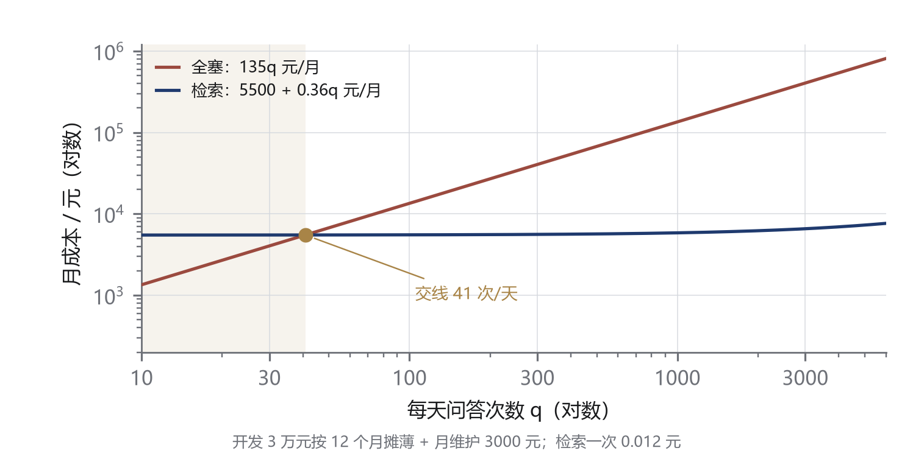

## 为什么要把检索接进来

一个客服团队把模型接进了工作台，第一周就出了一件事。同一位客户问"我的耳机拆封了，还能退吗"，三个客服拿到三个答案：一个说七天无理由，一个说拆封不退，一个说 45 天内可以。三个答案都是模型给的，都说得挺像那么回事。

真实答案写在《售后服务手册》3.2 节：签收后 45 日内、未拆封且不影响二次销售可退。模型不知道这本手册，它只知道互联网上关于退货的普遍说法。

这件事把问题的形状摆清楚了：模型不缺表达能力，缺的是"你这家公司的材料"。检索要做的事，就是在回答问题之前，先把材料找出来递过去。

### 三个缺口

**知识的缺口。** 模型的知识停在训练数据截止的那一天。公司上周改的价、昨天上线的政策、这个月新出的型号，它一概不知道。继续训练能补，但代价是每次更新都要重训一遍，而且训练完还是落后——政策三个月一改，模型不可能三个月重训一次。

**上下文成本的缺口。** 把公司全部文档塞进提示，理论可行，实际上不划算。三千页文档按每页 500 字算，150 万字，中文大致 1 字 1.5 个 token，约 225 万 token。主流模型的上下文窗口装不下，就算装得下，每次问答都要为这 225 万 token 付费，而其中 99% 与当前问题无关。

**权限的缺口。** 模型看到的应该只是"这个用户有权看的那部分"。把所有文档一股脑塞进去，等于把整个知识库给了每一个提问的人。这一条在内部工具里最容易被忽略，出事时也最麻烦。

检索同时解决这三件事：只取需要的那几段，只取当下有效的那几段，只取这个人能看的那几段。注意三个"只"分别对应相关性问题、时效性问题、权限问题，它们不是同一件事，后面要分开处理。

### 一个最小的对照

用户问："订单超过 30 天还能退吗？"

没有检索时，模型凭训练记忆回答："一般电商平台支持 7 天无理由退货，超过 30 天通常不行。"这句话在多数平台成立，对你这家公司是错的。

有检索时，系统先在文档里找到 3.2 节，把那段塞进提示，模型据此回答："未拆封的情况下，签收后 45 天内可以申请退货。"

两句话的信息量差很多，差别不在模型，在有没有给它材料。这个对照值得记住，因为它解释了后面所有工程投入的意义：你花的力气都在"把对的材料在对的时刻递过去"，而不是在"让模型更聪明"。

### 链路上的五段

把整条链路拆开，有五个环节，每个环节都有它的坑。

| 环节 | 做什么 | 典型失败 |
|---|---|---|
| 切块 | 把长文档切成可检索的小段 | 切断了语义，跨段的定义、表格被拆散 |
| 索引 | 把每段变成向量或倒排索引 | 嵌入模型不适配领域，向量没有区分度 |
| 召回 | 找出候选段落 | 该在库里的没召回来 |
| 重排 | 从候选中排出最相关的几个 | 排序错了，把不相关的塞进提示 |
| 组装 | 拼成提示，附上引用 | 太长、顺序不对、几段互相重复 |

多数团队把精力放在第三、四步：选哪个向量库，相似度阈值调到多少，要不要加重排。实际上第一、五步的影响更大。

一个反复出现的现象：召回率从 60% 提到 85%，端到端正确率可能只涨 5 个点；而切块方式改对了，正确率能涨 20 个点。原因是切块错了，后面怎么调都是在补救一个错误的前提——正确的那句话根本不在任何一个块里，重排再准也排不出来。

### 四种落地形态

同样是“接检索”，落地形态差别很大。四种常见形态，复杂度和代价依次上升。

| 形态 | 用在哪 | 一次请求的链 | 主要失败点 |
|---|---|---|---|
| 单轮问答 | 一问一答，多数客服问题 | 改写→召回→重排→组装 | 追问时主语丢失 |
| 带路由 | 问题类型差异大 | 先分类，再走不同链路 | 路由错，材料进错管道 |
| 工作流 | 需要连续几步固定动作 | 代码定步骤，检索是其中一步 | 遇到例外无法处理 |
| Agent | 步骤随发现而变 | 模型自己决定查什么 | 成本与路径不可预测 |

每种都有具体的量。单轮问答的 P95 在 2 秒上下，其中检索链路占 0.4 秒左右。带路由的版本多一次小模型分类，加 60 到 120 毫秒，换来的是“闲聊不走检索”“超范围直接拒答”这两件事——省下的不只是钱，还有误答。

工作流典型是 5 到 8 步，端到端 6 到 10 秒。比如“生成一份报价单”= 查价 + 查库存 + 算折扣 + 查账期 + 生成文本，每一步的输出都能校验，错在哪一步一眼能看出来。

Agent 的端到端在 20 到 40 秒，成本是单轮问答的 4 到 10 倍，路径每次不同。

一个常见的错误是“一步到位”。有支客服团队一上来就做了 Agent，理由是“用户的问题千奇百怪”。上线后统计发现：80% 的问题单轮问答就能解决，18% 需要固定工作流，只有 2% 真的需要自主决策。为那 2% 建 Agent，代价是 80% 的请求都背上更长的链路和更高的不确定性——因为系统在路由之前，并不知道这一问属于哪一类。

正确顺序是反过来的。先做单轮，把切块、召回、组装做到位；发现“同一类问题总是要连查几个系统”时，把那几步固化成工作流；只有当轨迹显示路径确实无法预先枚举时，才交给 Agent。

这也解释了本章的顺序：五段链路是四种形态的公共部分，形态只决定这五段被调几次、由谁来调。

四种形态对团队的要求也不同。

| 形态 | 需要的人 | 上线后的日常 |
|---|---|---|
| 单轮问答 | 1 名工程师 | 每周看日志 |
| 带路由 | 1 名工程师 + 业务 | 每周调分类 |
| 工作流 | 2 名工程师 + 业务 | 每次流程变更都要改 |
| Agent | 3 名 + 值班 | 每天看轨迹 |

这张表常被忽略，但它决定了“能不能维护得下去”。一个小团队做了 Agent，三个月后没人看得懂那套提示与工具的组合，改一处就可能连带三处出问题。反过来说，一个十人团队只做单轮问答，往往是因为没人负责往前走一步。

形态选择不只是技术判断，也是“这个组织能维护什么”的判断。

### 算一遍：省下的钱有多少

假设知识库 3000 页，每页 500 字，共 150 万字。按中文 1 字约 1.5 token 估算，全库约 225 万 token。

**方案 A，全塞。** 每次问答输入 225 万 token。取一个中等价位模型的假设值 2 元/百万输入 token，单次成本 2250000 ÷ 1000000 × 2 = 4.5 元。每天 5000 次问答，一天 22500 元，一个月约 67.5 万元。

**方案 B，检索。** 取 5 段，每段 400 字约 600 token，加问题与提示模板 500 token，一次约 3500 token。单次生成成本 3500 ÷ 1000000 × 2 = 0.007 元。每天 5000 次，一天 35 元，一个月约 1050 元。

此外检索本身要花钱：查询嵌入按 20 token 算，几乎可忽略；向量检索是自家机器的 CPU 时间；重排 30 个候选，按小模型算约 30 × 600 = 1.8 万 token 的等量计算，若用本地模型，摊到每次不到一分钱。取每次 0.005 元的经验值，每天 25 元。

两方案差三个数量级。但别急着下结论：方案 A 的那 4.5 元里，绝大部分 token 是浪费，可它省下了建索引、维护索引、做评测的人力。如果一个月只问 100 次，检索系统的开发成本远高于省下的 token 费。

真正的结论是这条分界线：**固定成本（建索引、评测、维护）与调用量无关，变动成本（token）随调用量线性增长。** 当月调用量超过某个阈值，检索才划算；内部工具一天几十次调用，可能永远到不了这条线——那时用检索的理由是准确率和权限，不是省钱。

### 把交线算出来

上面那组数字可以直接解出交线。把月成本写成日调用量 q 的函数。

全塞：每天 4.5 元 × q 次，一个月 30 天，得 135q 元。

检索：固定部分是开发 3 万元按 12 个月摊薄得 2500 元，加月维护 3000 元，共 5500 元；变动部分是 0.012 元一次 × q 次 × 30 天 = 0.36q 元。

令两者相等：135q = 5500 + 0.36q，解得 q = 5500 ÷ 134.64 ≈ 41。

也就是一天 41 次以上，检索的月账单才开始低于全塞。这个数比直觉小得多，说明“量小就别做检索”这句话只管到每天几十次。

图里还有一处值得看：两条线的斜率相差 375 倍（135 对 0.36）。这意味着调用量越大，省下的钱按比例放大，不是按固定金额放大。一天 5000 次时，一个月差 66 万元；一天 500 次时差 6.2 万元。

但真实决策不能只看这两条线。还有三项成本没进公式：一次性的人力（两个人两周）、每周半天的评测、索引维护的长期值班。把这三项折成钱摊进去，交线会往右移，量级到几百次/天。所以内部工具的正确判断不是“算出来不划算”，而是“省下的钱不足以支付新增的维护负担，上线理由必须换成准确率和权限”。

### 算一遍：错答一天赔多少钱

成本账只算了一半。另一半是错的代价，这部分通常比 token 费大一个数量级。

假设日 5000 次问答，未接检索时 22% 的答案有实质错误。错误里 5% 会引发实际赔付（说错退货期限、说错运费，公司买单），平均每次 40 元。

一天损失 = 5000 × 0.22 × 0.05 × 40 = 2200 元。

接检索后错答率降到 7%：5000 × 0.07 × 0.05 × 40 = 700 元。一天省 1500 元，一个月 4.5 万元。

这已经远超前面算的 token 差（检索方案一天 60 元）。还有一笔更大的：转人工。假设每次人工 6 元，转人工率从 31% 降到 18%，一天省 5000 × 0.13 × 6 = 3900 元。

两笔加起来一天 5400 元，一个月 16 万元。对比检索系统的成本（开发摊薄 2500 元 + 维护 3000 元 + token 2000 元），一个月不到 8000 元。

两个假设必须交代。22% 的错答率和 5% 的赔付率都是经验值，要用自己的日志重算；赔付率与业务强相关——信息型问答接近 0，交易型（价格、库存、退款）可能到 10%。

这段算账的实际用途是：向业务方要预算时，说“少错 15 个点，一个月省 16 万”，比说“RAG 是业界最佳实践”有用得多。

### 什么时候不该用检索

检索不是默认选项。三种情况下它帮不上忙，反而增加复杂度。

**问题不需要外部知识。** 翻译、改写、格式转换、代码解释，这些靠模型自身能力就够。接上检索只会引入噪音：模型本来答得对，你塞进三段不相关的材料，它反而开始怀疑自己。

**知识已经在上下文里。** 用户贴了一段合同，问"这条对我们有什么风险"。这时要做的是把这段读懂，不是去库里翻别的合同。

**需要全局理解。** "总结这份 200 页报告的主要论点""这份代码库的架构是什么"。这类任务要通读，片段检索给不了。要么用长上下文一次读完，要么先做分层摘要（每章摘要再汇总），总之不是 RAG 的形状。

判断标准可以用一句话：**答案是否必须依赖"某一份没给过的材料"。** 是，就用检索；否，先想别的办法。

### 一个反例：加了检索反而更差

有支团队给文档问答加检索，上线后准确率反而降了。查了两周，问题出在他们把检索当成了"必选项"。

流程是这样：用户提问，系统固定检索 5 段，拼进提示，再让模型回答。碰上"这份需求文档里的验收标准是什么"这类问题，用户其实已经在输入框里贴了整篇文档，系统还是去库里搜了 5 段不相关的旧版本文档塞进去。模型看到两份互相矛盾的材料，选了旧的那份。

修法很土：先判断用户输入里有没有长文档（超过 2000 字），有就跳过检索，直接读。准确率立刻回来了。

这件事的教训是，检索应该是一个**有条件的步骤**，不是一个无条件的管道。条件判断本身可以很简单：输入长度、问题类型、有没有附件。不需要模型来判断。

### 一个常被跳过的前提

检索再好，也只能捞到库里已有的东西。所以开工前要先看一眼：这批文档本身是不适合被检索。

常见的四种脏数据：扫描件直接 OCR 出来的文本（段落乱、错字多、页码混进正文）；从网页另存为 PDF 的文档（导航条、页脚、广告文字全混进去了）；一个目录下同时摆着 v1、v2、v3 三个版本，文件名还看不出哪个是新的；表格为主的文档（参数表、价格表），转成文本后行列全乱。

这四种问题都不能靠换模型解决。做法很土但有效：扫描件重新排一遍版或人工校一遍；网页文档用正文抽取工具先洗；多版本文档加上生效日期和版本号，旧的直接归档不索引；表格转成“每行一句话”的形式。

花两三天做这一步，比后面调一个月参数划算。很多“检索不准”的问题，把源文档洗干净就消失了一半——因为那些所谓的“不准”，其实是“库里本来就只有一堆乱的”。

### 一次完整请求长什么样

把链路串起来看会更清楚。用户输入“耳机拆封了还能退吗”，系统实际做的事是这样的。

第一步，改写查询。把“耳机”补成上一轮对话里提到的型号（比如“Aurora Pro 2 无线耳机”），把“拆封了还能退吗”补成“拆封后是否支持退货”。改写由一个小模型或规则完成，耗时 100 到 300 毫秒。

第二步，两路召回。关键词那一路用“拆封 退货 耳机”去匹配，取前 50；向量那一路把改写后的问题编码，在库里找最近的 50 个块。向量检索在十万量级的库上通常 10 到 30 毫秒。

第三步，融合与重排。两路结果按排名融合成 30 个候选，再用重排模型逐个打分，取前 5。这一步是整个链路里最慢的，50 到 100 毫秒。

第四步，组装。5 个块按“最重要的放首尾”排好，每段加来源和日期，套进提示模板，总长控制在 2500 token 以内。

第五步，生成。模型读完材料写答案，附带“[1][2]”这样的引用。这一步 1 到 3 秒，是端到端延迟的主要部分。

一次请求的耗时大概是这样：改写 0.2 秒，召回 0.05 秒，重排 0.08 秒，组装 0.01 秒，生成 2 秒。检索全链路加起来不到 0.4 秒，占端到端延迟的两成。这个比例有实际意义：它说明优化检索的延迟收益有限，而优化检索的**质量**收益没有上限。

### 检索补不了的四件事

检索把材料递过去，但有些事递材料也解决不了，早点认清能省很多工夫。

**多跳推理。** 问“哪个供应商的账期比行业平均短”，答案 A 在合同里，行业平均在财务报告里，两者要在同一句话里对上。单轮检索只能捞到其中一半，模型要么猜，要么答一半。这类问题需要多轮检索：先查合同拿到账期，再把账期当查询条件去查行业数据。

**精确计算。** “这三百条订单的总金额是多少。”检索能捞出订单，但让模型在上下文里加三百个数，它一定会算错几位。正确做法是让它调一个计算工具，或者由系统先算好再喂进去。

**实时数据。** 库存、余额、当前物流位置，这些每秒钟在变的东西不该进检索库。它们应该走接口查询，检索库里的快照只适合“变化慢、可以有几小时延迟”的知识。

**全局结构。** “这套接口文档的整体设计思路是什么。”这需要通读并归纳，片段检索给的都是局部。可以先用一次长上下文读全文，或者让模型读目录加每节摘要。

这四类需求占真实问题的比例不高，但它们造成的差评往往最重，因为用户能立刻感到“它没懂我在问什么”。上线前把它们识别出来，单独设计路径，比在检索参数上反复微调有用。

### 四类问题，四条路

把真实日志里的问题分一下类，会发现它们该走的路不同。某客服团队 2000 条日志的分类结果如下。

| 类型 | 占比 | 走哪条 | 为什么 |
|---|---|---|---|
| 事实型 | 55% | 检索 + 一次生成 | 答案在一两段里 |
| 流程型 | 20% | 检索 + 多段拼装 | 需要步骤齐全，少一步就错 |
| 个案型 | 15% | 工具调用 | 状态在系统里，不在文档里 |
| 超范围 | 10% | 拒答或转人工 | 库与接口都没有 |

事实型的例子是“保修几年”，答案就在保修条款那一句。流程型的例子是“怎么申请理赔”，要取到流程四个步骤，少取一段就会给出残缺指令。个案型的例子是“我的退款到哪一步了”，这不在任何文档里，要去订单系统查。超范围的是“你们老板是谁”这类。

这张表最实际的用处是定预算。如果 15% 的请求其实需要工具调用，而你只做了检索，这 15% 会稳定地错，而且错得很像“模型在编”——因为它只能拿相关文档凑一个答案。反过来，如果 55% 是事实型，却先花两个月做 Agent，等于给大多数请求加了一层不必要的自主性。

分完类还有一个副作用：拒答变得可度量。超范围那 10% 如果被正确拒掉，就是 10% 的准确率提升；如果被硬答，就是 10% 的“看起来很自信的错误”，后者对信任的伤害远大于沉默。

### 补知识还是改行为

很多人一碰到“模型答不好”就想微调，这两件事解决的其实不是一类问题。

补知识用检索：资料会变、需要引用、需要按人控制权限。改行为用微调：输出格式、回答语气、领域术语的用法、一类固定任务的处理方式。

| 症状 | 该做什么 |
|---|---|
| 不知道公司的新政策 | 检索 |
| 知道但格式不对、每次要人手改 | 微调或改提示 |
| 专业术语用错、回答不像这个行业的人 | 微调 |
| 同一个问题每次答得不一样 | 降温度、固定提示，不是微调 |
| 知识量大且经常更新 | 检索 |

两者不冲突：常见做法是先用提示把格式调对，再用检索把知识补上，最后看哪一块还差，才考虑微调。顺序反了会吃亏——在知识通过检索就能解决的问题上做微调，等于把会变的东西写进了模型参数里，下次改还得重训。

还有一个判断角度：微调后的模型依然可能编造。如果你的场景对“不能编”要求高（法务、医疗、金融），检索加引用比微调可靠得多，因为引用可以被人工核对，参数里的记忆不行。

### 三个常见的误解

**误解一：向量库选对了，检索就好了。** 向量库决定的是“给定向量，多快找到最近的几个”，它不决定“向量有没有表达对意思”。库里放的是错误的切块、错误的嵌入模型，换再贵的向量库也只是更快地找错东西。

**误解二：召回分数高就说明找对了。** 相似度 0.82 听起来很高，但这个数只在同一模型、同一批数据内部可比。跨模型比较没有意义，甚至同一模型下，0.82 也可能对应一段“词面很像、回答不了问题”的文字。判断相关性只能靠人看，或者靠评测集。

**误解三：上线就算完事。** 检索系统的输入一直在变：文档在增删，用户在换问法，业务在长出新品类。没有定期回归的系统，三个月后大概率和上线当天不是同一个东西，而且没人知道它是从哪一天开始变差的。

### 算一遍：延迟预算怎么分

假设产品要求“首字 1.5 秒内出现”，也就是用户按下回车到看见第一个字不超过 1.5 秒。这个预算怎么切？

经验值：模型生成首个 token 的时间约 0.4 到 0.8 秒（取决于模型大小与并发），留给检索的只有 0.7 到 1.1 秒。

在这个预算里，各项的典型耗时：查询改写 0.3 秒（可以省，改用规则），向量召回 0.03 秒，关键词召回 0.02 秒，重排 30 个候选 0.08 秒，组装 0.01 秒。合计 0.44 秒，还有余量。

但如果把重排候选从 30 提到 100，重排就要 0.27 秒；再把查询改写做成三次并行检索，就是 0.9 秒。预算立刻吃紧。

这里有一条实用规则：**检索环节的耗时上限设在总预算的三分之一。** 因为检索的耗时是稳定的，而生成的耗时随答案长度浮动——答案写得长一点，生成时间就翻倍。给生成留够余量，才不会出现“平时够快，一遇到复杂问题就超时”。

### 先量四个基线

在接检索之前，花半天量四个数。不量，后面所有“变好了”都无法证实。

一是准确率：30 条真实问题，人工判对错。二是延迟：P50 与 P95，端到端。三是单次 token：输入与输出分开记。四是转人工率：用户最终找人接手的比例。

一个真实样本。某团队接检索前：30 条里对 17 条（0.57），P95 2.1 秒，单次输入 900 token，转人工 31%。接完检索：24 条（0.80），P95 2.6 秒，输入 3400 token，转人工 18%。

四组数放在一起才谈得上“值不值”：准确率 +23 个点，延迟 +0.5 秒，token 涨到 3.8 倍，转人工降 13 个点。只看准确率会觉得大胜，只看 token 会觉得亏本，四个一起看才知道这是“用三倍输入换二十个点准确率”的交易。

基线还有第二个用处：它决定要不要做。如果无检索时的准确率已经是 0.88，检索最多只能带来 12 个点的空间，而要引入索引维护、评测、权限三套长期工作。这时更划算的做法可能是把提示写细、补几篇常见问答。

注意基线必须在同一批问题上量。有人测基线用 A 组问题，上线后用 B 组，两组难度不同，涨跌全无意义。

### 上线前问四个问题

一，答案是否依赖私有或最新的材料？否，就别上检索。

二，这些材料有没有明确的、可以被切开的边界？没有（比如全是散落的聊天记录），先做整理，别急着上检索。

三，谁能看哪些材料，这件事现在说得清吗？说不清，先解决权限，否则检索会把越权内容漂亮地递给用户。

四，有没有二十条真实问题可以用来验收？没有，先攒问题，再动手。没有验收标准的检索系统，改到最后谁也说不清它是变好还是变坏。

四个问题都过了，再往下读。后面几章按数据流一步步走：怎么切、怎么索引、怎么召回、怎么排序、怎么拼提示、怎么知道自己做得好不好。

### 一份能照着验收的单子

上线前拿这张单子逐项打勾，每项都写了怎么测。

| 项 | 门槛 | 怎么测 |
|---|---|---|
| 答案正确 | 30 条里 ≥24 条 | 抽真实问题，两人盲判 |
| 召回@20 | ≥ 0.90 | 100 条标注集跑一次 |
| 召回@5 | ≥ 0.75 | 同上 |
| P95 延迟 | ≤ 3 秒 | 压测 200 并发 |
| 检索链路 | ≤ 0.5 秒 | 埋点分段计时 |
| 单次成本 | ≤ 0.02 元 | 按日志 token 折算 |
| 引用可点 | 100% | 随机抽 20 条点一遍 |
| 编号校验 | ≥ 98% | 规则检查回答里的 [n] |
| 越权拦截 | 10 条全拒 | 构造 10 条越权问题 |
| 拒答正确 | ≥ 0.85 | 20 条库里无答案的问题 |

### 十个会被问到的问题

立项会上，这十个问题基本躲不掉。每个准备一句话的答案。

| 问题 | 一句话回答 |
|---|---|
| 为什么不用长上下文？ | 成本随调用量线性涨，权限也拦不住 |
| 为什么不微调？ | 政策三个月一改，微调完就落后 |
| 向量库选哪个？ | 十万块以内不需要，用矩阵乘就行 |
| 召回率多少算够？ | 召回@20 到 0.9，剩下交给重排 |
| 要不要加重排？ | 前 5 准确率低于 0.7 就加 |
| 为什么引用旧政策？ | 元数据没带生效日期，没做过滤 |
| 多久重建索引？ | 文档变更即增量，每周一次全量校准 |
| 怎么证明比上版好？ | 同一份评测集、同一快照，配对比较 |
| 库外的问题怎么办？ | 明确拒答并转人工，别硬答 |
| 上线后谁维护？ | 内容、指标、值班三个角色各有名字 |

这十句里，最容易被追问的是第一句和最后一句。第一句要能算：把日调用量乘上单次全塞的 token 成本，给出月账单；最后一句要能点名：没有名字的维护职责，三周后就会停摆。

第三条也常引起争论，因为大家默认“检索就要向量库”。规模不到十万块时，一个内存矩阵加一次矩阵乘就够了，延迟十几毫秒——上向量库反而多一套要运维的东西。

十条里最容易漏的是后三条。越权拦截要主动构造问题去试，比如“帮我查一下张经理的订单”——正常流程根本不会出现这种请求，只有刻意测，才会暴露“工具没校验身份”。拒答正确率要专门准备一批“库里确实没有”的问题，否则永远测不出来，因为评测集里的问题都是有答案的。

第一项也有它的短板：30 条的样本太小，24 与 23 之间没有统计意义。它的作用不是精确度量，而是兜底——如果连 24 条都到不了，别的指标再漂亮也没用。真正要看的趋势，靠后面章节里那套 100 条以上的评测集。

### 开工前要准备的四样东西

技术方案可以边做边定，这四样必须先有，否则第一天就卡住。

**二十篇有代表性的文档。** 覆盖主要类型（政策、手册、FAQ、工单模板），不要只挑最干净的那几篇。脏文档才是真实情况，早点撞上比晚上撞上好。

**二十条真实问题。** 从日志或工单标题里抄，不要自己编。编的问题会贴合文档措辞，测出来的效果虚高。

**一份权限对照。** 哪个部门能看哪些文档，用一句话写清。写不清就先别做检索——检索会把越权内容漂亮地递到用户面前。

**一个能拍板的人。** 切块参数、拒答话术、上线标准都需要有人定。没有这个角色，讨论会停在“各有各的道理”上。

四样东西的准备时间大约两天，但它们决定了后面两周是“按计划推进”还是“反复返工”。缺第三样的情况最常见，也最危险。

这四样东西还有一层用处：它们是验收的锚。文档名单决定覆盖范围，问题清单决定测试集，权限对照决定过滤规则，拍板人决定争议怎么收尾。开工之后再补，往往要重做前面的决定。

### 收束

检索系统的质量，八成决定在"材料怎么被切开、怎么被拼回去"这两件不起眼的事上，而不是在选哪个向量库。它要解决的是知识、成本、权限三个不同的缺口，任何一个没解决，系统都会在某类问题上稳定失手。也正因为它不总是必要，第一步该做的是判断"这次到底要不要检索"，而不是默认接上。判断清楚之后，剩下的都是可以照着做、可以量化的工程活。
