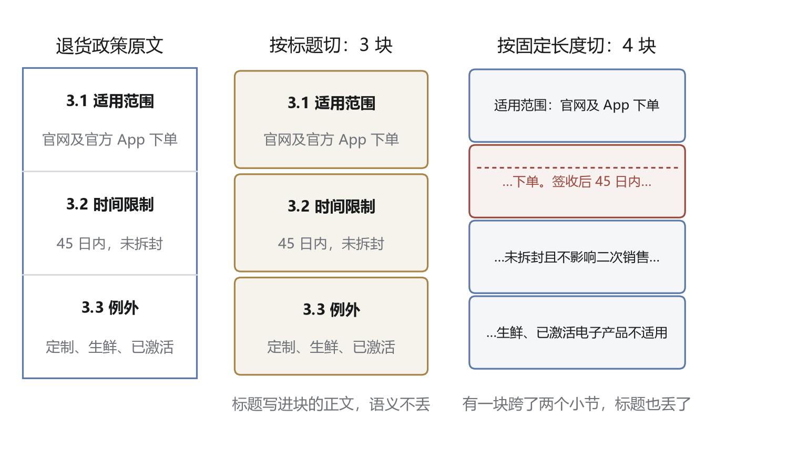

## 切块：检索质量的第一道关

有位同事在验收客服助手时发现一个问题：问"拆封了还能退吗"，系统答"拆封后不支持退货"。他没急着改模型，先去库里看了召回的那一段，内容是：

> 签收后 45 日内可申请退货，未拆封且不影响二次销售。定制商品、生鲜、已激活的电子产品不适用。

"未拆封"三个字就在里面，模型却把"未拆封"这个前提理解成了"拆封后不行"。再往上看一段，3.1 节写着"本条适用于通过官网及官方 App 下单的商品"，而召回的这一段里没有这句，模型也就不知道适用范围。

问题不在模型的理解，在这段文字被切出来时，标题和前后文都留在了别的块里。切块是检索质量的第一道关，也是返工最多的一道关。

### 为什么必须切

三个原因，每个都很硬。

**模型的输入有长度限制。** 嵌入模型常见输入上限是 512 token 或 8192 token，超出部分会被截断。一整篇 20 页的文档塞进去，只有开头被编码，后面全丢。

**整篇的向量会平均掉细节。** 一份文档里一段讲退货、一段讲发票、一段讲保修，压成一个向量后，它跟"退货""发票""保修"都沾一点，但都不像。检索时它可能被这三类问题都召回，也可能都排不进前几，因为向量是被拉平了的。

**检索粒度必须和回答粒度匹配。** 用户问"运费多少"，你需要的是那两三句，不是一整篇 20 页的文档。取回整篇，要么超出预算，要么模型要在里面重新找一遍——那等于把检索的活又交给模型做一次，成本高且不准。

所以要把长文档切成小段，每段单独建索引，检索时按段召回。

### 三种切法

**固定长度切。** 按 token 数切，比如每 300 token 一段，段间重叠 50。实现最简单，任何文本都能切，不会因为你文档格式奇怪而崩掉。缺点是把句子、表格、代码切散，而且切点与语义边界无关。

**按结构切。** 按 Markdown 标题、HTML 标签、Word 的大纲级别、PDF 的书签切。它保住了语义边界，是最值得作为默认的切法。缺点是对结构不规整的文档无效：扫描件转出来的文本没有标题层级，聊天记录也没有。

**按语义切。** 用模型判断"这里是不是话题转折了"，在转折处断开。理论上最贴近语义，实际上有三个问题：要跑一遍模型，成本高；同一份文档跑两次结果可能不同，不可复现；阈值很难调，切得太碎的情况很常见。

实践里的组合是：先按结构切，结构段超过阈值（比如 500 token）再在里面按固定长度切，重叠保留 10% 到 20%。这样九成文档能得到语义完整的块，剩下一成长文档也不至于爆长度。

### 一张可以照抄的参数表

下面这套参数在中文企业文档（政策、手册、FAQ）上比较稳，可以作为起点，再按评测结果调。

| 参数 | 建议值 | 说明 |
|---|---|---|
| 主切法 | 按标题层级切 | 切到三级标题为止，再往下太碎 |
| 单块目标长度 | 250–400 字（约 400–600 token） | 中文按字数算比 token 好控制 |
| 单块硬上限 | 800 字 | 超过就二次切，防止一整节特别长 |
| 单块下限 | 80 字 | 低于这个的碎片合并到相邻块 |
| 重叠 | 相邻块重叠 1 句或 10% | 只在固定长度二次切时使用 |
| 标题处理 | 把标题路径拼到块首 | 格式见下一节，这一步影响最大 |
| 表格 | 整表一块，或每行转一句话 | 不要按行切散表头 |
| 代码 | 整段一块，含函数名与注释 | 代码块被切散基本无法使用 |
| 元数据 | 文档名、章节路径、生效日期、权限标签、块序号 | 后三项最常被漏 |

### 标题层级怎么认出来

“按结构切”听着简单，实际操作里第一道坑是：结构在文件里并不以标题的形式存在。Markdown 有 `#`，HTML 有标签，Word 有大纲级别，PDF 什么都没有——只有一堆字号和坐标。

可用的识别规则有四条，每条都有它的盲区。

| 规则 | 判据 | 盲区 |
|---|---|---|
| 字号 | 比正文大 1.25 倍以上 | 图表标题、封面字 |
| 加粗 | 字体 weight 偏重 | 强调句、表头 |
| 行首编号 | 匹配“第X章”“3.2” | 列表项、条款 |
| 行长 | 少于 40 字 | 短正文行 |

实践里要求至少满足两条才算标题。只用字号一条，会把“图 3-1 退货流程”当成章节标题；只用行首编号，会把“3.2 元的违约金”当标题——这个坑在合同类文档里很常见。

两个真实的失败。第一个：某手册用彩色底纹做章节标题，字号与正文完全一样，按字号识别全部失败，切块退回了固定长度，召回@20 从 0.86 掉到 0.62；加上“行首编号 + 行长”两条规则后回到 0.83。第二个：PDF 转文本时页眉被当成标题，每页开头都是“XX 公司内部资料”，结果每一块的标题路径都是这一句，向量被同样的前缀污染，检索对各段的区分度下降。

页眉页脚的处理很土但必须做：统计每页都出现的行，出现频率超过 80% 的直接删掉。加上“纯数字行”“以“第 N 页”开头的行”两条正则，能清掉九成。

### 退货政策走一遍

拿一份真实的《售后服务手册》节选当例子。原文（三级标题结构）：

```text
三、退货与换货
3.1 适用范围
本条适用于通过官网及官方 App 下单的商品，
第三方平台订单按平台规则执行。
3.2 时间限制
签收后 45 日内可申请退货，
商品需未拆封且不影响二次销售。
3.3 例外
定制商品、生鲜、已激活的电子产品不适用本条。
3.4 流程
进入 App「我的订单」→ 选择商品 → 申请售后 →
上传三张照片 → 等待审核。
```

按标题切，得到四块，每块开头都拼上标题路径（实际入库时还会加上文档名）：

```text
块 1｜三、退货与换货 > 3.1 适用范围
本条适用于通过官网及官方 App 下单的商品，
第三方平台订单按平台规则执行。

块 2｜三、退货与换货 > 3.2 时间限制
签收后 45 日内可申请退货，商品需未拆封
且不影响二次销售。

块 3｜三、退货与换货 > 3.3 例外
定制商品、生鲜、已激活的电子产品不适用本条。

块 4｜三、退货与换货 > 3.4 流程
进入 App「我的订单」→ 选择商品 → 申请售后 →
上传三张照片 → 等待审核。
```



这四个块能分别回答什么问题，值得逐个看：

- 块 1 能答"在第三方平台买的能按这个政策退吗"。
- 块 2 能答"多久之内可以退""拆封了还能退吗"。
- 块 3 能答"定制的东西能退吗"。
- 块 4 能答"退款要提交什么材料"。

而"拆封了还能退吗"这个问题，正确答案需要块 2 加块 3 一起看：拆封的普通商品不行（块 2 的条件不满足），但如果是定制商品，块 3 直接把它排除在政策外，处理方式不一样。一次取 5 段，两块都能拿到，模型才有条件答准。

如果按固定 300 token 切，情况会变成这样：

```text
块 A｜…3.1 适用范围 本条适用于通过官网及官方 App
下单的商品，第三方平台订单按平台规则
块 B｜规则执行。3.2 时间限制 签收后 45 日内可申请
退货，商品需未拆封且不影响二次销售。3.3 例外
块 C｜定制商品、生鲜、已激活的电子产品不适用本条。
3.4 流程 进入 App「我的订单」→…
```

块 B 里"未拆封"和"45 日"都在，但它没有 3.1 的适用范围，也有 3.3 的"定制"两个字却没有完整语义。更麻烦的是块 B 开头是"规则执行。"，向量里这个词毫无信息量。用户问"拆封能退吗"，块 B 的向量中心是"规则执行 时间限制 45 日 退货 未拆封 例外 定制"，勉强能命中，但元数据和标题全丢了。

这就是最常见的返工场景：召回对了，答案还是错的，因为块里缺前提。

### 切块脚本：五十行能跑

把上面的规则写成代码，核心就两个函数。

```python
import re

def split_by_heading(text, max_chars=800, target=300):
    """按 1-3 级标题切，超长二次切，标题拼到块首。"""
    path, blocks, buf = [], [], []

    def flush():
        if not buf:
            return
        body = "\n".join(buf).strip()
        buf.clear()
        if not body:
            return
        head = " > ".join(path)
        for seg in hard_split(body, max_chars, target):
            blocks.append((head, seg))

    for ln in text.splitlines():
        m = re.match(r"^(#{1,3})\s+(.*)$", ln)
        if m:
            flush()
            lv = len(m.group(1))
            path[lv - 1:] = [m.group(2).strip()]
        else:
            buf.append(ln)
    flush()
    return blocks

def hard_split(body, max_chars, target):
    if len(body) <= max_chars:
        return [body]
    step = target - target // 10        # 10% 重叠
    return [body[i:i + target]
            for i in range(0, len(body), step)]
```

这段代码里有三个决定值得单独说。

**先 flush 再改 path。** 顺序反了，新标题会被拼到上一块的末尾。这个 bug 不会报错，只会让你在抽查时发现“块的标题和内容对不上”。

**只认 1 到 3 级标题。** 更深的层级（条款编号、列表）切出来的块太小且彼此高度相似，召回时互相挤占名额。

**二次切不尊重句子边界。** 这是故意留的简化，因为二次切只作用于超过 800 字的长节，占总量不到一成。要更精细，就在切点附近找最后一个句号或分号，往前退到那里。

生产环境还差三件事：GBK 文档要先转编码；表格要先抽出来单独处理（否则 pandas 或 docx 库读出来就是错行）；页眉页脚要先用正则清掉。这三件事不做，脚本跑得通，效果上不去。

还有一个便宜的优化：入库前把低于 80 字的块合并到相邻块。实现上只要在 `blocks` 生成后扫一遍，把过短的块与下一块拼起来即可。这个动作能让碎片块数量降一半，而碎片块是“召回了一堆、信息量却不够”的主要原因。

还有两件“非技术”的事，对后期排查的影响不比代码小。

**文件名带版本与日期。** `售后服务手册v3-20260301.pdf` 比 `售后服务手册(1).pdf` 好，因为它让“这是哪一版”变成可读信息。入库时把版本与生效日期抽成元数据，冲突处理才有依据。名字里带“(1)(2)”的文档，八成是同一份的多个副本，入库前应该先归并。

**块序号按章节内递增。** 不要用全局流水号。章节内序号让“取相邻块”变成一次范围查询（同章节、序号加减一），全局流水号做不到，而相邻块在补上下文时很有用。

### 块多大合适

没有标准答案，但权衡很具体。

**块太小（100 字以内）。** 召回出来的片段信息不足，模型要靠拼四五段才够回答；同一主题被切成很多块，容易召回一堆内容重合的段落，白占预算。极端情况是 FAQ，每条问答切一块，问"退款要多久"召回五条不相关的退款问答。

**块太大（1000 字以上）。** 向量被平均，细节丢失；一次取五块就是 5000 token，成本翻倍；无关内容混进来，稀释了关键句。

常用区间是 250 到 400 字。这个区间不是理论推导出来的，是踩坑踩出来的：小于 200 字，块里常常只有半句话；大于 500 字，一块里往往横跨两三个话题。

一个可以自己复现的小实验：同一份 9 万字手册，按 600 字、300 字、150 字三种粒度各切一遍，同一套 100 条查询。召回@20 分别是 0.81、0.90、0.93，但取 5 段时的端到端正确率是 0.68、0.72、0.69。

小块把召回推高了，端到端反而回落。因为 5 个 150 字的块合起来信息不够，模型得靠猜。这条曲线说明一件事：召回率不是越高越好，要看它涨的那部分是不是有用的部分。如果只看召回，你会一路把块切小，然后在端到端指标上找不到原因。

调整时可以看问题类型。问题很具体（"运费多少""保修几年"），块要小；问题很宽（"退货流程是什么""怎么申请理赔"），块要大。两类都有的时候，用下一节的父子块结构。

按问题类型给的起点如下，再按评测微调。

| 问题类型 | 起始块长 | 取几段 | 说明 |
|---|---|---|---|
| 单值事实 | 150–250 字 | 3 | 块小才精确 |
| 条件判断 | 300–400 字 | 5 | 条件常跨句 |
| 流程步骤 | 400–600 字 | 3 | 步骤不能拆散 |
| 概览综述 | 父子块 | 2 父块 | 直接给整节 |

这张表的用法是“先按类型定起点，再用评测集验证”。同一份手册里四类问题都有时，取中间值（300 字）作全局默认，再对流程类问题做父子块。全部按一类问题调，另一类必然吃亏。

### 一个具体的算例

假设手册 200 页，每页 450 字，共 9 万字。

按 300 字一块、重叠 0 算，切出 90000 ÷ 300 = 300 块。每块带 20 字标题路径，共 320 字。

嵌入这些块：320 × 300 = 9.6 万字，约 14 万 token。按嵌入模型 0.5 元/百万 token 的假设价，一次全量嵌入 0.07 元。这个钱可以忽略，所以嵌入成本从来不是决策因素，真正贵的是人工检查和重跑。

检索时取 5 块，约 5 × 480 = 2400 token。如果改成 500 字一块，同样 5 块就是 4000 token，单次生成成本涨 67%。

换个方向，如果把块缩到 150 字，为了覆盖同样的信息，模型平均要多取两三块，实际送进提示的 token 不会变少，但召回的精确度下降——因为每块的信息量太少，"看起来相关"的块变多了。这也是为什么很多人把块切小之后发现效果反而更差。

### 父块与子块

切块有个绕不开的矛盾：检索需要小块（精确），回答需要大块（完整）。父子块结构就是用来拆开这个矛盾的。

做法：把文档切成大块（父），比如每节一块，300 到 800 字；每个父块再切成小块（子），比如每 150 字一块。只对子块建向量索引，父块单独存。

检索时用子块匹配，命中之后取它所属的父块，把父块送给模型。这样召回精度按小块算，上下文完整性按大块给。

举个刚才能用上的例子。"拆封了还能退吗"这个问题，小块命中"商品需未拆封且不影响二次销售"这一句，父块是 3.2 整节。送给模型的是整节，里面既有"45 日内"，也有"未拆封"，还有"不影响二次销售"这个附加条件。答案自然完整。

代价有三项。索引变大（子块数量是父块的两三倍）；要维护父子映射（一块改了两边都要更新）；父块可能超长，得再截一次。

什么时候值得用：文档结构规整、单节长度在 300 到 1500 字之间、问题既有细节型也有概览型。什么时候不值得：文档本来就短（FAQ 每条就是一块），或者问题都很具体。

### 算一遍：父子块的代价

父子结构的好处好说，代价要算清。拿 9 万字的产品手册做例子。

**方案 A：平铺。** 300 字一块，9 万字切出 300 块。向量 300 × 1024 × 4 字节 = 1.2 MB，索引可忽略。检索取 5 块，约 1500 字 → 2250 token。

**方案 B：父子。** 父块按节切，平均 900 字，得 100 个父块；子块 150 字，得 600 个子块。向量 600 份，2.4 MB，仍然可忽略。检索时子块取 20 个，去重得到属于 6 个父块，取其中 3 个父块 = 2700 字 → 4000 token。

Token 从 2250 涨到 4000，多 78%。按输入 2 元/百万算，单次从 0.0045 元涨到 0.008 元。一天 5000 次，一个月多 525 元。

换来的是什么？同一套 200 条评测集上，“因块里缺条件而答错”从 23 条降到 9 条，也就是端到端正确率提升 7 个点。用 525 元/月换 7 个点，在客服场景里几乎没有犹豫的必要。

但要注意一个问题：父子结构里的“取几个父块”不是拍脑袋定的。如果父块平均 900 字而预算只有 2400 token，就只能取 2 个。这时应该反过来调父块的大小（比如按 500 字重新划父块），而不是减少取数——取 2 个父块意味着覆盖面只有两类，遇到“需要三段一起看”的问题照样错。

最后一笔账是维护。父子映射最容易出的错是“父块更新了、子块还是旧的”。避免方法是让 ID 从内容路径派生（文档 ID + 章节路径 + 段序号），不用数据库自增 ID；重建时整批重算，不做局部更新。

### 元数据不只是展示

每个块除文本和向量外，还要带一组字段。这些字段在检索时能当过滤器用，作用比看起来大。

| 字段 | 例子 | 用途 |
|---|---|---|
| 文档名 | 售后服务手册v3.pdf | 引用展示、去重 |
| 章节路径 | 三、退货与换货 > 3.2 时间限制 | 拼进块正文、引用定位 |
| 生效日期 | 2026-03-01 | 过滤旧版、冲突时取新 |
| 失效日期 | 空 | 政策到期自动下架 |
| 权限标签 | dept=aftersale; level=internal | 检索前过滤 |
| 文档类型 | 政策 / 手册 / 会议纪要 | 按类型调权重 |
| 块序号 | 07 | 引用定位、取相邻块 |
| 语言 | zh | 多语言库必备 |

最少要有：文档名、章节路径、生效日期、权限标签。少一个都会在某类问题上吃亏——没有生效日期，新政策上线后旧政策还会被召回；没有权限标签，法务文档会被卖给客服看；没有章节路径，前端没法把引用指到具体位置。

### 块里该带多少上下文

“把标题拼进去”只是第一步。还可以带更多东西，但每一样都有代价。同一份 9 万字手册、同一套 100 条查询，做过一组对比。

| 附加信息 | 每块增加 | 召回@20 |
|---|---|---|
| 只有正文 | 0 | 0.78 |
| 加标题路径 | 约 20 token | 0.86 |
| 再加文档名与版本 | 约 8 token | 0.88 |
| 再加上一块末句 | 约 40 token | 0.89 |
| 再加整节内容 | 约 300 token | 0.79 |

前三行值得做，第四行看情况，第五行明显是负收益。

**为什么“整节内容”反而变差。** 每块都带上整节，等于所有块的向量都包含了同一大段文字，块与块之间变得相似。查“45 天”时，整节里的“流程”“例外”也一起进了向量，把真正的信号稀释了。

**文档摘要要小心。** 给每块都加同一段“本文档讲售后服务”的前缀，会让全库向量趋同，检索退化成随机。摘要应该放元数据供展示，不进参与相似度计算的那份文本。

**上一块末句为什么有效。** 它补的是“这一块从哪来的”。切块切断了上下文，末句往往包含主语或条件（“……以下情况不适用：”），补上它，模型读起来更完整，向量也更能对上跨越边界的问法。代价是每块多 40 token，2400 token 的预算里占 1.7%，划算。

有一个容易忽略的细节：**元数据要参与检索，不只在结果里展示。** 如果只在展示时用，那就等于检索时把无权、过期的内容也当候选，占掉了名额。

### 产品手册走一遍

再换一种文档，看看切法怎么变。产品手册的特点是参数密集、表格多、术语多。

原文（节选）：

```text
XZ-300 无线吸尘器
一、技术参数
额定功率 450W，电池 2500mAh / 25.2V，
续航 标准模式 45 分钟、强力模式 12 分钟，
尘杯容量 0.6L，整机重量 1.6kg。
二、使用说明
首次使用前请充满电，充电时间约 4 小时。
强力模式适合地毯，标准模式适合硬质地面。
三、常见问题
Q：吸力变小怎么办？
A：检查尘杯是否已满、滤网是否需要清洗。
滤网建议每两周清洗一次，晾干 24 小时后装回。
```

这份文档按标题切出三块，但第一块有问题：参数是"参数名 + 数值"的密集结构，写成一段话后，检索"电池多大"要靠向量去猜。这类型内容应该做二次处理，把每个参数转成一句独立的话：

```text
XZ-300 的额定功率是 450W。
XZ-300 的电池容量是 2500mAh，电压 25.2V。
XZ-300 的续航是标准模式 45 分钟、强力模式 12 分钟。
XZ-300 的尘杯容量是 0.6L，整机重量 1.6kg。
```

转换后每句都能被直接命中，而且句子里带着型号，避免了"450W 是哪台机器"的歧义。代价是块数变多，但这类型内容本来就短，不成问题。

表格同理。一张五行三列的价格表，按固定长度切会把表头和单元格分开，切出来的块里全是“199 299 399”，谁也看不懂。正确做法有两种：整表作为一块（表小的时候），或者每行转成一句“产品 A，价格 199 元，库存 30 件”（表大的时候）。

### 表格的三种切法

三种做法在同一张 5 行 4 列的价格表上，30 条查询的命中@5 差别很大。

| 做法 | 块的样子 | 命中@5 |
|---|---|---|
| 整表一块 | 整张表连同表头 | 0.53 |
| 每行一句 | “A 型，售价 199 元” | 0.83 |
| Markdown 表 | 保留竖线分隔 | 0.61 |

整表一块的问题在向量被平均：五行不同产品压在一个向量里，“A 型多少钱”和“E 型多少钱”的相似度几乎相同，取回来是同一块，模型还得自己在五行里挑——就是前面那个挑错型号的事故。

每行一句效果最好，因为每块只讲一个对象，向量集中。代价是块数变多（5 行变 5 块），但参数表本来就短，不成问题。转换时要把表头写进每一句：“A 型吸尘器，售价 199 元，库存 30 件”，否则一行“199 / 30”谁也看不懂。

Markdown 表居中，因为它保留了列对齐的结构，但向量模型对竖线分隔的文本编码效果一般。

一个额外的技巧：表头单独存进元数据，检索时用“表头命中”加权。问“售价”时，表头含“售价”的那张表整体加分。这一步能把整表一块从 0.53 拉到 0.70 上下，仍不如每行一句，但适合不能拆表的场合——财务报表拆开就失去合计行。

### 重叠到底要不要加

重叠（overlap）指的是相邻两块共享一小段文本，常取 10%。它的作用是防止一句话正好被切在中间，导致两边都缺半句。

但重叠有两个副作用，常被忽略。

一是库变大。10% 的重叠意味着 10% 的块是重复内容，嵌入和存储都多花这份钱，检索时也更容易召回两个内容几乎一样的块，白占两个名额。去重要在结果层做，按文本相似度超过 0.9 就合并。

二是会让"看起来一样"的块变多，稀释排序。同一个句子出现在两个块里，两块的向量非常接近，重排模型给的分也接近，真正关键的第三块反而被挤掉。

所以重叠不是越多越好。按结构切的文档，切点落在标题上，本来就不需要重叠；只有在做固定长度二次切的时候，才需要 1 到 2 句的重叠。

### 一个反例：块首丢了主语

某团队为了让块大小整齐，定了一条规则：每块恰好 300 字，到 300 就断。评测时发现 40 条错误里有 12 条症状相同——召回的块开头是“全额退款。”或“不适用本条。”，模型据此答错。

原因是断点落在句子中间：上一句的主语留在上一块，这一块的第一个词是谓语。向量编码时，“全额退款”四个字很显眼，于是这块在“能不能退”的查询上得分很高，但它缺了“什么情况下”这个前提。

修法不是加重叠那么简单，因为 10% 重叠只有 30 字，救不回一整个分句。正确做法是“到 300 字后往后找最近的句号”，改动只有三行代码，那 12 条错误里 9 条消失。

一个自检办法：抽 20 个块，只看每块的第一句，问“这句话能不能独立读懂”。读不懂的块在真实查询里就会答错，而它在评测指标上可能完全正常——因为召回只看块 ID，不看块里有没有主语。

### 中文按什么单位切

英文按 token 切很自然，中文要注意两件事。

一是同样的 token 数，中文的信息量不同。粗略的经验值是 1 个汉字约 1 到 2 个 token（取决于分词器），一个 300 token 的块，中文可能只有 200 到 250 字。所以团队里定标准时，最好统一用"字"而不是"token"，方便人工判断。

二是标点会占预算。中文的顿号、引号、括号都是独立 token，一段话里标点多，实际字数就少。这在政策文档里尤其明显，一页看过去全是顿号和分号。

实践做法：把"目标 300 字"写成硬规则，同时记录实际 token 数，用两者的比值反推预算。比这个更省事的做法是直接抽 20 个块，把 token 数打出来看分布，心里就有数了。

### 一个反例：FAQ 切成一问一块

FAQ 类的文档最容易被想当然地"一问一块"。这个切法在 FAQ 少的时候很好用，量一上来就出问题。

原因有三个。同一个问题有多种问法（"能退吗""退货条件""怎么退"），分别写在三条 FAQ 里，切成一问一块后，这三块互相不知道对方存在。用户问"退货要多久到账"，可能召回的是"怎么申请退货"，因为两块的向量很近，而真正讲"到账时间"的那块排在第四。第三条更麻烦：有些 FAQ 的答案里写着"同上""见第 3 条"，切完就彻底失效了。

改法是把主题相同的 FAQ 合并成一块（"退货"相关的五条并成一块，400 字左右），并在块首写上主题词。这样一块能覆盖一类问法，答案里的相互指代也还在。

判断标准不是文档类型，而是"这个问题问出来时，答案通常需要几条 FAQ 一起看"。需要，就合并；不需要，才一问一块。

### 索引要能重建

切块策略一旦确定，就变成了一份需要版本管理的东西。因为文档会变，策略也会改，而两者一变，索引就要重建。

工程上要能回答三个问题：现在的索引是用哪版切块脚本、哪版嵌入模型、哪批文档建的？重建一次要多久？重建期间线上还能不能查？

小库（十万块以内）重建一次几分钟到半小时，做法是建到新索引、切流量、删旧索引，全程不停服。大库要几小时，得用增量索引加定期全量校准。

最容易出的事故是"改了切块策略没重建索引"。这时新上传的文档按新规则切，旧文档还是旧规则，库里同时存在两种形状的块。检索效果时好时坏，而且极难排查——因为你看到的两条结果，来自两个不同的切块版本。

### 文档改一段，只更新那几块

全量重建是最安全的做法，但一份 9 万字手册改三段就要重建五分钟，每天改十次就不现实了。增量更新能把它压到一秒级。

流程四步。

1. 全文重新切块。这一步只做文本处理，9 万字不到 0.2 秒。
2. 与旧块按 ID 比对，得出新增、删除、内容变化的三个集合。
3. 只对变化的块重新嵌入。改三段通常涉及三到五个块，编码 0.1 秒。
4. 更新索引：删旧块、加新块。

关键在于块 ID 怎么定。ID 用“文档别名 + 章节路径 + 段序号”，内容哈希单独存一列，只用来判断“这块变了没有”。这样改文字不会改 ID，评测集里的标注还能对上。

一个坑：章节标题改名会让该节下所有块的 ID 变化，增量就退化成全量。改名不频繁时可以直接接受；频繁时改用“节序号 + 首句前 8 字”作 ID，代价是首句被改写时也会变。

还有一个必须做的动作：增量更新后跑一次 20 条查询的抽查。原因是增量路径与全量路径的代码不同，最容易出的 bug 是新块进去了但旧块没删干净——表现为同一段内容召回两条，占掉两个名额。

### 三个反复出现的错误

**把表格切散。** 前面说过，表现是召回的块里全是数字没有表头。判断方法：随机抽 20 个块，如果里面有孤立的数字行，就是这个问题。

**丢掉标题。** 表现是召回的段落本身没问题，但模型答的时候缺前提。有一个自检办法：随便挑一个块，只看块文本，能不能知道它属于哪份文档的哪一节。不知道就是丢了标题。

**只切不管。** 文档每季度更新，切块规则却定在上线那天。表现是某类文档的召回率慢慢下降，而评测集上看不出来——因为评测集用的是上线时的旧文档。对策是把"文档变更后是否重跑评测"写进流程，而不是靠人记得。

### 照着做：第一天的切块方案

如果今天就要动手，按这个顺序做，半天能跑通。

1. 挑 20 篇最有代表性的文档，人工看一遍结构，确认是不是有标题层级。
2. 写切块脚本：按三级标题切，单块超过 800 字再按 300 字切、重叠 30 字，低于 80 字的碎片并入前一块。
3. 每块开头拼上"文档名 > 章节路径"。
4. 抽取元数据：文档名、章节路径、生效日期、权限标签、块序号。
5. 抽查 20 个块，看三件事：语义完不完整、标题在不在、有没有把表格切散。
6. 把这 20 篇跑一遍检索，问 10 个自己知道答案的问题，看正确段落有没有进前 5。
7. 有问题改规则重跑，直到 10 个问题里 8 个能进前 5。
8. 再全量跑一遍。

第 5 步和第 6 步是这套流程的价值所在。跳过它们直接全量索引，后面所有调优都会变成猜。

### 切块质量的快速体检

全量索引之前，用一个五分钟的动作判断切块是否合格：抽 20 个块，每个块只读它自己，问三个问题。

1. 这段说的是哪份文档的哪一节？（检查标题路径）
2. 这段能独立回答什么问题？（检查语义完整性）
3. 有没有数字、条件、否定词孤立地留在别的块里？（检查切点）

三个问题都能答“是/有”的块，通常没问题。第 2 个问题答不上来的比例超过 20%，说明块被切碎了；第 3 个问题出现的次数超过 3 次，说明切点选在句子或条款内部。

这个体检之所以有效，是因为它模拟的是模型的处境：模型看到的也只有这一块（加上元数据），它不知道前后文。人读不懂的块，模型也读不懂。

一个补充动作：把 20 个块按长度排序，看最长和最短的差距。差 5 倍以上说明二次切规则有问题——通常是某一节特别长却没有被切开，或者某个表格被整块塞进了正文。

这套体检不做，直接全量索引，代价是后面所有的调优都在一个错误的基础上进行。而它只需要五分钟。

还有一条约束常被忽略：嵌入模型的输入上限。常见的 512 token 上限，换成中文大约 320 到 350 字，加上 20 字的标题路径就接近满了。所以“块 300 字”这条经验里，有一部分其实是输入上限逼出来的，而不是语义上的最优。

换到支持 8192 token 的嵌入模型后，块可以放大到 500 字而不被截断，但“向量被平均”的问题会回来。判断方法是同一套评测集跑两遍：块 300 字对块 500 字，看前 5 准确率。很多场景下两者差别不到 2 个点，那就选小的——便宜、快、可解释。

### 收束

切块决定了"检索单元"的形状，而检索单元的形状决定了后面所有环节的天花板。它没有唯一正确的答案，但有明确的坏做法：切断语义、丢掉标题、把表格和代码切散、给了元数据却不拿它过滤。参数从 300 字、10% 重叠起步就够，真正要花时间的是抽查那 20 个块——那里暴露的问题，比任何参数调优都值钱。
