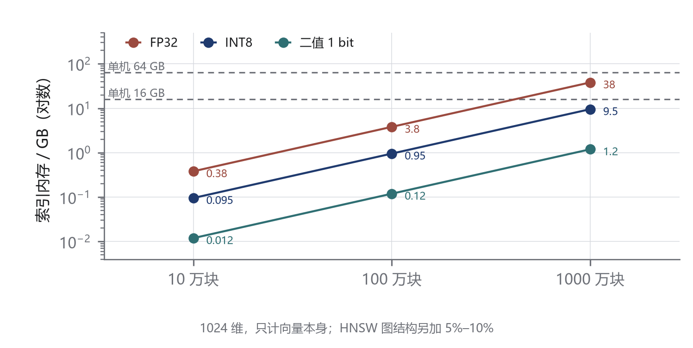

## 嵌入与向量检索

切好的块还只是文本。文本没法直接比较"像不像"，得先变成可以算距离的东西。这一步由嵌入模型完成。

先说一个真实的小事故。某公司做了一份产品手册的问答系统，用户问"XZ-300 的额定功率是多少"，系统答了 XZ-200 的参数。检索命中的段落确实相关——讲的是"XZ 系列吸尘器的技术参数"，里面有五款型号的功率。模型从五款里挑了一个，挑错了。

这是嵌入模型的一个典型表现：它把"XZ-300 功率"和"XZ 系列参数表"编码成了相近的向量，因为它们在语义上确实相近；但把 XZ-300 和 XZ-200 编码成了几乎一样的向量，因为对模型来说，这两个型号名都是"一串没见过的字符"。

理解这一点，比记住任何参数都有用。

### 嵌入模型在做什么

嵌入模型把一段文本压成一个定长向量，比如 1024 维，也就是 1024 个浮点数。训练目标是：语义相近的文本，向量距离近；无关的文本，距离远。

训练方式是对比学习。给一批"问题—正确段落"对，让它们的向量靠近，同时把同一批里的其他段落推远。批次越大，一次能提供的"错误答案"（负样本）越多，模型学到的边界越细。

用的时候很直接：把所有块编码一次，存起来；查询来了，把问题编码成同样维度的向量，算它与每个块的相似度，取最高的几个。

一次编码，多次查询，这是向量检索便宜的根本原因。查询侧的开销只有一次嵌入（几十毫秒）加一次近邻查找。

### 三个要选的东西

**模型。** 主流选择分两类：通用型（多语言、跨领域）和领域型（法律、医疗、代码）。通用型够用，但在术语密集的场景会明显差一截。选型不要看榜单第一名，要看它在你的数据上的表现，方法在下一节。

**维度。** 常见 384、768、1024、1536，也有 3072。维度高，表达能力强，但索引更大、检索更慢、内存更贵。有些模型支持"可变维度"，比如把 1024 维截断到 512 维使用，用一点精度换一半内存，适合成本敏感的场合。

**距离度量。** 余弦相似度、内积、欧氏距离。如果向量都做了归一化（长度变成 1），余弦相似度和内积完全等价。工程上默认"归一化 + 内积"，因为多数向量库对内积优化得最好，而且省掉每次算模长的开销。

一个常见的实现 bug：入库时做了归一化，查询时忘了做。这时内积就退化成"不归一化的内积"，长文本的向量模长更大，会系统性地得分更高——表现为"越长的块越容易被召回"。这类 bug 不会报错，只会让你觉得"效果就是不太行"。

### 怎么选模型：一个下午的流程

这一段是可以照做的。

**第一步，抽 100 条真实查询。** 从客服日志、工单标题、内部群的提问记录里抽，不要自己编。编出来的问题会不自觉地贴合文档的措辞，测出来的分数虚高。没有日志时，让业务同事每人写 20 条他们真的被问到过的问题。

**第二步，标出正确段落。** 每条查询标 1 到 3 个能回答它的块。标的时候只看"这段能不能回答问题"，不看"这段像不像"。这一步 100 条大约 2 小时。

**第三步，跑三个候选模型。** 每个模型把所有块编码一遍（注意用同一个切块结果），再对这 100 条查询算召回率 @10。记下四个数：召回@1、召回@5、召回@10、平均排名。

**第四步，看错误样本。** 挑 20 条没召回的，人工看是"块里没答案"还是"块里有答案但没排上"。前者是切块问题，换模型救不回来；后者才是模型问题。

**第五步，算钱。** 编码全库要多少 token，一次查询要多少，按单价折成月成本。

半天能做完。这半天的价值超过读十篇评测文章，因为榜单测的是别人的数据。

判断标准可以定得具体一点：召回@10 低于 80% 的模型直接排除；两个模型差距小于 3 个点时，选便宜的那个或维度低的那个，因为这点差距在真实流量里会被别的问题淹没。

### 选型打分：把四个数合成一个决定

五步跑完，你手里会有一张四列的表。把它归一化成得分，选型就不用拍脑袋。

| 候选 | 召回@10 | P95 | 价格（元/M） |
|---|---|---|---|
| A 通用 1024 维 | 0.86 | 28 ms | 0.5 |
| B 通用 768 维 | 0.83 | 18 ms | 0.3 |
| C 领域 1024 维 | 0.91 | 35 ms | 1.2 |
| D 大模型 3072 维 | 0.92 | 90 ms | 2.0 |

算法是两步。先对每一项做“最好记 1、最差记 0”的归一：召回区间是 0.83 到 0.92，所以 A 是（0.86−0.83）÷0.09 = 0.33，C 是（0.91−0.83）÷0.09 = 0.89；延迟反过来，越低越好，区间 18 到 90，A 是（90−28）÷72 = 0.86。再按权重加权，取召回 0.6、延迟 0.2、价格 0.2。

算出来四个得分：A 0.55、B 0.40、C 0.78、D 0.60。其中 C 的 0.78 = 0.6×0.89 + 0.2×0.76 + 0.2×0.47。

结果值得看：D 的召回最高（0.92），得分却只有 0.60，因为它在延迟和价格上都是最差；B 最便宜最快，但召回在最差一档，得分 0.40。胜出的 C 价格是 A 的两倍多，但召回高 5 个点。

把权重换成召回 0.5、延迟 0.4、价格 0.1，C 仍然第一（0.80），A 升到 0.60。一个候选在两组权重下都胜出，才说明它是稳的；如果换个权重就换冠军，说明差距在噪音范围内，应该选便宜的那个。

这张表还有一个隐含用途：它把“我觉得 C 好”变成了“C 在三个维度上的具体值”。讨论选型时，大家争的往往是权重，而不是数据——那就先把权重定下来，再去看数。

### 算一遍：十万块要多少内存、多快

假设 10 万个块，1024 维，用 FP32 存。

原始向量：100000 × 1024 × 4 字节 = 409.6 MB，约 400 MB。

HNSW 索引要额外存图结构。每个节点存 M 条边（通常 M=16），每条边是一个 4 字节的整数 ID，双向存储大约是 2M 个 ID：

100000 × 32 × 4 字节 = 12.8 MB

再加上每层的邻居表和元数据，实际大概 20 到 40 MB。所以整个索引约 450 MB。

如果换成 100 万块：4000 MB + 400 MB ≈ 4.4 GB。单机 16 GB 内存还放得下，32 GB 更宽松。这就是“百万级单机可扛”的来源。

把三档规模与三种精度放一起看，选型的边界就清楚了。

| 精度 | 10 万块 | 100 万块 | 1000 万块 |
|---|---|---|---|
| FP32 | 0.38 GB | 3.8 GB | 38 GB |
| INT8 | 0.095 GB | 0.95 GB | 9.5 GB |
| 二值 1 bit | 0.012 GB | 0.12 GB | 1.2 GB |



图里两条虚线是常见机器的内存。读法很直接：100 万块 FP32 在 4 GB 以内，一台 8 GB 的机器能跑；1000 万块 FP32 要 38 GB，已经超过单机 16 GB 这条线，必须量化或分片。

这里有一个容易漏的乘数：上面只算了向量本身。HNSW 的图结构另加 5% 到 10%，原文和元数据另存，进程本身还要几百 MB。按 1.15 倍估比较稳。

再算延迟。一次 HNSW 查询在单核上通常是 1 到 5 毫秒（ef_search 取 64 到 128），加一次查询嵌入 10 到 30 毫秒（小模型快，大模型慢），加网络往返，总共 20 到 60 毫秒。单核每秒能处理 20 到 50 次查询；4 核并行就是 100 到 200 QPS。

这个量级对应一个判断：**日活几千人的内部系统，一台 8 核机器足够；面向 C 端的系统要按峰值算，并做多副本。**

维度也不是越高越好。同样 100 万块，1024 维要 3.8 GB，3072 维要 11.4 GB，检索延迟高 30% 到 50%，而召回往往只高 1 到 2 个点。这就是打分表里 D 候选得分不高的原因：它在大维度上付出的代价，没有换来相称的收益。

例外是“短查询 + 长文档 + 术语密集”的场景，那里维度带来的表达差异更明显。判断方法还是自己的数据：两个维度各跑一遍，看召回@10 差多少，差 3 个点以内就选小的。

### 量化：省内存的代价

内存不够时，第一个手段是降精度。

INT8 把每维从 4 字节压到 1 字节，内存降 4 倍，召回通常掉 0.5 到 1 个点（经验值，跟模型与数据强相关）。二值化每维只留 1 bit，内存降 32 倍，召回掉 3 到 8 个点。

掉的那几个点可以部分抢回来，做法叫 rescore：先用压缩后的向量取前 200 个候选，再用 FP32 原向量对这 200 个重算一次精确距离，取前 50。原向量可以留在磁盘或另一台机器上，只读回少量候选，延迟增加 5 到 15 毫秒。

一个坑：量化参数（每维的 scale 与 offset）要跟索引一起存。重算时用了错的 scale，距离全乱，而且不会报错，只是“结果怪怪的”。这一类 bug 比崩溃难查得多。

判断线可以写得很简单：100 万块以内不要量化，多几 GB 内存比掉召回便宜；超过这个量级先上 INT8 并做 rescore；二值化只给上亿条的冷数据用。

### 向量库要不要专门选

规模小的时候不需要。十万块以内，用 NumPy 把矩阵载入内存，一次矩阵乘算全量相似度：10 万 × 1024 的矩阵乘一个 1024 维向量，单核几毫秒到十几毫秒。够用，而且没有额外依赖，没有运维负担。

规模上去之后才需要近似最近邻（ANN）索引。三种主流结构：

| 结构 | 原理 | 什么时候用 |
|---|---|---|
| HNSW | 多层图，从稀疏层跳到稠密层 | 默认选择。查询快、召回高，代价是内存大、构建慢 |
| IVF | 先聚类，只在最近的几个簇里找 | 内存紧、可以接受召回略低 |
| PQ | 把向量分段量化成短码 | 上亿条、单机必须放下 |

HNSW 的几个参数有明确含义，调之前要知道它们在管什么：

- `M=16`：每个节点的邻居数。调大（32）召回更高、内存更多；调小（8）省内存、召回下降。
- `ef_construction=200`：建索引时的搜索宽度。越大建得越慢、图质量越好。一般 100 到 400。
- `ef_search=64~128`：查询时的搜索宽度。这是唯一需要在线上调的参数，它直接决定"召回率与延迟"的取舍：64 大概 95% 召回、1 到 2 毫秒；128 大概 98% 召回、3 到 5 毫秒。

这几个数是经验值，不同实现（hnswlib、Faiss、各家向量数据库）的默认值不同，但含义一致。

构建成本也值得提前知道。100 万块、1024 维、M=16、ef_construction=200，在 8 核机器上构建通常要 30 到 60 分钟，构建期间内存峰值约为最终索引的 1.5 到 2 倍。这意味着“边建边服务”在同一台机器上很难做——这也是蓝绿重建要另一套机器的原因。

几个参数对构建时间的影响不成比例：ef_construction 从 200 提到 400，构建时间大约翻倍，召回只涨不到 1 个点；M 从 16 提到 32，构建时间增加约四成，内存增加一倍。所以调参的顺序是：先固定 M=16，只在召回不足时调 ef_search（查询侧，不影响构建），最后才考虑重建。

建好之后要能自检。三个数每季度看一次：索引条数（与文档台账对得上吗）、抽样自查询的 top1 命中率（随机抽 200 个块，用它的文本查询，top1 应该是它自己，低于 95% 说明索引写坏了）、平均向量模长（归一化后应接近 1，偏离说明归一化漏了某批）。

第二条最有用。它一次能抓到三类问题：写入时维度错、部分块没编码、索引与模型版本不一致。成本是 200 次查询，几秒钟。

### 查询改写：便宜且有效的一步

用户问"这个能退吗"，直接编码效果一般，因为"这个"没有具体含义，向量会落在一个模糊的位置。

**补全指代。** 多轮对话里，把"这个"根据上文换成具体名称。实现上可以用最近三轮对话加当前问题，让一个小模型重写成一个完整问题。

**生成多个查询。** 让模型把一个问题改写成三种说法（口语、书面、关键词式），分别检索，再合并结果。召回率通常能涨 10 到 20 个点，代价是三倍检索开销（但检索本身便宜，所以划算）。

**HyDE。** 让模型先写一段"想象中的答案"，用这段答案去检索。原理是答案和文档的措辞更接近，比问题本身更好匹配。适合"问题很短、文档很长"的场景，不适合需要精确匹配编号的场景。

这三种都属于低成本高收益，值得默认开启前两种。第三条要谨慎，因为它引入了模型生成的内容，一旦生成跑偏，检索会跟着跑偏。

改写也会带来风险：改写错了，后面全错。所以改写后的查询要记进日志，出问题时能看出来是哪一步偏的。

改写的提示要写得能被机械解析，否则三路结果对不上号。

```text
把用户问题改写成三个版本，只输出三行，不要解释。
1 口语：保留用户原本的说法
2 书面：换成正式表达，补全省略的主语
3 关键词：只留名词与编号，用空格分隔
用户问题：{q}
```

两个细节。行首的编号是给解析用的，代码按它切三路；关键词那行用空格分隔而不是逗号，因为 BM25 的分词器直接吃空格分隔的串。第三路出来的串通常还能直接看出“模型认为哪些词是关键”，对排查很有用。

### 产品手册走一遍

回到开头那个型号的事故。手册里有这样一块：

> XZ-300 无线吸尘器 > 一、技术参数
> XZ-200：额定功率 350W，电池 2000mAh，续航 30 分钟。
> XZ-300：额定功率 450W，电池 2500mAh，续航 45 分钟。
> XZ-500：额定功率 600W，电池 3000mAh，续航 60 分钟。

用户问"XZ-300 的额定功率"，向量会命中这一块（正确），但块里三个型号并列，模型要自己挑一行。它挑错的概率不低，因为块内信息太密。

两种改法。

一是切块时就拆细：把三行拆成三块，每块带上型号和章节路径。这样"XZ-300 的额定功率"直接命中"XZ-300：额定功率 450W"那一块，模型没有挑错的空间。

二是让嵌入模型认识型号：如果型号在训练数据里从未出现，它只是个随机字符串。解决办法是把型号与它的属性一起写进同一句（"XZ-300 的额定功率是 450W"），让模型至少能靠上下文区分；或者用 BM25 这一路来兜住型号这种精确字符串。

这两种改法要一起用。前者降低块内歧义，后者保证型号这种"没有语义的字符串"不被向量模型忽略——这也是为什么下一章要讲混合检索。

### 一个块只能有一个向量吗

默认做法是一块一个向量。有些场景这样做会丢信息，可以考虑一个块存多个向量。

**标题向量 + 正文向量。** 长文档的标题往往高度概括（"三、退货与换货"），正文是细节。两者混在一个向量里，标题的信息被正文稀释。分开存两个向量、检索时取两者最大分，能让"退货政策"这类概括性查询更容易命中。

**摘要向量。** 给每个块再生成一句摘要，摘要单独建向量。用户的问题往往更像摘要而不像原文，这一路能补上措辞差异。代价是要多跑一次生成，量大的时候成本不低。

**按句切分的多向量。** 一个块存若干句子向量，检索时取块内最高分的句子算块分。精度更好，索引体积翻几倍。

这三种都是"用存储换精度"。判断要不要做：如果错误样本里经常出现"块是对的，但模型抓错了块里的句子"，就值得做；如果错误主要是"块根本没被召回"，先解决召回，别在这里花时间。

### 分片与多租户

权限隔离在索引层有两种实现，选错了后期很难改。

**按租户分索引。** 每个客户一个独立的集合，物理隔离。优点是安全边界清楚，删租户就删目录；缺点是小租户浪费资源，租户数量上千之后元数据管理很麻烦，跨租户的全局检索做不了。

**共享索引 + 过滤。** 所有块放一个索引，每个块带租户和权限标签，检索时带过滤条件。优点是资源利用率高、运维简单；缺点是过滤会削弱 ANN 的召回——如果某个租户只有 1% 的数据，近邻搜索可能先找到一堆别人的块再被过滤掉，剩下的不够 k 个。

工程上的常见折中：大租户单独分片，小租户共享一个分片并在分片内过滤；或者用"分片键 + 分区索引"，让过滤条件在进入 ANN 之前就缩小候选空间。

判断线可以定得很实在：单租户数据量超过全库 10%，单独分片；低于这个比例，共享加过滤，但要把召回数从 50 提到 100，抵消过滤损失。

### 相似度分数能不能当阈值

很多系统的第一版会写"相似度低于 0.7 就不回答"。这条规则几乎总是错的，原因有三个。

**分数不可跨模型比较。** 换一个嵌入模型，0.7 的含义完全变了。有的模型分数普遍偏高（都在 0.8 以上），有的普遍偏低。

**分数不可跨查询比较。** 短问题的最高分往往比长问题低，因为短问题能匹配的词少。用固定阈值会导致"短问题一律拒答"。

**分布随库变化。** 库里新增一批风格不同的文档，整体分数分布会移动。

能用的替代做法有两种。一是看相对差距：第一名与第五名的分数差，差距大说明第一名明显更好，差距小说明这五个都差不多。二是用校准过的分类器：拿标注数据训练一个"这个块能不能回答这个问题"的小模型，它的输出概率才有可比性。

最简单可行的做法是不设阈值，改成“取前 5，并在提示里明确要求模型在材料不足时说不确定”。把判断权交给模型，比交给一个含义模糊的分数可靠。

### 向量做不到的三件事

**否定。** “拆封商品不支持退货”和“拆封商品支持退货”只差两个字，向量几乎一样。实测里，否定类查询的召回常比普通查询低十来个点（经验值，跟模型关系很大）。模型知道这两句“都在讲退货”，但分不清方向。

**比较。** “比 X 便宜的做法”与“比 X 贵的做法”同理。大小关系不在向量里。

**精确边界。** “45 天以内可退”与“超过 45 天不可退”意思相同（一个正说、一个反说），但和“45 天后可退”完全相反，而三者的向量都很近。

这三件事的对策不在嵌入模型上。否定词与比较词要能被字面匹配到（BM25 那一路），方向要靠重排模型读整句来判断，条件的边界要靠提示把原文条件原样给出。所以“换个更强的嵌入模型”解决不了这类错——它换不掉表示的边界。

一个便宜的补丁：入库时给块加一个 `polarity` 标记，含“不支持”“不得”“除外”的块标为 negative，提示里把这类块单独标出来，让模型特别注意。粗糙，但对法务、政策类文档有效。

### 中英混排与型号

中文企业文档里到处是英文：型号（XZ-300）、错误码（E1024）、SKU、API 名、单位（GB、mAh）。它们的共同点是：在嵌入模型的训练数据里罕见，没有稳定的语义邻域。

清洗比换模型有用。四条规则。

1. 全角转半角，大小写统一（`Ｅ１０２４` 转成 `e1024`）。
2. 型号与正文之间补空格，避免分词器把“XZ-300 的”连成一个词。
3. 型号与编号单独抽成元数据字段，检索时做精确过滤。
4. 数值与单位之间不留空格（“45 天”写成“45天”），否则两种写法互相匹配不上。

第 3 条最容易被跳过，收益却最直接。用户问“XZ-300 保修多久”，先按型号字段过滤到 3 个块，再在里面做向量检索，正确率比在 300 个块里硬找高得多。代价只是入库时多抽一个字段。

还有一个反直觉的现象：中英混排的块，向量质量往往比纯中文块差。因为模型要在两种语言的语义空间之间对齐，短文本上对齐更不稳。对策是把英文术语后面补上中文解释（“SKU（商品编码）”），或者干脆拆成两块、中英各一块，检索时合并。

### 召回失败先查哪一层

“这个块没被召回”有三个完全不同的原因，排查顺序不能反。

**第一层：块里到底有没有答案。** 找到正确的那份文档，人眼确认有没有那句话。没有，就该补文档或改切块，跟模型无关。这一步只看文档，不看系统，五分钟能做完。

**第二层：正确块在不在前 200。** 把 k 放到 200 跑一次同样的查询。在，说明检索本身能找到它，问题在排序；不在，说明向量表示或查询改写出问题。

**第三层：在前 200 但不在前 50。** 这是融合与排序的问题：RRF 把它压下去了，或者 BM25 那一路完全没命中，导致它只拿了一路的分。

顺序不能反，理由很实际：放宽 k 是零成本操作，改模型要重建索引。先花五分钟做零成本排查，能省掉半天重建。

三层都过之后还有一种情况：块对了、前 5 也进了，模型还是答错。那就不是召回问题，去查组装与生成，别在这里继续调参数。

一个可以记的量级：第一层的问题约占总错误的 20% 到 30%，第二层 30%，第三层 20%，剩下的归生成。这个分布决定了优化顺序——先补文档、改切块，收益最大；一上来换嵌入模型，往往改的是占比最小的那一块。

### 建索引这一步的实际操作

写代码的人容易把建索引想成"跑个脚本"，实际上它是个需要照顾的过程。

**分批编码。** 十万个块不要一次塞进显存，按 256 到 512 条一批。批太大容易 OOM，批太小吞吐上不去。编码速度的经验值：一个 1 亿参数级的嵌入模型，消费级显卡上每秒几百条，CPU 上每秒几十条。十万块在 GPU 上几分钟，在 CPU 上要半小时到一小时。

**断点续跑。** 编码到一半失败很常见。做法是每批完成后把结果追加写入文件或临时表，记录已完成的块 ID，重跑时跳过。没有这个，一次失败要从头再来。

**写库前先量维度。** 向量维度和索引声明不一致时，多数库的报错都很含糊（"形状不匹配"），排查花时间。写之前断言一下长度。

**记录三元组。** 索引目录里存一个说明文件：切块脚本版本、嵌入模型名称与版本、建索引时间。这三样缺一样，三个月后没人说得清线上跑的是什么。

**重建用蓝绿。** 新建一个索引目录，建完验证（跑 20 条查询看结果合不合理），再原子切换别名。不要在原索引上原地更新，中途失败就两头不靠。

这套流程听着啰嗦，但每一次省掉的步骤，都会在某个深夜变成一次无法回滚的事故。

### 建索引脚本：三件事不能省

“分批、断点、记元数据”这三件事写成代码只有二十几行，但它们的顺序不能乱。

```python
import json, pathlib

def build(chunks, embed, outdir, model, batch=256):
    outdir = pathlib.Path(outdir)
    outdir.mkdir(parents=True, exist_ok=True)
    ckpt = outdir / "done.json"
    old = ckpt.read_text() if ckpt.exists() else "{}"
    vecs = json.loads(old)
    todo = [c for c in chunks if c["id"] not in vecs]
    for i in range(0, len(todo), batch):
        part = todo[i:i + batch]
        got = embed([c["text"] for c in part])
        for c, v in zip(part, got):
            assert len(v) == 1024, c["id"]
            vecs[c["id"]] = v
        ckpt.write_text(json.dumps(vecs))
        print(len(vecs), "/", len(chunks))
    meta = {"model": model, "dim": 1024,
            "chunk_rule": "h3+300/80",
            "built_at": "2026-11-20"}
    (outdir / "meta.json").write_text(
        json.dumps(meta, ensure_ascii=False))
```

三个设计点。断点靠 `done.json`：每批写完就落盘，重跑时自动跳过已完成的块，代价是每批多一次写盘。维度断言放写在库里：库对错误维度的报错很含糊，提前断言能省半小时排查。元数据写 `meta.json`：模型名、维度、切块规则、时间四样齐了，三个月后还能对上号。

这段代码有两个地方在生产里必须改。一是 `done.json` 在十万级以上会变成几十 MB，换成 JSONL 逐行追加、启动时读一遍建集合。二是嵌入调用要限并发并在失败时退避重试，不然一次网络抖动就会中断整个批次。

跑之前先估一下时间，心里有个数。十万块、每块 320 字约 480 token，一台消费级卡上一个一亿参数级的嵌入模型，每秒四五百条，算下来三四分钟。同样十万块在 CPU 上每秒几十条，要半小时到一小时。如果实测比这个慢十倍，先查 batch 是不是被显存逼小了——batch 从 512 降到 64，吞吐往往掉一半以上。


### 两个失败案例

**换模型没重建索引。** 有人觉得新嵌入模型更好，把模型换了，代码里改一行，查询时用新模型编码问题——但库里存的还是旧模型的向量。两个模型的向量空间毫无关系，算出来的相似度等于随机数。表现是"召回完全随机，偶尔撞对"。修法只有一条：换模型必须全量重建索引，并且索引要记录模型名称和版本，查询时校验。

**维度截断没重训。** 有些模型支持把 1024 维截到 512 维，但前提是模型本身训练过这个截断（叫 Matryoshka 表示）。如果自己拿一个普通模型的向量砍掉后半段，剩下的 512 维不是"低精度版本"，而是"丢了信息的前半段"，效果会明显下降。判断方法：截断前后各测一次召回率，差距超过 5 个点就不要截。

### 换嵌入模型的七步

模型换代（换更强的、换领域的、换掉停服的）是迟早的事。这件事在实施上只有七步，但少一步就会出事故。

1. 冻结基线。当前索引 + 100 条查询，跑一次召回@5/@20、MRR，全部存档。
2. 新模型全量编码到新目录，不覆盖旧索引。目录名带上模型名与日期。
3. 双跑。同一批查询分别走新旧索引，两套结果并排存下来。
4. 比四个数：召回@5、召回@20、P95 延迟、索引内存。差 3 个点以内视为无差别，选便宜的那个。
5. 抽 20 条人工看前 5 结果，重点看“新版把什么弄丢了”。指标体现不出的失手，通常在这一步暴露。
6. 切别名（蓝绿），旧索引保留一周。监控看召回与延迟两条曲线。
7. 一周后删旧索引，把“当前模型名 + 维度 + 切块版本 + 构建时间”写进索引说明文件。

最容易出的两个坑。

**查询侧没跟着换。** 入库用了新模型，查询还调旧的编码器，向量空间对不上，相似度等于随机。表现是“全部召回都不相关”，但代码不报错。防法是让索引自带模型名，查询前校验一次，不一致直接拒绝服务——宁可报错，也不要静默地返回垃圾。

**块 ID 变了。** 新模型往往要配合新的切块参数，块 ID 一换，评测集里的标注全部失效。防法是用逻辑 ID（文档别名 + 章节路径 + 段序号），这样即使重新切块，标注还能对上大部分。

### 照着做的清单

1. 抽 100 条真实查询，标出正确块（2 小时）。
2. 用 3 个候选模型各跑一遍编码 + 检索，记下召回@5、@10。
3. 选召回@10 最高且成本可接受的，记下模型名与维度。
4. 全库编码，向量归一化，存进索引，索引里写入模型名与版本。
5. 查询侧流水线：补全指代 → 生成 2 到 3 个改写 → 分别编码 → 合并。
6. 设 `ef_search=64` 起步，观察延迟与召回，再决定要不要提到 128。
7. 记录每次查询的改写结果、命中的块 ID、相似度分数，供后续归因。
8. 把"换模型 = 全量重建"写进变更流程。

### 收束

向量检索的工程质量集中在三处：用你自己的数据选模型、把查询改写成完整问题、管好索引的规模与版本。它擅长"意思相近"，不擅长"字面精确"——型号、错误码、人名、条款编号这类东西，它天生弱。这不是模型的缺陷，是这类表示的边界。知道边界在哪，才知道下一步该补什么。
