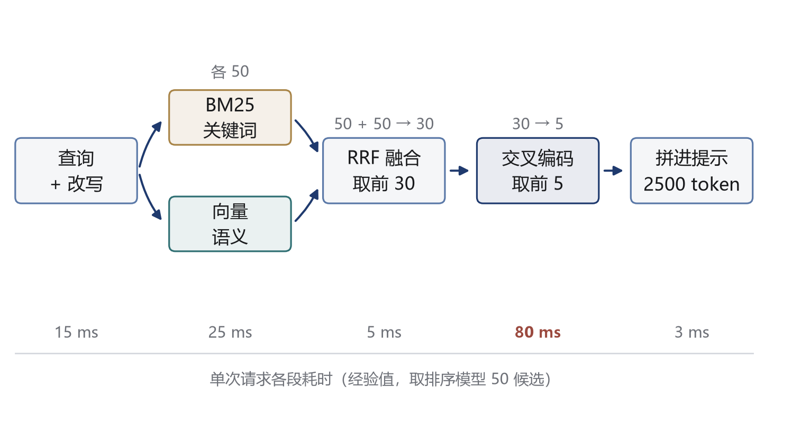

## 混合检索与重排

只用向量检索，有一类查询会稳定失手：包含精确字符串的。

用户问"错误码 E1024 是什么意思"。向量模型把"E1024"编码成一个语义模糊的东西——这个字符串在它的训练数据里从未出现，编码结果与"错误码""报错"这些词没什么区分度。于是它召回了一堆讲"错误处理规范"的段落，而真正写着 E1024 说明的那一段排在第 11 位。

排在第 11 位意味着什么？如果只取前 5，这一段根本进不了提示，模型只能凭常识编一个解释。用户看到的是一个通顺但错误的答案。

关键词检索在这一类上几乎不会错，因为它就是按字面匹配的。E1024 出现在哪一段，那一段就得分。它不知道"退货"和"退换"是一个意思，但它知道"E1024"就是"E1024"。

两种检索的强项正好互补，这就是混合检索存在的理由。

### 两路各自擅长什么

**稀疏检索（BM25）。** 基于词频和逆文档频率：一个词在这段里出现得多、在整个库里出现得少，这段就越可能是关于这个词的。它不训练，不需要 GPU，对精确词、专有名词、编号、代码标识符特别有效。

它的弱点是词形。用户说"退款"，文档写"退货返款"，字面上不重叠，BM25 给零分。中文还要先分词，"吸尘器"分成"吸尘/器"还是"吸尘器"，结果差很多。

**稠密检索（向量）。** 基于语义，对"换个说法"的查询有效。"这机器吸力弱了怎么办"和"吸力下降的处理方法"字面重叠很少，向量能对上。

它的弱点是精确匹配，以及任何在训练数据里罕见的字符串。

两路合并后，召回率通常比单路高 10 到 20 个点（这是公开报告里的常见量级，具体到你的数据要自己测）。

### 怎么合并：RRF

两路的分数不能直接相加。BM25 的分数可能是 12.3，余弦相似度是 0.78，尺度完全不同，而且随查询变化。所以主流做法是丢掉分数，只用排名。

倒数排名融合（Reciprocal Rank Fusion，RRF）的公式：

$$\mathrm{score}(d)=\sum_{r}\frac{1}{k+\mathrm{rank}_r(d)}$$

这个式子在说什么：对每个文档 d，看它在每一路（r 取 BM25 和向量两路）里排第几，把 1 除以"k 加上排名"，然后把两路的结果加起来。排得越靠前，加的分越多；没出现在某一路的结果里，那一路就不贡献分数。

k 的作用是压平差距。k 取 60 时，第 1 名得 1/61 ≈ 0.0164，第 2 名得 1/62 ≈ 0.0161，差 2%；k 取 0 时，第 1 名得 1，第 2 名得 0.5，差一半。所以 k 越大，越"温和"，越不容易被单路的极端排名左右。

k=60 是原论文的推荐值，也是大多数系统的默认值。它合适的原因很实际：让两路的贡献大致均衡，同时保证"在某一路上排第一"仍然有明显优势。

### 算一遍：五个文档的融合

假设一次查询，两路各返回 5 个文档，排名如下（文档用字母表示）：

| 文档 | BM25 排名 | 向量排名 |
|---|---|---|
| A | 1 | 未出现 |
| B | 2 | 3 |
| C | 未出现 | 1 |
| D | 3 | 2 |
| E | 4 | 4 |

取 k=60，逐个算：

- A：只有 BM25，1/(60+1) = 0.01639
- B：1/(60+2) + 1/(60+3) = 0.01613 + 0.01587 = 0.03200
- C：只有向量，1/(60+1) = 0.01639
- D：1/(60+3) + 1/(60+2) = 0.01587 + 0.01613 = 0.03200
- E：1/(60+4) + 1/(60+4) = 0.01563 + 0.01563 = 0.03125

融合后的顺序是 B = D > E > A = C。

这个结果暴露了 RRF 的一个特点：**两路都排得靠前的文档，哪怕单路都不是第一，融合后也会跑到最前面。** B 在 BM25 排第 2、向量排第 3，融合后与 D 并列第一；而 A 在 BM25 排第 1，却因为向量那一路完全没召回它，掉到了第四。

这个特点在多数时候是对的（两路都认可，说明相关性更稳），但也有例外，见后面"一个隐蔽的失败模式"。

如果 k 改成 10，结果会变：

- A：1/11 = 0.0909
- B：1/12 + 1/13 = 0.0833 + 0.0769 = 0.1602
- C：1/11 = 0.0909
- D：1/13 + 1/12 = 0.1602
- E：1/14 + 1/14 = 0.1429

顺序没变，但比例变了：k=60 时 B 是 A 的 1.95 倍（0.0320 对 0.0164），k=10 时是 1.76 倍（0.1602 对 0.0909）。也就是说，k 越小，单路第一名越有分量；k 越大，越偏向"两路都靠前"的共识。极限情形很好记：k=0 时 A 得 1 分、B 得 0.83 分，A 赢；k=100 时 A 得 0.0099、B 得 0.0192，B 赢一倍。

所以调 k 的方向是明确的：如果错误样本里经常出现"只在某一路排第一的精确命中被融合挤掉了"，把 k 调小（10 到 30）；如果经常出现"两路都在第 4、5 名、其实并不相关的段落跑到最前面"，把 k 调大（80 到 120）。

### 从候选到提示：数量与延迟

两路各取 50，融合成 30，重排取 5。这三个数字都该有理由，不该随手填。

**为什么召回各取 50。** 召回层的候选数决定了重排的天花板上限——如果正确段落排在第 60 位，你怎么重排都拿不到它。经验值：召回@50 通常比召回@20 高 5 到 10 个点，比召回@100 低 2 到 3 个点。所以 50 是"够用且不浪费"的位置。

**为什么融合后取 30。** 30 是重排的输入量，直接决定重排延迟。它应该大于最终取 5 的两三倍，给重排留出纠错空间，但没必要把 50 全送进去。

**为什么重排只取 5。** 提示里放 5 段，约 2500 token，是多数场景的甜点。放到 8 段，成本和延迟都涨，准确率涨得很少——因为第 6 到第 8 段大多与问题弱相关。

延迟与候选数的关系（经验值，用 1 亿参数级的交叉编码模型、每条 512 token）：

| 重排候选数 | 典型耗时 | 相对成本 |
|---|---|---|
| 10 | 20–30 ms | 1× |
| 30 | 50–80 ms | 3× |
| 50 | 80–140 ms | 5× |
| 100 | 160–280 ms | 10× |
| 200 | 320–560 ms | 20× |

这张表就是"候选数该取多少"的全部答案：从 20 涨到 50，召回提升明显；从 50 涨到 200，提升有限而延迟翻四倍。默认 50，除非你的场景对延迟极不敏感。

一个容易忽略的点：重排是**逐条打分**的，候选数翻倍，延迟就翻倍，没有"批量优惠"。所以它不能像向量检索那样靠加机器横向扩展——每台机器处理的是不同请求，单个请求内部的 50 条必须串行或小批并行。

### 重排模型怎么选

三类选择：

**小型交叉编码器。** 几千万到一两亿参数，专门为排序训练。延迟低（50 条 50 到 100 毫秒），精度比双塔高很多。这是默认选择。

**大型交叉编码器。** 几亿到十亿参数，精度更高，延迟高 3 到 10 倍。只在"排序错了代价很大"的场景用，比如法务检索。

**用生成模型打分。** 让大模型直接判断"这段能不能回答这个问题"。精度可能最高，但成本高一个数量级，只适合离线评估或极低 QPS 的场景。

选型时看两个数：nDCG@10（排序质量）和 P95 延迟。前者在你的标注集上测，后者在目标硬件上压测。两个都过，就定下来。

还有一个部署上的细节：重排模型要和向量模型分开部署、分开扩容。因为它们的负载特征不同——向量模型是"一次编码，多次查询"（查询时只有一次前向），重排是"每个候选一次前向"。把两者塞在一个服务里，扩容时会被其中一个拖住。

### 退货政策走一遍

用户问："我买的耳机拆封了，还能退吗？"

**BM25 一路。** 分词后得到"买 耳机 拆封 退"，匹配到这些块：

1. 块 2（3.2 时间限制，含"拆封""退"）
2. 块 3（3.3 例外，含"电子产品""不适用"）
3. 块 7（某次客服培训材料，含"拆封""退货"但讲的是话术）
4. 块 12（旧版政策，含"拆封不退"）
5. 块 1（3.1 适用范围，含"商品"）

**向量一路。** 语义上最接近的是：

1. 块 3（例外条款，"已激活的电子产品不适用"语义上直接对应"拆封"）
2. 块 2（时间限制）
3. 块 7（客服话术，语义接近但内容不对）
4. 块 15（另一份文档里的"七天无理由"通用说明）
5. 块 1（适用范围）

注意两路的差别：BM25 把旧版政策（块 12）排进来了，因为"拆封不退"字面高度匹配；向量那一路没排它，因为语义上它和"拆封了还能退吗"是相反的意思，向量对"否定"不敏感但至少没把它排前面。

**RRF 融合（k=60）。**

- 块 2：1/61 + 1/62 = 0.0325（两路都靠前，融合后第一）
- 块 3：1/62 + 1/61 = 0.0325（并列第一）
- 块 7：1/63 + 1/63 = 0.0317
- 块 12：1/64 = 0.0156
- 块 1：1/65 + 1/65 = 0.0308

融合后顺序：块 2 ≈ 块 3 > 块 7 > 块 1 > 块 12。

**重排。** 30 个候选送进交叉编码器，它把问题和每段拼在一起读，能看出"未拆封且不影响二次销售"是退货的前提条件，"已激活的电子产品不适用"是例外。重排后前 5：

1. 块 2 + 块 3（两段都要，缺一不可）
2. 块 1（说明适用范围：第三方平台订单不按这个规则）
3. 块 4（退货流程，用户下一步会用）
4. 块 12（旧版政策，被排到第五）

这里有个容易漏掉的细节：**单看每一路，块 2 和块 3 谁排第一都说得通，但正确答案需要两段一起。** 所以提示里放 5 段而不是 2 段，是有实质意义的——不是为了多给信息，是为了让互补的两段同时在。

而块 12（旧版政策）虽然进了前 5，它的元数据里生效日期是 2024 年，比现行版早两年。组装阶段要靠元数据把它标出来，或者在检索层就按日期过滤掉。这件事下一章会讲。

### BM25 的两个参数与中文分词

BM25 有两个参数，一般不用改，但要知道它们在干什么。

- `k1=1.2`：控制词频的饱和速度。一个词出现 10 次和出现 100 次，得分不会差 10 倍，因为饱和了。k1 小，饱和得快，长文档不容易靠堆词刷分。
- `b=0.75`：控制文档长度的惩罚。b=1 表示完全按长度归一化（短文档有优势），b=0 表示不归一化（长文档有优势）。0.75 是折中。

中文的真正难点在分词。"吸尘器滤网怎么清洗"，分成"吸尘器/滤网/怎么/清洗"是对的；分成"吸尘/器/滤网/怎么/清洗"就多了一个无意义的"器"。不同分词器差别不小，选型时用你自己的查询集测一下召回率，比看文档有用。

还有一个办法可以绕过分词：用字级别的 n-gram（bigram）做索引。"吸尘"两个字是一个 token，"尘器"是另一个。这样不需要词典，对型号、缩写、错字更鲁棒，代价是索引变大（大约是词级的两三倍）。中文场景下这是个很实用的选项，很多开源检索库都支持。

### 两路之外还能加什么

两路是骨架，还可以在骨架上加几路人造信号，成本都很低。

**标题加权。** 索引时把标题单独作为一个字段，命中的标题词额外加分。"退货"出现在标题里和出现在正文第三段里，重要性不同。实现上就是在 BM25 的字段循环里给标题一个 2 到 3 倍的权重。

**时间衰减。** 给每个块按生效日期算一个衰减因子，越新越靠前。政策、价格、组织架构这类会变的知识需要衰减，产品原理、接口文档这类不变的知识不需要。混在一起时给个很弱的衰减（比如每年 5%）就够，不要用强衰减，否则会把稳定的基础知识压下去。

**同源去重。** 同一份文档的相邻三块经常一起被召回，内容连续、信息冗余。可以在融合前做一次同源限制：同一文档最多进 3 块，且优先取编号相邻的组合。这一步能让 5 个名额里出现更多不同来源。

**查询类型路由。** 判断问题是"要事实"还是"要流程"。要事实时把块调小、重排取前 3；要流程时取前 8、按章节顺序排。这个判断可以用很简单的规则（含"怎么""流程""步骤"就归为流程），不需要模型。

加路数不是越多越好。每加一路都要多测一次它是不是真的提升了召回——很多团队加了七路，实际收益来自两路，其余增加了延迟和排查难度。

### 重排会不会把事情弄坏

会。重排不是只涨不跌的。

**域外失效。** 交叉编码器在训练数据相似的文本上很强，在你的领域里可能很弱。如果重排模型没见过中文工单、没见过带表格的段落、没见过代码，它给出的分数可能不如原始排名。判断方法：把重排前后的前 5 结果各存一份，人工对比 50 条，看重排是变好、没变，还是变差。变差就不能上。

**长度偏好。** 很多重排模型对长度有隐性偏好（偏好 200 到 400 token 的段落）。如果你的块是 800 字，它可能系统性地压低这些块的分。对策是缩小块，或者用在你数据上微调过的重排模型。

**位置偏差与拆分错误。** 有些实现会把"问题 + 段落"截断到 512 token，段落太长时后半段被切掉，而答案正好在后半段。这个 bug 特别隐蔽：重排分数很低，看代码也看不出问题。检查方法是打印实际送入模型的 token 长度，看有没有被截断。

**成本与延迟的连锁反应。** 重排加进来之后，一次请求多了 50 到 100 毫秒。如果产品对首字延迟有要求，重排可能得挪到异步，或者只在"用户展开了结果"时才算。这属于产品层面的取舍，不是模型能解决的。

一个稳妥的上线方式：先和原始排序做 A/B，跑两周，看端到端正确率和 P95 延迟两个数。两个都改善才全量。

### 过滤放在检索前还是检索后

权限、日期、文档类型这些条件，放的位置影响很大。

**放在检索前（带过滤检索）。** 快，结果一定满足条件。但 ANN 索引带过滤时召回会下降：如果过滤条件只剩 1% 的数据，近邻搜索可能先找到一堆被过滤掉的块，剩下的不够 k 个。解决办法是提高 ef_search 或候选数，代价是延迟。

**放在检索后（先检索再过滤）。** 实现简单，但可能过滤完只剩两三条，甚至一条不剩。

常见折中：把选择性强、变化少的条件（租户、部门）做成物理分片；把选择性弱的条件（日期范围、文档类型）放在检索后，并且当过滤后剩余不足 3 条时，放宽候选数重查一次。

一个实测经验：如果过滤后平均剩余数量低于"目标 k 的 2 倍"，就应该改成带过滤检索或调整分片，否则你会经常遇到"只召回 2 段"的情况。

### 一个隐蔽的失败模式

混合检索有个不容易发现的问题：两路都召回了同一段，RRF 会给它很高的分数，但那段可能只是"两面都沾"，并不是最相关的。

举个真实形状的例子。用户问"订单 A12 的退款为什么还没到"。BM25 会命中所有含"订单""A12""退款"的块，向量会命中所有讲"退款时效"的块。有一块是客服内部 FAQ："订单退款未到账的常见原因包括……"，它在两路都排第 3、4 名，融合后冲到第一。而真正写着"A12 这笔退款因银行卡信息有误被退回"的那条工单记录，因为措辞独特（"银行卡信息有误"），在 BM25 里排第 2、在向量里排第 8，融合后排第三。

重排能救一部分——交叉编码器读到"银行卡信息有误"会给出高分。但如果重排模型没见过这类工单格式，它也可能给出中等分。

缓解办法有两个。一是**按来源加权**：工单系统的结构化记录比通用 FAQ 更可能包含个案答案，可以在融合时给不同来源一个乘数（比如工单 1.2、FAQ 1.0、培训材料 0.8）。二是**保留单路高分**：如果某段在某一路排第 1 且分数远高于第二名，即便另一路没召回它，也强行保留进候选。

这两个办法都依赖元数据里的"来源"字段，所以前面说的元数据不是装饰。

### 照着做的配置

- 切块 300 字，标题拼进块首，元数据含来源类型与生效日期；
- BM25 用字级 bigram，取前 50；
- 向量用多语言通用模型，取前 50，`ef_search=64`；
- RRF 融合，k=60，取前 30；
- 交叉编码重排，取前 5，P95 延迟控制在 150 毫秒内；
- 按来源类型加权（工单/合同 1.2，手册 1.0，培训材料 0.8）；
- 过滤：租户与部门在索引层，日期在结果层。

这套配置在中文企业文档上通常能到"召回@50 约 90%，前 5 准确率约 70%"（经验值）。没到这个水平，先查召回，别调重排。

### 收束

混合检索加交叉编码重排，是当前性价比最高的组合。它的成本集中在重排的延迟上，收益覆盖了精确查询和语义查询两类。调它的时候要守住顺序：先看召回@50 够不够，再看融合有没有把对的挤掉，最后才看重排。反过来调，通常是把一个召回问题误诊成排序问题，改半天没效果。
