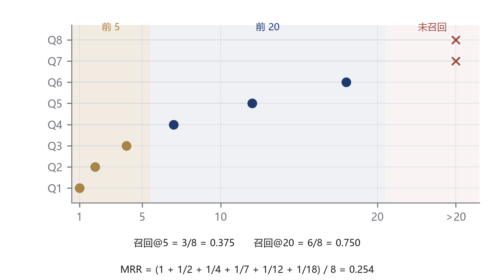
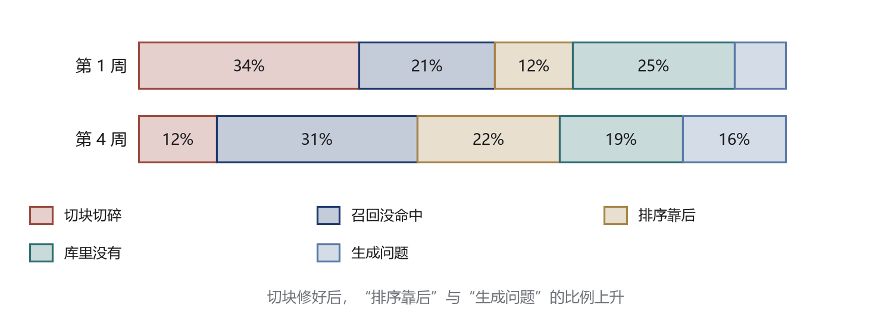
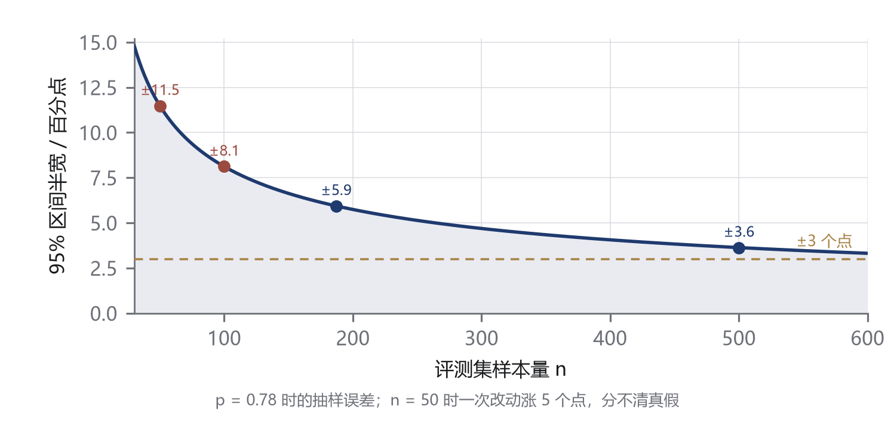

## 检索评测：没有它，调优全靠猜

一个团队做知识库问答，迭代了两个月。每次改动都是同一个循环：改切块或改提示，找几个同事试几个问题，感觉好点了，上线，然后有人反馈变差了，改回去。

两个月后他们说不清系统到底比第一版好还是差。因为没有一把能重复使用的尺子。所有判断都来自"我试了三个问题，两个对了"。

这一章讲怎么造这把尺子，以及看哪几个数。

### 先分清两层

端到端评测给一个分数（比如"正确率 71%"），但它不告诉你问题在哪。所以要分两层测。

**检索层：** 给定查询，能回答问题的块有没有出现在前 k 位。这层只关心"材料找对了没有"。

**生成层：** 给定正确的材料，模型答得对不对。这层只关心"材料用对了没有"。

分开测的价值在归因。端到端错了，看一眼检索层就知道：召回里有没有正确块？有，是生成的问题；没有，是检索的问题。实际项目里，端到端错误中大约六成来自检索层（这是个经验值，各项目差别很大，但"检索是主要来源"这个结论比较普遍）。

如果没有分层，你会把所有错误都归给模型，然后去换模型、调提示、加 few-shot，改了一圈发现没变好——因为正确的那段材料从头到尾就没进过提示。

### 三个指标

**召回率 @k（Recall@k）。** 前 k 个结果里包含至少一个正确块的查询占比。

$$\text{Recall@}k=\frac{\text{前 }k\text{ 命中正确块的查询数}}{\text{查询总数}}$$

这个式子在说什么：把查询挨个跑一遍，每个查询看前 k 个结果里有没有正确答案，有就记 1，没有记 0，最后求平均。它是"有没有找到"的指标，不关心排在第几。

**MRR（平均倒数排名）。**

$$\text{MRR}=\frac{1}{N}\sum_{i=1}^{N}\frac{1}{\text{rank}_i}$$

这个式子在说什么：对每个查询，看第一个正确块排第几，取它的倒数（第 1 名得 1，第 2 名得 0.5，第 5 名得 0.2），所有查询求平均。它衡量"排得有多靠前"，排第一和排第五在召回率里等价，在 MRR 里差五倍。

**nDCG@k。** 考虑多个相关段落、以及相关程度有高低的情况。适合"一个问题需要三段材料拼起来"或者"某段比另一段更关键"的场景。计算稍复杂，用在上线评估里，日常调优看得少。

对大多数团队，日常只看两个数：召回@20（候选够不够）和召回@5（排序好不好）。MRR 作为趋势指标，nDCG 在版本验收时用。

### 算一遍：8 条查询的指标

假设评测集有 8 条查询，每条标了 1 个"必须召回的块"，实测时正确块的排名是：

| 查询 | 正确块排名 | 进前 5 | 进前 20 |
|---|---|---|---|
| Q1 | 1 | 是 | 是 |
| Q2 | 2 | 是 | 是 |
| Q3 | 4 | 是 | 是 |
| Q4 | 7 | 否 | 是 |
| Q5 | 12 | 否 | 是 |
| Q6 | 18 | 否 | 是 |
| Q7 | 未进前 20 | 否 | 否 |
| Q8 | 未进前 20 | 否 | 否 |



**召回@5。** 排名 ≤5 的有 Q1、Q2、Q3，共 3 条。3 ÷ 8 = 0.375。

**召回@20。** 排名 ≤20 的有 Q1 到 Q6，共 6 条。6 ÷ 8 = 0.750。

**MRR。** 逐条算倒数：

- Q1：1/1 = 1.000
- Q2：1/2 = 0.500
- Q3：1/4 = 0.250
- Q4：1/7 ≈ 0.143
- Q5：1/12 ≈ 0.083
- Q6：1/18 ≈ 0.056
- Q7、Q8：未召回，记 0

合计 1.000 + 0.500 + 0.250 + 0.143 + 0.083 + 0.056 = 2.032，除以 8 得 0.254。

这三个数一起看，能读出很多信息。

召回@20 是 0.75，说明有两成的问题材料根本不在候选里——这是召回问题，先别管排序。召回@5 只有 0.375，说明即使材料在候选里，也有一半排得太靠后。而 MRR 0.254 偏低，主要被 Q5、Q6 拉下来（这两条排到 12 和 18，倒数很小）。

如果只能改一处，先改召回@20 那两成——因为它们是"无论怎么排序都救不回来"的部分。这两条具体是什么问题？必须回到那两条查询上看：是库里没有这份文档，还是切块把答案切碎了，还是嵌入模型在这个领域失灵。

**一个容易犯的算术错误：分母。** 召回率的分母是"查询总数"，不是"命中数"。有人算成 3÷6=0.5，把未召回的两条排除在分母外——这样算出来的数会随系统变差而变好，因为差的查询被排除了。

### 一条查询标多个块时怎么算

上面的 8 条查询每条只标了一个正确块。真实标注常常一条标两三个，这时指标的口径要先说清，否则两个人算出来的数不一样。

**MRR 只看第一个命中。** 不管它是不是标里的第一个，也不管其他标注块有没有排上。这样算简单，但也粗：把两个标注块都排在前 3，和只排上其中一个，MRR 可能一样。

**nDCG 看全部。** 给每个标注块一个相关度（2 = 直接回答，1 = 提供关键条件），按位置折损累加：

$$\mathrm{DCG}@k=\sum_{i=1}^{k}\frac{2^{\mathrm{rel}_i}-1}{\log_2(i+1)}$$

这个式子在说什么：排第 1 的相关块贡献满分，排第 2 的除以 log₂3≈1.58，排第 3 的除以 2。折损的原因是越往后用户越不可能看到。

五条查询、k=3 的手算：

| 查询 | 前 3 名（相关度） | DCG | nDCG |
|---|---|---|---|
| Q1 | A(2), B(1), X | 2.00+0.63=2.63 | 1.00 |
| Q2 | B(1), X, A(2) | 1.00+1.00=2.00 | 0.76 |
| Q3 | X, A(2), B(1) | 1.26+0.50=1.76 | 0.67 |
| Q4 | X, Y, Z | 0 | 0 |
| Q5 | A(2), X, B(1) | 2.00+0.50=2.50 | 0.95 |

理想值 IDCG = 2÷log₂2 + 1÷log₂3 = 2.63（两个标注块全排在最前）。所以 nDCG 分别是 2.63/2.63、2.00/2.63、1.76/2.63、0、2.50/2.63。平均 = (1.00+0.76+0.67+0+0.95)÷5 = 0.676。

同一批数据算 MRR：第一个命中的排名分别是 1、1、2、无、1，倒数 1、1、0.5、0、0，平均 0.70。

两个数结合起来看才能得结论。Q2 的 MRR 是满分（第一个结果就是标注块 B），但 nDCG 只有 0.76——因为它把更关键的那个块（A，相关度 2）排到了第 3。只看 MRR 会把这类“排上了但排错”的问题冠冕堂皇地遼过去。

判断该用哪个：问题只需要一段材料时就 MRR，一道题需要两段拼起来时就 nDCG。两个都算也花不了几分钟，报表里都放上。

### 评测集怎么建

这是整章最费工的一节，也是最值的。

**第一步：定规模。** 100 到 200 条。少于 50 条，指标波动大到看不出区别（一条查询的对错能让召回率跳 2 个百分点）；超过 300 条，标注成本高而收益有限，因为主要错误类型在 100 条里就能暴露。

**第二步：抽样。** 三个来源按比例混。真实查询日志（60%）：从近三个月的问题里按流量分层抽，高频问题抽一部分、长尾问题也抽一部分，比例接近真实分布。业务同事提供（25%）：他们被问倒过的那些问题，往往是最难的。文档反推（15%）：拿一段文档让模型生成"这段能回答什么问题"，用来补覆盖盲区。

只用文档反推是常见错误。生成的问题会贴合原文措辞，检索容易命中，分数虚高。真实用户会问"我上周买的东西还没到，钱能退吗"——没有"物流""订单"这些关键词。

**第三步：标注。** 每条查询标出所有能回答它的块，不是只标一个。同一问题可能有 2 到 3 段都合格（不同文档讲了同一件事），标全集才能算准召回。

标注有个容易忽略的动作：**标"不相关"的典型样本。** 有些块看起来高度相关但内容过时或答非所问（比如旧版政策、客服话术）。把它们显式标为"不可用"，评测才能发现"召回了旧政策"这类错误——只看"有没有召回正确答案"是发现不了的。

**第四步：定口径。** 这件事必须在标注前做，几个人各标各的会得到没法用的数据。要写清四条：

- 什么样的块算"能回答"：包含答案所需事实，或包含回答问题所必需的条件。
- 部分相关怎么算：只提到话题但没给答案的，标 0，不标 0.5。
- 需要多段拼起来才完整的，全部标 1（不要只标主要那段）。
- 一条查询可以标 0 段吗？可以，但要标"库中没有答案"，这类查询用来测拒答。

**第五步：冻结。** 标注完成后，这份集合不再改动，用作"固定考卷"。后续发现的新问题另建一个"增长集"，定期合并进主集（合并时要重新跑一遍基线分）。

在真正开始标注之前，还有一件省钱的事：先跑一遍基线，看错误分布。如果 30 条抽样里 20 条是"库里根本没有这份文档"，那说明该补文档，不该建评测集；等文档补齐了再测，能省掉一轮标注。评测集是用来衡量系统能力的，不是用来衡量文档缺口的。

### 标注的实际操作

用表格工具就够，字段是这五列：查询 ID、查询原文、标注块 ID（可多个，逗号分隔）、是否库内无答案、备注。

标注人只做一件事：读查询，在检索结果里勾选能回答的块。不要让他们看到当前的排序，否则会不自觉地"顺着排序选"，把系统的错误固化成标准答案。

做法是：先跑一次全量检索，把每条查询的前 50 个结果导出，人工在里面挑。如果 50 个里都没有正确答案，标记为"未覆盖"——这批就是知识库的缺口。

标注速度的经验值：一条查询 1 到 3 分钟，100 条半天能完成。两人交叉标注 20 条重叠样本，一致率（Cohen's kappa 之类）低于 0.6 就说明口径没写清，要重新对齐。

### 一致率怎么算

“一致率”这个词很容易被算成“两边都标了的比例”，那样算会高得离谱。正确算法要把“碰巧一致”扣掉。

具体做法：两人各标 20 条重叠查询，把它们拆成“查询-块”对，假设一共 100 对。统计四个数：甲也标乙也标的 38 对，甲标乙不标的 6 对，乙标甲不标的 8 对，两边都不标的 48 对。

观察一致率 Po = (38+48) ÷ 100 = 0.86，看着很高。但它里面含了“两边都不标”这个容易撞对的部分：100 对里有 48 对本来就不相关，两人随便标也会一致。

碰巧一致率 Pe 用边际分布算：甲标了 44 对，乙标了 46 对，那么随机情况下同时标上的比例是 (44×46) ÷ 100² = 0.202；两边都不标的比例是 (56×54) ÷ 100² = 0.302。Pe = 0.202 + 0.302 = 0.505。

kappa = (0.86 − 0.505) ÷ (1 − 0.505) = 0.72。

0.72 属于“较好”，可以开工；0.4 到 0.6 算“中等”，先重新对齐口径再标；低于 0.4 说明两人对“能回答”的理解完全不同，这时标出来的数据不能当标准答案。

对齐口径最有效的办法不是开会讲，而是抽 10 个分歧最大的对子，摆在桌上逐对讨论：“这段算不算能回答？”讨论完把结论写成一句话补进口径文档。一轮下来 kappa 能从 0.5 提到 0.7。

### 一条评测记录长什么样

字段定错，后面所有统计都要返工。一条记录至少要有这些：

```json
{
  "id": "q047",
  "text": "耳机拆封了还能退吗",
  "source": "log",
  "created": "2026-10-08",
  "gold": [
    {"chunk": "so-manual#3.2", "rel": 2},
    {"chunk": "so-manual#3.3", "rel": 1}
  ],
  "negatives": ["so-manual-2024#2.1"],
  "no_answer": false,
  "note": "两段一起看才完整"
}
```

五个字段各有它的道理。

`chunk` 用稳定的逻辑 ID（文档别名 + 章节号），不用数据库自增 ID。重新切块之后自增 ID 全变，而逻辑 ID 还能对上——这一条决定了评测集能不能活过三次重建。

`rel` 只分两档：2 是直接回答，1 是提供必需条件。分四档看着精细，实测里标注一致性会明显下降，两个人对“3 分和 2 分有什么区别”很难达成一致。

`negatives` 单独存“看起来相关但不可用”的块。旧版政策、客服话术属于这一类，它们不进 gold，但要能在评测时检查“有没有把它们排进前 5”。

`no_answer` 标记库里确实没有答案的查询，用来单算拒答正确率。混进召回率里算，会把系统能力的变化和拒答策略的变化搅在一起。

`note` 记口径上的特殊判断（“这条只算 3.2 节，3.1 不算”）。半年后回来看，没有 note 的记录一定会引起争论。

存储用 JSONL，一行一条。好处是 diff 友好、能按行追加、坏处是没有表格视图——所以标注阶段还是用表格，导出时跑一次校验：行数对不对、必填列有没有空、每个 chunk ID 能不能在索引里找到。最后这条最容易被跳过，而它决定了一次重建之后评测是能跑还是直接崩。

### 跑评测的工程细节

**固定索引快照。** 每次评测用同一份索引副本，不要让评测跑在一直在变的线上库上。索引一变，前后的分数就没可比性——你可能只是把新文档加进去了，分数涨了 5 个点，但那是数据变了，不是系统变好了。

**存全量结果。** 每条查询存前 50 的结果（块 ID + 分数 + 来源），不要只存指标。指标只能告诉你变好变坏，结果才能告诉你为什么。

**一次只改一处。** 同时改切块和提示，分数涨了 3 个点，你不知道是哪个的功劳，下次也不知道该保留哪个。

**记录元信息。** 每次评测存一份说明：切块脚本版本、嵌入模型版本、重排模型版本、提示版本、评测集版本。缺一样，两周后就没法复现。

**留基线。** 第一版跑出来的分数是基线，之后所有对比都对着它。基线要连同配置一起存档。

### 失败归因表

指标掉下来或者分数不够时，要能快速定位。把错误按类型分类统计，是最高效的办法。

| 错误类型 | 怎么判定 | 典型占比（经验值） | 该改什么 |
|---|---|---|---|
| 库里没有 | 前 50 全不相关，且人工确认知识库无此内容 | 15–25% | 补文档，不是改系统 |
| 切块切碎 | 正确文档被召回，但块里只有半句或缺条件 | 20–30% | 改切块规则，加标题与重叠 |
| 召回没命中 | 正确块在库里，但前 50 名之外 | 20–30% | 换嵌入模型、加 BM25、加查询改写 |
| 排序靠后 | 正确块在前 50 但不在前 5 | 15–20% | 加重排、调 RRF 的 k |
| 生成没用上 | 正确块在前 5，答案还是错 | 10–15% | 改组装模板、调顺序、缩短上下文 |
| 生成编造 | 材料里没有的内容出现在答案里 | 5–10% | 加强约束、加拒答话术、加引用校验 |

这张表的价值在于它把"效果不好"拆成了六件互不相同的事，每件对应不同的动作。没有它，团队会在"换模型"这一件事上反复尝试，而它只对应表中的第三、四行。

统计方法很土：抽 30 条错误样本，逐条人工归类，数出比例。30 条不够精确，但足以看出主要矛盾在哪。半小时的活。

### 归因记录怎么写

归因不能只记一个类型名，要记到“下一件事做什么”。一行五列的格式就够：

```text
qid  现象        归因        证据            动作
047  答 7 天     库里没有    前 50 无新版块    补文档
052  答半句      切块切碎    块尾断在条件前    改切块
061  拒答        召回未命中  正确块排 63      加 BM25
073  引 [6]      生成编造    只有 5 段材料    加校验
```

三条经验。

**归因要落到可执行的动作上。** “模型不行”“提示不好”不是归因，因为它们无法转成下一步。写“切块切碎”的人下一句能接“把 800 字以上再切”，写“模型不行”的人下一句只能接“换个大模型试试”。

**证据要能复现。** 写“正确块排 63”而不是“召回到了但排后面”。前者能直接去日志里查，后者只能相信。

**每周看一次比例变化，不看单条。** 一个真实的变化过程：第一周切块类占 34%，改完切块降到 12%，召回类升到 31% 成为第一。这个顺序是对的——先把“块里没答案”清掉，才能看清“有答案但没召回”到底有多严重。反过来先调召回，等于在一个错误的前提上调参数。

这份记录还能回答一类管理问题：“这个月改了三次，到底改善了什么？”把每周的分布排在一起，改善的是哪一类一目了然。



图里有一点值得记住：**主要矛盾会转移。** 切块修好之后，“切块切碎”从 34% 降到 12%，但总分只涨了 5 个点，因为“排序靠后”和“生成问题”的占比同时上升了。这不是修错了，而是修好一层之后，下一层才浮出水面。

看清这一点，就不会在“为什么改了没大涨”上纠结。每一轮优化能拿到的收益，只等于当前最大那一类的占比乘上一个改进率。要拿更大的收益，只能继续往下修。

### 生成层怎么测

检索对了，剩下的是"模型有没有用好材料"。

测法：构造"材料齐全"的输入（把标注里的正确块直接放进提示，跳过检索），看回答是否满足五项：

1. 包含关键事实（数字、条件、日期都对）；
2. 没有材料以外的内容；
3. 引用了正确来源；
4. 格式符合要求（长度、结构、语气）；
5. 材料不足时正确拒答。

五项里前两项最重要，也最容易自动检查：关键事实可以做成关键词列表比对，编造可以用"回答里的每个数字是否在材料中出现"这类粗糙但有效的规则。

用模型当裁判是常见做法，成本低、可批量。但它有三个已知偏差：偏好长答案、偏好有格式的答案（分点、加粗）、对"部分正确"判断宽松。校准方法是准备 50 条人工判过的对照，让裁判模型也判一遍，算一致率。一致率低于 80%，裁判的结论只能当参考，不能当决策依据。

### 用户日志才是终局

离线评测集有个结构性缺陷：只覆盖你已经想到的问题。真实用户会问出你没想到的。

上线后要看两类日志。

**零结果与低分查询。** 检索一个都没召回，或者最高分明显低于该查询类型的中位数。这批直接暴露知识库缺口，按主题归类，每周看一次。

**差评查询。** 用户追问、点"没帮助"、转人工。这批要分三种：检索错（材料没找对）、生成错（材料对但答错）、超范围（问题本身系统答不了）。分完才知道该改哪一层。

### 三个业务指标

召回率、MRR 这些是工程指标，业务方看不懂。要向他们汇报，得换成三个他们关心的数。

**转人工率。** 会话最终由人接手的比例。它同时反映“答得对不对”和“敢不敢答”——系统拒答多，转人工也会高。一个内部客服助手的基线是 31%，接检索后 18%。

**一次解决率。** 同一用户 7 天内就同一件事没有再次提问的比例。这个数最接近“用户觉得问题解决了”，代价是要等 7 天才能算。基线常在 55% 到 70% 之间。

**回答采纳率。** 回答被复制、被点赞、或按它执行了下一步动作（点了“申请退货”）的比例。它比点赞率可靠，因为行为比态度诚实。

三个数各有一个坑。转人工率会被“入口设计”影响：转人工按钮放得显眼，率就高，与系统质量无关。一次解决率会被“用户懒得再问”污染：他不问了，不代表解决了。采纳率只在有明确下一步操作时才有意义。

用法上，把三个数放在同一张折线图上，每季度对一次。工程指标涨了而三个业务指标不动的阶段，通常意味着“优化的那部分不是用户在乎的部分”——这时候该回头看失败归因表，而不是继续调参数。

把这两批每周过一遍，挑 5 到 10 条并入评测集，系统才会随时间变好。不做这件事的团队，半年后系统还是上线时的水平——因为用户的问题在变，而评测集没变。

还有一个可以每月看一次的数：线上查询的主题分布，与评测集的主题分布差多少。做法是把两边各分成十来个主题（订单、物流、退款、保修、发票……），算占比的最大差值。差值超过 20 个点，说明评测集已经偏了——它测的是半年前的用户，分数再高也不代表现在的体验。

### 算一遍：多少条样本才够用

评测集太小，指标会跟着运气跳。跳多少可以算出来。

假设真实召回率 p 约为 0.78，样本量 n，那么样本召回率的标准误是：

$$\mathrm{SE}=\sqrt{\frac{p(1-p)}{n}}$$

这个式子在说什么：每次抽样测出来的分数不会刚好等于真实值，会在它附近波动，波动的幅度就是这个数。样本越少，波动越大。

n=50 时：√(0.78×0.22÷50)=√0.00343≈0.059，也就是 ±5.9 个百分点。95% 的置信区间是 ±11.6 个点——这意味着一次改进让分数涨了 5 个点，你根本分不清是真的变好还是抽样噪音。

n=187 时：√(0.78×0.22÷187)=√0.000918≈0.030，即 ±3.0 个点，95% 区间 ±5.9 个点。这就能分辨"涨 6 个点"这种量级的改进。

n=500 时：±1.9 个点。继续加样本收益递减，成本却是线性增长。



所以 100 到 200 条是性价比最高的区间：能分辨 5 个点以上的变化，标注成本还可控。

### 一个评测集从 0 到 187 条

这件事听着重，其实三周能做完，而且不占满工时。

| 周 | 动作 | 产出 | 工时 |
|---|---|---|---|
| 一 | 抽日志、跑基线、看错误分布 | 30 条样本与初步归因 | 1 天 |
| 二 | 定义口径、标 100 条、双标抽检 | 100 条标注 + kappa | 2 天 |
| 三 | 补 87 条（业务 + 反推）、冻结 | 187 条与基线分 | 2 天 |

第一周的关键动作是“先看错误分布”。如果 30 条里 20 条是库里没文档，那这一周应该去补文档，而不是继续标评测集。

第二周的口径定义要写成文字，四条就够：什么算能回答、部分相关怎么记、需要多段怎么办、可以标零吗。写完立刻用 10 条试标，两人对照一遍再往下。

第三周的补充要按缺口来，不要按“凑数”来。日志里没有的品类（比如发票、保修）用业务同事的问题补，文档里没被覆盖的章节用反推补。

三周之后这份集合就是资产。它的维护成本很低（每季度审一次，每周并入 5 到 10 条），但它决定了后面所有迭代有没有方向。

### 四个容易踩的坑

**坑一：标注时看了检索结果。** 标注人如果先看到系统返回的前 5，会不自觉地从中挑，等于把系统的偏好写进标准答案。正确做法是把前 50 导出，但不标顺序，甚至打乱。

**坑二：一条查询只标一个块。** 同一问题常有两三段都能回答（不同文档讲了同一件事）。只标一个，召回率会被系统性低估；更糟的是，模型答对了却因为“引用的不是标注的那个块”被判错。

**坑三：把“看起来相关”当成“能回答”。** 客服话术、培训材料这类内容与问题高度相关，但答不了问题。它们应该进 `negatives`，不进 gold。这个区分不做，评测会奖励“召回了一堆相关但不解决问题的内容”。

**坑四：用新系统生成的问题去测新系统。** 让模型根据文档生成问题、再用同一批文档测，分数会虚高 10 到 20 个点。文档反推只能用来补覆盖盲区（占 15% 左右），不能占大头。

四个坑里，前两个影响最大，因为它们改变的是“标准答案”本身，而不是测量方式。一旦标准错了，后面所有的调优都在朝错误方向走。

口径写下来才叫口径。一张四行的表能省掉大量争论。

| 项 | 约定 | 例 |
|---|---|---|
| 能回答 | 含答案事实或必需条件 | 3.2 节含“45 日” |
| 部分相关 | 记 0，不记半分 | 只提“退货”两字 |
| 需多段 | 每段都记 1 | 3.2 与 3.3 |
| 库内无答案 | 单独标记 | 问竞品价格 |

第二行最容易分歧。有人觉得“提到了关键词就算相关”，有人要求“能直接回答”。前者会把分数抬高十来个点，而且无法与别的团队比较。定成 0 之后，界线清楚，两个人标同一批数据才有意义。

一个自检：把评测集里 10 条查询的正确块打印出来，人读一遍，问“这段真的能回答这个问题吗”。答不上来的比例超过 20%，说明标注口径需要重做。如果你的改进都只有 2 到 3 个点的量级，要么把样本加到 500，要么接受"小改动测不出来"，用 A/B 上线跑真实流量。

还有一个更隐蔽的问题：**配对比较比独立比较灵敏得多。** 两版系统跑同一批查询，逐条比较"这条变好还是变差"，只看变化的那部分，噪音会小很多。187 条里有 30 条从错变对、8 条从对变错，净增 22 条，这个信号比"0.78 变成 0.90"更硬。所以评测报告里除了总分，最好带一张"变化分布"：改善多少条、退步多少条、不变多少条。

### 评测集会不会过时

会，而且比想象中快。

三种过时方式。第一，业务变了：评测集里 30% 的查询关于去年的一款产品，现在没人问了，这部分分数再好也没意义。第二，文档变了：标注时引用的块 ID 在重新切块后不存在了，评测直接跑不起来。第三，系统变了：系统学会了拒答，那些"库里没有答案"的查询原来算错，现在算对，分数自然上涨，但这不是能力提升。

对策是把评测集当资产维护，而不是当一次性产物。

- 每季度审一次：删掉业务上已经消失的查询，补进新的高频问题。
- 块 ID 用稳定的逻辑 ID（文档 ID + 章节路径 + 序号），不要用数据库自增 ID，重新索引后还能对上。
- 指标口径跟着系统能力更新：当拒答成为正式能力后，把"库里没有答案"的查询单独算一个"拒答正确率"，不要混进召回率。
- 保留历史基线：每次大改（换嵌入模型、改切块）都重跑一遍，把结果存档。这样三个月后你能回答"我们现在比半年前好多少"。


### 评测跑一轮要多久

这决定了你能多频繁地跑，也就决定了迭代速度。

检索层：187 条 × 0.45 秒 = 84 秒，8 路并发后 11 秒。这部分可以每次提交都跑。

生成层：187 条 × 3 秒 = 9 分钟，8 路并发 70 秒。加模型裁判（每条再审一次，约 2 秒），并发后 2 分钟内。适合每天跑一次。

人工抽检：20 条，每条 1 到 2 分钟，半小时。每周一次。

三层的频率不同，是因为它们回答的问题不同：检索层回答“改动有没有把材料弄丢”，生成层回答“材料给对了答得怎样”，人工回答“指标没变但体验变了吗”。把三层都做成每次提交必跑，成本高且没人看；只做检索层，又会漏掉生成侧的退化。

一个实用的约定：合并请求里必须附上检索层的前后对比（两个数：召回@5、召回@20），生成层的结果允许延后到当天晚上出。

### 一份评测报告的模板

汇报时别说"准确率 92%"，说清四件事：

```text
评测集：187 条（日志 112 / 业务 47 / 文档反推 28）
冻结：2026-10-08
指标：召回@5 = 0.78，召回@20 = 0.91
　　　MRR = 0.62，端到端正确 = 0.71
对比：上一版召回@5 = 0.74，端到端 0.68（同快照）
失败：切块碎 34%，召回未命中 28%，库里没有 19%
下一步：改表格与长节的切块规则
```

这五行信息量远大于一个百分数，而且能直接指导下一个迭代做什么。

### 一个常见的误判

"我们的检索准确率 92%"，这句话通常没有信息量，因为没说三件事：k 是多少（@1 和 @20 差很多）、评测集多大（8 条测出 92% 和 200 条测出 92% 不是一回事）、谁标的（自测还是盲标）。

更麻烦的是"准确率"这个词本身在检索里没有定义——是召回率？是前 5 里有多少相关？还是端到端答对的比例？三个数可能差 30 个点。

把这三个问题问清，一半的"效果很好"会变成"还需要测一下"。这不是苛求精确，是要让"好"这个判断能被别人复现——同一个系统、同一份评测集、同一套口径，任何人跑出来的数应该一样。

### 一个最小可跑的评测脚本

不需要框架，四十行代码就够，关键是字段齐全。

```python
import json

def run_eval(path, retriever, ks=(5, 20)):
    qs = json.load(open(path, encoding="utf-8"))
    rows, hits = [], {k: 0 for k in ks}
    rr, covered = 0.0, 0

    for q in qs:
        res = retriever.search(q["text"], top_k=50)
        ids = [r["chunk_id"] for r in res]
        gold = set(q["gold_ids"])                     # 可多个
        rank = None
        for i, cid in enumerate(ids):
            if cid in gold:
                rank = i + 1
                break

        for k in ks:
            if rank and rank <= k:
                hits[k] += 1
        if rank:
            rr += 1.0 / rank
            covered += 1

        rows.append({"qid": q["id"], "rank": rank,
                     "top10": ids[:10]})

    n = len(qs)
    rep = {f"recall@{k}": round(hits[k] / n, 3) for k in ks}
    rep["mrr"] = round(rr / n, 3)
    rep["covered"] = round(covered / n, 3)   # 至少召回一条
    rep["n"] = n
    json.dump({"report": rep, "rows": rows},
              open("eval_out.json", "w"), ensure_ascii=False)
    return rep
```


四个字段不能省：`rank`（正确块的排名，没有就是 None）、`top10`（前 10 个块 ID，用于人工看错误）、`report`（指标）、`n`（样本量）。有了 `rank` 和 `top10`，出问题时能立刻分辨"没召回"和"排太后"，不用重新跑一遍。

`covered` 这个数容易被忽略，但它和召回@20 一起看能分出两种情况：covered 高而 recall@20 低，是排序问题；covered 低，是召回问题。

### 收束

评测不是收尾工作，是调优的起点。没有它，所有改动都是盲改，团队会在"感觉好点了"和"有人说变差了"之间来回。有了它，每次改动都有一个能复现的分数、一份能归因的错误分布，以及一条能看出来的趋势线。造这把尺子要花半天到两天，但它决定了后面所有工作是在收敛还是在原地转圈。
