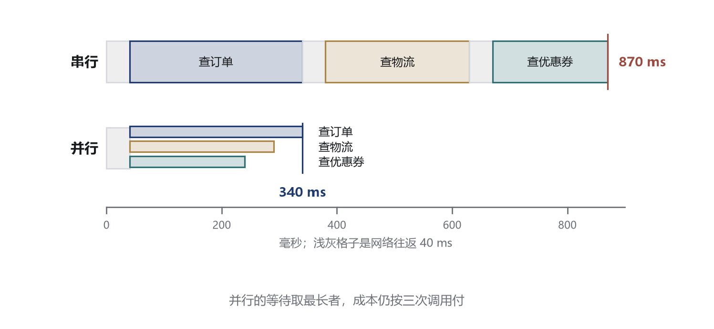

## 工具调用：接口设计的活

有个团队做了半年的客服助手，工具调用成功率一直卡在 70% 左右。他们换过两个模型，调过提示，加过 few-shot 示例，都没有明显改善。

后来把失败样本拉出来看，发现问题集中在三处：模型把"查物流"和"查订单"搞混（两个工具的描述几乎一样）；查询订单时不带订单号只带手机号，但参数里没写手机号可以是后四位；退款工具失败时返回 `{"success": false}`，模型看不懂，直接重试，一小时内给同一个用户退了三次款。

这三处问题，没有一处出在模型上。工具调用失败的原因八成在接口设计：描述不清、参数不严、返回不明确。

### 一个完整的工具定义

工具定义的四个部分是：名字、用途描述、参数 schema、返回格式。以查订单为例。

```json
{
  "name": "get_order",
  "description": "查单笔订单。问发货、退款进度、金额时用",
  "parameters": {
    "type": "object",
    "properties": {
      "order_id": {
        "type": "string",
        "description": "订单号，OD 开头，13 位"
      },
      "phone_suffix": {
        "type": "string",
        "description": "下单手机号后四位，仅无订单号时用",
        "pattern": "^[0-9]{4}$"
      }
    },
    "oneOf": [
      {"required": ["order_id"]},
      {"required": ["phone_suffix"]}
    ]
  },
  "returns": {
    "ok": {
      "order_id": "string",
      "status": "paid|shipped|delivered|refunding|closed",
      "amount": "number，单位元，两位小数",
      "created_at": "ISO8601，带时区",
      "logistics": "object|null"
    },
    "error": {
      "code": "NOT_FOUND|FORBIDDEN|RATE_LIMITED",
      "message": "人类可读的原因",
      "suggestion": "模型下一步可以怎么做"
    }
  }
}
```

这个定义里有五个细节值得单独说。

**描述里写清"什么时候用"，也要写"什么时候不用"。** 上面的示例为了控制行宽做了压缩，真实部署时后半句不要省——模型搞混两个工具，往往是因为它不知道边界在哪。`get_order` 和 `list_orders` 的区别必须写出来。

**参数描述里给了格式约束。** "形如 OD20261105001，以 OD 开头，共 13 位"让模型能自己检查用户给的值合不合法，也让它在生成时不容易编错位数。

**用 `oneOf` 表达互斥必填。** 不要让模型自己在 `required` 里权衡。结构化表达比自然语言提示可靠。

**枚举值写全。** `status` 的六个取值全列出来，模型才能正确解读返回值。只写"string"，它可能把 `refunding` 当成"已退款"。

**错误返回里有 `suggestion`。** 这一项决定模型重试时会不会撞同一堵墙。`NOT_FOUND` 配"请向用户确认订单号，或改用手机号后四位查询"，模型下一步就有方向了。

### 有副作用的工具要更严

查询类工具错了只是答错，操作类工具错了是真金白银。退款工具的定义要额外加三样东西。

```json
{
  "name": "create_refund",
  "description": "为订单发起退款。不可撤销，先调 get_order",
  "parameters": {
    "type": "object",
    "properties": {
      "order_id": {
        "type": "string",
        "description": "订单号，须先经 get_order 校验"
      },
      "amount": {
        "type": "number",
        "description": "退款金额，元，不得超过实付金额"
      },
      "reason": {
        "type": "string",
        "enum": ["质量问题", "七天无理由",
                 "未收到货", "协商一致"],
        "description": "退款原因，只能从枚举中选"
      },
      "request_id": {
        "type": "string",
        "description": "幂等键，重试时复用同一个值"
      }
    },
    "required": ["order_id", "amount", "reason", "request_id"]
  }
}
```

三样新增：调用前置条件（"必须先调用 get_order"）、不可逆声明（"不可撤销"）、幂等键（`request_id`）。这三句都是给模型看的，但它们的作用不是"约束模型"，而是让模型在错误的时候更容易被系统拦下——服务端仍然要自己校验。

### 带分支参数的工具怎么写

第三类工具介于两者之间：只有一种动作，但参数形状随情况变。退货申请就是典型——“退款”要填金额，“换货”要填新 SKU。

```json
{
  "name": "submit_return",
  "description": "提交退货申请。不可撤销，先调 get_order",
  "parameters": {
    "type": "object",
    "properties": {
      "order_id": {"type": "string"},
      "item_ids": {"type": "array",
                   "items": {"type": "string"},
                   "minItems": 1},
      "method": {
        "oneOf": [
          {"type": "object",
           "properties": {
             "kind": {"const": "refund"},
             "amount": {"type": "number"}},
           "required": ["kind", "amount"]},
          {"type": "object",
           "properties": {
             "kind": {"const": "exchange"},
             "sku": {"type": "string"}},
           "required": ["kind", "sku"]}
        ],
        "description": "退款填 amount，换货填 sku"
      },
      "request_id": {"type": "string"}
    },
    "required": ["order_id", "item_ids", "method",
                 "request_id"]
  }
}
```

`oneOf` 在这里做的是“结构上的二选一”。如果只用文字写“退款时填金额，换货时填 SKU”，模型会两个都填，或者都填一半。写成 schema 之后，校验器直接拦住，模型收到错误再改一次就能对。

代价是描述变长（这个定义比 `get_order` 长约三倍）。而且 `oneOf` 在部分模型的工具调用实现里支持不好，会退化成“任意对象”。落地前要用真实模型试一次：给它三个例子（退款、换货、两者都不给），看能不能稳定生成合法参数。

错误码也要列全，并且标出“能不能重试”。这一列比错误码本身更有用。

| 错误码 | 含义 | 可重试 | 模型下一步 |
|---|---|---|---|
| INVALID_ITEM | 商品不在该订单 | 否 | 先调 get_order 核对 |
| POLICY_REJECT | 不满足退货政策 | 否 | 说明原因，转人工 |
| DUPLICATE_REQ | 幂等键已用过 | 是（同键） | 取上次结果，不重发 |
| DOWNSTREAM_5XX | 下游异常 | 是 | 退避重试 2 次 |
| RATE_LIMITED | 被限流 | 是 | 等 2 秒再试 |

没有“可重试”这一列时，模型对所有错误一律重试，既浪费时间又可能重复提交。有了它，`POLICY_REJECT` 会被正确地转成一句解释，而不是被重试三次。

### 一个可以直接用的工具描述模板

把下面这段当成填写模板，比从零写省事，也比凭感觉写稳定。

```text
name: get_shipment_trace
描述：查询单个包裹的物流轨迹。
适用：问"到哪了""什么时候能到"，且已知订单号时。
不适用：查订单信息用 get_order；查所有包裹用
        list_shipments。
参数：order_id 订单号，13 位；
      carrier 快递公司，枚举 SF/YTO/ZTO/JD/OTHER。
返回：节点列表（时间、地点、描述），
      加一行摘要"最近更新：上海分拨中心，运输中"。
错误：NOT_FOUND（运单未生成，24 小时后再查）；
      CARRIER_TIMEOUT（换快递公司查询或稍后重试）。
副作用：无。
权限：shipment:read，仅限当前用户自己的订单。
```

七个字段：名字、描述、适用、不适用、参数、返回、错误。后三个（错误、副作用、权限）是"让系统能拦住模型"的信息，不是给用户看的。

副作用那一栏写"无"或写明具体影响，是团队内部的约定。写清"无"，调用前就不用犹豫；写"会扣款"，模型和审核的人都会更小心。


### 六个反复出现的设计错误

**工具粒度太细。** 把"查订单""查物流""查退款"拆成三个工具，模型要连续调三次，每次都可能选错，而且三次调用之间有两次多余的往返。合并成一个带 `include` 参数的工具，成功率高得多。

**工具粒度太粗。** 一个 `execute_sql(query)` 能干所有事。模型写出的 SQL 经常错，而且这是把数据库的全部权限递了出去。粗粒度工具只在"内网、低风险、有审计"的场景可接受。

**参数是自由文本。** 让模型生成一段查询语句、一段正则、一段脚本，等于把校验责任交给它。能枚举的用枚举，能结构化的用结构化，剩下真正需要自由文本的字段，服务端必须校验。

**缺少失败返回。** 工具失败时返回空对象 `{}` 或 `{"success": false}`，模型不知道发生了什么，只能重复调用。返回里至少要有错误码、原因、建议。

**参数没有默认值。** 每个参数都必填，模型会为了凑参数编造值（比如编一个订单号）。给合理的默认值，或者用 `oneOf` 表达"二选一"。

**一个工具做太多事。** `process_order`，再用 `action` 参数区分取消、退款、补发 看起来省事，但三种动作的参数、权限、风险完全不同，混在一个工具里，模型分不清该传什么，服务端也难做细粒度权限。

### 失败到底出在哪一类

工具调用成功率上不去时，先把失败样本分类。某团队抽了 300 次失败，分布是这样（经验值，各系统差异很大）。

| 类型 | 占比 | 典型症状 | 改哪里 |
|---|---|---|---|
| 选错工具 | 40% | 调了相邻的那个 | 描述里写“不适用” |
| 参数错 | 25% | 格式不对、ID 编造 | 换 enum、pattern |
| 返回读不懂 | 20% | 字段名模糊、无错误码 | 裁剪 + 摘要行 |
| 超时与失败 | 15% | 同一个调用反复重发 | 超时与重试 |

这张表最有用的一点：前三类占 85%，全部只需改描述和 schema，不改代码、不换模型。那个卡在 70% 成功率的团队就是这种情况——他们一直在换模型，而问题在 `get_order` 和 `get_shipment_trace` 的描述里都写着“查订单相关信息”。

分对类还有个副作用：它把“成功率”这个笼统的数变成四个可分别优化的数。参数错降到 5% 之后，成功率会直接涨几个点，而且涨得可解释。

反过来，如果“超时”占了一半，就不该继续改 schema——瓶颈在下游，该做缓存或异步。分不清类的时候，人总会在“最容易改的那一项”上反复用力，而它可能不是主因。

### 让模型敢并行

一次回答需要查三个信息（订单、物流、优惠券），串行调用要三次往返。支持并行调用后，总延迟接近一次。

模型能并行的前提是三个工具之间没有依赖。这一点设计时要主动制造。

判断方法很直接：工具 B 的输入里有没有工具 A 的输出？没有，就能并行。`get_order(order_id)` 和 `get_coupon(user_id)` 互不依赖，可以同时发；`create_refund` 需要 `get_order` 返回的金额，必须后发。

实现上的四个要点：

**一，提示里明确鼓励。** 很多模型默认串行，因为它"想一步做一步"。在系统提示里加一句"如果多个工具之间没有依赖，请在同一轮里并行调用"，并行率会明显提高。

**二，并行上限。** 一次最多并行 5 个，超过就排队。不设上限时，模型有时会一次发 20 个调用，把下游打满。

**三，超时独立。** 每个调用有自己的超时（比如 3 秒），一个超时不影响其他。整体等待时间取最长者，不是求和。

**四，部分失败要能继续。** 5 个调用里 1 个失败，不要把 5 个结果全丢掉。把成功的 4 个和失败的那 1 个错误信息一起返回给模型，让它决定是重试、换路，还是带着不完整信息继续。

### 算一遍：并行省多少

假设三个工具各自的 P50 延迟是 300 毫秒、250 毫秒、200 毫秒，网络往返每次 40 毫秒。

串行：三次调用 + 三次往返 = (300+40) + (250+40) + (200+40) = 870 毫秒。

并行：一次往返 + 最慢的那个 = 40 + 300 = 340 毫秒。

省下 530 毫秒。如果这是一次对话里的第一屏内容，用户感知差别很明显。

但要注意，并行只省"等待"，不省"成本"。三次调用的计算、三次结果进上下文，token 一分不少。所以并行适合"延迟敏感、成本不敏感"的场景，反过来就要慎重。

还有一个隐性收益：并行让模型少了一轮"看结果再决定下一步"的推理，总 token 反而可能下降。实测里，把三个无依赖的查询改成并行，总输入 token 通常降 10% 到 20%（因为少了一轮中间结果和推理），这个收益常被忽略。



图里有两个细节。第一，并行那一排的浅灰格子只有一次（网络往返只在开头发一次），串行那一排有三次。第二，340 毫秒由最慢的那一项决定——把 300 毫秒的查订单优化到 100 毫秒，整体只降到 250 毫秒；把最慢的那一项换成缓存，才能直接降到 60 毫秒左右。优化并行链路，永远先看最慢的那一项。

### 超时与重试的具体取值

超时不是拍一个 3 秒就完事。取值决定两件事：失败了能不能及时知道，以及会不会把下游压垮。

| 类型 | 连接超时 | 读超时 | 重试 |
|---|---|---|---|
| 查询类 | 1 s | 3 s | 2 次，0.5/1 s |
| 写入类 | 1 s | 5 s | 2 次，仅网络错 |
| 报表类 | 1 s | 30 s | 1 次 |
| 第三方 | 2 s | 8 s | 0 次，转人工 |

读超时的定法：取该工具 P99 延迟的 2 倍，最少 3 秒。P99 是 1.2 秒就设 3 秒；P99 是 9 秒就设 20 秒——否则高峰期会出现一批“超时”，而那些请求本来能成。

重试要加抖动（随机 0 到 200 毫秒）。多个调用同时失败、同时重试，会在下游制造一个尖峰，把本来只慢一点的接口打成不可用。

写入类只对“连接失败”重试，不对“读超时”重试。因为读超时时操作可能已经执行了，重发会制造第二笔；这时应该拿幂等键去查结果，而不是重发。

最后是一条总预算：一次回答给工具调用 8 秒。超了就带着已有结果生成，并在回答里说明“部分信息未取到”。让用户拿到一个不完整但诚实的答案，比等到 25 秒后超时好得多。

### 幂等：不做会出真事

模型会重试，原因很多：网络超时、返回格式不对、它觉得结果不合理、上下文被截断后重来。对查询类工具无所谓，对有副作用的工具必须做幂等——同一个请求重复执行只生效一次。

标准做法三步。

**一，生成幂等键。** 由系统注入（推荐），或者让模型生成。系统注入更可靠：在调用工具前，用"会话 ID + 步骤号 + 工具名"算一个键，重试时复用。如果让模型生成，提示里必须写"重试时复用同一个 request_id"，但模型未必照做。

**二，服务端去重。** 一张幂等表，主键是 `request_id`，值是"处理中/已完成 + 结果"。请求进来先查表：已完成的直接返回上次的结果；处理中的返回"处理中，请稍后"；没有记录才真正执行。

**三，加唯一约束。** 数据库层面对"业务主键"加唯一索引（比如"同一订单 + 同一原因 + 24 小时内只能有一笔退款"）。这是最后一道防线，防的是幂等表本身出问题。

一个真实事故的形状：退款接口没做幂等，模型在一次超时后重试了两次，用户收到三笔退款。对账时才发现。修复花了半天，但用户沟通和合规说明花了两周。

判断哪些工具需要幂等，看一句话：**这个操作执行两次，会不会让世界变得不一样？** 会（扣钱、发货、发消息、改状态），就必须幂等。不会（查询、计算、转换），可以不做。

### 返回给模型看的那一份

工具返回的原始数据经常太大。查一个订单回来 30 个字段，模型只需要 5 个。

不裁剪的后果有两个：上下文被撑满，后面的推理空间被挤掉；无关字段干扰判断，模型可能拿 `warehouse_code` 当成错误码。

裁剪的后果也有一个：关键信息可能被切掉。

可行的做法是让工具返回两份：一份给模型看的摘要（10 个字段以内，带单位，带可读的枚举值），一份原始数据留在系统里供后续查询（只在需要时按 ID 取）。

摘要的字段选择有原则：**模型回答问题必需的事实 + 让它判断下一步的线索。** 查订单的摘要应该是：订单号、状态、金额、下单时间、物流状态（一句话）、是否可退。像 `internal_flag`、`warehouse_code` 这类字段，模型用不上，删掉。

列表类返回还要加两件事：总数、是否还有下一页。没有这两个数，模型会以为返回的 20 条就是全部，然后写出"一共有 20 笔订单"这种结论。

### 权限：最容易被忽略的一层

模型拿到的权限，应该等于"这个用户在这件事上的权限"，而不是"这个系统能做的所有事"。

三种常见事故：客服助手能查所有用户的订单（本该只查当前会话的）；代码助手能读整个仓库（本该只读当前项目）；助理能发邮件给任何人（本该只发内部）。

做法只有一条：**权限检查放在工具侧，不靠提示约束模型。** 提示可以被绕过（用户一句话就能诱导），代码不会。具体三条：

- 工具的入参里不放"用户 ID"，用户 ID 由服务端从会话里取，模型无法指定别人；
- 每个工具声明所需权限（`scope: order:read`），服务端在调用前校验；
- 高风险工具（转账、删除、对外发送）加二次确认，确认动作由前端完成，不经过模型。

顺带一个细节：**越权尝试要记日志。** 模型被诱导去查别人的订单时，那次调用应该被拒绝并记录。这类日志在安全审计里非常有用，也是发现提示注入攻击的主要途径。

### 参数校验要分两层

“参数合法”有两层意思，混在一起会让错误信息没法用。

**第一层是结构校验。** 类型对不对、枚举值在不在范围内、必填有没有给、正则匹不匹配。这一层由 schema 自动完成，失败时返回“哪个字段、期望什么”，模型看到就能改。

**第二层是业务校验。** 订单是否存在、是否属于当前用户、状态是否允许退款、金额是否超过实付。这一层必须查库，失败时返回业务错误码。

两层分开的价值在于错误信息的可操作性。结构错误模型自己能修（改格式、换枚举），业务错误它修不了（不能凭空造一个存在的订单），只能改路径或转人工。如果两层混成一个“参数错误”，模型会把业务错误当结构错误，反复改格式重试。

一个具体的顺序：

| 顺序 | 校验 | 失败返回 |
|---|---|---|
| 1 | schema | 400 + 字段路径 |
| 2 | 身份与权限 | 403 + 不透露存在性 |
| 3 | 资源存在 | 404 + 建议下一步 |
| 4 | 业务规则 | 409 + 原因与替代方案 |

第 2 步要特别小心：查别人的订单时，返回“无权限”还是“不存在”？安全上的惯例是返回“不存在”，避免通过错误信息探测他人数据是否存在。但这不是绝对的——内部系统里，明确说“无权限”反而有助于排查。这件事要按场景决定，并且写进接口文档，不能靠实现者随手选。

### 工具层怎么验收

三个数，都能在半天内测出来。

**选择正确率。** 构造 50 条问题，每条标“该调哪个工具”。跑一遍，看模型选对的比例。基线常在 0.7 上下，把描述里的“不适用”补齐后能到 0.9 以上。

**参数合法率。** 同一个 50 条，看生成的参数能不能通过 schema 校验。这一项跟描述里的格式约束直接相关：写了 pattern、enum 之后，通常从 0.85 提到 0.97。

**结果利用率。** 抽查 20 条成功的调用，看工具返回的关键字段有没有出现在最终回答里。这一项低，说明返回结构有问题——模型读不懂，或者关键信息埋在了 30 个字段中间。一个真实基线是 0.64，加了摘要行与裁剪之后到 0.81。

三个数一起看才能定位。选择对、参数对、但结果利用率低，问题在返回层；选择错得多，问题在描述层；参数合法率低，问题在 schema。这三类修改的代价差别很大，先分清楚再动手。

工具本身也要有测试，但测的不是“函数返回对不对”，而是“模型拿到它之后能不能用对”。可写成一组固定的用例。

```python
CASES = [
    ("查 OD20261105001 的状态", "get_order",
     {"order_id": "OD20261105001"}),
    ("138****2231 这个手机号的订单",
     "get_order", {"phone_suffix": "2231"}),
    ("这台机器保修多久", "search_docs",
     {"q": "保修期限"}),
]

def test_select(llm):
    for text, want, _ in CASES:
        got = llm.pick_tool(text)
        assert got.name == want, (text, got.name)
```

三个要点。用例要包含“容易混淆的对”（查订单 vs 查物流）；断言只看工具名与必需参数，不比对全部参数（措辞会变）；每周跑一次，把它当成接口变更的回归网。

这组用例只有十几条，但它在改描述、加工具、换模型时都会第一时间报错。没有它，每次改动都只能靠“试几个问题看看”。

描述长度也有个经验区间：每个工具 60 到 120 字（中文）。短于 60 字往往漏掉“不适用”和参数约束；长于 120 字开始出现“模型只读了前半段”的现象——尤其在一屏摆 15 个工具时，后面的描述更容易被忽略。

算一下总量：15 个工具 × 100 字 ≈ 1500 字 ≈ 2250 token，占 8K 窗口的 28%。这就是“工具太多”会实质影响效果的原因——不是模型能力不够，是它的注意力被工具说明吃掉了。

每个工具还该有一个 SLO：P99 延迟与可用性。它们不进模型上下文，进监控。理由是工具层的失败往往先表现为“Agent 变慢/变笨”，而根因是某个工具从 200 毫秒变成 2 秒。按工具看 P99，能在一周内发现下游退化；只看端到端，只能看到一团模糊的“变慢”。

SLO 的取值不用精确：查询类 P99 小于 1 秒、写入类小于 3 秒、报表类小于 30 秒，可用性 99.5% 起步。超过就进日报，连续三天超就排期修。

### 上线前的六个问题

1. 每个工具的名字和描述，能不能让一个新人猜对"什么时候用"？
2. 描述里有没有写"什么时候不该用"？
3. 参数里还有没有能换成枚举或正则的自由文本？
4. 失败返回里有没有错误码、原因、下一步建议？
5. 有副作用的工具是否幂等，幂等键由谁生成？
6. 每个工具的权限范围，是不是等于用户在该场景的权限？

六个都过，工具层的可靠性就有底了。这六条里五条是设计问题，只有第三条涉及写代码——这也是为什么工具调用"看起来是接口问题，实际是设计问题"。

### 描述怎么写才不容易被选错

工具选择错误，八成是描述的问题。有三条经验。

**名字用动词开头，带对象。** `get_order`、`create_refund`、`list_invoices` 比 `order_query`、`refund`、`invoice` 好，因为动词说明了动作，减少"这个工具会不会改变数据"的猜测。

**描述用三段式：做什么、什么时候用、什么时候不用。** 第三段最常被漏掉，也最有用。举例：`search_articles` 的描述里加一句"不用于查询订单或账户信息，那些用对应的专用工具"，能挡掉一批误用。

**相近工具要显式对比。** 如果系统里同时有 `search_docs`（搜知识库）和 `search_logs`（搜运行日志），两者的描述里都要提对方："若用户问的是系统报错后的排查线索，用 search_logs"。模型不会主动去比较两个工具，除非你让它比。

还有个技巧：给工具加一个 `when_to_use` 字段单独承载使用场景，比全部塞进 `description` 更好读。有些协议支持这个字段，不支持的话在描述里用"适用："分段。

最后一条常被忽略：**描述要定期清理。** 半年后业务变了，工具还在，描述没改，模型按旧描述使用它，结果就是"它总是用错工具"。每次业务变更时顺手过一遍工具描述，比事后调提示便宜。

### 工具也要能下线

工具只增不减是常见现象。半年后模型面前摆着 22 个工具，其中 4 个已经没人用，但每次请求都要为它们付描述 token。

下线比上线难，因为调用方是模型，它不会告诉你“我还在用这个”。可用的做法是三步。

**先标废弃，不删。** 描述里加一句“已废弃，请改用 get_shipment_trace”，观察两周。如果日志里仍有调用，说明某条提示或某个流程还在引导它用旧工具。

**看调用量，不看是否存在。** 一个工具 30 天零调用，就可以进入下线流程；每周还有几次，说明它在兜某类长尾，先查清是哪类。

**分批删，留回滚。** 一次删一个，删后跑一次工具层验收（选择正确率、参数合法率）。两个数都没掉，才继续删下一个。

顺带一个数字：单次请求里工具描述的 token 通常占总输入的 20% 到 35%。从 22 个减到 15 个，能省 8% 到 12% 的输入成本，同时提高选择准确率——因为候选少了。这是少见的“省钱和提质同向”的改动。

### 工具太多的时候

工具从 5 个涨到 30 个，选择准确率会明显下降。这不是模型不够强，是候选空间变大了：30 个工具的 30 段描述加起来几千 token，模型要在里面挑一个，而且很多描述天然相似。

四种应对，按成本从低到高。

**一，按场景分组，每组一套工具。** 客服场景只暴露订单、物流、退款这几个；运维场景只暴露日志、指标、重启。分组由前端页面或用户角色决定，不让模型选。

**二，先路由再选工具。** 用一次轻量调用判断"这个问题属于哪个域"，再只把该域的工具给它。多一次调用，但候选从 30 降到 6，准确率提升通常值得。

**三，合并同族工具。** 五个 `get_xxx_detail` 合并成一个 `get_detail(type, id)`，用枚举区分。工具的"形状"少了，选择就容易。

**四，把低频工具藏起来。** 有些工具一个月用一次，但每次都占描述空间。做成"两步调用"：先 `list_capabilities` 拿到可用工具清单，再按需加载详细定义。这一招在工具上百个时几乎是必需的。

一个经验值：单次暴露给模型的工具超过 15 到 20 个，选择准确率开始明显下降。到 30 个以上，即使模型很强，也建议做分组或路由。

### 工具结果怎么摆进上下文

工具返回之后，怎么放进对话，也影响成功率。

**结构化优先。** 返回 JSON 比返回一段自然语言好，因为模型能准确取字段。但如果返回的 JSON 有 30 个字段，反而是负担（见前面的裁剪）。

**错误要显式。** 不要用"空结果"表示失败。"查询失败"和"查到了但为空"是两件事：前者该重试或换路，后者该告诉用户"没有这笔订单"。返回里必须有区分。

**加一行摘要。** 在结构化数据前面加一句人话："订单 OD20261105001，已付款，金额 299.00 元，昨天发货，物流在途中。"这句话让模型不必解析 JSON 就能抓住要点，也能在数据被截断时保留关键信息。

**时间要带时区。** `2026-11-19T08:00:00Z` 和 `2026-11-19 08:00` 的区别，在多时区业务里会变成"答错一天"。

**别把原始 HTML 塞进去。** 有些工具直接返回网页源码，几千 token 的标签把上下文吃掉大半，模型还要在里面找正文。工具侧就该抽好正文再返回。

### 列表类工具的三个必填字段

列表类工具（订单列表、工单列表、日志检索）最容易在“返回结构”上出问题，因为它的返回是一个集合，而模型天然会把集合当成全集。

三个字段必须返回：总数（total）、是否还有下一页（has_more 或 next_cursor）、以及本次返回的条数。缺了后两个，模型会写出“您一共有 20 笔订单”这种结论——它看到的确实是 20 条，但它不知道还有 180 条。

分页参数的默认值也有讲究。`page_size` 默认 20，上限 100。默认太小会让模型反复翻页（每次翻页都是一轮调用），默认太大又会把上下文塞满。20 是两边的折中：既能回答“最近几笔”这类问题，也不至于一次灌进 5000 token。

游标比分页号可靠。用 `page=3` 时，如果中间有一条订单新增，第 3 页的内容会错位，模型拿到的数据前后矛盾。用 `cursor`（上一页最后一条的 ID 或时间戳）就不会错位。这个细节在“边聊边查”的场景里尤其重要，因为两次翻页之间可能隔了几十秒。

还有一条经验：给模型一个“不要翻页”的选项。很多问题（“最近一单”）只需要第一页，但模型看到 `has_more=true` 就会去翻。在描述里写清“用户问最近 N 条时，不要翻页；需要全部时先问用户”，能省掉三成多余调用。

### 一个失败案例：一次并行 20 个调用

某数据助手支持并行调用，一次查询需要拉 8 个指标，模型把 8 个调用一起发了出去。看起来很好，直到月底账单出来：单次请求的输入 token 从 3000 涨到 12000。

原因不在并行本身，在返回。8 个工具的原始返回各 1500 token，全部进上下文，加起来 12000。模型读完这些，还要再算一遍。

修法两步：工具返回裁剪到每项 200 token 的摘要（8 项 1600 token）；把"需要哪些指标"的判断做在路由层，不再让模型一次拉全部。

改完之后，单次请求 token 降到 2500，延迟也从 2.4 秒降到 1.1 秒。并行是对的，但"并行 + 全量返回"是双重浪费。

这件事的通用教训：**并行的收益在延迟，成本在上下文。** 每加一个并行调用，都要问一句"它返回的东西真的会用到吗"。

### 收束

工具调用是把"模型的能力"接到"系统的能力"上。接口设计决定了成功率，幂等设计决定了最坏情况，权限设计决定了事故的边界。这三件事都在模型之外，也都在模型之上——模型换一代，好的接口设计依然有效，坏的设计依然会坏。所以这个环节的投入回报率很高，而且不需要训练任何东西。一个可以自查的信号：如果工具调用的失败原因里，超过一半是选错工具参数格式不对看不懂返回，那问题几乎全在接口，不在模型；把这些修完，你会看到成功率跳一个台阶。
