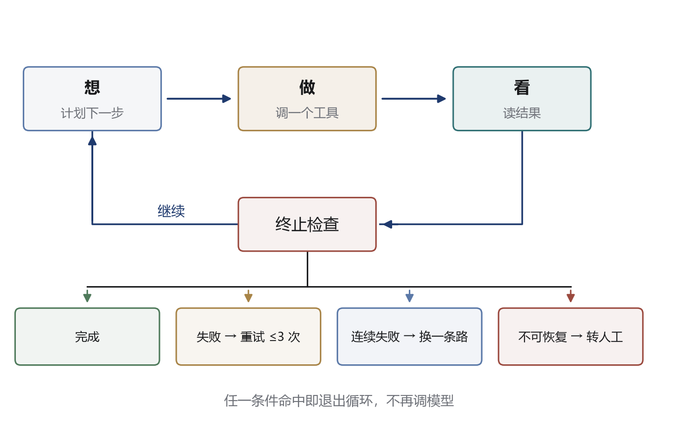

## Agent 循环：什么时候该让它自己跑

一个团队做了"自主运维助手"：给模型一批工具（查日志、查指标、重启服务、改配置），让它自己排查线上问题。三个月后项目被叫停，原因不是效果差——它有时候真能定位到问题，而是成本不可预测：同样一个告警，有时 3 步解决，有时 40 步还在绕，单次成本从几分钱到十几块，账单无法预估。更麻烦的是它偶尔会重启错的服务。

这个项目的问题不在模型能力，在选择上。他们要的是"应对 20 种已知告警的标准处置流程"，用固定工作流 5 步就能做完，而且每步都可测、可回滚。选了 Agent，等于用一条不确定的路径去解一个确定的问题。

这一章讲两件事：怎么判断该用工作流还是 Agent，以及真要做的时候怎么让它可控。

### 先判断：工作流还是 Agent

工作流是"步骤由代码决定"，Agent 是"步骤由模型决定"。这个区别决定了一切：成本能不能预估、失败能不能复现、责任能不能划清。

下面这张表可以当成打分卡，逐项对照。

| 判断项 | 偏工作流 | 偏 Agent |
|---|---|---|
| 步骤是否固定 | 固定或基本固定 | 每次都可能不同 |
| 步数 | 3 到 5 步 | 10 步以上且不确定 |
| 输入是否可枚举 | 输入类型少，字段固定 | 输入千奇百怪 |
| 是否需要中途判断 | 判断点固定且少 | 判断点随情况变 |
| 失败代价 | 高（涉及资金、对外操作） | 中低（可回退、可重做） |
| 可验证性 | 每步输出都能校验 | 只有最终结果能校验 |
| 已有 SOP | 有明确流程文档 | 没有，靠经验 |
| 异常比例 | 低于一成 | 高于三成 |

八项里偏工作流的多，就用工作流。这一条能挡掉大部分"看起来需要 Agent"的需求。

几个具体的分界例子：

**开发票、查订单、按模板生成周报——工作流。** 步骤和输入都固定，判断点很少。

**修一个 bug、跨三个数据源做调研、在陌生环境里完成一次操作——Agent。** 路径取决于发现什么，中途的判断无法预先枚举。

**客服问答——两者都不是，是"检索 + 一次生成"。** 只有需要连续操作多个系统时才升级成工作流。

最常见的错误是"用 Agent 做工作流的活"。代价很实在：成本翻五到十倍，稳定性下降，出问题时无法复现（因为每次路径不同），排查时间远超预期。

### 三种循环形态

**ReAct（想一步、做一步、看一步）。** 最简单，适合工具少、步数短（3 到 8 步）的任务。每一轮把历史全部带上，模型决定下一步调什么工具。缺点是步数一多，上下文线性膨胀，而且容易在同一个地方绕圈。

**计划-执行。** 先让模型写一个完整计划（步骤列表），再逐步执行，执行中允许修订。适合步骤多、需要全局规划的任务。"整理这个季度的销售数据并出三张图"就是典型：先列五步，逐步做，发现数据缺一个月再补一步。

好处是计划本身可以被检查、被人工确认、被当成审计记录。坏处是计划可能一开始就错，后面的执行都在错的框架里。

**反思-修正。** 执行完之后让模型（或另一个模型）检查结果，不满意就重做。提升质量，成本翻倍甚至三倍。适合可验证的任务：代码（能跑测试）、数学（能验算）、格式转换（能对比）。不适合主观任务，因为"不满意"的标准不稳定，容易陷入无限改进。

工程上常见的组合是"计划-执行 + 局部反思"：先规划，按步执行，只在关键产物（最终报告、代码补丁）上做一次反思。

### 终止条件：必须有，而且要有具体值



生产环境的 Agent 必须有明确的停止规则。下面这组值可以作为起点。

| 条件 | 建议值 | 命中后怎么做 |
|---|---|---|
| 最大步数 | 12（简单任务）/ 20（复杂任务） | 总结已完成部分，说明未完成原因 |
| 最大 token 预算 | 单任务 60k–150k | 同上，且上报 |
| 单任务最大耗时 | 90 秒–5 分钟 | 中断，返回中间结果 |
| 连续相同动作 | 2 次 | 判定卡住，换路或退出 |
| 工具连续失败 | 3 次（同一工具） | 换替代工具或转人工 |
| 总工具失败率 | 超过 50% | 判定环境异常，退出 |
| 模型显式声明 | "完成""无法完成" | 直接退出 |

几个值为什么这么取。

**最大步数 12 或 20。** 观察真实任务的步数分布：多数任务在 6 到 10 步完成，长尾到 20。设置在 P95 附近，比"无限"安全，比"P50"宽松。设得太紧的后果很具体：任务需要 15 步，限制 10 步，它在中途放弃，用户看到一次无用的回答，还会觉得系统很笨。

**连续相同动作 2 次。** 判定"卡住"最有效的信号不是步数，而是重复。把每一步的动作（工具名 + 参数）算一个哈希，连续两次相同就说明它在原地打转。这个检测比"最大步数"更早触发，也更准确。

**工具连续失败 3 次。** 一次失败可能是网络抖动，两次可能还是，三次基本说明这个工具在这条路上不通。这时应该换路（换工具、换参数），而不是继续重试。

**总工具失败率 50%。** 这是个兜底指标。所有工具都在失败，说明不是单点问题，而是环境问题（鉴权过期、下游挂了）。这时继续跑只是烧钱。

还有一个容易被忽略的终止条件：**预算的绝对值。** 步数和 token 都是相对值，但账单是绝对的。给每个任务设一个金额上限（比如 0.5 元），超了就停。这一条在共享额度的系统里尤其重要，否则一个跑飞的循环能把整个月的额度吃掉。

### 算一遍：一次任务多少钱

假设单步的输入 token 是 3000（历史 + 工具描述 + 当前状态），输出 300 token，工具返回平均 500 token 进下一轮。

成本按输入 2 元/百万、输出 8 元/百万估（经验值，实际按你的模型定价替换）。

第 1 步：输入 3000 × 2/1e6 = 0.006 元，输出 300 × 8/1e6 = 0.0024 元，合计 0.0084 元。

因为每轮历史都在增长，第 n 步的输入约为 3000 + (n−1) × 800。8 步任务的输入总量：

3000 + 3800 + 4600 + 5400 + 6200 + 7000 + 7800 + 8600 = 46400 token

输入成本 46400 × 2/1e6 = 0.093 元，输出 8 × 300 × 8/1e6 = 0.019 元。合计约 0.11 元/任务。

同样的任务用工作流：5 次调用，每次输入 3000、输出 300（历史不累积），输入 15000 token 成本 0.03 元，输出 0.012 元，合计 0.042 元。

差别是 2.6 倍。而如果 Agent 跑飞了，跑到 20 步：单步输入从 3000 涨到 18200，累计约 212000 token，光输入就 0.42 元，加输出约 0.47 元，是工作流的十一倍。

这个算例说明两件事：**成本对步数近似平方增长**（因为历史累积），所以"多几步没关系"这个直觉是错的；**终止条件的价值可以直接折成钱**，把最大步数从 20 降到 12，最坏情况的成本降一半以上。

### 轨迹要记什么

Agent 出问题时，光看最终输出没用，得看轨迹。轨迹至少要有这些字段。

```json
{
  "task_id": "t-20261120-0091",
  "started_at": "2026-11-20T09:12:03+08:00",
  "steps": [
    {
      "step": 1,
      "thought": "需要先确认订单状态",
      "tool": "get_order",
      "args": {"order_id": "OD20261105001"},
      "result_summary": {"status": "delivered",
                         "amount": 299.0},
      "ok": true,
      "latency_ms": 240,
      "tokens": {"in": 3120, "out": 180},
      "idempotency_key": null
    },
    {
      "step": 2,
      "thought": "已签收，检查是否在退货期内",
      "tool": "get_policy",
      "args": {"topic": "return_window"},
      "result_summary": {"days": 45,
                         "require_unopened": true},
      "ok": true,
      "latency_ms": 180,
      "tokens": {"in": 3480, "out": 210},
      "idempotency_key": null
    }
  ],
  "stop_reason": "completed",
  "total_steps": 2,
  "total_tokens": {"in": 6600, "out": 390},
  "total_ms": 2100,
  "cost_cny": 0.019
}
```

字段的作用：`thought` 让你知道它为什么走这条路；`args` 和 `result_summary` 让你能重放；`idempotency_key` 让你在出事时能查重；`stop_reason` 是最重要的一项，它把"为什么停"变成可统计的分布。

有了这份轨迹，能回答三个问题：它为什么选了这条路；它在哪一步开始偏；同类任务的步数分布有没有变化。

一个实用的监控指标是**步数 P50 与 P95**。同类任务平时 6 到 8 步，某天开始出现大量 20 步的，说明有新情况触发了绕路——可能是某个工具变慢、某个接口开始报错、或者用户的问题类型变了。这个信号比"成功率下降"出现得早得多。

### 状态放哪里

多步任务需要记住进展，有三种放法。

**放在上下文里。** 所有历史都在提示中，模型自己看。简单，但长任务会撑爆上下文，而且成本随步数平方增长（见前面的算例）。

**放在外部存储。** 每步结束后写一条记录（做了什么、结果如何），需要时按需检索。省上下文，但要设计"怎么取回来"——不能每步都把全部历史读回来，那等于没存。

**混合。** 最近 3 到 5 步留在上下文，更早的压缩成一段摘要（"已完成：查订单、查政策；结论：在退货期内但已拆封"），原始记录留在外部。这是长任务的常见做法。

选择标准很简单：任务步数少于 8，放上下文；8 到 20，混合；超过 20，以外部状态为主，上下文里只放"当前状态 + 下一步目标"。

### 失败恢复

Agent 的失败形态和执行路径强相关，通用的补救手段只有四种。

**重试当前步。** 工具临时故障，重试有效。要带幂等键，否则会产生重复副作用。

**换一条路。** 某个工具一直失败，看有没有替代：搜索换一个数据源，查询换一个接口，接口不通就退回文档检索。

**退回到检查点。** 把中间状态存下来，出错时回退到上一个可用的状态，从那里继续。这要求每步都有落盘（下一章会展开）。

**降级给人工。** 带上已完成的部分、失败原因、建议的下一步。这一条最容易被省略，也最能保住体验。

为什么"降级给人工"重要：一个能说"我查到了这些，最后一步需要你确认"的系统，比一个默默失败的系统好得多。用户对"部分完成 + 说明"的容忍度，远高于对"什么都没做成"的容忍度。

### 一个具体的对比

任务："帮我查一下这个客户最近的投诉，看看有没有共性问题。"

**工作流版。** 四步：按客户 ID 取最近 30 天工单 → 按类型分组 → 统计频次 → 生成摘要。步骤固定，每步的输出都能校验（工单条数对不对、分组有没有漏），成本 0.04 元，延迟 6 秒，失败时能定位到具体哪一步。

**Agent 版。** 模型自己决定查哪些表、查多少条、要不要看历史订单、要不要对比同类客户。它能处理"这个客户还有关联账号"这类意外，但成本 0.2 到 0.5 元，延迟 20 到 40 秒，失败时只能从轨迹里猜。

选择取决于"意外情况占多少"。低于一成，工作流完全够用；高于三成，Agent 才有价值。

有一件事值得单独说：**工作流也可以"半自主"。** 把固定四步做成分步执行，中间某一步允许模型做判断（比如"要不要再查历史订单"），其余仍由代码控制。这种形态成本接近工作流，覆盖面接近 Agent，是多数业务的甜点。

### 提示怎么写才让它少绕路

脚手架决定上限，提示决定它在同样脚手架里跑得顺不顺。三条经验，都是实测有效的。

**先列计划再动手。** 在系统提示里要求"开始调用工具前，先用一段话列出你打算做的 3 到 5 步"。这一步几乎不花钱，但能显著减少绕路——模型先把路径写出来，后面就不容易在第 4 步迷路。计划也可以给用户看，让他在错的方向上尽早打断。

**要求每步说明"为什么"。** 在工具调用前写一句"我现在要查 X，因为 Y"。这句话对用户有用，对排查更有用：出问题时你一眼能看出它的判断在哪一步偏了，而不是只看一串参数。

**不确定就问，不要猜。** 明确写"如果缺少完成任务所需的关键信息（订单号、日期、账号），先向用户提问，不要猜测"。不写这句，模型会编一个订单号去试，然后基于错误结果继续推理。

还有一条反向经验：**不要过度提示。** 系统提示里塞二十条规则，效果往往不如五条。规则太多时模型会顾此失彼，而且规则之间可能冲突（"尽快回答"和"必须确认所有信息"）。五条以内，每条都能对应一类真实的失败，这是比较稳的量。

### 人工确认点放在哪

Agent 不是全自动才叫好。在正确的环节插一次人工确认，能挡掉大部分严重事故，代价只是几十秒。

放确认点的三个位置：

**不可逆操作之前。** 退款、删除、对外发送、改配置。这些做完收不回来，值得停一次。确认信息要给全：要做什么、影响谁、金额多少、能不能撤销。

**权限跨越时。** 模型要做的事超出当前用户权限（比如查别人的订单），必须由本人确认或直接拒绝。

**成本超过阈值时。** 单任务成本超过 0.3 元、或步数超过 10 步，弹一次"是否继续"。这一条在内部工具里很有效，用户会自己判断"这个问题值不值得让它继续查"。

确认界面的设计有两个细节。一是**给结论不给过程**：用户不需要看 8 步轨迹，只需要看"我打算给他退 299 元，理由质量问题，确认吗"。二是**允许修改**：用户可以直接改金额、改理由，而不是只能"同意/取消"。允许修改能显著提高采纳率。

反过来，不要在每一步都确认。每一步都停，用户很快就会养成"闭眼点确定"的习惯，确认点也就失效了。三到五步一次，或者只在上述三个位置，是比较合理的密度。

### 什么时候该把 Agent 拆回去

系统跑一段时间之后，可能出现一个信号：某类任务的成功率上不去，轨迹杂乱。这时该做的不是加工具、换模型，而是把这类任务"拆回去"，做成工作流。

判断依据很具体：把这类任务的轨迹按步数排序，看前 20% 的轨迹。如果它们走的路径高度相似（同样的工具、同样的顺序），说明这类任务本来就是固定的，只是当初没意识到。把它提取成工作流，成功率立刻能到 90% 以上，成本降到五分之一。

反过来，如果前 20% 的轨迹路径各不相同，说明这类任务确实需要自主性，继续优化脚手架。

这是"从 Agent 到工作流"的正常演化：先让 Agent 跑一批真实任务，用轨迹发现哪些是固定路径，再把固定路径固化成工作流，只把真正变化的留给 Agent。很多成熟系统的形态是"外层工作流 + 内层小 Agent"，而不是一个大 Agent 管所有事。


### 一个失败案例：没有终止条件的循环

某系统没有设最大步数，只靠模型自己判断"完成了没有"。上线第一周正常，第二周开始出现异常账单：一个任务跑到 60 多步，成本 3.8 元。

查轨迹发现，那个任务卡在"查不到某个内部编号对应的记录"，模型每轮都换个参数重试，每次都返回"未找到"。它没有放弃的机制，就一直试。

修法三条：加最大步数 12；加"连续两次相同动作即停"；加"同一工具连续失败 3 次即换路"。改完这类事故消失，同时平均成本降了 40%——因为一部分原本会绕路的任务提前结束了。

这件事说明一个反直觉的点：**终止条件不只是省钱，它还能提高体验。** 一个 12 步内放弃并说清原因的 Agent，比一个跑到 60 步还沉默的 Agent 让人放心。

### 收束

Agent 的核心不是"自主"，而是"可控地自主"：知道它什么时候该停、失败时怎么退、出了事怎么查。这三件事都靠脚手架实现，不靠模型变强。判断要不要用 Agent，先看步骤是否可枚举、异常比例有多大；真要用，就把终止条件写成一串具体的数字，把每一步都记成可重放的轨迹。做完这些，它才算一个能上生产的东西，而不是一个能演示的东西。
