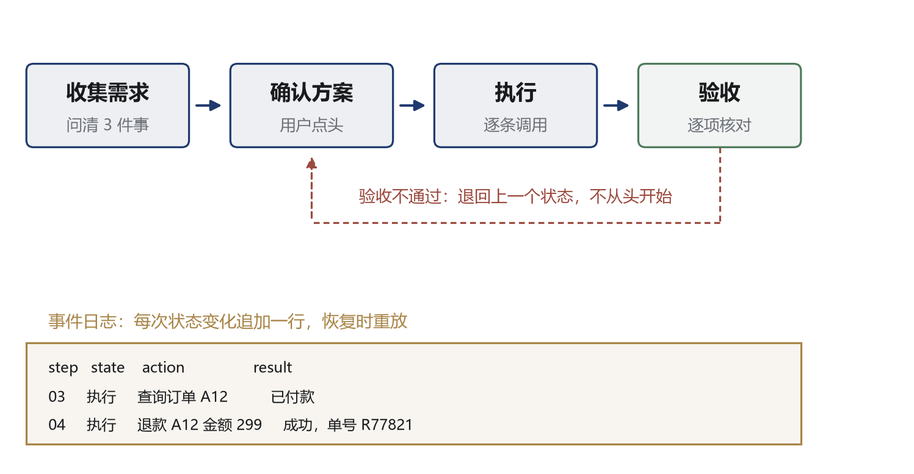

## 记忆与长任务

有个内部工具做"需求到上线"的辅助：用户提一个需求，它帮着查规范、写方案、拆任务、跟进状态。第一周很好用。到第三周，用户问"上次定的那个接口版本为什么选 v3 不选 v2"，它答不上来——那次讨论发生在 12 天前，早就滑出了上下文窗口。

但真正严重的问题不是答不上来，而是它开始**编**：它说"因为 v3 性能更好"，而当时的实际原因是 v2 缺少一个必须的鉴权字段。编得很合理，用户也就信了。

这件事说明两件事：上下文窗口再大，也装不下一个持续三周的項目；而缺记忆时，模型不是沉默，是补一个听起来合理的答案。

### 记忆的四层

把"记住"这件事拆开，有四层，各层的寿命、存放位置、读写时机完全不同。

| 层次 | 内容 | 生命周期 | 存放位置 | 谁写 | 谁读 |
|---|---|---|---|---|---|
| 工作记忆 | 本轮对话原文 | 一次会话 | 上下文 | 对话本身 | 每轮都读 |
| 会话摘要 | 本轮要点与结论 | 一次会话 | 上下文或会话表 | 触发压缩时 | 每轮都读 |
| 长期记忆 | 用户偏好、已确认事实、做过的决定 | 跨会话 | 数据库 | 满足规则时 | 按需检索 |
| 知识记忆 | 文档、规范、政策 | 长期 | 检索库 | 入库流程 | 按需检索 |

四层缺一不可，缺哪一层会出什么症状也很明确。

只有工作记忆：越聊越慢，到第 20 轮开始超长截断，然后突然忘掉开头说的事。

只有摘要没有原文：细节全丢。用户问"当时那个金额是多少"，摘要里只有"讨论了退款金额"，没有具体数字。

只有长期记忆没有检索：等于没记。存了 500 条，每次回答时一条都用不上，因为它不知道该取哪条。

只有知识记忆没有长期记忆：每次都要重新问一遍"你要简短还是详细""你是哪个部门的"。用户会觉得很笨。

### 每层怎么写入、怎么读出

**工作记忆。** 写入是自动的（对话本身就是）。读出也是自动的（每轮全带上）。唯一要设计的是**上限**：保留最近 N 轮（通常 5 到 10 轮）或最近 M 个 token。超过就触发压缩。

**会话摘要。** 触发时机有三种：上下文占到 60% 到 70%、一个子任务结束、用户说"我们换个话题"。写什么有讲究，见下一节。读的时候放在历史之前，让模型先看到"到目前为止的结论"，再看到最近几轮的细节。

**长期记忆。** 写入要过规则，不是所有对话都值得记。四条触发规则：用户明确说"记住"；用户表达了稳定偏好（"以后都这样"）；做出了一个决定（"就按 A 方案做"）；确认了一个事实（"我们的对接方是 B 公司"）。读出一般走检索：把当前问题编码，去记忆库里找最相关的 3 到 5 条。

**知识记忆。** 写入走入库流程（切块、嵌入、建索引），读出走检索。它和长期记忆必须分库，原因有三个：时效性不同（知识要版本管理，记忆不用）、可信度不同（知识是权威文档，记忆是对话产物）、更新方式不同（知识批量重建索引，记忆逐条增删）。

把两者混在一起，会出现"用户随口说的一句话"和"公司正式文件"同权竞争的情况，检索结果会被噪音污染。

### 上下文变大就能不做记忆吗

不能。长上下文解决的是"一次能读多少"，记忆解决的是"该读什么"。

假设窗口足够大到能装下一百万 token，把三周的全部对话都塞进去，会有三个新问题。

**成本按量线性上升。** 每轮都要为这一百万 token 付费，哪怕这次只是问"顺便问一下发票什么时候开"。对话越长越贵，用户用得越久越不划算。

**重要信息被稀释。** 一百万 token 里真正相关的可能只有 2000，模型要在噪音里找，准确率反而下降。这和检索要解决的"上下文成本缺口"是同一件事，只是发生在会话内部。

**冲突无法消解。** 三周里用户改过三次主意，全部原文都在上下文里，模型看到三个互相矛盾的版本，没有时间戳和"已废弃"标记，它只能猜。

所以长上下文改变的是"装得下多少"，不改变"该选择什么"。两者是配合关系：长上下文让工作记忆可以更长，记忆层负责把窗口之外的东西按需递回来。

### 什么时候压缩，压掉什么

压缩对话历史的时机比方法更重要。

**按长度触发。** 上下文占到 60% 到 70% 时，把最早的若干轮浓缩成摘要。简单、可预测，不需要判断语义。60% 这个数留了 30% 到 40% 的余量给后续几轮和输出，避免压完马上又满。

**按事件触发。** 一个子任务结束、用户明确转换话题时，把前一段总结掉。质量更高（因为边界清楚），但需要识别事件。识别方法可以很简单：用户说"好的""下一个""换个问题"，或者工具调用链结束。

**不压缩。** 十轮以内的短会话不需要压缩，压缩反而丢信息。判断标准是"后面的问题是否会用到前面的细节"，短会话基本都是。

压掉什么、留下什么，是压缩质量的关键。一条可用的规则：

- 留：结论、决定、承诺、未解决的问题、关键数字与日期、用户明确的偏好。
- 丢：寒暄、重复确认、过程性的往返（"好的我查一下""稍等"）、已经被推翻的中间方案。

最容易压坏的是数字和条件。把"签收后 45 日内、未拆封可退"压成"45 天内可退"，条件就没了；把"299 元、分两笔退"压成"退款已完成"，金额和笔数就没了。所以摘要提示里要专门写一句"保留所有金额、日期、数量、条件句，原样保留"。

### 算一遍：压缩能省多少

假设一次会话 40 轮，每轮用户 40 字、助手 150 字，中文按 1 字 1.5 token 估。

单轮约 190 字 × 1.5 = 285 token。40 轮约 11400 token。

如果不压缩，第 40 轮请求的输入是 11400 + 系统提示 300 + 本轮 285 ≈ 12000 token。按输入 2 元/百万算，单次 0.024 元。整段会话的累计输入成本大约是这个数的一半乘 40（因为逐轮增长），约 0.48 元。

如果每 10 轮压缩一次：把 10 轮（2850 token）压成 300 token 的摘要，压缩率约 10:1。

第 40 轮时，上下文里有：3 段摘要（900 token）+ 最近 10 轮原文（2850 token）+ 系统提示（300 token）≈ 4050 token，比 12000 少三分之二。

整段会话的累计成本降到约 0.18 元，省 63%。

代价是细节损失。900 token 的摘要装不下 30 轮里的所有细节，某些追问会答不上来。所以工程上常见的做法是"摘要进上下文，原文进外部存储"：需要细节时用检索把相关的几轮原文捞回来。这一步让"压缩"从"有损"变成"可恢复"。

### 长期记忆写什么、怎么取

**写什么。** 只记四类，前面说过，这里给出具体的判定规则，可以直接写成代码里的条件。

- 用户偏好：句子里出现"以后""每次""都"且指向输出形式（长度、语言、格式、称呼）→ 记。
- 已确认事实：用户陈述且系统没有反驳，且该事实在后续可能影响决策（部门、角色、系统名、对接人）→ 记。
- 已做决定：出现"就按""定了""采用"且指向一个方案 → 记，带时间戳。
- 显式要求：出现"记住""别忘了""下次提醒我" → 记。

反过来，不记的东西也要明确：一次性的临时参数（"这次用英文"）、情绪表达、与业务无关的闲聊、用户自己都不确定的信息（"好像是下周三"）。

**怎么取。** 走检索，但有三点和文档检索不同。

一是**必须带时间**。记忆的价值随时间衰减，取回时把时间戳一起给模型（"2026-10-08 用户说偏好简短回答"），让它自己判断是否还适用。

二是**同类只取最近三条**。偏好会变，取回五条互相矛盾的偏好，模型会挑一个，通常挑错。

三是**相关性阈值更高**。记忆库小、噪音大，取回不相关的记忆比不取更糟——模型会硬把不相关的偏好套到当前问题上。宁少勿多，2 到 3 条足够。

### 冲突与遗忘

长期记忆最大的麻烦是冲突：用户上个月要求"回答简洁"，这个月要求"详细一点"。

处理规则要明确，而且要写进代码，不能靠模型判断。

- **后写的覆盖先写的**（同一类信息，保留最新一条，旧的不删但标记 `superseded`）。
- **带时间戳的表达优先**（"从下周开始"这类，按生效时间排序）。
- **冲突无法自动判定时，向用户确认一次**（"您之前希望简短回答，这次需要详细一些吗"）。问一次的成本远低于猜错。

遗忘同样重要，而且不只是产品礼貌。用户说"忘掉我刚才说的手机号"，系统要真的能删——不只是标记隐藏，要从记忆库、日志、缓存里都删掉。很多地区对个人数据有明确的删除要求，这一点在合规检查里几乎必查。

工程上的做法：记忆表里每条记录带 `source_session` 和 `subject_id`，删除请求按这两个字段批量清理，并记录删除日志（删了什么、什么时候、谁要求的）。删除日志本身不含内容，只含 ID 与时间，这样既能审计又不留残余。

### 多用户、多任务怎么隔离

记忆一旦跨会话，就必须处理隔离。隔离做错，轻则串味（A 客户的偏好影响了 B 客户），重则泄露。

三层隔离，缺一不可。

**键的隔离。** 所有记忆记录的键必须至少包含用户 ID；如果系统支持多任务并行，还要加任务或线程 ID。查询时这两个条件是强制的，不能由模型决定。

**库的隔离。** 大客户单独分库或分表，小客户共享并在查询层过滤。这条和向量分片的取舍一样：数据量大的隔离得更物理，小的靠逻辑过滤。

**提示的隔离。** 取回的记忆放进提示时，要标明归属（"该用户在 10 月 8 日说过……"），不要直接以第一人称混进系统提示。混进去之后，模型可能把 A 的偏好当成自己的行为准则，套用到所有对话上。

还有一个容易忽略的点：**任务之间的记忆要不要共享？** 同一个用户的两个并行任务（一个在处理退款，一个在咨询保修），如果把记忆混在一起，退款任务里的急切情绪会影响保修任务的语气。常见做法是：长期偏好（语言、长度、称呼）共享，任务内的临时状态隔离。

### 状态机：长任务的骨架

超过十步的任务，靠模型自己记住进展不可靠。做法是用一个显式的状态机，把"长任务"拆成"若干个短任务"。



以一个"退款处理"任务为例，状态和转换条件写清楚：

| 状态 | 进入条件 | 要做的动作 | 产出 | 失败处理 |
|---|---|---|---|---|
| 收集需求 | 任务开始 | 确认订单号、退款原因、期望金额 | 结构化需求对象 | 缺信息则向用户提问，最多问 2 轮 |
| 确认方案 | 需求齐全 | 校验订单状态与政策，生成方案 | 方案（金额、理由、路径）+ 用户确认 | 校验不通过则退回收集需求 |
| 执行 | 用户确认 | 调用退款接口，记录幂等键 | 退款单号、状态 | 失败重试 2 次，仍失败转人工 |
| 验收 | 执行成功 | 核对金额与状态，通知用户 | 完成记录 | 不一致则退回确认方案 |

这套设计有三个好处：每一步都是可测试的（给定输入，输出确定）；每一步都是可重试的（状态没变，重跑安全）；每一步都是可观测的（当前在哪个状态，一眼可见）。

模型在每个状态里只负责"在当前状态下该做什么"，不需要记住全部历史。这是可靠性的来源，也是成本的来源——每个状态一次调用，而不是一个大循环跑到底。

状态机的边界要选对。状态太少（比如只有"处理中/完成"），等于没有；状态太多（十几步），维护成本高，而且模型在每个状态里的自由度太小，"自主"的意义也没了。4 到 8 个状态是常见区间。


### 一个能照做的记忆方案

把上面这些拼起来，第一版可以是这样的，两三天能落地。

1. **会话表**：一行一个会话，字段是会话 ID、用户 ID、创建时间、当前状态、最近活跃时间。
2. **轮次表**：一行一轮，字段是会话 ID、轮次号、角色、内容、token 数、时间戳。这张表就是工作记忆的持久化形式。
3. **摘要表**：一行一段摘要，字段是会话语 ID、覆盖的轮次区间、摘要文本、生成时间。压缩时追加，不覆盖。
4. **长期记忆表**：字段是用户 ID、类型（偏好/事实/决定）、内容、来源会话、创建时间、是否已废弃。
5. **外部存储 + 检索**：把轮次原文按会话分块建索引，追问细节时用检索捞回来。

读写时机：每轮结束写轮次表；累计到 8 到 10 轮或上下文超过 60% 时生成摘要；满足四条规则时写长期记忆；每次请求组装上下文时，按"系统提示 → 摘要 → 最近轮次 → 检索到的记忆 → 当前问题"的顺序拼。

这套方案的存储成本很低（一个中等规模的内部系统，一年也就几百万行），但它把"记忆"从"模型的隐式能力"变成了"系统的显式数据"，可查、可删、可回滚。


### 崩溃恢复

长任务一定会被打断：进程重启、请求超时、用户关页面、部署发布。

可恢复的关键有两条：每一步的产出都落盘；落盘的内容足以重建上下文。

常见设计是事件日志：每一步追加一条记录，恢复时从日志重放出当前状态。

```json
{
  "task_id": "r-0912",
  "seq": 3,
  "state": "执行",
  "action": "create_refund",
  "args": {
    "order_id": "OD20261105001",
    "amount": 299.0,
    "reason": "质量问题"
  },
  "idempotency_key": "r-0912-3",
  "result": {
    "refund_id": "R77821",
    "status": "processing"
  },
  "ts": "2026-11-20T09:14:22+08:00"
}
```

恢复流程是三步：读日志 → 找最后一条未完成的记录 → 用它重放（因为带幂等键，重放安全）。注意"未完成"的判定：有 `action` 没有 `result` 的那条，说明动作发出去了但结果没回来。这时不能直接重做，要先查一次"这个幂等键的结果是什么"——可能已经成功了，只是响应丢了。

没有这一层，一次崩溃就意味着从头再来。对一个 20 分钟的任务，用户基本不会等第二次。

### 一个失败案例：摘要吃掉了关键约束

某合同助手在会话进行到第 15 轮时，突然建议了一个已经被否掉的方案。

查历史发现：第 6 轮用户明确说"不接受自动续约条款"，第 12 轮压缩时，摘要把这段压成了"讨论过续约条款"。第 15 轮模型看到"讨论过续约条款"，就提出了带自动续约的方案。

问题出在压缩提示上。它写的是"总结以上对话的主要内容"，于是模型挑了"讨论过续约"，丢掉了"不接受"这个否定。

修法是把压缩提示改成结构化的：

```text
请把以上对话压缩成四部分，每部分不超过 60 字：
1. 已确认的事实（数字、日期、名称原样保留）
2. 已做出的决定（含"不接受""排除"这类否定结论）
3. 尚未解决的问题
4. 用户的明确约束（如"不要""必须""只能"）
```

改完之后这类问题基本消失。教训是：**摘要不是概括，是有选择的保留。** 概括会天然丢掉否定和例外，而否定和例外恰恰是约束。

### 一个反直觉的结论

长任务里，模型的能力往往不是瓶颈，记忆的可靠性才是。

同样一个模型，在一个"每步都能拿到正确上下文"的脚手架里，完成率能到 70%；在"靠模型自己记住"的脚手架里，只有 30%（这是经验值，具体数字随任务变化，但差距的方向稳定）。差别不在模型，在系统有没有替它管好状态。

所以做长任务时，顺序应该是：先把状态管理和上下文供给做稳，再看模型够不够强。反过来的顺序很常见——先换最强的模型，发现还是不行，再回头做状态管理，白花了两个月。

### 收束

记忆不是"多存点东西"，是"在正确的时候拿到正确的那几条"。四层记忆各管一段，压缩要保留约束而不只是概括，长期记忆要带时间戳并且能被真删，长任务要有显式状态机和可重放的事件日志。这几件事都不难，但它们决定了同一个模型是能跑完三周的项目，还是连三轮对话都记不住。
